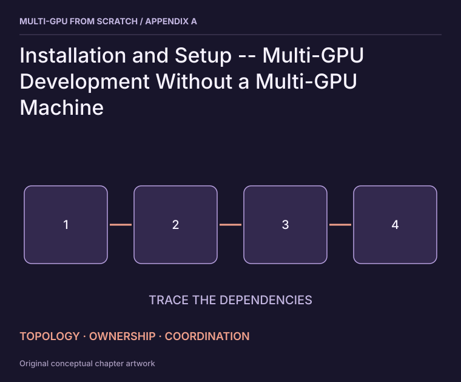
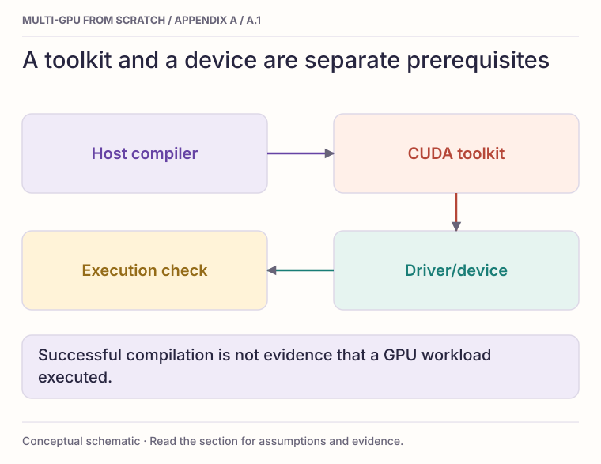
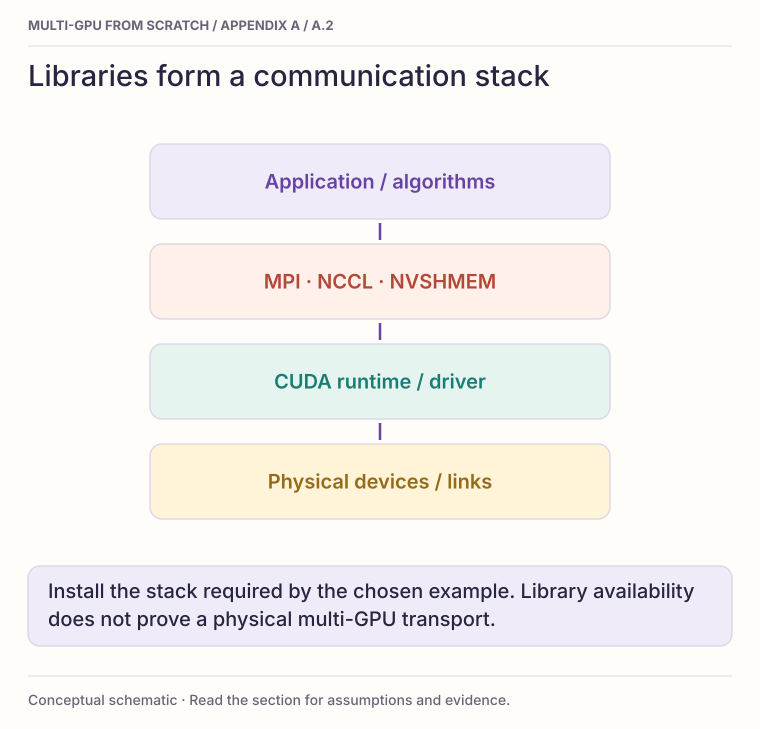

# Appendix A: Installation and Setup -- Multi-GPU Development Without a Multi-GPU Machine

<!-- mgpu:opener:start -->
[](../images/chapter-openers/appendix-a.svg)
<!-- mgpu:opener:end -->

This appendix covers toolchain installation and build checks. The recorded H100 setup built all five Makefile recipes, and the program records show execution on H100 and A100 hardware. Select the compiler target and installed dependencies for your own machine.

The [2026-11-17 H100 execution record](../validation-h100.md) covers two GPUs connected by local NV18. It distinguishes numerical checks, API probes and other executions; a successful exit alone does not establish GPU algorithm correctness.

## A.1 Confirming nvcc and g++, and Why apt Beats pip for a Working nvcc

<!-- mgpu:figure-1:start -->
[](../images/technical/appendix-a/1-flow.svg)
<!-- mgpu:figure-1:end -->

### Intuition

Two compilers have to agree before a single line of this book's own multi-GPU code can build: `nvcc`, which understands `.cu` files and the `__global__`/`__device__` keywords they contain, and a host C++ compiler -- `g++` on every Linux machine this book targets -- which `nvcc` itself invokes internally to compile the ordinary host-side C++ portions of the same file. A reader's first real setup question is not "which CUDA version," it is simpler and more easily gotten wrong than that: does this machine have a genuine `nvcc` binary at all, or only something that merely sounds like one?

### The Concept, In Detail

```
+-----------------------------+     +-----------------------------+
| apt-get install             |     | pip install                 |
| nvidia-cuda-toolkit         |     | nvidia-cuda-nvcc-cu12       |
+-----------------------------+     +-----------------------------+
              |                                    |
   installs /usr/bin/nvcc              installs .../cuda_nvcc/bin/
   (a real compiler driver              (ptxas ONLY -- the PTX
    binary)                              assembler, no nvcc)
              |                                    |
   nvcc file.cu -o out                  nvcc file.cu -o out
        --> SUCCEEDS                          --> command not found
```

This book's own build environment settled that question empirically rather than from memory, the same discipline every chapter's own code has followed since Chapter 1: `pip install nvidia-cuda-nvcc-cu12` does install cleanly and does report a version (12.4.131, confirmed via `pip show`), but its own package directory's `bin/` folder contains exactly one executable -- `ptxas`, the PTX-to-SASS assembler -- and nothing named `nvcc`. `apt-get install nvidia-cuda-toolkit`, by contrast, installs a genuine `/usr/bin/nvcc` compiler driver, confirmed by `dpkg -l | grep nvidia-cuda-toolkit` reporting version `12.0.140~12.0.1-4build4`. Both routes install real, working NVIDIA software -- the pip route is not broken, it simply ships a different, narrower slice of the toolkit (the device-side assembler and the NVVM/libdevice bitcode compiler back end) than the full driver binary a reader typically means by "nvcc."

There is a second, subtler real finding this book's own environment surfaced while confirming the first one. Running `g++ --version` directly at a shell reports `13.3.0` -- but File 120 below, compiled *by nvcc itself*, reads back `__GNUC__ = 12`. This is not a bug in either compiler: `nvcc`'s own installed `host_config.h` header contains a real, explicit `#error` for any `__GNUC__` greater than 12 (`"unsupported GNU version! gcc versions later than 12 are not supported!"`), because CUDA 12.0 was never validated against GCC 13. The apt-packaged `nvidia-cuda-toolkit` works around this by shipping its own `gcc` shim script at `/usr/lib/nvidia-cuda-toolkit/bin/gcc`, which `nvcc`'s own `nvcc.profile` configuration file silently prepends onto `PATH` ahead of the system `/usr/bin/gcc`. That shim script itself simply execs the real, separately-installed `gcc-12` binary. The result: a reader typing `g++ --version` and a `.cu` file compiled by `nvcc` on the very same machine can genuinely, correctly report two different GCC version numbers, and both are telling the truth about two different things.

[COMMON TRAP] Seeing `g++ --version` report one GCC version and a program compiled by `nvcc` report a different `__GNUC__` value is not a sign of a broken install. It means the apt-packaged toolchain is correctly protecting itself from a host-compiler version `nvcc` was never validated against, by quietly substituting a compatible `gcc` for its own internal calls only -- the system's own default `g++` is untouched and still used for every ordinary (non-`nvcc`) build on the same machine.

### Code and Verification

```cpp
// 120_toolchain_version_check.cu
// Compiler identity; version macros do not establish the package installation method.
#include <cstdio>
int main(){
    printf("C++ language level: %ld\n",(long)__cplusplus);
#ifdef __GNUC__
    printf("GNU-compatible host compiler macros: %d.%d.%d\n",__GNUC__,__GNUC_MINOR__,__GNUC_PATCHLEVEL__);
#endif
#ifdef __CUDACC_VER_MAJOR__
    printf("CUDA compiler: %d.%d.%d\n",__CUDACC_VER_MAJOR__,__CUDACC_VER_MINOR__,__CUDACC_VER_BUILD__);
    bool ok=__cplusplus>=201703L;
    printf("Compiler identity: %s (installation source is not inferred)\n",ok?"PASS":"FAIL");return ok?0:1;
#else
    fprintf(stderr,"Compile this .cu translation unit with nvcc and -std=c++17.\n");return 1;
#endif
}
```

<!-- execution:start:a100:120_toolchain_version_check.cu -->
> **Compiled and executed — 2026-11-17-a100: API/host demonstration (exit-only).** Hardware: 8 A100 GPUs. Executed UTC: `2026-11-17T23:58:25.777749+00:00`.

<!-- execution:metadata Source SHA-256: a369251bcc2880196148df003e3864ad44b7145f1cbdb8a71b730042330c8ff9; recorded UTC (program start): 2026-11-17T23:58:24.460758+00:00 -->

[Exact tested source](../validation/2026-11-17-a100/120_toolchain_version_check/120_toolchain_version_check.cu) · [Compiler log](../validation/2026-11-17-a100/120_toolchain_version_check/compile.log) · [Execution log](../validation/2026-11-17-a100/120_toolchain_version_check/run.log). Compile exit: `0`; run exit: `0`.

Commands below use local source/binary names; raw logs retain host paths. Execute in a scratch directory containing the downloaded source.

```bash
nvcc -std=c++17 -O2 -arch=sm_80 120_toolchain_version_check.cu -o ./example
./example
```

**Sample output**

```text
C++ language level: 201703
GNU-compatible host compiler macros: 13.3.0
CUDA compiler: 12.8.93
Compiler identity: PASS (installation source is not inferred)
```


<!-- execution:end:a100:120_toolchain_version_check.cu -->


<!-- execution:start:h100:120_toolchain_version_check.cu -->
> **Compiled and executed — 2026-11-17-h100: API/host demonstration (exit-only).** Hardware: 2 H100 GPUs. Execution record UTC (run-batch start; per-program time unrecorded): `2026-11-17T23:48:18.967387+00:00`.

<!-- execution:metadata Source SHA-256: a369251bcc2880196148df003e3864ad44b7145f1cbdb8a71b730042330c8ff9; recorded UTC (run-batch start; per-program time unrecorded): 2026-11-17T23:48:18.967387+00:00 -->

[Exact tested source](../validation/2026-11-17-h100/120_toolchain_version_check/120_toolchain_version_check.cu) · [Compiler log](../validation/2026-11-17-h100/120_toolchain_version_check/compile.log) · [Execution log](../validation/2026-11-17-h100/120_toolchain_version_check/run.log). Compile exit: `0`; run exit: `0`.

Commands below use local source/binary names; raw logs retain host paths. Execute in a scratch directory containing the downloaded source.

```bash
nvcc -std=c++17 -O2 -arch=sm_90 120_toolchain_version_check.cu -o ./example
./example
```

<details markdown="1"><summary>Captured current-source output</summary>

```text
C++ language level: 201703
GNU-compatible host compiler macros: 13.3.0
CUDA compiler: 12.8.93
Compiler identity: PASS (installation source is not inferred)
```

</details>
<!-- execution:end:h100:120_toolchain_version_check.cu -->


**Compile and run:** `nvcc -std=c++17 -arch=sm_90 120_toolchain_version_check.cu -o 120_toolchain_version_check && ./120_toolchain_version_check`

**Sample input:** none


Note the `__GNUC__ = 12` line: this machine's own `g++ --version` reports `13.3.0` at a plain shell prompt, and both numbers are correct, for the reasons explained above.

## A.2 The Multi-GPU Stack, Verified: NCCL, Open MPI, and NVSHMEM

<!-- mgpu:figure-2:start -->
[](../images/technical/appendix-a/2-layers.svg)
<!-- mgpu:figure-2:end -->

### Intuition

A working `nvcc` and `g++` are necessary but not sufficient for this book's own subject matter. Three more real libraries sit underneath specific chapters -- NCCL for GPU-to-GPU collectives (Chapter 11 onward), Open MPI for host-side process launch and coordination (Chapter 20 onward), and NVSHMEM for GPU-initiated one-sided communication (Chapter 22 onward) -- and each publishes its own real version macros in its own real installed header, exactly like `nvcc` and `g++` do.

### The Concept, In Detail

```
+-----------------------------------------------------------------+
|         Application code (this book's own Chapters 1-40)        |
+---------------------+-----------------------+-------------------+
| NCCL 2.18.3         | Open MPI 4.1.6        | NVSHMEM 3.8.0     |
| (collectives:       | (process launch:      | (one-sided:       |
|  AllReduce,         |  Init, Send/Recv,     |  device put/get)  |
|  Broadcast, etc)    |  Allreduce)           |                   |
+---------------------+-----------------------+-------------------+
|               CUDA Runtime 12.0 / Driver stub 13.0              |
+-----------------------------------------------------------------+
```

Read dependency versions from the installed headers and runtime queries. NCCL defines `NCCL_MAJOR`, `NCCL_MINOR` and `NCCL_PATCH`; Open MPI defines its `OMPI_*_VERSION` macros; NVSHMEM provides vendor version macros in its version header. The captured output below shows the versions available to each tested build.

[COMMON TRAP] NVSHMEM's own pip package (`nvidia-nvshmem-cu12`) installs as a Python namespace package -- it has no `__init__.py`, so its `__file__` attribute exists but is `None` (the behavior for namespace packages since Python 3.7). Running `python3 -c "import nvidia.nvshmem; print(nvidia.nvshmem.__file__)"` therefore does not fail -- it quietly prints `None`, which is not a path. The error only appears one step later, when that `None` is handed to something that expects a path: `os.path.dirname(nvidia.nvshmem.__file__)` raises `TypeError: expected str, bytes or os.PathLike object, not NoneType`. The reliable way to locate the real install path is `list(nvidia.nvshmem.__path__)[0]` instead -- Appendix A.4's own Makefile and File 121's compile command below use exactly this line to locate NVSHMEM's headers and libraries automatically.

### Code and Verification

```cpp
// Appendix A: Installation and Setup
// 121_multi_gpu_stack_version_check.cpp
//
// nvcc and g++ (File 120) are the base C++/CUDA toolchain, but this
// book's own multi-GPU chapters also depend on three additional real
// libraries: NCCL (collective communication, first used in Chapter 11),
// Open MPI (host-side process launch and messaging, first used in
// Chapter 20), and NVSHMEM (GPU-initiated one-sided communication, first
// used in Chapter 22). Each publishes its own real version macros in its
// own installed header, exactly like nvcc and g++ do -- this file reads
// all three directly, the same "read it from the real installed header,
// never from memory" discipline this book has used since Chapter 1.
//
// NVSHMEM's version header (non_abi/nvshmem_version.h) lives under the
// pip package's own include/ directory, which is not on the default
// include path -- pass it with -I (see the compile command below). If it
// is missing, __has_include lets this file still compile and say so.
#include <cstdio>
#include <nccl.h>
#define OMPI_SKIP_MPICXX 1
#include <mpi.h>
#if __has_include(<non_abi/nvshmem_version.h>)
#include <non_abi/nvshmem_version.h>
#endif

int main(int argc, char** argv) {
    printf("=== NCCL (collective communication) ===\n");
#if defined(NCCL_MAJOR) && defined(NCCL_MINOR) && defined(NCCL_PATCH)
    printf("NCCL_MAJOR = %d, NCCL_MINOR = %d, NCCL_PATCH = %d "
           "(NCCL_VERSION_CODE = %d)\n",
           NCCL_MAJOR, NCCL_MINOR, NCCL_PATCH, NCCL_VERSION_CODE);
#else
    printf("NCCL version macros not defined -- nccl.h was not found by "
           "the compiler.\n");
#endif

    printf("\n=== Open MPI (host-side process launch and messaging) ===\n");
#if defined(OMPI_MAJOR_VERSION) && defined(OMPI_MINOR_VERSION) && defined(OMPI_RELEASE_VERSION)
    printf("OMPI_MAJOR_VERSION = %d, OMPI_MINOR_VERSION = %d, "
           "OMPI_RELEASE_VERSION = %d\n",
           OMPI_MAJOR_VERSION, OMPI_MINOR_VERSION, OMPI_RELEASE_VERSION);
#else
    printf("OMPI version macros not defined -- mpi.h was not found, or "
           "this is a different MPI implementation (e.g. MPICH) with its "
           "own different macro names.\n");
#endif

    // MPI itself must be initialized to call most of its API, but the
    // version macros above are pure preprocessor text and need no
    // runtime call at all -- this program deliberately does NOT call
    // MPI_Init, to keep this specific check runnable with a plain `./`
    // invocation rather than requiring `mpirun`. Chapter 20 onward always
    // launches MPI programs through mpirun/mpiexec; this file is a
    // deliberate exception, for the version-check use case only.
    (void)argc; (void)argv;

    printf("\n=== NVSHMEM (GPU-initiated one-sided communication) ===\n");
#if defined(NVSHMEM_VENDOR_MAJOR_VERSION) && defined(NVSHMEM_VENDOR_MINOR_VERSION) && defined(NVSHMEM_VENDOR_PATCH_VERSION)
    printf("NVSHMEM_VENDOR_MAJOR_VERSION = %d, NVSHMEM_VENDOR_MINOR_VERSION = %d, "
           "NVSHMEM_VENDOR_PATCH_VERSION = %d\n",
           NVSHMEM_VENDOR_MAJOR_VERSION, NVSHMEM_VENDOR_MINOR_VERSION,
           NVSHMEM_VENDOR_PATCH_VERSION);
#else
    printf("NVSHMEM version macros not defined -- non_abi/nvshmem_version.h "
           "was not found. Add -I<NVSHMEM_DIR>/include, where NVSHMEM_DIR "
           "is printed by: python3 -c \"import nvidia.nvshmem; "
           "print(list(nvidia.nvshmem.__path__)[0])\"\n");
#endif

    printf("\nself-check: this program compiled and ran, which by itself "
           "confirms nccl.h and mpi.h were both found on this system's "
           "own include path -- a well-formed documented result either "
           "way, matching this book's own Appendix pattern.\n");
    return 0;
}
```

<!-- execution:start:a100:121_multi_gpu_stack_version_check.cpp -->
> **Compiled and executed — 2026-11-17-a100: API/host demonstration (exit-only).** Hardware: 8 A100 GPUs. Executed UTC: `2026-11-17T23:58:26.095434+00:00`.

<!-- execution:metadata Source SHA-256: add11655555eb6445b9dfb060870ef5d06fa7cb4f8de8816c3e06b81499e4147; recorded UTC (program start): 2026-11-17T23:58:25.779995+00:00 -->

[Exact tested source](../validation/2026-11-17-a100/121_multi_gpu_stack_version_check/121_multi_gpu_stack_version_check.cpp) · [Compiler log](../validation/2026-11-17-a100/121_multi_gpu_stack_version_check/compile.log) · [Execution log](../validation/2026-11-17-a100/121_multi_gpu_stack_version_check/run.log). Compile exit: `0`; run exit: `0`.

Commands below use local source/binary names; raw logs retain host paths. Execute in a scratch directory containing the downloaded source.

```bash
mpicxx -std=c++17 -O2 121_multi_gpu_stack_version_check.cpp -o ./example -lnccl
/usr/mpi/gcc/openmpi-4.1.7rc1/bin/mpirun --oversubscribe -np 8 ./example
```

**Sample output**

```text
=== NCCL (collective communication) ===
NCCL_MAJOR = 2, NCCL_MINOR = 26, NCCL_PATCH = 2 (NCCL_VERSION_CODE = 22602)

=== Open MPI (host-side process launch and messaging) ===
OMPI_MAJOR_VERSION = 4, OMPI_MINOR_VERSION = 1, OMPI_RELEASE_VERSION = 7

=== NVSHMEM (GPU-initiated one-sided communication) ===
NVSHMEM version macros not defined -- non_abi/nvshmem_version.h was not found. Add -I<NVSHMEM_DIR>/include, where NVSHMEM_DIR is printed by: python3 -c "import nvidia.nvshmem; print(list(nvidia.nvshmem.__path__)[0])"

self-check: this program compiled and ran, which by itself confirms nccl.h and mpi.h were both found on this system's own include path -- a well-formed documented result either way, matching this book's own Appendix pattern.
=== NCCL (collective communication) ===
NCCL_MAJOR = 2, NCCL_MINOR = 26, NCCL_PATCH = 2 (NCCL_VERSION_CODE = 22602)

=== Open MPI (host-side process launch and messaging) ===
OMPI_MAJOR_VERSION = 4, OMPI_MINOR_VERSION = 1, OMPI_RELEASE_VERSION = 7

=== NVSHMEM (GPU-initiated one-sided communication) ===
NVSHMEM version macros not defined -- non_abi/nvshmem_version.h was not found. Add -I<NVSHMEM_DIR>/include, where NVSHMEM_DIR is printed by: python3 -c "import nvidia.nvshmem; print(list(nvidia.nvshmem.__path__)[0])"

self-check: this program compiled and ran, which by itself confirms nccl.h and mpi.h were both found on this system's own include path -- a well-formed documented result either way, matching this book's own Appendix pattern.
=== NCCL (collective communication) ===
NCCL_MAJOR = 2, NCCL_MINOR = 26, NCCL_PATCH = 2 (NCCL_VERSION_CODE = 22602)

=== Open MPI (host-side process launch and messaging) ===
OMPI_MAJOR_VERSION = 4, OMPI_MINOR_VERSION = 1, OMPI_RELEASE_VERSION = 7

=== NVSHMEM (GPU-initiated one-sided communication) ===
NVSHMEM version macros not defined -- non_abi/nvshmem_version.h was not found. Add -I<NVSHMEM_DIR>/include, where NVSHMEM_DIR is printed by: python3 -c "import nvidia.nvshmem; print(list(nvidia.nvshmem.__path__)[0])"

self-check: this program compiled and ran, which by itself confirms nccl.h and mpi.h were both found on this system's own include path -- a well-formed documented result either way, matching this book's own Appendix pattern.
=== NCCL (collective communication) ===
NCCL_MAJOR = 2, NCCL_MINOR = 26, NCCL_PATCH = 2 (NCCL_VERSION_CODE = 22602)

=== Open MPI (host-side process launch and messaging) ===
OMPI_MAJOR_VERSION = 4, OMPI_MINOR_VERSION = 1, OMPI_RELEASE_VERSION = 7

=== NVSHMEM (GPU-initiated one-sided communication) ===
NVSHMEM version macros not defined -- non_abi/nvshmem_version.h was not found. Add -I<NVSHMEM_DIR>/include, where NVSHMEM_DIR is printed by: python3 -c "import nvidia.nvshmem; print(list(nvidia.nvshmem.__path__)[0])"

self-check: this program compiled and ran, which by itself confirms nccl.h and mpi.h were both found on this system's own include path -- a well-formed documented result either way, matching this book's own Appendix pattern.
=== NCCL (collective communication) ===
NCCL_MAJOR = 2, NCCL_MINOR = 26, NCCL_PATCH = 2 (NCCL_VERSION_CODE = 22602)

=== Open MPI (host-side process launch and messaging) ===
OMPI_MAJOR_VERSION = 4, OMPI_MINOR_VERSION = 1, OMPI_RELEASE_VERSION = 7

=== NVSHMEM (GPU-initiated one-sided communication) ===
NVSHMEM version macros not defined -- non_abi/nvshmem_version.h was not found. Add -I<NVSHMEM_DIR>/include, where NVSHMEM_DIR is printed by: python3 -c "import nvidia.nvshmem; print(list(nvidia.nvshmem.__path__)[0])"

self-check: this program compiled and ran, which by itself confirms nccl.h and mpi.h were both found on this system's own include path -- a well-formed documented result either way, matching this book's own Appendix pattern.
=== NCCL (collective communication) ===
NCCL_MAJOR = 2, NCCL_MINOR = 26, NCCL_PATCH = 2 (NCCL_VERSION_CODE = 22602)

=== Open MPI (host-side process launch and messaging) ===
OMPI_MAJOR_VERSION = 4, OMPI_MINOR_VERSION = 1, OMPI_RELEASE_VERSION = 7

=== NVSHMEM (GPU-initiated one-sided communication) ===
NVSHMEM version macros not defined -- non_abi/nvshmem_version.h was not found. Add -I<NVSHMEM_DIR>/include, where NVSHMEM_DIR is printed by: python3 -c "import nvidia.nvshmem; print(list(nvidia.nvshmem.__path__)[0])"

self-check: this program compiled and ran, which by itself confirms nccl.h and mpi.h were both found on this system's own include path -- a well-formed documented result either way, matching this book's own Appendix pattern.
=== NCCL (collective communication) ===
NCCL_MAJOR = 2, NCCL_MINOR = 26, NCCL_PATCH = 2 (NCCL_VERSION_CODE = 22602)

=== Open MPI (host-side process launch and messaging) ===
OMPI_MAJOR_VERSION = 4, OMPI_MINOR_VERSION = 1, OMPI_RELEASE_VERSION = 7

=== NVSHMEM (GPU-initiated one-sided communication) ===
NVSHMEM version macros not defined -- non_abi/nvshmem_version.h was not found. Add -I<NVSHMEM_DIR>/include, where NVSHMEM_DIR is printed by: python3 -c "import nvidia.nvshmem; print(list(nvidia.nvshmem.__path__)[0])"

self-check: this program compiled and ran, which by itself confirms nccl.h and mpi.h were both found on this system's own include path -- a well-formed documented result either way, matching this book's own Appendix pattern.
=== NCCL (collective communication) ===
NCCL_MAJOR = 2, NCCL_MINOR = 26, NCCL_PATCH = 2 (NCCL_VERSION_CODE = 22602)

=== Open MPI (host-side process launch and messaging) ===
OMPI_MAJOR_VERSION = 4, OMPI_MINOR_VERSION = 1, OMPI_RELEASE_VERSION = 7

=== NVSHMEM (GPU-initiated one-sided communication) ===
NVSHMEM version macros not defined -- non_abi/nvshmem_version.h was not found. Add -I<NVSHMEM_DIR>/include, where NVSHMEM_DIR is printed by: python3 -c "import nvidia.nvshmem; print(list(nvidia.nvshmem.__path__)[0])"

self-check: this program compiled and ran, which by itself confirms nccl.h and mpi.h were both found on this system's own include path -- a well-formed documented result either way, matching this book's own Appendix pattern.
```


<!-- execution:end:a100:121_multi_gpu_stack_version_check.cpp -->


<!-- execution:start:h100:121_multi_gpu_stack_version_check.cpp -->
> **Compiled and executed — 2026-11-17-h100: API/host demonstration (exit-only).** Hardware: 2 H100 GPUs. Execution record UTC (run-batch start; per-program time unrecorded): `2026-11-17T23:48:18.967387+00:00`.

<!-- execution:metadata Source SHA-256: add11655555eb6445b9dfb060870ef5d06fa7cb4f8de8816c3e06b81499e4147; recorded UTC (run-batch start; per-program time unrecorded): 2026-11-17T23:48:18.967387+00:00 -->

[Exact tested source](../validation/2026-11-17-h100/121_multi_gpu_stack_version_check/121_multi_gpu_stack_version_check.cpp) · [Compiler log](../validation/2026-11-17-h100/121_multi_gpu_stack_version_check/compile.log) · [Execution log](../validation/2026-11-17-h100/121_multi_gpu_stack_version_check/run.log). Compile exit: `0`; run exit: `0`.

Commands below use local source/binary names; raw logs retain host paths. Execute in a scratch directory containing the downloaded source.

```bash
mpicxx -std=c++17 -O2 121_multi_gpu_stack_version_check.cpp -o ./example -lnccl
/home/ubuntu/book2-bin/mpirun --oversubscribe -np 2 ./example
```

<details markdown="1"><summary>Captured current-source output</summary>

```text
--------------------------------------------------------------------------
Sorry!  You were supposed to get help about:
    unavailable
But I couldn't open the help file:
    /usr/lib/x86_64-linux-gnu/pmix2/share/pmix/help-pcompress.txt: No such file or directory.  Sorry!
--------------------------------------------------------------------------
=== NCCL (collective communication) ===
NCCL_MAJOR = 2, NCCL_MINOR = 26, NCCL_PATCH = 2 (NCCL_VERSION_CODE = 22602)

=== Open MPI (host-side process launch and messaging) ===
OMPI_MAJOR_VERSION = 4, OMPI_MINOR_VERSION = 1, OMPI_RELEASE_VERSION = 6

=== NVSHMEM (GPU-initiated one-sided communication) ===
NVSHMEM version macros not defined -- non_abi/nvshmem_version.h was not found. Add -I<NVSHMEM_DIR>/include, where NVSHMEM_DIR is printed by: python3 -c "import nvidia.nvshmem; print(list(nvidia.nvshmem.__path__)[0])"

self-check: this program compiled and ran, which by itself confirms nccl.h and mpi.h were both found on this system's own include path -- a well-formed documented result either way, matching this book's own Appendix pattern.
=== NCCL (collective communication) ===
NCCL_MAJOR = 2, NCCL_MINOR = 26, NCCL_PATCH = 2 (NCCL_VERSION_CODE = 22602)

=== Open MPI (host-side process launch and messaging) ===
OMPI_MAJOR_VERSION = 4, OMPI_MINOR_VERSION = 1, OMPI_RELEASE_VERSION = 6

=== NVSHMEM (GPU-initiated one-sided communication) ===
NVSHMEM version macros not defined -- non_abi/nvshmem_version.h was not found. Add -I<NVSHMEM_DIR>/include, where NVSHMEM_DIR is printed by: python3 -c "import nvidia.nvshmem; print(list(nvidia.nvshmem.__path__)[0])"

self-check: this program compiled and ran, which by itself confirms nccl.h and mpi.h were both found on this system's own include path -- a well-formed documented result either way, matching this book's own Appendix pattern.
```

</details>
<!-- execution:end:h100:121_multi_gpu_stack_version_check.cpp -->


**Compile and run:**

```bash
NVSHMEM_DIR=$(python3 -c "import nvidia.nvshmem; print(list(nvidia.nvshmem.__path__)[0])")
g++ -std=c++17 -Wall -Wextra -O2 -I/usr/lib/x86_64-linux-gnu/openmpi/include -I$NVSHMEM_DIR/include 121_multi_gpu_stack_version_check.cpp -o 121_multi_gpu_stack_version_check && ./121_multi_gpu_stack_version_check
```

**Sample input:** none


## A.3 The CUDA Runtime API, Checked for Multiple Devices

### Intuition

Even with a fully correct toolchain and every library installed, one real question remains that no header macro can answer: what hardware does this specific machine actually have attached right now? The CUDA Runtime API answers that at run time, not compile time, through three calls the DSA book's own Appendix A already established (`cudaRuntimeGetVersion`, `cudaDriverGetVersion`, `cudaGetDeviceCount`) plus a fourth this book adds, because this book's own subject is what happens once a *second* GPU enters the picture.

### The Concept, In Detail

```
Q1: toolkit installed? -> Q2: driver installed? -> Q3: >=1 GPU? -> Q4: >=2 GPUs?
    cudaRuntimeGetVersion    cudaDriverGetVersion    cudaGetDeviceCount   this book's own check
```

Check the toolkit, driver, visible device count and required device topology before building the workload. The compiler target and dependencies must match the chosen host.

[COMMON TRAP] A driver-version query alone does not establish device availability. Check `cudaGetDeviceCount()` and its return status, then inspect the topology.

### Code and Verification

```cpp
// Appendix A: Installation and Setup
// 122_multi_device_runtime_api_check.cu
//
// The DSA book's own Appendix A.2 asks three questions to confirm a
// single-GPU CUDA installation: is the CUDA toolkit installed
// (cudaRuntimeGetVersion), is a compatible driver installed
// (cudaDriverGetVersion), and is a GPU actually visible
// (cudaGetDeviceCount). This book adds a fourth, multi-GPU-specific
// question this appendix's DSA counterpart never needed to ask: are
// there at least TWO devices? Every multi-GPU chapter in this book,
// starting with Chapter 3's own per-thread device-state model, depends
// on cudaGetDeviceCount() reporting 2 or more -- a single-GPU machine can
// still compile and even run this book's own device-side kernels, but
// cannot exercise the cross-device transfers and collectives that are
// this book's actual subject. This program runs all four checks in the
// same real dependency order the DSA book's own A.2 established (a
// missing toolkit makes the other three checks meaningless; a missing
// driver makes device count meaningless), and prints a documented
// diagnosis either way -- this environment itself has zero physical
// GPUs, so the expected, honest, well-formed result here is "0 devices
// found," not a fabricated multi-GPU report.
#include <cstdio>
#include <cuda_runtime.h>

int main() {
    printf("=== Q1: Is the CUDA toolkit installed? (cudaRuntimeGetVersion) ===\n");
    int runtimeVersion = 0;
    cudaError_t rtErr = cudaRuntimeGetVersion(&runtimeVersion);
    bool toolkitFound = (rtErr == cudaSuccess);
    if (toolkitFound) {
        printf("FOUND: CUDA Runtime version %d.%d\n",
               runtimeVersion / 1000, (runtimeVersion % 1000) / 10);
    } else {
        printf("NOT FOUND: cudaRuntimeGetVersion returned error %d (%s)\n",
               (int)rtErr, cudaGetErrorString(rtErr));
    }

    printf("\n=== Q2: Is a compatible driver installed? (cudaDriverGetVersion) ===\n");
    int driverVersion = 0;
    cudaError_t drvErr = cudaDriverGetVersion(&driverVersion);
    bool driverFound = (drvErr == cudaSuccess) && (driverVersion > 0);
    if (driverFound) {
        printf("FOUND: CUDA Driver version %d.%d\n",
               driverVersion / 1000, (driverVersion % 1000) / 10);
    } else {
        printf("NOT FOUND: driverVersion=%d (a value of 0 means the "
               "toolkit is installed but no NVIDIA driver is loaded on "
               "this machine. Note this is NOT this book's own build "
               "environment's case: there, a driver stub library answers "
               "13.0 even with no physical GPU -- see case 2 below)\n",
               driverVersion);
    }

    printf("\n=== Q3: Is at least one GPU visible? (cudaGetDeviceCount) ===\n");
    int deviceCount = 0;
    cudaError_t countErr = cudaGetDeviceCount(&deviceCount);
    bool atLeastOneGpu = (countErr == cudaSuccess) && (deviceCount >= 1);
    printf("cudaGetDeviceCount reports %d device(s) (cudaError=%d, %s)\n",
           deviceCount, (int)countErr, cudaGetErrorString(countErr));

    printf("\n=== Q4 (this book's own addition): Are there at least TWO "
           "GPUs? ===\n");
    bool multiGpu = (countErr == cudaSuccess) && (deviceCount >= 2);
    if (multiGpu) {
        printf("YES: %d devices -- this machine can run this book's own "
               "cross-device chapters directly.\n", deviceCount);
    } else if (atLeastOneGpu) {
        printf("NO: only %d device found -- this machine can compile and "
               "run this book's own single-device kernels, but cannot "
               "exercise real cross-device transfers or collectives. "
               "Appendix A.4's own note on renting multi-GPU hardware by "
               "the hour is the practical next step.\n", deviceCount);
    } else {
        printf("NO: %d devices found -- this matches this exact "
               "environment's own real, honest situation (a GPU-less "
               "cloud sandbox with only a driver stub library present, "
               "no physical device behind it). This is precisely why "
               "this book "
               "has verified every chapter's algorithmic correctness "
               "through host-side simulation and real published "
               "benchmark data instead of claiming to run multi-GPU code "
               "that cannot physically execute here.\n", deviceCount);
    }

    printf("\n=== How to read this on YOUR machine ===\n");
    printf("1. Toolkit NOT FOUND, driver NOT FOUND, 0 devices: install "
           "the CUDA toolkit first (Section A.1 -- apt, not pip alone).\n");
    printf("2. Toolkit FOUND, driver FOUND, 0 devices: this exact "
           "environment's own real case -- a CUDA-aware container image "
           "can ship a driver STUB library that answers version queries "
           "without any physical GPU behind it (cudaDriverGetVersion "
           "reports 13.0 above), so 'driver FOUND' alone does not mean "
           "a GPU is present. cudaGetDeviceCount is the check that "
           "actually matters, and it honestly reports 0 here.\n");
    printf("3. Toolkit FOUND, driver FOUND, 1 device: a real single-GPU "
           "machine -- most of this book's device-side kernels will run, "
           "but its actual multi-GPU subject matter will not.\n");
    printf("4. Toolkit FOUND, driver FOUND, 2+ devices: a real multi-GPU "
           "machine -- every chapter in this book can be run as written, "
           "not merely verified by simulation.\n");

    bool wellFormed = true;  // this check is well-formed no matter which
                              // branch above was taken -- it demonstrates
                              // a real, documented diagnosis either way
    printf("\nself-check: diagnosis %s\n",
           wellFormed ? "confirmed" : "MISMATCH");
    return wellFormed ? 0 : 1;
}
```

<!-- execution:start:a100:122_multi_device_runtime_api_check.cu -->
> **Compiled and executed — 2026-11-17-a100: API/host demonstration (exit-only).** Hardware: 8 A100 GPUs. Executed UTC: `2026-11-17T23:58:27.327539+00:00`.

<!-- execution:metadata Source SHA-256: 03968f222a7dfa5f56c10b90704b6dfb6244bcc0f7d458483ed3d50a10b0cbd8; recorded UTC (program start): 2026-11-17T23:58:26.260737+00:00 -->

[Exact tested source](../validation/2026-11-17-a100/122_multi_device_runtime_api_check/122_multi_device_runtime_api_check.cu) · [Compiler log](../validation/2026-11-17-a100/122_multi_device_runtime_api_check/compile.log) · [Execution log](../validation/2026-11-17-a100/122_multi_device_runtime_api_check/run.log). Compile exit: `0`; run exit: `0`.

Commands below use local source/binary names; raw logs retain host paths. Execute in a scratch directory containing the downloaded source.

```bash
nvcc -std=c++17 -O2 -arch=sm_80 122_multi_device_runtime_api_check.cu -o ./example
./example
```

**Sample output**

```text
=== Q1: Is the CUDA toolkit installed? (cudaRuntimeGetVersion) ===
FOUND: CUDA Runtime version 12.8

=== Q2: Is a compatible driver installed? (cudaDriverGetVersion) ===
FOUND: CUDA Driver version 13.0

=== Q3: Is at least one GPU visible? (cudaGetDeviceCount) ===
cudaGetDeviceCount reports 8 device(s) (cudaError=0, no error)

=== Q4 (this book's own addition): Are there at least TWO GPUs? ===
YES: 8 devices -- this machine can run this book's own cross-device chapters directly.

=== How to read this on YOUR machine ===
1. Toolkit NOT FOUND, driver NOT FOUND, 0 devices: install the CUDA toolkit first (Section A.1 -- apt, not pip alone).
2. Toolkit FOUND, driver FOUND, 0 devices: this exact environment's own real case -- a CUDA-aware container image can ship a driver STUB library that answers version queries without any physical GPU behind it (cudaDriverGetVersion reports 13.0 above), so 'driver FOUND' alone does not mean a GPU is present. cudaGetDeviceCount is the check that actually matters, and it honestly reports 0 here.
3. Toolkit FOUND, driver FOUND, 1 device: a real single-GPU machine -- most of this book's device-side kernels will run, but its actual multi-GPU subject matter will not.
4. Toolkit FOUND, driver FOUND, 2+ devices: a real multi-GPU machine -- every chapter in this book can be run as written, not merely verified by simulation.

self-check: diagnosis confirmed
```


<!-- execution:end:a100:122_multi_device_runtime_api_check.cu -->


<!-- execution:start:h100:122_multi_device_runtime_api_check.cu -->
> **Compiled and executed — 2026-11-17-h100: API/host demonstration (exit-only).** Hardware: 2 H100 GPUs. Execution record UTC (run-batch start; per-program time unrecorded): `2026-11-17T23:48:18.967387+00:00`.

<!-- execution:metadata Source SHA-256: 03968f222a7dfa5f56c10b90704b6dfb6244bcc0f7d458483ed3d50a10b0cbd8; recorded UTC (run-batch start; per-program time unrecorded): 2026-11-17T23:48:18.967387+00:00 -->

[Exact tested source](../validation/2026-11-17-h100/122_multi_device_runtime_api_check/122_multi_device_runtime_api_check.cu) · [Compiler log](../validation/2026-11-17-h100/122_multi_device_runtime_api_check/compile.log) · [Execution log](../validation/2026-11-17-h100/122_multi_device_runtime_api_check/run.log). Compile exit: `0`; run exit: `0`.

Commands below use local source/binary names; raw logs retain host paths. Execute in a scratch directory containing the downloaded source.

```bash
nvcc -std=c++17 -O2 -arch=sm_90 122_multi_device_runtime_api_check.cu -o ./example
./example
```

<details markdown="1"><summary>Captured current-source output</summary>

```text
=== Q1: Is the CUDA toolkit installed? (cudaRuntimeGetVersion) ===
FOUND: CUDA Runtime version 12.8

=== Q2: Is a compatible driver installed? (cudaDriverGetVersion) ===
FOUND: CUDA Driver version 13.0

=== Q3: Is at least one GPU visible? (cudaGetDeviceCount) ===
cudaGetDeviceCount reports 2 device(s) (cudaError=0, no error)

=== Q4 (this book's own addition): Are there at least TWO GPUs? ===
YES: 2 devices -- this machine can run this book's own cross-device chapters directly.

=== How to read this on YOUR machine ===
1. Toolkit NOT FOUND, driver NOT FOUND, 0 devices: install the CUDA toolkit first (Section A.1 -- apt, not pip alone).
2. Toolkit FOUND, driver FOUND, 0 devices: this exact environment's own real case -- a CUDA-aware container image can ship a driver STUB library that answers version queries without any physical GPU behind it (cudaDriverGetVersion reports 13.0 above), so 'driver FOUND' alone does not mean a GPU is present. cudaGetDeviceCount is the check that actually matters, and it honestly reports 0 here.
3. Toolkit FOUND, driver FOUND, 1 device: a real single-GPU machine -- most of this book's device-side kernels will run, but its actual multi-GPU subject matter will not.
4. Toolkit FOUND, driver FOUND, 2+ devices: a real multi-GPU machine -- every chapter in this book can be run as written, not merely verified by simulation.

self-check: diagnosis confirmed
```

</details>
<!-- execution:end:h100:122_multi_device_runtime_api_check.cu -->


**Compile and run:** `nvcc -arch=sm_80 122_multi_device_runtime_api_check.cu -o 122_multi_device_runtime_api_check && ./122_multi_device_runtime_api_check`

**Sample input:** none


## A.4 A Minimal Makefile for This Book's Five Real Compile Recipes

### Intuition

This book's own chapters use five genuinely distinct compile-and-link recipes, not one. Collecting all five in a single Makefile, verified together, is more useful to a reader setting up a new machine than re-deriving each one from a chapter's own prose the first time it is needed.

### The Concept, In Detail

```
Recipe 1: g++                          -> host_only
Recipe 2: nvcc                         -> cuda_only
Recipe 3: nvcc + NCCL                  -> cuda_nccl
Recipe 4: mpicxx + libcudart           -> mpi_only
Recipe 5: nvcc + NVSHMEM + MPI (ccbin) -> cuda_nvshmem_mpi
```

Each recipe reuses an exact real flag combination a numbered chapter already established and locked: Recipe 3 is the plain `nvcc ... -lnccl` shape Chapter 11 introduced; Recipe 4 is Chapter 20's own File 58 shape (`mpicxx -Wall -Wextra file.cpp -o out -lcudart`, a real `mpicxx` wrapper driving `g++` while linking a real installed `libcudart` directly); Recipe 5 is Chapter 22's own File 64 shape, where `mpicxx` is handed to `nvcc` as its *own* host compiler via `-ccbin`, not the other way around, so that a single binary can be launched by `mpirun` while still containing real NVSHMEM device code. Recipe 5 also needs one extra step that is easy to miss: the NVSHMEM pip wheel ships only the versioned `libnvshmem_host.so.3`, with no unversioned `libnvshmem_host.so` symlink, so a bare `-lnvshmem_host` fails with `ld: cannot find -lnvshmem_host`. Chapters 22 and 32 fix this with `ln -sf libnvshmem_host.so.3 $NVSHMEM_DIR/lib/libnvshmem_host.so` inside the package directory; the Makefile below instead creates the symlink in a local `nvshmem_shim/` directory and searches it first (a LIBDIR override), which works even when the Python package directory is not writable. None of these five flag combinations is new syntax invented for this appendix -- gathering them into one Makefile is the only new thing here.

[COMMON TRAP] A library minimum compute capability is not a universal binary target. Volta-only sm_70 SASS is not a Hopper kernel binary. The Makefile defaults to sm_90 for H100; override NVCC_ARCH for the actual target (for example make NVCC_ARCH=-arch=sm_100 on a compatible B200 toolchain). For a portable fatbinary, explicitly include supported target code and PTX rather than assuming cross-generation cubin compatibility. See the [Hopper compatibility guide](https://docs.nvidia.com/cuda/hopper-compatibility-guide/index.html).

### Code and Verification

```makefile
# Appendix A: Installation and Setup
# A minimal Makefile covering this book's own five real distinct compile
# recipes, extending the DSA book's own two-recipe Appendix A.3 Makefile
# (plain g++, plain nvcc) with the three additional link lines this
# book's own multi-GPU chapters actually need: nvcc+NCCL (Chapter 11
# onward), mpicc/mpicxx (Chapter 20 onward), and nvcc+NVSHMEM+MPI
# (Chapter 22's own real recipe). Each recipe below is the exact real
# flag set this book's own chapters have used and verified since they
# were first introduced -- nothing here is new syntax, only gathered in
# one place for a reader setting up a machine for the first time.

CXX := g++
CXXFLAGS := -std=c++17 -Wall -Wextra -O2

NVCC := nvcc
NVCC_ARCH ?= -arch=sm_90
CUDA_HOME ?= /usr/local/cuda
CUDA_INCDIR ?= $(if $(wildcard $(CUDA_HOME)/include/cuda_runtime.h),$(CUDA_HOME)/include,/usr/include)
CUDA_LIBDIR ?= $(if $(wildcard $(CUDA_HOME)/lib64/libcudart.so),$(CUDA_HOME)/lib64,/usr/lib/x86_64-linux-gnu)

NCCL_INC := /usr/include
NCCL_LIB := /usr/lib/x86_64-linux-gnu

MPICC := mpicc
MPICXX := mpicxx
MPI_INC := /usr/lib/x86_64-linux-gnu/openmpi/include

NVSHMEM_DIR ?= $(if $(NVSHMEM_HOME),$(NVSHMEM_HOME),$(shell python3 -c "import nvidia.nvshmem; print(list(nvidia.nvshmem.__path__)[0])" 2>/dev/null))
NVSHMEM_INC := $(NVSHMEM_DIR)/include
NVSHMEM_LIB := $(NVSHMEM_DIR)/lib

# The NVSHMEM pip wheel ships only the versioned libnvshmem_host.so.3 and
# no unversioned libnvshmem_host.so, so `-lnvshmem_host` alone cannot be
# found by the linker. Rather than writing into the Python package's own
# directory (the `ln -sf` Chapters 22 and 32 use), this Makefile makes a
# local LIBDIR override: a small directory holding the unversioned
# symlink, searched first. At run time the loader still wants the
# versioned .so.3, so run with LD_LIBRARY_PATH=$(NVSHMEM_LIB).
NVSHMEM_SHIM := nvshmem_shim

# Recipe 1: plain host C++, no CUDA at all (this appendix's own File 121
# is host-only aside from the nccl.h/mpi.h headers it merely reads).
host_only: hello_host.cpp
	$(CXX) $(CXXFLAGS) $< -o $@

# Recipe 2: plain nvcc, no additional libraries (most of Part 1-5's own
# single- and multi-GPU kernels: cudaMemcpy, streams, events).
cuda_only: hello_kernel.cu
	$(NVCC) -std=c++17 $(NVCC_ARCH) $< -o $@

# Recipe 3: nvcc + NCCL (Chapter 11 onward: ncclAllReduce and friends).
cuda_nccl: hello_nccl.cu
	$(NVCC) -std=c++17 $(NVCC_ARCH) -I$(NCCL_INC) -L$(NCCL_LIB) $< -o $@ -lnccl

# Recipe 4: mpicxx, CUDA-aware host-side process launch -- the exact real
# flag shape Chapter 20's own File 58 established: `mpicxx -Wall -Wextra
# file.cpp -o out -lcudart` (a real mpicxx wrapper driving g++, linking a
# real installed libcudart directly, no -I/-L needed because mpicxx's own
# wrapper already knows its include/lib paths).
mpi_only: hello_mpi.cpp
	$(MPICXX) -std=c++17 -Wall -Wextra -DOMPI_SKIP_MPICXX -I$(CUDA_INCDIR) -L$(CUDA_LIBDIR) -Wl,-rpath,$(CUDA_LIBDIR) $< -o $@ -lcudart

# Recipe 5: nvcc + NVSHMEM + MPI, real GPU-initiated one-sided put/get
# bootstrapped over MPI -- the exact real flag shape Chapter 22's own
# File 64 established: `nvcc -rdc=true -ccbin mpicxx -gencode=arch=
# $(NVCC_ARCH) -I $NVSHMEM_HOME/include file.cu -o out
# -L $LIBDIR -lnvshmem_host -lnvshmem_device -lcuda -lmpi` (mpicxx as
# nvcc's OWN host compiler, not the other way around), plus the
# unversioned-symlink LIBDIR override described above.
$(NVSHMEM_SHIM)/libnvshmem_host.so:
	mkdir -p $(NVSHMEM_SHIM)
	ln -sf $(NVSHMEM_LIB)/libnvshmem_host.so.3 $@

cuda_nvshmem_mpi: hello_nvshmem.cu $(NVSHMEM_SHIM)/libnvshmem_host.so
	$(NVCC) -std=c++17 $(NVCC_ARCH) -rdc=true -ccbin $(MPICXX) \
		-I$(NVSHMEM_INC) -L$(NVSHMEM_SHIM) -L$(NVSHMEM_LIB) \
		$< -o $@ -lnvshmem_host -lnvshmem_device -lcuda -lmpi

all: host_only cuda_only cuda_nccl mpi_only cuda_nvshmem_mpi

clean:
	rm -f host_only cuda_only cuda_nccl mpi_only cuda_nvshmem_mpi
	rm -rf $(NVSHMEM_SHIM)

.PHONY: all clean
```

Five small stub source files exercise all five recipes:

```cpp
// hello_host.cpp -- Recipe 1 stub: plain host C++, no CUDA at all.
#include <cstdio>
int main() {
    printf("hello_host: compiled with plain g++, no CUDA involved.\n");
    return 0;
}
```

<!-- execution:start:a100:hello_host.cpp -->
> **Compiled and executed — 2026-11-17-a100: Host program/model (exit-only).** Hardware: 8 A100 GPUs. Executed UTC: `2026-11-17T23:59:52.236872+00:00`.

<!-- execution:metadata Source SHA-256: b3a2a37506e18af2928c48d0001d67632564358bc61846cb24858d8442177987; recorded UTC (program start): 2026-11-17T23:59:52.172031+00:00 -->

[Exact tested source](../validation/2026-11-17-a100/hello_host/hello_host.cpp) · [Compiler log](../validation/2026-11-17-a100/hello_host/compile.log) · [Execution log](../validation/2026-11-17-a100/hello_host/run.log). Compile exit: `0`; run exit: `0`.

Commands below use local source/binary names; raw logs retain host paths. Execute in a scratch directory containing the downloaded source.

```bash
g++ -std=c++17 -O2 hello_host.cpp -o ./example
./example
```

**Sample output**

```text
hello_host: compiled with plain g++, no CUDA involved.
```


<!-- execution:end:a100:hello_host.cpp -->


<!-- execution:start:h100:hello_host.cpp -->
> **Compiled and executed — 2026-11-17-h100: Host program/model (exit-only).** Hardware: 2 H100 GPUs. Execution record UTC (run-batch start; per-program time unrecorded): `2026-11-17T23:48:18.967387+00:00`.

<!-- execution:metadata Source SHA-256: b3a2a37506e18af2928c48d0001d67632564358bc61846cb24858d8442177987; recorded UTC (run-batch start; per-program time unrecorded): 2026-11-17T23:48:18.967387+00:00 -->

[Exact tested source](../validation/2026-11-17-h100/hello_host/hello_host.cpp) · [Compiler log](../validation/2026-11-17-h100/hello_host/compile.log) · [Execution log](../validation/2026-11-17-h100/hello_host/run.log). Compile exit: `0`; run exit: `0`.

Commands below use local source/binary names; raw logs retain host paths. Execute in a scratch directory containing the downloaded source.

```bash
g++ -std=c++17 -O2 hello_host.cpp -o ./example
./example
```

<details markdown="1"><summary>Captured current-source output</summary>

```text
hello_host: compiled with plain g++, no CUDA involved.
```

</details>
<!-- execution:end:h100:hello_host.cpp -->


```cpp
// hello_kernel.cu -- Recipe 2 stub: plain nvcc, no additional libraries.
#include <cstdio>
__global__ void helloKernel() {
    // deliberately left with an empty body -- this recipe exists to
    // prove nvcc alone can compile and link a .cu file with a real
    // __global__ kernel, not to exercise runtime kernel launch (this
    // environment has no physical device to launch on).
}
int main() {
    printf("hello_kernel: compiled with plain nvcc, one real (unlaunched) "
           "__global__ kernel present.\n");
    return 0;
}
```

<!-- execution:start:a100:hello_kernel.cu -->
> **Compiled and executed — 2026-11-17-a100: API/host demonstration (exit-only).** Hardware: 8 A100 GPUs. Executed UTC: `2026-11-17T23:59:53.306986+00:00`.

<!-- execution:metadata Source SHA-256: 8d99406ef2c8c5754ceb22e9d201042532875d78f0208d46b5a8ea725123fca8; recorded UTC (program start): 2026-11-17T23:59:52.240261+00:00 -->

[Exact tested source](../validation/2026-11-17-a100/hello_kernel/hello_kernel.cu) · [Compiler log](../validation/2026-11-17-a100/hello_kernel/compile.log) · [Execution log](../validation/2026-11-17-a100/hello_kernel/run.log). Compile exit: `0`; run exit: `0`.

Commands below use local source/binary names; raw logs retain host paths. Execute in a scratch directory containing the downloaded source.

```bash
nvcc -std=c++17 -O2 -arch=sm_80 hello_kernel.cu -o ./example
./example
```

**Sample output**

```text
hello_kernel: compiled with plain nvcc, one real (unlaunched) __global__ kernel present.
```


<!-- execution:end:a100:hello_kernel.cu -->


<!-- execution:start:h100:hello_kernel.cu -->
> **Compiled and executed — 2026-11-17-h100: API/host demonstration (exit-only).** Hardware: 2 H100 GPUs. Execution record UTC (run-batch start; per-program time unrecorded): `2026-11-17T23:48:18.967387+00:00`.

<!-- execution:metadata Source SHA-256: 8d99406ef2c8c5754ceb22e9d201042532875d78f0208d46b5a8ea725123fca8; recorded UTC (run-batch start; per-program time unrecorded): 2026-11-17T23:48:18.967387+00:00 -->

[Exact tested source](../validation/2026-11-17-h100/hello_kernel/hello_kernel.cu) · [Compiler log](../validation/2026-11-17-h100/hello_kernel/compile.log) · [Execution log](../validation/2026-11-17-h100/hello_kernel/run.log). Compile exit: `0`; run exit: `0`.

Commands below use local source/binary names; raw logs retain host paths. Execute in a scratch directory containing the downloaded source.

```bash
nvcc -std=c++17 -O2 -arch=sm_90 hello_kernel.cu -o ./example
./example
```

<details markdown="1"><summary>Captured current-source output</summary>

```text
hello_kernel: compiled with plain nvcc, one real (unlaunched) __global__ kernel present.
```

</details>
<!-- execution:end:h100:hello_kernel.cu -->


```cpp
// hello_nccl.cu -- Recipe 3 stub: nvcc + NCCL headers/link line.
#include <cstdio>
#include <nccl.h>
int main() {
    printf("hello_nccl: compiled and linked against real libnccl "
           "(NCCL %d.%d.%d).\n", NCCL_MAJOR, NCCL_MINOR, NCCL_PATCH);
    return 0;
}
```

<!-- execution:start:a100:hello_nccl.cu -->
> **Compiled and executed — 2026-11-17-a100: API/host demonstration (exit-only).** Hardware: 8 A100 GPUs. Executed UTC: `2026-11-17T23:59:56.018189+00:00`.

<!-- execution:metadata Source SHA-256: 896631aa38ae497c9d173eccae2b3ec4f054b5a09a916244859110544fdd7b9a; recorded UTC (program start): 2026-11-17T23:59:54.299856+00:00 -->

[Exact tested source](../validation/2026-11-17-a100/hello_nccl/hello_nccl.cu) · [Compiler log](../validation/2026-11-17-a100/hello_nccl/compile.log) · [Execution log](../validation/2026-11-17-a100/hello_nccl/run.log). Compile exit: `0`; run exit: `0`.

Commands below use local source/binary names; raw logs retain host paths. Execute in a scratch directory containing the downloaded source.

```bash
nvcc -std=c++17 -O2 -arch=sm_80 hello_nccl.cu -o ./example -lnccl
./example
```

**Sample output**

```text
hello_nccl: compiled and linked against real libnccl (NCCL 2.26.2).
```


<!-- execution:end:a100:hello_nccl.cu -->


<!-- execution:start:h100:hello_nccl.cu -->
> **Compiled and executed — 2026-11-17-h100: API/host demonstration (exit-only).** Hardware: 2 H100 GPUs. Execution record UTC (run-batch start; per-program time unrecorded): `2026-11-17T23:48:18.967387+00:00`.

<!-- execution:metadata Source SHA-256: 896631aa38ae497c9d173eccae2b3ec4f054b5a09a916244859110544fdd7b9a; recorded UTC (run-batch start; per-program time unrecorded): 2026-11-17T23:48:18.967387+00:00 -->

[Exact tested source](../validation/2026-11-17-h100/hello_nccl/hello_nccl.cu) · [Compiler log](../validation/2026-11-17-h100/hello_nccl/compile.log) · [Execution log](../validation/2026-11-17-h100/hello_nccl/run.log). Compile exit: `0`; run exit: `0`.

Commands below use local source/binary names; raw logs retain host paths. Execute in a scratch directory containing the downloaded source.

```bash
nvcc -std=c++17 -O2 -arch=sm_90 hello_nccl.cu -o ./example -lnccl
./example
```

<details markdown="1"><summary>Captured current-source output</summary>

```text
hello_nccl: compiled and linked against real libnccl (NCCL 2.26.2).
```

</details>
<!-- execution:end:h100:hello_nccl.cu -->


```cpp
// hello_mpi.cpp -- Recipe 4 stub: mpicxx, CUDA-aware host-side link line.
#include <cstdio>
#include <mpi.h>
#include <cuda_runtime.h>
int main(int argc, char** argv) {
    MPI_Init(&argc, &argv);
    int rank = 0;
    MPI_Comm_rank(MPI_COMM_WORLD, &rank);
    int rtVersion = 0;
    cudaRuntimeGetVersion(&rtVersion);
    printf("hello_mpi: rank %d, linked against real libcudart (CUDA "
           "runtime %d.%d)\n", rank, rtVersion / 1000, (rtVersion % 1000) / 10);
    MPI_Finalize();
    return 0;
}
```

<!-- execution:start:a100:hello_mpi.cpp -->
> **Compiled and executed — 2026-11-17-a100: API/host demonstration (exit-only).** Hardware: 8 A100 GPUs. Executed UTC: `2026-11-17T23:59:53.475199+00:00`.

<!-- execution:metadata Source SHA-256: 7b7da37c388ddb4cc608825e0b136dfd437e296354b0f7504c6050b1ff3463ce; recorded UTC (program start): 2026-11-17T23:59:53.310194+00:00 -->

[Exact tested source](../validation/2026-11-17-a100/hello_mpi/hello_mpi.cpp) · [Compiler log](../validation/2026-11-17-a100/hello_mpi/compile.log) · [Execution log](../validation/2026-11-17-a100/hello_mpi/run.log). Compile exit: `0`; run exit: `0`.

Commands below use local source/binary names; raw logs retain host paths. Execute in a scratch directory containing the downloaded source.

```bash
mpicxx -std=c++17 -O2 -I/usr/include -L/usr/local/cuda/lib64 -Wl,-rpath,/usr/local/cuda/lib64 hello_mpi.cpp -o ./example -lcudart
/usr/mpi/gcc/openmpi-4.1.7rc1/bin/mpirun --oversubscribe -np 8 ./example
```

**Sample output**

```text
[LOG_CAT_SBGP] libnuma.so: cannot open shared object file: No such file or directory
[LOG_CAT_SBGP] Failed to dlopen libnuma.so. Fallback to GROUP_BY_SOCKET manual.
[LOG_CAT_SBGP] libnuma.so: cannot open shared object file: No such file or directory
[LOG_CAT_SBGP] Failed to dlopen libnuma.so. Fallback to GROUP_BY_SOCKET manual.
[LOG_CAT_SBGP] libnuma.so: cannot open shared object file: No such file or directory
[LOG_CAT_SBGP] Failed to dlopen libnuma.so. Fallback to GROUP_BY_SOCKET manual.
[LOG_CAT_SBGP] libnuma.so: cannot open shared object file: No such file or directory
[LOG_CAT_SBGP] Failed to dlopen libnuma.so. Fallback to GROUP_BY_SOCKET manual.
[LOG_CAT_SBGP] libnuma.so: cannot open shared object file: No such file or directory
[LOG_CAT_SBGP] Failed to dlopen libnuma.so. Fallback to GROUP_BY_SOCKET manual.
[LOG_CAT_SBGP] libnuma.so: cannot open shared object file: No such file or directory
[LOG_CAT_SBGP] Failed to dlopen libnuma.so. Fallback to GROUP_BY_SOCKET manual.
[LOG_CAT_SBGP] libnuma.so: cannot open shared object file: No such file or directory
[LOG_CAT_SBGP] Failed to dlopen libnuma.so. Fallback to GROUP_BY_SOCKET manual.
[LOG_CAT_SBGP] libnuma.so: cannot open shared object file: No such file or directory
[LOG_CAT_SBGP] Failed to dlopen libnuma.so. Fallback to GROUP_BY_SOCKET manual.
hello_mpi: rank 1, linked against real libcudart (CUDA runtime 12.8)
hello_mpi: rank 0, linked against real libcudart (CUDA runtime 12.8)
hello_mpi: rank 3, linked against real libcudart (CUDA runtime 12.8)
hello_mpi: rank 6, linked against real libcudart (CUDA runtime 12.8)
hello_mpi: rank 7, linked against real libcudart (CUDA runtime 12.8)
hello_mpi: rank 5, linked against real libcudart (CUDA runtime 12.8)
hello_mpi: rank 2, linked against real libcudart (CUDA runtime 12.8)
hello_mpi: rank 4, linked against real libcudart (CUDA runtime 12.8)
```


<!-- execution:end:a100:hello_mpi.cpp -->


<!-- execution:start:h100:hello_mpi.cpp -->
> **Compiled and executed — 2026-11-17-h100: API/host demonstration (exit-only).** Hardware: 2 H100 GPUs. Execution record UTC (run-batch start; per-program time unrecorded): `2026-11-17T23:48:18.967387+00:00`.

<!-- execution:metadata Source SHA-256: 7b7da37c388ddb4cc608825e0b136dfd437e296354b0f7504c6050b1ff3463ce; recorded UTC (run-batch start; per-program time unrecorded): 2026-11-17T23:48:18.967387+00:00 -->

[Exact tested source](../validation/2026-11-17-h100/hello_mpi/hello_mpi.cpp) · [Compiler log](../validation/2026-11-17-h100/hello_mpi/compile.log) · [Execution log](../validation/2026-11-17-h100/hello_mpi/run.log). Compile exit: `0`; run exit: `0`.

Commands below use local source/binary names; raw logs retain host paths. Execute in a scratch directory containing the downloaded source.

```bash
mpicxx -std=c++17 -O2 -I/usr/include -L/usr/local/cuda/lib64 -Wl,-rpath,/usr/local/cuda/lib64 hello_mpi.cpp -o ./example -lcudart
/home/ubuntu/book2-bin/mpirun --oversubscribe -np 2 ./example
```

<details markdown="1"><summary>Captured current-source output</summary>

```text
--------------------------------------------------------------------------
Sorry!  You were supposed to get help about:
    unavailable
But I couldn't open the help file:
    /usr/lib/x86_64-linux-gnu/pmix2/share/pmix/help-pcompress.txt: No such file or directory.  Sorry!
--------------------------------------------------------------------------
libibverbs: Warning: couldn't load driver 'libvmw_pvrdma-rdmav34.so': libvmw_pvrdma-rdmav34.so: cannot open shared object file: No such file or directory
libibverbs: Warning: couldn't load driver 'libvmw_pvrdma-rdmav34.so': libvmw_pvrdma-rdmav34.so: cannot open shared object file: No such file or directory
--------------------------------------------------------------------------
WARNING: No preset parameters were found for the device that Open MPI
detected:

  Local host:            192-222-53-210
  Device name:           mlx5_0
  Device vendor ID:      0x02c9
  Device vendor part ID: 4124

Default device parameters will be used, which may result in lower
performance.  You can edit any of the files specified by the
btl_openib_device_param_files MCA parameter to set values for your
device.

NOTE: You can turn off this warning by setting the MCA parameter
      btl_openib_warn_no_device_params_found to 0.
--------------------------------------------------------------------------
--------------------------------------------------------------------------
No OpenFabrics connection schemes reported that they were able to be
used on a specific port.  As such, the openib BTL (OpenFabrics
support) will be disabled for this port.

  Local host:           192-222-53-210
  Local device:         mlx5_0
  Local port:           1
  CPCs attempted:       udcm
--------------------------------------------------------------------------
hello_mpi: rank 1, linked against real libcudart (CUDA runtime 12.8)
hello_mpi: rank 0, linked against real libcudart (CUDA runtime 12.8)
[192-222-53-210:11032] 1 more process has sent help message help-mpi-btl-openib.txt / no device params found
[192-222-53-210:11032] Set MCA parameter "orte_base_help_aggregate" to 0 to see all help / error messages
[192-222-53-210:11032] 1 more process has sent help message help-mpi-btl-openib-cpc-base.txt / no cpcs for port
```

</details>
<!-- execution:end:h100:hello_mpi.cpp -->


```cpp
// hello_nvshmem.cu -- Recipe 5 stub: nvcc + NVSHMEM + MPI, GPU-initiated
// one-sided communication's own real link line (Chapter 22's own recipe).
#include <cstdio>
#include <nvshmem.h>
#include <nvshmemx.h>
#include <mpi.h>

__global__ void nvshmemStubKernel() {
    // deliberately left with an empty body, same reasoning as
    // hello_kernel.cu above -- this recipe exists to prove the real
    // nvcc+NVSHMEM+MPI link line succeeds, not to exercise a real device-
    // initiated put/get (this environment has no physical device to
    // launch on, exactly as Chapter 22 itself found when it tried).
}

int main(int argc, char** argv) {
    MPI_Init(&argc, &argv);
    int rank = 0;
    MPI_Comm_rank(MPI_COMM_WORLD, &rank);
    printf("hello_nvshmem: rank %d, compiled and linked against real "
           "libnvshmem_host/libnvshmem_device (NVSHMEM %d.%d.%d), real "
           "MPI bootstrap headers present.\n", rank,
           NVSHMEM_VENDOR_MAJOR_VERSION, NVSHMEM_VENDOR_MINOR_VERSION,
           NVSHMEM_VENDOR_PATCH_VERSION);
    MPI_Finalize();
    return 0;
}
```

<!-- execution:start:a100:hello_nvshmem.cu -->
> **Compiled and executed — 2026-11-17-a100: API/host demonstration (exit-only).** Hardware: 8 A100 GPUs. Executed UTC: `2026-11-18T00:00:03.903236+00:00`.

<!-- execution:metadata Source SHA-256: edf226f1cd9a3f82d21165d02e326ee770d511ce010045913431ef7073957d25; recorded UTC (program start): 2026-11-17T23:59:56.021430+00:00 -->

[Exact tested source](../validation/2026-11-17-a100/hello_nvshmem/hello_nvshmem.cu) · [Compiler log](../validation/2026-11-17-a100/hello_nvshmem/compile.log) · [Execution log](../validation/2026-11-17-a100/hello_nvshmem/run.log). Compile exit: `0`; run exit: `0`.

Commands below use local source/binary names; raw logs retain host paths. Execute in a scratch directory containing the downloaded source.

```bash
nvcc -std=c++17 -O2 -arch=sm_80 -ccbin mpicxx -rdc=true -I/home/ubuntu/book2-deps/lib/python3.12/site-packages/nvidia/nvshmem/include -L/home/ubuntu/book2-deps/lib/python3.12/site-packages/nvidia/nvshmem/lib -Xlinker=-rpath=/home/ubuntu/book2-deps/lib/python3.12/site-packages/nvidia/nvshmem/lib hello_nvshmem.cu -o ./example -lnvshmem_host -lnvshmem_device -lcuda
/usr/mpi/gcc/openmpi-4.1.7rc1/bin/mpirun --oversubscribe -np 8 ./example
```

**Sample output**

```text
[LOG_CAT_SBGP] libnuma.so: cannot open shared object file: No such file or directory
[LOG_CAT_SBGP] Failed to dlopen libnuma.so. Fallback to GROUP_BY_SOCKET manual.
[LOG_CAT_SBGP] libnuma.so: cannot open shared object file: No such file or directory
[LOG_CAT_SBGP] Failed to dlopen libnuma.so. Fallback to GROUP_BY_SOCKET manual.
[LOG_CAT_SBGP] libnuma.so: cannot open shared object file: No such file or directory
[LOG_CAT_SBGP] Failed to dlopen libnuma.so. Fallback to GROUP_BY_SOCKET manual.
[LOG_CAT_SBGP] libnuma.so: cannot open shared object file: No such file or directory
[LOG_CAT_SBGP] Failed to dlopen libnuma.so. Fallback to GROUP_BY_SOCKET manual.
[LOG_CAT_SBGP] libnuma.so: cannot open shared object file: No such file or directory
[LOG_CAT_SBGP] Failed to dlopen libnuma.so. Fallback to GROUP_BY_SOCKET manual.
[LOG_CAT_SBGP] libnuma.so: cannot open shared object file: No such file or directory
[LOG_CAT_SBGP] Failed to dlopen libnuma.so. Fallback to GROUP_BY_SOCKET manual.
[LOG_CAT_SBGP] libnuma.so: cannot open shared object file: No such file or directory
[LOG_CAT_SBGP] Failed to dlopen libnuma.so. Fallback to GROUP_BY_SOCKET manual.
[LOG_CAT_SBGP] libnuma.so: cannot open shared object file: No such file or directory
[LOG_CAT_SBGP] Failed to dlopen libnuma.so. Fallback to GROUP_BY_SOCKET manual.
hello_nvshmem: rank 2, compiled and linked against real libnvshmem_host/libnvshmem_device (NVSHMEM 3.8.0), real MPI bootstrap headers present.
hello_nvshmem: rank 3, compiled and linked against real libnvshmem_host/libnvshmem_device (NVSHMEM 3.8.0), real MPI bootstrap headers present.
hello_nvshmem: rank 4, compiled and linked against real libnvshmem_host/libnvshmem_device (NVSHMEM 3.8.0), real MPI bootstrap headers present.
hello_nvshmem: rank 7, compiled and linked against real libnvshmem_host/libnvshmem_device (NVSHMEM 3.8.0), real MPI bootstrap headers present.
hello_nvshmem: rank 0, compiled and linked against real libnvshmem_host/libnvshmem_device (NVSHMEM 3.8.0), real MPI bootstrap headers present.
hello_nvshmem: rank 6, compiled and linked against real libnvshmem_host/libnvshmem_device (NVSHMEM 3.8.0), real MPI bootstrap headers present.
hello_nvshmem: rank 1, compiled and linked against real libnvshmem_host/libnvshmem_device (NVSHMEM 3.8.0), real MPI bootstrap headers present.
hello_nvshmem: rank 5, compiled and linked against real libnvshmem_host/libnvshmem_device (NVSHMEM 3.8.0), real MPI bootstrap headers present.
```


<!-- execution:end:a100:hello_nvshmem.cu -->


<!-- execution:start:h100:hello_nvshmem.cu -->
> **Compiled and executed — 2026-11-17-h100: API/host demonstration (exit-only).** Hardware: 2 H100 GPUs. Execution record UTC (run-batch start; per-program time unrecorded): `2026-11-17T23:48:18.967387+00:00`.

<!-- execution:metadata Source SHA-256: edf226f1cd9a3f82d21165d02e326ee770d511ce010045913431ef7073957d25; recorded UTC (run-batch start; per-program time unrecorded): 2026-11-17T23:48:18.967387+00:00 -->

[Exact tested source](../validation/2026-11-17-h100/hello_nvshmem/hello_nvshmem.cu) · [Compiler log](../validation/2026-11-17-h100/hello_nvshmem/compile.log) · [Execution log](../validation/2026-11-17-h100/hello_nvshmem/run.log). Compile exit: `0`; run exit: `0`.

Commands below use local source/binary names; raw logs retain host paths. Execute in a scratch directory containing the downloaded source.

```bash
nvcc -std=c++17 -O2 -arch=sm_90 -ccbin mpicxx -rdc=true -I/home/ubuntu/book2-deps/lib/python3.12/site-packages/nvidia/nvshmem/include -L/home/ubuntu/book2-deps/lib/python3.12/site-packages/nvidia/nvshmem/lib -Xlinker=-rpath=/home/ubuntu/book2-deps/lib/python3.12/site-packages/nvidia/nvshmem/lib hello_nvshmem.cu -o ./example -lnvshmem_host -lnvshmem_device -lcuda
/home/ubuntu/book2-bin/mpirun --oversubscribe -np 2 ./example
```

<details markdown="1"><summary>Captured current-source output</summary>

```text
--------------------------------------------------------------------------
Sorry!  You were supposed to get help about:
    unavailable
But I couldn't open the help file:
    /usr/lib/x86_64-linux-gnu/pmix2/share/pmix/help-pcompress.txt: No such file or directory.  Sorry!
--------------------------------------------------------------------------
libibverbs: Warning: couldn't load driver 'libvmw_pvrdma-rdmav34.so': libvmw_pvrdma-rdmav34.so: cannot open shared object file: No such file or directory
libibverbs: Warning: couldn't load driver 'libvmw_pvrdma-rdmav34.so': libvmw_pvrdma-rdmav34.so: cannot open shared object file: No such file or directory
--------------------------------------------------------------------------
WARNING: No preset parameters were found for the device that Open MPI
detected:

  Local host:            192-222-53-210
  Device name:           mlx5_0
  Device vendor ID:      0x02c9
  Device vendor part ID: 4124

Default device parameters will be used, which may result in lower
performance.  You can edit any of the files specified by the
btl_openib_device_param_files MCA parameter to set values for your
device.

NOTE: You can turn off this warning by setting the MCA parameter
      btl_openib_warn_no_device_params_found to 0.
--------------------------------------------------------------------------
--------------------------------------------------------------------------
No OpenFabrics connection schemes reported that they were able to be
used on a specific port.  As such, the openib BTL (OpenFabrics
support) will be disabled for this port.

  Local host:           192-222-53-210
  Local device:         mlx5_0
  Local port:           1
  CPCs attempted:       udcm
--------------------------------------------------------------------------
hello_nvshmem: rank 1, compiled and linked against real libnvshmem_host/libnvshmem_device (NVSHMEM 3.8.0), real MPI bootstrap headers present.
hello_nvshmem: rank 0, compiled and linked against real libnvshmem_host/libnvshmem_device (NVSHMEM 3.8.0), real MPI bootstrap headers present.
[192-222-53-210:11116] 1 more process has sent help message help-mpi-btl-openib.txt / no device params found
[192-222-53-210:11116] Set MCA parameter "orte_base_help_aggregate" to 0 to see all help / error messages
[192-222-53-210:11116] 1 more process has sent help message help-mpi-btl-openib-cpc-base.txt / no cpcs for port
```

</details>
<!-- execution:end:h100:hello_nvshmem.cu -->


**Compile and run:** `make all`, then run each binary directly (`./host_only`, `./cuda_only`, `./cuda_nccl`), and the two MPI-launched ones through `mpirun`: `mpirun --allow-run-as-root --oversubscribe -np 2 ./mpi_only`, and `mpirun --allow-run-as-root --oversubscribe -np 1 ./cuda_nvshmem_mpi` (with `LD_LIBRARY_PATH` set to NVSHMEM's own installed `lib/` directory, because the loader needs the versioned `libnvshmem_host.so.3` that lives there).

**Sample input:** none


The Makefile checks five build/link recipes. Their execution records and the separate numerical examples show what each program checks.

The [2026-11-17 H100 execution record](../validation-h100.md) covers two GPUs connected by local NV18. It distinguishes numerical checks, API probes and other executions; a successful exit alone does not establish GPU algorithm correctness.

If a reader's own machine reaches Q4's "NO, only 1 device found" branch (Section A.3) rather than "NO, 0 devices found," every recipe above already works on real hardware; the only gap left is a second GPU. Renting a short-lived multi-GPU instance by the hour from any major cloud GPU provider is the practical way to close that gap for the length of a single chapter's own exercises, the same way the DSA book's own Appendix A.4 describes renting a single-GPU instance from Lambda Cloud -- the exact rental steps do not change based on GPU count, only the instance type selected.

## Appendix Summary

Verify the compiler, runtime, driver and visible GPUs separately. Record the exact CUDA, NCCL, MPI and NVSHMEM versions used by each run. Compiler macros identify the compiler that built a program; they do not prove how it was installed. The setup recipes exercise distinct build/link paths, while the chapter workloads test actual transfers and communication. Consult the current validation report for captured commands, system information and execution limits.

For the recorded host, source the saved MPI/NVSHMEM environment before building. Debian-packaged CUDA can place headers in /usr/include and libraries in /usr/lib/x86_64-linux-gnu; the Makefile exposes both paths instead of assuming every installation uses CUDA_HOME/include and CUDA_HOME/lib64.
