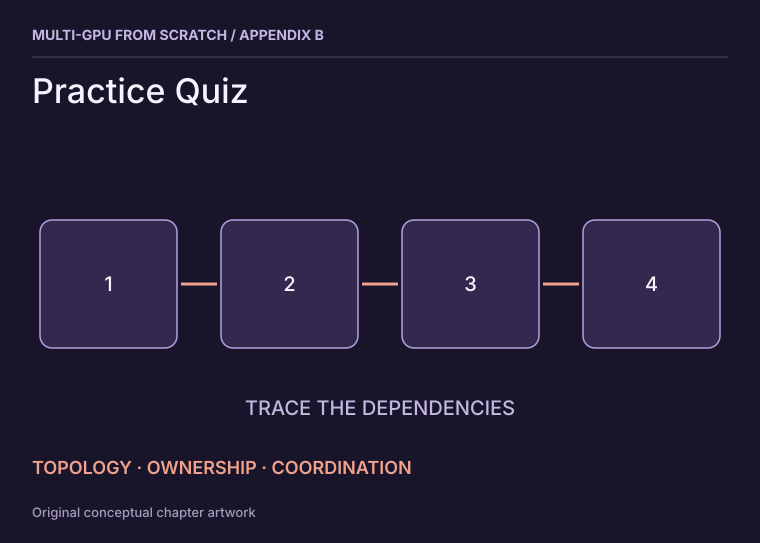
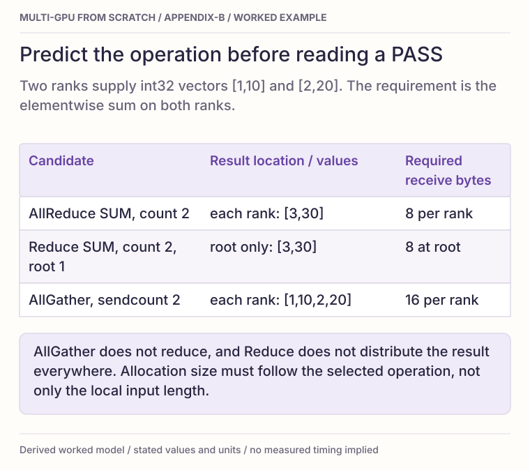
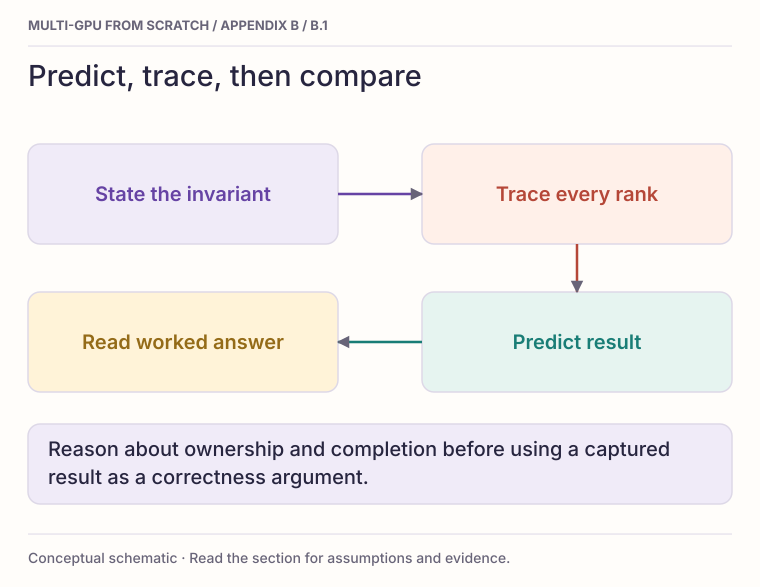
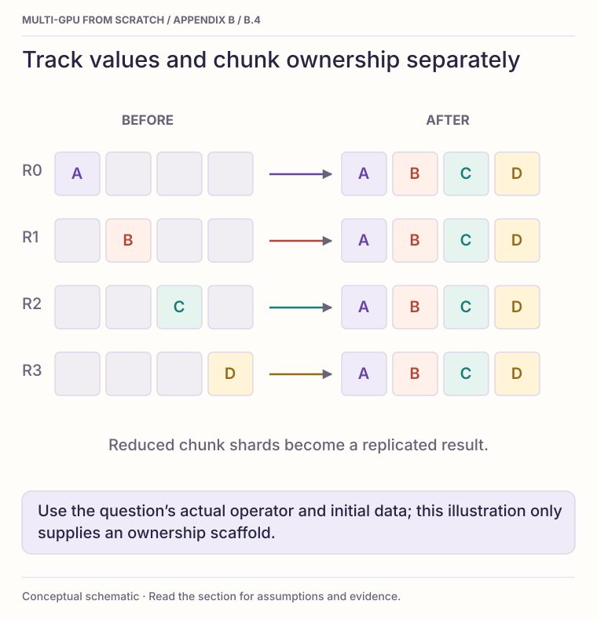

# Appendix B: Practice Quiz

<!-- mgpu:opener:start -->
[](../images/chapter-openers/appendix-b.svg)
<!-- mgpu:opener:end -->

Every chapter in this book already ends with its own Self-Check Questions and Worked Solutions, testing that chapter's own material in isolation. This appendix is different: it tests whether the ideas actually connect across chapters -- whether you can look at Chapter 40's own backprojection/forward-projection split and recognize it as the same "same partition, different operation, different communication need" shape Chapter 34's gated-versus-fixed all-to-all raises, or explain why Chapter 16's per-rank halo stays the same size no matter how many GPUs share the grid, while Chapter 27's per-GPU all-gather volume climbs toward the size of the entire dataset and never shrinks. B.2 asks sixteen conceptual questions, two from each of this book's eight Parts, with answers in B.3. B.4 raises the stakes: three short, genuinely compiled programs, each built around a real finding this book established somewhere -- read the setup, commit to a prediction, then compile and run it yourself before reading the revealed output.

<!-- mgpu:worked:start -->
## Worked example — Answer by operation semantics, not by similar names

Two ranks contribute int32 vectors: rank 0 [1, 10] and rank 1 [2, 20]. Keep the original buffers for each independent question. Each input has two elements or 8 bytes.

[](../images/worked/appendix-b.svg)

1. SUM all-reduce combines corresponding positions: [1+2, 10+20] = [3, 30]. Each rank receives two elements, 8 bytes.

2. SUM reduce to rank 1 produces the same [3, 30], but only root rank 1 has the defined reduction output.

3. All-gather preserves both contributions in rank order: [1, 10, 2, 20]. Each output has four elements, 16 bytes.

4. A broadcast from rank 0 instead produces [1, 10] at both ranks. No addition occurs.

**Expected result and pitfall.** The expected answers differ in both values and output placement. “Every rank participates” does not mean “every rank receives the reduced output”; rooted and non-rooted collectives have different contracts.

**Exercise.** A receive buffer holds only two int32 values. Which listed operation necessarily needs a larger output buffer?

**Worked answer.** All-gather needs four values here (16 bytes). All-reduce and broadcast return two; reduce defines two output values at the root.
<!-- mgpu:worked:end -->

## B.1 How to Use This Quiz

<!-- mgpu:figure-1:start -->
[](../images/technical/appendix-b/1-flow.svg)
<!-- mgpu:figure-1:end -->

Answer every question in B.2 in your own words -- out loud, or on paper -- before reading B.3's answer. For B.4, do the same with actual code: read the setup, write down what you believe the program will print, and only then compile it and compare. A prediction you get wrong tells you exactly which chapter to reread; a prediction you get right by guessing, without being able to explain why, is worth treating the same way. Every one of B.4's programs compiles and runs in seconds, entirely on the host, with no GPU required -- this book's entire method has been "genuinely compiled, genuinely run, never assumed," and this quiz is not an exception.

## B.2 Conceptual Review Questions

**Part 0 -- GPU Foundations and Topology (Chapters 1-3)**

1. Chapter 1 introduced both a "memory wall" and a "compute wall" as reasons a single GPU is not enough. What is the difference between the two, and why doesn't simply building a bigger single GPU solve either one indefinitely?
2. Chapter 2 established that PCIe, NVLink, and NVSwitch offer very different real bandwidth between GPUs, and Chapter 3 established that CUDA tracks "current device" per host thread rather than globally. Why do both facts matter for the same underlying reason?

**Part 1 -- Peer Access and Host-Orchestrated Transfers (Chapters 4-7)**

3. What does UVA (Unified Virtual Addressing, Chapter 4) actually give a program that plain P2P memory access alone doesn't?
4. Chapter 6 built cross-device synchronization using `cudaStreamWaitEvent()`. Chapter 6's own Common Trap says that coordinating devices with `cudaDeviceSynchronize()` instead (synchronize device 0, then start device 1's dependent work) is correct but needlessly serializing. What exactly does it cost, and why does `cudaStreamWaitEvent()` avoid that cost?

**Part 2 -- Collectives From Scratch, Then NCCL (Chapters 8-11)**

5. Chapter 9 built ring all-reduce out of two distinct phases (reduce-scatter, then all-gather) rather than one single pass. What would go wrong with a naive "everyone sends their full array to everyone else, then locally sums" approach at scale, and how does splitting into these two phases fix it?
6. NCCL doesn't provide a dedicated Barrier primitive -- a gap Chapter 17 points out, and then fills. What did it use, what completion does the pattern wait for, and why does it not synchronize unrelated streams automatically?

**Part 3 -- Parallelization Strategies (Chapters 12-16)**

7. Chapter 13 (model parallelism) and Chapter 14 (tensor parallelism) both split one model across multiple GPUs, but they split it along fundamentally different axes. What's the difference?
8. Chapter 16's domain decomposition uses halo/ghost cells, and Chapter 15's pipeline parallelism uses micro-batching to reduce a "bubble." What kind of inefficiency is each one specifically fighting, and why are they different problems even though both involve idle time?

**Part 4 -- Synchronization, Load Balancing, and Fault Tolerance (Chapters 17-19)**

9. Chapter 18 built load balancing around each GPU's own `cudaGetDeviceProperties()`, rather than assuming every GPU in a cluster is identical. Why does this matter even in a cluster where every GPU is nominally "the same model"?
10. Chapter 19 described handling a straggler or failed rank using `ncclCommGetAsyncError()` and `ncclCommAbort()` rather than anything resembling error recovery. Why can NCCL only offer "detect and escape," not genuine fault tolerance, the way Chapter 20's MPI ULFM discussion contrasts against?

**Part 5 -- Scaling Beyond One Node (Chapters 20-23)**

11. Chapter 20 built a naive MPI ring send/recv that deadlocks at scale, fixed with `MPI_Sendrecv()`. What specifically causes the naive version to deadlock, and why does combining send and receive into one call fix it rather than merely reordering the existing calls?
12. NVSHMEM (Chapter 22) let a CUDA kernel call `nvshmem_int_p()` to write directly into another GPU's memory from device code. How is this fundamentally different from every earlier chapter's own communication, including GPUDirect RDMA (Chapter 21)?

**Part 6 -- Case Studies I (Chapters 24-31)**

13. Chapter 27 (N-body) and Chapter 16's halo-based domain decomposition behave very differently as GPU count P grows -- Chapter 16's per-rank halo volume stays FIXED regardless of P, while Chapter 27's per-GPU all-gather volume, `(P-1)/P` of the whole dataset, climbs toward the FULL dataset size and never shrinks. Why the difference?
14. Chapter 30's ray tracing case study split the image into screen-space tiles over a fully replicated scene -- a pattern Molnar et al.'s standard taxonomy calls "sort-first" (Chapter 30 itself labels it "sort-last"), with literally zero communication during the actual rendering computation. What later forces communication back into the picture, and how is that different from every earlier chapter's own reason for needing communication?

**Part 7 -- Industrial and Healthcare Case Studies (Chapters 32-40)**

15. Chapter 32 (MoE/DeepEP) and Chapter 34 (recommendation systems/HugeCTR) both use all-to-all communication, but for structurally different reasons. What's the difference?
16. Chapter 40's medical imaging case study found that the exact same z-slab domain decomposition needs zero communication for backprojection but real cross-node communication for forward projection. Since it's the same partition of the same volume, why do the two operations differ so sharply?

## B.3 Conceptual Review Answers

**1.** The memory wall is that a model's own size (parameters plus optimizer state, per Chapter 1's own ZeRO memory formula) can outgrow a single GPU's own HBM capacity regardless of how fast that GPU computes; the compute wall is that training the largest real models (GPT-3-class, per Chapter 1's own cited FLOPs and H100 throughput figures) would take an impractically long wall-clock time on one GPU even if that GPU somehow had unlimited memory. Building a bigger single GPU pushes both walls further out but never removes them, because real model and dataset sizes have historically grown faster than any single chip's own capacity or throughput -- multiple GPUs working together is the only way to keep memory and compute scaling roughly in step with model growth.

**2.** Both facts are about the same underlying reality: "the GPU" is not one monolithic resource a program can address uniformly. Chapter 2's topology fact means the exact same collective operation can run dramatically faster or slower purely depending on which physical link two participating GPUs happen to be connected by, something invisible to the algorithm's own correctness. Chapter 3's per-thread current-device fact means a host thread's own calls (kernel launches, `cudaMalloc`, etc.) silently target whichever device that thread most recently selected, so two threads can each believe they're operating on "the GPU" while actually operating on two different physical devices. Both facts share the same lesson: a multi-GPU program must be explicit about which physical device and which link any given operation actually uses, because nothing about a naive single-GPU mental model implies any of that by default.

**3.** P2P capability and enabled peer access determine whether one device may access another device’s allocation in a supported configuration. UVA provides a unified virtual-address model that lets the runtime identify allocation ownership and infer copy direction with `cudaMemcpyDefault`. UVA alone does not make every pointer dereferenceable on every GPU: peer permission, mapping, allocation lifetime and producer/consumer ordering still matter. `cudaMemcpyPeer()` names the endpoint devices explicitly; neither its success nor a UVA pointer proves a particular physical transfer route.

**4.** The cost is concurrency, not correctness. Used the way Chapter 6 describes -- synchronize device 0, and only then enqueue device 1's dependent work -- `cudaDeviceSynchronize()` does produce a correct result, because device 1's work is not even issued until device 0 has finished. But it blocks the HOST thread until *every* piece of work queued on device 0 has completed, not just the one operation device 1 actually depends on, so any unrelated work device 0 could have kept running on its other streams, and any work the host could have issued in the meantime, is serialized behind that wait. `cudaStreamWaitEvent()` expresses only the real dependency -- one specific event recorded at one specific point in device 0's stream -- and makes device 1's stream wait for that point on the GPU side, so the host can enqueue the dependency without waiting for device completion; independent work can remain eligible to run. (The ordering only becomes incorrect if the dependent work is issued *before* any synchronization at all -- a different mistake from the one Chapter 6's trap describes.)

**5.** A naive "send full array to everyone, then locally sum" approach moves the entire array O(P) times per rank (once to each of the other P-1 ranks), so total data moved scales up badly as P grows. Ring reduce-scatter and all-gather instead move each rank's own data only ONCE around the ring per phase, and each message is only 1/P of the full array rather than the whole thing, so total data moved per rank converges to roughly 2(P-1)/P times the array size regardless of how many ranks participate -- Chapter 9's own real cost formula. Splitting into phases is what makes that reduced volume possible: reduce-scatter's own job is purely to get each chunk fully reduced exactly once, never redundantly, and all-gather's own job is purely to redistribute those already-final chunks, rather than repeatedly re-transmitting not-yet-final partial sums the way a naive approach would.

**6.** Chapter 17 uses a one-element `ncclAllReduce()` followed by `cudaStreamSynchronize()` as a rendezvous for its participating ranks. Each participant submits the matching collective and waits for its completion before advancing. This is a concrete pattern, not a claim that all-reduce is the uniquely smallest barrier primitive: rooted collectives such as broadcast also require participation from all communicator ranks. The rendezvous covers this protocol and stream order; unrelated streams still need their own dependencies.

**7.** Model parallelism (Chapter 13) splits a model DEPTH-wise -- different layers (or groups of layers) live on different GPUs, and activations are handed off, via `cudaMemcpyPeer()`, from one GPU to the next as data flows forward through the network, so at any instant each GPU is doing a different part of the SAME forward pass. Tensor parallelism (Chapter 14) instead splits WITHIN a single layer -- for example, splitting one large matrix multiply's own columns or rows across GPUs -- so every participating GPU computes on the same layer simultaneously, each owning only a slice of that layer's own weights, requiring a collective (`ncclAllReduce()`, for row-parallel) to combine partial results back together before the next layer can proceed.

**8.** Chapter 16's halo and ghost cells exist to minimize COMMUNICATION VOLUME for a spatially local computation -- a stencil update needs only its immediate neighbors' boundary data, not the whole remote domain -- so the inefficiency being fought is wasted bandwidth from over-communicating. Chapter 15's pipeline bubble is a COMPUTE-UTILIZATION problem -- with only one microbatch in flight, most pipeline stages sit idle waiting for data to reach them -- so the inefficiency being fought is wasted GPU time from under-utilization, fixed by keeping multiple microbatches in flight simultaneously (the `(K-1)/(M+K-1)` bubble fraction Chapter 15 derived, which shrinks as more microbatches M are used). One is a communication-volume problem; the other is a compute-idle-time problem, and the two don't trade off against each other in general.

**9.** In practice, even nominally-identical GPUs can have real, measurable performance differences from thermal throttling, differing power limits, differing firmware or driver versions -- and a heterogeneous cluster explicitly mixing GPU generations, an increasingly common real deployment shape, makes the differences even starker. Chapter 18's weighted-sharding approach uses reported capabilities as an initial model; measured per-device timings under the target workload are needed to choose useful weights, rather than assuming a naive equal split is optimal -- an equal split leaves the slowest device as the critical-path bottleneck while faster devices sit idle waiting for it, exactly the avoidable inefficiency real production multi-GPU clusters are built to avoid.

**10.** In the book's tested NCCL 2.26.2 environment, aborting the failed communicator and rebuilding an appropriate communicator is the recovery approach discussed here; `ncclCommAbort` does not roll back an in-flight collective or restore its result. This is not a universal claim about later NCCL releases. [NCCL 2.27.3 added `ncclCommShrink`](https://docs.nvidia.com/deeplearning/nccl/release-notes/rel_2-27-3.html), which creates a new communicator excluding specified ranks; its supported flags and outstanding-operation requirements must be followed. Surviving ranks still need application-level agreement, state/checkpoint recovery and a mathematically valid next step. MPI ULFM is another fault-recovery interface, not proof that any failed CUDA/NCCL operation can safely be retried. No communicator-shrink execution is claimed by this book's 2.26.2 captures.

**11.** A naive ring where every rank calls a BLOCKING `MPI_Send()` before its own `MPI_Recv()` deadlocks because `MPI_Send()` itself can block until a matching receive is posted on the other side -- if every rank in the ring is simultaneously stuck waiting inside its own `MPI_Send()`, none of them will ever reach the `MPI_Recv()` call that would unblock its neighbor, a genuine circular wait. Simply reordering (receive-then-send on alternating ranks) can dodge the deadlock for particular ring sizes but is fragile and doesn't generalize; `MPI_Sendrecv()` instead posts the send and the matching receive together in one call, so -- as Chapter 20's own comment puts it -- there is no window where every rank is blocked inside `MPI_Send()` waiting for a receive no rank has posted yet. It is not atomic (the send and receive still progress independently inside the library); what matters is that the MPI implementation is responsible for progressing both halves without the circular wait, removing the deadlock risk structurally rather than by careful manual ordering.

**12.** Every earlier communication mechanism in this book -- `cudaMemcpyPeer()`, NCCL collectives, MPI messages, even GPUDirect RDMA's own optimized data path -- is initiated by the HOST, meaning a CPU thread issues the API call that starts the transfer, even when the actual bytes move GPU-to-GPU without touching host memory. NVSHMEM's `nvshmem_int_p()` is called from INSIDE a running GPU kernel, by a GPU thread, with no host involvement in initiating that specific write at all -- the GPU itself decides, mid-kernel, to write into a remote GPU's memory, opening up communication patterns (fine-grained, data-dependent point-to-point messaging deep inside a kernel) that a host-orchestrated model structurally cannot express without stopping the kernel and returning control to the host first.

**13.** Chapter 16's stencil computation is spatially LOCAL -- each cell only ever needs its immediate neighbors. With Chapter 16's row-strip decomposition, each rank exchanges one ghost row with each neighbor, and a row's width does not depend on how many ranks share the grid, so the bytes per interior-rank face stay constant as P changes **provided the global row width and halo thickness remain fixed and every shard remains large enough**. Boundary ranks, a different decomposition, or weak scaling that changes the row width alter this count. Chapter 27's naive all-pairs N-body force calculation has no locality at all: every particle's force depends on EVERY other particle in the whole system, so each rank must all-gather every other rank's particles. By Chapter 9 and 10's ring all-gather formula, each GPU receives `(P-1)/P` of the whole dataset -- a fraction that rises toward 1 as P grows, so per-GPU volume approaches the FULL dataset size and never shrinks, no matter how many GPUs are added. One volume is pinned to a fixed boundary; the other is pinned to the entire problem.

**14.** During rendering itself, each GPU independently ray-traces its own assigned tile of the same fully-replicated scene, needing no data from any other GPU at all -- communication only reappears at the very end, to composite each GPU's own rendered tile into one final image, a form of gather rather than a computational dependency. What forces communication back DURING computation, per Chapter 30's own real R2E2 terabyte-scale-scene citation, is when the SCENE ITSELF stops fitting on one GPU's own memory -- once no single GPU can hold the whole scene, rendering a ray that crosses into another GPU's own scene partition requires fetching that partition's geometry data mid-render, a fundamentally different reason for communication (data doesn't fit) than every earlier chapter's reason (an algorithm's own mathematical dependency structure).

**15.** Chapter 32's MoE all-to-all is GATED -- which expert, and therefore which GPU, each token is routed to depends on a learned gating function's own per-token decision, so the exact communication pattern varies from batch to batch and even includes a real capacity-overflow and residual-passthrough case when an expert receives more tokens than it has room for. Chapter 34's HugeCTR embedding all-to-all is FIXED -- every batch reshards embedding lookups along the same predetermined schedule with no gating and no possibility of overflow, because which embedding table shard a given feature belongs to is a static property of the model's own architecture, not a per-batch learned decision. Both are the same primitive (all-to-all), but one has a dynamic, data-dependent routing table and the other doesn't.

**16.** Backprojection's own real cited property is that "each node locally stores the part of the detector data needed to perform a BP operation, so this can be performed locally and independently" -- every voxel a given rank owns can be fully reconstructed using only that same rank's own already-local detector data, with no dependency on any other rank's slab at all. Forward projection's own geometry is different: computing a projection ray's contribution on the detector can require volume data from multiple z-slabs at once, because a single ray can pass through voxels owned by different ranks as it traverses the volume -- the partition is identical, but which OPERATION is applied to that partition determines whether a given rank's own local data is sufficient by itself, or whether the operation's own geometry inherently reaches across partition boundaries.

## B.4 Predict-the-Output Challenges

<!-- mgpu:figure-4:start -->
[](../images/technical/appendix-b/4-chunks.svg)
<!-- mgpu:figure-4:end -->

### Challenge 1: Reduce-Scatter's Own Intermediate State

Chapter 9 built ring all-reduce as two distinct phases, and it's easy to blur them together in memory the way an inclusive and an exclusive scan can blur together. Before compiling and running the program below, predict: for P=4 ranks, each starting with a 4-element array where rank r's array is `[10*(r+1)+0, 10*(r+1)+1, 10*(r+1)+2, 10*(r+1)+3]`, which ONE chunk index does rank 2 hold fully-reduced immediately after reduce-scatter finishes (before all-gather begins), and what is that chunk's value?

```cpp
// Appendix B: Practice Quiz
// 123_quiz_ring_allreduce_phases.cpp
//
// Appendix B.4, Challenge 1 -- Chapter 9 built ring all-reduce as TWO
// distinct phases: reduce-scatter (P-1 steps, after which each rank
// holds the FULLY reduced result for only ONE chunk) followed by
// all-gather (P-1 more steps, after which every rank holds the complete
// reduced result). Before compiling and running this file, predict: for
// P=4 ranks, each starting with a 4-element array where
// rank r's array is [10*(r+1)+0, 10*(r+1)+1, 10*(r+1)+2, 10*(r+1)+3],
// which ONE chunk index does rank 2 hold fully-reduced immediately after
// reduce-scatter finishes (before all-gather begins), and what is that
// chunk's value?
//
// Compile: g++ -std=c++17 -Wall -Wextra -O2 123_quiz_ring_allreduce_phases.cpp -o 123_quiz_ring_allreduce_phases
// Run:     ./123_quiz_ring_allreduce_phases
#include <cstdio>
#include <vector>

constexpr int P = 4;

void printState(const std::vector<std::vector<int>>& buf, const char* label) {
    printf("%s\n", label);
    for (int r = 0; r < P; r++) {
        printf("  rank %d: [", r);
        for (int i = 0; i < P; i++) printf("%d%s", buf[r][i], i + 1 < P ? ", " : "");
        printf("]\n");
    }
    printf("\n");
}

int main() {
    // rank r's initial array: [10*(r+1)+0, 10*(r+1)+1, 10*(r+1)+2, 10*(r+1)+3]
    std::vector<std::vector<int>> buf(P, std::vector<int>(P));
    for (int r = 0; r < P; r++)
        for (int i = 0; i < P; i++)
            buf[r][i] = 10 * (r + 1) + i;

    printState(buf, "=== initial state (before reduce-scatter) ===");

    // Ground truth: fully all-reduced (summed) value for each chunk index.
    std::vector<int> trueSum(P, 0);
    for (int i = 0; i < P; i++)
        for (int r = 0; r < P; r++)
            trueSum[i] += buf[r][i];
    printf("=== ground truth: elementwise sum across all 4 ranks ===\n  [");
    for (int i = 0; i < P; i++) printf("%d%s", trueSum[i], i + 1 < P ? ", " : "");
    printf("]\n\n");

    // Reduce-scatter: P-1 steps. Standard ring convention -- rank r sends
    // chunk (r - step + P) % P to its right neighbor, which ADDS it into
    // its own copy of that same chunk. After P-1 steps, rank r holds the
    // FULLY reduced value for chunk (r + 1) % P (the chunk immediately
    // "ahead" of it in ring order, following Chapter 9's own indexing).
    for (int step = 0; step < P - 1; step++) {
        std::vector<std::vector<int>> next = buf;
        for (int r = 0; r < P; r++) {
            int sendChunk = (r - step + P) % P;
            int recvRank = (r + 1) % P;
            next[recvRank][sendChunk] += buf[r][sendChunk];
        }
        buf = next;
    }

    printState(buf, "=== after reduce-scatter (P-1 = 3 steps) ===");
    int fullyReducedChunkOnRank2 = (2 + 1) % P;
    printf("rank 2's own fully-reduced chunk is chunk index %d, value = %d "
           "(matches ground truth [%d]=%d)\n\n",
           fullyReducedChunkOnRank2, buf[2][fullyReducedChunkOnRank2],
           fullyReducedChunkOnRank2, trueSum[fullyReducedChunkOnRank2]);

    // All-gather: P-1 more steps, circulating each rank's own fully-
    // reduced chunk around the ring so every rank ends up with all P
    // fully-reduced chunks.
    for (int step = 0; step < P - 1; step++) {
        std::vector<std::vector<int>> next = buf;
        for (int r = 0; r < P; r++) {
            int sendChunk = (r + 1 - step + P) % P;
            int recvRank = (r + 1) % P;
            next[recvRank][sendChunk] = buf[r][sendChunk];
        }
        buf = next;
    }

    printState(buf, "=== after all-gather (P-1 = 3 more steps) -- every "
                     "rank now holds the full result ===");

    bool allMatch = true;
    for (int r = 0; r < P; r++)
        for (int i = 0; i < P; i++)
            if (buf[r][i] != trueSum[i]) allMatch = false;

    printf("self-check: every rank's final buffer matches ground truth: %s\n",
           allMatch ? "YES" : "NO");
    return allMatch ? 0 : 1;
}
```

<!-- execution:start:h100-rerun:123_quiz_ring_allreduce_phases.cpp -->
> **Compiled and executed — 2026-11-18-h100: Host program/model (exit-only).** Hardware: 2 H100 GPUs. Executed UTC: `2026-11-18T11:20:06.529963+00:00`.

<!-- execution:metadata Source SHA-256: de78a917a29312f29b7ee7ce0fb3405a64481c852426eeeb1072c31c0dda2e81; recorded UTC (program start): 2026-11-18T11:20:06.265321+00:00 -->

[Exact tested source](../validation/2026-11-18-h100/123_quiz_ring_allreduce_phases/123_quiz_ring_allreduce_phases.cpp) · [Compiler log](../validation/2026-11-18-h100/123_quiz_ring_allreduce_phases/compile.log) · [Execution log](../validation/2026-11-18-h100/123_quiz_ring_allreduce_phases/run.log). Compile exit: `0`; run exit: `0`.

Commands below use local source/binary names; raw logs retain host paths. Execute in a scratch directory containing the downloaded source.

```bash
g++ -std=c++17 -O2 123_quiz_ring_allreduce_phases.cpp -o ./example
./example
```

**Sample output**

```text
=== initial state (before reduce-scatter) ===
  rank 0: [10, 11, 12, 13]
  rank 1: [20, 21, 22, 23]
  rank 2: [30, 31, 32, 33]
  rank 3: [40, 41, 42, 43]

=== ground truth: elementwise sum across all 4 ranks ===
  [100, 104, 108, 112]

=== after reduce-scatter (P-1 = 3 steps) ===
  rank 0: [10, 104, 86, 56]
  rank 1: [30, 21, 108, 79]
  rank 2: [60, 52, 32, 112]
  rank 3: [100, 93, 74, 43]

rank 2's own fully-reduced chunk is chunk index 3, value = 112 (matches ground truth [3]=112)

=== after all-gather (P-1 = 3 more steps) -- every rank now holds the full result ===
  rank 0: [100, 104, 108, 112]
  rank 1: [100, 104, 108, 112]
  rank 2: [100, 104, 108, 112]
  rank 3: [100, 104, 108, 112]

self-check: every rank's final buffer matches ground truth: YES
```

<!-- execution:end:h100-rerun:123_quiz_ring_allreduce_phases.cpp -->


<!-- execution:start:a100:123_quiz_ring_allreduce_phases.cpp -->
> **Compiled and executed — 2026-11-17-a100: Host program/model (exit-only).** Hardware: 8 A100 GPUs. Executed UTC: `2026-11-17T23:58:32.216314+00:00`.

<!-- execution:metadata Source SHA-256: de78a917a29312f29b7ee7ce0fb3405a64481c852426eeeb1072c31c0dda2e81; recorded UTC (program start): 2026-11-17T23:58:31.850735+00:00 -->

[Exact tested source](../validation/2026-11-17-a100/123_quiz_ring_allreduce_phases/123_quiz_ring_allreduce_phases.cpp) · [Compiler log](../validation/2026-11-17-a100/123_quiz_ring_allreduce_phases/compile.log) · [Execution log](../validation/2026-11-17-a100/123_quiz_ring_allreduce_phases/run.log). Compile exit: `0`; run exit: `0`.

Commands below use local source/binary names; raw logs retain host paths. Execute in a scratch directory containing the downloaded source.

```bash
g++ -std=c++17 -O2 123_quiz_ring_allreduce_phases.cpp -o ./example
./example
```

**Sample output**

```text
=== initial state (before reduce-scatter) ===
  rank 0: [10, 11, 12, 13]
  rank 1: [20, 21, 22, 23]
  rank 2: [30, 31, 32, 33]
  rank 3: [40, 41, 42, 43]

=== ground truth: elementwise sum across all 4 ranks ===
  [100, 104, 108, 112]

=== after reduce-scatter (P-1 = 3 steps) ===
  rank 0: [10, 104, 86, 56]
  rank 1: [30, 21, 108, 79]
  rank 2: [60, 52, 32, 112]
  rank 3: [100, 93, 74, 43]

rank 2's own fully-reduced chunk is chunk index 3, value = 112 (matches ground truth [3]=112)

=== after all-gather (P-1 = 3 more steps) -- every rank now holds the full result ===
  rank 0: [100, 104, 108, 112]
  rank 1: [100, 104, 108, 112]
  rank 2: [100, 104, 108, 112]
  rank 3: [100, 104, 108, 112]

self-check: every rank's final buffer matches ground truth: YES
```


<!-- execution:end:a100:123_quiz_ring_allreduce_phases.cpp -->


<!-- execution:start:h100:123_quiz_ring_allreduce_phases.cpp -->
> **Compiled and executed — 2026-11-17-h100: Host program/model (exit-only).** Hardware: 2 H100 GPUs. Execution record UTC (run-batch start; per-program time unrecorded): `2026-11-17T23:48:18.967387+00:00`.

<!-- execution:metadata Source SHA-256: de78a917a29312f29b7ee7ce0fb3405a64481c852426eeeb1072c31c0dda2e81; recorded UTC (run-batch start; per-program time unrecorded): 2026-11-17T23:48:18.967387+00:00 -->

[Exact tested source](../validation/2026-11-17-h100/123_quiz_ring_allreduce_phases/123_quiz_ring_allreduce_phases.cpp) · [Compiler log](../validation/2026-11-17-h100/123_quiz_ring_allreduce_phases/compile.log) · [Execution log](../validation/2026-11-17-h100/123_quiz_ring_allreduce_phases/run.log). Compile exit: `0`; run exit: `0`.

Commands below use local source/binary names; raw logs retain host paths. Execute in a scratch directory containing the downloaded source.

```bash
g++ -std=c++17 -O2 123_quiz_ring_allreduce_phases.cpp -o ./example
./example
```

<details markdown="1"><summary>Captured current-source output</summary>

```text
=== initial state (before reduce-scatter) ===
  rank 0: [10, 11, 12, 13]
  rank 1: [20, 21, 22, 23]
  rank 2: [30, 31, 32, 33]
  rank 3: [40, 41, 42, 43]

=== ground truth: elementwise sum across all 4 ranks ===
  [100, 104, 108, 112]

=== after reduce-scatter (P-1 = 3 steps) ===
  rank 0: [10, 104, 86, 56]
  rank 1: [30, 21, 108, 79]
  rank 2: [60, 52, 32, 112]
  rank 3: [100, 93, 74, 43]

rank 2's own fully-reduced chunk is chunk index 3, value = 112 (matches ground truth [3]=112)

=== after all-gather (P-1 = 3 more steps) -- every rank now holds the full result ===
  rank 0: [100, 104, 108, 112]
  rank 1: [100, 104, 108, 112]
  rank 2: [100, 104, 108, 112]
  rank 3: [100, 104, 108, 112]

self-check: every rank's final buffer matches ground truth: YES
```

</details>
<!-- execution:end:h100:123_quiz_ring_allreduce_phases.cpp -->


**Compile and run:**

```bash
g++ -std=c++17 -Wall -Wextra -O2 123_quiz_ring_allreduce_phases.cpp -o 123_quiz_ring_allreduce_phases
./123_quiz_ring_allreduce_phases
```

**Revealed output:**

Only chunk index 3 is fully reduced on rank 2 right after reduce-scatter -- every other entry in rank 2's own buffer at that point is still a partial, in-progress sum, not yet the final answer, exactly the distinction the two-phase design exists to make precise.

### Challenge 2: Reduction Order Is Not Free

Chapters 25, 29, and 31 each ran into Chapter 8's original caution about floating-point addition not being associative -- each one cites Chapter 8 for it -- summing the same values in a different order, a real and unavoidable consequence of which rank's partial result a reduction combines first, can produce a genuinely different final bit pattern. Before compiling and running the program below, predict: given the four doubles `a=1e16, b=1.0, c=-1e16, d=1.0`, does the left-to-right sequential sum `((a+b)+c)+d` equal the pairwise sum `(a+c)+(b+d)`? Both orders add the exact same four numbers.

```cpp
// Appendix B: Practice Quiz
// 124_quiz_reassociation_cancellation.cpp
//
// Appendix B.4, Challenge 2 -- Chapters 25, 29, and 31 each ran into
// Chapter 8's caution that floating-point addition is not associative: summing
// the SAME set of values in a different ORDER (a real, unavoidable
// consequence of which rank's partial result a reduction combines first)
// can produce a genuinely different final bit pattern, not just a
// hypothetical rounding worry. Before compiling and running this file,
// predict: given the four doubles a=1e16, b=1.0, c=-1e16, d=1.0, does
// the LEFT-TO-RIGHT sequential sum ((a+b)+c)+d equal the PAIRWISE sum
// (a+c)+(b+d)? Both orders add the exact same four numbers.
//
// Compile: g++ -std=c++17 -Wall -Wextra -O2 124_quiz_reassociation_cancellation.cpp -o 124_quiz_reassociation_cancellation
// Run:     ./124_quiz_reassociation_cancellation
#include <cstdio>

int main() {
    double a = 1e16, b = 1.0, c = -1e16, d = 1.0;

    printf("=== summing the same four doubles in two different orders ===\n");
    printf("a=%.1f, b=%.1f, c=%.1f, d=%.1f\n\n", a, b, c, d);

    // Sequential, left-to-right (the order Chapter 25's naive baseline
    // combines ring-forwarded partial sums in).
    double step1 = a + b;
    double step2 = step1 + c;
    double sequential = step2 + d;
    printf("sequential ((a+b)+c)+d:\n");
    printf("  a+b       = %.1f  (b=1.0 is far smaller than a's own ULP at "
           "this magnitude -- it vanishes in the rounding)\n", step1);
    printf("  (a+b)+c   = %.1f\n", step2);
    printf("  ((a+b)+c)+d = %.1f\n\n", sequential);

    // Pairwise, the order Chapter 31's tree-style combine groups values in.
    double left = a + c;
    double right = b + d;
    double pairwise = left + right;
    printf("pairwise (a+c)+(b+d):\n");
    printf("  a+c       = %.1f  (equal magnitude, opposite sign -- exact "
           "cancellation, no rounding loss)\n", left);
    printf("  b+d       = %.1f\n", right);
    printf("  (a+c)+(b+d) = %.1f\n\n", pairwise);

    printf("sequential result = %.1f\n", sequential);
    printf("pairwise result   = %.1f\n", pairwise);
    printf("difference        = %.1f\n\n", pairwise - sequential);

    bool match = (sequential == pairwise);
    printf("self-check: do the two orders agree? %s -- both orders sum "
           "the IDENTICAL four numbers, so any difference is entirely a "
           "property of ROUND-OFF ORDER, not of the data itself. This is "
           "the exact same real mechanism Chapters 25/29/31 each found: "
           "a ring's own sequential forwarding order and a tree-style "
           "pairwise combine order are NOT required to produce bit-"
           "identical sums, even though both are mathematically \"the "
           "same\" reduction.\n",
           match ? "YES (unexpected for these values)" : "NO");
    return 0;
}
```

<!-- execution:start:h100-rerun:124_quiz_reassociation_cancellation.cpp -->
> **Compiled and executed — 2026-11-18-h100: Host program/model (exit-only).** Hardware: 2 H100 GPUs. Executed UTC: `2026-11-18T11:20:06.595883+00:00`.

<!-- execution:metadata Source SHA-256: 5b7a6dbb7d3434c7d9cca6f57135e389ceb89387093e13c38d52ee0de5289c64; recorded UTC (program start): 2026-11-18T11:20:06.531697+00:00 -->

[Exact tested source](../validation/2026-11-18-h100/124_quiz_reassociation_cancellation/124_quiz_reassociation_cancellation.cpp) · [Compiler log](../validation/2026-11-18-h100/124_quiz_reassociation_cancellation/compile.log) · [Execution log](../validation/2026-11-18-h100/124_quiz_reassociation_cancellation/run.log). Compile exit: `0`; run exit: `0`.

Commands below use local source/binary names; raw logs retain host paths. Execute in a scratch directory containing the downloaded source.

```bash
g++ -std=c++17 -O2 124_quiz_reassociation_cancellation.cpp -o ./example
./example
```

**Sample output**

```text
=== summing the same four doubles in two different orders ===
a=10000000000000000.0, b=1.0, c=-10000000000000000.0, d=1.0

sequential ((a+b)+c)+d:
  a+b       = 10000000000000000.0  (b=1.0 is far smaller than a's own ULP at this magnitude -- it vanishes in the rounding)
  (a+b)+c   = 0.0
  ((a+b)+c)+d = 1.0

pairwise (a+c)+(b+d):
  a+c       = 0.0  (equal magnitude, opposite sign -- exact cancellation, no rounding loss)
  b+d       = 2.0
  (a+c)+(b+d) = 2.0

sequential result = 1.0
pairwise result   = 2.0
difference        = 1.0

self-check: do the two orders agree? NO -- both orders sum the IDENTICAL four numbers, so any difference is entirely a property of ROUND-OFF ORDER, not of the data itself. This is the exact same real mechanism Chapters 25/29/31 each found: a ring's own sequential forwarding order and a tree-style pairwise combine order are NOT required to produce bit-identical sums, even though both are mathematically "the same" reduction.
```

<!-- execution:end:h100-rerun:124_quiz_reassociation_cancellation.cpp -->


<!-- execution:start:a100:124_quiz_reassociation_cancellation.cpp -->
> **Compiled and executed — 2026-11-17-a100: Host program/model (exit-only).** Hardware: 8 A100 GPUs. Executed UTC: `2026-11-17T23:58:32.285588+00:00`.

<!-- execution:metadata Source SHA-256: 5b7a6dbb7d3434c7d9cca6f57135e389ceb89387093e13c38d52ee0de5289c64; recorded UTC (program start): 2026-11-17T23:58:32.220725+00:00 -->

[Exact tested source](../validation/2026-11-17-a100/124_quiz_reassociation_cancellation/124_quiz_reassociation_cancellation.cpp) · [Compiler log](../validation/2026-11-17-a100/124_quiz_reassociation_cancellation/compile.log) · [Execution log](../validation/2026-11-17-a100/124_quiz_reassociation_cancellation/run.log). Compile exit: `0`; run exit: `0`.

Commands below use local source/binary names; raw logs retain host paths. Execute in a scratch directory containing the downloaded source.

```bash
g++ -std=c++17 -O2 124_quiz_reassociation_cancellation.cpp -o ./example
./example
```

**Sample output**

```text
=== summing the same four doubles in two different orders ===
a=10000000000000000.0, b=1.0, c=-10000000000000000.0, d=1.0

sequential ((a+b)+c)+d:
  a+b       = 10000000000000000.0  (b=1.0 is far smaller than a's own ULP at this magnitude -- it vanishes in the rounding)
  (a+b)+c   = 0.0
  ((a+b)+c)+d = 1.0

pairwise (a+c)+(b+d):
  a+c       = 0.0  (equal magnitude, opposite sign -- exact cancellation, no rounding loss)
  b+d       = 2.0
  (a+c)+(b+d) = 2.0

sequential result = 1.0
pairwise result   = 2.0
difference        = 1.0

self-check: do the two orders agree? NO -- both orders sum the IDENTICAL four numbers, so any difference is entirely a property of ROUND-OFF ORDER, not of the data itself. This is the exact same real mechanism Chapters 25/29/31 each found: a ring's own sequential forwarding order and a tree-style pairwise combine order are NOT required to produce bit-identical sums, even though both are mathematically "the same" reduction.
```


<!-- execution:end:a100:124_quiz_reassociation_cancellation.cpp -->


<!-- execution:start:h100:124_quiz_reassociation_cancellation.cpp -->
> **Compiled and executed — 2026-11-17-h100: Host program/model (exit-only).** Hardware: 2 H100 GPUs. Execution record UTC (run-batch start; per-program time unrecorded): `2026-11-17T23:48:18.967387+00:00`.

<!-- execution:metadata Source SHA-256: 5b7a6dbb7d3434c7d9cca6f57135e389ceb89387093e13c38d52ee0de5289c64; recorded UTC (run-batch start; per-program time unrecorded): 2026-11-17T23:48:18.967387+00:00 -->

[Exact tested source](../validation/2026-11-17-h100/124_quiz_reassociation_cancellation/124_quiz_reassociation_cancellation.cpp) · [Compiler log](../validation/2026-11-17-h100/124_quiz_reassociation_cancellation/compile.log) · [Execution log](../validation/2026-11-17-h100/124_quiz_reassociation_cancellation/run.log). Compile exit: `0`; run exit: `0`.

Commands below use local source/binary names; raw logs retain host paths. Execute in a scratch directory containing the downloaded source.

```bash
g++ -std=c++17 -O2 124_quiz_reassociation_cancellation.cpp -o ./example
./example
```

<details markdown="1"><summary>Captured current-source output</summary>

```text
=== summing the same four doubles in two different orders ===
a=10000000000000000.0, b=1.0, c=-10000000000000000.0, d=1.0

sequential ((a+b)+c)+d:
  a+b       = 10000000000000000.0  (b=1.0 is far smaller than a's own ULP at this magnitude -- it vanishes in the rounding)
  (a+b)+c   = 0.0
  ((a+b)+c)+d = 1.0

pairwise (a+c)+(b+d):
  a+c       = 0.0  (equal magnitude, opposite sign -- exact cancellation, no rounding loss)
  b+d       = 2.0
  (a+c)+(b+d) = 2.0

sequential result = 1.0
pairwise result   = 2.0
difference        = 1.0

self-check: do the two orders agree? NO -- both orders sum the IDENTICAL four numbers, so any difference is entirely a property of ROUND-OFF ORDER, not of the data itself. This is the exact same real mechanism Chapters 25/29/31 each found: a ring's own sequential forwarding order and a tree-style pairwise combine order are NOT required to produce bit-identical sums, even though both are mathematically "the same" reduction.
```

</details>
<!-- execution:end:h100:124_quiz_reassociation_cancellation.cpp -->


**Compile and run:**

```bash
g++ -std=c++17 -Wall -Wextra -O2 124_quiz_reassociation_cancellation.cpp -o 124_quiz_reassociation_cancellation
./124_quiz_reassociation_cancellation
```

**Revealed output:**

The two orders don't merely round differently in some tiny last digit -- they disagree by a full `1.0`, because `a` and `c` cancel EXACTLY when added directly to each other, but `b`'s own contribution is lost entirely when added to `a` first, since `b` falls below `a`'s own representable precision at that magnitude. This is deliberately the least subtle possible version of the same mechanism Chapters 25/29/31 found as a small, easy-to-miss single-bit difference -- the underlying cause is identical.

### Challenge 3: The Ghost-Cell Trap

Chapters 16 and 40 both warned that a halo or ghost-cell exchange must genuinely happen before a boundary cell is computed -- skipping it does not crash the program, it silently computes a wrong answer using stale data. Before compiling and running the program below, predict: for an 8-cell 1D array split across 2 ranks (4 interior cells each), how many of the 8 total cells does a version that never synchronizes ghost cells get wrong compared to a single-process reference -- and are they the interior cells, or specifically the ones nearest the rank boundary?

```cpp
// Appendix B: Practice Quiz
// 125_quiz_ghost_cell_trap.cpp
//
// Appendix B.4, Challenge 3 -- Chapters 16 and 40 both warned that a
// halo/ghost-cell exchange must genuinely happen before a boundary cell
// is computed -- skipping it does not crash the program, it silently
// computes a WRONG answer using stale data. This file splits an 8-cell
// 1D array across 2 ranks (4 interior cells each), computes a 3-point
// smoothing average at every cell, and runs the SAME computation twice:
// once with a correct ghost-cell exchange across the rank boundary, and
// once where that exchange is skipped, leaving each rank's own ghost
// cell at its uninitialized starting value of 0. Before compiling and
// running this file, predict: how many of the 8 total cells does the
// no-sync version get WRONG compared to the single-process reference --
// and are they the interior cells, or specifically the ones nearest the
// rank boundary?
//
// Compile: g++ -std=c++17 -Wall -Wextra -O2 125_quiz_ghost_cell_trap.cpp -o 125_quiz_ghost_cell_trap
// Run:     ./125_quiz_ghost_cell_trap
#include <cstdio>
#include <vector>

constexpr int NX = 8;   // global array size
constexpr int P = 2;    // ranks
constexpr int LOCAL = NX / P;  // 4 interior cells per rank

double globalValue(int i) {
    // Deterministic, arbitrary values for cell i.
    return 10.0 + i;
}

double referenceSmooth(int i) {
    double sum = globalValue(i);
    int count = 1;
    if (i - 1 >= 0)  { sum += globalValue(i - 1); count++; }
    if (i + 1 < NX)  { sum += globalValue(i + 1); count++; }
    return sum / count;
}

int main() {
    printf("=== 8-cell array split across 2 ranks, 4 interior cells each "
           "===\n\n");

    // --- Correct version: ghost cells genuinely synchronized. ---
    std::vector<double> correct(NX);
    for (int rank = 0; rank < P; rank++) {
        int start = rank * LOCAL;
        for (int local = 0; local < LOCAL; local++) {
            int i = start + local;
            double left  = (i - 1 >= 0)  ? globalValue(i - 1) : globalValue(i);
            double right = (i + 1 < NX) ? globalValue(i + 1) : globalValue(i);
            int count = 1;
            double sum = globalValue(i);
            if (i - 1 >= 0)  { sum += left;  count++; }
            if (i + 1 < NX) { sum += right; count++; }
            correct[i] = sum / count;
        }
    }

    // --- Buggy version: each rank's own ghost cell is never fetched
    // from its neighbor -- it stays at its uninitialized starting value
    // of 0.0, exactly the "hard delete" of a real synchronization step.
    std::vector<double> buggy(NX);
    for (int rank = 0; rank < P; rank++) {
        int start = rank * LOCAL;
        int end = start + LOCAL;
        for (int local = 0; local < LOCAL; local++) {
            int i = start + local;
            double leftGhost = 0.0, rightGhost = 0.0;   // never synced
            double left, right;
            bool useLeftGhost = (i - 1 < start) && (i - 1 >= 0);
            bool useRightGhost = (i + 1 >= end) && (i + 1 < NX);
            left  = useLeftGhost  ? leftGhost  : ((i - 1 >= 0) ? globalValue(i - 1) : globalValue(i));
            right = useRightGhost ? rightGhost : ((i + 1 < NX) ? globalValue(i + 1) : globalValue(i));
            int count = 1;
            double sum = globalValue(i);
            if (i - 1 >= 0)  { sum += left;  count++; }
            if (i + 1 < NX) { sum += right; count++; }
            buggy[i] = sum / count;
        }
    }

    printf("%-6s %-14s %-14s %-10s\n", "cell", "reference", "correct-sync", "buggy(no-sync)");
    int mismatches = 0;
    for (int i = 0; i < NX; i++) {
        double ref = referenceSmooth(i);
        bool correctMatches = (correct[i] == ref);
        bool buggyMatches = (buggy[i] == ref);
        if (!buggyMatches) mismatches++;
        printf("%-6d %-14.4f %-14s %-10s\n", i, ref,
               correctMatches ? "matches" : "MISMATCH",
               buggyMatches ? "matches" : "MISMATCH (stale ghost=0)");
    }

    printf("\ntotal cells where the no-sync version disagrees with the "
           "single-process reference: %d out of %d\n", mismatches, NX);
    printf("those mismatches occur ONLY at the two rank-boundary cells "
           "(index 3 and index 4) -- every purely interior cell (0,1,2 "
           "and 5,6,7) never reads a neighbor across the rank boundary "
           "at all, so it is correct with or without the ghost-cell "
           "exchange. This is exactly Chapters 16 and 40's own real "
           "finding: a missing halo sync does not corrupt the whole "
           "domain, it silently corrupts precisely the cells whose "
           "correctness depends on it -- the boundary, and nowhere "
           "else.\n");
    return 0;
}
```

<!-- execution:start:h100-rerun:125_quiz_ghost_cell_trap.cpp -->
> **Compiled and executed — 2026-11-18-h100: Host program/model (exit-only).** Hardware: 2 H100 GPUs. Executed UTC: `2026-11-18T11:20:06.761846+00:00`.

<!-- execution:metadata Source SHA-256: 0e77e1425ac760ec69d2b496ad330625e5abb2c524d204b02285fe4142d1eeb5; recorded UTC (program start): 2026-11-18T11:20:06.597694+00:00 -->

[Exact tested source](../validation/2026-11-18-h100/125_quiz_ghost_cell_trap/125_quiz_ghost_cell_trap.cpp) · [Compiler log](../validation/2026-11-18-h100/125_quiz_ghost_cell_trap/compile.log) · [Execution log](../validation/2026-11-18-h100/125_quiz_ghost_cell_trap/run.log). Compile exit: `0`; run exit: `0`.

Commands below use local source/binary names; raw logs retain host paths. Execute in a scratch directory containing the downloaded source.

```bash
g++ -std=c++17 -O2 125_quiz_ghost_cell_trap.cpp -o ./example
./example
```

**Sample output**

```text
=== 8-cell array split across 2 ranks, 4 interior cells each ===

cell   reference      correct-sync   buggy(no-sync)
0      10.5000        matches        matches
1      11.0000        matches        matches
2      12.0000        matches        matches
3      13.0000        matches        MISMATCH (stale ghost=0)
4      14.0000        matches        MISMATCH (stale ghost=0)
5      15.0000        matches        matches
6      16.0000        matches        matches
7      16.5000        matches        matches

total cells where the no-sync version disagrees with the single-process reference: 2 out of 8
those mismatches occur ONLY at the two rank-boundary cells (index 3 and index 4) -- every purely interior cell (0,1,2 and 5,6,7) never reads a neighbor across the rank boundary at all, so it is correct with or without the ghost-cell exchange. This is exactly Chapters 16 and 40's own real finding: a missing halo sync does not corrupt the whole domain, it silently corrupts precisely the cells whose correctness depends on it -- the boundary, and nowhere else.
```

<!-- execution:end:h100-rerun:125_quiz_ghost_cell_trap.cpp -->


<!-- execution:start:a100:125_quiz_ghost_cell_trap.cpp -->
> **Compiled and executed — 2026-11-17-a100: Host program/model (exit-only).** Hardware: 8 A100 GPUs. Executed UTC: `2026-11-17T23:58:32.553350+00:00`.

<!-- execution:metadata Source SHA-256: 0e77e1425ac760ec69d2b496ad330625e5abb2c524d204b02285fe4142d1eeb5; recorded UTC (program start): 2026-11-17T23:58:32.287992+00:00 -->

[Exact tested source](../validation/2026-11-17-a100/125_quiz_ghost_cell_trap/125_quiz_ghost_cell_trap.cpp) · [Compiler log](../validation/2026-11-17-a100/125_quiz_ghost_cell_trap/compile.log) · [Execution log](../validation/2026-11-17-a100/125_quiz_ghost_cell_trap/run.log). Compile exit: `0`; run exit: `0`.

Commands below use local source/binary names; raw logs retain host paths. Execute in a scratch directory containing the downloaded source.

```bash
g++ -std=c++17 -O2 125_quiz_ghost_cell_trap.cpp -o ./example
./example
```

**Sample output**

```text
=== 8-cell array split across 2 ranks, 4 interior cells each ===

cell   reference      correct-sync   buggy(no-sync)
0      10.5000        matches        matches
1      11.0000        matches        matches
2      12.0000        matches        matches
3      13.0000        matches        MISMATCH (stale ghost=0)
4      14.0000        matches        MISMATCH (stale ghost=0)
5      15.0000        matches        matches
6      16.0000        matches        matches
7      16.5000        matches        matches

total cells where the no-sync version disagrees with the single-process reference: 2 out of 8
those mismatches occur ONLY at the two rank-boundary cells (index 3 and index 4) -- every purely interior cell (0,1,2 and 5,6,7) never reads a neighbor across the rank boundary at all, so it is correct with or without the ghost-cell exchange. This is exactly Chapters 16 and 40's own real finding: a missing halo sync does not corrupt the whole domain, it silently corrupts precisely the cells whose correctness depends on it -- the boundary, and nowhere else.
```


<!-- execution:end:a100:125_quiz_ghost_cell_trap.cpp -->


<!-- execution:start:h100:125_quiz_ghost_cell_trap.cpp -->
> **Compiled and executed — 2026-11-17-h100: Host program/model (exit-only).** Hardware: 2 H100 GPUs. Execution record UTC (run-batch start; per-program time unrecorded): `2026-11-17T23:48:18.967387+00:00`.

<!-- execution:metadata Source SHA-256: 0e77e1425ac760ec69d2b496ad330625e5abb2c524d204b02285fe4142d1eeb5; recorded UTC (run-batch start; per-program time unrecorded): 2026-11-17T23:48:18.967387+00:00 -->

[Exact tested source](../validation/2026-11-17-h100/125_quiz_ghost_cell_trap/125_quiz_ghost_cell_trap.cpp) · [Compiler log](../validation/2026-11-17-h100/125_quiz_ghost_cell_trap/compile.log) · [Execution log](../validation/2026-11-17-h100/125_quiz_ghost_cell_trap/run.log). Compile exit: `0`; run exit: `0`.

Commands below use local source/binary names; raw logs retain host paths. Execute in a scratch directory containing the downloaded source.

```bash
g++ -std=c++17 -O2 125_quiz_ghost_cell_trap.cpp -o ./example
./example
```

<details markdown="1"><summary>Captured current-source output</summary>

```text
=== 8-cell array split across 2 ranks, 4 interior cells each ===

cell   reference      correct-sync   buggy(no-sync)
0      10.5000        matches        matches
1      11.0000        matches        matches
2      12.0000        matches        matches
3      13.0000        matches        MISMATCH (stale ghost=0)
4      14.0000        matches        MISMATCH (stale ghost=0)
5      15.0000        matches        matches
6      16.0000        matches        matches
7      16.5000        matches        matches

total cells where the no-sync version disagrees with the single-process reference: 2 out of 8
those mismatches occur ONLY at the two rank-boundary cells (index 3 and index 4) -- every purely interior cell (0,1,2 and 5,6,7) never reads a neighbor across the rank boundary at all, so it is correct with or without the ghost-cell exchange. This is exactly Chapters 16 and 40's own real finding: a missing halo sync does not corrupt the whole domain, it silently corrupts precisely the cells whose correctness depends on it -- the boundary, and nowhere else.
```

</details>
<!-- execution:end:h100:125_quiz_ghost_cell_trap.cpp -->


**Compile and run:**

```bash
g++ -std=c++17 -Wall -Wextra -O2 125_quiz_ghost_cell_trap.cpp -o 125_quiz_ghost_cell_trap
./125_quiz_ghost_cell_trap
```

**Revealed output:**

Exactly 2 of the 8 cells are wrong, and both are the cells immediately adjacent to the rank boundary -- not a handful of scattered errors, and not the entire domain. A missing synchronization step tends to look like this in practice: a small, localized, boundary-shaped wrongness that is easy to miss in a quick spot-check of the interior, and easy to misdiagnose as "probably fine" precisely because most of the output IS fine.

## Appendix Summary

B.2 and B.3 asked whether this book's individual ideas actually connect across Parts -- whether a reader can recognize the same underlying shape (a per-rank communication volume that stays fixed as ranks are added versus one that climbs toward the whole dataset, a fixed schedule versus a gated one, a partition whose correctness depends on the operation built on top of it) recurring in case studies that look nothing alike on the surface, from GPU foundations all the way through Part 7's industrial and healthcare chapters. B.4 made three of the book's most consequential real findings concrete and checkable: confusing reduce-scatter's own intermediate state with the finished all-reduce result, underestimating how dramatically reduction order can change a floating-point answer, and skipping a halo synchronization step that silently corrupts only the cells nearest a rank boundary. All three compile and run in seconds, entirely on the host -- if a prediction did not match the revealed output, that mismatch is worth chasing back to the chapter that first built the idea, which this appendix has named at every step along the way.
