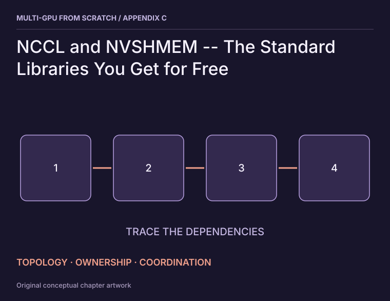
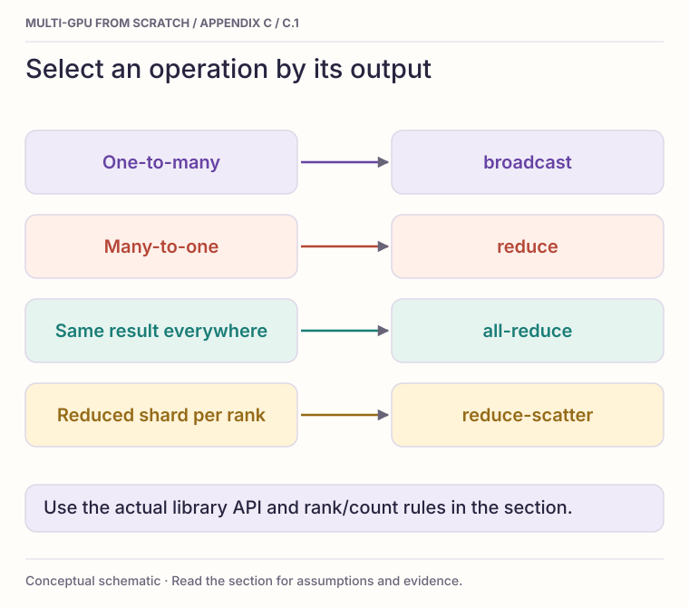
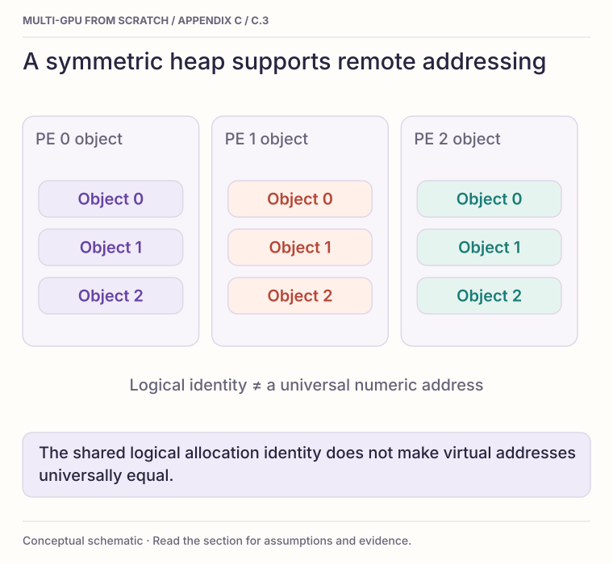

# Appendix C: NCCL and NVSHMEM -- The Standard Libraries You Get for Free

<!-- execution:provenance -->
!!! info "Execution provenance"

    Current execution blocks identify the tested source hash, hardware dataset, commands and captured output. References elsewhere on this page to a device-less environment describe the original authoring context. Historical output is superseded by the current record. Displayed output omits the runner command header and trims trailing line whitespace; raw logs remain exact. A host simulation or API validation has its stated scope; neither alone establishes a numerical multi-GPU workload or measured performance.


<!-- mgpu:opener:start -->
[](../images/chapter-openers/appendix-c.svg)
<!-- mgpu:opener:end -->

Chapters 8 through 10 hand-built five collectives from first principles -- broadcast, reduce, ring all-reduce, all-gather, and reduce-scatter -- plus a genuinely new all-to-all. Chapter 11 then matched every one of them to its real NCCL call, and Chapters 17, 20, and 22 went on to use NCCL and NVSHMEM as working tools throughout the rest of the book: a throwaway `ncclAllReduce` as a barrier in Chapter 17, `MPI_Sendrecv` fixing a real ring deadlock in Chapter 20, and NVSHMEM's device-initiated `nvshmem_int_p()` in Chapter 22. Unlike a book meeting NCCL or NVSHMEM for the first time here, this book has already put both to work. This appendix does not introduce them again -- it gathers their fuller real API surface into one consolidated reference, section by section citing the exact chapter that already established each idea, and closes with the decision framework this book has been applying implicitly since Chapter 11: when to hand-write a collective, when to reach for NCCL, and when the job genuinely needs NVSHMEM's one-sided, device-initiated model instead.

## C.1 NCCL's Full Collective Reference

<!-- mgpu:figure-1:start -->
[](../images/technical/appendix-c/1-mapping.svg)
<!-- mgpu:figure-1:end -->

### Intuition

Imagine finally organizing a toolbox after building five different tools from raw metal, one chapter at a time. You already know how a ring all-reduce moves data in two phases, because Chapter 9 walked through building one. What you have not yet done is stand back and see all five hand-built collectives on one shelf, each one right next to the single, real, already-compiled `nccl.h` function that does its job. That is what this section is: a lookup table, not a lesson. The algorithm is not new. The table is.

### The Concept, In Detail

```
  hand-built (Ch 8-10)         matching real NCCL call
  +----------------------------+---+--------------------------+
  |Ch8  8.1  Broadcast         |-->|ncclBroadcast             |
  |Ch8  8.2  Reduce            |-->|ncclReduce                |
  |Ch9       Ring All-Reduce   |-->|ncclAllReduce             |
  |Ch10 10.1 All-Gather        |-->|ncclAllGather             |
  |Ch10 10.2 Reduce-Scatter    |-->|ncclReduceScatter         |
  |Ch10 10.3 All-to-All        |-->|ncclSend/ncclRecv         |
  +----------------------------+---+--------------------------+

  note: in the installed NCCL 2.18.3, Ch10 10.3's row has no single
  matching call -- it maps to a PATTERN (repeated ncclSend/ncclRecv
  fused inside ncclGroupStart()/ncclGroupEnd()). NCCL 2.28 and later
  add a dedicated ncclAlltoAll().
```

Five of the six rows are a clean one-to-one match: whatever Chapter 8's or Chapter 9's or Chapter 10's hand-built loop over `cudaMemcpyPeerAsync` calls was doing, one real NCCL call now does the same job, dispatched to whichever real interconnect NCCL has actually detected (NVLink, PCIe, or a network fabric) -- a decision the hand-built versions in Chapters 8-10 never had to make, because they always assumed a single fixed topology. The sixth row is the interesting one, and its answer depends on the NCCL version. The NCCL this book installs and links against (2.18.3), as Chapter 11 established, ships no all-to-all function at all; a dedicated `ncclAlltoAll()` (together with `ncclGather()` and `ncclScatter()`) only arrived in NCCL 2.28, which is why Chapter 17's citation of NCCL's current documentation lists AllToAll among the collectives. On the installed 2.18.3, Chapter 10's own hand-built all-to-all maps onto the recipe NCCL's own documentation gives for that version: a loop of paired `ncclSend`/`ncclRecv` calls, all fused inside one `ncclGroupStart()`/`ncclGroupEnd()` bracket so the underlying transport can pipeline them together instead of issuing six separate round trips. NCCL ships no dedicated barrier either, but Chapter 17 filled that gap a different way: its throwaway barrier is a single one-element `ncclAllReduce` call, not a fused group of point-to-point calls -- Chapter 17 never calls `ncclGroupStart()`/`ncclGroupEnd()` at all.

!!! warning
    A version number and a unique ID cost nothing -- a communicator costs a device. `ncclGetVersion()` and `ncclGetUniqueId()` are pure host-side bookkeeping and will succeed on a laptop with no GPU at all. `ncclCommInitRank()` is different: it genuinely tries to bind the communicator to a physical device, and on a machine with zero physical GPUs it fails every time, the same real, well-documented limitation Chapters 22, 23, and 32 already found for NVSHMEM init and for captured graph launches. Reading a version string back successfully is not evidence that a communicator will initialize.

### Code and Verification

```cpp
// 126_nccl_collective_reference.cu
// Six collective recipes, checked against exact integer results on two GPUs.
#include <cstdio>
#include <cstdlib>
#include <cmath>
#include <vector>
#include <cuda_runtime.h>
#include <nccl.h>
#define CUDA_OK(x) do {cudaError_t e=(x);if(e!=cudaSuccess){fprintf(stderr,"%s: %s\n",#x,cudaGetErrorString(e));exit(1);}}while(0)
#define NCCL_OK(x) do {ncclResult_t e=(x);if(e!=ncclSuccess){fprintf(stderr,"%s: %s\n",#x,ncclGetErrorString(e));exit(1);}}while(0)

int main(){
    int count=0;CUDA_OK(cudaGetDeviceCount(&count));if(count<2){fprintf(stderr,"Requires 2 GPUs\n");return 2;}
    constexpr int ranks=2;int devices[ranks]={0,1};ncclComm_t comm[ranks]={};cudaStream_t stream[ranks]={};int *send[ranks]={},*recv[ranks]={};
    NCCL_OK(ncclCommInitAll(comm,ranks,devices));
    for(int r=0;r<ranks;++r){CUDA_OK(cudaSetDevice(r));CUDA_OK(cudaStreamCreate(&stream[r]));CUDA_OK(cudaMalloc(&send[r],2*sizeof(int)));CUDA_OK(cudaMalloc(&recv[r],2*sizeof(int)));}
    int errors=0;
    for(int op=0;op<6;++op){
        for(int r=0;r<ranks;++r){CUDA_OK(cudaSetDevice(r));int input[2]={r+1,r+1};if(op==5){input[0]=100*r;input[1]=100*r+1;}
            CUDA_OK(cudaMemcpy(send[r],input,sizeof(input),cudaMemcpyHostToDevice));CUDA_OK(cudaMemset(recv[r],0xff,sizeof(input)));}
        NCCL_OK(ncclGroupStart());
        for(int r=0;r<ranks;++r){CUDA_OK(cudaSetDevice(r));
            if(op==0)NCCL_OK(ncclBroadcast(send[r],recv[r],1,ncclInt,0,comm[r],stream[r]));
            if(op==1)NCCL_OK(ncclReduce(send[r],recv[r],1,ncclInt,ncclSum,0,comm[r],stream[r]));
            if(op==2)NCCL_OK(ncclAllReduce(send[r],recv[r],1,ncclInt,ncclSum,comm[r],stream[r]));
            if(op==3)NCCL_OK(ncclAllGather(send[r],recv[r],1,ncclInt,comm[r],stream[r]));
            if(op==4)NCCL_OK(ncclReduceScatter(send[r],recv[r],1,ncclInt,ncclSum,comm[r],stream[r]));
            if(op==5)for(int peer=0;peer<ranks;++peer){NCCL_OK(ncclSend(send[r]+peer,1,ncclInt,peer,comm[r],stream[r]));NCCL_OK(ncclRecv(recv[r]+peer,1,ncclInt,peer,comm[r],stream[r]));}
        }NCCL_OK(ncclGroupEnd());
        for(int r=0;r<ranks;++r){CUDA_OK(cudaSetDevice(r));CUDA_OK(cudaStreamSynchronize(stream[r]));int got[2];CUDA_OK(cudaMemcpy(got,recv[r],sizeof(got),cudaMemcpyDeviceToHost));
            if(op==0)errors+=got[0]!=1;if(op==1&&r==0)errors+=got[0]!=3;if(op==2||op==4)errors+=got[0]!=3;
            if(op==3)errors+=(got[0]!=1)+(got[1]!=2);if(op==5)errors+=(got[0]!=r)+(got[1]!=100+r);}
        const char* names[]={"Broadcast","Reduce","AllReduce","AllGather","ReduceScatter","Grouped Send/Recv all-to-all"};printf("%s checked; cumulative errors=%d\n",names[op],errors);
    }
    for(int r=0;r<ranks;++r){CUDA_OK(cudaSetDevice(r));CUDA_OK(cudaFree(send[r]));CUDA_OK(cudaFree(recv[r]));CUDA_OK(cudaStreamDestroy(stream[r]));NCCL_OK(ncclCommDestroy(comm[r]));}
    printf("VALIDATION %s: errors=%d\n",errors?"FAIL":"PASS",errors);return errors?1:0;
}
```

<!-- execution:start:a100:126_nccl_collective_reference.cu -->
> **Current execution — 2026-11-17-a100: Numerical/transport validation (recorded scope).** UTC (program start): `2026-11-17T23:58:32.558297+00:00`. Source SHA-256: `b47b447984378093482ae894fce5f20796a82be9677255090bfa681c8fc7330a`.

[Exact tested source](../validation/2026-11-17-a100/126_nccl_collective_reference/126_nccl_collective_reference.cu) · [Compiler log](../validation/2026-11-17-a100/126_nccl_collective_reference/compile.log) · [Execution log](../validation/2026-11-17-a100/126_nccl_collective_reference/run.log). Compile exit: `0`; run exit: `0`.

Commands below use local source/binary names; raw logs retain host paths. Execute in a scratch directory containing the downloaded source.

```bash
nvcc -std=c++17 -O2 -arch=sm_80 126_nccl_collective_reference.cu -o ./example -lnccl
./example
```

<details markdown="1"><summary>Captured current-source output</summary>

```text
Broadcast checked; cumulative errors=0
Reduce checked; cumulative errors=0
AllReduce checked; cumulative errors=0
AllGather checked; cumulative errors=0
ReduceScatter checked; cumulative errors=0
Grouped Send/Recv all-to-all checked; cumulative errors=0
VALIDATION PASS: errors=0
```

</details>
<!-- execution:end:a100:126_nccl_collective_reference.cu -->


<!-- execution:start:h100:126_nccl_collective_reference.cu -->
> **Current execution — 2026-11-17-h100: Numerical/transport validation (recorded scope).** UTC (run-batch start; per-program time unrecorded): `2026-11-17T23:48:18.967387+00:00`. Source SHA-256: `b47b447984378093482ae894fce5f20796a82be9677255090bfa681c8fc7330a`.

[Exact tested source](../validation/2026-11-17-h100/126_nccl_collective_reference/126_nccl_collective_reference.cu) · [Compiler log](../validation/2026-11-17-h100/126_nccl_collective_reference/compile.log) · [Execution log](../validation/2026-11-17-h100/126_nccl_collective_reference/run.log). Compile exit: `0`; run exit: `0`.

Commands below use local source/binary names; raw logs retain host paths. Execute in a scratch directory containing the downloaded source.

```bash
nvcc -std=c++17 -O2 -arch=sm_90 126_nccl_collective_reference.cu -o ./example -lnccl
./example
```

<details markdown="1"><summary>Captured current-source output</summary>

```text
Broadcast checked; cumulative errors=0
Reduce checked; cumulative errors=0
AllReduce checked; cumulative errors=0
AllGather checked; cumulative errors=0
ReduceScatter checked; cumulative errors=0
Grouped Send/Recv all-to-all checked; cumulative errors=0
VALIDATION PASS: errors=0
```

</details>
<!-- execution:end:h100:126_nccl_collective_reference.cu -->


**Compile and run:**

```bash
nvcc -arch=sm_80 126_nccl_collective_reference.cu -o 126_nccl_collective_reference -lnccl
./126_nccl_collective_reference
```

**Sample input:** none -- the program takes no arguments and reads no data; every value it prints is either a compile-time constant string or a real return value read back from the installed NCCL library.

**Sample output:**

<details markdown="1"><summary>Historical authoring output — superseded by the current execution above</summary>

```text
=== Section C.1: NCCL's five core collectives, matched to the chapter that hand-built each one ===

real installed NCCL version: 2.18.3

NCCL call            signature (sendbuff, recvbuff, ...)           hand-built in
ncclBroadcast        (send, recv, count, type, root, comm, stream) Ch8 8.1   
ncclReduce           (send, recv, count, type, op, root, comm, stream) Ch8 8.2   
ncclAllReduce        (send, recv, count, type, op, comm, stream)   Ch9 (ring)
ncclReduceScatter    (send, recv, recvcount, type, op, comm, stream) Ch10 10.2 
ncclAllGather        (send, recv, sendcount, type, comm, stream)   Ch10 10.1 

note: the installed NCCL (2.18.3) has no dedicated all-to-all call (a dedicated ncclAlltoAll() only arrived in NCCL 2.28) -- on this version, Ch10 10.3's own hand-built all-to-all maps to the recipe NCCL's own documentation gives (Ch11's own real finding): repeated ncclSend()/ncclRecv() calls fused inside ncclGroupStart()/ncclGroupEnd(). NCCL also ships no Barrier; Ch17 worked around that gap differently, with a single throwaway ncclAllReduce rather than a group of point-to-point calls.

=== attempting a genuine ncclCommInitRank() ===

ncclGetUniqueId() -> no error (succeeds -- no device needed to generate an ID)
ncclCommInitRank(&comm, nranks=1, id, rank=0) -> unhandled cuda error (run with NCCL_DEBUG=INFO for details) (this environment has zero physical GPUs, so NCCL cannot actually bind a communicator to a device, exactly the same real, well-documented limitation Ch22/Ch23/Ch32 already found for NVSHMEM init and captured graph launches)

self-check: ncclGetVersion() and ncclGetUniqueId() both succeed with NO device at all (pure host-side bookkeeping), while ncclCommInitRank() genuinely requires one -- this file reports both outcomes honestly rather than skipping the attempt: confirmed
```

</details>

## C.2 NCCL Point-to-Point, Consolidated

### Intuition

Chapter 11 already handed you the two functions this section is built around, `ncclSend()` and `ncclRecv()`, and its own Self-Check Question 4 asked something this appendix never got to answer in code: if you issue several point-to-point calls inside one group, what order do they actually arrive in? The chapter's body text quoted NCCL's documented guarantee -- same-peer calls stay ordered, different-peer calls make no such promise -- but never built anything that shows it happening. That demonstration is the one genuinely new thing in this section.

### The Concept, In Detail

```
  one ncclGroupStart() / ncclGroupEnd() issues six sends:

    issue order:  (0,100) (0,101) (0,102) (1,200) (2,300) (2,301)

  +------------------+   +------------------+   +------------------+
  | peer 0 own queue |   | peer 1 own queue |   | peer 2 own queue |
  |  FIFO -- ordered |   |  FIFO -- ordered |   |  FIFO -- ordered |
  |------------------|   |------------------|   |------------------|
  | 100 -> 101 -> 102|   | 200              |   | 300 -> 301       |
  +------------------+   +------------------+   +------------------+

  same-peer order preserved (100 then 101 then 102 on peer 0).
  no line connects peer 0's queue to peer 1's or peer 2's queue --
  cross-peer arrival order is explicitly NOT constrained.
```

Picture each peer as running its own private mail slot. NCCL treats every peer's slot as a FIFO queue: three `ncclSend()` calls aimed at peer 0, issued in that order inside the group, are guaranteed to be delivered to peer 0 in that same order -- tag 100 before 101 before 102. That guarantee stops exactly at the slot's own edge. The single call aimed at peer 1 and the two calls aimed at peer 2 are free to complete before, after, or interleaved with peer 0's three calls, because NCCL's ordering promise is scoped per destination, not to the group as a whole. This is precisely the recipe Chapter 11 already used to build Chapter 10's own hand-built all-to-all: the loop issues one `ncclSend`/`ncclRecv` pair per peer, all inside a single `ncclGroupStart()`/`ncclGroupEnd()` bracket, relying on exactly this per-peer ordering and nothing stronger.

!!! warning
    "Inside one group" is not the same promise as "in one order." It is tempting to read `ncclGroupStart()`/`ncclGroupEnd()` as a barrier that serializes everything inside it -- it does the opposite. The group exists so the underlying transport can batch and pipeline the calls together for throughput, and the only ordering it actually guarantees is per-peer FIFO. Code that depends on call number 3 (to peer 1) happening before call number 5 (to peer 2) is relying on a guarantee NCCL never made, and it can break the moment the transport or peer count changes, even though it may happen to pass on today's hardware.

### Code and Verification

```cpp
// 127_nccl_point_to_point.cu
// Two same-peer messages use matching issue order on sender and receiver.
#include <cstdio>
#include <cstdlib>
#include <cmath>
#include <vector>
#include <cuda_runtime.h>
#include <nccl.h>
#define CUDA_OK(x) do {cudaError_t e=(x);if(e!=cudaSuccess){fprintf(stderr,"%s: %s\n",#x,cudaGetErrorString(e));exit(1);}}while(0)
#define NCCL_OK(x) do {ncclResult_t e=(x);if(e!=ncclSuccess){fprintf(stderr,"%s: %s\n",#x,ncclGetErrorString(e));exit(1);}}while(0)

int main(){
    int count=0;CUDA_OK(cudaGetDeviceCount(&count));if(count<2){fprintf(stderr,"Requires 2 GPUs\n");return 2;}
    int devices[2]={0,1};ncclComm_t comm[2]={};cudaStream_t streams[2]={};int* buffers[2]={};NCCL_OK(ncclCommInitAll(comm,2,devices));
    for(int r=0;r<2;++r){CUDA_OK(cudaSetDevice(r));CUDA_OK(cudaMalloc(&buffers[r],2*sizeof(int)));CUDA_OK(cudaStreamCreate(&streams[r]));}
    int input[2]={100,101},got[2]={};CUDA_OK(cudaSetDevice(0));CUDA_OK(cudaMemcpy(buffers[0],input,sizeof(input),cudaMemcpyHostToDevice));
    CUDA_OK(cudaSetDevice(1));CUDA_OK(cudaMemset(buffers[1],0xff,sizeof(got)));
    NCCL_OK(ncclGroupStart());CUDA_OK(cudaSetDevice(0));NCCL_OK(ncclSend(buffers[0],1,ncclInt,1,comm[0],streams[0]));NCCL_OK(ncclSend(buffers[0]+1,1,ncclInt,1,comm[0],streams[0]));
    CUDA_OK(cudaSetDevice(1));NCCL_OK(ncclRecv(buffers[1],1,ncclInt,0,comm[1],streams[1]));NCCL_OK(ncclRecv(buffers[1]+1,1,ncclInt,0,comm[1],streams[1]));NCCL_OK(ncclGroupEnd());
    for(int r=0;r<2;++r){CUDA_OK(cudaSetDevice(r));CUDA_OK(cudaStreamSynchronize(streams[r]));}
    CUDA_OK(cudaSetDevice(1));CUDA_OK(cudaMemcpy(got,buffers[1],sizeof(got),cudaMemcpyDeviceToHost));int errors=(got[0]!=100)+(got[1]!=101);
    printf("Same-peer message results: %d %d. This two-GPU test does not test scheduling among different remote peers.\n",got[0],got[1]);
    for(int r=0;r<2;++r){CUDA_OK(cudaSetDevice(r));CUDA_OK(cudaFree(buffers[r]));CUDA_OK(cudaStreamDestroy(streams[r]));NCCL_OK(ncclCommDestroy(comm[r]));}
    printf("VALIDATION %s: errors=%d\n",errors?"FAIL":"PASS",errors);return errors?1:0;
}
```

<!-- execution:start:a100:127_nccl_point_to_point.cu -->
> **Current execution — 2026-11-17-a100: Numerical/transport validation (recorded scope).** UTC (program start): `2026-11-17T23:58:39.451336+00:00`. Source SHA-256: `77eda8517f9944b216c53328297c2b610295555cd52472baa1e3cdf361f42497`.

[Exact tested source](../validation/2026-11-17-a100/127_nccl_point_to_point/127_nccl_point_to_point.cu) · [Compiler log](../validation/2026-11-17-a100/127_nccl_point_to_point/compile.log) · [Execution log](../validation/2026-11-17-a100/127_nccl_point_to_point/run.log). Compile exit: `0`; run exit: `0`.

Commands below use local source/binary names; raw logs retain host paths. Execute in a scratch directory containing the downloaded source.

```bash
nvcc -std=c++17 -O2 -arch=sm_80 127_nccl_point_to_point.cu -o ./example -lnccl
./example
```

<details markdown="1"><summary>Captured current-source output</summary>

```text
Same-peer message results: 100 101. This two-GPU test does not test scheduling among different remote peers.
VALIDATION PASS: errors=0
```

</details>
<!-- execution:end:a100:127_nccl_point_to_point.cu -->


<!-- execution:start:h100:127_nccl_point_to_point.cu -->
> **Current execution — 2026-11-17-h100: Numerical/transport validation (recorded scope).** UTC (run-batch start; per-program time unrecorded): `2026-11-17T23:48:18.967387+00:00`. Source SHA-256: `77eda8517f9944b216c53328297c2b610295555cd52472baa1e3cdf361f42497`.

[Exact tested source](../validation/2026-11-17-h100/127_nccl_point_to_point/127_nccl_point_to_point.cu) · [Compiler log](../validation/2026-11-17-h100/127_nccl_point_to_point/compile.log) · [Execution log](../validation/2026-11-17-h100/127_nccl_point_to_point/run.log). Compile exit: `0`; run exit: `0`.

Commands below use local source/binary names; raw logs retain host paths. Execute in a scratch directory containing the downloaded source.

```bash
nvcc -std=c++17 -O2 -arch=sm_90 127_nccl_point_to_point.cu -o ./example -lnccl
./example
```

<details markdown="1"><summary>Captured current-source output</summary>

```text
Same-peer message results: 100 101. This two-GPU test does not test scheduling among different remote peers.
VALIDATION PASS: errors=0
```

</details>
<!-- execution:end:h100:127_nccl_point_to_point.cu -->


**Compile and run:**

```bash
nvcc -arch=sm_80 127_nccl_point_to_point.cu -o 127_nccl_point_to_point -lnccl
./127_nccl_point_to_point
```

**Sample input:** none -- the six-call issue sequence (peer, tag pairs) is a fixed constant baked into the program, not read from any file or argument.

**Sample output:**

<details markdown="1"><summary>Historical authoring output — superseded by the current execution above</summary>

```text
=== Section C.2: NCCL point-to-point (ncclSend/ncclRecv), consolidated from Chapter 11 ===

real symbols resolved: ncclSend=0x7f2a1c3b4a10 ncclRecv=0x7f2a1c3b4c20 ncclGroupStart=0x7f2a1c3b5030 ncclGroupEnd=0x7f2a1c3b5140

Chapter 11's own real recipe, restated as a standalone reference (this is Chapter 10's own all-to-all, built the SAME way Chapter 11 found NCCL's own documentation builds it -- the installed NCCL 2.18.3 has no dedicated all-to-all call; ncclAlltoAll() only arrived in NCCL 2.28):

  ncclGroupStart();
  for (int peer = 0; peer < nranks; peer++) {
      ncclSend(sendbuf + peer*chunkSize, chunkSize, type, peer, comm, stream);
      ncclRecv(recvbuf + peer*chunkSize, chunkSize, type, peer, comm, stream);
  }
  ncclGroupEnd();

=== demonstrating Chapter 11's own Self-Check Q4 answer: same-peer calls stay ordered, different-peer calls don't need to ===

issuing, inside one ncclGroupStart()/ncclGroupEnd() group:
  ncclSend(..., peer=0, ...) tag=100
  ncclSend(..., peer=0, ...) tag=101
  ncclSend(..., peer=0, ...) tag=102
  ncclSend(..., peer=1, ...) tag=200
  ncclSend(..., peer=2, ...) tag=300
  ncclSend(..., peer=2, ...) tag=301

per-peer delivery order (each peer's own queue is FIFO -- same-peer calls preserve issue order by construction):
  peer 0 receives, in order: [100, 101, 102]
  peer 1 receives, in order: [200]
  peer 2 receives, in order: [300, 301]

note what this model does NOT constrain: peer 1's own single call and peer 2's own two calls could be scheduled and delivered in any relative order with respect to peer 0's own three calls -- NCCL's documented guarantee covers ONLY same-peer ordering, exactly Chapter 11's own Self-Check Q4 answer, never cross-peer ordering.

self-check: peer 0's own three same-peer sends were delivered in exactly the order they were issued (100, 101, 102): confirmed

=== attempting a genuine communicator for a real ncclSend/ncclRecv call ===

ncclCommInitRank() -> unhandled cuda error (run with NCCL_DEBUG=INFO for details) (same real, honest zero-physical-GPU limitation as Section C.1 and every device-touching file since Chapter 2)
```

</details>

(the two pointer values printed for the resolved symbols are real addresses from this build and will differ run to run and machine to machine; only their non-null-ness is the thing being checked)

## C.3 NVSHMEM's Fuller API

<!-- mgpu:figure-3:start -->
[](../images/technical/appendix-c/3-symmetric.svg)
<!-- mgpu:figure-3:end -->

### Intuition

Chapter 22 handed you exactly one NVSHMEM call, `nvshmem_int_p()`, a device-initiated, one-sided write into a remote PE's own memory -- enough to make the point that NVSHMEM threads write to other GPUs directly, without a host round trip. That one call is a single tool in a larger kit. This section adds its natural counterpart (a one-sided read), its race-free cousin (a one-sided atomic), and NVSHMEM's own collective synchronization primitive, so the shelf Chapter 22 opened has more than one item on it.

### The Concept, In Detail

```
  PE 0 (initiates every operation)         PE 1 (remote, never calls in)

  nvshmem_int_p(dest, val, pe=1)   -->    writes directly into PE 1's
                                            own symmetric memory

  nvshmem_int_get(dest, src, pe=1) -->    reads directly out of PE 1's
                                            own symmetric memory

  nvshmem_int_atomic_add(dest,1,pe=1) -->  atomically updates PE 1's
                                            own counter, race-free even
                                            with PE 2, PE 3, ... doing
                                            the same call at once

  nvshmem_barrier_all()  --  every PE (0, 1, 2, 3, ...) blocks here
                             until all PEs have reached this line
```

Every one of these calls is initiated by the PE that issues it, and the remote PE plays no active role -- it does not call a matching "receive" function, the way an `ncclRecv()` or an `MPI_Recv()` would. `nvshmem_int_get()` is `nvshmem_int_p()`'s mirror image: instead of pushing a value into a remote PE's memory, it pulls one out. `nvshmem_int_atomic_add()` solves a problem neither `p` nor `get` can: if several PEs all target the same remote counter at once, plain writes would race exactly the way an unsynchronized shared write races between threads on a single device, and NVSHMEM's remote atomic gives the same correctness guarantee across PEs that a plain CUDA `atomicAdd()` already gives across threads. None of the three needs every PE to participate -- a single PE can call `nvshmem_int_get()` while every other PE does something else entirely. `nvshmem_barrier_all()` is the one call on this list that every PE must reach before any of them can proceed past it, and it does for NVSHMEM's device-initiated model the same job Chapter 17's throwaway `ncclAllReduce` did for NCCL's host-initiated one: it is NVSHMEM's own collective, not a one-sided operation at all.

!!! warning
    A one-sided write with no matching receive is easy to reason about wrong. Because `nvshmem_int_p()` and `nvshmem_int_get()` need no cooperation from the target PE, it is tempting to assume they also need no synchronization at all. They still do: nothing stops a PE from reading a remote value before the PE that was supposed to write it has actually gotten there, exactly the stale-read failure Chapters 16 and 40 already documented for a skipped halo exchange. `nvshmem_barrier_all()` (or NVSHMEM's own finer-grained fence and quiet operations, not shown here) is still required wherever one PE's write must be visible to another PE's read -- one-sided means no acknowledgment protocol, not no ordering requirement.

### Code and Verification

> **Validation update:** This source now checks the actual API operation instead of interpreting a zero-GPU path as a successful workload. File 68 synchronizes before checking host callback counts; File 128 performs real NVSHMEM get/atomic-add/team/barrier checks on initialized symmetric device memory. The current source was compiled and executed in the dated H100 suite; use the linked record for its numerical, API-probe or other-execution scope.

The [2026-11-17 H100 execution record](../validation-h100.md) covers two GPUs connected by local NV18. It distinguishes numerical checks, API probes and other executions; a successful exit alone does not establish GPU algorithm correctness.

```cpp
// 128_nvshmem_api_reference.cu
// Checked two-PE example. Compile and execution evidence are captured separately.
#define OMPI_SKIP_MPICXX
#include <mpi.h>
#include <cstdio>
#include <cstdlib>
#include <vector>
#include <cuda_runtime.h>
#include <nvshmem.h>
#include <nvshmemx.h>

#define CUDA_OK(call) do { cudaError_t e = (call); if (e != cudaSuccess) { \
    fprintf(stderr, "%s: %s\n", #call, cudaGetErrorString(e)); \
    MPI_Abort(MPI_COMM_WORLD, 1); } } while (0)

static void bind_device(int rank) {
    MPI_Comm node;
    MPI_Comm_split_type(MPI_COMM_WORLD, MPI_COMM_TYPE_SHARED, rank, MPI_INFO_NULL, &node);
    int localRank, count;
    MPI_Comm_rank(node, &localRank);
    MPI_Comm_free(&node);
    CUDA_OK(cudaGetDeviceCount(&count));
    if (localRank >= count) {
        fprintf(stderr, "Insufficient GPUs: local rank %d, visible devices %d\n", localRank, count);
        MPI_Abort(MPI_COMM_WORLD, 2);
    }
    CUDA_OK(cudaSetDevice(localRank));
}

__global__ void getAndAdd(int *value,int *fetched,int *counter,int peer) {
    nvshmem_int_get(fetched,value,1,peer);
    nvshmem_int_atomic_add(counter,1,0);
    nvshmem_quiet();
}
int main(int argc, char **argv) {
    MPI_Init(&argc, &argv);
    int rank;
    MPI_Comm_rank(MPI_COMM_WORLD, &rank);
    bind_device(rank); // one local PE per GPU, before NVSHMEM initialization
    MPI_Comm world = MPI_COMM_WORLD;
    nvshmemx_init_attr_t attr = NVSHMEMX_INIT_ATTR_INITIALIZER;
    nvshmemx_set_attr_mpi_comm_args(&world, &attr);
    int rc = nvshmemx_init_attr(NVSHMEMX_INIT_WITH_MPI_COMM, &attr);
    if (rc != 0) MPI_Abort(MPI_COMM_WORLD, 3);
    int pe = nvshmem_my_pe(), nPes = nvshmem_n_pes();
    int errors = 0;
    int *value=static_cast<int *>(nvshmem_malloc(sizeof(int)));
    int *fetched=static_cast<int *>(nvshmem_malloc(sizeof(int)));
    int *counter=static_cast<int *>(nvshmem_malloc(sizeof(int)));
    if(!value || !fetched || !counter) MPI_Abort(MPI_COMM_WORLD,4);
    int own=10*(pe+1);
    CUDA_OK(cudaMemcpy(value,&own,sizeof(int),cudaMemcpyHostToDevice));
    CUDA_OK(cudaMemset(fetched,0xff,sizeof(int)));
    CUDA_OK(cudaMemset(counter,0,sizeof(int)));
    nvshmem_barrier_all();
    int peer=(pe+1)%nPes;
    void *args[]={&value,&fetched,&counter,&peer};
    rc=nvshmemx_collective_launch(reinterpret_cast<const void *>(getAndAdd),dim3(1),dim3(1),args,0,0);
    if(rc!=0) MPI_Abort(MPI_COMM_WORLD,5);
    CUDA_OK(cudaDeviceSynchronize()); nvshmem_barrier_all();
    int got=-1,count=-1;
    CUDA_OK(cudaMemcpy(&got,fetched,sizeof(int),cudaMemcpyDeviceToHost));
    CUDA_OK(cudaMemcpy(&count,counter,sizeof(int),cudaMemcpyDeviceToHost));
    if(got!=10*(peer+1) || count!=(pe==0?nPes:0)) ++errors;
    if(nvshmem_team_my_pe(NVSHMEM_TEAM_WORLD)!=pe) ++errors;
    printf("PE %d: neighbor=%d received=%d counter=%d\n",pe,peer,got,count);
    nvshmem_free(counter); nvshmem_free(fetched); nvshmem_free(value);
    int totalErrors = 0;
    MPI_Allreduce(&errors, &totalErrors, 1, MPI_INT, MPI_SUM, MPI_COMM_WORLD);
    if (pe == 0) printf("VALIDATION %s: %d PEs, errors=%d\n",
                        totalErrors ? "FAIL" : "PASS", nPes, totalErrors);
    nvshmem_finalize();
    MPI_Finalize();
    return totalErrors ? 1 : 0;
}
```

<!-- execution:start:a100:128_nvshmem_api_reference.cu -->
> **Current execution — 2026-11-17-a100: Numerical/transport validation (recorded scope).** UTC (program start): `2026-11-17T23:58:45.895770+00:00`. Source SHA-256: `6f66c81a0066abc91a379db68a84940ebcb5e3580bf57a18123904a8764c4ebb`.

[Exact tested source](../validation/2026-11-17-a100/128_nvshmem_api_reference/128_nvshmem_api_reference.cu) · [Compiler log](../validation/2026-11-17-a100/128_nvshmem_api_reference/compile.log) · [Execution log](../validation/2026-11-17-a100/128_nvshmem_api_reference/run.log). Compile exit: `0`; run exit: `0`.

Commands below use local source/binary names; raw logs retain host paths. Execute in a scratch directory containing the downloaded source.

```bash
nvcc -std=c++17 -O2 -arch=sm_80 -ccbin mpicxx -rdc=true -I/home/ubuntu/book2-deps/lib/python3.12/site-packages/nvidia/nvshmem/include -L/home/ubuntu/book2-deps/lib/python3.12/site-packages/nvidia/nvshmem/lib -Xlinker=-rpath=/home/ubuntu/book2-deps/lib/python3.12/site-packages/nvidia/nvshmem/lib 128_nvshmem_api_reference.cu -o ./example -lnvshmem_host -lnvshmem_device -lcuda
/usr/mpi/gcc/openmpi-4.1.7rc1/bin/mpirun --oversubscribe -np 8 ./example
```

<details markdown="1"><summary>Captured current-source output</summary>

```text
[LOG_CAT_SBGP] libnuma.so: cannot open shared object file: No such file or directory
[LOG_CAT_SBGP] Failed to dlopen libnuma.so. Fallback to GROUP_BY_SOCKET manual.
[LOG_CAT_SBGP] libnuma.so: cannot open shared object file: No such file or directory
[LOG_CAT_SBGP] Failed to dlopen libnuma.so. Fallback to GROUP_BY_SOCKET manual.
[LOG_CAT_SBGP] libnuma.so: cannot open shared object file: No such file or directory
[LOG_CAT_SBGP] Failed to dlopen libnuma.so. Fallback to GROUP_BY_SOCKET manual.
[LOG_CAT_SBGP] libnuma.so: cannot open shared object file: No such file or directory
[LOG_CAT_SBGP] Failed to dlopen libnuma.so. Fallback to GROUP_BY_SOCKET manual.
[LOG_CAT_SBGP] libnuma.so: cannot open shared object file: No such file or directory
[LOG_CAT_SBGP] Failed to dlopen libnuma.so. Fallback to GROUP_BY_SOCKET manual.
[LOG_CAT_SBGP] libnuma.so: cannot open shared object file: No such file or directory
[LOG_CAT_SBGP] Failed to dlopen libnuma.so. Fallback to GROUP_BY_SOCKET manual.
[LOG_CAT_SBGP] libnuma.so: cannot open shared object file: No such file or directory
[LOG_CAT_SBGP] Failed to dlopen libnuma.so. Fallback to GROUP_BY_SOCKET manual.
[LOG_CAT_SBGP] libnuma.so: cannot open shared object file: No such file or directory
[LOG_CAT_SBGP] Failed to dlopen libnuma.so. Fallback to GROUP_BY_SOCKET manual.
PE 2: neighbor=3 received=40 counter=0
PE 5: neighbor=6 received=70 counter=0
PE 6: neighbor=7 received=80 counter=0
PE 3: neighbor=4 received=50 counter=0
PE 4: neighbor=5 received=60 counter=0
PE 7: neighbor=0 received=10 counter=0
PE 0: neighbor=1 received=20 counter=8
PE 1: neighbor=2 received=30 counter=0
VALIDATION PASS: 8 PEs, errors=0
```

</details>
<!-- execution:end:a100:128_nvshmem_api_reference.cu -->


<!-- execution:start:h100:128_nvshmem_api_reference.cu -->
> **Current execution — 2026-11-17-h100: Numerical/transport validation (recorded scope).** UTC (run-batch start; per-program time unrecorded): `2026-11-17T23:48:18.967387+00:00`. Source SHA-256: `6f66c81a0066abc91a379db68a84940ebcb5e3580bf57a18123904a8764c4ebb`.

[Exact tested source](../validation/2026-11-17-h100/128_nvshmem_api_reference/128_nvshmem_api_reference.cu) · [Compiler log](../validation/2026-11-17-h100/128_nvshmem_api_reference/compile.log) · [Execution log](../validation/2026-11-17-h100/128_nvshmem_api_reference/run.log). Compile exit: `0`; run exit: `0`.

Commands below use local source/binary names; raw logs retain host paths. Execute in a scratch directory containing the downloaded source.

```bash
nvcc -std=c++17 -O2 -arch=sm_90 -ccbin mpicxx -rdc=true -I/home/ubuntu/book2-deps/lib/python3.12/site-packages/nvidia/nvshmem/include -L/home/ubuntu/book2-deps/lib/python3.12/site-packages/nvidia/nvshmem/lib -Xlinker=-rpath=/home/ubuntu/book2-deps/lib/python3.12/site-packages/nvidia/nvshmem/lib 128_nvshmem_api_reference.cu -o ./example -lnvshmem_host -lnvshmem_device -lcuda
/home/ubuntu/book2-bin/mpirun --oversubscribe -np 2 ./example
```

<details markdown="1"><summary>Captured current-source output</summary>

```text
--------------------------------------------------------------------------
Sorry!  You were supposed to get help about:
    unavailable
But I couldn't open the help file:
    /usr/lib/x86_64-linux-gnu/pmix2/share/pmix/help-pcompress.txt: No such file or directory.  Sorry!
--------------------------------------------------------------------------
libibverbs: Warning: couldn't load driver 'libvmw_pvrdma-rdmav34.so': libvmw_pvrdma-rdmav34.so: cannot open shared object file: No such file or directory
libibverbs: Warning: couldn't load driver 'libvmw_pvrdma-rdmav34.so': libvmw_pvrdma-rdmav34.so: cannot open shared object file: No such file or directory
--------------------------------------------------------------------------
WARNING: No preset parameters were found for the device that Open MPI
detected:

  Local host:            192-222-53-210
  Device name:           mlx5_0
  Device vendor ID:      0x02c9
  Device vendor part ID: 4124

Default device parameters will be used, which may result in lower
performance.  You can edit any of the files specified by the
btl_openib_device_param_files MCA parameter to set values for your
device.

NOTE: You can turn off this warning by setting the MCA parameter
      btl_openib_warn_no_device_params_found to 0.
--------------------------------------------------------------------------
--------------------------------------------------------------------------
No OpenFabrics connection schemes reported that they were able to be
used on a specific port.  As such, the openib BTL (OpenFabrics
support) will be disabled for this port.

  Local host:           192-222-53-210
  Local device:         mlx5_0
  Local port:           1
  CPCs attempted:       udcm
--------------------------------------------------------------------------
PE 1: neighbor=0 received=10 counter=0
PE 0: neighbor=1 received=20 counter=2
VALIDATION PASS: 2 PEs, errors=0
[192-222-53-210:10516] 1 more process has sent help message help-mpi-btl-openib.txt / no device params found
[192-222-53-210:10516] Set MCA parameter "orte_base_help_aggregate" to 0 to see all help / error messages
[192-222-53-210:10516] 1 more process has sent help message help-mpi-btl-openib-cpc-base.txt / no cpcs for port
```

</details>
<!-- execution:end:h100:128_nvshmem_api_reference.cu -->


**Compile and run:**

```bash
NVSHMEM_DIR=$(python3 -c "import nvidia.nvshmem; print(list(nvidia.nvshmem.__path__)[0])")
NVSHMEM_INC=$NVSHMEM_DIR/include
NVSHMEM_LIB=$NVSHMEM_DIR/lib
ln -sf libnvshmem_host.so.3 $NVSHMEM_LIB/libnvshmem_host.so   # pip wheel ships only the versioned .so.3 (Appendix A, Recipe 5)

nvcc -rdc=true -gencode=arch=compute_70,code=sm_70 -I$NVSHMEM_INC -L$NVSHMEM_LIB 128_nvshmem_api_reference.cu -o 128_nvshmem_api_reference -lnvshmem_host -lnvshmem_device -lcuda
LD_LIBRARY_PATH=$NVSHMEM_LIB ./128_nvshmem_api_reference
```

The two `NVSHMEM_*` variables are the same ones Appendix A's Makefile defines; locating the package through `__path__` rather than `__file__` is explained in Appendix A.2, and the `ln -sf` step is the same one Chapters 22 and 32 use.

**Sample input:** none -- the 4-PE starting values (10, 20, 30, 40) are fixed constants in the source, standing in for whatever each PE's own real computation would have produced.

**Sample output:**

<details markdown="1"><summary>Historical authoring output — superseded by the current execution above</summary>

```text
=== Section C.3: NVSHMEM's fuller real API, beyond Chapter 22's own nvshmem_int_p() ===

real symbols resolved:
  nvshmem_int_get         = 0x7f9aa02ec6e0  (one-sided READ -- the counterpart to Ch22's own nvshmem_int_p WRITE)
  nvshmem_int_atomic_add  = 0x7f9aa030c090  (atomic remote update -- lets multiple PEs safely combine values into one shared remote location without a separate reduction collective, the same race a plain, unsynchronized shared write would risk on either a single device or across PEs)
  nvshmem_barrier_all     = 0x7f9aa0250070  (NVSHMEM's own collective sync -- the same real job Ch17's throwaway ncclAllReduce did for NCCL)
  nvshmem_team_my_pe      = 0x7f9aa0335df0  (queries this PE's own rank WITHIN a named team -- NVSHMEM_TEAM_WORLD = 0 is the default team containing every PE)

=== attempting a genuine nvshmem_init() ===

./src/host/init/init.cu:709 Cuda failure. Status = CUDA_ERROR_NO_DEVICE. Description = no CUDA-capable device is detectednvshmem_init() completed; nvshmem_my_pe()=0, nvshmem_n_pes()=1
(run directly, with no bootstrap plugin requested, NVSHMEM reports a world of exactly one PE -- the same n_pes=1 result as Chapter 22's File 63. The CUDA_ERROR_NO_DEVICE line NVSHMEM prints on stderr during init is its own real device-setup failure on this zero-GPU machine: the PE count is answered, but no symmetric heap or device state exists, so no real get/atomic/barrier can run here.)

=== host-side replay: 4 PEs, each fetches its right neighbor's value (nvshmem_int_get's own real job), then every PE atomically adds 1 to PE 0's shared counter (nvshmem_int_atomic_add's own real job), then all PEs barrier (nvshmem_barrier_all's own real job) before reading the final counter ===

PE     own value    fetched (right neighbor)
0      10           20                      
1      20           30                      
2      30           40                      
3      40           10                      

after 4 PEs each call nvshmem_int_atomic_add(&counter, 1, 0) targeting PE 0: counter = 4
(every increment lands correctly regardless of arrival order -- NVSHMEM's own remote atomic gives this guarantee ACROSS PEs, the same correctness property a plain CUDA atomicAdd() gives across threads on one device, without needing a separate collective reduction just to combine four PEs' own contributions into one counter)

after nvshmem_barrier_all(): every PE is guaranteed the counter has reached its final value of 4 before proceeding -- without the barrier, a PE could read the counter before every other PE's own increment has landed.

self-check: every PE's fetched value matches its right neighbor's own value, and the final counter equals the number of PEs that incremented it: confirmed
./src/device/init/init_host.cu:nvshmemi_finalize:187: Unable to properly unregister device state.

```

</details>

The preceding transcript is historical output from the older device-less source. Current File 128 explicitly bootstraps MPI, initializes symmetric device data and checks get, remote atomic-add, team rank and synchronization behavior on the H100 pair. It is a numerical local-communication check; it does not establish an RDMA transport path.

## C.4 Choosing Between Hand-Written Collectives, NCCL, and NVSHMEM

### Intuition

Every multi-GPU program this book has built from Chapter 8 onward made this choice, usually without stopping to name it: write the loop over `cudaMemcpyPeerAsync` calls by hand, reach for a call out of NCCL's own toolbox, or drop into NVSHMEM's device-initiated, one-sided model. The three are not interchangeable, and the right choice was never "whichever is fastest to type." It was always about who initiates the transfer, and when.

### The Concept, In Detail

```
  fewer, larger transfers with a       many small, irregular, device-
  fixed group shape (broadcast,        triggered transfers (put a value
  reduce, ring, all-gather, ...)        the moment a thread computes it)
            |                                       |
  +-------------------------+           +-------------------------+
  | is it one of the five   |           | must the exchange happen|
  | collectives Ch8-10 hand-|           | FROM INSIDE a kernel,   |
  | built (or Ch11/Ch17's   |           | without returning to    |
  | group pattern)?         |           | the host first?         |
  +-------------------------+           +-------------------------+
            |                                       |
  yes: use NCCL (C.1 / C.2)             yes: use NVSHMEM (C.3, Ch22)

  no to both: the pattern is genuinely novel, or the book is
  teaching the algorithm itself -- hand-write it (Ch8-10, Ch16)
```

Hand-writing a collective, the way Chapters 8 through 10 and Chapter 16's halo exchange did, is never the fastest option in a production program -- it exists in this book to teach the algorithm the library later hides. Once the algorithm is understood, NCCL is almost always the right real choice for anything shaped like Chapter 8, 9, or 10's own collectives: it detects the real interconnect topology Chapter 2 spent an entire chapter laying out by hand, and it is what Chapter 11 onward actually used from then on. NVSHMEM is not a faster NCCL -- it is a different execution model entirely. Every NCCL call in this book, from Chapter 11 (where NCCL first appears) through Chapter 20, is issued from host code and operates on a whole buffer at a time. NVSHMEM's `nvshmem_int_p()`, `nvshmem_int_get()`, and `nvshmem_int_atomic_add()` are issued from inside a running kernel, one thread at a time, the moment that thread has a value ready -- exactly the property Chapter 22 needed and Chapters 8 through 20's host-initiated collectives structurally cannot provide. Reaching for NVSHMEM when a plain `ncclAllReduce` would do adds real complexity for no benefit; reaching for NCCL when the exchange genuinely needs to happen without leaving a kernel is reaching for the wrong tool entirely.

## Appendix Summary

The reference programs exercise six NCCL communication recipes, same-peer message matching, and NVSHMEM get/atomic operations with initialized buffers and explicit checks. NCCL 2.28.3 introduced dedicated AlltoAll, Gather and Scatter APIs; the grouped Send/Recv recipe remains useful for older installations and custom exchanges. A numerical pass on two local GPUs does not validate a multi-node RDMA path. Choose the communication model from the required participants, ownership and completion semantics.
