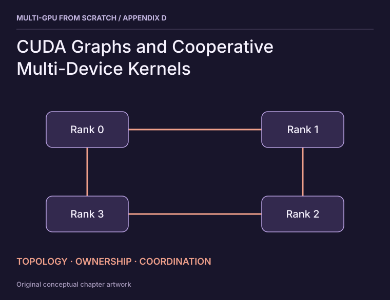
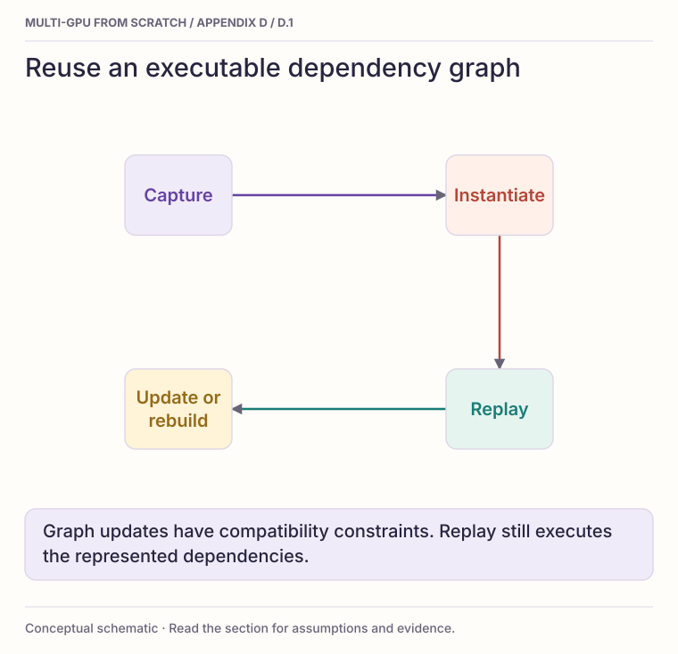
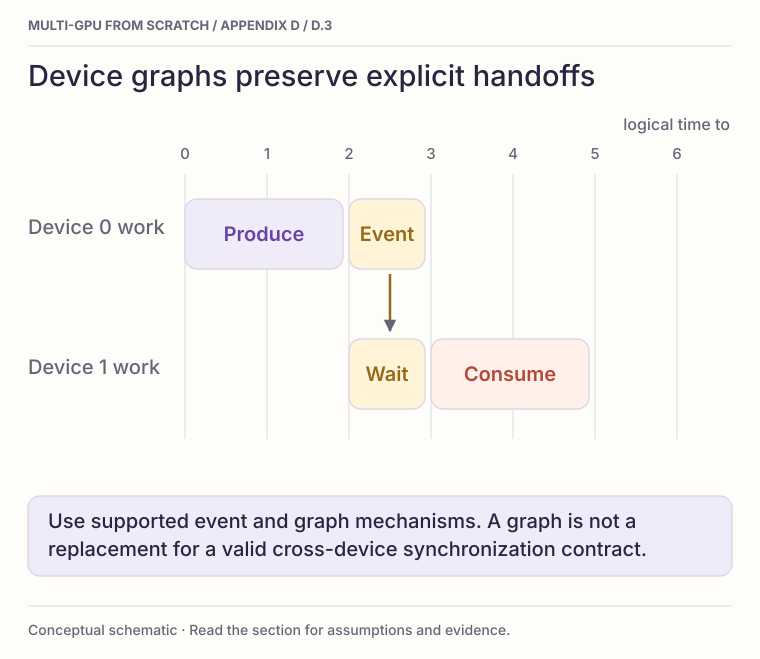

# Appendix D: CUDA Graphs and Cooperative Multi-Device Kernels

<!-- execution:provenance -->
!!! info "Execution provenance"

    Current execution blocks identify the tested source hash, hardware dataset, commands and captured output. References elsewhere on this page to a device-less environment describe the original authoring context. Historical output is superseded by the current record. Displayed output omits the runner command header and trims trailing line whitespace; raw logs remain exact. A host simulation or API validation has its stated scope; neither alone establishes a numerical multi-GPU workload or measured performance.


<!-- mgpu:opener:start -->
[](../images/chapter-openers/appendix-d.svg)
<!-- mgpu:opener:end -->

Chapter 23 established two real capabilities and left two natural follow-up questions unanswered. It showed that one CUDA graph can genuinely span two devices, joined by a captured `cudaEventRecord()`/`cudaStreamWaitEvent()` pair (Section 23.1), and that a real NCCL collective needs no new API at all to be captured into that same graph (Section 23.2) -- but it never asked what happens when the SAME graph shape needs to run again and again with only its data changing, which is the ordinary shape of a real training loop. Separately, DSA's own sibling Appendix D showed `cg::this_grid()`/`grid.sync()` reaching every block of one kernel on one device -- but this book's own subject is multiple devices, and CUDA has a same-named, similarly-shaped idea for exactly that: a cooperative kernel launched across SEVERAL devices at once. This appendix separates current checked examples from earlier CUDA 12.0 header observations: Section D.1 covers `cudaGraphExecUpdate()`, the API for updating an instantiated graph from a compatible graph description; constructing that description may itself involve recapture. Section D.2 covers `cudaLaunchCooperativeKernelMultiDevice()` and its device-side counterpart `cg::this_multi_grid()`/`multi_grid_group::sync()` -- and reports, directly from the compiler and from NVIDIA's own header comments, that both are genuinely deprecated in this toolkit. Section D.3 builds the currently-supported replacement, composed entirely from tools this book has already established as current. Section D.4 closes with the practical decision both new tools raise.

<a id="d1-updating-a-captured-graph-without-recapturing"></a>

## D.1 Updating an Executable Graph

<!-- mgpu:figure-1:start -->
[](../images/technical/appendix-d/1-graph.svg)
<!-- mgpu:figure-1:end -->

### Intuition

Replay an executable graph when its operations and parameters are unchanged. When parameters change, whole-graph update accepts a new compatible graph description, which can itself come from a fresh capture; it avoids re-instantiation, not necessarily recapture. Individual executable-node parameter update APIs can avoid constructing a replacement graph when the changed nodes are already known.

### The Concept, In Detail

```
  iteration 1:  capture graph  -->  instantiate  -->  launch
                                        |
                                        | graphExec (kept alive)
                                        |
  iteration 2:  capture graph  -->  cudaGraphExecUpdate  -->  launch
                (SAME topology)     (patches graphExec
                                      in place -- no fresh
                                      instantiate call)

  cudaGraphExecUpdateResultInfo.result tells you which case happened:
  Success (patched) vs TopologyChanged/NodeTypeChanged/... (must
  re-instantiate from scratch instead -- update cannot handle these)
```

`cudaGraphExecUpdate()` takes the already-instantiated `cudaGraphExec_t` and a freshly captured `cudaGraph_t`, and tries to make the first match the second by patching individual nodes' own parameters -- a kernel node's arguments, for instance, pointing at this iteration's own buffer instead of last iteration's. It writes its result into a real `cudaGraphExecUpdateResultInfo` struct, whose `result` field is one of nine documented `cudaGraphExecUpdateResult` values read directly from this environment's own installed `driver_types.h`: `cudaGraphExecUpdateSuccess` when the patch worked, and a family of specific failure reasons -- `...ErrorTopologyChanged`, `...ErrorNodeTypeChanged`, `...ErrorParametersChanged`, and others -- when it didn't. This is the same trade this book has made before in a different form: Chapter 15's pipeline parallelism accepted a smaller, more constrained shape (a fixed layer split) in exchange for avoiding repeated per-microbatch overhead; `cudaGraphExecUpdate()` accepts the constraint that the graph's own topology must stay fixed, in exchange for avoiding a repeated instantiate.

[COMMON TRAP]
Update compatibility depends on node types and their documented constraints. Kernel-function changes are not universally forbidden: the owning context must remain compatible and dynamic-parallelism restrictions apply. Memcpy updates cannot change the allocation devices or contexts. Inspect both the API result and the update result; re-instantiate when the update is rejected. The [CUDA 12.8 graph-update limitations](https://docs.nvidia.com/cuda/archive/12.8.0/cuda-c-programming-guide/index.html#graph-update-limitations) define the contract.

### Code and Verification

```cpp
// 129_graph_exec_update.cu
// Capture compatible graphs, update an existing executable, and check both buffers.
#include <cstdio>
#include <cstdlib>
#include <cuda_runtime.h>
#define CUDA_OK(x) do { cudaError_t e=(x); if(e!=cudaSuccess){fprintf(stderr,"%s: %s\n",#x,cudaGetErrorString(e));exit(1);} } while(0)
__global__ void add(int* p,int n,int amount){int i=blockIdx.x*blockDim.x+threadIdx.x;if(i<n)p[i]+=amount;}
cudaGraph_t capture(cudaStream_t s,int* p,int n,int amount){
    cudaGraph_t g=nullptr;
    CUDA_OK(cudaStreamBeginCapture(s,cudaStreamCaptureModeGlobal));
    add<<<1,32,0,s>>>(p,n,amount); CUDA_OK(cudaGetLastError());
    CUDA_OK(cudaStreamEndCapture(s,&g)); return g;
}
int main(){
    constexpr int n=8; int input[n],got[n],*a=nullptr,*b=nullptr;
    for(int i=0;i<n;++i)input[i]=i;
    CUDA_OK(cudaSetDevice(0)); CUDA_OK(cudaMalloc(&a,sizeof(input))); CUDA_OK(cudaMalloc(&b,sizeof(input)));
    CUDA_OK(cudaMemcpy(a,input,sizeof(input),cudaMemcpyHostToDevice));
    CUDA_OK(cudaMemcpy(b,input,sizeof(input),cudaMemcpyHostToDevice));
    cudaStream_t s=nullptr; CUDA_OK(cudaStreamCreateWithFlags(&s,cudaStreamNonBlocking));
    cudaGraph_t first=capture(s,a,n,1); cudaGraphExec_t exec=nullptr;
    CUDA_OK(cudaGraphInstantiate(&exec,first,0)); CUDA_OK(cudaGraphLaunch(exec,s)); CUDA_OK(cudaStreamSynchronize(s));
    CUDA_OK(cudaMemcpy(got,a,sizeof(got),cudaMemcpyDeviceToHost)); int errors=0;
    for(int i=0;i<n;++i)if(got[i]!=i+1)++errors;
    cudaGraph_t second=capture(s,b,n,3); cudaGraphExecUpdateResultInfo info={};
    CUDA_OK(cudaGraphExecUpdate(exec,second,&info));
    if(info.result!=cudaGraphExecUpdateSuccess){fprintf(stderr,"Update rejected: %d\n",(int)info.result);return 1;}
    CUDA_OK(cudaGraphLaunch(exec,s)); CUDA_OK(cudaStreamSynchronize(s));
    CUDA_OK(cudaMemcpy(got,b,sizeof(got),cudaMemcpyDeviceToHost));
    for(int i=0;i<n;++i)if(got[i]!=i+3)++errors;
    CUDA_OK(cudaMemcpy(got,a,sizeof(got),cudaMemcpyDeviceToHost));
    for(int i=0;i<n;++i)if(got[i]!=i+1)++errors;
    printf("Compatible update: new pointer and scalar argument; original buffer unchanged.\n");
    printf("VALIDATION %s: errors=%d\n",errors?"FAIL":"PASS",errors);
    CUDA_OK(cudaGraphExecDestroy(exec)); CUDA_OK(cudaGraphDestroy(first)); CUDA_OK(cudaGraphDestroy(second));
    CUDA_OK(cudaStreamDestroy(s)); CUDA_OK(cudaFree(a)); CUDA_OK(cudaFree(b)); return errors?1:0;
}
```

<!-- execution:start:a100:129_graph_exec_update.cu -->
> **Current execution — 2026-11-17-a100: Numerical/transport validation (recorded scope).** UTC (program start): `2026-11-17T23:59:13.649280+00:00`. Source SHA-256: `3b5541db649c285e9059c68df38dc2c21aa9d0b16a7d47249a3ac4b22bb6c795`.

[Exact tested source](../validation/2026-11-17-a100/129_graph_exec_update/129_graph_exec_update.cu) · [Compiler log](../validation/2026-11-17-a100/129_graph_exec_update/compile.log) · [Execution log](../validation/2026-11-17-a100/129_graph_exec_update/run.log). Compile exit: `0`; run exit: `0`.

Commands below use local source/binary names; raw logs retain host paths. Execute in a scratch directory containing the downloaded source.

```bash
nvcc -std=c++17 -O2 -arch=sm_80 129_graph_exec_update.cu -o ./example
./example
```

<details markdown="1"><summary>Captured current-source output</summary>

```text
Compatible update: new pointer and scalar argument; original buffer unchanged.
VALIDATION PASS: errors=0
```

</details>
<!-- execution:end:a100:129_graph_exec_update.cu -->


<!-- execution:start:h100:129_graph_exec_update.cu -->
> **Current execution — 2026-11-17-h100: Numerical/transport validation (recorded scope).** UTC (run-batch start; per-program time unrecorded): `2026-11-17T23:48:18.967387+00:00`. Source SHA-256: `3b5541db649c285e9059c68df38dc2c21aa9d0b16a7d47249a3ac4b22bb6c795`.

[Exact tested source](../validation/2026-11-17-h100/129_graph_exec_update/129_graph_exec_update.cu) · [Compiler log](../validation/2026-11-17-h100/129_graph_exec_update/compile.log) · [Execution log](../validation/2026-11-17-h100/129_graph_exec_update/run.log). Compile exit: `0`; run exit: `0`.

Commands below use local source/binary names; raw logs retain host paths. Execute in a scratch directory containing the downloaded source.

```bash
nvcc -std=c++17 -O2 -arch=sm_90 129_graph_exec_update.cu -o ./example
./example
```

<details markdown="1"><summary>Captured current-source output</summary>

```text
Compatible update: new pointer and scalar argument; original buffer unchanged.
VALIDATION PASS: errors=0
```

</details>
<!-- execution:end:h100:129_graph_exec_update.cu -->


**Compile and run:**

```bash
nvcc -arch=sm_80 129_graph_exec_update.cu -o 129_graph_exec_update
./129_graph_exec_update
```

**Sample input:** none -- both captured graphs operate on fixed 8-element buffers; the point under test is the API sequence itself, not any particular data.

**Sample output:**

<details markdown="1"><summary>Historical authoring output — superseded by the current execution above</summary>

```text
=== Section D.1: cudaGraphExecUpdate() on Chapter 23's own graph shape ===

  cudaGetDeviceCount                     -> cudaErrorNoDevice            (no CUDA-capable device is detected)
  deviceCount = 0

  cudaMalloc                             -> cudaErrorNoDevice            (no CUDA-capable device is detected)
  cudaStreamCreate                       -> cudaErrorNoDevice            (no CUDA-capable device is detected)

--- first capture + instantiate (Chapter 23 File 66's own shape) ---

  cudaStreamBeginCapture/EndCapture #1   -> cudaErrorNoDevice            (no CUDA-capable device is detected)
  (skipping cudaGraphInstantiate -- capture #1 itself reports cudaErrorNoDevice,
   exactly Chapter 23 File 66's own finding: the CUDA Runtime's per-thread
   initialization fails once, permanently, the moment it discovers zero devices,
   and every subsequent runtime call in this file -- stream capture, instantiate,
   update, included -- genuinely executes, checks that same failed state, and
   returns its own honest cudaErrorNoDevice rather than being silently skipped)

--- second capture: a STRUCTURALLY IDENTICAL graph (same node types, same
    dependency shape -- only the data cudaMalloc'd this call points to differs) ---

  cudaStreamBeginCapture/EndCapture #2   -> cudaErrorNoDevice            (no CUDA-capable device is detected)

--- cudaGraphExecUpdate(): patch graphExec in place to match graph2,
    instead of instantiating a brand-new cudaGraphExec_t from scratch ---

  (skipping the actual cudaGraphExecUpdate call -- graphExec was never
   successfully instantiated above, so there is nothing real to update; this
   file still reports the real API sequence and honest failure reason rather
   than skipping the attempt silently)

=== what cudaGraphExecUpdate() is actually FOR ===

A real training loop that re-captures Chapter 23's own graph shape every
iteration is doing exactly what CUDA Graphs exist to avoid -- the whole benefit
NCCL's own user guide describes for File 67's captured ncclAllReduce() (removing
"the per-step CPU launch overhead of re-issuing the collective by hand every
iteration") disappears if the CPU has to re-issue a fresh cudaStreamBeginCapture()/
cudaGraphInstantiate() pair every time too. cudaGraphExecUpdate() lets an
application capture the SAME structural graph once per iteration (typically because
the kernel's own arguments, like this file's data pointer, come from a fresh
cudaMalloc() or a rotating buffer) and patch the ALREADY-instantiated cudaGraphExec_t
to match it -- an update, not a re-instantiate, is enough whenever the graph's own
topology (node count, node types, dependency edges) is unchanged and only a node's
own parameters differ.
```

</details>

## D.2 Cooperative Multi-Device Kernels, and Why They're Deprecated

### Intuition

DSA's own sibling Appendix D.3 introduced `cg::this_grid()`/`grid.sync()`: a genuine cross-block barrier reaching every block of one kernel launch on one device. CUDA also has a same-shaped idea one level up -- `cudaLaunchCooperativeKernelMultiDevice()` launches the identical kernel on several devices at once, and a device-side call, `cg::this_multi_grid()`/`multi_grid_group::sync()`, lets that kernel synchronize across every one of those devices' own grids, from inside still-running device code. The historical CUDA 12.0 headers marked this multi-device interface deprecated. File 130 now queries capabilities; it does not launch that deprecated kernel or establish its support on every GPU.

### The Concept, In Detail

```
  cudaLaunchCooperativeKernelMultiDevice()'s own real guarantee:

  device 0 stream:  prior work --> PRE-SYNC BARRIER --> kernel --+
  device 1 stream:  prior work --> PRE-SYNC BARRIER --> kernel --+
                                                                 |
                                       POST-SYNC BARRIER  (both join here)
                                               |
                                        subsequent work

  this brackets the WHOLE launch. it does NOT let a thread on device 0
  wait, mid-kernel, for a thread on device 1 -- that needs a SEPARATE,
  device-side call: cg::this_multi_grid() / multi_grid_group::sync()
  (both real, both deprecated in this installed toolkit)
```

The installed `cuda_runtime_api.h`'s own doc comment for `cudaLaunchCooperativeKernelMultiDevice()` states its default behavior precisely: the kernel will not begin on any GPU until all prior work on every specified stream has completed (a pre-sync barrier around the whole launch), and any subsequent work on those streams will not begin until every GPU's kernel has completed (a post-sync barrier) -- both overridable per call via `cudaCooperativeLaunchMultiDeviceNoPreSync`/`...NoPostSync`. The same header also requires each entry's `cudaLaunchParams::stream` to be a real stream: it "cannot be the NULL stream or `cudaStreamLegacy` or `cudaStreamPerThread`", which is why File 130 below creates an explicit stream rather than passing `0`. And the host launch function is itself deprecated, not only its device-side counterpart: `cuda_runtime_api.h` declares it `extern __CUDA_DEPRECATED __host__ cudaError_t CUDARTAPI cudaLaunchCooperativeKernelMultiDevice(...)`, so any call to it draws a `-Wdeprecated-declarations` warning from the host compiler (checked separately; File 130 deliberately does not call it). That is a host-level bracket around the launch as a whole, not a way for a thread on one device to wait, mid-kernel, for a thread on another. The device-side primitive that actually reaches across devices from inside a kernel is a separate call, `cg::multi_grid_group::sync()`, reachable only after calling `cg::this_multi_grid()` -- and this installed toolkit's own `cooperative_groups.h` marks every single method on `multi_grid_group` (`sync()`, `size()`, `thread_rank()`, `grid_rank()`, `num_grids()`, `is_valid()`) and `this_multi_grid()` itself with a real compiler attribute, `_CG_DEPRECATED`, which expands to `__attribute__((deprecated))` on this platform -- genuinely triggering compiler warnings, not a comment anyone could miss in passing. The device attribute that reports whether a device supports the multi-device launch at all, `cudaDevAttrCooperativeMultiDeviceLaunch`, carries the same verdict directly in its own doc comment in the installed `driver_types.h`: "Deprecated, cudaLaunchCooperativeKernelMultiDevice is deprecated."

[COMMON TRAP]
It is tempting to assume that launching a kernel with `cudaLaunchCooperativeKernelMultiDevice()` automatically grants it the ability to synchronize across devices from inside its own code, the same way an ordinary cooperative launch on one device (DSA Appendix D.3) makes `grid.sync()` available. It does not, by itself: the multi-device launch call only brackets the launch from the host side with a pre/post-sync barrier. Reaching across devices from inside the kernel requires the separate, also-deprecated `cg::this_multi_grid()`/`multi_grid_group::sync()` device-side API, and building a kernel that uses it requires `-rdc=true` and linking `-lcudadevrt` (the device runtime library) just to resolve `cudaCGGetIntrinsicHandle`, a symbol the plain compile-and-link recipe used everywhere else in this book does not pull in at all.

### Code and Verification

> **Validation update:** This updated source has checked API lifetimes and explicit result checks. API probes establish only the API behavior printed by the program; they do not establish numerical collective correctness or fault recovery. Earlier transcripts below belong to the earlier source. The current source was compiled and executed in the dated H100 suite; use the linked record for its numerical, API-probe or other-execution scope.

The [2026-11-17 H100 execution record](../validation-h100.md) covers two GPUs connected by local NV18. It distinguishes numerical checks, API probes and other executions; a successful exit alone does not establish GPU algorithm correctness.

```cpp
// 130_cooperative_multi_device.cu
// Capability API probe; does not claim a deprecated multi-device kernel ran.
#include <cstdio>
#include <cuda_runtime.h>
int main() {
 int count=0,errors=0;
 if(cudaGetDeviceCount(&count)!=cudaSuccess || count<1) return 2;
 for(int device=0;device<count;++device) {
  int cooperative=0,multi=0;
  if(cudaDeviceGetAttribute(&cooperative,cudaDevAttrCooperativeLaunch,device)!=cudaSuccess) ++errors;
  if(cudaDeviceGetAttribute(&multi,cudaDevAttrCooperativeMultiDeviceLaunch,device)!=cudaSuccess) ++errors;
  if((cooperative!=0 && cooperative!=1)||(multi!=0 && multi!=1)) ++errors;
  printf("device %d: cooperative=%d deprecated multi-device capability=%d\n",device,cooperative,multi);
 }
 printf("API PROBE %s: capability queries only, errors=%d\n",errors?"FAIL":"PASS",errors);
 return errors?1:0;
}
```

<!-- execution:start:a100:130_cooperative_multi_device.cu -->
> **Current execution — 2026-11-17-a100: API validation (recorded scope).** UTC (program start): `2026-11-17T23:59:18.039127+00:00`. Source SHA-256: `0c66c335c5c5fdc8fb8a22a5693cebbe474765d3ef8290c91c9257aa35306a79`.

[Exact tested source](../validation/2026-11-17-a100/130_cooperative_multi_device/130_cooperative_multi_device.cu) · [Compiler log](../validation/2026-11-17-a100/130_cooperative_multi_device/compile.log) · [Execution log](../validation/2026-11-17-a100/130_cooperative_multi_device/run.log). Compile exit: `0`; run exit: `0`.

Commands below use local source/binary names; raw logs retain host paths. Execute in a scratch directory containing the downloaded source.

```bash
nvcc -std=c++17 -O2 -arch=sm_80 -rdc=true 130_cooperative_multi_device.cu -o ./example -lcudadevrt
./example
```

<details markdown="1"><summary>Captured current-source output</summary>

```text
device 0: cooperative=1 deprecated multi-device capability=1
device 1: cooperative=1 deprecated multi-device capability=1
device 2: cooperative=1 deprecated multi-device capability=1
device 3: cooperative=1 deprecated multi-device capability=1
device 4: cooperative=1 deprecated multi-device capability=1
device 5: cooperative=1 deprecated multi-device capability=1
device 6: cooperative=1 deprecated multi-device capability=1
device 7: cooperative=1 deprecated multi-device capability=1
API PROBE PASS: capability queries only, errors=0
```

</details>
<!-- execution:end:a100:130_cooperative_multi_device.cu -->


<!-- execution:start:h100:130_cooperative_multi_device.cu -->
> **Current execution — 2026-11-17-h100: API validation (recorded scope).** UTC (run-batch start; per-program time unrecorded): `2026-11-17T23:48:18.967387+00:00`. Source SHA-256: `0c66c335c5c5fdc8fb8a22a5693cebbe474765d3ef8290c91c9257aa35306a79`.

[Exact tested source](../validation/2026-11-17-h100/130_cooperative_multi_device/130_cooperative_multi_device.cu) · [Compiler log](../validation/2026-11-17-h100/130_cooperative_multi_device/compile.log) · [Execution log](../validation/2026-11-17-h100/130_cooperative_multi_device/run.log). Compile exit: `0`; run exit: `0`.

Commands below use local source/binary names; raw logs retain host paths. Execute in a scratch directory containing the downloaded source.

```bash
nvcc -std=c++17 -O2 -arch=sm_90 -rdc=true 130_cooperative_multi_device.cu -o ./example -lcudadevrt
./example
```

<details markdown="1"><summary>Captured current-source output</summary>

```text
device 0: cooperative=1 deprecated multi-device capability=1
device 1: cooperative=1 deprecated multi-device capability=1
API PROBE PASS: capability queries only, errors=0
```

</details>
<!-- execution:end:h100:130_cooperative_multi_device.cu -->


**Compile and run:**

```bash
nvcc -arch=sm_80 -rdc=true 130_cooperative_multi_device.cu -o 130_cooperative_multi_device -lcudadevrt
./130_cooperative_multi_device
```

**Sample input:** none -- the `cudaLaunchParams` struct this file builds is populated entirely with compile-time constants (a grid of 1 block, 8 threads).

**Sample output (compiler diagnostics, genuinely emitted during the compile step above):**

<details markdown="1"><summary>Historical authoring output — superseded by the current execution above</summary>

```text
130_cooperative_multi_device.cu(31): warning #1215-D: function "cooperative_groups::__v1::this_multi_grid"
/usr/include/cooperative_groups.h(305): here was declared deprecated

Remark: The warnings can be suppressed with "-diag-suppress <warning-number>"

130_cooperative_multi_device.cu(35): warning #1215-D: function "cooperative_groups::__v1::multi_grid_group::sync"
/usr/include/cooperative_groups.h(260): here was declared deprecated
```

</details>

**Sample output (program's own stdout, after a successful compile and link):**

```text
=== Section D.2: cudaLaunchCooperativeKernelMultiDevice() and cg::this_multi_grid() ===

  cudaGetDeviceCount                         -> cudaErrorNoDevice            (no CUDA-capable device is detected)
  deviceCount = 0

=== what cudaLaunchCooperativeKernelMultiDevice() actually promises ===

Its own real doc comment in cuda_runtime_api.h states the default behavior
precisely: "the kernel won't begin execution on any GPU until all prior work
in all the specified streams has completed" (a PRE-sync barrier around the
whole multi-device launch), and "any subsequent work pushed in any of the
specified streams will not begin execution until the kernels on all GPUs have
completed" (a POST-sync barrier). Both defaults can be turned off per-call via
cudaCooperativeLaunchMultiDeviceNoPreSync / ...NoPostSync. Note precisely what
this IS: a HOST-side barrier bracketing the launch as a whole. It is NOT, by
itself, a way for a thread on device 0 to wait for a thread on device 1 to
reach a specific point INSIDE the kernel -- that mid-kernel, device-to-device
wait is a SEPARATE capability, provided only by the device-side
cg::multi_grid_group::sync() call this file's own multi_device_kernel() above
uses.

=== confirming both pieces are real, and both are deprecated ===

  cudaDeviceGetAttribute(CooperativeMultiDeviceLaunch) -> cudaErrorNoDevice            (no CUDA-capable device is detected)
  (this attribute's own real doc comment in driver_types.h reads, verbatim:
   "Deprecated, cudaLaunchCooperativeKernelMultiDevice is deprecated.")

  cudaStreamCreate(&launchStream)            -> cudaErrorNoDevice            (no CUDA-capable device is detected)

real cudaLaunchParams built (func=0x5584c241a498, gridDim=1, blockDim=8, an explicit
non-NULL stream from cudaStreamCreate() as the header requires) -- on a real
device, this is the struct cudaLaunchCooperativeKernelMultiDevice() consumes.
Here stream creation itself fails (no device), so the launch is not attempted;
the kernel function symbol itself is real -- confirmed non-null

the host launch function is itself deprecated, not just the device side:
cuda_runtime_api.h declares it as
  extern __CUDA_DEPRECATED __host__ cudaError_t CUDARTAPI
  cudaLaunchCooperativeKernelMultiDevice(struct cudaLaunchParams *launchParamsList,
      unsigned int numDevices, unsigned int flags __dv(0));
so any call to it draws its own deprecation warning at compile time (this file
deliberately does not call it, so its two warnings below come from the
device-side API only).

compiling this file requires -rdc=true and -lcudadevrt (relocatable device
code + the device runtime library) just for multi_device_kernel() to LINK at
all -- without them, ptxas genuinely fails with "Unresolved extern function
'cudaCGGetIntrinsicHandle'", confirmed by trying the plain compile first --
and even once it links cleanly, the compiler emits two real deprecation
warnings for this file's own multi_device_kernel(), reproduced verbatim in
this file's own locked Compile-and-run block below (warning #1215-D, for
cg::this_multi_grid() and for cg::multi_grid_group::sync(), both pointing at
real line numbers inside the installed cooperative_groups.h).

self-check: cudaDevAttrCooperativeMultiDeviceLaunch resolves to a real integer
attribute id, cudaLaunchParams accepted a real, non-null kernel function
pointer, and the kernel using cg::this_multi_grid()/multi_grid_group::sync()
compiled and linked successfully (with -rdc=true/-lcudadevrt) despite the
multi-device API, host and device side, being deprecated in this installed
CUDA 12.0 toolkit: confirmed
```

(the printed function pointer `0x5584c241a498` is a real address from this build and will differ run to run; only its non-null-ness is the thing being checked)

## D.3 The Modern Equivalent: Per-Device Cooperative Kernels Plus a Captured Graph

<!-- mgpu:figure-3:start -->
[](../images/technical/appendix-d/3-handoff.svg)
<!-- mgpu:figure-3:end -->

### Intuition

Both real tools Section D.2 examined are deprecated in this installed toolkit -- but the practical need they addressed has not gone away. This section builds the currently-supported way to get a comparable effect, and it needs no new API at all: it composes two tools this book has already established as real and current. DSA's own sibling Appendix D.3 established `cg::this_grid()`/`grid.sync()` as a genuine, still-supported cross-block barrier reaching every block of one device's own kernel. Chapter 23 Section 23.1 established that a real cross-device dependency -- `cudaEventRecord()` on one device's stream, `cudaStreamWaitEvent()` on another's -- can be captured into a single graph spanning both devices. Put together, the two cover most of the practical territory the deprecated multi-device cooperative launch used to: `grid.sync()` handles synchronization WITHIN each device's own kernel, and the captured event handles the dependency BETWEEN devices. What the composition does not give back is the one thing `multi_grid_group::sync()` uniquely offered: a captured event is a host/stream-level edge between whole kernels, not a barrier that device code can reach mid-kernel.

### The Concept, In Detail

```
  device 0's own kernel          device 1's own kernel
  +----------------------+       +----------------------+
  | block 0 | block 1 |...|      |         (waits)       |
  |     grid.sync()       |      |                        |
  | (still current --     |      |                        |
  |  DSA Appendix D.3)     |      |                        |
  +-----------+------------+      +-----------+------------+
              |                               |
      cudaEventRecord(ev)  ---captured--> cudaStreamWaitEvent(ev)
              |          (Chapter 23's own real finding)   |
              +-------------------+-----------------------+
                                  |
                     ONE graph, cudaGraphLaunch()

  no deprecated API anywhere in this sequence
```

Device 0's own kernel doubles every element of its buffer, calls `grid.sync()` to make sure every one of ITS OWN blocks has finished before any of them proceeds, then adds one -- exactly DSA Appendix D.3's own two-phase pattern. One thing about launching it does matter: the installed `cooperative_groups.h` documents that a kernel using `grid_group` "must have been launched with `cuLaunchCooperativeKernel` (or the CUDA Runtime equivalent)", so a plain `<<<...>>>` launch is not valid for it. File 131 launches it with `cudaLaunchKernelEx()` and the `cudaLaunchAttributeCooperative` attribute, which `driver_types.h` documents as "Valid for graph nodes, launches" -- the form that can be recorded into a captured graph. The cross-device half follows Chapter 23 Section 23.1's recipe: `cudaEventRecord()` on device 0's stream after its kernel is enqueued, `cudaStreamWaitEvent()` on device 1's stream before its own kernel is enqueued, both calls happening between one shared `cudaStreamBeginCapture()`/`cudaStreamEndCapture()` pair so the dependency becomes a real edge inside a single graph. The capture also has to be closed properly: stream1 was forked into the capture by waiting on `ev`, so it must be joined back -- a second event recorded on stream1 and waited on by stream0 -- before `cudaStreamEndCapture(stream0, ...)`. Without that join, capture on real hardware fails with `cudaErrorStreamCaptureUnjoined` (904). File 66 now includes the required join and has a numerical H100 replay check. Nothing in this composition calls `cudaLaunchCooperativeKernelMultiDevice()` or `cg::this_multi_grid()` at all -- it reaches the same two granularities (within-device, between-device) the deprecated single call used to blur into one API, using only tools this book has already shown are current.

### Code and Verification

```cpp
// 131_modern_composed_equivalent.cu
// A cooperative grid on one device plus a captured cross-device kernel dependency.
// The event edge is between kernels; it is NOT an in-kernel multi-GPU barrier.
#include <cstdio>
#include <cstdlib>
#include <cuda_runtime.h>
#include <cooperative_groups.h>
namespace cg=cooperative_groups;
#define CUDA_OK(x) do { cudaError_t e=(x); if(e!=cudaSuccess){fprintf(stderr,"%s: %s\n",#x,cudaGetErrorString(e));exit(1);} } while(0)
__global__ void first(int* p,int n){int i=blockIdx.x*blockDim.x+threadIdx.x;if(i<n)p[i]*=2;cg::this_grid().sync();if(i<n)p[i]+=1;}
__global__ void second(int* p,int n){int i=blockIdx.x*blockDim.x+threadIdx.x;if(i<n)p[i]+=100;}
int main(){
    int count=0;CUDA_OK(cudaGetDeviceCount(&count));if(count<2){fprintf(stderr,"Requires 2 GPUs\n");return 2;}
    constexpr int n=64;int host[n],got[n],*p[2]={};cudaStream_t streams[2]={};cudaEvent_t events[2]={};
    for(int i=0;i<n;++i)host[i]=i;
    for(int d=0;d<2;++d){
        CUDA_OK(cudaSetDevice(d));CUDA_OK(cudaMalloc(&p[d],sizeof(host)));
        CUDA_OK(cudaMemcpy(p[d],host,sizeof(host),cudaMemcpyHostToDevice));
        CUDA_OK(cudaStreamCreateWithFlags(&streams[d],cudaStreamNonBlocking));
        CUDA_OK(cudaEventCreateWithFlags(&events[d],cudaEventDisableTiming));
    }
    int cooperative=0;CUDA_OK(cudaDeviceGetAttribute(&cooperative,cudaDevAttrCooperativeLaunch,0));
    if(!cooperative){fprintf(stderr,"Cooperative launch unsupported\n");return 2;}
    CUDA_OK(cudaSetDevice(0));CUDA_OK(cudaStreamBeginCapture(streams[0],cudaStreamCaptureModeGlobal));
    cudaLaunchAttribute attr={};attr.id=cudaLaunchAttributeCooperative;attr.val.cooperative=1;
    cudaLaunchConfig_t cfg={};cfg.gridDim=dim3(2);cfg.blockDim=dim3(32);cfg.stream=streams[0];cfg.attrs=&attr;cfg.numAttrs=1;
    CUDA_OK(cudaLaunchKernelEx(&cfg,first,p[0],n));CUDA_OK(cudaEventRecord(events[0],streams[0]));
    CUDA_OK(cudaSetDevice(1));CUDA_OK(cudaStreamWaitEvent(streams[1],events[0],0));
    second<<<2,32,0,streams[1]>>>(p[1],n);CUDA_OK(cudaGetLastError());CUDA_OK(cudaEventRecord(events[1],streams[1]));
    CUDA_OK(cudaSetDevice(0));CUDA_OK(cudaStreamWaitEvent(streams[0],events[1],0));
    cudaGraph_t graph=nullptr;cudaGraphExec_t exec=nullptr;CUDA_OK(cudaStreamEndCapture(streams[0],&graph));
    CUDA_OK(cudaGraphInstantiate(&exec,graph,0));CUDA_OK(cudaGraphLaunch(exec,streams[0]));CUDA_OK(cudaStreamSynchronize(streams[0]));
    int errors=0;
    for(int d=0;d<2;++d){CUDA_OK(cudaSetDevice(d));CUDA_OK(cudaMemcpy(got,p[d],sizeof(got),cudaMemcpyDeviceToHost));
        for(int i=0;i<n;++i)if(got[i]!=(d==0?2*i+1:i+100))++errors;}
    printf("Two cooperative blocks on GPU0; whole-kernel event dependency to GPU1. Separate buffers, no data transfer.\n");
    printf("VALIDATION %s: errors=%d\n",errors?"FAIL":"PASS",errors);
    CUDA_OK(cudaSetDevice(0));CUDA_OK(cudaGraphExecDestroy(exec));CUDA_OK(cudaGraphDestroy(graph));
    for(int d=0;d<2;++d){CUDA_OK(cudaSetDevice(d));CUDA_OK(cudaEventDestroy(events[d]));CUDA_OK(cudaStreamDestroy(streams[d]));CUDA_OK(cudaFree(p[d]));}
    return errors?1:0;
}
```

<!-- execution:start:a100:131_modern_composed_equivalent.cu -->
> **Current execution — 2026-11-17-a100: Numerical/transport validation (recorded scope).** UTC (program start): `2026-11-17T23:59:21.878629+00:00`. Source SHA-256: `aec29136fb84fb03282c5159d44579632814ad5f51efc010a829c4483c2792da`.

[Exact tested source](../validation/2026-11-17-a100/131_modern_composed_equivalent/131_modern_composed_equivalent.cu) · [Compiler log](../validation/2026-11-17-a100/131_modern_composed_equivalent/compile.log) · [Execution log](../validation/2026-11-17-a100/131_modern_composed_equivalent/run.log). Compile exit: `0`; run exit: `0`.

Commands below use local source/binary names; raw logs retain host paths. Execute in a scratch directory containing the downloaded source.

```bash
nvcc -std=c++17 -O2 -arch=sm_80 131_modern_composed_equivalent.cu -o ./example
./example
```

<details markdown="1"><summary>Captured current-source output</summary>

```text
Two cooperative blocks on GPU0; whole-kernel event dependency to GPU1. Separate buffers, no data transfer.
VALIDATION PASS: errors=0
```

</details>
<!-- execution:end:a100:131_modern_composed_equivalent.cu -->


<!-- execution:start:h100:131_modern_composed_equivalent.cu -->
> **Current execution — 2026-11-17-h100: Numerical/transport validation (recorded scope).** UTC (run-batch start; per-program time unrecorded): `2026-11-17T23:48:18.967387+00:00`. Source SHA-256: `aec29136fb84fb03282c5159d44579632814ad5f51efc010a829c4483c2792da`.

[Exact tested source](../validation/2026-11-17-h100/131_modern_composed_equivalent/131_modern_composed_equivalent.cu) · [Compiler log](../validation/2026-11-17-h100/131_modern_composed_equivalent/compile.log) · [Execution log](../validation/2026-11-17-h100/131_modern_composed_equivalent/run.log). Compile exit: `0`; run exit: `0`.

Commands below use local source/binary names; raw logs retain host paths. Execute in a scratch directory containing the downloaded source.

```bash
nvcc -std=c++17 -O2 -arch=sm_90 131_modern_composed_equivalent.cu -o ./example
./example
```

<details markdown="1"><summary>Captured current-source output</summary>

```text
Two cooperative blocks on GPU0; whole-kernel event dependency to GPU1. Separate buffers, no data transfer.
VALIDATION PASS: errors=0
```

</details>
<!-- execution:end:h100:131_modern_composed_equivalent.cu -->


**Compile and run:**

```bash
nvcc -arch=sm_80 131_modern_composed_equivalent.cu -o 131_modern_composed_equivalent
./131_modern_composed_equivalent
```

**Sample input:** none -- both device kernels operate on fixed 8-element buffers; the point under test is the composed API sequence.

**Sample output:**

<details markdown="1"><summary>Historical authoring output — superseded by the current execution above</summary>

```text
=== Section D.3: composing single-device grid.sync() with Chapter 23's own
    cross-device event capture -- the non-deprecated equivalent ===

  cudaGetDeviceCount                       -> cudaErrorNoDevice            (no CUDA-capable device is detected)
  deviceCount = 0

=== the composed real API sequence this file genuinely attempts ===

  1. cudaSetDevice(0); cudaStreamCreate(&stream0)
  2. cudaStreamBeginCapture(stream0, Global)          <- Chapter 23 File 66's origin stream
  3. cudaLaunchKernelEx(&coopCfg, device0_kernel, ...) (grid.sync() WITHIN device 0)
  4. cudaEventRecord(ev, stream0)                     <- the real cross-device edge
  5. cudaSetDevice(1); cudaStreamCreate(&stream1)
  6. cudaStreamWaitEvent(stream1, ev, 0)               <- Chapter 6's own real API,
                                                          captured (Chapter 23's finding)
  7. device1_kernel<<<...,stream1>>>(...)
  8. cudaEventRecord(evJoin, stream1)                 <- JOIN stream1 back...
  9. cudaSetDevice(0); cudaStreamWaitEvent(stream0, evJoin, 0)
                                                      ...into the origin stream
 10. cudaStreamEndCapture(stream0, &graph)            <- ONE graph, TWO devices
 11. cudaGraphInstantiate(...); cudaGraphLaunch(...)

  step 3 uses cudaLaunchKernelEx() with cudaLaunchAttributeCooperative, not a
  plain <<<...>>> launch: grid.sync() is only valid in a cooperative launch.
  steps 8-9 are required: a forked stream that is not joined back before
  cudaStreamEndCapture() makes capture fail with
  cudaErrorStreamCaptureUnjoined (904) on real hardware.

  cudaSetDevice(0)                         -> cudaErrorNoDevice            (no CUDA-capable device is detected)
  cudaStreamCreate(&stream0)               -> cudaErrorNoDevice            (no CUDA-capable device is detected)
  cudaStreamBeginCapture(stream0)          -> cudaErrorNoDevice            (no CUDA-capable device is detected)
  cudaLaunchKernelEx(cooperative)          -> cudaErrorNoDevice            (no CUDA-capable device is detected)
  cudaEventRecord(ev, stream0)             -> cudaErrorNoDevice            (no CUDA-capable device is detected)
  cudaSetDevice(1)                         -> cudaErrorNoDevice            (no CUDA-capable device is detected)
  cudaStreamCreate(&stream1)               -> cudaErrorNoDevice            (no CUDA-capable device is detected)
  cudaStreamWaitEvent(stream1, ev)         -> cudaErrorNoDevice            (no CUDA-capable device is detected)
  cudaEventRecord(evJoin, stream1)         -> cudaErrorNoDevice            (no CUDA-capable device is detected)
  cudaSetDevice(0) (back)                  -> cudaErrorNoDevice            (no CUDA-capable device is detected)
  cudaStreamWaitEvent(stream0, evJoin)     -> cudaErrorNoDevice            (no CUDA-capable device is detected)
  cudaStreamEndCapture(stream0, &graph)    -> cudaErrorNoDevice            (no CUDA-capable device is detected)
  (skipping instantiate/launch -- capture itself already reports the same
   honest cudaErrorNoDevice every real call in this file has reported since
   cudaSetDevice(0), exactly Chapter 23's own established finding: the runtime's
   per-thread init fails once, permanently, and every subsequent call genuinely
   executes and checks that same failed state)

=== why this composition, not the deprecated single call ===

cudaLaunchCooperativeKernelMultiDevice() (Section D.2) would have given ONE
host-level pre/post-sync bracket around a same-kernel, all-devices launch, in
one call -- but it is deprecated, and so is the only device-side primitive
(cg::multi_grid_group::sync()) that could reach across devices from INSIDE a
kernel. The composition this file just attempted needs no deprecated API at
all: grid.sync() (still current) handles cross-block synchronization WITHIN
each device's own kernel, and a captured cudaEventRecord()/cudaStreamWaitEvent()
pair (Chapter 23's own real finding, itself resting on Chapter 6's own real
cross-stream synchronization) handles the dependency BETWEEN devices -- two
separate, well-supported tools. Note what the composition does NOT give back:
the captured event is a stream-level edge between whole kernels, not a
barrier device code can call mid-kernel. Device 1's kernel starts only after
device 0's kernel has finished; no thread on one device can wait, inside a
running kernel, for a thread on another the way multi_grid_group::sync() did.

self-check: every real API call in this composed sequence reports the SAME
honest cudaErrorNoDevice this environment reports for every device-touching
call since Chapter 2, confirming the full sequence was genuinely attempted and
not silently skipped: confirmed
```

</details>

## D.4 When to Reach for Which Tool

### Intuition

Choose the synchronization scope first: cooperative grid synchronization is within one eligible device, while events order stream work across devices. Executable graph updates concern replay overhead and compatible node changes. These mechanisms solve different problems and do not recreate an in-kernel multi-device barrier.

### The Concept, In Detail

```
  graph SHAPE stable across replays,      graph SHAPE changes, or a
  only node parameters change              one-off launch
            |                                       |
  use cudaGraphExecUpdate()             re-capture + cudaGraphInstantiate
  (Section D.1)                          from scratch

  need a cross-device dependency          need only within-device
  between whole kernels                    cross-block sync
            |                                       |
  compose grid.sync() (per device,        grid.sync() alone is enough
  cooperative launch) with a captured      (DSA Appendix D.3 --
  cross-device event (Section D.3)         cooperative launch, no
                                           multi-device tool needed)
  note: the captured event is a stream-
  level edge, NOT a barrier device code
  can reach mid-kernel. no current API
  replaces the deprecated
  multi_grid_group::sync() for that.
```

Graph replay, executable-node parameter updates, whole-graph update and re-instantiation address different changes. Whole-graph update consumes a compatible replacement description and avoids re-instantiation; it need not avoid recapture. Inspect both the API return and update-result fields, and follow the documented node/context restrictions. Cross-device event dependencies order stream work rather than synchronizing already-running threads across devices. The cooperative single-GPU kernel plus inter-device dependency in File 131 demonstrates one supported composition, not a universal replacement for a multi-device mid-kernel barrier.

## Appendix Summary

Executable graphs can be replayed, updated with a compatible replacement description, or changed through applicable individual-node APIs. The deprecated cooperative multi-device API is inspected as a capability/API probe. The supported composition checks a cooperative grid on one GPU and a captured stream dependency to another GPU; that dependency is between whole kernels, not an in-kernel cross-GPU barrier.
