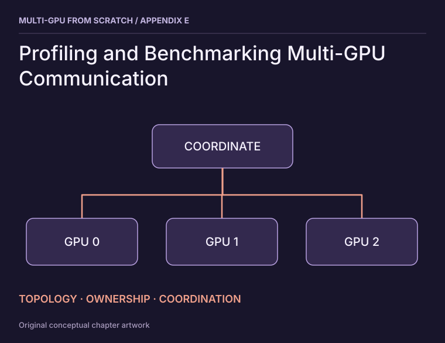
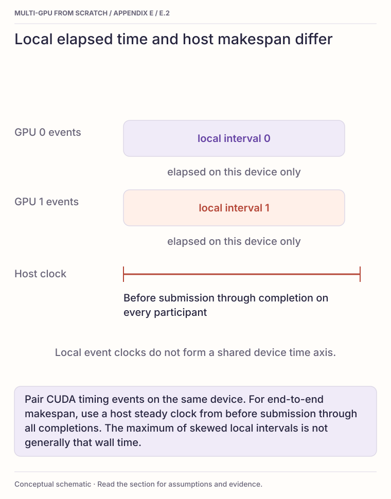
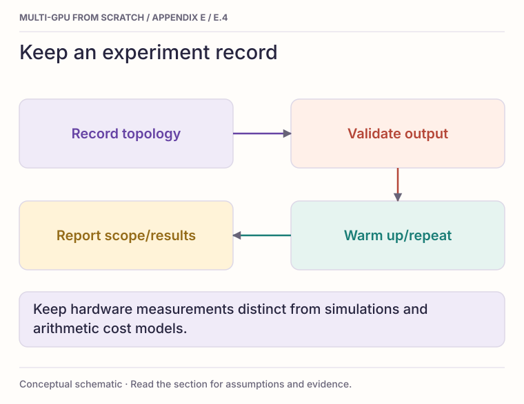

# Appendix E: Profiling and Benchmarking Multi-GPU Communication

<!-- mgpu:opener:start -->
[](../images/chapter-openers/appendix-e.svg)
<!-- mgpu:opener:end -->

Communication volume, measured latency and achieved bandwidth answer different questions. This appendix separates deterministic algorithm models from measurements on a particular machine, distinguishes local GPU durations from end-to-end completion, and introduces NCCL logging and Nsight Systems.

## E.1 Why This Book Counts Data Volume Instead of Timing It

### Intuition

A wall-clock measurement of an NCCL call answers "how long did this all-reduce take, on this cluster, this one time" -- an answer that depends on network congestion, which other jobs share the interconnect, thermal throttling, and dozens of factors that have nothing to do with the algorithm itself. Chapter 9's own closed-form formula for how much data a ring all-reduce moves per GPU answers a different, more useful question: does this strategy inherently move less data than that one, for this many GPUs, regardless of what cluster runs it? This book has used exactly that formula as its evidence since Chapter 9, without treating those counts as measured throughput.

### The Concept, In Detail

```
  volume moved per GPU, as a multiple of buffer size K:

  N     naive (N-1)     ring 2(N-1)/N
  2     1.00 K          1.00 K          (equal -- one direct transfer either way)
  4     3.00 K          1.50 K
  8     7.00 K          1.75 K
  16    15.00 K         1.88 K
  64    63.00 K         1.97 K          (ring approaches but never reaches 2K)

  naive GROWS WITHOUT BOUND as N grows; ring SATURATES near 2K -- a
  conclusion read directly off the formula, no clock involved
```

A naive, direct-send all-reduce has every one of N GPUs send its own full buffer to every other GPU -- (N-1) sends of the complete buffer, so the volume moved per GPU grows linearly with N, without bound. Chapter 9's own real ring all-reduce formula, 2(N-1)/N, behaves completely differently: it is bounded above by 2, for any N at all, because each of its 2(N-1) steps moves only 1/N of the buffer rather than the whole thing. Both numbers come from the same place the DSA sibling's own Appendix E.1 hash-probe comparison did -- a closed-form count, computed identically on any machine, any run, any compiler -- and the traffic comparison follows from the formula; an elapsed-time winner still requires an appropriate latency/bandwidth model or measurement, the same way Chapter 9's own body text first established it.

[COMMON TRAP]
It is tempting to treat a volume-per-GPU formula as a rough proxy for real network time, with an actual measured transfer time as the "real" ground truth being approximated. For the question this section asks -- does one strategy move less data than another -- the volume count is not an approximation of anything; it is the exact quantity the formula describes, and it says nothing at all about how fast any particular interconnect moves that volume. Converting a volume into an actual time estimate needs a real, cited bandwidth number for a real interconnect (Chapter 2's own NVLink/PCIe figures, say) multiplied against this section's own volume formula -- exactly Chapter 5's own real cost-model technique -- never a number invented to fill the gap.

### Code and Verification

```cpp
// Appendix E: Profiling and Benchmarking Multi-GPU Communication
// 132_round_count_vs_timing.cpp
//
// Appendix E.1 -- this book has never reported a wall-clock number as
// evidence that one collective strategy beats another (see
// getting-started.md's own honesty discipline). What it has used
// instead, since Chapter 9, is a deterministic, hardware-independent
// closed-form formula: Chapter 9's own real round-count result, a naive
// direct-send all-reduce needs 2(N-1) message ROUNDS while a real ring
// all-reduce needs only 2(N-1)/N times the data volume moved per GPU.
// This file makes that comparison directly, with ZERO timing calls
// anywhere -- computing, for a range of real GPU counts, exactly how
// many multiples of a GPU's own local buffer size each strategy moves.
//
// Compile: g++ -std=c++17 -Wall -Wextra -O2 132_round_count_vs_timing.cpp -o 132_round_count_vs_timing
// Run:     ./132_round_count_vs_timing
#include <cstdio>
#include <vector>

int main() {
    printf("=== Section E.1: comparing two all-reduce strategies by DATA VOLUME MOVED, "
           "not wall-clock time ===\n\n");

    printf("Chapter 9's own real formulas, reused here directly with no clock involved:\n");
    printf("  naive (direct-send) all-reduce: each of N GPUs sends its own buffer to\n");
    printf("    every other GPU -- (N-1) sends per GPU, each of the FULL buffer size K\n");
    printf("  ring all-reduce:                two phases (reduce-scatter + all-gather),\n");
    printf("    2(N-1) total steps, but each step moves only K/N of the buffer\n\n");

    printf("%-6s %-28s %-28s %-10s\n", "N", "naive: volume/GPU (x K)", "ring: volume/GPU (x K)", "ring/naive");
    std::vector<int> ns = {2, 4, 8, 16, 32, 64};
    for (int n : ns) {
        double naive_volume = (double)(n - 1);              // (N-1) full-size sends
        double ring_volume = 2.0 * (n - 1) / n;              // Chapter 9's own real formula
        double ratio = ring_volume / naive_volume;
        printf("%-6d %-28.4f %-28.4f %-10.4f\n", n, naive_volume, ring_volume, ratio);
    }

    printf("\nnone of the numbers above came from running anything -- they are all read\n");
    printf("directly off Chapter 9's own closed-form formulas, computed identically and\n");
    printf("reproducibly on ANY machine, ANY run, ANY compiler, unlike a wall-clock\n");
    printf("measurement of an actual NCCL call would be.\n");

    // Self-check: ring's own volume NEVER exceeds naive's volume for any N, and is
    // STRICTLY less for every N > 2 -- at N=2 the two strategies are identical (one
    // GPU sending its whole buffer to the other, however you name the algorithm),
    // so N=2 is an expected, honest equality, not a bug. Confirms Chapter 9's own
    // real "ring moves no more data per GPU than naive, and strictly less once
    // there are more than two GPUs" finding.
    bool ok = true;
    for (int n : ns) {
        double naive_volume = (double)(n - 1);
        double ring_volume = 2.0 * (n - 1) / n;
        if (ring_volume > naive_volume) ok = false;
        if (n > 2 && !(ring_volume < naive_volume)) ok = false;
    }
    double ring_at_64 = 2.0 * 63 / 64;
    printf("\nself-check: ring's own volume-per-GPU never exceeds naive's at any tested N,\n");
    printf("and is strictly less for every N > 2 (approaching but never reaching 2x K as N\n");
    printf("grows large -- %.4f at N=64, vs naive's 63x K at the same N); N=2 is the one\n",
           ring_at_64);
    printf("honest exception, where both strategies reduce to the same single transfer: %s\n",
           ok ? "confirmed" : "MISMATCH");

    return ok ? 0 : 1;
}
```

<!-- execution:start:a100:132_round_count_vs_timing.cpp -->
> **Compiled and executed — 2026-11-17-a100: Host program/model (exit-only).** Hardware: 8 A100 GPUs. Executed UTC: `2026-11-17T23:59:26.587447+00:00`.

<!-- execution:metadata Source SHA-256: 4220a8cc3a93130070541cc7b0f3faaafe31ef2215617c2028aed722521abc68; recorded UTC (program start): 2026-11-17T23:59:26.371814+00:00 -->

[Exact tested source](../validation/2026-11-17-a100/132_round_count_vs_timing/132_round_count_vs_timing.cpp) · [Compiler log](../validation/2026-11-17-a100/132_round_count_vs_timing/compile.log) · [Execution log](../validation/2026-11-17-a100/132_round_count_vs_timing/run.log). Compile exit: `0`; run exit: `0`.

Commands below use local source/binary names; raw logs retain host paths. Execute in a scratch directory containing the downloaded source.

```bash
g++ -std=c++17 -O2 132_round_count_vs_timing.cpp -o ./example
./example
```

**Sample output**

```text
=== Section E.1: comparing two all-reduce strategies by DATA VOLUME MOVED, not wall-clock time ===

Chapter 9's own real formulas, reused here directly with no clock involved:
  naive (direct-send) all-reduce: each of N GPUs sends its own buffer to
    every other GPU -- (N-1) sends per GPU, each of the FULL buffer size K
  ring all-reduce:                two phases (reduce-scatter + all-gather),
    2(N-1) total steps, but each step moves only K/N of the buffer

N      naive: volume/GPU (x K)      ring: volume/GPU (x K)       ring/naive
2      1.0000                       1.0000                       1.0000
4      3.0000                       1.5000                       0.5000
8      7.0000                       1.7500                       0.2500
16     15.0000                      1.8750                       0.1250
32     31.0000                      1.9375                       0.0625
64     63.0000                      1.9688                       0.0312

none of the numbers above came from running anything -- they are all read
directly off Chapter 9's own closed-form formulas, computed identically and
reproducibly on ANY machine, ANY run, ANY compiler, unlike a wall-clock
measurement of an actual NCCL call would be.

self-check: ring's own volume-per-GPU never exceeds naive's at any tested N,
and is strictly less for every N > 2 (approaching but never reaching 2x K as N
grows large -- 1.9688 at N=64, vs naive's 63x K at the same N); N=2 is the one
honest exception, where both strategies reduce to the same single transfer: confirmed
```


<!-- execution:end:a100:132_round_count_vs_timing.cpp -->


<!-- execution:start:h100:132_round_count_vs_timing.cpp -->
> **Compiled and executed — 2026-11-17-h100: Host program/model (exit-only).** Hardware: 2 H100 GPUs. Execution record UTC (run-batch start; per-program time unrecorded): `2026-11-17T23:48:18.967387+00:00`.

<!-- execution:metadata Source SHA-256: 4220a8cc3a93130070541cc7b0f3faaafe31ef2215617c2028aed722521abc68; recorded UTC (run-batch start; per-program time unrecorded): 2026-11-17T23:48:18.967387+00:00 -->

[Exact tested source](../validation/2026-11-17-h100/132_round_count_vs_timing/132_round_count_vs_timing.cpp) · [Compiler log](../validation/2026-11-17-h100/132_round_count_vs_timing/compile.log) · [Execution log](../validation/2026-11-17-h100/132_round_count_vs_timing/run.log). Compile exit: `0`; run exit: `0`.

Commands below use local source/binary names; raw logs retain host paths. Execute in a scratch directory containing the downloaded source.

```bash
g++ -std=c++17 -O2 132_round_count_vs_timing.cpp -o ./example
./example
```

<details markdown="1"><summary>Captured current-source output</summary>

```text
=== Section E.1: comparing two all-reduce strategies by DATA VOLUME MOVED, not wall-clock time ===

Chapter 9's own real formulas, reused here directly with no clock involved:
  naive (direct-send) all-reduce: each of N GPUs sends its own buffer to
    every other GPU -- (N-1) sends per GPU, each of the FULL buffer size K
  ring all-reduce:                two phases (reduce-scatter + all-gather),
    2(N-1) total steps, but each step moves only K/N of the buffer

N      naive: volume/GPU (x K)      ring: volume/GPU (x K)       ring/naive
2      1.0000                       1.0000                       1.0000
4      3.0000                       1.5000                       0.5000
8      7.0000                       1.7500                       0.2500
16     15.0000                      1.8750                       0.1250
32     31.0000                      1.9375                       0.0625
64     63.0000                      1.9688                       0.0312

none of the numbers above came from running anything -- they are all read
directly off Chapter 9's own closed-form formulas, computed identically and
reproducibly on ANY machine, ANY run, ANY compiler, unlike a wall-clock
measurement of an actual NCCL call would be.

self-check: ring's own volume-per-GPU never exceeds naive's at any tested N,
and is strictly less for every N > 2 (approaching but never reaching 2x K as N
grows large -- 1.9688 at N=64, vs naive's 63x K at the same N); N=2 is the one
honest exception, where both strategies reduce to the same single transfer: confirmed
```

</details>
<!-- execution:end:h100:132_round_count_vs_timing.cpp -->


**Compile and run:**

```bash
g++ -std=c++17 -Wall -Wextra -O2 132_round_count_vs_timing.cpp -o 132_round_count_vs_timing
./132_round_count_vs_timing
```

**Sample input:** none -- the six GPU counts `{2, 4, 8, 16, 32, 64}` are fixed constants; every volume figure is computed from Chapter 9's own closed-form formulas.


## E.2 Timing a Multi-Device Collective Correctly

<!-- mgpu:figure-2:start -->
[](../images/technical/appendix-e/2-timing.svg)
<!-- mgpu:figure-2:end -->

### Intuition

A CUDA event pair measures elapsed time on one device. For a multi-GPU operation, collect an event pair on each participating stream and wait for all completion events. Keep those local durations separate from a host-clock measurement covering submission through completion on every device.

### The Concept, In Detail

```
  device 0 stream: [ start_0 ]---[ dummy work ]---[ stop_0 ]  elapsed_0 = 2.1 ms
  device 1 stream: [ start_1 ]---[ dummy work, more queued ]---[ stop_1 ]  elapsed_1 = 3.4 ms
  device 2 stream: [ start_2 ]---[ dummy work ]---[ stop_2 ]  elapsed_2 = 1.9 ms

  LOCAL metric: max(elapsed_0, elapsed_1, elapsed_2) = 3.4 ms
  END-TO-END: monotonic host clock before submission through all completions
  Different start times mean these metrics need not be equal.
```

The maximum local event duration is a useful bottleneck metric, but it is not generally the complete operation’s wall-clock span: streams can start at different host times. Device 0 is not necessarily the fastest device. For end-to-end latency, start a monotonic host clock before submitting the measured batch and stop it only after all relevant streams have completed. This includes host submission and completion-wait overhead. For distributed ranks, define the measurement boundary consistently, coordinate starts as needed, and report the rank-wise metric being aggregated. Never subtract timestamps recorded on different GPUs. Across hosts, monotonic clocks also have different origins; aggregate defined local durations or use explicitly synchronized/correlated timelines, rather than subtracting unrelated timestamps. See the [CUDA 12.8 timing guidance](https://docs.nvidia.com/cuda/archive/12.8.0/cuda-c-best-practices-guide/index.html#timing).

[COMMON TRAP]
It is tempting to assume that because NCCL's own collective call returns on every device's stream at roughly the same point in the CPU's own issuing code, the devices themselves finish at roughly the same real time too. Issuing a call and a device actually completing the work it enqueues are different events, exactly DSA's own Appendix E.2 point about asynchronous kernel launches -- and nothing about a multi-device collective narrows that gap, it only adds one MORE device whose own completion time needs to be checked rather than assumed to match device 0's.

### Code and Verification

```cpp
// 133_multi_device_timing.cu
// Local GPU event durations and end-to-end host completion are different metrics.
#include <cstdio>
#include <cstdlib>
#include <vector>
#include <chrono>
#include <algorithm>
#include <cuda_runtime.h>
#define CUDA_OK(x) do { cudaError_t e=(x); if(e!=cudaSuccess){fprintf(stderr,"%s: %s\n",#x,cudaGetErrorString(e));exit(1);} } while(0)
__global__ void increment(int* data,int n){int i=blockIdx.x*blockDim.x+threadIdx.x;if(i<n)data[i]+=1;}
int main(){
    int count=0;CUDA_OK(cudaGetDeviceCount(&count));if(count<2){fprintf(stderr,"Requires 2 GPUs\n");return 2;}
    constexpr int n=1024;std::vector<int*> data(count,nullptr);std::vector<cudaStream_t> streams(count,nullptr);
    std::vector<cudaEvent_t> starts(count,nullptr),stops(count,nullptr);std::vector<float> ms(count);
    for(int d=0;d<count;++d){CUDA_OK(cudaSetDevice(d));CUDA_OK(cudaMalloc(&data[d],n*sizeof(int)));CUDA_OK(cudaMemset(data[d],0,n*sizeof(int)));
        CUDA_OK(cudaStreamCreateWithFlags(&streams[d],cudaStreamNonBlocking));CUDA_OK(cudaEventCreate(&starts[d]));CUDA_OK(cudaEventCreate(&stops[d]));CUDA_OK(cudaDeviceSynchronize());}
    auto begin=std::chrono::steady_clock::now();
    for(int d=0;d<count;++d){CUDA_OK(cudaSetDevice(d));CUDA_OK(cudaEventRecord(starts[d],streams[d]));
        increment<<<4,256,0,streams[d]>>>(data[d],n);CUDA_OK(cudaGetLastError());CUDA_OK(cudaEventRecord(stops[d],streams[d]));}
    for(int d=0;d<count;++d){CUDA_OK(cudaSetDevice(d));CUDA_OK(cudaEventSynchronize(stops[d]));}
    auto end=std::chrono::steady_clock::now();int errors=0;int host[n];
    for(int d=0;d<count;++d){CUDA_OK(cudaSetDevice(d));CUDA_OK(cudaEventElapsedTime(&ms[d],starts[d],stops[d]));
        CUDA_OK(cudaMemcpy(host,data[d],sizeof(host),cudaMemcpyDeviceToHost));for(int v:host)if(v!=1)++errors;
        printf("GPU %d local stream duration: %.6f ms\n",d,ms[d]);}
    printf("Maximum local duration: %.6f ms (GPU clocks are not a shared timeline)\n",*std::max_element(ms.begin(),ms.end()));
    printf("Host launch-to-all-complete: %.6f ms (includes submission and completion waits)\n",std::chrono::duration<double,std::milli>(end-begin).count());
    printf("Independent kernels only; this is not a collective bandwidth benchmark.\n");
    printf("VALIDATION %s: errors=%d\n",errors?"FAIL":"PASS",errors);
    for(int d=0;d<count;++d){CUDA_OK(cudaSetDevice(d));CUDA_OK(cudaEventDestroy(starts[d]));CUDA_OK(cudaEventDestroy(stops[d]));CUDA_OK(cudaStreamDestroy(streams[d]));CUDA_OK(cudaFree(data[d]));}
    return errors?1:0;
}
```

<!-- execution:start:a100:133_multi_device_timing.cu -->
> **Compiled and executed — 2026-11-17-a100: Numerical/transport validation (recorded scope).** Hardware: 8 A100 GPUs. Executed UTC: `2026-11-17T23:59:28.362034+00:00`.

<!-- execution:metadata Source SHA-256: da98b4a2287bda14c04e113592f02ec19d29dbf9c31ec3e8f53f6bd40ed4c90d; recorded UTC (program start): 2026-11-17T23:59:26.592804+00:00 -->

[Exact tested source](../validation/2026-11-17-a100/133_multi_device_timing/133_multi_device_timing.cu) · [Compiler log](../validation/2026-11-17-a100/133_multi_device_timing/compile.log) · [Execution log](../validation/2026-11-17-a100/133_multi_device_timing/run.log). Compile exit: `0`; run exit: `0`.

Commands below use local source/binary names; raw logs retain host paths. Execute in a scratch directory containing the downloaded source.

```bash
nvcc -std=c++17 -O2 -arch=sm_80 133_multi_device_timing.cu -o ./example
./example
```

**Sample output**

```text
GPU 0 local stream duration: 0.102400 ms
GPU 1 local stream duration: 0.048128 ms
GPU 2 local stream duration: 0.051200 ms
GPU 3 local stream duration: 0.070656 ms
GPU 4 local stream duration: 0.061440 ms
GPU 5 local stream duration: 0.056320 ms
GPU 6 local stream duration: 0.052224 ms
GPU 7 local stream duration: 0.061440 ms
Maximum local duration: 0.102400 ms (GPU clocks are not a shared timeline)
Host launch-to-all-complete: 1.187402 ms (includes submission and completion waits)
Independent kernels only; this is not a collective bandwidth benchmark.
VALIDATION PASS: errors=0
```


<!-- execution:end:a100:133_multi_device_timing.cu -->


<!-- execution:start:h100:133_multi_device_timing.cu -->
> **Compiled and executed — 2026-11-17-h100: Numerical/transport validation (recorded scope).** Hardware: 2 H100 GPUs. Execution record UTC (run-batch start; per-program time unrecorded): `2026-11-17T23:48:18.967387+00:00`.

<!-- execution:metadata Source SHA-256: da98b4a2287bda14c04e113592f02ec19d29dbf9c31ec3e8f53f6bd40ed4c90d; recorded UTC (run-batch start; per-program time unrecorded): 2026-11-17T23:48:18.967387+00:00 -->

[Exact tested source](../validation/2026-11-17-h100/133_multi_device_timing/133_multi_device_timing.cu) · [Compiler log](../validation/2026-11-17-h100/133_multi_device_timing/compile.log) · [Execution log](../validation/2026-11-17-h100/133_multi_device_timing/run.log). Compile exit: `0`; run exit: `0`.

Commands below use local source/binary names; raw logs retain host paths. Execute in a scratch directory containing the downloaded source.

```bash
nvcc -std=c++17 -O2 -arch=sm_90 133_multi_device_timing.cu -o ./example
./example
```

<details markdown="1"><summary>Captured current-source output</summary>

```text
GPU 0 local stream duration: 0.085856 ms
GPU 1 local stream duration: 0.029056 ms
Maximum local duration: 0.085856 ms (GPU clocks are not a shared timeline)
Host launch-to-all-complete: 0.138782 ms (includes submission and completion waits)
Independent kernels only; this is not a collective bandwidth benchmark.
VALIDATION PASS: errors=0
```

</details>
<!-- execution:end:h100:133_multi_device_timing.cu -->


**Compile and run:**

```bash
nvcc -arch=sm_80 133_multi_device_timing.cu -o 133_multi_device_timing
./133_multi_device_timing
```

**Sample input:** none -- this file targets 4 illustrative device indices (0-3); the point under test is the per-device timing loop's own structure, not any particular data.


## E.3 NCCL_DEBUG and Nsight Systems: Real Multi-GPU Diagnostics

### Intuition

`NCCL_DEBUG=INFO` adds initialization and transport diagnostics to the same program execution. Use it to inspect the library’s selected paths and explain errors; the amount and ordering of diagnostic output depend on the NCCL version and runtime configuration.

### The Concept, In Detail

```
  NCCL_DEBUG=INFO -- one library's own internal log
    bootstrap network chosen, plugin load attempts, driver version,
    per-communicator WARN/INFO lines -- text, read top to bottom

  Nsight Systems (nsys) -- the whole application, every process, one timeline
    rank 0 GPU: [====kernel====][==NCCL AllReduce==]
    rank 1 GPU:      [====kernel====][==NCCL AllReduce==]
    -- shows cross-rank overlap and idle gaps NCCL_DEBUG's own text log
       cannot show at all

  real invocation, run across every MPI rank at once:
  mpirun -np 4 nsys profile --trace=cuda,nvtx,mpi -o report-%q{OMPI_COMM_WORLD_RANK} ./program
```

`NCCL_DEBUG=INFO` and Nsight Systems answer different questions at different granularities, the same distinction the DSA sibling's own Appendix E.3 drew between Nsight Systems and Nsight Compute for a single device. `NCCL_DEBUG=INFO` is a text log written by NCCL's own library code as it runs -- useful for exactly the kind of question this section's own File 134 answers below: which network transport did NCCL actually choose, did a plugin load, what does the underlying CUDA driver report -- the same category of bootstrap-and-configuration detail Appendix A.1's own toolchain investigation needed, but sourced from NCCL's own real internal logging rather than compiler output. Nsight Systems answers a structurally different question: given a real multi-process, multi-GPU run (launched via `mpirun`, exactly as Chapter 20 already launches every real MPI program in this book), where in WALL-CLOCK TIME did each rank's own GPU work happen, and where did ranks sit idle waiting on each other -- a picture no text log, however detailed, can show.

[COMMON TRAP]
It is tempting to treat `NCCL_DEBUG=INFO`'s own verbose output as evidence about PERFORMANCE, since it is the more detailed of the two. It is not -- the lines it emits describe configuration and control-flow (which transport was selected, whether a plugin loaded, what error a call returned), not timing. A run that logs a clean, fast-looking bootstrap sequence can still be slow in wall-clock terms, and a run that logs a warning can still complete correctly; `NCCL_DEBUG=INFO` is a correctness-and-configuration diagnostic, the direct multi-GPU descendant of every honest `cudaGetErrorString()` check this book has printed since Chapter 2, not a substitute for Nsight Systems' own real timeline when the actual question is where time went.

### Code and Verification

```cpp
// 134_nccl_debug_and_nsys.cu
// Run once normally and once with NCCL_DEBUG=INFO to compare library diagnostics.
#include <cstdio>
#include <cuda_runtime.h>
#include <nccl.h>
int main(){
    cudaError_t e=cudaSetDevice(0);if(e!=cudaSuccess){fprintf(stderr,"CUDA: %s\n",cudaGetErrorString(e));return 1;}
    ncclUniqueId id;ncclComm_t comm=nullptr;ncclResult_t r=ncclGetUniqueId(&id);
    if(r==ncclSuccess)r=ncclCommInitRank(&comm,1,id,0);
    if(r!=ncclSuccess){fprintf(stderr,"NCCL initialization: %s\n",ncclGetErrorString(r));return 1;}
    r=ncclCommDestroy(comm);if(r!=ncclSuccess){fprintf(stderr,"NCCL destroy: %s\n",ncclGetErrorString(r));return 1;}
    printf("API PROBE PASS: errors=0; one-rank initialization and cleanup, no collective throughput measured.\n");
    printf("Set NCCL_DEBUG=INFO before starting the process; library logging is separate from application output.\n");return 0;
}
```

<!-- execution:start:a100:134_nccl_debug_and_nsys.cu -->
> **Compiled and executed — 2026-11-17-a100: API validation (recorded scope).** Hardware: 8 A100 GPUs. Executed UTC: `2026-11-17T23:59:33.953891+00:00`.

<!-- execution:metadata Source SHA-256: 6da46382d3ee32e45342d2e6e612e242132881e5684c6f1d61ff20880ebfa01f; recorded UTC (program start): 2026-11-17T23:59:32.185126+00:00 -->

[Exact tested source](../validation/2026-11-17-a100/134_nccl_debug_and_nsys/134_nccl_debug_and_nsys.cu) · [Compiler log](../validation/2026-11-17-a100/134_nccl_debug_and_nsys/compile.log) · [Execution log](../validation/2026-11-17-a100/134_nccl_debug_and_nsys/run.log). Compile exit: `0`; run exit: `0`.

Commands below use local source/binary names; raw logs retain host paths. Execute in a scratch directory containing the downloaded source.

```bash
nvcc -std=c++17 -O2 -arch=sm_80 134_nccl_debug_and_nsys.cu -o ./example -lnccl
./example
```

**Sample output**

```text
API PROBE PASS: errors=0; one-rank initialization and cleanup, no collective throughput measured.
Set NCCL_DEBUG=INFO before starting the process; library logging is separate from application output.
```


<!-- execution:end:a100:134_nccl_debug_and_nsys.cu -->


<!-- execution:start:h100:134_nccl_debug_and_nsys.cu -->
> **Compiled and executed — 2026-11-17-h100: API validation (recorded scope).** Hardware: 2 H100 GPUs. Execution record UTC (run-batch start; per-program time unrecorded): `2026-11-17T23:48:18.967387+00:00`.

<!-- execution:metadata Source SHA-256: 6da46382d3ee32e45342d2e6e612e242132881e5684c6f1d61ff20880ebfa01f; recorded UTC (run-batch start; per-program time unrecorded): 2026-11-17T23:48:18.967387+00:00 -->

[Exact tested source](../validation/2026-11-17-h100/134_nccl_debug_and_nsys/134_nccl_debug_and_nsys.cu) · [Compiler log](../validation/2026-11-17-h100/134_nccl_debug_and_nsys/compile.log) · [Execution log](../validation/2026-11-17-h100/134_nccl_debug_and_nsys/run.log). Compile exit: `0`; run exit: `0`.

Commands below use local source/binary names; raw logs retain host paths. Execute in a scratch directory containing the downloaded source.

```bash
nvcc -std=c++17 -O2 -arch=sm_90 134_nccl_debug_and_nsys.cu -o ./example -lnccl
./example
```

<details markdown="1"><summary>Captured current-source output</summary>

```text
API PROBE PASS: errors=0; one-rank initialization and cleanup, no collective throughput measured.
Set NCCL_DEBUG=INFO before starting the process; library logging is separate from application output.
```

</details>
<!-- execution:end:h100:134_nccl_debug_and_nsys.cu -->


**Compile and run:**

```bash
nvcc -arch=sm_80 134_nccl_debug_and_nsys.cu -o 134_nccl_debug_and_nsys -lnccl
./134_nccl_debug_and_nsys                  # default -- NCCL stays silent
NCCL_DEBUG=INFO ./134_nccl_debug_and_nsys  # verbose -- NCCL's own real bootstrap log
```

**Sample input:** none -- the same fixed `ncclCommInitRank(&comm, 1, id, 0)` call runs both times; only the `NCCL_DEBUG` environment variable differs between the two runs.


On real multi-GPU hardware, the same two tools are used together rather than as alternatives: `NCCL_DEBUG=INFO` set as an environment variable for a suspicious run to see what NCCL itself chose and reported, and Nsight Systems run across every rank at once to see where the wall-clock time actually went:

```bash
NCCL_DEBUG=INFO mpirun -np 4 ./my_program
nsys profile --trace=cuda,nvtx,mpi -o report mpirun -np 4 ./my_program
```

## E.4 A Benchmarking Checklist for Multi-GPU Communication

<!-- mgpu:figure-4:start -->
[](../images/technical/appendix-e/4-flow.svg)
<!-- mgpu:figure-4:end -->

### Intuition

Benchmarking multi-GPU communication on real hardware raises questions specific to communication that a generic "time this kernel" checklist does not cover: how does a collective's measured throughput under a stated byte-count convention change as message size grows, how does it change as GPU count grows, and how does it change depending on which physical link connects the GPUs involved. This section closes with the practical checklist this book's own chapters implicitly followed whenever they needed to make a claim like "ring all-reduce moves less data than naive, and by a growing margin as N grows" -- a claim proven with Section E.1's own counting technique throughout this book, and one Section E.2/E.3's real tools would extend into genuine throughput numbers on real hardware.

### The Concept, In Detail

```
  message size (Ch5):        vary SIZE, hold GPU count/topology fixed --
                              find the latency-bound vs bandwidth-bound
                              crossover point

  GPU count P (Ch9, Ch16):    vary P, hold message size/topology fixed --
                              compare against the real closed-form round-
                              count formula for the SAME P

  topology (Ch2):             vary WHICH GPUs are paired (NVLink-connected
                              vs PCIe-only), hold size/P fixed
```

Whichever variable is being swept, the same real-hardware discipline this book's own case-study chapters relied on applies: run one warm-up collective first and discard it (the very first NCCL call in a process often pays a one-time bootstrap cost, exactly the kind of real setup Section E.3's own `NCCL_DEBUG=INFO` output makes visible, that no later call repeats), run several trials and report the MEDIAN rather than the mean (a single unusually slow trial, from unrelated network traffic sharing the same interconnect, skews a mean far more than a median), and vary exactly one of message size, GPU count, or topology at a time while holding the other two fixed -- Chapter 5's own real crossover between latency-bound and bandwidth-bound regimes, Chapter 9's own round-count formula, and Chapter 2's own topology measurements are each, individually, the real reference a genuine measurement should be checked against once real hardware makes one possible.

## Appendix Summary

Report traffic models and hardware measurements separately. Use GPU events for local stream durations and a defined host interval through all completions for end-to-end latency. Save topology, payload, warmups, trials and validation results. NCCL debug logs and profiler timelines provide complementary explanations of the measured behavior.

For a single node, profiling the launcher can capture its descendants in one report. Across nodes, put nsys before the per-rank application and give every rank a distinct report filename; see [NVIDIA Nsight Systems MPI launch guidance](https://docs.nvidia.com/nsight-systems/UserGuide/index.html#handling-application-launchers-mpirun-deepspeed-etc).
