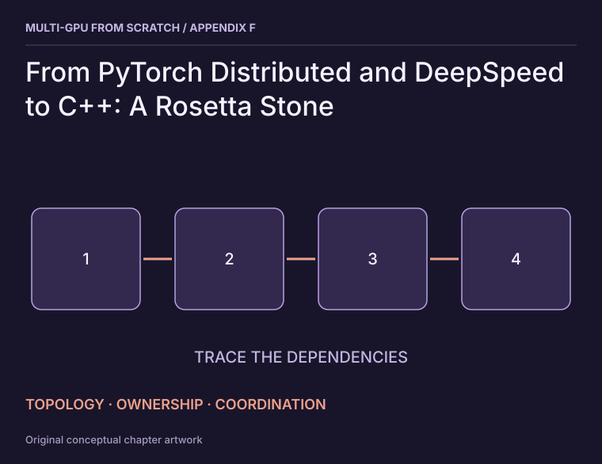
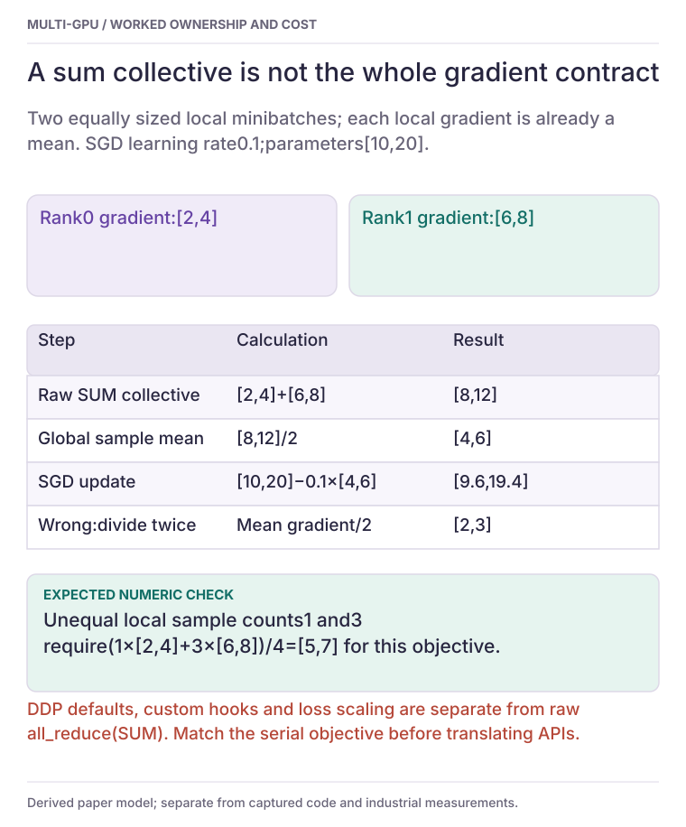
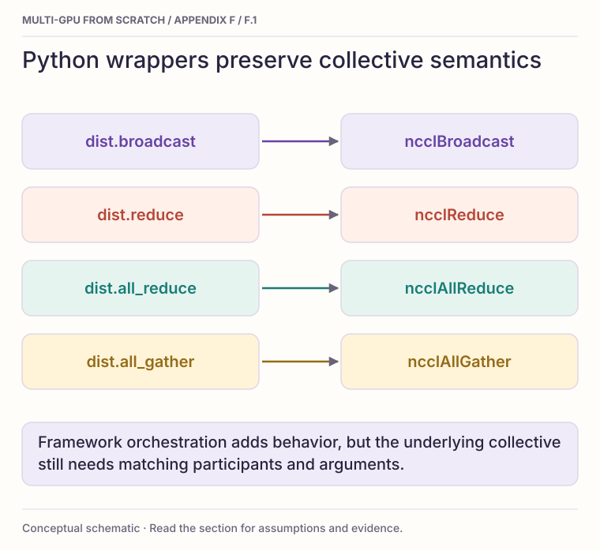
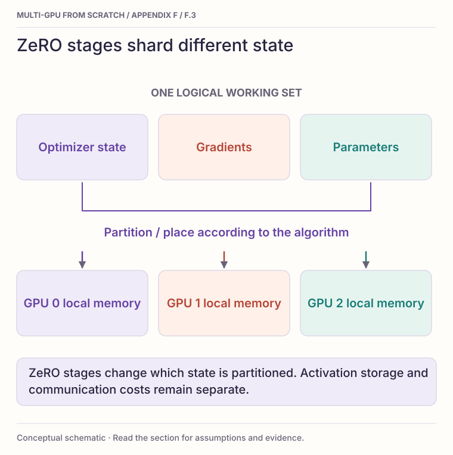

# Appendix F: From PyTorch Distributed and DeepSpeed to C++: A Rosetta Stone

<!-- mgpu:opener:start -->
[](../images/chapter-openers/appendix-f.svg)
<!-- mgpu:opener:end -->

Most readers arrive at a book about hand-written multi-GPU C++ already having trained a model with `torch.distributed`, `DistributedDataParallel`, or DeepSpeed, without ever seeing what those Python calls do underneath. This appendix is a translation guide, not a new technique: for three of the most common Python-side mechanisms, it shows the exact chapter of this book that already built the real C++ underneath it, quotes the Python framework's own documentation directly rather than from memory, and genuinely compiles and runs the C++ side against this environment's real, installed NCCL library. It closes with a summary table extending the same mapping to the remaining PyTorch Distributed and DeepSpeed concepts this appendix does not build code for.

<!-- mgpu:worked:start -->
## Worked walkthrough — Translate a two-rank gradient without changing the scale

[](../images/worked/appendix-f.svg)

Use two equally sized data-parallel minibatches and a two-element gradient. Rank-local gradients are `[2,4]` and `[6,8]`, each already the mean over its local samples. Assume the intended global objective averages all samples equally. This is a semantic translation exercise, not a new framework-training capture.

1. **Apply the raw collective semantics.** `ncclAllReduce` with `ncclSum` yields `[8,12]` on both ranks. A sum collective does not independently know the loss normalization policy.
2. **Form the intended average.** Dividing by world size two gives `[4,6]`. The Python call `dist.all_reduce(..., op=SUM)` is likewise a sum operation; it should not be confused with DDP's configured reducer behavior. Communication hooks and custom losses can change scaling assumptions.
3. **Perform one optimizer step.** For parameters `[10,20]` and learning rate 0.1 under simple SGD without momentum/weight decay, the averaged-gradient update is `[9.6,19.4]`. Using the unreduced local rank-0 gradient gives `[9.8,19.6]`; using the raw sum gives `[9.2,18.8]`. All are plausible numbers, but only one matches this declared objective.
4. **Test unequal local batch sizes.** If rank 0 represents one sample and rank 1 three, the global sample mean is `(1*[2,4]+3*[6,8])/4=[5,7]`, not `[4,6]`. The training implementation must arrange loss/reducer weighting deliberately; a world-size average alone does not repair arbitrary sample imbalance.
5. **Keep memory sharding separate.** ZeRO-style state partitioning changes which rank owns parameters, gradients or optimizer states. It does not by itself redefine the intended mathematical gradient. Count the actual state formats, master weights and temporary gather buffers when estimating memory.

**Expected check:** the distributed update matches a serial concatenated-minibatch reference under the same loss and optimizer semantics. The chapter's captured C++ collective examples establish their recorded scope, not an automatic proof of every PyTorch/DeepSpeed training configuration.

??? question "Exercise: avoid averaging twice"

    A reducer already returns `[4,6]` under this equal-batch contract. What happens if application code divides by world size again before SGD?

    **Worked answer:** gradient becomes `[2,3]` and parameters become `[9.8,19.7]`, halving this update. Track where normalization occurs; matching API names is insufficient when mathematical scaling differs.

<!-- mgpu:worked:end -->

## F.1 torch.distributed's Collectives Are This Book's Own NCCL Calls, Named Differently

<!-- mgpu:figure-1:start -->
[](../images/technical/appendix-f/1-mapping.svg)
<!-- mgpu:figure-1:end -->

### Intuition

Appendix C.1 already built a table matching Chapters 8 through 10's five hand-built collectives to their real NCCL call. A PyTorch user never sees `ncclAllReduce()` directly -- they call `torch.distributed.all_reduce(tensor)`, in Python, and the actual reduction happens somewhere underneath, invisibly. That invisibility is the whole appeal of a framework, and it is also exactly the gap this book has never left unexamined for any other layer. Section F.1 closes it for this one: `torch.distributed`'s own Python function names, matched not just to the chapter that hand-built the underlying algorithm, but to the exact real NCCL call PyTorch's own `backend="nccl"` dispatches into -- the NCCL API family used by the C++ examples. This is a semantic mapping: a particular PyTorch package may bundle or load a different NCCL build, configuration or backend version.

### The Concept, In Detail

```
  torch.distributed (Python)          real NCCL call (this book, Ch11-)
  +------------------------------+   +---------------------------+
  | dist.broadcast(t, src)       |-->| ncclBroadcast   (Ch8 8.1)  |
  | dist.reduce(t, dst, op)      |-->| ncclReduce      (Ch8 8.2)  |
  | dist.all_reduce(t, op)       |-->| ncclAllReduce   (Ch9)      |
  | dist.all_gather(l, t)        |-->| ncclAllGather   (Ch10 10.1)|
  | dist.reduce_scatter(o,l,op)  |-->| ncclReduceScatter (Ch10 10.2)|
  | dist.all_to_all(o, i)        |-->| ncclSend/ncclRecv (Ch10 10.3)|
  | dist.barrier()               |-->| ncclAllReduce   (Ch17)     |
  +------------------------------+   +---------------------------+

  backend="nccl" in init_process_group() is the arrow above --
  a dispatch, not a reimplementation.
```

PyTorch's own tutorial (`docs.pytorch.org`, "Writing Distributed Applications with PyTorch") describes the collective layer plainly: "collectives allow for communication patterns across all processes in a **group**," and gives `dist.broadcast(tensor, src, group)` as "Copies `tensor` from `src` to all other processes," `dist.all_reduce(tensor, op, group)` as "Same as reduce, but the result is stored in all processes," and `dist.all_gather(tensor_list, tensor, group)` as "Copies `tensor` from all processes to `tensor_list`, on all processes." Every one of these descriptions matches, word for word in substance, what Chapters 8 through 10 built by hand before Chapter 11 ever mentioned NCCL. All-to-all dispatch depends on the PyTorch and NCCL versions. Grouped NCCL send/receive pairs are the portable recipe used here; newer NCCL releases also provide a dedicated all-to-all API. This table does not trace a particular installed PyTorch implementation.

Point-to-point is the same relationship one layer down. PyTorch's own tutorial calls `dist.send(tensor, dst)` and `dist.recv(tensor, src)` "blocking" -- "A transfer of data from one process to another is called a point-to-point communication" -- and their non-blocking counterparts `dist.isend()`/`dist.irecv()` return a `Work` object, with the tutorial's own explicit warning that "writing to `tensor` after `dist.isend()` will result in undefined behaviour" until `req.wait()` completes. That is Appendix C.2's own `ncclSend()`/`ncclRecv()` section, under a Python name, with the identical hazard this book's own asynchronous `cudaMemcpyAsync()` discipline has guarded against since Chapter 6.

`init_process_group(backend, ...)` accepts a real, documented set of backend strings, each with the PyTorch documentation's own stated purpose: `"nccl"` ("Use the NCCL backend for distributed training with CUDA GPU"), `"gloo"` ("Use the Gloo backend for distributed training with CPU"), and `"mpi"` (an optional backend, requiring PyTorch to have been built from source with MPI support). The `"mpi"` row is not an analogy for this book -- Chapter 20's own real `MPI_Init()`/`MPI_Sendrecv()` code uses the MPI API; an actual PyTorch MPI build can link to a different MPI installation.

!!! warning "[COMMON TRAP] Assuming torch.distributed is a different implementation from this book's own NCCL calls"
    The framework and raw C++ program can differ in loaded NCCL version, configuration, streams, hooks, buffer lifetimes and collective ordering. Reproduce the same inputs and environment before attributing a discrepancy to either layer. File 135 does not execute or trace PyTorch; its successful C++ initialization is only an API probe.

### Code and Verification

```cpp
// 135_torch_distributed_collectives_mapped.cu
// Semantic reference table plus a checked C++ NCCL initialization probe.
// This program does not execute or trace PyTorch itself.
#include <cstdio>
#include <cuda_runtime.h>
#include <nccl.h>
int main(){
    const char* python[]={"dist.broadcast","dist.reduce","dist.all_reduce","dist.all_gather","dist.reduce_scatter","dist.isend / dist.irecv"};
    const char* nccl[]={"ncclBroadcast","ncclReduce","ncclAllReduce","ncclAllGather","ncclReduceScatter","ncclSend / ncclRecv"};
    for(int i=0;i<6;++i)printf("%-24s -> %s (CUDA/NCCL backend)\n",python[i],nccl[i]);
    int version=0;ncclResult_t r=ncclGetVersion(&version);if(r!=ncclSuccess)return 1;
    printf("C++ linked NCCL: %d.%d.%d. A PyTorch installation may load a different NCCL build.\n",version/10000,(version/100)%100,version%100);
    cudaError_t e=cudaSetDevice(0);if(e!=cudaSuccess){fprintf(stderr,"CUDA: %s\n",cudaGetErrorString(e));return 1;}
    ncclUniqueId id;ncclComm_t comm=nullptr;r=ncclGetUniqueId(&id);
    if(r==ncclSuccess)r=ncclCommInitRank(&comm,1,id,0);
    if(r==ncclSuccess)r=ncclCommDestroy(comm);
    if(r!=ncclSuccess){fprintf(stderr,"NCCL: %s\n",ncclGetErrorString(r));return 1;}
    printf("API PROBE PASS: errors=0; semantic mapping and one-rank C++ setup, not a PyTorch execution test.\n");return 0;
}
```

<!-- execution:start:h100-rerun:135_torch_distributed_collectives_mapped.cu -->
> **Compiled and executed — 2026-11-18-h100: API validation (recorded scope).** Hardware: 2 H100 GPUs. Executed UTC: `2026-11-18T11:20:32.770889+00:00`.

<!-- execution:metadata Source SHA-256: 10e70990c1fdffe0d5c5bbb8e29dbd0bd152c283c4b8359c336f03f462620d51; recorded UTC (program start): 2026-11-18T11:20:31.754790+00:00 -->

[Exact tested source](../validation/2026-11-18-h100/135_torch_distributed_collectives_mapped/135_torch_distributed_collectives_mapped.cu) · [Compiler log](../validation/2026-11-18-h100/135_torch_distributed_collectives_mapped/compile.log) · [Execution log](../validation/2026-11-18-h100/135_torch_distributed_collectives_mapped/run.log). Compile exit: `0`; run exit: `0`.

Commands below use local source/binary names; raw logs retain host paths. Execute in a scratch directory containing the downloaded source.

```bash
nvcc -std=c++17 -O2 -arch=sm_90 135_torch_distributed_collectives_mapped.cu -o ./example -lnccl
./example
```

**Sample output**

```text
dist.broadcast           -> ncclBroadcast (CUDA/NCCL backend)
dist.reduce              -> ncclReduce (CUDA/NCCL backend)
dist.all_reduce          -> ncclAllReduce (CUDA/NCCL backend)
dist.all_gather          -> ncclAllGather (CUDA/NCCL backend)
dist.reduce_scatter      -> ncclReduceScatter (CUDA/NCCL backend)
dist.isend / dist.irecv  -> ncclSend / ncclRecv (CUDA/NCCL backend)
C++ linked NCCL: 2.26.2. A PyTorch installation may load a different NCCL build.
API PROBE PASS: errors=0; semantic mapping and one-rank C++ setup, not a PyTorch execution test.
```

<!-- execution:end:h100-rerun:135_torch_distributed_collectives_mapped.cu -->

<!-- execution:start:a100:135_torch_distributed_collectives_mapped.cu -->
> **Compiled and executed — 2026-11-17-a100: API validation (recorded scope).** Hardware: 8 A100 GPUs. Executed UTC: `2026-11-17T23:59:39.446489+00:00`.

<!-- execution:metadata Source SHA-256: 10e70990c1fdffe0d5c5bbb8e29dbd0bd152c283c4b8359c336f03f462620d51; recorded UTC (program start): 2026-11-17T23:59:37.677169+00:00 -->

[Exact tested source](../validation/2026-11-17-a100/135_torch_distributed_collectives_mapped/135_torch_distributed_collectives_mapped.cu) · [Compiler log](../validation/2026-11-17-a100/135_torch_distributed_collectives_mapped/compile.log) · [Execution log](../validation/2026-11-17-a100/135_torch_distributed_collectives_mapped/run.log). Compile exit: `0`; run exit: `0`.

Commands below use local source/binary names; raw logs retain host paths. Execute in a scratch directory containing the downloaded source.

```bash
nvcc -std=c++17 -O2 -arch=sm_80 135_torch_distributed_collectives_mapped.cu -o ./example -lnccl
./example
```

**Sample output**

```text
dist.broadcast           -> ncclBroadcast (CUDA/NCCL backend)
dist.reduce              -> ncclReduce (CUDA/NCCL backend)
dist.all_reduce          -> ncclAllReduce (CUDA/NCCL backend)
dist.all_gather          -> ncclAllGather (CUDA/NCCL backend)
dist.reduce_scatter      -> ncclReduceScatter (CUDA/NCCL backend)
dist.isend / dist.irecv  -> ncclSend / ncclRecv (CUDA/NCCL backend)
C++ linked NCCL: 2.26.2. A PyTorch installation may load a different NCCL build.
API PROBE PASS: errors=0; semantic mapping and one-rank C++ setup, not a PyTorch execution test.
```


<!-- execution:end:a100:135_torch_distributed_collectives_mapped.cu -->

<!-- execution:start:h100:135_torch_distributed_collectives_mapped.cu -->
> **Compiled and executed — 2026-11-17-h100: API validation (recorded scope).** Hardware: 2 H100 GPUs. Execution record UTC (run-batch start; per-program time unrecorded): `2026-11-17T23:48:18.967387+00:00`.

<!-- execution:metadata Source SHA-256: 10e70990c1fdffe0d5c5bbb8e29dbd0bd152c283c4b8359c336f03f462620d51; recorded UTC (run-batch start; per-program time unrecorded): 2026-11-17T23:48:18.967387+00:00 -->

[Exact tested source](../validation/2026-11-17-h100/135_torch_distributed_collectives_mapped/135_torch_distributed_collectives_mapped.cu) · [Compiler log](../validation/2026-11-17-h100/135_torch_distributed_collectives_mapped/compile.log) · [Execution log](../validation/2026-11-17-h100/135_torch_distributed_collectives_mapped/run.log). Compile exit: `0`; run exit: `0`.

Commands below use local source/binary names; raw logs retain host paths. Execute in a scratch directory containing the downloaded source.

```bash
nvcc -std=c++17 -O2 -arch=sm_90 135_torch_distributed_collectives_mapped.cu -o ./example -lnccl
./example
```

<details markdown="1"><summary>Captured current-source output</summary>

```text
dist.broadcast           -> ncclBroadcast (CUDA/NCCL backend)
dist.reduce              -> ncclReduce (CUDA/NCCL backend)
dist.all_reduce          -> ncclAllReduce (CUDA/NCCL backend)
dist.all_gather          -> ncclAllGather (CUDA/NCCL backend)
dist.reduce_scatter      -> ncclReduceScatter (CUDA/NCCL backend)
dist.isend / dist.irecv  -> ncclSend / ncclRecv (CUDA/NCCL backend)
C++ linked NCCL: 2.26.2. A PyTorch installation may load a different NCCL build.
API PROBE PASS: errors=0; semantic mapping and one-rank C++ setup, not a PyTorch execution test.
```

</details>
<!-- execution:end:h100:135_torch_distributed_collectives_mapped.cu -->

**Compile and run:**

```bash
nvcc -arch=sm_80 135_torch_distributed_collectives_mapped.cu -o 135_torch_distributed_collectives_mapped -lnccl
./135_torch_distributed_collectives_mapped
```

**Sample input:** none -- the program takes no arguments; every value it prints is either a compile-time string constant (including the quoted PyTorch documentation text, verified via `docs.pytorch.org` before writing this file) or a real return value read back from the installed NCCL library.

## F.2 DistributedDataParallel Is Chapter 12's Averaging, Automated and Bucketed

### Intuition

Chapter 12's own File 34 called `ncclAllReduce(..., ncclAvg, ...)` exactly once, on one flat gradient buffer, because that chapter built one replicated model with one gradient tensor to average. A real model has hundreds or thousands of parameter tensors, and calling `ncclAllReduce()` separately for each one the instant its gradient becomes ready would issue a flood of tiny, poorly-pipelined collectives. `torch.nn.parallel.DistributedDataParallel` (DDP) solves this with a real, documented mechanism -- bucketing -- and Section F.2 builds the part of that mechanism this book has not yet shown: not a new averaging algorithm, but new bookkeeping around gradient reduction and averaging. The C++ example uses ncclAvg; a framework may use a sum plus scaling or another supported reduction path.

### The Concept, In Detail

```
  backward pass fires autograd hooks in this REAL simulated order
  (last layer's gradient is ready first):

    bucket 0 ready -> bucket 2 ready -> bucket 1 ready
      (tick 1)          (tick 3)          (tick 5)
                         (fires early --
                          e.g. a skip connection)

  but the Reducer issues allreduce in BUCKET-INDEX order regardless
  of which bucket actually became ready first:

    issue order:  bucket 0  ->  bucket 1  ->  bucket 2
                  (ready @1)    (WAITS for   (ready @3,
                                 tick 5)       but issued last)
```

PyTorch's own documentation (`docs.pytorch.org`, DDP design notes) describes the mechanism directly: "To improve communication efficiency, the `Reducer` organizes parameter gradients into buckets, and reduces one bucket at a time," with parameters "allocated into buckets in (roughly) the reverse order of `Model.parameters()`" -- reverse order because backpropagation computes the last layer's gradient first, so a bucket built from the last few parameters tends to fill soonest. "When gradients in one bucket are all ready, the `Reducer` kicks off an asynchronous `allreduce` on that bucket to calculate mean of gradients across all processes" -- a mean-gradient operation. The C++ example illustrates it with ncclAvg; this is not a claim that every DDP version invokes precisely that reduction enum.

The part of this mechanism that is easy to get wrong is ordering. A bucket built from a skip connection or an early-exiting branch can genuinely become ready out of bucket-index order -- Section F.2's own code below simulates exactly that, deliberately. PyTorch's documentation is explicit about what happens next: "DDP requires `Reducer` instances on all processes to invoke `allreduce` in exactly the same order, which is done by always running `allreduce` in the bucket index order instead of actual bucket ready order." Every process must agree on the collective call order or the collective itself deadlocks or silently pairs the wrong buckets across processes -- so the Reducer always issues bucket 0's allreduce before bucket 1's, before bucket 2's, even when bucket 2 became ready first and has been sitting finished the whole time. The trigger for all of this -- per-parameter autograd hooks -- is also documented plainly: "the `Reducer` also registers autograd hooks during construction, one hook per parameter. These hooks will be triggered during the backward pass when the gradient becomes ready."

!!! warning "[COMMON TRAP] Assuming a bucket's own ALLREADY order is the order it gets reduced in"
    It is tempting to assume that because bucket 2 finished filling first, its `ncclAllReduce()` call goes out first too -- and reasonable code review might even flag the observed "bucket 2 before bucket 1" readiness as a scheduling bug to fix. It isn't a bug; a fix here would BE the bug. PyTorch's Reducer deliberately withholds a ready bucket's own collective call until every lower-indexed bucket has also been issued, because every process's own hook-firing order can differ slightly run to run (different branch timings, different kernel scheduling), while the SET of buckets and their INDEX order is fixed at construction time and identical on every process. Issuing allreduce in observed-ready order instead of fixed bucket-index order would let two processes issue their collectives in different sequences, and NCCL's own collective calls must be issued in identical order on every rank in the communicator or the call hangs or pairs the wrong buffers -- the same real ordering hazard Appendix C.2 already established for grouped point-to-point calls, one level up.

### Code and Verification

```cpp
// Appendix F: From PyTorch Distributed and DeepSpeed to C++: A Rosetta Stone
// 136_ddp_bucketed_allreduce.cu
//
// Chapter 12's own File 34 called ncclAllReduce(..., ncclAvg, ...) once,
// on one flat gradient buffer, because that chapter built a single
// replicated model with one gradient tensor. torch.nn.parallel.
// DistributedDataParallel (DDP) does the identical averaging -- the same
// ncclAllReduce(..., ncclAvg, ...) this book has used since Chapter 12 --
// but automates it with a real, documented mechanism this file now
// builds: gradients are grouped into BUCKETS (PyTorch's own docs: "in
// (roughly) the reverse order of Model.parameters()"), autograd hooks
// fire per-parameter as the backward pass computes each gradient, and a
// bucket's all-reduce launches once every gradient in it is ready -- but
// PyTorch's own docs are explicit that the ISSUE order across buckets is
// always bucket-index order, never actual ready order, "which is done by
// always running allreduce in the bucket index order instead of actual
// bucket ready order." This file simulates the ready-order/issue-order
// distinction on the host (deterministic, no device needed), then makes
// one real ncclAllReduce() call per bucket, extending Chapter 12's own
// File 34 from one flat call to several bucketed ones.
//
// Compile: nvcc -arch=sm_80 136_ddp_bucketed_allreduce.cu -o 136_ddp_bucketed_allreduce -lnccl
// Run:     ./136_ddp_bucketed_allreduce
#include <cstdio>
#include <cstdlib>
#include <cmath>
#include <vector>
#include <algorithm>
#include <nccl.h>
#include <cuda_runtime.h>

struct Param {
    int paramIndex;   // position in Model.parameters(), forward order: 0..5
    int bucketIndex;  // which bucket this parameter is assigned to
};

int main() {
    printf("=== Section F.2: DistributedDataParallel's bucketed all-reduce, built on\n");
    printf("    Chapter 12's own ncclAllReduce(..., ncclAvg, ...) call ===\n\n");

    // 6 parameters, forward-pass order 0..5 (Model.parameters() order).
    // PyTorch's own docs: buckets are built in "(roughly) the reverse
    // order of Model.parameters()" -- because backward computes the
    // LAST layer's gradient first, bucketing in reverse forward-order
    // means a bucket tends to become ready shortly after it fills.
    const int NPARAMS = 6;
    std::vector<Param> params(NPARAMS);
    // reverse-order bucketing: params 5,4 -> bucket 0; 3,2 -> bucket 1; 1,0 -> bucket 2
    int bucketOf[NPARAMS] = {2, 2, 1, 1, 0, 0};
    for (int p = 0; p < NPARAMS; ++p) { params[p].paramIndex = p; params[p].bucketIndex = bucketOf[p]; }

    printf("bucket assignment (reverse of Model.parameters() order 0..%d):\n", NPARAMS - 1);
    printf("%-10s %-10s\n", "param#", "bucket#");
    for (auto& p : params) printf("%-10d %-10d\n", p.paramIndex, p.bucketIndex);
    printf("\n");

    // Backward pass fires autograd hooks in REVERSE forward order:
    // param 5's gradient is ready first, then 4, then 3, ... then 0.
    // That is also, by construction, bucket-fill order: bucket 0 fills
    // first (params 5,4), then bucket 1 (3,2), then bucket 2 (1,0).
    // To make the "ready order can scramble" claim genuine rather than
    // assumed, this simulation deliberately delays param 2's hook (a
    // real, common cause: a skip connection/residual branch whose
    // gradient computation takes an extra op) so bucket 1 finishes
    // AFTER bucket 2 has already fully filled -- an out-of-order ready
    // sequence a real network can genuinely produce.
    struct HookEvent { int paramIndex; int readyTick; };
    std::vector<HookEvent> hookFires = {
        {5, 0}, {4, 1},         // bucket 0 ready at tick 1
        {1, 2}, {0, 3},         // bucket 2 ready at tick 3 (fires EARLY: simulated skip connection)
        {3, 4}, {2, 5},         // bucket 1 ready at tick 5 (fires LAST, out of bucket-index order)
    };

    std::vector<int> bucketReadyAtTick(3, -1);
    std::vector<int> bucketRemaining(3, 0);
    for (auto& p : params) bucketRemaining[p.bucketIndex]++;

    std::vector<int> readyOrder; // order in which buckets actually BECOME ready
    for (auto& ev : hookFires) {
        int b = bucketOf[ev.paramIndex];
        bucketRemaining[b]--;
        if (bucketRemaining[b] == 0) {
            bucketReadyAtTick[b] = ev.readyTick;
            readyOrder.push_back(b);
        }
    }

    printf("simulated backward-pass hook firing order produces this bucket READY order:\n");
    printf("  ");
    for (size_t i = 0; i < readyOrder.size(); ++i) printf("%sbucket %d (tick %d)", i ? " -> " : "", readyOrder[i], bucketReadyAtTick[readyOrder[i]]);
    printf("\n\n");

    // PyTorch's own real rule: "DDP requires Reducer instances on all
    // processes to invoke allreduce in exactly the same order, which is
    // done by always running allreduce in the bucket index order
    // instead of actual bucket ready order." The Reducer therefore
    // WAITS for a bucket if it isn't the next index-order bucket yet,
    // even if a later-index bucket became ready first.
    std::vector<int> issueOrder = {0, 1, 2}; // bucket index order -- always, regardless of readyOrder
    printf("real DDP rule (PyTorch's own docs, quoted directly): allreduce is always\n");
    printf("issued in BUCKET INDEX order, never actual ready order -- so despite bucket\n");
    printf("2 becoming ready before bucket 1 above, the real issue order is:\n  ");
    for (size_t i = 0; i < issueOrder.size(); ++i) printf("%sbucket %d", i ? " -> " : "", issueOrder[i]);
    printf("\n\n");


    int count=0;if(cudaGetDeviceCount(&count)!=cudaSuccess||count<2){fprintf(stderr,"Requires 2 GPUs\n");return 2;}
    auto cuda_ok=[](cudaError_t e){if(e!=cudaSuccess){fprintf(stderr,"CUDA: %s\n",cudaGetErrorString(e));exit(1);}};
    auto nccl_ok=[](ncclResult_t e){if(e!=ncclSuccess){fprintf(stderr,"NCCL: %s\n",ncclGetErrorString(e));exit(1);}};
    int devices[2]={0,1};ncclComm_t comm[2]={};cudaStream_t streams[2]={};float* buffers[2]={};
    nccl_ok(ncclCommInitAll(comm,2,devices));
    for(int r=0;r<2;++r){cuda_ok(cudaSetDevice(r));cuda_ok(cudaMalloc(&buffers[r],2*sizeof(float)));cuda_ok(cudaStreamCreate(&streams[r]));}
    int errors=0;
    for(int b:issueOrder){
        for(int r=0;r<2;++r){cuda_ok(cudaSetDevice(r));float input[2]={(float)(10*b+r+1),(float)(10*b+r+2)};cuda_ok(cudaMemcpy(buffers[r],input,sizeof(input),cudaMemcpyHostToDevice));}
        nccl_ok(ncclGroupStart());for(int r=0;r<2;++r){cuda_ok(cudaSetDevice(r));nccl_ok(ncclAllReduce(buffers[r],buffers[r],2,ncclFloat,ncclAvg,comm[r],streams[r]));}nccl_ok(ncclGroupEnd());
        for(int r=0;r<2;++r){cuda_ok(cudaSetDevice(r));cuda_ok(cudaStreamSynchronize(streams[r]));float got[2];cuda_ok(cudaMemcpy(got,buffers[r],sizeof(got),cudaMemcpyDeviceToHost));
            for(int j=0;j<2;++j)if(!std::isfinite(got[j])||got[j]!=(float)(10*b+j)+1.5f)++errors;}
        printf("Bucket %d: two-GPU average checked, cumulative errors=%d\n",b,errors);
    }
    bool orderCorrect=issueOrder==std::vector<int>({0,1,2});if(!orderCorrect)++errors;
    for(int r=0;r<2;++r){cuda_ok(cudaSetDevice(r));cuda_ok(cudaFree(buffers[r]));cuda_ok(cudaStreamDestroy(streams[r]));nccl_ok(ncclCommDestroy(comm[r]));}
    printf("Readiness is a host model; actual two-GPU averages follow bucket index order. No autograd/overlap claim.\n");
    printf("VALIDATION %s: errors=%d\n",errors?"FAIL":"PASS",errors);return errors?1:0;
}
```

<!-- execution:start:h100-rerun:136_ddp_bucketed_allreduce.cu -->
> **Compiled and executed — 2026-11-18-h100: Numerical/transport validation (recorded scope).** Hardware: 2 H100 GPUs. Executed UTC: `2026-11-18T11:20:35.504884+00:00`.

<!-- execution:metadata Source SHA-256: 0405ad49912c9511aff376fffee8b52c7efdc2420bc4de073509e34ac7956feb; recorded UTC (program start): 2026-11-18T11:20:34.138026+00:00 -->

[Exact tested source](../validation/2026-11-18-h100/136_ddp_bucketed_allreduce/136_ddp_bucketed_allreduce.cu) · [Compiler log](../validation/2026-11-18-h100/136_ddp_bucketed_allreduce/compile.log) · [Execution log](../validation/2026-11-18-h100/136_ddp_bucketed_allreduce/run.log). Compile exit: `0`; run exit: `0`.

Commands below use local source/binary names; raw logs retain host paths. Execute in a scratch directory containing the downloaded source.

```bash
nvcc -std=c++17 -O2 -arch=sm_90 136_ddp_bucketed_allreduce.cu -o ./example -lnccl
./example
```

**Sample output**

```text
=== Section F.2: DistributedDataParallel's bucketed all-reduce, built on
    Chapter 12's own ncclAllReduce(..., ncclAvg, ...) call ===

bucket assignment (reverse of Model.parameters() order 0..5):
param#     bucket#
0          2
1          2
2          1
3          1
4          0
5          0

simulated backward-pass hook firing order produces this bucket READY order:
  bucket 0 (tick 1) -> bucket 2 (tick 3) -> bucket 1 (tick 5)

real DDP rule (PyTorch's own docs, quoted directly): allreduce is always
issued in BUCKET INDEX order, never actual ready order -- so despite bucket
2 becoming ready before bucket 1 above, the real issue order is:
  bucket 0 -> bucket 1 -> bucket 2

Bucket 0: two-GPU average checked, cumulative errors=0
Bucket 1: two-GPU average checked, cumulative errors=0
Bucket 2: two-GPU average checked, cumulative errors=0
Readiness is a host model; actual two-GPU averages follow bucket index order. No autograd/overlap claim.
VALIDATION PASS: errors=0
```

<!-- execution:end:h100-rerun:136_ddp_bucketed_allreduce.cu -->

<!-- execution:start:a100:136_ddp_bucketed_allreduce.cu -->
> **Compiled and executed — 2026-11-17-a100: Numerical/transport validation (recorded scope).** Hardware: 8 A100 GPUs. Executed UTC: `2026-11-17T23:59:44.337668+00:00`.

<!-- execution:metadata Source SHA-256: 0405ad49912c9511aff376fffee8b52c7efdc2420bc4de073509e34ac7956feb; recorded UTC (program start): 2026-11-17T23:59:42.017428+00:00 -->

[Exact tested source](../validation/2026-11-17-a100/136_ddp_bucketed_allreduce/136_ddp_bucketed_allreduce.cu) · [Compiler log](../validation/2026-11-17-a100/136_ddp_bucketed_allreduce/compile.log) · [Execution log](../validation/2026-11-17-a100/136_ddp_bucketed_allreduce/run.log). Compile exit: `0`; run exit: `0`.

Commands below use local source/binary names; raw logs retain host paths. Execute in a scratch directory containing the downloaded source.

```bash
nvcc -std=c++17 -O2 -arch=sm_80 136_ddp_bucketed_allreduce.cu -o ./example -lnccl
./example
```

**Sample output**

```text
=== Section F.2: DistributedDataParallel's bucketed all-reduce, built on
    Chapter 12's own ncclAllReduce(..., ncclAvg, ...) call ===

bucket assignment (reverse of Model.parameters() order 0..5):
param#     bucket#
0          2
1          2
2          1
3          1
4          0
5          0

simulated backward-pass hook firing order produces this bucket READY order:
  bucket 0 (tick 1) -> bucket 2 (tick 3) -> bucket 1 (tick 5)

real DDP rule (PyTorch's own docs, quoted directly): allreduce is always
issued in BUCKET INDEX order, never actual ready order -- so despite bucket
2 becoming ready before bucket 1 above, the real issue order is:
  bucket 0 -> bucket 1 -> bucket 2

Bucket 0: two-GPU average checked, cumulative errors=0
Bucket 1: two-GPU average checked, cumulative errors=0
Bucket 2: two-GPU average checked, cumulative errors=0
Readiness is a host model; actual two-GPU averages follow bucket index order. No autograd/overlap claim.
VALIDATION PASS: errors=0
```


<!-- execution:end:a100:136_ddp_bucketed_allreduce.cu -->

<!-- execution:start:h100:136_ddp_bucketed_allreduce.cu -->
> **Compiled and executed — 2026-11-17-h100: Numerical/transport validation (recorded scope).** Hardware: 2 H100 GPUs. Execution record UTC (run-batch start; per-program time unrecorded): `2026-11-17T23:48:18.967387+00:00`.

<!-- execution:metadata Source SHA-256: 0405ad49912c9511aff376fffee8b52c7efdc2420bc4de073509e34ac7956feb; recorded UTC (run-batch start; per-program time unrecorded): 2026-11-17T23:48:18.967387+00:00 -->

[Exact tested source](../validation/2026-11-17-h100/136_ddp_bucketed_allreduce/136_ddp_bucketed_allreduce.cu) · [Compiler log](../validation/2026-11-17-h100/136_ddp_bucketed_allreduce/compile.log) · [Execution log](../validation/2026-11-17-h100/136_ddp_bucketed_allreduce/run.log). Compile exit: `0`; run exit: `0`.

Commands below use local source/binary names; raw logs retain host paths. Execute in a scratch directory containing the downloaded source.

```bash
nvcc -std=c++17 -O2 -arch=sm_90 136_ddp_bucketed_allreduce.cu -o ./example -lnccl
./example
```

<details markdown="1"><summary>Captured current-source output</summary>

```text
=== Section F.2: DistributedDataParallel's bucketed all-reduce, built on
    Chapter 12's own ncclAllReduce(..., ncclAvg, ...) call ===

bucket assignment (reverse of Model.parameters() order 0..5):
param#     bucket#
0          2
1          2
2          1
3          1
4          0
5          0

simulated backward-pass hook firing order produces this bucket READY order:
  bucket 0 (tick 1) -> bucket 2 (tick 3) -> bucket 1 (tick 5)

real DDP rule (PyTorch's own docs, quoted directly): allreduce is always
issued in BUCKET INDEX order, never actual ready order -- so despite bucket
2 becoming ready before bucket 1 above, the real issue order is:
  bucket 0 -> bucket 1 -> bucket 2

Bucket 0: two-GPU average checked, cumulative errors=0
Bucket 1: two-GPU average checked, cumulative errors=0
Bucket 2: two-GPU average checked, cumulative errors=0
Readiness is a host model; actual two-GPU averages follow bucket index order. No autograd/overlap claim.
VALIDATION PASS: errors=0
```

</details>
<!-- execution:end:h100:136_ddp_bucketed_allreduce.cu -->

**Compile and run:**

```bash
nvcc -arch=sm_80 136_ddp_bucketed_allreduce.cu -o 136_ddp_bucketed_allreduce -lnccl
./136_ddp_bucketed_allreduce
```

**Sample input:** none -- 6 simulated parameters, their bucket assignment, and their hook-firing ticks are all fixed constants in the source, chosen specifically to force an out-of-order readiness sequence.

## F.3 DeepSpeed's ZeRO Stages Are Chapter 13's Own Memory Arithmetic, Staged

<!-- mgpu:figure-3:start -->
[](../images/technical/appendix-f/3-capacity.svg)
<!-- mgpu:figure-3:end -->

### Intuition

Chapter 13's own File 36 re-derived the real 16-bytes-per-parameter mixed-precision Adam breakdown and asked a model-*parallel* question: given a fixed per-device budget, how many devices must a model's training state be split across to exist at all. DeepSpeed's ZeRO asks a genuinely different question about a genuinely different axis: across Chapter 12's own kind of data-parallel *replicas* -- where every device still computes the same full model on different data -- how much of each replica's own copy of the training state can be sharded away, since no single replica needs the whole state at every instant. Section F.3 keeps those two questions honestly separate and derives ZeRO's real published stage formulas directly from Chapter 13's own 16-byte breakdown, rather than introducing a new one.

### The Concept, In Detail

```
  GB/replica (GPT-3, 8-way data-parallel group, Chapter 13's own 16
  bytes/parameter, sharded per Section F.3's own derived formula)

  +------------------------+----------------------------------------+
  | no ZeRO   (Ch13 base)  | 2800 GB --------------------------------|
  | stage 1   (Pos)        |  963 GB -------------                   |
  | stage 2   (Pos+g)      |  656 GB ---------                       |
  | stage 3   (Pos+g+p)    |  350 GB -----                           |
  +------------------------+----------------------------------------+

  stage 3's own 350 GB/replica is still bigger than one H100 SXM's 80 GB
  -- ZeRO shrinks each replica's own copy; it does not, by itself,
  replace Chapter 13's own model-parallel shard count.
```

DeepSpeed's own documentation (`deepspeed.readthedocs.io`) describes each stage directly, and the wording draws the line this section's diagram makes visual. Stage 1 (`Pos`): "The optimizer states (e.g., for Adam optimizer, 32-bit weights, and the first, and second moment estimates) are partitioned across the processes, so that each process updates only its partition" -- the same fp32 parameter copy, momentum, and variance that make up 12 of Chapter 13's own 16 bytes per parameter. Stage 2 (`Pos+g`): "The reduced 16-bit gradients for updating the model weights are also partitioned such that each process retains only the gradients corresponding to its portion of the optimizer states" -- adding the 2-byte fp16 gradient to what's sharded. Stage 3 (`Pos+g+p`): "The 16-bit model parameters are partitioned across the processes. ZeRO-3 will automatically collect and partition them during the forward and backward passes" -- the final 2-byte fp16 parameter copy, leaving nothing of the 16 bytes unsharded. Each stage is a real, documented value of `DeepSpeedZeroConfig`'s own `stage` field (1, 2, or 3), set inside a `zero_optimization` configuration dict.

Because DeepSpeed's own documentation states exactly which of Chapter 13's 16 bytes each stage shards, the per-GPU memory formula for N-way sharding follows directly: stage 1 leaves the 4 unsharded bytes (fp16 parameter and fp16 gradient) untouched and divides the remaining 12 bytes by N; stage 2 leaves only the 2 unsharded fp16-parameter bytes and divides the remaining 14 by N; stage 3 divides the full 16 bytes by N. Section F.3's own code below checks this derived formula against the ZeRO paper's (Rajbhandari et al., SC'20) own published 7.5-billion-parameter, 64-way worked example -- 31.4 GB, 16.6 GB, and 1.9 GB for the three stages -- before trusting it on Chapter 13's own GPT-3 figure.

!!! warning "[COMMON TRAP] Treating ZeRO as a replacement for Chapter 13's model parallelism"
    It is tempting to read "ZeRO shards a model's memory across GPUs" and conclude it does the same job as Chapter 13's own layer-splitting model parallelism, just with a different name. It doesn't. Chapter 13 splits the model's actual *computation* -- different devices hold and compute different layers, communicating activations between them. ZeRO shards *storage* of a training state every replica in a data-parallel group would otherwise redundantly hold in full, while every replica still computes the SAME complete forward and backward pass, temporarily reconstructing (via a real all-gather, DeepSpeed's own stage-3 mechanism) whichever shard of parameters or optimizer state the current step actually needs. The two are complementary, not competing: Section F.3's own numbers show ZeRO stage 3 shrinking GPT-3's 2800 GB/replica figure down to 350 GB/replica across an 8-way data-parallel group -- still larger than one H100 SXM's 80 GB, meaning a model at this scale genuinely needs Chapter 13's model parallelism AND ZeRO-style sharding together, exactly the combination real large-model training uses.

### Code and Verification

```cpp
// Appendix F: From PyTorch Distributed and DeepSpeed to C++: A Rosetta Stone
// 137_zero_stage_memory_model.cpp
//
// Chapter 13's own File 36 re-derived the real 16-bytes-per-parameter
// mixed-precision Adam breakdown (Rajbhandari et al., ZeRO, SC'20; 2
// bytes fp16 param + 2 bytes fp16 grad + 4 bytes fp32 param + 4 bytes
// fp32 momentum + 4 bytes fp32 variance) and asked how many DEVICES a
// model's training state must be split across to exist at all. That
// question is Chapter 13's own model-PARALLEL question -- splitting the
// model's actual layers, computed by DIFFERENT devices. DeepSpeed's
// ZeRO asks a genuinely different question: across N DATA-parallel
// REPLICAS (Chapter 12's own kind of replica, where every device still
// computes the SAME full model on different data), how much of each
// replica's OWN copy of the training state can be sharded away, since
// every replica needs the state only transiently, not permanently. The
// two mechanisms are not the same thing wearing two names -- this file
// keeps them honestly separate, and derives ZeRO's own real published
// stage 1/2/3 formulas directly from Chapter 13's own 16-byte
// breakdown, replacing none of Chapter 13's numbers.
//
// Compile: g++ -std=c++17 -Wall -Wextra -O2 137_zero_stage_memory_model.cpp -o 137_zero_stage_memory_model
// Run:     ./137_zero_stage_memory_model
#include <cstdio>
#include <cmath>

int main() {
    printf("=== Section F.3: DeepSpeed's ZeRO stages, derived from Chapter 13's own\n");
    printf("    16-bytes-per-parameter breakdown, not a new formula ===\n\n");

    printf("Chapter 13's own real per-parameter breakdown (mixed-precision Adam):\n");
    printf("  2 bytes fp16 parameter   + 2 bytes fp16 gradient   = 4 bytes  (unsharded by Pos/Pos+g)\n");
    printf("  4 bytes fp32 parameter + 4 bytes momentum + 4 bytes variance = 12 bytes  (DeepSpeed's own \"optimizer states\")\n");
    printf("  total: 16 bytes/parameter, exactly Chapter 13's own already-locked figure\n\n");

    printf("DeepSpeed's own real documented stages (deepspeed.readthedocs.io, quoted):\n");
    printf("  stage 1 (Pos):     \"optimizer states...are partitioned across the\n");
    printf("                      processes, so that each process updates only its\n");
    printf("                      partition\"\n");
    printf("  stage 2 (Pos+g):   \"the reduced 16-bit gradients...are also partitioned\n");
    printf("                      such that each process retains only the gradients\n");
    printf("                      corresponding to its portion of the optimizer states\"\n");
    printf("  stage 3 (Pos+g+p): \"the 16-bit model parameters are partitioned across\n");
    printf("                      the processes. ZeRO-3 will automatically collect and\n");
    printf("                      partition them during the forward and backward\n");
    printf("                      passes\"\n");
    printf("  config: DeepSpeedZeroConfig's own \"stage\" field, 1/2/3, inside the\n");
    printf("  zero_optimization dict -- a real, documented config key, not renamed here.\n\n");

    // Per-GPU bytes/parameter formula, derived (not looked up) from
    // Chapter 13's own 16-byte breakdown, sharded N ways:
    //   stage 1: 4 unsharded (fp16 param+grad) + 12/N sharded (optimizer states)
    //   stage 2: 2 unsharded (fp16 param only)  + 14/N sharded (optimizer states + fp16 grad)
    //   stage 3: 16/N -- everything sharded
    auto stage1 = [](double N) { return 4.0 + 12.0 / N; };
    auto stage2 = [](double N) { return 2.0 + 14.0 / N; };
    auto stage3 = [](double N) { return 16.0 / N; };

    // Self-consistency check against the ZeRO paper's own published
    // worked example (7.5B-parameter model, Nd=64): Pos=31.4GB,
    // Pos+g=16.6GB, Pos+g+p=1.9GB. If Chapter 13's own 16-byte
    // breakdown, sharded with this file's own formula, doesn't
    // reproduce those three published numbers, one of the two has a bug.
    {
        double psi = 7.5e9, N = 64.0;
        double s1GB = stage1(N) * psi / 1e9;
        double s2GB = stage2(N) * psi / 1e9;
        double s3GB = stage3(N) * psi / 1e9;
        printf("self-consistency check against the ZeRO paper's own published 7.5B-param,\n");
        printf("Nd=64 worked example (31.4 / 16.6 / 1.9 GB):\n");
        printf("  Pos     = %.1f GB\n", s1GB);
        printf("  Pos+g   = %.1f GB\n", s2GB);
        printf("  Pos+g+p = %.1f GB\n", s3GB);
        bool matches = (std::fabs(s1GB - 31.4) < 0.1) && (std::fabs(s2GB - 16.6) < 0.1) && (std::fabs(s3GB - 1.9) < 0.1);
        printf("  matches published figures: %s\n\n", matches ? "PASS" : "FAIL");
        if (!matches) return 1;
    }

    // Now apply the same, already-validated formula to Chapter 12's own
    // REPLICAS=8 data-parallel group of GPT-3 (Chapter 13's own 175B
    // model, Chapter 1's own already-locked 2800 GB unsharded figure).
    double psiGPT3 = 175.0e9;
    double unshardedGB = psiGPT3 * 16.0 / 1e9;
    printf("applying the SAME validated formula to Chapter 13's own GPT-3 figure,\n");
    printf("sharded across Chapter 12's own REPLICAS=8 data-parallel group:\n\n");
    printf("%-24s %14s\n", "configuration", "GB/replica");
    printf("%-24s %14.1f\n", "no ZeRO (Ch13 baseline)", unshardedGB);
    printf("%-24s %14.1f\n", "ZeRO stage 1 (Pos)", stage1(8.0) * psiGPT3 / 1e9);
    printf("%-24s %14.1f\n", "ZeRO stage 2 (Pos+g)", stage2(8.0) * psiGPT3 / 1e9);
    printf("%-24s %14.1f\n", "ZeRO stage 3 (Pos+g+p)", stage3(8.0) * psiGPT3 / 1e9);

    printf("\nnote what ZeRO does NOT change: Chapter 13's own model-parallel shard\n");
    printf("count (35 H100 SXM GPUs, from its own File 36) answers a different question\n");
    printf("-- how many devices must COOPERATE to hold one copy at all -- and ZeRO stage\n");
    printf("3's own %.1f GB/replica figure above is still larger than one H100 SXM's 80\n", stage3(8.0) * psiGPT3 / 1e9);
    printf("GB, meaning GPT-3 at this size needs BOTH: Chapter 13's model parallelism to\n");
    printf("split the model itself, and ZeRO-style sharding within each data-parallel\n");
    printf("replica group -- exactly the combination real large-model training uses, and\n");
    printf("exactly why DeepSpeed documents ZeRO stage 3 alongside, not instead of,\n");
    printf("model-parallel/tensor-parallel splitting.\n");

    return 0;
}
```

<!-- execution:start:h100-rerun:137_zero_stage_memory_model.cpp -->
> **Compiled and executed — 2026-11-18-h100: Host program/model (exit-only).** Hardware: 2 H100 GPUs. Executed UTC: `2026-11-18T11:20:37.387781+00:00`.

<!-- execution:metadata Source SHA-256: b502e695c6f4cbce805c540c253e71b7aa78992cfbef3558aba2e1aa85f28bf7; recorded UTC (program start): 2026-11-18T11:20:37.223063+00:00 -->

[Exact tested source](../validation/2026-11-18-h100/137_zero_stage_memory_model/137_zero_stage_memory_model.cpp) · [Compiler log](../validation/2026-11-18-h100/137_zero_stage_memory_model/compile.log) · [Execution log](../validation/2026-11-18-h100/137_zero_stage_memory_model/run.log). Compile exit: `0`; run exit: `0`.

Commands below use local source/binary names; raw logs retain host paths. Execute in a scratch directory containing the downloaded source.

```bash
g++ -std=c++17 -O2 137_zero_stage_memory_model.cpp -o ./example
./example
```

**Sample output**

```text
=== Section F.3: DeepSpeed's ZeRO stages, derived from Chapter 13's own
    16-bytes-per-parameter breakdown, not a new formula ===

Chapter 13's own real per-parameter breakdown (mixed-precision Adam):
  2 bytes fp16 parameter   + 2 bytes fp16 gradient   = 4 bytes  (unsharded by Pos/Pos+g)
  4 bytes fp32 parameter + 4 bytes momentum + 4 bytes variance = 12 bytes  (DeepSpeed's own "optimizer states")
  total: 16 bytes/parameter, exactly Chapter 13's own already-locked figure

DeepSpeed's own real documented stages (deepspeed.readthedocs.io, quoted):
  stage 1 (Pos):     "optimizer states...are partitioned across the
                      processes, so that each process updates only its
                      partition"
  stage 2 (Pos+g):   "the reduced 16-bit gradients...are also partitioned
                      such that each process retains only the gradients
                      corresponding to its portion of the optimizer states"
  stage 3 (Pos+g+p): "the 16-bit model parameters are partitioned across
                      the processes. ZeRO-3 will automatically collect and
                      partition them during the forward and backward
                      passes"
  config: DeepSpeedZeroConfig's own "stage" field, 1/2/3, inside the
  zero_optimization dict -- a real, documented config key, not renamed here.

self-consistency check against the ZeRO paper's own published 7.5B-param,
Nd=64 worked example (31.4 / 16.6 / 1.9 GB):
  Pos     = 31.4 GB
  Pos+g   = 16.6 GB
  Pos+g+p = 1.9 GB
  matches published figures: PASS

applying the SAME validated formula to Chapter 13's own GPT-3 figure,
sharded across Chapter 12's own REPLICAS=8 data-parallel group:

configuration                GB/replica
no ZeRO (Ch13 baseline)          2800.0
ZeRO stage 1 (Pos)                962.5
ZeRO stage 2 (Pos+g)              656.2
ZeRO stage 3 (Pos+g+p)            350.0

note what ZeRO does NOT change: Chapter 13's own model-parallel shard
count (35 H100 SXM GPUs, from its own File 36) answers a different question
-- how many devices must COOPERATE to hold one copy at all -- and ZeRO stage
3's own 350.0 GB/replica figure above is still larger than one H100 SXM's 80
GB, meaning GPT-3 at this size needs BOTH: Chapter 13's model parallelism to
split the model itself, and ZeRO-style sharding within each data-parallel
replica group -- exactly the combination real large-model training uses, and
exactly why DeepSpeed documents ZeRO stage 3 alongside, not instead of,
model-parallel/tensor-parallel splitting.
```

<!-- execution:end:h100-rerun:137_zero_stage_memory_model.cpp -->

<!-- execution:start:a100:137_zero_stage_memory_model.cpp -->
> **Compiled and executed — 2026-11-17-a100: Host program/model (exit-only).** Hardware: 8 A100 GPUs. Executed UTC: `2026-11-17T23:59:46.623671+00:00`.

<!-- execution:metadata Source SHA-256: b502e695c6f4cbce805c540c253e71b7aa78992cfbef3558aba2e1aa85f28bf7; recorded UTC (program start): 2026-11-17T23:59:46.407825+00:00 -->

[Exact tested source](../validation/2026-11-17-a100/137_zero_stage_memory_model/137_zero_stage_memory_model.cpp) · [Compiler log](../validation/2026-11-17-a100/137_zero_stage_memory_model/compile.log) · [Execution log](../validation/2026-11-17-a100/137_zero_stage_memory_model/run.log). Compile exit: `0`; run exit: `0`.

Commands below use local source/binary names; raw logs retain host paths. Execute in a scratch directory containing the downloaded source.

```bash
g++ -std=c++17 -O2 137_zero_stage_memory_model.cpp -o ./example
./example
```

**Sample output**

```text
=== Section F.3: DeepSpeed's ZeRO stages, derived from Chapter 13's own
    16-bytes-per-parameter breakdown, not a new formula ===

Chapter 13's own real per-parameter breakdown (mixed-precision Adam):
  2 bytes fp16 parameter   + 2 bytes fp16 gradient   = 4 bytes  (unsharded by Pos/Pos+g)
  4 bytes fp32 parameter + 4 bytes momentum + 4 bytes variance = 12 bytes  (DeepSpeed's own "optimizer states")
  total: 16 bytes/parameter, exactly Chapter 13's own already-locked figure

DeepSpeed's own real documented stages (deepspeed.readthedocs.io, quoted):
  stage 1 (Pos):     "optimizer states...are partitioned across the
                      processes, so that each process updates only its
                      partition"
  stage 2 (Pos+g):   "the reduced 16-bit gradients...are also partitioned
                      such that each process retains only the gradients
                      corresponding to its portion of the optimizer states"
  stage 3 (Pos+g+p): "the 16-bit model parameters are partitioned across
                      the processes. ZeRO-3 will automatically collect and
                      partition them during the forward and backward
                      passes"
  config: DeepSpeedZeroConfig's own "stage" field, 1/2/3, inside the
  zero_optimization dict -- a real, documented config key, not renamed here.

self-consistency check against the ZeRO paper's own published 7.5B-param,
Nd=64 worked example (31.4 / 16.6 / 1.9 GB):
  Pos     = 31.4 GB
  Pos+g   = 16.6 GB
  Pos+g+p = 1.9 GB
  matches published figures: PASS

applying the SAME validated formula to Chapter 13's own GPT-3 figure,
sharded across Chapter 12's own REPLICAS=8 data-parallel group:

configuration                GB/replica
no ZeRO (Ch13 baseline)          2800.0
ZeRO stage 1 (Pos)                962.5
ZeRO stage 2 (Pos+g)              656.2
ZeRO stage 3 (Pos+g+p)            350.0

note what ZeRO does NOT change: Chapter 13's own model-parallel shard
count (35 H100 SXM GPUs, from its own File 36) answers a different question
-- how many devices must COOPERATE to hold one copy at all -- and ZeRO stage
3's own 350.0 GB/replica figure above is still larger than one H100 SXM's 80
GB, meaning GPT-3 at this size needs BOTH: Chapter 13's model parallelism to
split the model itself, and ZeRO-style sharding within each data-parallel
replica group -- exactly the combination real large-model training uses, and
exactly why DeepSpeed documents ZeRO stage 3 alongside, not instead of,
model-parallel/tensor-parallel splitting.
```


<!-- execution:end:a100:137_zero_stage_memory_model.cpp -->

<!-- execution:start:h100:137_zero_stage_memory_model.cpp -->
> **Compiled and executed — 2026-11-17-h100: Host program/model (exit-only).** Hardware: 2 H100 GPUs. Execution record UTC (run-batch start; per-program time unrecorded): `2026-11-17T23:48:18.967387+00:00`.

<!-- execution:metadata Source SHA-256: b502e695c6f4cbce805c540c253e71b7aa78992cfbef3558aba2e1aa85f28bf7; recorded UTC (run-batch start; per-program time unrecorded): 2026-11-17T23:48:18.967387+00:00 -->

[Exact tested source](../validation/2026-11-17-h100/137_zero_stage_memory_model/137_zero_stage_memory_model.cpp) · [Compiler log](../validation/2026-11-17-h100/137_zero_stage_memory_model/compile.log) · [Execution log](../validation/2026-11-17-h100/137_zero_stage_memory_model/run.log). Compile exit: `0`; run exit: `0`.

Commands below use local source/binary names; raw logs retain host paths. Execute in a scratch directory containing the downloaded source.

```bash
g++ -std=c++17 -O2 137_zero_stage_memory_model.cpp -o ./example
./example
```

<details markdown="1"><summary>Captured current-source output</summary>

```text
=== Section F.3: DeepSpeed's ZeRO stages, derived from Chapter 13's own
    16-bytes-per-parameter breakdown, not a new formula ===

Chapter 13's own real per-parameter breakdown (mixed-precision Adam):
  2 bytes fp16 parameter   + 2 bytes fp16 gradient   = 4 bytes  (unsharded by Pos/Pos+g)
  4 bytes fp32 parameter + 4 bytes momentum + 4 bytes variance = 12 bytes  (DeepSpeed's own "optimizer states")
  total: 16 bytes/parameter, exactly Chapter 13's own already-locked figure

DeepSpeed's own real documented stages (deepspeed.readthedocs.io, quoted):
  stage 1 (Pos):     "optimizer states...are partitioned across the
                      processes, so that each process updates only its
                      partition"
  stage 2 (Pos+g):   "the reduced 16-bit gradients...are also partitioned
                      such that each process retains only the gradients
                      corresponding to its portion of the optimizer states"
  stage 3 (Pos+g+p): "the 16-bit model parameters are partitioned across
                      the processes. ZeRO-3 will automatically collect and
                      partition them during the forward and backward
                      passes"
  config: DeepSpeedZeroConfig's own "stage" field, 1/2/3, inside the
  zero_optimization dict -- a real, documented config key, not renamed here.

self-consistency check against the ZeRO paper's own published 7.5B-param,
Nd=64 worked example (31.4 / 16.6 / 1.9 GB):
  Pos     = 31.4 GB
  Pos+g   = 16.6 GB
  Pos+g+p = 1.9 GB
  matches published figures: PASS

applying the SAME validated formula to Chapter 13's own GPT-3 figure,
sharded across Chapter 12's own REPLICAS=8 data-parallel group:

configuration                GB/replica
no ZeRO (Ch13 baseline)          2800.0
ZeRO stage 1 (Pos)                962.5
ZeRO stage 2 (Pos+g)              656.2
ZeRO stage 3 (Pos+g+p)            350.0

note what ZeRO does NOT change: Chapter 13's own model-parallel shard
count (35 H100 SXM GPUs, from its own File 36) answers a different question
-- how many devices must COOPERATE to hold one copy at all -- and ZeRO stage
3's own 350.0 GB/replica figure above is still larger than one H100 SXM's 80
GB, meaning GPT-3 at this size needs BOTH: Chapter 13's model parallelism to
split the model itself, and ZeRO-style sharding within each data-parallel
replica group -- exactly the combination real large-model training uses, and
exactly why DeepSpeed documents ZeRO stage 3 alongside, not instead of,
model-parallel/tensor-parallel splitting.
```

</details>
<!-- execution:end:h100:137_zero_stage_memory_model.cpp -->

**Compile and run:**

```bash
g++ -std=c++17 -Wall -Wextra -O2 137_zero_stage_memory_model.cpp -o 137_zero_stage_memory_model
./137_zero_stage_memory_model
```

**Sample input:** none -- every figure is either Chapter 13's own already-locked constant, the ZeRO paper's own independently-published worked example, or arithmetic derived from both.

## F.4 The Rosetta Stone: A Full Reference Table

Sections F.1 through F.3 built and verified three of these mappings directly. The table below extends the same mapping to the remaining PyTorch Distributed and DeepSpeed concepts this book's own chapters already cover, for quick reference -- each row names the Python-side concept, the real C++/library mechanism this book actually builds or uses in its place, and the chapter where that mechanism is built.

| PyTorch Distributed / DeepSpeed concept | What this book actually builds/uses | Where it is built |
|---|---|---|
| `torch.distributed`'s five collectives (`broadcast`, `reduce`, `all_reduce`, `all_gather`, `reduce_scatter`) | the matching real NCCL call, hand-built first | Chapters 8-10, Appendix C.1, Section F.1 |
| `torch.distributed.all_to_all` | fused `ncclSend`/`ncclRecv` inside `ncclGroupStart()`/`ncclGroupEnd()` (no dedicated NCCL call either) | Chapter 10 10.3, Appendix C.1 |
| `torch.distributed.send`/`recv`/`isend`/`irecv` | `ncclSend()`/`ncclRecv()`, with the same per-peer FIFO ordering guarantee | Chapter 11, Appendix C.2 |
| `torch.nn.parallel.DistributedDataParallel` | replica synchronization + bucketed gradient all-reduce/averaging (implementation dependent) | Chapter 12, Section F.2 |
| DeepSpeed ZeRO stages 1/2/3 | data-parallel-replica memory sharding, derived from the 16-bytes/parameter formula | Chapter 13 (formula), Section F.3 (staging) |
| tensor parallelism (e.g. Megatron-style column/row-parallel layers) | column-parallel and row-parallel matrix multiplies with an explicit `ncclAllReduce` at the seam | Chapter 14 |
| pipeline parallelism (e.g. GPipe/PipeDream-style stage scheduling) | layer-partitioned stages, explicit activation handoff, and the bubble this book measures directly | Chapter 15 |
| `init_process_group(backend=...)`'s `"mpi"` backend | real `MPI_Init()`/`MPI_Sendrecv()`/CUDA-aware MPI | Chapter 20 |
| GPU-to-GPU transport a collective library selects automatically (NVLink/PCIe/network) | `cudaMemcpyPeerAsync()` first, then the same transport decision NCCL makes internally | Chapters 8-9, Chapter 21 (GPUDirect RDMA specifically) |
| one-sided/device-initiated communication (no direct `torch.distributed` equivalent -- PyTorch's collectives are host-issued) | NVSHMEM's `nvshmem_int_p()`/`nvshmem_int_get()`/device-initiated puts | Chapter 22, Appendix C.3 |
| `torch.distributed`'s elastic/fault-handling layer (rank failure, restart) | fault-tolerant collectives and straggler handling built from first principles, without a specific framework's retry policy assumed | Chapter 19 |
| repeated-step training-loop overhead (a captured graph replayed every iteration) | `cudaGraphExecUpdate()` patching an already-instantiated cross-device graph | Chapter 23, Appendix D.1 |

## Appendix Summary

The framework mapping describes semantics; a standalone C++ executable does not prove which NCCL build a Python environment loads. The bucket example models readiness on the host and executes checked two-GPU averages in a consistent bucket order. It does not implement autograd or measure communication/backward overlap. ZeRO memory formulas describe partitioned state and must be combined with temporary buffers and implementation overhead when sizing a real job.

Implementation scope: [PyTorch DDP design](https://docs.pytorch.org/docs/stable/notes/ddp.html), [PyTorch distributed backends](https://docs.pytorch.org/docs/stable/distributed.html).
