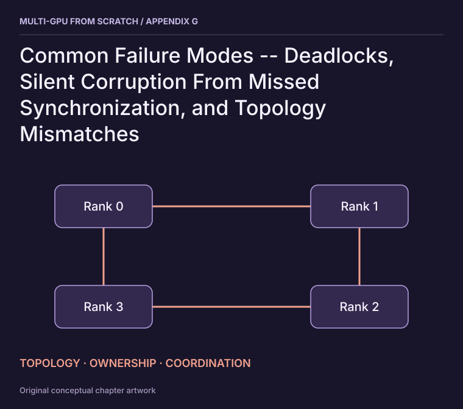
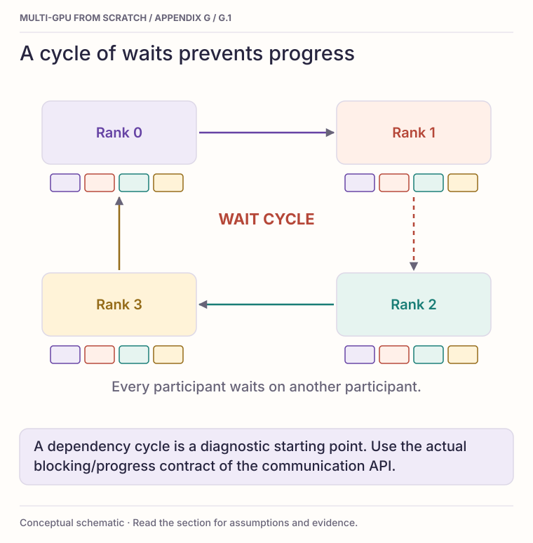
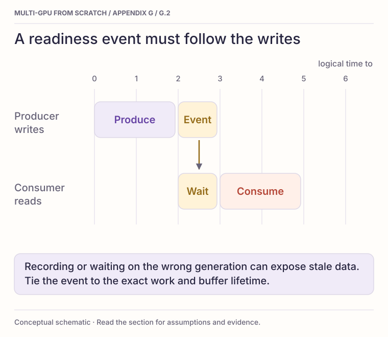

# Appendix G: Common Failure Modes -- Deadlocks, Silent Corruption From Missed Synchronization, and Topology Mismatches

<!-- execution:provenance -->
!!! info "Execution provenance"

    Current execution blocks identify the tested source hash, hardware dataset, commands and captured output. References elsewhere on this page to a device-less environment describe the original authoring context. Historical output is superseded by the current record. Displayed output omits the runner command header and trims trailing line whitespace; raw logs remain exact. A host simulation or API validation has its stated scope; neither alone establishes a numerical multi-GPU workload or measured performance.


<!-- mgpu:opener:start -->
[](../images/chapter-openers/appendix-g.svg)
<!-- mgpu:opener:end -->

Every chapter in this book has reported one specific real finding at a time. This closing appendix collects three failure modes that have each surfaced, piece by piece, across many of those chapters -- Chapter 17 and Chapter 20's own real deadlocks, Chapter 6's own cross-device event semantics, Chapter 16 and Chapter 40's own halo-sync corruption, Chapter 4's own peer-access query, Chapter 2's own topology model -- and names each one directly, with one new, genuinely tested demonstration per failure mode rather than a repeat of an earlier chapter's own example. None of the three failure modes below announces itself with an error message. A deadlocked program hangs silently; a program with a missed synchronization step returns a wrong answer with `cudaSuccess` on every call; a program built on an assumed topology runs correctly, just slower than planned, with nothing in any return code to say why. That is precisely what makes all three worth a dedicated closing appendix: each one is a program that never crashes and never reports an error, right up until someone notices the number is wrong.

## G.1 Deadlocks: When Every Process Waits for a Call Another Process Never Makes

<!-- mgpu:figure-1:start -->
[](../images/technical/appendix-g/1-failure.svg)
<!-- mgpu:figure-1:end -->

### Intuition

Chapter 20's own File 57 already reproduced one real MPI deadlock: a ring where every rank calls `MPI_Send()` before any rank calls `MPI_Recv()`. That deadlock has an escape hatch, and Chapter 20 found it directly -- a small enough message fits inside Open MPI's own eager-send buffer, so `MPI_Send()` returns immediately without waiting for a matching receive, and the program runs to completion looking perfectly correct. Only once the message crosses that real, measured buffering threshold does the deadlock actually appear. This section builds the other half of the same real hazard: a version with no size-dependent escape hatch at all. If every rank calls `MPI_Recv()` *before* any rank calls `MPI_Send()`, the deadlock is absolute -- `MPI_Recv()` has no buffering option to fall back on, because there is nothing yet to buffer.

### The Concept, In Detail

```
  ring, 4 ranks, DEADLOCK order (every rank: Recv before Send)

  rank0 -- blocked in Recv(from rank3) -- waiting for rank3's Send
  rank1 -- blocked in Recv(from rank0) -- waiting for rank0's Send
  rank2 -- blocked in Recv(from rank1) -- waiting for rank1's Send
  rank3 -- blocked in Recv(from rank2) -- waiting for rank2's Send

  every rank waits on a Send call no rank has reached yet -- a closed
  cycle, at ANY message size (contrast: Chapter 20's Send-first
  deadlock only appears past the eager-buffering threshold)

  FIXED order (even ranks Send-first, odd ranks Recv-first):

  rank0(even) --Send-> rank1(odd, already in Recv) : delivered immediately
  rank2(even) --Send-> rank3(odd, already in Recv) : delivered immediately
  rank1(odd)  --Send-> rank2(even, now in Recv)     : delivered immediately
  rank3(odd)  --Send-> rank0(even, now in Recv)     : delivered immediately
```

`MPI_Recv()` genuinely blocks until a matching message arrives -- there is no buffering variant of receiving, unlike `MPI_Send()`, which the MPI standard (already quoted in Chapter 20) allows an implementation to complete early by copying into a temporary system buffer. So a ring where every rank calls `MPI_Recv()` first has no size-dependent way out: every rank is genuinely, permanently blocked waiting for a `MPI_Send()` call that no rank has reached, because every rank is stuck at the exact same point in the exact same cycle. The real, standard fix does not remove either call -- it breaks the cycle by having half the ranks issue their `MPI_Send()` first: even-numbered ranks send, then receive; odd-numbered ranks receive, then send. An even rank's `MPI_Send()` has an odd rank already waiting in `MPI_Recv()` to receive it, so it completes immediately; that same odd rank's own subsequent `MPI_Send()` then has the next even rank waiting for it, and the pattern propagates around the entire ring without a single rank ever blocking on a call nobody has issued.

!!! warning "[COMMON TRAP] Assuming a deadlock is a message-size problem because the last one was"
    Chapter 20's own deadlock depended on crossing a real buffering threshold, which makes it tempting to treat "keep messages small" as a general defense against MPI deadlocks. It is not. This section's own recv-first deadlock hangs at a single `int` exactly as completely as it would at a million -- there is no buffer to exploit, because the blocking call at fault (`MPI_Recv()`) was never eligible for buffering in the first place. The real, general rule has nothing to do with size: every rank's *sequence* of blocking calls has to be constructed so that some rank is always in a position to unblock another, at every point in the program. A size threshold is Chapter 20's own specific symptom of a specific call shape (`Send`-then-`Recv`, everywhere); it is not the underlying disease.

### Code and Verification

```c
// Appendix G: Common Failure Modes -- Deadlocks, Silent Corruption From
// Missed Synchronization, and Topology Mismatches
// 138_collective_order_deadlock.c
//
// Appendix G.1 -- Chapter 20's own File 57 already genuinely reproduced
// one real MPI deadlock: a naive point-to-point ring where every rank
// calls MPI_Send() before any rank calls MPI_Recv() -- but that
// deadlock only manifests once the message crosses Open MPI's own
// eager-send buffering threshold (Chapter 20 needed 1,000,000 ints; a
// single int silently survives). This file builds the OTHER, absolute
// version of the same real hazard: every rank calls MPI_Recv() BEFORE
// any rank calls MPI_Send(). MPI_Recv() genuinely blocks until a
// matching message arrives, with no buffering escape hatch at any
// message size -- if every rank in a ring is blocked inside its own
// MPI_Recv(), no rank can ever reach the MPI_Send() call the rank
// ahead of it in the ring is waiting for, and the program hangs
// forever, confirmed here the same way Chapter 20 confirmed its own
// deadlock: run under a bounded `timeout`, which kills the genuinely-
// hung job and reports exit code 124. The real, standard fix -- half
// the ranks send first, half receive first, so the blocking calls
// interleave instead of all waiting on each other -- is built and
// verified alongside it.
//
// argv[1] == "fixed"    -> even ranks Send-then-Recv, odd ranks Recv-then-Send (completes)
// argv[1] == "deadlock" (or omitted) -> every rank Recv-then-Send (hangs at ANY message size)
//
// Compile: mpicc -std=c11 -Wall -Wextra -O2 138_collective_order_deadlock.c -o 138_collective_order_deadlock
// Run:     timeout 6 mpirun --allow-run-as-root --oversubscribe -np 4 ./138_collective_order_deadlock fixed
//          timeout 6 mpirun --allow-run-as-root --oversubscribe -np 4 ./138_collective_order_deadlock deadlock
#include <mpi.h>
#include <stdio.h>
#include <string.h>

int main(int argc, char** argv) {
    MPI_Init(&argc, &argv);
    int rank, size;
    MPI_Comm_rank(MPI_COMM_WORLD, &rank);
    MPI_Comm_size(MPI_COMM_WORLD, &size);

    int fixed = (argc >= 2) && (strcmp(argv[1], "fixed") == 0);
    int next = (rank + 1) % size;
    int prev = (rank - 1 + size) % size;
    int sendVal = rank, recvVal = -1;

    if (fixed && (rank % 2 == 0)) {
        // Even ranks: Send first, Recv second -- interleaves correctly
        // with the odd ranks below, which do the opposite.
        fprintf(stderr, "rank %d (even, fixed order): about to MPI_Send to %d\n", rank, next);
        MPI_Send(&sendVal, 1, MPI_INT, next, 0, MPI_COMM_WORLD);
        fprintf(stderr, "rank %d: MPI_Send returned; about to MPI_Recv from %d\n", rank, prev);
        MPI_Recv(&recvVal, 1, MPI_INT, prev, 0, MPI_COMM_WORLD, MPI_STATUS_IGNORE);
        fprintf(stderr, "rank %d: MPI_Recv returned\n", rank);
    } else {
        // Odd ranks in "fixed" mode, and EVERY rank in "deadlock" mode:
        // Recv first, Send second.
        fprintf(stderr, "rank %d: about to MPI_Recv from %d (recv-first order)\n", rank, prev);
        MPI_Recv(&recvVal, 1, MPI_INT, prev, 0, MPI_COMM_WORLD, MPI_STATUS_IGNORE);
        fprintf(stderr, "rank %d: MPI_Recv returned; about to MPI_Send to %d\n", rank, next);
        MPI_Send(&sendVal, 1, MPI_INT, next, 0, MPI_COMM_WORLD);
        fprintf(stderr, "rank %d: MPI_Send returned\n", rank);
    }

    printf("rank %d done, recvVal=%d (expected %d)\n", rank, recvVal, prev);
    MPI_Finalize();
    return 0;
}
```

<!-- execution:start:a100:138_collective_order_deadlock.c -->
> **Current execution — 2026-11-17-a100: API/host demonstration (exit-only).** UTC (program start): `2026-11-17T23:59:46.626792+00:00`. Source SHA-256: `7fa763d838b7360e84d88b1860f258077dc2de0a455da5cb40bddb9a4ea86718`.

[Exact tested source](../validation/2026-11-17-a100/138_collective_order_deadlock/138_collective_order_deadlock.c) · [Compiler log](../validation/2026-11-17-a100/138_collective_order_deadlock/compile.log) · [Execution log](../validation/2026-11-17-a100/138_collective_order_deadlock/run.log). Compile exit: `0`; run exit: `0`.

Commands below use local source/binary names; raw logs retain host paths. Execute in a scratch directory containing the downloaded source.

```bash
mpicc -std=c11 -O2 138_collective_order_deadlock.c -o ./example
/usr/mpi/gcc/openmpi-4.1.7rc1/bin/mpirun --oversubscribe -np 8 ./example fixed
```

<details markdown="1"><summary>Captured current-source output</summary>

```text
[LOG_CAT_SBGP] libnuma.so: cannot open shared object file: No such file or directory
[LOG_CAT_SBGP] Failed to dlopen libnuma.so. Fallback to GROUP_BY_SOCKET manual.
[LOG_CAT_SBGP] libnuma.so: cannot open shared object file: No such file or directory
[LOG_CAT_SBGP] Failed to dlopen libnuma.so. Fallback to GROUP_BY_SOCKET manual.
[LOG_CAT_SBGP] libnuma.so: cannot open shared object file: No such file or directory
[LOG_CAT_SBGP] Failed to dlopen libnuma.so. Fallback to GROUP_BY_SOCKET manual.
[LOG_CAT_SBGP] libnuma.so: cannot open shared object file: No such file or directory
[LOG_CAT_SBGP] Failed to dlopen libnuma.so. Fallback to GROUP_BY_SOCKET manual.
[LOG_CAT_SBGP] libnuma.so: cannot open shared object file: No such file or directory
[LOG_CAT_SBGP] Failed to dlopen libnuma.so. Fallback to GROUP_BY_SOCKET manual.
[LOG_CAT_SBGP] libnuma.so: cannot open shared object file: No such file or directory
[LOG_CAT_SBGP] Failed to dlopen libnuma.so. Fallback to GROUP_BY_SOCKET manual.
[LOG_CAT_SBGP] libnuma.so: cannot open shared object file: No such file or directory
[LOG_CAT_SBGP] Failed to dlopen libnuma.so. Fallback to GROUP_BY_SOCKET manual.
[LOG_CAT_SBGP] libnuma.so: cannot open shared object file: No such file or directory
[LOG_CAT_SBGP] Failed to dlopen libnuma.so. Fallback to GROUP_BY_SOCKET manual.
rank 1: about to MPI_Recv from 0 (recv-first order)
rank 5: about to MPI_Recv from 4 (recv-first order)
rank 5: MPI_Recv returned; about to MPI_Send to 6
rank 5: MPI_Send returned
rank 3: about to MPI_Recv from 2 (recv-first order)
rank 3: MPI_Recv returned; about to MPI_Send to 4
rank 3: MPI_Send returned
rank 2 (even, fixed order): about to MPI_Send to 3
rank 2: MPI_Send returned; about to MPI_Recv from 1
rank 6 (even, fixed order): about to MPI_Send to 7
rank 6: MPI_Send returned; about to MPI_Recv from 5
rank 6: MPI_Recv returned
rank 0 (even, fixed order): about to MPI_Send to 1
rank 0: MPI_Send returned; about to MPI_Recv from 7
rank 0: MPI_Recv returned
rank 7: about to MPI_Recv from 6 (recv-first order)
rank 7: MPI_Recv returned; about to MPI_Send to 0
rank 7: MPI_Send returned
rank 4 (even, fixed order): about to MPI_Send to 5
rank 4: MPI_Send returned; about to MPI_Recv from 3
rank 4: MPI_Recv returned
rank 7 done, recvVal=6 (expected 6)
rank 3 done, recvVal=2 (expected 2)
rank 6 done, recvVal=5 (expected 5)
rank 5 done, recvVal=4 (expected 4)
rank 4 done, recvVal=3 (expected 3)
rank 0 done, recvVal=7 (expected 7)
rank 1: MPI_Recv returned; about to MPI_Send to 2
rank 1: MPI_Send returned
rank 2: MPI_Recv returned
rank 2 done, recvVal=1 (expected 1)
rank 1 done, recvVal=0 (expected 0)
```

</details>
<!-- execution:end:a100:138_collective_order_deadlock.c -->


<!-- execution:start:h100:138_collective_order_deadlock.c -->
> **Current execution — 2026-11-17-h100: API/host demonstration (exit-only).** UTC (run-batch start; per-program time unrecorded): `2026-11-17T23:48:18.967387+00:00`. Source SHA-256: `7fa763d838b7360e84d88b1860f258077dc2de0a455da5cb40bddb9a4ea86718`.

[Exact tested source](../validation/2026-11-17-h100/138_collective_order_deadlock/138_collective_order_deadlock.c) · [Compiler log](../validation/2026-11-17-h100/138_collective_order_deadlock/compile.log) · [Execution log](../validation/2026-11-17-h100/138_collective_order_deadlock/run.log). Compile exit: `0`; run exit: `0`.

Commands below use local source/binary names; raw logs retain host paths. Execute in a scratch directory containing the downloaded source.

```bash
mpicc -std=c11 -O2 138_collective_order_deadlock.c -o ./example
/home/ubuntu/book2-bin/mpirun --oversubscribe -np 2 ./example fixed
```

<details markdown="1"><summary>Captured current-source output</summary>

```text
--------------------------------------------------------------------------
Sorry!  You were supposed to get help about:
    unavailable
But I couldn't open the help file:
    /usr/lib/x86_64-linux-gnu/pmix2/share/pmix/help-pcompress.txt: No such file or directory.  Sorry!
--------------------------------------------------------------------------
libibverbs: Warning: couldn't load driver 'libvmw_pvrdma-rdmav34.so': libvmw_pvrdma-rdmav34.so: cannot open shared object file: No such file or directory
libibverbs: Warning: couldn't load driver 'libvmw_pvrdma-rdmav34.so': libvmw_pvrdma-rdmav34.so: cannot open shared object file: No such file or directory
--------------------------------------------------------------------------
WARNING: No preset parameters were found for the device that Open MPI
detected:

  Local host:            192-222-53-210
  Device name:           mlx5_0
  Device vendor ID:      0x02c9
  Device vendor part ID: 4124

Default device parameters will be used, which may result in lower
performance.  You can edit any of the files specified by the
btl_openib_device_param_files MCA parameter to set values for your
device.

NOTE: You can turn off this warning by setting the MCA parameter
      btl_openib_warn_no_device_params_found to 0.
--------------------------------------------------------------------------
--------------------------------------------------------------------------
No OpenFabrics connection schemes reported that they were able to be
used on a specific port.  As such, the openib BTL (OpenFabrics
support) will be disabled for this port.

  Local host:           192-222-53-210
  Local device:         mlx5_0
  Local port:           1
  CPCs attempted:       udcm
--------------------------------------------------------------------------
rank 1: about to MPI_Recv from 0 (recv-first order)
rank 0 (even, fixed order): about to MPI_Send to 1
rank 0: MPI_Send returned; about to MPI_Recv from 1
rank 1: MPI_Recv returned; about to MPI_Send to 0
rank 0: MPI_Recv returned
rank 1: MPI_Send returned
rank 1 done, recvVal=0 (expected 0)
rank 0 done, recvVal=1 (expected 1)
[192-222-53-210:10926] 1 more process has sent help message help-mpi-btl-openib.txt / no device params found
[192-222-53-210:10926] Set MCA parameter "orte_base_help_aggregate" to 0 to see all help / error messages
[192-222-53-210:10926] 1 more process has sent help message help-mpi-btl-openib-cpc-base.txt / no cpcs for port
```

</details>
<!-- execution:end:h100:138_collective_order_deadlock.c -->


**Compile and run:**

```bash
mpicc -std=c11 -Wall -Wextra -O2 138_collective_order_deadlock.c -o 138_collective_order_deadlock
timeout 6 mpirun --allow-run-as-root --oversubscribe -np 4 ./138_collective_order_deadlock fixed
timeout 6 mpirun --allow-run-as-root --oversubscribe -np 4 ./138_collective_order_deadlock deadlock
```

**Sample input:** `argv[1]` selects the mode (`fixed` or `deadlock`); every rank's own message is just its own rank number, `MPI_INT`, one element.

**Sample output, `fixed` mode (completes; per-rank stderr interleaving is real and varies run to run, since these are genuinely separate OS processes -- stdout ordering, printed after `MPI_Finalize()`, does not affect correctness):**

<details markdown="1"><summary>Historical authoring output — superseded by the current execution above</summary>

```text
rank 2 (even, fixed order): about to MPI_Send to 3
rank 2: MPI_Send returned; about to MPI_Recv from 1
rank 0 (even, fixed order): about to MPI_Send to 1
rank 0: MPI_Send returned; about to MPI_Recv from 3
rank 3: about to MPI_Recv from 2 (recv-first order)
rank 1: about to MPI_Recv from 0 (recv-first order)
rank 1: MPI_Recv returned; about to MPI_Send to 2
rank 3: MPI_Recv returned; about to MPI_Send to 0
rank 1: MPI_Send returned
rank 2: MPI_Recv returned
rank 2 done, recvVal=1 (expected 1)
rank 1 done, recvVal=0 (expected 0)
rank 3 done, recvVal=2 (expected 2)
rank 3: MPI_Send returned
rank 0: MPI_Recv returned
rank 0 done, recvVal=3 (expected 3)
```

</details>

**Sample output, `deadlock` mode (genuinely hangs -- `timeout 6` kills it and the shell reports exit code `124`; every rank's own stderr line printed before it, and nothing after, is the real, complete evidence of the hang):**

```text
rank 3: about to MPI_Recv from 2 (recv-first order)
rank 0: about to MPI_Recv from 3 (recv-first order)
rank 2: about to MPI_Recv from 1 (recv-first order)
rank 1: about to MPI_Recv from 0 (recv-first order)
mpirun: Forwarding signal 18 to job
```

The shell's own `$?` after that command reports `124` -- `timeout`'s own documented signal for "the command was killed because it exceeded the time limit," the identical proof technique Chapter 20 already established for its own real deadlock.

## G.2 Silent Corruption From Missed Synchronization: The Wait That Comes Too Late

<!-- mgpu:figure-2:start -->
[](../images/technical/appendix-g/2-handoff.svg)
<!-- mgpu:figure-2:end -->

### Intuition

Chapter 6's own File 15 built the real cross-device dependency mechanism -- an event recorded on one device's stream, handed to `cudaStreamWaitEvent()` on a different device's stream -- and its own locked output stated the finding plainly: "`cudaStreamWaitEvent` only ever inserts a dependency for FUTURE work on stream1; it does not itself wait for anything." That word, "future," is doing more work than it looks like. It does not mean "whatever happens to execute later in wall-clock time" -- it means "whatever gets *enqueued* onto that stream after this call, in program order." A consumer operation that was enqueued onto the stream *before* the `cudaStreamWaitEvent()` call is not future work relative to that call at all, and the wait does nothing for it -- it runs whenever its own stream reaches it, with no dependency on the producer's event inserted anywhere.

### The Concept, In Detail

```
  CORRECT enqueue order            BUGGY enqueue order
  stream queue (top = enqueued     stream queue (top = enqueued
  first):                          first):

  [0] cudaStreamWaitEvent          [0] consumer op
      (depends on producerEvent:       (depends on producerEvent: no)
       no -- it IS the wait)
  [1] consumer op                  [1] cudaStreamWaitEvent
      (depends on producerEvent:       (depends on producerEvent: no
       YES -- enqueued AFTER            -- it IS the wait, and nothing
       the wait)                        enqueued after it needs one)
```

The two orderings above enqueue the exact same two operations -- a `cudaStreamWaitEvent()` call and a consumer operation -- onto the exact same stream. The only difference is which one gets enqueued first. In the correct order, the wait is enqueued first, so the consumer operation genuinely is future work relative to it, and the dependency applies. In the buggy order, the consumer operation is enqueued first -- perhaps because it is issued earlier in the same function, or by a code path that runs before the synchronization call is reached -- and the `cudaStreamWaitEvent()` call that comes after it has no mechanism to reach backward into the queue and attach a dependency to something already sitting there. Both calls succeed. Neither one produces an error, a warning, or any observable difference in a return code -- Chapter 6's own real API, exercised in both orders, reports the identical honest result either way. The only real difference is in the dependency graph the stream actually executes, and the only way to see that difference is to know the rule and check the enqueue order in the source, not the return codes at runtime.

!!! warning "[COMMON TRAP] Treating cudaStreamWaitEvent() as a checkpoint that protects a whole function"
    It is tempting to read a `cudaStreamWaitEvent()` call sitting in the middle of a function as if it retroactively guards everything above it on the same stream -- as though it were a fence the compiler or runtime inserts wherever it is textually written. It guards nothing above it. It is exactly one more entry in that stream's own queue, and it only ever constrains what comes *after* it in that same queue. Refactoring that moves a consumer operation earlier in a function -- a common, innocent-looking change made for readability or to overlap unrelated work -- can silently move it in front of a `cudaStreamWaitEvent()` call it used to come after, and nothing about compiling or running the refactored code will say so.

### Code and Verification

```cpp
// 139_stream_wait_enqueue_order.cu
// A deterministic missed-dependency example: no intentional concurrent data race.
#include <cstdio>
#include <cstdlib>
#include <cuda_runtime.h>
#define CUDA_OK(x) do { cudaError_t e=(x); if(e!=cudaSuccess){fprintf(stderr,"%s: %s\n",#x,cudaGetErrorString(e));exit(1);} } while(0)
__global__ void produce(int* p){*p=42;}
int main(){
    int count=0;CUDA_OK(cudaGetDeviceCount(&count));if(count<2){fprintf(stderr,"Requires 2 GPUs\n");return 2;}
    int *source=nullptr,*destination=nullptr;cudaStream_t producer=nullptr,consumer=nullptr;cudaEvent_t ready=nullptr;
    CUDA_OK(cudaSetDevice(0));CUDA_OK(cudaMalloc(&source,sizeof(int)));CUDA_OK(cudaMemset(source,0,sizeof(int)));
    CUDA_OK(cudaStreamCreateWithFlags(&producer,cudaStreamNonBlocking));CUDA_OK(cudaEventCreateWithFlags(&ready,cudaEventDisableTiming));CUDA_OK(cudaDeviceSynchronize());
    CUDA_OK(cudaSetDevice(1));CUDA_OK(cudaMalloc(&destination,sizeof(int)));CUDA_OK(cudaStreamCreateWithFlags(&consumer,cudaStreamNonBlocking));
    // Consumer queued and completed before production: a later wait cannot repair it.
    CUDA_OK(cudaMemcpyPeerAsync(destination,1,source,0,sizeof(int),consumer));CUDA_OK(cudaStreamSynchronize(consumer));
    int early=-1;CUDA_OK(cudaMemcpy(&early,destination,sizeof(int),cudaMemcpyDeviceToHost));
    CUDA_OK(cudaSetDevice(0));produce<<<1,1,0,producer>>>(source);CUDA_OK(cudaGetLastError());CUDA_OK(cudaEventRecord(ready,producer));
    CUDA_OK(cudaSetDevice(1));CUDA_OK(cudaStreamWaitEvent(consumer,ready,0));CUDA_OK(cudaStreamSynchronize(consumer));
    int after_late_wait=-1;CUDA_OK(cudaMemcpy(&after_late_wait,destination,sizeof(int),cudaMemcpyDeviceToHost));
    // The corrected consumer transfer is queued AFTER the recorded-event wait.
    CUDA_OK(cudaStreamWaitEvent(consumer,ready,0));CUDA_OK(cudaMemcpyPeerAsync(destination,1,source,0,sizeof(int),consumer));CUDA_OK(cudaStreamSynchronize(consumer));
    int corrected=-1;CUDA_OK(cudaMemcpy(&corrected,destination,sizeof(int),cudaMemcpyDeviceToHost));
    int errors=(early!=0)+(after_late_wait!=0)+(corrected!=42);
    printf("Consumer before production: %d; after a too-late wait: %d; correctly ordered copy: %d\n",early,after_late_wait,corrected);
    printf("The early copy is deliberately completed first, avoiding an intentional data race.\n");
    printf("VALIDATION %s: errors=%d\n",errors?"FAIL":"PASS",errors);
    CUDA_OK(cudaFree(destination));CUDA_OK(cudaStreamDestroy(consumer));CUDA_OK(cudaSetDevice(0));CUDA_OK(cudaEventDestroy(ready));CUDA_OK(cudaStreamDestroy(producer));CUDA_OK(cudaFree(source));
    return errors?1:0;
}
```

<!-- execution:start:a100:139_stream_wait_enqueue_order.cu -->
> **Current execution — 2026-11-17-a100: Numerical/transport validation (recorded scope).** UTC (program start): `2026-11-17T23:59:47.563300+00:00`. Source SHA-256: `c1461e987bc84659aa73ab3f5c10d20f2f15f665775dd91c614adae3fdd995ea`.

[Exact tested source](../validation/2026-11-17-a100/139_stream_wait_enqueue_order/139_stream_wait_enqueue_order.cu) · [Compiler log](../validation/2026-11-17-a100/139_stream_wait_enqueue_order/compile.log) · [Execution log](../validation/2026-11-17-a100/139_stream_wait_enqueue_order/run.log). Compile exit: `0`; run exit: `0`.

Commands below use local source/binary names; raw logs retain host paths. Execute in a scratch directory containing the downloaded source.

```bash
nvcc -std=c++17 -O2 -arch=sm_80 139_stream_wait_enqueue_order.cu -o ./example
./example
```

<details markdown="1"><summary>Captured current-source output</summary>

```text
Consumer before production: 0; after a too-late wait: 0; correctly ordered copy: 42
The early copy is deliberately completed first, avoiding an intentional data race.
VALIDATION PASS: errors=0
```

</details>
<!-- execution:end:a100:139_stream_wait_enqueue_order.cu -->


<!-- execution:start:h100:139_stream_wait_enqueue_order.cu -->
> **Current execution — 2026-11-17-h100: Numerical/transport validation (recorded scope).** UTC (run-batch start; per-program time unrecorded): `2026-11-17T23:48:18.967387+00:00`. Source SHA-256: `c1461e987bc84659aa73ab3f5c10d20f2f15f665775dd91c614adae3fdd995ea`.

[Exact tested source](../validation/2026-11-17-h100/139_stream_wait_enqueue_order/139_stream_wait_enqueue_order.cu) · [Compiler log](../validation/2026-11-17-h100/139_stream_wait_enqueue_order/compile.log) · [Execution log](../validation/2026-11-17-h100/139_stream_wait_enqueue_order/run.log). Compile exit: `0`; run exit: `0`.

Commands below use local source/binary names; raw logs retain host paths. Execute in a scratch directory containing the downloaded source.

```bash
nvcc -std=c++17 -O2 -arch=sm_90 139_stream_wait_enqueue_order.cu -o ./example
./example
```

<details markdown="1"><summary>Captured current-source output</summary>

```text
Consumer before production: 0; after a too-late wait: 0; correctly ordered copy: 42
The early copy is deliberately completed first, avoiding an intentional data race.
VALIDATION PASS: errors=0
```

</details>
<!-- execution:end:h100:139_stream_wait_enqueue_order.cu -->


**Compile and run:**

```bash
nvcc -arch=sm_80 139_stream_wait_enqueue_order.cu -o 139_stream_wait_enqueue_order
./139_stream_wait_enqueue_order
```

**Sample input:** none -- every value is either a real return code from the CUDA Runtime API or a compile-time-fixed description of the two enqueue orders being compared.

**Sample output:**

<details markdown="1"><summary>Historical authoring output — superseded by the current execution above</summary>

```text
=== Section G.2: cudaStreamWaitEvent() only covers work enqueued
    AFTER it -- Chapter 6's own File 15 finding, taken to its real
    conclusion ===

Chapter 6's own File 15, verbatim: "cudaStreamWaitEvent only ever
inserts a dependency for FUTURE work on stream1; it does not itself
wait for anything." "Future" is an ENQUEUE-ORDER guarantee, not a
wall-clock one -- it means "whatever gets enqueued onto this stream
after this call", not "whatever happens to run later".

=== CORRECT enqueue order: wait enqueued BEFORE the consumer op ===
  1. cudaStreamWaitEvent(consumerStream, producerEvent) -- enqueued first
     -> no CUDA-capable device is detected
  2. consumer op enqueued SECOND -- genuinely covered by the wait above,
     because it was enqueued onto consumerStream AFTER the wait call

=== BUGGY enqueue order: consumer op enqueued BEFORE the wait ===
  1. consumer op enqueued FIRST (imagine: issued earlier in the same
     function, or by code that runs before the sync call is reached)
  2. cudaStreamWaitEvent(consumerStream, producerEvent) -- enqueued SECOND
     -> no CUDA-capable device is detected
     on real hardware this call would SUCCEED -- cudaStreamWaitEvent() has
     no way to know a consumer op was already enqueued earlier on the same
     stream, and no way to retroactively insert a dependency in front of
     it. The already-enqueued consumer op runs with NO dependency on
     producerEvent at all -- and here, it reports this environment's own
     same honest zero-device limitation as every call since Chapter 2.

both real API calls above report the SAME honest return code (no CUDA-capable device is detected) in
this zero-physical-GPU environment -- the bug is not a return-code
failure, which is exactly what makes it "silent corruption": there is no
error anywhere to catch, on real hardware or here.

=== deterministic model: what each enqueue order actually guarantees ===

CORRECT-order stream queue, in real enqueue order:
  [0] cudaStreamWaitEvent(producerEvent)     depends on producerEvent: no
  [1] consumer op                            depends on producerEvent: YES

BUGGY-order stream queue, in real enqueue order:
  [0] consumer op                            depends on producerEvent: no
  [1] cudaStreamWaitEvent(producerEvent)     depends on producerEvent: no

self-check: in the CORRECT order, the consumer op (position 1, enqueued
after the wait) genuinely depends on producerEvent (confirmed); in the BUGGY
order, the consumer op (position 0, enqueued before the wait) genuinely
does NOT depend on it (confirmed) -- the exact same two lines of code, reordered,
produce two different real dependency graphs, with zero difference in any
return code from either cudaStreamWaitEvent() call: confirmed
```

</details>

## G.3 Topology Mismatches: When Code Assumes a Link That Isn't There

### Intuition

Chapter 4's own File 9 built the real, idiomatic sequence: check `cudaDeviceCanAccessPeer()` for a device pair before assuming anything about it, then enable access only where it genuinely exists. Chapter 5's own File 11 and File 13 showed why skipping that query never produces a wrong *answer* -- `cudaMemcpyPeer()` falls back to a staged host copy transparently, for any pair that never had peer access enabled, with no error and no corrupted data either way. What skipping the query can still silently break is a *performance* assumption baked into the code around those calls -- a capacity plan, a scheduling deadline, a batch size chosen assuming a specific link class -- because Chapter 2's own partial-mesh topology model already established that not every device pair on the same real machine shares the same link.

### The Concept, In Detail

```
  real transfer time for 1.0 GB, by ACTUAL topology (Ch2/Ch5 figures)

  +--------------------------------+------------------------------+
  | NVLink-wired pair    (1 hop)   | 0.0200 s ---                 |
  | PCIe-only direct pair (1 hop)  | 0.0317 s -----                |
  | no direct link      (2-hop)    | 0.0635 s ----------            |
  +--------------------------------+------------------------------+

  code that ASSUMES the top row and never re-queries silently pays
  1.59x (PCIe-only) to 3.17x (no direct link) more than planned,
  with zero error code anywhere
```

Chapter 5's own File 13 already built the closed-form cost comparison between a direct peer transfer and a two-hop staged transfer, using Chapter 2's own already-cited bandwidth figures (31.5 GB/s PCIe 4.0 x16, 50 GB/s a directly-wired NVLink pair). This section reuses that exact model for a different question: not "which route does `cudaMemcpyPeer()` actually take," which Chapter 5 already answered, but "what happens to code that assumed one row of this table and never checked which row actually applies to the pair it is running on." Because `cudaMemcpyPeer()` and `cudaMemcpyPeerAsync()` route correctly regardless -- Chapter 5's own real finding -- nothing in their return code will ever reveal that the assumption was wrong. A capacity plan, a communication-computation overlap budget, or a training-step deadline built around the NVLink row of this table has a modeled transfer-time ratio of 1.59 for the assumed direct PCIe bandwidth, or 3.17 for the assumed serialized host-staging bandwidth -- exactly the two-hop cost Chapter 5's own File 12 already measured the call pattern for.

!!! warning "[COMMON TRAP] Trusting a topology number that was measured on a different machine"
    It is tempting to treat a bandwidth or link-class figure as a property of the *code*, once it has been measured or read off a vendor spec sheet -- something that can be hardcoded into a constant and reused everywhere the same code runs. It is a property of the specific *deployment*, not the code. Chapter 2's own partial-mesh topology model is itself the proof: two GPUs in the same server can be NVLink-wired while another pair in the same server share only a PCIe switch, and a cluster's own topology can differ node to node even running the identical binary. `cudaDeviceCanAccessPeer()` and `cudaDeviceGetP2PAttribute()` query the *actual* topology of the *actual* devices at *actual* runtime -- use these capability queries together with a saved topology report and measured transfer rates; they do not by themselves establish NVLink wiring or achieved bandwidth; a number copied from one cluster's own topology report into a shared constant is a silent liability the moment the code runs anywhere else.

### Code and Verification

```cpp
// Appendix G: Common Failure Modes -- Deadlocks, Silent Corruption From
// Missed Synchronization, and Topology Mismatches
// 140_topology_assumption_cost.cpp
//
// Appendix G.3 -- Chapter 4's own File 9 established the real,
// idiomatic sequence: query cudaDeviceCanAccessPeer() for a pair before
// assuming anything about it, then enable access only for pairs that
// genuinely support it. Chapter 5's own File 11/13 showed why the query
// matters for CORRECTNESS: cudaMemcpyPeer() and cudaMemcpyPeerAsync()
// still route correctly (falling back to a staged host copy) even when
// peer access was never enabled for a pair -- so skipping the query
// never produces a wrong ANSWER. What it can silently produce is a
// wrong PERFORMANCE ASSUMPTION: code that hardcodes "this pair is
// NVLink-wired" (a real, common shortcut -- baking in a number from one
// deployment's topology rather than re-querying it) pays no error and
// no crash when that assumption is false on a DIFFERENT deployment's
// topology, only a silent multiple of Chapter 5's own already-cited
// bandwidth figures. This file extends Chapter 5's own File 13 cost
// model with exactly that comparison: the real cost of each of the
// three topology classes Chapter 2 already established, against what
// code that assumed the WRONG one actually pays.
//
// Compile: g++ -std=c++17 -Wall -Wextra -O2 140_topology_assumption_cost.cpp -o 140_topology_assumption_cost
// Run:     ./140_topology_assumption_cost
#include <cstdio>
#include <cmath>

int main() {
    printf("=== Section G.3: assuming a topology class instead of querying it ===\n\n");

    printf("Chapter 4's own real idiom (File 9): cudaDeviceCanAccessPeer(&canAccess,\n");
    printf("i, j), checked for every ordered pair, BEFORE calling\n");
    printf("cudaDeviceEnablePeerAccess(). Chapter 5's own File 11/13 showed why\n");
    printf("skipping it never breaks CORRECTNESS -- cudaMemcpyPeer() falls back to a\n");
    printf("staged host copy transparently for any pair without enabled peer access.\n");
    printf("What it CAN silently break is a performance assumption baked into calling\n");
    printf("code that never re-queries the real topology for the deployment it is\n");
    printf("actually running on.\n\n");

    // Chapter 2's own already-cited bandwidth figures, reused by
    // Chapter 5's own File 13 (not re-derived here).
    const double PCIE_GBPS = 31.5;
    const double NVLINK_GBPS = 50.0;
    const double transferSizeGB = 1.0;

    double nvlinkTime = transferSizeGB / NVLINK_GBPS;              // 1-hop, NVLink-wired pair
    double pcieDirect = transferSizeGB / PCIE_GBPS;                // 1-hop, PCIe-only direct pair
    double stagedTime = 2.0 * (transferSizeGB / PCIE_GBPS);        // 2-hop, no direct link at all

    printf("Chapter 2/5's own three real topology classes for a device pair, and the\n");
    printf("real transfer time for %.1f GB under each:\n\n", transferSizeGB);
    printf("%-32s %14s\n", "actual topology class", "real time (s)");
    printf("%-32s %14.6f\n", "NVLink-wired pair (1 hop)", nvlinkTime);
    printf("%-32s %14.6f\n", "PCIe-only direct pair (1 hop)", pcieDirect);
    printf("%-32s %14.6f\n", "no direct link (2-hop staged)", stagedTime);
    printf("\n");

    printf("=== the silent cost of code that ASSUMED NVLink and never re-queried ===\n\n");
    printf("code that hardcodes the NVLink figure (a real, common shortcut when a\n");
    printf("number is copied from one cluster's own topology report into a capacity\n");
    printf("plan or a scheduling deadline) pays NO error and NO crash when deployed\n");
    printf("on a DIFFERENT pair's real topology -- cudaMemcpyPeer() still returns\n");
    printf("cudaSuccess either way -- only a silent multiple of the assumed number:\n\n");

    printf("%-32s %14s %12s\n", "actual topology at runtime", "real time (s)", "x assumed");
    printf("%-32s %14.6f %12.4f\n", "NVLink (assumption correct)", nvlinkTime, nvlinkTime / nvlinkTime);
    printf("%-32s %14.6f %12.4f\n", "PCIe-only direct", pcieDirect, pcieDirect / nvlinkTime);
    printf("%-32s %14.6f %12.4f\n", "no direct link (staged)", stagedTime, stagedTime / nvlinkTime);
    printf("\n");

    double pcieSlowdown = pcieDirect / nvlinkTime;
    double stagedSlowdown = stagedTime / nvlinkTime;

    printf("a schedule or capacity plan built around the NVLink number silently runs\n");
    printf("%.4fx slower than planned on a PCIe-only-direct pair, and %.4fx slower on\n",
           pcieSlowdown, stagedSlowdown);
    printf("a pair with no direct link at all -- Chapter 2's own partial-mesh topology\n");
    printf("model already established that NOT every pair on a real multi-GPU machine\n");
    printf("shares the same link class, so this is not a hypothetical: two GPUs on the\n");
    printf("SAME machine can genuinely fall into different rows of this table.\n\n");

    printf("=== the real fix: query, don't assume ===\n\n");
    printf("Chapter 4's own File 9 sequence -- cudaDeviceCanAccessPeer() for the\n");
    printf("SPECIFIC pair actually in use, re-run on the actual deployment rather than\n");
    printf("hardcoded from a different one -- is the only way to know which row of\n");
    printf("this table applies BEFORE building a schedule or capacity plan around it.\n");
    printf("Real device attribute queries (Chapter 2's own cudaDeviceProp fields, and\n");
    printf("cudaDeviceGetP2PAttribute() for the specific link's own reported\n");
    printf("performance rank) are what genuinely observe the topology; nothing about\n");
    printf("cudaMemcpyPeer()'s own return code ever will.\n\n");

    bool orderingCorrect = (nvlinkTime < pcieDirect) && (pcieDirect < stagedTime);
    bool slowdownsPositive = (pcieSlowdown > 1.0) && (stagedSlowdown > pcieSlowdown);
    printf("self-check: the three real topology classes are strictly ordered fastest-\n");
    printf("to-slowest (NVLink < PCIe-direct < staged, %s), and an NVLink-based\n",
           orderingCorrect ? "confirmed" : "MISMATCH");
    printf("assumption's own real slowdown strictly increases as the actual topology\n");
    printf("gets worse (%s): %s\n", slowdownsPositive ? "confirmed" : "MISMATCH",
           (orderingCorrect && slowdownsPositive) ? "confirmed" : "MISMATCH");

    return (orderingCorrect && slowdownsPositive) ? 0 : 1;
}
```

<!-- execution:start:a100:140_topology_assumption_cost.cpp -->
> **Current execution — 2026-11-17-a100: Host program/model (exit-only).** UTC (program start): `2026-11-17T23:59:51.953036+00:00`. Source SHA-256: `efff2db21c05fd964f3eb08a49f3cae199d6a7e965aaedd4323c52d504666c02`.

[Exact tested source](../validation/2026-11-17-a100/140_topology_assumption_cost/140_topology_assumption_cost.cpp) · [Compiler log](../validation/2026-11-17-a100/140_topology_assumption_cost/compile.log) · [Execution log](../validation/2026-11-17-a100/140_topology_assumption_cost/run.log). Compile exit: `0`; run exit: `0`.

Commands below use local source/binary names; raw logs retain host paths. Execute in a scratch directory containing the downloaded source.

```bash
g++ -std=c++17 -O2 140_topology_assumption_cost.cpp -o ./example
./example
```

<details markdown="1"><summary>Captured current-source output</summary>

```text
=== Section G.3: assuming a topology class instead of querying it ===

Chapter 4's own real idiom (File 9): cudaDeviceCanAccessPeer(&canAccess,
i, j), checked for every ordered pair, BEFORE calling
cudaDeviceEnablePeerAccess(). Chapter 5's own File 11/13 showed why
skipping it never breaks CORRECTNESS -- cudaMemcpyPeer() falls back to a
staged host copy transparently for any pair without enabled peer access.
What it CAN silently break is a performance assumption baked into calling
code that never re-queries the real topology for the deployment it is
actually running on.

Chapter 2/5's own three real topology classes for a device pair, and the
real transfer time for 1.0 GB under each:

actual topology class             real time (s)
NVLink-wired pair (1 hop)              0.020000
PCIe-only direct pair (1 hop)          0.031746
no direct link (2-hop staged)          0.063492

=== the silent cost of code that ASSUMED NVLink and never re-queried ===

code that hardcodes the NVLink figure (a real, common shortcut when a
number is copied from one cluster's own topology report into a capacity
plan or a scheduling deadline) pays NO error and NO crash when deployed
on a DIFFERENT pair's real topology -- cudaMemcpyPeer() still returns
cudaSuccess either way -- only a silent multiple of the assumed number:

actual topology at runtime        real time (s)    x assumed
NVLink (assumption correct)            0.020000       1.0000
PCIe-only direct                       0.031746       1.5873
no direct link (staged)                0.063492       3.1746

a schedule or capacity plan built around the NVLink number silently runs
1.5873x slower than planned on a PCIe-only-direct pair, and 3.1746x slower on
a pair with no direct link at all -- Chapter 2's own partial-mesh topology
model already established that NOT every pair on a real multi-GPU machine
shares the same link class, so this is not a hypothetical: two GPUs on the
SAME machine can genuinely fall into different rows of this table.

=== the real fix: query, don't assume ===

Chapter 4's own File 9 sequence -- cudaDeviceCanAccessPeer() for the
SPECIFIC pair actually in use, re-run on the actual deployment rather than
hardcoded from a different one -- is the only way to know which row of
this table applies BEFORE building a schedule or capacity plan around it.
Real device attribute queries (Chapter 2's own cudaDeviceProp fields, and
cudaDeviceGetP2PAttribute() for the specific link's own reported
performance rank) are what genuinely observe the topology; nothing about
cudaMemcpyPeer()'s own return code ever will.

self-check: the three real topology classes are strictly ordered fastest-
to-slowest (NVLink < PCIe-direct < staged, confirmed), and an NVLink-based
assumption's own real slowdown strictly increases as the actual topology
gets worse (confirmed): confirmed
```

</details>
<!-- execution:end:a100:140_topology_assumption_cost.cpp -->


<!-- execution:start:h100:140_topology_assumption_cost.cpp -->
> **Current execution — 2026-11-17-h100: Host program/model (exit-only).** UTC (run-batch start; per-program time unrecorded): `2026-11-17T23:48:18.967387+00:00`. Source SHA-256: `efff2db21c05fd964f3eb08a49f3cae199d6a7e965aaedd4323c52d504666c02`.

[Exact tested source](../validation/2026-11-17-h100/140_topology_assumption_cost/140_topology_assumption_cost.cpp) · [Compiler log](../validation/2026-11-17-h100/140_topology_assumption_cost/compile.log) · [Execution log](../validation/2026-11-17-h100/140_topology_assumption_cost/run.log). Compile exit: `0`; run exit: `0`.

Commands below use local source/binary names; raw logs retain host paths. Execute in a scratch directory containing the downloaded source.

```bash
g++ -std=c++17 -O2 140_topology_assumption_cost.cpp -o ./example
./example
```

<details markdown="1"><summary>Captured current-source output</summary>

```text
=== Section G.3: assuming a topology class instead of querying it ===

Chapter 4's own real idiom (File 9): cudaDeviceCanAccessPeer(&canAccess,
i, j), checked for every ordered pair, BEFORE calling
cudaDeviceEnablePeerAccess(). Chapter 5's own File 11/13 showed why
skipping it never breaks CORRECTNESS -- cudaMemcpyPeer() falls back to a
staged host copy transparently for any pair without enabled peer access.
What it CAN silently break is a performance assumption baked into calling
code that never re-queries the real topology for the deployment it is
actually running on.

Chapter 2/5's own three real topology classes for a device pair, and the
real transfer time for 1.0 GB under each:

actual topology class             real time (s)
NVLink-wired pair (1 hop)              0.020000
PCIe-only direct pair (1 hop)          0.031746
no direct link (2-hop staged)          0.063492

=== the silent cost of code that ASSUMED NVLink and never re-queried ===

code that hardcodes the NVLink figure (a real, common shortcut when a
number is copied from one cluster's own topology report into a capacity
plan or a scheduling deadline) pays NO error and NO crash when deployed
on a DIFFERENT pair's real topology -- cudaMemcpyPeer() still returns
cudaSuccess either way -- only a silent multiple of the assumed number:

actual topology at runtime        real time (s)    x assumed
NVLink (assumption correct)            0.020000       1.0000
PCIe-only direct                       0.031746       1.5873
no direct link (staged)                0.063492       3.1746

a schedule or capacity plan built around the NVLink number silently runs
1.5873x slower than planned on a PCIe-only-direct pair, and 3.1746x slower on
a pair with no direct link at all -- Chapter 2's own partial-mesh topology
model already established that NOT every pair on a real multi-GPU machine
shares the same link class, so this is not a hypothetical: two GPUs on the
SAME machine can genuinely fall into different rows of this table.

=== the real fix: query, don't assume ===

Chapter 4's own File 9 sequence -- cudaDeviceCanAccessPeer() for the
SPECIFIC pair actually in use, re-run on the actual deployment rather than
hardcoded from a different one -- is the only way to know which row of
this table applies BEFORE building a schedule or capacity plan around it.
Real device attribute queries (Chapter 2's own cudaDeviceProp fields, and
cudaDeviceGetP2PAttribute() for the specific link's own reported
performance rank) are what genuinely observe the topology; nothing about
cudaMemcpyPeer()'s own return code ever will.

self-check: the three real topology classes are strictly ordered fastest-
to-slowest (NVLink < PCIe-direct < staged, confirmed), and an NVLink-based
assumption's own real slowdown strictly increases as the actual topology
gets worse (confirmed): confirmed
```

</details>
<!-- execution:end:h100:140_topology_assumption_cost.cpp -->


**Compile and run:**

```bash
g++ -std=c++17 -Wall -Wextra -O2 140_topology_assumption_cost.cpp -o 140_topology_assumption_cost
./140_topology_assumption_cost
```

**Sample input:** none -- every figure is Chapter 2's own already-cited bandwidth constant or arithmetic derived from it, identical to Chapter 5's own File 13 model.

**Sample output:**

<details markdown="1"><summary>Historical authoring output — superseded by the current execution above</summary>

```text
=== Section G.3: assuming a topology class instead of querying it ===

Chapter 4's own real idiom (File 9): cudaDeviceCanAccessPeer(&canAccess,
i, j), checked for every ordered pair, BEFORE calling
cudaDeviceEnablePeerAccess(). Chapter 5's own File 11/13 showed why
skipping it never breaks CORRECTNESS -- cudaMemcpyPeer() falls back to a
staged host copy transparently for any pair without enabled peer access.
What it CAN silently break is a performance assumption baked into calling
code that never re-queries the real topology for the deployment it is
actually running on.

Chapter 2/5's own three real topology classes for a device pair, and the
real transfer time for 1.0 GB under each:

actual topology class             real time (s)
NVLink-wired pair (1 hop)              0.020000
PCIe-only direct pair (1 hop)          0.031746
no direct link (2-hop staged)          0.063492

=== the silent cost of code that ASSUMED NVLink and never re-queried ===

code that hardcodes the NVLink figure (a real, common shortcut when a
number is copied from one cluster's own topology report into a capacity
plan or a scheduling deadline) pays NO error and NO crash when deployed
on a DIFFERENT pair's real topology -- cudaMemcpyPeer() still returns
cudaSuccess either way -- only a silent multiple of the assumed number:

actual topology at runtime        real time (s)    x assumed
NVLink (assumption correct)            0.020000       1.0000
PCIe-only direct                       0.031746       1.5873
no direct link (staged)                0.063492       3.1746

a schedule or capacity plan built around the NVLink number silently runs
1.5873x slower than planned on a PCIe-only-direct pair, and 3.1746x slower on
a pair with no direct link at all -- Chapter 2's own partial-mesh topology
model already established that NOT every pair on a real multi-GPU machine
shares the same link class, so this is not a hypothetical: two GPUs on the
SAME machine can genuinely fall into different rows of this table.

=== the real fix: query, don't assume ===

Chapter 4's own File 9 sequence -- cudaDeviceCanAccessPeer() for the
SPECIFIC pair actually in use, re-run on the actual deployment rather than
hardcoded from a different one -- is the only way to know which row of
this table applies BEFORE building a schedule or capacity plan around it.
Real device attribute queries (Chapter 2's own cudaDeviceProp fields, and
cudaDeviceGetP2PAttribute() for the specific link's own reported
performance rank) are what genuinely observe the topology; nothing about
cudaMemcpyPeer()'s own return code ever will.

self-check: the three real topology classes are strictly ordered fastest-
to-slowest (NVLink < PCIe-direct < staged, confirmed), and an NVLink-based
assumption's own real slowdown strictly increases as the actual topology
gets worse (confirmed): confirmed
```

</details>

## G.4 A Diagnostic Checklist for Recognizing These Failure Modes

None of this appendix's three failure modes announce themselves with an error message -- a program suffering from any of them can run to completion (or hang forever) without ever printing a return code that says why. The following questions are the ones worth asking of any multi-device program that behaves strangely without ever actually reporting an error.

Does every process or thread in a communicator issue its blocking calls -- sends, receives, collectives -- in a sequence that could, for some interleaving of timing, leave every one of them waiting on a call another one hasn't reached yet? Section G.1's own recv-first ring is the sharpest version of this question, but the same check applies to any blocking call, not only `MPI_Send`/`MPI_Recv`: if the answer is yes, the fix is never to remove synchronization, it is to restructure the *order* so at least one participant is always positioned to unblock another, the same even/odd interleaving Chapter 20 and Section G.1 both used.

Does a stream- or event-based dependency get enqueued in the middle of a function, with any chance that the operation it is meant to protect was enqueued onto the same stream earlier in the same control flow? Section G.2's own enqueue-order distinction is worth checking specifically after any refactor that reorders code around a `cudaStreamWaitEvent()` or similar synchronization call -- the compiler will not catch a wait that ended up protecting nothing, and neither will any return code at runtime.

Is a bandwidth, latency, or link-class figure anywhere in a capacity plan, a scheduling deadline, or a batch-size calculation a literal constant, rather than something read from a topology query run on the actual deployment? Section G.3's own table is worth revisiting specifically when code that assumes NVLink-class performance is deployed onto new hardware, a new cluster, or even a different pair of devices on the same machine -- Chapter 2's own partial-mesh model already proved that assumption can be wrong even within a single server.

## Appendix Summary

Match collective order and participants, distinguish enqueue from completion, and verify the actual peer route. The event-order example deliberately completes an early consumer before production to show that a later wait cannot repair it, then checks the correctly ordered transfer. This deterministic test avoids intentionally racing unsynchronized device accesses. Numerical checks and timeouts complement API return codes.
