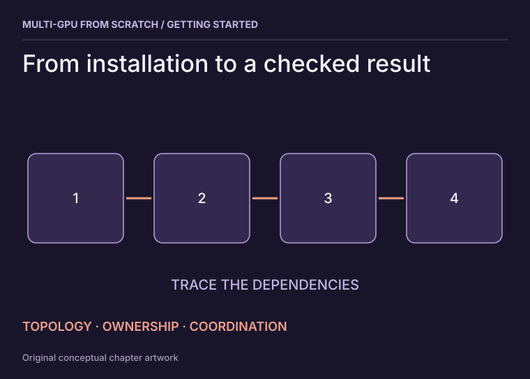
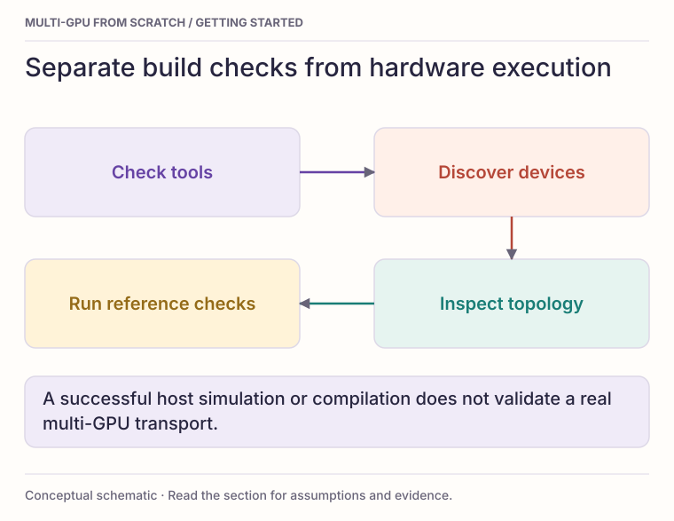

# Getting Started

<!-- execution:overview -->
!!! success "Recorded hardware validation"

    All 145 current source programs compiled and executed on [two H100 GPUs](validation-h100.md) and again on [eight A100 GPUs](validation-a100.md). Each pass records 33 numerical/transport validations, 13 API validations and 99 other executions with limited correctness scope. The A100 pass uses eight MPI processes for multi-rank examples; individual programs retain their documented participant counts. A separate eight-device harness checks all 56 ordered peer-copy pairs, four collective patterns and three halo generations.


<!-- mgpu:opener:start -->
[](images/chapter-openers/getting-started.svg)
<!-- mgpu:opener:end -->

This book targets CUDA C++ compiled with `nvcc` for real NVIDIA GPU architectures -- the appropriate target must be selected per example -- plus MPI (OpenMPI or MPICH) for Part 5's multi-node material. A real multi-GPU machine with a matching driver is what you need to *run* the code in this book end to end; `nvcc` itself only needs a CUDA toolkit and will happily compile for architectures your current machine doesn't have, and host-only MPI programs can run as multiple local ranks without GPUs; CUDA-aware MPI examples still need CUDA devices.

## Installing a toolchain

<!-- mgpu:figure-overview:start -->
[](images/technical/getting-started.svg)
<!-- mgpu:figure-overview:end -->

A full NVIDIA CUDA Toolkit install (from developer.nvidia.com, or via your platform's package manager, e.g. `apt-get install nvidia-cuda-toolkit` on Debian/Ubuntu) gives you a genuine, working `nvcc`, `ptxas`, `cicc`, and CUDA headers; NCCL, NVSHMEM and MPI development packages are separate dependencies, with no GPU or driver required to *compile* -- only to run device code. The package name and supported compiler/architecture targets depend on the distribution and toolkit version. Use [NVIDIA’s installation guide](https://docs.nvidia.com/cuda/cuda-installation-guide-linux/) for the actual host.

Check that your selected toolkit provides `nvcc --version`; a Python package containing some CUDA components is not automatically a full C++ build environment. Install NCCL/NVSHMEM headers and libraries separately where required. Host-only MPI can run without CUDA devices; CUDA-aware MPI requires a compatible MPI build and real device buffers. Follow [NVIDIA’s CUDA-aware MPI guidance](https://developer.nvidia.com/blog/introduction-cuda-aware-mpi/) and the chapter’s actual build options rather than assuming an ordinary MPI installation supports GPU pointers.

```bash
nvcc --version   # compiler, needed to build anything
nvcc -arch=sm_80 hello_cuda.cu -o hello_cuda   # pick the arch flag matching your GPU
mpirun --version   # for Part 5 onward
```

## The honesty discipline this book follows

All 145 programs were compiled and executed on two H100 GPUs and eight A100 GPUs. Current validation distinguishes numerical/transport checks, API checks and host models:

- **Host programs and simulations** are compiled and executed as host programs. Their results check the modeled arithmetic and scheduling, not CUDA concurrency or physical links.
- **GPU numerical checks** initialize data and compare actual device results with an explicit reference.
- **API probes** check the stated capability, lifecycle or expected-error behavior; they are not numerical collective tests.
- **Execution evidence** records source hashes, commands, timestamps, system information and raw logs. The 2026-11-17 two-H100 local NV18 run compiled and executed all 145 programs: 33 numerical checks, 13 API probes and 99 other executions. See [H100 validation](validation-h100.md). Host simulations remain useful supplementary checks; neither they nor this single-node run validate cross-node RDMA, failure recovery or performance on other hardware.

Execution records include the tested source, compile/run commands, UTC dates and captured output. See the [H100 results](validation-h100.md) and [A100 results](validation-a100.md).

Before execution, run `nvidia-smi`, `nvcc --version`, and the chapter’s device-count/topology checks. H100 uses the generic `sm_90` target for these ordinary CUDA examples; B200 uses `sm_100` with a toolkit that supports it. Rebuild and revalidate rather than reusing a Hopper cubin on Blackwell. [NVIDIA’s compatibility guide](https://docs.nvidia.com/cuda/blackwell-compatibility-guide/index.html) explains cubin and PTX compatibility. Run MPI examples with the required number of distinct visible devices; multiple ranks on one GPU are not a substitute for a multi-GPU collective.

From the repository root, `python3 tools/validate_examples.py --output artifacts/local-audit` collects compiler evidence. GPU execution is opt-in with `--execute --arch sm_90` on H100 or `--execute --arch sm_100` on B200. Keep each architecture’s output separate and inspect per-example classifications; API diagnostics and simulations are not numerical GPU validations.

## Compile-line conventions

- Plain C++ host files (`.cpp`): `g++ -std=c++17 -Wall -Wextra -O2 file.cpp -o binary`
- CUDA files with real device code (`.cu`): `nvcc -arch=sm_80 file.cu -o binary`
- Files that call the CUDA Runtime API from the host add `-lcudart` and the toolchain's include/library paths, shown inline wherever they're used.
- MPI files (`.cpp`, built with the MPI wrapper compiler): `mpic++ -std=c++17 -Wall -Wextra -O2 file.cpp -o binary`, run as `mpirun -np N ./binary`.
- CUDA-aware MPI files combine both: `mpic++ -std=c++17 file.cpp -I$CUDA_HOME/include -L$CUDA_HOME/lib64 -lcudart -o binary`.

## Prerequisites

This book assumes working knowledge of C++ (structs, templates, pointers, RAII) and prior single-GPU CUDA experience at the level of "you have written and launched a kernel before" -- it does not re-derive the CUDA execution and memory model from nothing the way a first CUDA book would, though Part 0 does rebuild everything specific to *multiple* devices from scratch. No prior MPI experience is assumed; Part 5's own Chapter 20 builds plain MPI from nothing before it ever adds CUDA to the picture.
