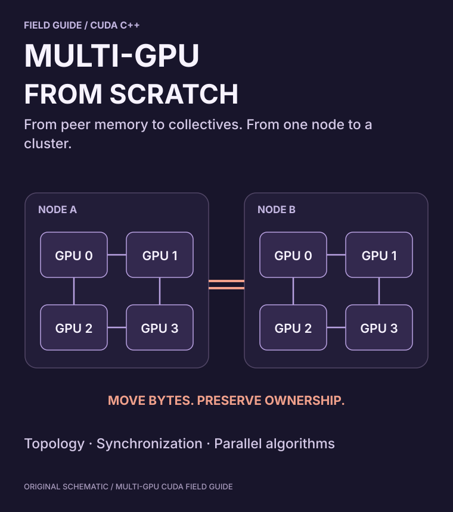
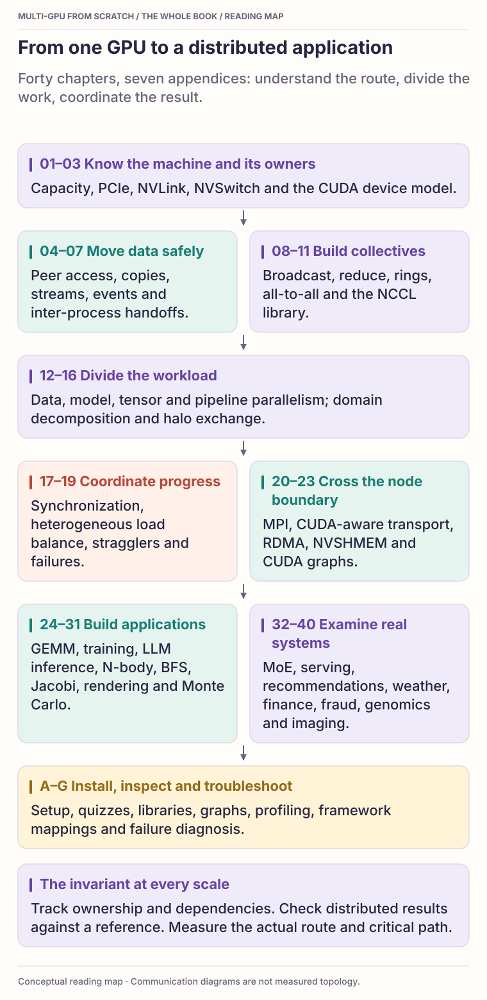

# Multi-GPU Programming in CUDA C++

<!-- execution:overview -->
!!! success "Recorded hardware validation"

    The [November 18 two-H100 rerun](validation-h100-rerun.md) compiled and executed all 145 recorded revisions: 34 numerical/transport checks, 13 API checks and 98 other executions. The earlier [two-H100](validation-h100.md) and [eight-A100](validation-a100.md) records remain available with their original scopes. The A100 pass uses eight MPI processes for multi-rank examples; individual programs retain their documented participant counts. A separate eight-device harness checks all 56 ordered peer-copy pairs, four collective patterns and three halo generations.

<!-- mgpu:opener:start -->

<!-- mgpu:opener:end -->

*From Peer-to-Peer Memory to Distributed Training Across the Cluster*

## From one GPU to a distributed application

<!-- mgpu:figure-overview:start -->

<!-- mgpu:figure-overview:end -->

*Follow the map downward to build the concepts. Use Appendices A–G throughout for setup, profiling and troubleshooting. The chapter routes are a reading guide, rather than a required execution order.*

A single-GPU CUDA book can treat "the GPU" as one honest unit of compute with one memory space and one clock. That assumption is the first thing this book removes. The moment a workload needs a second device -- because a model no longer fits in one GPU's memory, or because a dataset takes too long to process on one, or because a real cluster is what production actually runs on -- every earlier assumption about synchronization, memory visibility, and "the" answer being in one place stops holding, and a new set of real questions takes over: how do two devices even see each other, what does it cost to move a byte from one to the other, and what happens when one of them is slower, or fails, mid-collective.

This book develops multi-GPU CUDA from device selection and transfers through collectives and parallelization strategies. Every program has dated H100 and A100 execution records. Host models explain the algorithms; numerical checks validate device results for the recorded workloads. Start with [Getting Started](getting-started.md).

The corrected staged-MPI example (58) passed the November 18 two-H100 numerical rerun and memory check. **All 145 current sources have successful execution records:** 142 match the H100 dataset; the three corrected CPU-only models have [new local records](host-model-corrections.md). See the [additional dated H100 results](validation-h100-rerun.md) for commands, system information and sample outputs.

## What this book covers

- **Part 0 -- Why Multi-GPU, and the Hardware Underneath It.** The real reasons a workload outgrows one device, the real topology a multi-GPU machine actually has (PCIe, NVLink, NVSwitch) and how to read yours, and the CUDA programming model extended from one device and one stream to several.
- **Part 1 -- Getting Data Between GPUs.** Peer-to-peer memory access and unified virtual addressing, explicit peer transfers versus staged host transfers and when each genuinely wins, cross-device streams and events, and CUDA's own inter-process communication for sharing memory and events across separate processes.
- **Part 2 -- Collective Communication, Built From Scratch.** Broadcast and reduce built by hand before any library does it for you, ring all-reduce -- a bandwidth-oriented algorithm that communication libraries select alongside tree and topology-specific alternatives -- all-gather, reduce-scatter, and all-to-all, and finally NCCL, read honestly against the from-scratch versions this book already built and verified.
- **Part 3 -- Parallelization Strategies.** Data parallelism, model parallelism for when a single device can't hold the weights, tensor parallelism's own real matrix-splitting math, pipeline parallelism and the bubble that genuinely costs you throughput, and domain decomposition with halo exchange for scientific computing.
- **Part 4 -- Synchronization, Load Balancing, and Failure.** Global barriers across devices, load balancing across GPUs that are not identical, and what a real multi-GPU system does about a straggler or an outright failure mid-collective.
- **Part 5 -- Scaling Beyond One Node.** Plain MPI point-to-point and collective communication built from scratch first, then CUDA-aware MPI's own real advantage of skipping a host round-trip, GPUDirect RDMA, NVSHMEM's GPU-initiated communication, and CUDA graphs that span multiple GPUs and multiple nodes.
- **Part 6 -- Case Studies.** Dense matrix multiplication at scale, distributed neural-network training with data parallelism and ring all-reduce, multi-GPU LLM inference with tensor and pipeline parallelism, N-body simulation, distributed breadth-first search, a distributed Jacobi solver with halo exchange, multi-GPU ray tracing, and Monte Carlo risk simulation -- putting the whole book's toolbox to work on problems that genuinely need more than one device at once.

- **Part 7 -- Industrial Case Studies.** Mixture-of-experts routing, disaggregated inference, recommender embeddings, weather forecasting, portfolio risk, low-latency finance, fraud detection, genomics and medical imaging connect the earlier mechanisms to published system designs.

## How to read this book

Every chapter develops intuition, complete implementations, worked examples, pitfalls and self-checks. All 145 programs have [H100](validation-h100.md) and [A100](validation-a100.md) execution records, with sample output beside the code. The eight-A100 supplement also checks all 56 ordered peer pairs, four collectives and three halo generations.