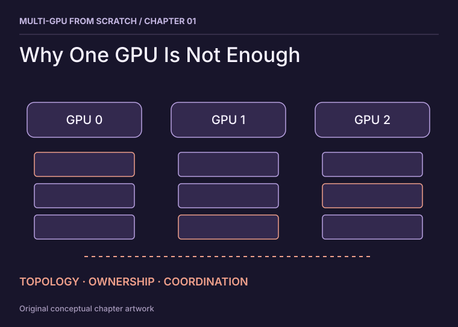
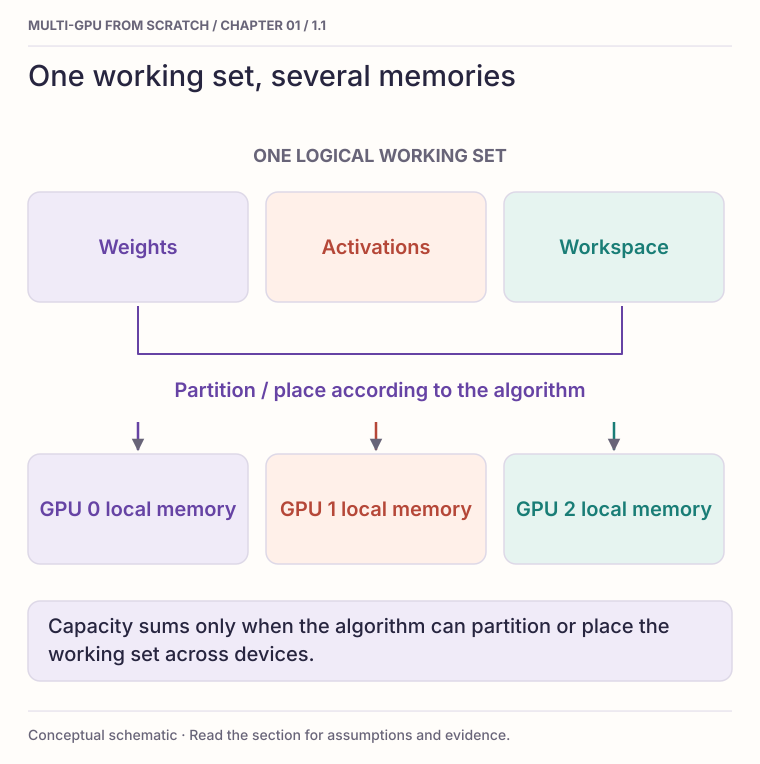
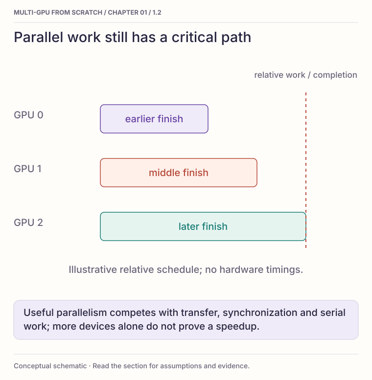

# Chapter 1: Why One GPU Is Not Enough

<!-- mgpu:opener:start -->
[](../images/chapter-openers/01.svg)
<!-- mgpu:opener:end -->

**What you will understand by the end of this chapter:**

- Why "not enough" hides two genuinely different failures — running out of memory and running out of time — and why the fix for one is not automatically the fix for the other.
- How to compute, exactly, how much device memory training a model actually costs, using the real mixed-precision Adam breakdown every production training stack uses.
- How to compute, exactly, how much total arithmetic training a model costs, using the same compute formula real scaling-law research uses to plan training runs.
- What a single real CUDA Runtime API call can honestly tell you about the machine you're running on, even before a second device is ever involved.

**What you need to know first:**

- Working C++ at an ordinary level: structs, pointers, basic arithmetic.
- Prior single-GPU CUDA experience at the level of "you have written and launched a kernel before" (this book's own prerequisite, stated in Getting Started) — this chapter does not re-derive the CUDA execution model from nothing.
- No prior multi-GPU experience. This chapter, and this book, build everything specific to *multiple* devices from scratch.

---

Every chapter after this one is about getting two or more GPUs to cooperate. Before that's worth the trouble, it's worth being precise about what problem it actually solves — because "not enough" is not one failure, and the rest of this book is organized around the difference between its two forms.

## 1.1 The Memory-Capacity Wall

<!-- mgpu:figure-1:start -->
[](../images/technical/ch01/1-capacity.svg)
<!-- mgpu:figure-1:end -->

### Intuition

Picture packing a moving truck. There are two completely different ways to fail. The truck might simply be too small — the couch does not fit, full stop, no amount of clever packing changes that. Or the truck might be plenty big, but you're only allowed one trip and a fixed number of hours to load and drive it — everything technically *fits*, yet the job still doesn't get done in time. A GPU fails the same two ways, and this section is about the first one: the truck being too small, stated in exact bytes rather than as a metaphor.

### Background

During training, four kinds of data compete for space in a GPU's memory: the model's **parameters**, the **gradients** produced by backpropagation (one value per parameter), the **optimizer state** Adam keeps to smooth out those gradients, and the **activations** kept from the forward pass so backpropagation has something to differentiate. The first three scale purely with parameter count and can be added up exactly. The fourth scales with batch size and sequence length as well, and is workload-dependent rather than a fixed multiple of model size — a real cost, called out here rather than folded into a number that would overstate how precisely it's known.

For parameters, gradients, and optimizer state, the accounting is exact. Rajbhandari et al.'s ZeRO paper (SC'20) gives the standard mixed-precision Adam breakdown: an fp16 copy of the parameters and the gradients (2 bytes/parameter each), plus an fp32 copy of the parameters, the momentum, and the variance Adam tracks for numerical stability (4 bytes/parameter each):

```
2 (fp16 params) + 2 (fp16 grads) + 4 (fp32 params) + 4 (momentum) + 4 (variance)
= 16 bytes per parameter
```

against roughly 2 bytes per parameter just to hold the weights for inference — training a model costs an order of magnitude more memory per parameter than merely running it. The program below turns that formula into exact numbers for two real model sizes, checked against two real GPUs' published memory capacities.

```cpp
// Chapter 1: Why One GPU Is Not Enough
// 02_memory_wall.cpp
//
// Plain host C++. No CUDA, no simulation, nothing to fake: this is ordinary
// arithmetic on numbers taken from cited real sources (see the chapter
// text for citations), computed exactly and reproducibly.
#include <cstdio>
#include <cstdint>
#include <cmath>

struct Model {
    const char* name;
    double params; // parameter count
};

int main() {
    const Model models[] = {
        {"7B-class model",   7.0e9},
        {"GPT-3 (175B)",   175.0e9},
    };

    // Real GPU memory capacities, decimal GB as the vendor datasheets state
    // them (NVIDIA H100 datasheet / product page).
    const double H100_SXM_GB = 80.0;
    const double H100_NVL_GB = 94.0;
    const double BYTES_PER_GB = 1.0e9;

    printf("%-16s %10s %16s %16s %10s %10s\n",
           "Model", "Params", "Inference(fp16)", "Training(Adam,mp)",
           "H100 SXM x", "H100 NVL x");

    for (const auto& m : models) {
        // Inference footprint: weights only, fp16/bf16 -> 2 bytes/param.
        double inferenceBytes = m.params * 2.0;

        // Training footprint, mixed-precision Adam, per the ZeRO paper
        // (Rajbhandari et al., SC'20): 2 (fp16 params) + 2 (fp16 grads)
        // + 4 (fp32 params) + 4 (fp32 momentum) + 4 (fp32 variance)
        // = 16 bytes per parameter. This excludes activation memory,
        // which is workload- (batch size, sequence length) dependent
        // and addressed separately in the chapter text.
        double trainingBytes = m.params * 16.0;

        double inferenceGB = inferenceBytes / BYTES_PER_GB;
        double trainingGB  = trainingBytes  / BYTES_PER_GB;

        double sxmNeeded = std::ceil(trainingGB / H100_SXM_GB);
        double nvlNeeded = std::ceil(trainingGB / H100_NVL_GB);

        printf("%-16s %8.1fB %13.1f GB %13.1f GB %10.0f %10.0f\n",
               m.name, m.params / 1e9, inferenceGB, trainingGB,
               sxmNeeded, nvlNeeded);
    }

    printf("\nMinimum H100 SXM (80 GB) GPUs to hold GPT-3's training state "
           "(params+grads+Adam state only, no activations): %.0f\n",
           std::ceil((175.0e9 * 16.0 / BYTES_PER_GB) / H100_SXM_GB));

    return 0;
}
```

<!-- execution:start:h100-rerun:02_memory_wall.cpp -->
> **Compiled and executed — 2026-11-18-h100: Host program/model (exit-only).** Hardware: 2 H100 GPUs. Executed UTC: `2026-11-18T11:20:48.233007+00:00`.

<!-- execution:metadata Source SHA-256: a2ff2cb43ab47129401d4d1b916c527da97d8271196a249813fb57e3a3853b1b; recorded UTC (program start): 2026-11-18T11:20:48.118691+00:00 -->

[Exact tested source](../validation/2026-11-18-h100/02_memory_wall/02_memory_wall.cpp) · [Compiler log](../validation/2026-11-18-h100/02_memory_wall/compile.log) · [Execution log](../validation/2026-11-18-h100/02_memory_wall/run.log). Compile exit: `0`; run exit: `0`.

Commands below use local source/binary names; raw logs retain host paths. Execute in a scratch directory containing the downloaded source.

```bash
g++ -std=c++17 -O2 02_memory_wall.cpp -o ./example
./example
```

**Sample output**

```text
Model                Params  Inference(fp16) Training(Adam,mp) H100 SXM x H100 NVL x
7B-class model        7.0B          14.0 GB         112.0 GB          2          2
GPT-3 (175B)        175.0B         350.0 GB        2800.0 GB         35         30

Minimum H100 SXM (80 GB) GPUs to hold GPT-3's training state (params+grads+Adam state only, no activations): 35
```

<!-- execution:end:h100-rerun:02_memory_wall.cpp -->


<!-- execution:start:a100:02_memory_wall.cpp -->
> **Compiled and executed — 2026-11-17-a100: Host program/model (exit-only).** Hardware: 8 A100 GPUs. Executed UTC: `2026-11-18T00:00:11.085308+00:00`.

<!-- execution:metadata Source SHA-256: a2ff2cb43ab47129401d4d1b916c527da97d8271196a249813fb57e3a3853b1b; recorded UTC (program start): 2026-11-18T00:00:10.869538+00:00 -->

[Exact tested source](../validation/2026-11-17-a100/02_memory_wall/02_memory_wall.cpp) · [Compiler log](../validation/2026-11-17-a100/02_memory_wall/compile.log) · [Execution log](../validation/2026-11-17-a100/02_memory_wall/run.log). Compile exit: `0`; run exit: `0`.

Commands below use local source/binary names; raw logs retain host paths. Execute in a scratch directory containing the downloaded source.

```bash
g++ -std=c++17 -O2 02_memory_wall.cpp -o ./example
./example
```

**Sample output**

```text
Model                Params  Inference(fp16) Training(Adam,mp) H100 SXM x H100 NVL x
7B-class model        7.0B          14.0 GB         112.0 GB          2          2
GPT-3 (175B)        175.0B         350.0 GB        2800.0 GB         35         30

Minimum H100 SXM (80 GB) GPUs to hold GPT-3's training state (params+grads+Adam state only, no activations): 35
```


<!-- execution:end:a100:02_memory_wall.cpp -->


<!-- execution:start:h100:02_memory_wall.cpp -->
> **Compiled and executed — 2026-11-17-h100: Host program/model (exit-only).** Hardware: 2 H100 GPUs. Execution record UTC (run-batch start; per-program time unrecorded): `2026-11-17T23:48:18.967387+00:00`.

<!-- execution:metadata Source SHA-256: a2ff2cb43ab47129401d4d1b916c527da97d8271196a249813fb57e3a3853b1b; recorded UTC (run-batch start; per-program time unrecorded): 2026-11-17T23:48:18.967387+00:00 -->

[Exact tested source](../validation/2026-11-17-h100/02_memory_wall/02_memory_wall.cpp) · [Compiler log](../validation/2026-11-17-h100/02_memory_wall/compile.log) · [Execution log](../validation/2026-11-17-h100/02_memory_wall/run.log). Compile exit: `0`; run exit: `0`.

Commands below use local source/binary names; raw logs retain host paths. Execute in a scratch directory containing the downloaded source.

```bash
g++ -std=c++17 -O2 02_memory_wall.cpp -o ./example
./example
```

<details markdown="1"><summary>Captured current-source output</summary>

```text
Model                Params  Inference(fp16) Training(Adam,mp) H100 SXM x H100 NVL x
7B-class model        7.0B          14.0 GB         112.0 GB          2          2
GPT-3 (175B)        175.0B         350.0 GB        2800.0 GB         35         30

Minimum H100 SXM (80 GB) GPUs to hold GPT-3's training state (params+grads+Adam state only, no activations): 35
```

</details>
<!-- execution:end:h100:02_memory_wall.cpp -->


```bash
g++ -std=c++17 -Wall -Wextra -O2 02_memory_wall.cpp -o memory_wall
./memory_wall
```

A 175-billion-parameter model's weights alone (350 GB at fp16) already exceed a single H100's 80 GB several times over — before a single gradient or optimizer value is added. Once they are, the training state needs **35 H100 SXM GPUs' worth of memory just to exist**, with zero of it left over for the activations that actually let training happen. Even the comparatively modest 7B-class model's *training* footprint (112 GB) doesn't fit in one H100 (80 GB), though its *inference* footprint (14 GB) fits easily.

!!! warning "[COMMON TRAP] Asking "does this model fit on a GPU" as if it's one question"
    "Fits on a GPU" has at least two different, very differently-sized answers depending on whether you mean *running* it or *training* it — 14 GB versus 112 GB for the exact same 7B-class model above, an 8x gap from precision and optimizer state alone, with real activation memory still not counted. A model comfortably fitting for inference is not evidence it will fit for training, and the two numbers should never be quoted interchangeably.

## 1.2 The Compute-Throughput Wall

<!-- mgpu:figure-2:start -->
[](../images/technical/ch01/2-balance.svg)
<!-- mgpu:figure-2:end -->

### Intuition

Now suppose, hypothetically, the truck from Section 1.1 were infinitely large — no capacity problem at all. The job can still fail the *second* way: there's a fixed number of hours in the day and a fixed rate at which any one truck can be loaded and driven, and if the total amount of stuff to move is large enough, one truck running continuously simply cannot finish in a human timescale, no matter how big it is. That is the throughput wall, and unlike the capacity wall it isn't binary — it's a rate, multiplied by however much total work there is.

### Background

Kaplan et al.'s "Scaling Laws for Neural Language Models" (2020) give a compact estimate for that total amount of work — training compute:

```
C ≈ 6 · N · D
```

where `N` is the model's (non-embedding) parameter count, `D` is the number of training tokens, and the factor of 6 accounts for one forward pass and the (roughly twice as expensive) backward pass. This is the paper's own stated formula (`C ≈ 6NBS`, with batch size `B` times step count `S` equal to total tokens `D`), and it is a real, exactly-computable quantity once `N` and `D` are fixed — not a rough guess.

```cpp
// Chapter 1: Why One GPU Is Not Enough
// 03_compute_wall.cpp
//
// Plain host C++. Computes a deterministic FLOP count and divides by a
// cited real peak-FLOPS figure -- never a fabricated wall-clock number,
// per this book's own stated discipline (see getting-started.md).
#include <cstdio>

int main() {
    // Kaplan et al., "Scaling Laws for Neural Language Models" (2020):
    // C ~= 6*N*D, where N is (non-embedding) parameter count and D is
    // dataset size in tokens. We use GPT-3's reported total parameter
    // count (175B, Brown et al. 2020, Table 2.1) as an approximation of
    // N, and the paper's own stated token budget, D = 300e9 tokens
    // ("All models were trained for a total of 300 billion tokens").
    const double N = 175.0e9;
    const double D = 300.0e9;
    const double totalFLOPs = 6.0 * N * D;

    // NVIDIA H100 SXM5: 989 TFLOP/s peak dense BF16/FP16 Tensor Core
    // throughput (no sparsity). Real vendor-cited figure.
    const double H100_PEAK_FLOPS = 989.0e12;
    const double SECONDS_PER_DAY = 86400.0;

    const double idealFlopsPerDay = H100_PEAK_FLOPS * SECONDS_PER_DAY;
    const double idealGpuDays = totalFLOPs / idealFlopsPerDay;

    // Real training never sustains 100% of peak. We label this an
    // illustrative assumption, not a measurement: many public reports of
    // well-optimized large-model training put achieved throughput in the
    // 30-50% range of peak (Model FLOPs Utilization, or MFU); we use 50%
    // here as a round, explicitly-labeled upper-end illustrative figure.
    const double assumedMFU = 0.50;
    const double realisticGpuDays = idealGpuDays / assumedMFU;

    printf("Total training compute (C = 6*N*D): %.3e FLOPs\n", totalFLOPs);
    printf("N (parameters, approx.):            %.3e\n", N);
    printf("D (tokens):                         %.3e\n", D);
    printf("H100 SXM peak dense BF16/FP16:       %.3e FLOP/s\n",
           H100_PEAK_FLOPS);
    printf("\n");
    printf("GPU-days on a single H100 at 100%% of peak (ideal, "
           "unreachable in practice): %.1f\n", idealGpuDays);
    printf("GPU-days on a single H100 at an assumed %.0f%% of peak "
           "(illustrative MFU, not measured):   %.1f\n",
           assumedMFU * 100.0, realisticGpuDays);
    printf("Same total compute spread across 1024 such GPUs at the "
           "assumed %.0f%% MFU: %.2f days\n",
           assumedMFU * 100.0, realisticGpuDays / 1024.0);

    return 0;
}
```

<!-- execution:start:h100-rerun:03_compute_wall.cpp -->
> **Compiled and executed — 2026-11-18-h100: Host program/model (exit-only).** Hardware: 2 H100 GPUs. Executed UTC: `2026-11-18T11:20:48.299208+00:00`.

<!-- execution:metadata Source SHA-256: afb0e2461806947cd7f0bc421aac900cd61a586feb494c575609a410e5b492f3; recorded UTC (program start): 2026-11-18T11:20:48.235220+00:00 -->

[Exact tested source](../validation/2026-11-18-h100/03_compute_wall/03_compute_wall.cpp) · [Compiler log](../validation/2026-11-18-h100/03_compute_wall/compile.log) · [Execution log](../validation/2026-11-18-h100/03_compute_wall/run.log). Compile exit: `0`; run exit: `0`.

Commands below use local source/binary names; raw logs retain host paths. Execute in a scratch directory containing the downloaded source.

```bash
g++ -std=c++17 -O2 03_compute_wall.cpp -o ./example
./example
```

**Sample output**

```text
Total training compute (C = 6*N*D): 3.150e+23 FLOPs
N (parameters, approx.):            1.750e+11
D (tokens):                         3.000e+11
H100 SXM peak dense BF16/FP16:       9.890e+14 FLOP/s

GPU-days on a single H100 at 100% of peak (ideal, unreachable in practice): 3686.4
GPU-days on a single H100 at an assumed 50% of peak (illustrative MFU, not measured):   7372.8
Same total compute spread across 1024 such GPUs at the assumed 50% MFU: 7.20 days
```

<!-- execution:end:h100-rerun:03_compute_wall.cpp -->


<!-- execution:start:a100:03_compute_wall.cpp -->
> **Compiled and executed — 2026-11-17-a100: Host program/model (exit-only).** Hardware: 8 A100 GPUs. Executed UTC: `2026-11-18T00:00:11.153780+00:00`.

<!-- execution:metadata Source SHA-256: afb0e2461806947cd7f0bc421aac900cd61a586feb494c575609a410e5b492f3; recorded UTC (program start): 2026-11-18T00:00:11.088863+00:00 -->

[Exact tested source](../validation/2026-11-17-a100/03_compute_wall/03_compute_wall.cpp) · [Compiler log](../validation/2026-11-17-a100/03_compute_wall/compile.log) · [Execution log](../validation/2026-11-17-a100/03_compute_wall/run.log). Compile exit: `0`; run exit: `0`.

Commands below use local source/binary names; raw logs retain host paths. Execute in a scratch directory containing the downloaded source.

```bash
g++ -std=c++17 -O2 03_compute_wall.cpp -o ./example
./example
```

**Sample output**

```text
Total training compute (C = 6*N*D): 3.150e+23 FLOPs
N (parameters, approx.):            1.750e+11
D (tokens):                         3.000e+11
H100 SXM peak dense BF16/FP16:       9.890e+14 FLOP/s

GPU-days on a single H100 at 100% of peak (ideal, unreachable in practice): 3686.4
GPU-days on a single H100 at an assumed 50% of peak (illustrative MFU, not measured):   7372.8
Same total compute spread across 1024 such GPUs at the assumed 50% MFU: 7.20 days
```


<!-- execution:end:a100:03_compute_wall.cpp -->


<!-- execution:start:h100:03_compute_wall.cpp -->
> **Compiled and executed — 2026-11-17-h100: Host program/model (exit-only).** Hardware: 2 H100 GPUs. Execution record UTC (run-batch start; per-program time unrecorded): `2026-11-17T23:48:18.967387+00:00`.

<!-- execution:metadata Source SHA-256: afb0e2461806947cd7f0bc421aac900cd61a586feb494c575609a410e5b492f3; recorded UTC (run-batch start; per-program time unrecorded): 2026-11-17T23:48:18.967387+00:00 -->

[Exact tested source](../validation/2026-11-17-h100/03_compute_wall/03_compute_wall.cpp) · [Compiler log](../validation/2026-11-17-h100/03_compute_wall/compile.log) · [Execution log](../validation/2026-11-17-h100/03_compute_wall/run.log). Compile exit: `0`; run exit: `0`.

Commands below use local source/binary names; raw logs retain host paths. Execute in a scratch directory containing the downloaded source.

```bash
g++ -std=c++17 -O2 03_compute_wall.cpp -o ./example
./example
```

<details markdown="1"><summary>Captured current-source output</summary>

```text
Total training compute (C = 6*N*D): 3.150e+23 FLOPs
N (parameters, approx.):            1.750e+11
D (tokens):                         3.000e+11
H100 SXM peak dense BF16/FP16:       9.890e+14 FLOP/s

GPU-days on a single H100 at 100% of peak (ideal, unreachable in practice): 3686.4
GPU-days on a single H100 at an assumed 50% of peak (illustrative MFU, not measured):   7372.8
Same total compute spread across 1024 such GPUs at the assumed 50% MFU: 7.20 days
```

</details>
<!-- execution:end:h100:03_compute_wall.cpp -->


```bash
g++ -std=c++17 -Wall -Wextra -O2 03_compute_wall.cpp -o compute_wall
./compute_wall
```

**Model boundary, stated plainly:** the `3686.4` and `7372.8` GPU-day figures are *not* timing measurements — nothing was clocked. They're a deterministic FLOP count (`3.150e+23`, computed exactly from Kaplan's formula) divided by a real, vendor-published peak-FLOPS figure (H100 SXM's 989 TFLOP/s dense Tensor Core throughput, no sparsity). The 50%-of-peak scenario is explicitly labeled as an illustrative assumption about achieved utilization (Model FLOPs Utilization, or MFU), not a measurement of anything — real training runs report MFU figures all over the 30-50% range depending on model, hardware, and how well the implementation overlaps communication with compute, itself a running theme starting in Part 2. Either way the conclusion is the same: **over 10 years on one GPU even at ideal throughput (3686.4 days), over 20 years at the assumed 50% MFU (7372.8 days), or roughly a week on 1,024 of them at that same 50% MFU (7.20 days).**

!!! warning "[COMMON TRAP] Treating a model that "fits in memory" as a model that's actually trainable"
    Section 1.1's capacity check and this section's throughput check are independent — passing one says nothing about the other. A model could squeeze into a single GPU's memory (perhaps with aggressive offloading) and still cost 10 to 20 years of wall-clock time to train on that one GPU, which is exactly what the 3686-to-7372 GPU-day range above represents for GPT-3-scale training. "It fits" answers the capacity wall's question, not the throughput wall's.

## 1.3 What a Single Real CUDA Call Can Already Tell You

### Intuition

Before ordering a fleet of trucks, the first thing any reasonable person checks is how many trucks are actually sitting in the lot right now — not how many the catalog describes, not how many a bigger budget could buy, but the literal count available this moment. `cudaGetDeviceCount()` is that check, and every multi-GPU program in this book, without exception, starts by asking the runtime this exact question before assuming an answer.

### Background

Call `cudaGetDeviceCount()` before constructing a multi-device workload. Its result determines which ordinals are available to the process.

```cpp
// Chapter 1: Why One GPU Is Not Enough
// 01_device_query.cu
//
// A genuine CUDA Runtime API call, compiled with a real nvcc and genuinely
// executed. It does not simulate anything: cudaGetDeviceCount() either finds
// real devices or it doesn't, and this program prints exactly what the
// runtime reports back, whatever that is.
#include <cstdio>
#include <cuda_runtime.h>

int main() {
    int deviceCount = 0;
    cudaError_t err = cudaGetDeviceCount(&deviceCount);

    printf("cudaGetDeviceCount() returned: %s (code %d)\n",
           cudaGetErrorString(err), (int)err);
    printf("Reported device count: %d\n", deviceCount);

    if (err != cudaSuccess || deviceCount == 0) {
        printf("No usable CUDA device on this machine.\n");
        printf("This is an honest, unmodified report from the CUDA "
               "Runtime API -- not a placeholder.\n");
        return 0;
    }

    for (int i = 0; i < deviceCount; ++i) {
        cudaDeviceProp prop;
        cudaGetDeviceProperties(&prop, i);
        size_t freeBytes = 0, totalBytes = 0;
        cudaSetDevice(i);
        cudaMemGetInfo(&freeBytes, &totalBytes);
        printf("Device %d: %s -- %.2f GB total, %.2f GB free, "
               "compute capability %d.%d\n",
               i, prop.name,
               totalBytes / 1e9, freeBytes / 1e9,
               prop.major, prop.minor);
    }
    return 0;
}
```

<!-- execution:start:h100-rerun:01_device_query.cu -->
> **Compiled and executed — 2026-11-18-h100: API/host demonstration (exit-only).** Hardware: 2 H100 GPUs. Executed UTC: `2026-11-18T11:20:47.352430+00:00`.

<!-- execution:metadata Source SHA-256: 4a14f312d6406e432c3bd12214a99f9e37288c7dea955f587460413a11d333cc; recorded UTC (program start): 2026-11-18T11:20:46.736995+00:00 -->

[Exact tested source](../validation/2026-11-18-h100/01_device_query/01_device_query.cu) · [Compiler log](../validation/2026-11-18-h100/01_device_query/compile.log) · [Execution log](../validation/2026-11-18-h100/01_device_query/run.log). Compile exit: `0`; run exit: `0`.

Commands below use local source/binary names; raw logs retain host paths. Execute in a scratch directory containing the downloaded source.

```bash
nvcc -std=c++17 -O2 -arch=sm_90 01_device_query.cu -o ./example
./example
```

**Sample output**

```text
cudaGetDeviceCount() returned: no error (code 0)
Reported device count: 2
Device 0: NVIDIA H100 80GB HBM3 -- 85.02 GB total, 84.47 GB free, compute capability 9.0
Device 1: NVIDIA H100 80GB HBM3 -- 85.02 GB total, 84.47 GB free, compute capability 9.0
```

<!-- execution:end:h100-rerun:01_device_query.cu -->


<!-- execution:start:a100:01_device_query.cu -->
> **Compiled and executed — 2026-11-17-a100: API/host demonstration (exit-only).** Hardware: 8 A100 GPUs. Executed UTC: `2026-11-18T00:00:05.793304+00:00`.

<!-- execution:metadata Source SHA-256: 4a14f312d6406e432c3bd12214a99f9e37288c7dea955f587460413a11d333cc; recorded UTC (program start): 2026-11-18T00:00:04.726059+00:00 -->

[Exact tested source](../validation/2026-11-17-a100/01_device_query/01_device_query.cu) · [Compiler log](../validation/2026-11-17-a100/01_device_query/compile.log) · [Execution log](../validation/2026-11-17-a100/01_device_query/run.log). Compile exit: `0`; run exit: `0`.

Commands below use local source/binary names; raw logs retain host paths. Execute in a scratch directory containing the downloaded source.

```bash
nvcc -std=c++17 -O2 -arch=sm_80 01_device_query.cu -o ./example
./example
```

**Sample output**

```text
cudaGetDeviceCount() returned: no error (code 0)
Reported device count: 8
Device 0: NVIDIA A100-SXM4-40GB -- 42.41 GB total, 41.96 GB free, compute capability 8.0
Device 1: NVIDIA A100-SXM4-40GB -- 42.41 GB total, 41.96 GB free, compute capability 8.0
Device 2: NVIDIA A100-SXM4-40GB -- 42.41 GB total, 41.96 GB free, compute capability 8.0
Device 3: NVIDIA A100-SXM4-40GB -- 42.41 GB total, 41.96 GB free, compute capability 8.0
Device 4: NVIDIA A100-SXM4-40GB -- 42.41 GB total, 41.96 GB free, compute capability 8.0
Device 5: NVIDIA A100-SXM4-40GB -- 42.41 GB total, 41.96 GB free, compute capability 8.0
Device 6: NVIDIA A100-SXM4-40GB -- 42.41 GB total, 41.96 GB free, compute capability 8.0
Device 7: NVIDIA A100-SXM4-40GB -- 42.41 GB total, 41.96 GB free, compute capability 8.0
```


<!-- execution:end:a100:01_device_query.cu -->


<!-- execution:start:h100:01_device_query.cu -->
> **Compiled and executed — 2026-11-17-h100: API/host demonstration (exit-only).** Hardware: 2 H100 GPUs. Execution record UTC (run-batch start; per-program time unrecorded): `2026-11-17T23:48:18.967387+00:00`.

<!-- execution:metadata Source SHA-256: 4a14f312d6406e432c3bd12214a99f9e37288c7dea955f587460413a11d333cc; recorded UTC (run-batch start; per-program time unrecorded): 2026-11-17T23:48:18.967387+00:00 -->

[Exact tested source](../validation/2026-11-17-h100/01_device_query/01_device_query.cu) · [Compiler log](../validation/2026-11-17-h100/01_device_query/compile.log) · [Execution log](../validation/2026-11-17-h100/01_device_query/run.log). Compile exit: `0`; run exit: `0`.

Commands below use local source/binary names; raw logs retain host paths. Execute in a scratch directory containing the downloaded source.

```bash
nvcc -std=c++17 -O2 -arch=sm_90 01_device_query.cu -o ./example
./example
```

<details markdown="1"><summary>Captured current-source output</summary>

```text
cudaGetDeviceCount() returned: no error (code 0)
Reported device count: 2
Device 0: NVIDIA H100 80GB HBM3 -- 85.02 GB total, 84.47 GB free, compute capability 9.0
Device 1: NVIDIA H100 80GB HBM3 -- 85.02 GB total, 84.47 GB free, compute capability 9.0
```

</details>
<!-- execution:end:h100:01_device_query.cu -->


```bash
nvcc -arch=sm_80 01_device_query.cu -o device_query
./device_query
```

The recorded queries discover two H100 devices and eight A100 devices. Discovery is the first setup check; topology and workload results follow in later examples.

The [2026-11-17 H100 execution record](../validation-h100.md) covers two GPUs connected by local NV18. It distinguishes numerical checks, API probes and other executions; a successful exit alone does not establish GPU algorithm correctness.

!!! warning "[COMMON TRAP] Hard-coding a device count"
    Query the devices visible to the process, check the result, and select the participants required by the workload. Report an unmet prerequisite instead of using an unavailable ordinal.

## Chapter Summary

"Not enough" splits into two independent failures: the memory-capacity wall, a hard binary limit measured exactly in bytes (Section 1.1 found GPT-3's training state needs 35 H100 SXM GPUs' worth of memory, using ZeRO's real 16-bytes-per-parameter mixed-precision Adam breakdown), and the compute-throughput wall, a rate limit measured in FLOPs against a real peak-FLOPS figure (Section 1.2 found the same model needs over 10 years on one GPU even at ideal throughput, and over 20 years at an assumed 50% MFU, using Kaplan's real `C≈6ND` compute formula). Both walls have the same structural fix — stop asking one device to hold and do everything — but splitting work across devices creates a problem neither wall had: the pieces now have to communicate, correctly and fast enough that communication doesn't become the new bottleneck. Section 1.3's `cudaGetDeviceCount()` call is the first, smallest piece of the machinery every later chapter uses to manage that communication, and its current H100 result reports real device discovery; this query alone does not validate a numerical GPU algorithm.

The [2026-11-17 H100 execution record](../validation-h100.md) covers two GPUs connected by local NV18. It distinguishes numerical checks, API probes and other executions; a successful exit alone does not establish GPU algorithm correctness.

Part 1 (Chapters 4-7) builds the primitive layer for getting data between devices at all. Part 2 (Chapters 8-11) builds the communication patterns — broadcast, reduce, all-reduce — from scratch, by hand, before reaching for a library. Part 3 (Chapters 12-16) chooses *what* to split for a given workload shape. Part 4 handles devices that don't finish at the same time, or don't finish at all. Part 5 takes everything past the boundary of one machine. Part 6 puts all of it to work on real workloads, end to end.

## Self-Check Questions

1. A 7B-class model's inference footprint (14 GB) and training footprint (112 GB) differ by exactly 8x. Derive that factor directly from the bytes-per-parameter figures used in Section 1.1, without recomputing either total from scratch.
2. Section 1.1 explicitly excludes activation memory from its "35 H100 GPUs" figure. Explain why activation memory can't be folded into a fixed bytes-per-parameter constant the way parameters, gradients, and optimizer state can.
3. Suppose a model has 70 billion parameters instead of GPT-3's 175 billion, trained on the same 300 billion tokens. Using Section 1.2's formula, is its total training compute exactly 2.5x smaller, more than 2.5x smaller, or less than 2.5x smaller than GPT-3's? Justify your answer from the formula's structure, not just the arithmetic.
4. Section 1.2 reports both an "ideal" GPU-day figure and a "50% MFU" figure. Which of the two is closer to what a real training run would actually take, and which real-world factor does the gap between them represent?
5. Why does `01_device_query.cu` check `cudaGetDeviceCount()`'s return code *and* the device count itself, rather than just checking whether the count is greater than zero?
6. A colleague argues that since a 7B-class model's training footprint (112 GB) doesn't fit on one H100 (80 GB) either, the capacity wall and the throughput wall are really "the same problem twice." Using both models' numbers from Sections 1.1 and 1.2, explain why this is wrong.
7. If NVIDIA released a hypothetical GPU with 10x an H100's memory but identical peak FLOPS, which of this chapter's two walls would it move for GPT-3-scale training, and which would remain exactly where it is?

## Where We Go Next

Chapter 2 looks at the physical layer connecting multiple GPUs together — PCIe, NVLink, and NVSwitch — because splitting work across devices, the fix this chapter arrived at for both walls, is only as good as the connection between the pieces. Chapter 3 then builds the CUDA-side vocabulary (devices, contexts, streams) needed to actually address more than one device from code, and Chapter 4 starts moving data across the links Chapter 2 describes.

## Worked Solutions

**1.** Inference costs 2 bytes/parameter (fp16 weights only); training costs 16 bytes/parameter (2 fp16 params + 2 fp16 grads + 4 fp32 params + 4 momentum + 4 variance, per ZeRO). `16 / 2 = 8`, exactly the ratio Section 1.1's table shows (14 GB to 112 GB) for the 7B-class model, and the same ratio holds for any parameter count since both figures scale linearly with it.

**2.** Parameters, gradients, and optimizer state each need a fixed, small number of copies *per parameter*, regardless of what data flows through the model — that's why a constant bytes-per-parameter figure captures them exactly. Activation memory instead depends on how many intermediate values the forward pass produces before backpropagation consumes them, which scales with batch size and sequence length — two choices made per training run, not properties of the model's parameter count at all. A single constant can't represent a quantity that depends on inputs the model's own definition doesn't fix.

**3.** Exactly 2.5x smaller. `C = 6ND`, and with `D` held fixed at 300 billion tokens, `C` is directly proportional to `N` — halving-and-a-bit `N` (175B to 70B is a 2.5x reduction) produces exactly the same 2.5x reduction in `C`, with no other factor in the formula depending on `N` in a way that would make the relationship anything other than linear.

**4.** The 50%-MFU figure (7372.8 GPU-days) is closer to what a real run would take, because no real training run sustains 100% of a GPU's advertised peak FLOPS — the gap between the two figures represents Model FLOPs Utilization: overhead from memory stalls, communication waiting, and imperfect overlap between compute and data movement, all of which the "ideal" figure assumes away entirely.

**5.** Check the error code before trusting the returned count. A failed query can leave an unusable output; a successful discovery query still does not establish peer access, transport performance or numerical algorithm correctness.

**6.** They differ in kind, not just number. The capacity wall is binary — either the training state's bytes fit in the available memory or they don't, and no amount of waiting changes a "doesn't fit." The throughput wall is a rate multiplied by total work — the model's training compute technically *can* be run on one GPU, just not within a useful amount of time. The numbers for the 7B-class model make this concrete. Section 1.1's table gives its capacity check directly: 112 GB of training state against 80 GB, a fail by 32 GB. Its throughput figure is not in Section 1.2, but the same formula gives it: `C = 6ND = 6 x 7e9 x 3e11 = 1.26e22` FLOPs over 300 billion tokens, and `1.26e22 / 9.89e14 FLOP/s / 86,400 s/day` is about 147 GPU-days at ideal peak (about 295 at the assumed 50% MFU). That is months, not decades: slow, but not hopeless the way GPT-3's 3686 to 7372 GPU-days are. So the two checks give different verdicts for the same model, one a hard byte fail and the other a matter of how long you are willing to wait, which already shows they measure different things. A future GPU with far more memory but unchanged FLOPS would pass the capacity check while leaving every GPU-day figure above exactly where it is.

**7.** It would move the capacity wall dramatically — GPT-3's 2800 GB training footprint would fit on far fewer such GPUs (800 GB each instead of 80 GB, so `ceil(2800 / 800) = 4` GPUs instead of 35, still ignoring activations). It would leave the throughput wall completely unchanged, because Section 1.2's GPU-day figures depend only on peak FLOPS and the total FLOP count, neither of which this hypothetical GPU's extra memory affects at all.

---

**Sources cited in this chapter:**

- [NVIDIA H100 GPU product page](https://www.nvidia.com/en-us/data-center/h100/) -- H100 SXM memory (80 GB, 3.35 TB/s) and H100 NVL memory (94 GB, 3.9 TB/s).
- [NVIDIA H100 GPU Datasheet](https://resources.nvidia.com/en-us-gpu-resources/h100-datasheet-24306) -- H100 SXM5 peak dense BF16/FP16 Tensor Core throughput (989 TFLOPS).
- Brown, T. et al., ["Language Models are Few-Shot Learners"](https://arxiv.org/abs/2005.14165) (2020) -- GPT-3's 175B parameter count (Table 2.1) and 300-billion-token training budget.
- Rajbhandari, S. et al., ["ZeRO: Memory Optimizations Toward Training Trillion Parameter Models"](https://aiichironakano.github.io/cs596/Rajbhandari-ZeRO-SC20.pdf) (SC'20) -- the 16-bytes-per-parameter mixed-precision Adam memory breakdown.
- Kaplan, J. et al., ["Scaling Laws for Neural Language Models"](https://arxiv.org/abs/2001.08361) (2020) -- the `C ≈ 6NBS` (equivalently `C ≈ 6ND`) training compute estimate.
