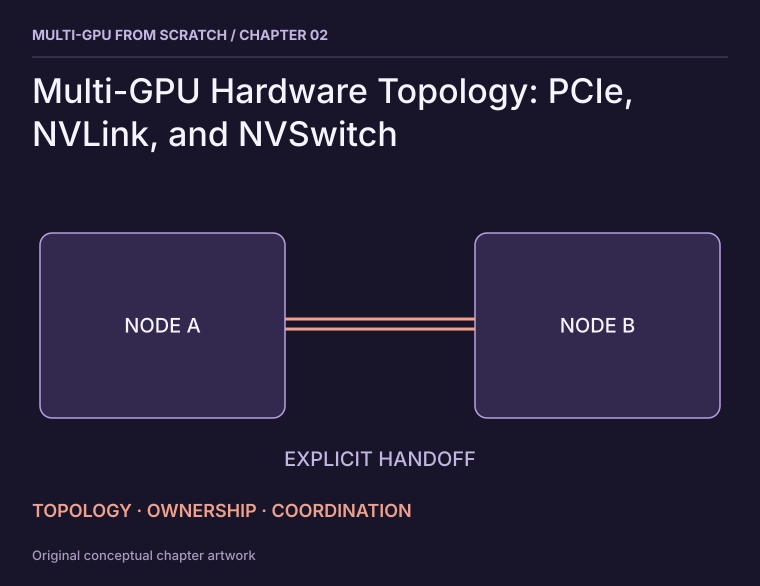
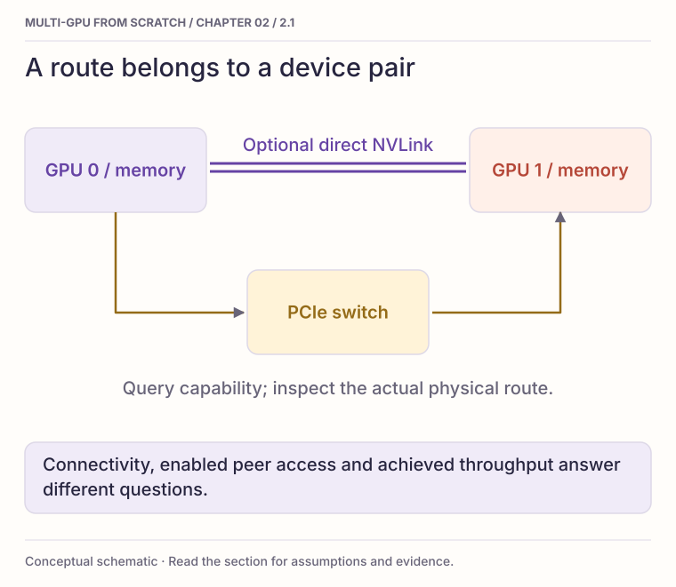
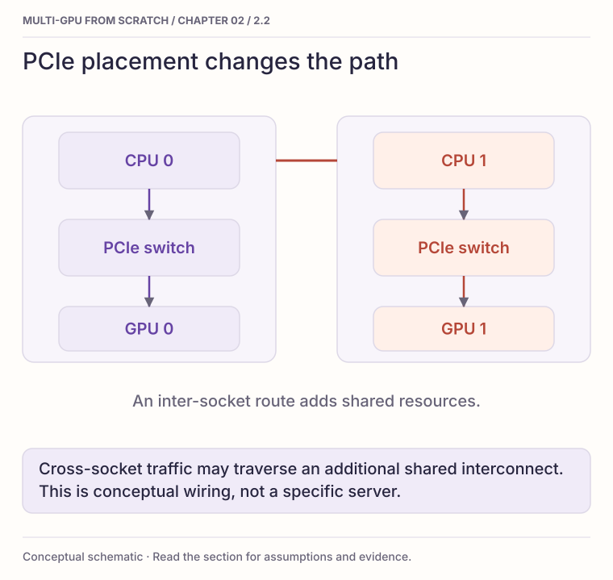
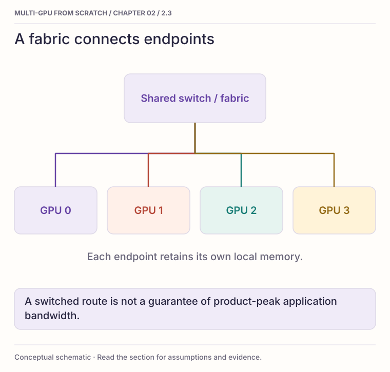

# Chapter 2: Multi-GPU Hardware Topology: PCIe, NVLink, and NVSwitch

<!-- mgpu:opener:start -->
[](../images/chapter-openers/02.svg)
<!-- mgpu:opener:end -->

**What you will understand by the end of this chapter:**

- Why "GPU-to-GPU bandwidth" is a matrix, not a single number, and what determines which entry in that matrix two specific GPUs get.
- The real bandwidth figures for PCIe (generations 3 through 5), NVLink (generations 1.0 through 4.0), and NVSwitch, and how each one fills in that matrix differently.
- Why a communication pattern's achievable bandwidth is set by its single weakest link, not its average link — and why that makes topology, not just raw link speed, a first-class design concern.
- What the CUDA Runtime API can honestly report about device-pair connectivity even without real multi-GPU hardware present.

**What you need to know first:**

- Chapter 1's memory-capacity and compute-throughput walls, and why splitting work across devices is the fix for both.
- No prior knowledge of PCIe, NVLink, or NVSwitch is assumed — this chapter builds all three from their real published specifications.

---

Chapter 1 established that splitting work across GPUs solves both the capacity wall and the throughput wall, but introduces a new one: the devices now have to talk to each other. This chapter is about the physical layer that conversation happens over.

## 2.1 Bandwidth Is a Graph, Not a Number

<!-- mgpu:figure-1:start -->
[](../images/technical/ch02/1-topology.svg)
<!-- mgpu:figure-1:end -->

### Intuition

A single GPU has exactly one bandwidth figure worth knowing: how fast it talks to its own memory. The moment a second GPU enters the picture, "bandwidth" stops being a single fact about the machine and becomes a fact about a *pair* — like asking "how far is it" without saying between which two cities. Some pairs of GPUs sit right next to each other on the fastest link the system has; others are separated by several intermediate hops, and the answer for that pair can be an order of magnitude worse, on the exact same machine.

### Background

Three real technologies fill in that pairwise bandwidth matrix in practice, in increasing order of how good an answer they give: PCIe (every GPU has it, and it's the universal fallback), NVLink (a direct, high-bandwidth point-to-point link some GPU pairs have), and NVSwitch (a crossbar that makes *every* pair behave like a direct NVLink link). The rest of this chapter goes through each with real published bandwidth figures, then measures what a difference in topology actually costs a real communication pattern.

```text
PCIe-only pair (through a shared switch):        NVLink pair (direct):
GPU0 --- PCIe switch --- GPU1                    GPU0 ======= NVLink ======= GPU1
(moderate, shared bandwidth)                     (direct, much higher bandwidth)
```

## 2.2 PCIe: The Baseline Every GPU Has

<!-- mgpu:figure-2:start -->
[](../images/technical/ch02/2-numa.svg)
<!-- mgpu:figure-2:end -->

### Intuition

Every GPU, however it's also connected, sits on a PCI Express link to its host system — think of it as the one road every property is guaranteed to have a driveway onto, even if a private highway also happens to connect two particular houses directly. PCIe bandwidth has roughly doubled with each generation, but the number that matters for a specific *pair* of GPUs depends on where in the PCIe road network they each sit, not just which generation the roads are paved to.

### Background

| Generation | x16 link bandwidth (per direction) |
|---|---|
| PCIe 3.0 | 15.8 GB/s |
| PCIe 4.0 | 31.5 GB/s |
| PCIe 5.0 | 63.0 GB/s |

Two GPUs sharing the same PCIe switch get the full per-generation bandwidth between them. Two GPUs on different CPU sockets have to cross both PCIe switches *and* whatever link joins the two sockets (a NUMA interconnect such as Intel's UPI or AMD's Infinity Fabric) — a shared, finite resource every other cross-socket transfer on the machine is also competing for:

```text
CPU0 -- PCIe switch -- GPU0, GPU1, GPU2, GPU3   (same-switch pairs: full x16 bandwidth)
CPU1 -- PCIe switch -- GPU4, GPU5, GPU6, GPU7   (same-switch pairs: full x16 bandwidth)
CPU0 <---- inter-socket link, shared/finite ----> CPU1
(a pair split across sockets, e.g. GPU0<->GPU4, crosses this shared link too)
```

The topology model in Section 2.4 makes the size of this gap concrete rather than just asserted: a same-switch PCIe 4.0 pair gets 31.5 GB/s, while a cross-socket pair gets half that, 15.75 GB/s (a modeling simplification representing the extra hop and shared contention, not a vendor figure).

!!! warning "[COMMON TRAP] Assuming "PCIe 4.0 everywhere" means uniform bandwidth"
    Knowing every GPU in a machine is on PCIe 4.0 tells you the *ceiling* for any pair, not the bandwidth any specific pair actually gets. Neither placement guarantees the ceiling: link width, routing support, contention and the host interconnect all matter. The cross-socket penalty below is an illustrative model, not a fixed hardware ratio.

## 2.3 NVLink and NVSwitch: When PCIe Isn't Enough

<!-- mgpu:figure-3:start -->
[](../images/technical/ch02/3-switch.svg)
<!-- mgpu:figure-3:end -->

### Intuition

NVLink is a private highway built directly between two specific houses — dramatically faster than the shared public road (PCIe), but only for the houses it was actually built to connect. NVSwitch is what happens when, instead of building private highways between some pairs of houses and not others, someone builds one central interchange that every house connects to, so any two houses get highway-speed travel between them, with no favorites.

### Background

Each NVLink generation has shipped with a new GPU architecture and a real, published bandwidth jump:

| NVLink generation | Introduced with | Per-link bandwidth (per direction) | Links per GPU | Total per-GPU bandwidth (bidirectional) |
|---|---|---|---|---|
| 1.0 | P100 (Pascal) | 20 GB/s | 4 | 160 GB/s |
| 2.0 | V100 (Volta) | 25 GB/s | 6 | 300 GB/s |
| 3.0 | A100 (Ampere) | 25 GB/s | 12 | 600 GB/s |
| 4.0 | H100 (Hopper) | 25 GB/s | 18 | 900 GB/s |

The two bandwidth columns count differently, the way vendors usually quote them: the per-link figure is one direction, while the total counts both directions (links x per-link x 2, e.g. 18 x 25 x 2 = 900 GB/s for H100). Compared like for like, an H100's NVLink is 450 GB/s per direction against a PCIe 4.0 x16 link's 31.5 GB/s per direction, roughly **14 times** as much (about 7 times PCIe 5.0 x16's 63 GB/s per direction). But those 18 links don't have to all go to the same neighbor — with only point-to-point NVLink and a fixed number of links per GPU, a system with enough GPUs eventually runs out of direct links to go around. Early multi-GPU NVLink systems (the DGX-1 generation) had exactly this shape: each GPU directly wired to some, but not all, of the others, with the rest falling back to plain PCIe.

NVSwitch removes that tradeoff by putting a crossbar switch chip between the GPUs instead of wiring them directly to each other:

```text
Partial NVLink mesh (some pairs direct,           NVSwitch (every pair, same bandwidth):
some fall back to PCIe):
                                                          [ NVSwitch crossbar ]
  GPU0 == GPU1                                          /   |   |   |   |   \
   |  \  /  |          <- diagonals are PCIe          GPU0 GPU1 GPU2 GPU3 ...
  GPU3 == GPU2             fallback, not NVLink       (every spoke: full NVLink
                                                        bandwidth, no exceptions)
```

NVSwitch provides switched peer paths, but H100 SXM’s 900 GB/s bidirectional budget (450 GB/s each direction) belongs to each GPU and is shared across its peer flows. The matrix below assigns ideal pairwise ceilings for a simple model; it does not allocate a separate 450 GB/s to every simultaneous pair. See [NVIDIA’s Hopper architecture description](https://developer.nvidia.com/blog/nvidia-hopper-architecture-in-depth/).

!!! warning "[COMMON TRAP] Assuming a GPU's total NVLink bandwidth means every pair gets that much"
    An H100's "900 GB/s of NVLink" describes the total across all 18 of its links, not a guarantee that any two specific H100s in a system share that much. On a partial-mesh system, a directly-wired pair can approach that figure; a non-wired pair gets ordinary PCIe speed instead, a difference Section 2.4's model makes concrete. NVSwitch improves reachability and path symmetry; concurrent flows still share endpoint and fabric resources.

## 2.4 What Topology Costs a Real Communication Pattern

### Intuition

Imagine a relay race where the runners are connected pairwise by roads of different speeds. The team's overall time is decided entirely by its *slowest* leg, no matter how fast the other legs are — a blazing final stretch cannot undo a bottleneck earlier in the chain. A ring of communicating GPUs works the same way: the ring's throughput is exactly its slowest link's bandwidth, not an average of all the links.

### Background

Ordinary host C++, no CUDA, models each topology as a bandwidth matrix built from the real per-link figures above, then computes the bandwidth a *ring* of GPUs can sustain — set by its single weakest link, which is exactly what Chapter 9's ring all-reduce depends on.

```cpp
// Chapter 2: Multi-GPU Hardware Topology
// 04_topology_bandwidth_model.cpp
//
// Plain host C++. Models three real interconnect topologies as bandwidth
// matrices built from cited, real per-link figures, then computes a
// deterministic "ring bottleneck bandwidth" for each -- previewing why
// Chapter 9's ring all-reduce cares about topology at all. Nothing here
// is a hardware measurement; it's exact arithmetic over cited constants,
// with every modeling simplification called out in a comment.
#include <cstdio>
#include <vector>
#include <algorithm>
#include <limits>

constexpr int N = 8; // 8 GPUs, matching a typical single-node DGX-class box

using Matrix = std::vector<std::vector<double>>;

// Topology A: PCIe-only, dual-socket. GPUs 0-3 sit under CPU0's PCIe
// switch, GPUs 4-7 under CPU1's. Same-switch pairs get a full PCIe 4.0
// x16 link (31.5 GB/s per direction -- real, cited figure). Cross-socket
// pairs must cross the inter-CPU link; we model that, explicitly as a
// simplification (not a vendor spec), as half of the same-switch
// bandwidth, representing the extra hop and shared contention.
Matrix pcieTreeTopology() {
    const double SAME_SWITCH = 31.5;   // PCIe 4.0 x16, per direction
    const double CROSS_SOCKET = SAME_SWITCH / 2.0; // modeling simplification
    Matrix bw(N, std::vector<double>(N, 0.0));
    for (int i = 0; i < N; ++i) {
        for (int j = 0; j < N; ++j) {
            if (i == j) continue;
            bool sameSocket = (i / 4) == (j / 4);
            bw[i][j] = sameSocket ? SAME_SWITCH : CROSS_SOCKET;
        }
    }
    return bw;
}

// Topology B: a partial NVLink mesh, in the style of pre-NVSwitch
// systems such as DGX-1 -- illustrative of the PATTERN (not a claim to
// reproduce any specific real system's exact wiring diagram). Each GPU
// is directly NVLink-wired to 4 of the other 7 (real NVLink 2.0 figure:
// 25 GB/s per link, 2 links per wired pair = 50 GB/s, V100-class). The
// remaining, non-wired pairs are NOT reachable by relaying through a
// third GPU on these systems -- they fall back to plain PCIe, the same
// real PCIe 4.0 x16 figure (31.5 GB/s) used in the tree topology above.
// This is the actual, well-documented DGX-1-era problem this section's
// prose describes: which pair you pick determines whether you get
// NVLink or PCIe speed, and there is no in-between.
Matrix partialNvlinkMeshTopology() {
    const double DIRECT = 50.0;      // NVLink 2.0, 2 links, 25 GB/s each
    const double PCIE_FALLBACK = 31.5; // PCIe 4.0 x16, same figure as above
    Matrix bw(N, std::vector<double>(N, PCIE_FALLBACK));
    for (int i = 0; i < N; ++i) bw[i][i] = 0.0;
    // Direct NVLink wiring: each GPU i <-> (i+1)%N and i <-> (i+2)%N (a
    // simple illustrative ring-plus-skip graph giving degree 4 per node,
    // matching DGX-1's own degree-4-per-GPU hybrid cube-mesh pattern).
    for (int i = 0; i < N; ++i) {
        for (int step : {1, 2, N - 1, N - 2}) {
            int j = (i + step) % N;
            bw[i][j] = DIRECT;
        }
    }
    return bw;
}

// Topology C: NVSwitch, DGX H100-style. Every GPU reaches every other
// GPU at the full per-GPU NVLink 4.0 aggregate bandwidth -- that's the
// entire point of a non-blocking crossbar switch. The cited H100 SXM
// figure (900 GB/s) is BIDIRECTIONAL (18 links x 50 GB/s); every other
// entry in this file is PER DIRECTION, so the like-for-like figure used
// here is 18 links x 25 GB/s = 450 GB/s per direction.
Matrix nvswitchTopology() {
    const double UNIFORM = 450.0;      // NVLink 4.0, 18 x 25 GB/s, per direction
    Matrix bw(N, std::vector<double>(N, UNIFORM));
    for (int i = 0; i < N; ++i) bw[i][i] = 0.0;
    return bw;
}

// The bandwidth achievable by a ring collective is set by its weakest
// link -- every GPU in the ring sends and receives every round, so the
// ring's throughput cannot exceed its slowest edge.
double ringBottleneck(const Matrix& bw, const std::vector<int>& order) {
    double bottleneck = std::numeric_limits<double>::max();
    for (size_t i = 0; i < order.size(); ++i) {
        int a = order[i];
        int b = order[(i + 1) % order.size()];
        bottleneck = std::min(bottleneck, bw[a][b]);
    }
    return bottleneck;
}

void printMatrix(const char* label, const Matrix& bw) {
    printf("%s (GB/s):\n", label);
    for (int i = 0; i < N; ++i) {
        printf("  ");
        for (int j = 0; j < N; ++j) printf("%6.1f", bw[i][j]);
        printf("\n");
    }
}

int main() {
    Matrix pcie = pcieTreeTopology();
    Matrix mesh = partialNvlinkMeshTopology();
    Matrix nvswitch = nvswitchTopology();

    printMatrix("PCIe tree (dual-socket)", pcie);
    printMatrix("Partial NVLink mesh", mesh);
    printMatrix("NVSwitch (full crossbar)", nvswitch);

    // Natural order: GPU 0,1,2,...,7 -- the order you'd get by just
    // indexing devices, with no topology awareness at all.
    std::vector<int> naturalOrder = {0, 1, 2, 3, 4, 5, 6, 7};

    printf("\nRing bottleneck bandwidth, GPUs visited in natural index "
           "order 0->1->2->...->7->0:\n");
    printf("  PCIe tree:      %6.2f GB/s\n", ringBottleneck(pcie, naturalOrder));
    printf("  Partial mesh:   %6.2f GB/s\n", ringBottleneck(mesh, naturalOrder));
    printf("  NVSwitch:       %6.2f GB/s\n", ringBottleneck(nvswitch, naturalOrder));

    printf("\nFor the partial mesh specifically, the natural order above "
           "happens to only use directly-wired (50 GB/s) links -- every "
           "step is a step-1 hop, and step-1 is one of this graph's wired "
           "offsets. Reordering to include one step-3 pair (not wired, "
           "so it falls back to plain PCIe) shows what happens when the "
           "visiting order doesn't match the physical wiring:\n");
    std::vector<int> hitsUnwiredPair = {0, 3, 1, 2, 4, 5, 6, 7}; // 0->3 is step-3, unwired
    printf("  Order that includes one unwired (step-3) pair: %6.2f GB/s\n",
           ringBottleneck(mesh, hitsUnwiredPair));

    printf("\nNVSwitch's whole point: bottleneck bandwidth is %.1f GB/s "
           "regardless of visiting order, because there is no such thing "
           "as an indirect hop -- every pair is one switch away.\n", 450.0);

    return 0;
}
```

<!-- execution:start:a100:04_topology_bandwidth_model.cpp -->
> **Compiled and executed — 2026-11-17-a100: Host program/model (exit-only).** Hardware: 8 A100 GPUs. Executed UTC: `2026-11-18T00:00:11.521865+00:00`.

<!-- execution:metadata Source SHA-256: 12a05e6d00e1722f315ba32775d5c50fd909fb9b0b91c3b03cf8064095532672; recorded UTC (program start): 2026-11-18T00:00:11.156729+00:00 -->

[Exact tested source](../validation/2026-11-17-a100/04_topology_bandwidth_model/04_topology_bandwidth_model.cpp) · [Compiler log](../validation/2026-11-17-a100/04_topology_bandwidth_model/compile.log) · [Execution log](../validation/2026-11-17-a100/04_topology_bandwidth_model/run.log). Compile exit: `0`; run exit: `0`.

Commands below use local source/binary names; raw logs retain host paths. Execute in a scratch directory containing the downloaded source.

```bash
g++ -std=c++17 -O2 04_topology_bandwidth_model.cpp -o ./example
./example
```

**Sample output**

```text
PCIe tree (dual-socket) (GB/s):
     0.0  31.5  31.5  31.5  15.8  15.8  15.8  15.8
    31.5   0.0  31.5  31.5  15.8  15.8  15.8  15.8
    31.5  31.5   0.0  31.5  15.8  15.8  15.8  15.8
    31.5  31.5  31.5   0.0  15.8  15.8  15.8  15.8
    15.8  15.8  15.8  15.8   0.0  31.5  31.5  31.5
    15.8  15.8  15.8  15.8  31.5   0.0  31.5  31.5
    15.8  15.8  15.8  15.8  31.5  31.5   0.0  31.5
    15.8  15.8  15.8  15.8  31.5  31.5  31.5   0.0
Partial NVLink mesh (GB/s):
     0.0  50.0  50.0  31.5  31.5  31.5  50.0  50.0
    50.0   0.0  50.0  50.0  31.5  31.5  31.5  50.0
    50.0  50.0   0.0  50.0  50.0  31.5  31.5  31.5
    31.5  50.0  50.0   0.0  50.0  50.0  31.5  31.5
    31.5  31.5  50.0  50.0   0.0  50.0  50.0  31.5
    31.5  31.5  31.5  50.0  50.0   0.0  50.0  50.0
    50.0  31.5  31.5  31.5  50.0  50.0   0.0  50.0
    50.0  50.0  31.5  31.5  31.5  50.0  50.0   0.0
NVSwitch (full crossbar) (GB/s):
     0.0 450.0 450.0 450.0 450.0 450.0 450.0 450.0
   450.0   0.0 450.0 450.0 450.0 450.0 450.0 450.0
   450.0 450.0   0.0 450.0 450.0 450.0 450.0 450.0
   450.0 450.0 450.0   0.0 450.0 450.0 450.0 450.0
   450.0 450.0 450.0 450.0   0.0 450.0 450.0 450.0
   450.0 450.0 450.0 450.0 450.0   0.0 450.0 450.0
   450.0 450.0 450.0 450.0 450.0 450.0   0.0 450.0
   450.0 450.0 450.0 450.0 450.0 450.0 450.0   0.0

Ring bottleneck bandwidth, GPUs visited in natural index order 0->1->2->...->7->0:
  PCIe tree:       15.75 GB/s
  Partial mesh:    50.00 GB/s
  NVSwitch:       450.00 GB/s

For the partial mesh specifically, the natural order above happens to only use directly-wired (50 GB/s) links -- every step is a step-1 hop, and step-1 is one of this graph's wired offsets. Reordering to include one step-3 pair (not wired, so it falls back to plain PCIe) shows what happens when the visiting order doesn't match the physical wiring:
  Order that includes one unwired (step-3) pair:  31.50 GB/s

NVSwitch's whole point: bottleneck bandwidth is 450.0 GB/s regardless of visiting order, because there is no such thing as an indirect hop -- every pair is one switch away.
```


<!-- execution:end:a100:04_topology_bandwidth_model.cpp -->


<!-- execution:start:h100:04_topology_bandwidth_model.cpp -->
> **Compiled and executed — 2026-11-17-h100: Host program/model (exit-only).** Hardware: 2 H100 GPUs. Execution record UTC (run-batch start; per-program time unrecorded): `2026-11-17T23:48:18.967387+00:00`.

<!-- execution:metadata Source SHA-256: 12a05e6d00e1722f315ba32775d5c50fd909fb9b0b91c3b03cf8064095532672; recorded UTC (run-batch start; per-program time unrecorded): 2026-11-17T23:48:18.967387+00:00 -->

[Exact tested source](../validation/2026-11-17-h100/04_topology_bandwidth_model/04_topology_bandwidth_model.cpp) · [Compiler log](../validation/2026-11-17-h100/04_topology_bandwidth_model/compile.log) · [Execution log](../validation/2026-11-17-h100/04_topology_bandwidth_model/run.log). Compile exit: `0`; run exit: `0`.

Commands below use local source/binary names; raw logs retain host paths. Execute in a scratch directory containing the downloaded source.

```bash
g++ -std=c++17 -O2 04_topology_bandwidth_model.cpp -o ./example
./example
```

<details markdown="1"><summary>Captured current-source output</summary>

```text
PCIe tree (dual-socket) (GB/s):
     0.0  31.5  31.5  31.5  15.8  15.8  15.8  15.8
    31.5   0.0  31.5  31.5  15.8  15.8  15.8  15.8
    31.5  31.5   0.0  31.5  15.8  15.8  15.8  15.8
    31.5  31.5  31.5   0.0  15.8  15.8  15.8  15.8
    15.8  15.8  15.8  15.8   0.0  31.5  31.5  31.5
    15.8  15.8  15.8  15.8  31.5   0.0  31.5  31.5
    15.8  15.8  15.8  15.8  31.5  31.5   0.0  31.5
    15.8  15.8  15.8  15.8  31.5  31.5  31.5   0.0
Partial NVLink mesh (GB/s):
     0.0  50.0  50.0  31.5  31.5  31.5  50.0  50.0
    50.0   0.0  50.0  50.0  31.5  31.5  31.5  50.0
    50.0  50.0   0.0  50.0  50.0  31.5  31.5  31.5
    31.5  50.0  50.0   0.0  50.0  50.0  31.5  31.5
    31.5  31.5  50.0  50.0   0.0  50.0  50.0  31.5
    31.5  31.5  31.5  50.0  50.0   0.0  50.0  50.0
    50.0  31.5  31.5  31.5  50.0  50.0   0.0  50.0
    50.0  50.0  31.5  31.5  31.5  50.0  50.0   0.0
NVSwitch (full crossbar) (GB/s):
     0.0 450.0 450.0 450.0 450.0 450.0 450.0 450.0
   450.0   0.0 450.0 450.0 450.0 450.0 450.0 450.0
   450.0 450.0   0.0 450.0 450.0 450.0 450.0 450.0
   450.0 450.0 450.0   0.0 450.0 450.0 450.0 450.0
   450.0 450.0 450.0 450.0   0.0 450.0 450.0 450.0
   450.0 450.0 450.0 450.0 450.0   0.0 450.0 450.0
   450.0 450.0 450.0 450.0 450.0 450.0   0.0 450.0
   450.0 450.0 450.0 450.0 450.0 450.0 450.0   0.0

Ring bottleneck bandwidth, GPUs visited in natural index order 0->1->2->...->7->0:
  PCIe tree:       15.75 GB/s
  Partial mesh:    50.00 GB/s
  NVSwitch:       450.00 GB/s

For the partial mesh specifically, the natural order above happens to only use directly-wired (50 GB/s) links -- every step is a step-1 hop, and step-1 is one of this graph's wired offsets. Reordering to include one step-3 pair (not wired, so it falls back to plain PCIe) shows what happens when the visiting order doesn't match the physical wiring:
  Order that includes one unwired (step-3) pair:  31.50 GB/s

NVSwitch's whole point: bottleneck bandwidth is 450.0 GB/s regardless of visiting order, because there is no such thing as an indirect hop -- every pair is one switch away.
```

</details>
<!-- execution:end:h100:04_topology_bandwidth_model.cpp -->


```bash
g++ -std=c++17 -Wall -Wextra -O2 04_topology_bandwidth_model.cpp -o topology_model
./topology_model
```

Three things fall out of this. First, the PCIe tree's ring bottleneck (15.75 GB/s) is the *cross-socket* figure, not the faster same-switch figure — a ring visiting all 8 GPUs in index order necessarily crosses the socket boundary, and that crossing sets the whole ring's speed. Second, the partial mesh's ring bandwidth (50 GB/s) depends entirely on the visiting order matching the physical wiring — swapping in a single unwired pair drops the same 8 GPUs' ring bandwidth to 31.5 GB/s, a 37% cut, from a reordering that looks harmless on paper. Third, this idealized NVSwitch matrix assigns every pair the same 450 GB/s per-direction ceiling, derived from H100's aggregate 900 GB/s bidirectional per-GPU budget. Ring reordering therefore does not change this model's minimum edge value. Achieved throughput still depends on contention, the collective algorithm, message size, and the bandwidth shared among a GPU's simultaneous transfers.

## 2.5 What the CUDA Runtime Can Honestly Tell You About Topology, Right Now

### Intuition

Even without a working truck fleet in the lot, you can still call the dispatcher and ask "if I had truck A and truck B, could they share a loading dock?" — the answer is honest and useful even when there are currently zero trucks to actually test it with.

### Background

The exact API this book uses for real starting in Chapter 4 — `cudaDeviceCanAccessPeer()` — can be called for real today, and its honest behavior is worth seeing before it matters.

```cpp
// Chapter 2: Multi-GPU Hardware Topology
// 05_peer_access_query.cu
//
// A genuine CUDA Runtime API call to the exact function this book starts
// actually using for real in Chapter 4 (peer-to-peer memory access):
// cudaDeviceCanAccessPeer(). Compiled with a real nvcc and genuinely run.
// It is called honestly, on whatever devices actually exist here -- it
// is not skipped, and its result is not invented.
#include <cstdio>
#include <cuda_runtime.h>

int main() {
    int deviceCount = 0;
    cudaError_t err = cudaGetDeviceCount(&deviceCount);
    printf("cudaGetDeviceCount(): %s, count = %d\n",
           cudaGetErrorString(err), deviceCount);

    if (deviceCount < 2) {
        printf("Fewer than 2 devices are present, so there is no GPU "
               "pair to ask cudaDeviceCanAccessPeer() about. We call it "
               "anyway, on device ids 0 and 1, exactly as a program that "
               "assumed 2 devices without checking first would -- and "
               "report the runtime's real answer rather than skipping "
               "the call:\n");
        int canAccess = -1;
        cudaError_t peerErr = cudaDeviceCanAccessPeer(&canAccess, 0, 1);
        printf("cudaDeviceCanAccessPeer(0, 1) -> %s (code %d), "
               "canAccess left at %d\n",
               cudaGetErrorString(peerErr), (int)peerErr, canAccess);
        printf("This is the honest failure mode this book's own topology "
               "and peer-access chapters build around: always check "
               "cudaGetDeviceCount() before assuming a peer exists.\n");
        return 0;
    }

    for (int i = 0; i < deviceCount; ++i) {
        for (int j = 0; j < deviceCount; ++j) {
            if (i == j) continue;
            int canAccess = 0;
            cudaDeviceCanAccessPeer(&canAccess, i, j);
            printf("GPU %d -> GPU %d peer access: %s\n",
                   i, j, canAccess ? "yes" : "no");
        }
    }
    return 0;
}
```

<!-- execution:start:a100:05_peer_access_query.cu -->
> **Compiled and executed — 2026-11-17-a100: API/host demonstration (exit-only).** Hardware: 8 A100 GPUs. Executed UTC: `2026-11-18T00:00:12.593983+00:00`.

<!-- execution:metadata Source SHA-256: ecb945fdb849a142966a3c372c4ee83c5d73aa1f5f51bf8b7aba93d6215c1c9f; recorded UTC (program start): 2026-11-18T00:00:11.527007+00:00 -->

[Exact tested source](../validation/2026-11-17-a100/05_peer_access_query/05_peer_access_query.cu) · [Compiler log](../validation/2026-11-17-a100/05_peer_access_query/compile.log) · [Execution log](../validation/2026-11-17-a100/05_peer_access_query/run.log). Compile exit: `0`; run exit: `0`.

Commands below use local source/binary names; raw logs retain host paths. Execute in a scratch directory containing the downloaded source.

```bash
nvcc -std=c++17 -O2 -arch=sm_80 05_peer_access_query.cu -o ./example
./example
```

**Sample output**

```text
cudaGetDeviceCount(): no error, count = 8
GPU 0 -> GPU 1 peer access: yes
GPU 0 -> GPU 2 peer access: yes
GPU 0 -> GPU 3 peer access: yes
GPU 0 -> GPU 4 peer access: yes
GPU 0 -> GPU 5 peer access: yes
GPU 0 -> GPU 6 peer access: yes
GPU 0 -> GPU 7 peer access: yes
GPU 1 -> GPU 0 peer access: yes
GPU 1 -> GPU 2 peer access: yes
GPU 1 -> GPU 3 peer access: yes
GPU 1 -> GPU 4 peer access: yes
GPU 1 -> GPU 5 peer access: yes
GPU 1 -> GPU 6 peer access: yes
GPU 1 -> GPU 7 peer access: yes
GPU 2 -> GPU 0 peer access: yes
GPU 2 -> GPU 1 peer access: yes
GPU 2 -> GPU 3 peer access: yes
GPU 2 -> GPU 4 peer access: yes
GPU 2 -> GPU 5 peer access: yes
GPU 2 -> GPU 6 peer access: yes
GPU 2 -> GPU 7 peer access: yes
GPU 3 -> GPU 0 peer access: yes
GPU 3 -> GPU 1 peer access: yes
GPU 3 -> GPU 2 peer access: yes
GPU 3 -> GPU 4 peer access: yes
GPU 3 -> GPU 5 peer access: yes
GPU 3 -> GPU 6 peer access: yes
GPU 3 -> GPU 7 peer access: yes
GPU 4 -> GPU 0 peer access: yes
GPU 4 -> GPU 1 peer access: yes
GPU 4 -> GPU 2 peer access: yes
GPU 4 -> GPU 3 peer access: yes
GPU 4 -> GPU 5 peer access: yes
GPU 4 -> GPU 6 peer access: yes
GPU 4 -> GPU 7 peer access: yes
GPU 5 -> GPU 0 peer access: yes
GPU 5 -> GPU 1 peer access: yes
GPU 5 -> GPU 2 peer access: yes
GPU 5 -> GPU 3 peer access: yes
GPU 5 -> GPU 4 peer access: yes
GPU 5 -> GPU 6 peer access: yes
GPU 5 -> GPU 7 peer access: yes
GPU 6 -> GPU 0 peer access: yes
GPU 6 -> GPU 1 peer access: yes
GPU 6 -> GPU 2 peer access: yes
GPU 6 -> GPU 3 peer access: yes
GPU 6 -> GPU 4 peer access: yes
GPU 6 -> GPU 5 peer access: yes
GPU 6 -> GPU 7 peer access: yes
GPU 7 -> GPU 0 peer access: yes
GPU 7 -> GPU 1 peer access: yes
GPU 7 -> GPU 2 peer access: yes
GPU 7 -> GPU 3 peer access: yes
GPU 7 -> GPU 4 peer access: yes
GPU 7 -> GPU 5 peer access: yes
GPU 7 -> GPU 6 peer access: yes
```


<!-- execution:end:a100:05_peer_access_query.cu -->


<!-- execution:start:h100:05_peer_access_query.cu -->
> **Compiled and executed — 2026-11-17-h100: API/host demonstration (exit-only).** Hardware: 2 H100 GPUs. Execution record UTC (run-batch start; per-program time unrecorded): `2026-11-17T23:48:18.967387+00:00`.

<!-- execution:metadata Source SHA-256: ecb945fdb849a142966a3c372c4ee83c5d73aa1f5f51bf8b7aba93d6215c1c9f; recorded UTC (run-batch start; per-program time unrecorded): 2026-11-17T23:48:18.967387+00:00 -->

[Exact tested source](../validation/2026-11-17-h100/05_peer_access_query/05_peer_access_query.cu) · [Compiler log](../validation/2026-11-17-h100/05_peer_access_query/compile.log) · [Execution log](../validation/2026-11-17-h100/05_peer_access_query/run.log). Compile exit: `0`; run exit: `0`.

Commands below use local source/binary names; raw logs retain host paths. Execute in a scratch directory containing the downloaded source.

```bash
nvcc -std=c++17 -O2 -arch=sm_90 05_peer_access_query.cu -o ./example
./example
```

<details markdown="1"><summary>Captured current-source output</summary>

```text
cudaGetDeviceCount(): no error, count = 2
GPU 0 -> GPU 1 peer access: yes
GPU 1 -> GPU 0 peer access: yes
```

</details>
<!-- execution:end:h100:05_peer_access_query.cu -->


```bash
nvcc -arch=sm_80 05_peer_access_query.cu -o peer_access_query
./peer_access_query
```

`nvidia-smi topo -m` reports the actual driver-visible topology. The 2026-11-17 H100 record includes the execution host’s topology: two GPUs connected by local NV18. The modeled matrices above are explanatory examples, not measured bandwidths for that host.

The [2026-11-17 H100 execution record](../validation-h100.md) covers two GPUs connected by local NV18. It distinguishes numerical checks, API probes and other executions; a successful exit alone does not establish GPU algorithm correctness.

!!! warning "[COMMON TRAP] Calling a peer-access function without checking device count first"
    `cudaDeviceCanAccessPeer(&canAccess, 0, 1)` is a well-formed call even when device 1 (or device 0) doesn't exist — it doesn't crash, it returns an honest error code, exactly as shown above. Code that skips checking `cudaGetDeviceCount()` first and just assumes at least two devices exist will still "work" in the sense of not crashing, but every peer-access decision it makes from that point on is built on a check that silently failed.

## Chapter Summary

GPU-to-GPU bandwidth is a matrix indexed by pair, not a single fact about a machine. PCIe is the universal fallback, shaped by the tree it sits in — same-switch pairs are fast, cross-socket pairs are not, regardless of generation (Section 2.2). NVLink replaces specific pairs' PCIe hop with a much faster direct one, but only for the pairs it's actually wired to; NVSwitch removes that distinction entirely by making every pair look like a direct NVLink pair (Section 2.3). A ring communication pattern's throughput is set by its single weakest link, which Section 2.4 computed in the model: 15.75 GB/s for a PCIe tree, 50 GB/s for a partial mesh visited in the right order (31.5 GB/s in the wrong one), and a constant 450 GB/s per direction for NVSwitch regardless of order. Section 2.5's `cudaDeviceCanAccessPeer()` call previews the exact real API Chapter 4 builds on, exercised on the actual H100 pair in the current execution record.

The [2026-11-17 H100 execution record](../validation-h100.md) covers two GPUs connected by local NV18. It distinguishes numerical checks, API probes and other executions; a successful exit alone does not establish GPU algorithm correctness.

## Self-Check Questions

1. Two GPUs are on the same PCIe switch; two others are on different sockets. Using Section 2.2's figures, what real-world factor explains the second pair's lower bandwidth, given both pairs are nominally "PCIe 4.0 x16"?
2. An engineer claims "our H100s have 900 GB/s of NVLink between every pair" based only on knowing the GPU model. What additional fact about the system would you need to confirm before trusting that claim?
3. In Section 2.4's partial-mesh model, why does reordering the ring to include a single unwired pair drop the bottleneck bandwidth to exactly the PCIe fallback figure (31.5 GB/s), rather than to some intermediate value?
4. Section 2.4 computes a ring's bottleneck as the *minimum* bandwidth across its edges rather than the *average*. Explain, using the relay-race intuition from Section 2.4, why the minimum is the physically correct choice.
5. Why does NVSwitch's ring bottleneck (450 GB/s) not change at all under any reordering, while the partial mesh's does?
6. `05_peer_access_query.cu` calls `cudaDeviceCanAccessPeer(&canAccess, 0, 1)` even when `cudaGetDeviceCount()` already reported 0 devices. What real value does making that call anyway provide, versus simply skipping it once the count is known to be 0?
7. Suppose a real 8-GPU DGX-A100-class (NVSwitch) system and an 8-GPU partial-mesh system both need to run the identical ring collective. Which system's performance is more sensitive to how the software assigns GPU indices to ring positions, and why?

## Where We Go Next

Chapter 3 builds the CUDA-side vocabulary this book needs to actually address more than one device from code — devices, contexts, and streams — which sits on top of whichever of this chapter's three topologies a given machine actually has. Chapter 4 then starts actually moving data across the links this chapter described.

## Worked Solutions

**1.** The model assumes a same-switch ceiling equal to the generation bandwidth (31.5 GB/s for Gen4 x16). The cross-socket pair's transfer must additionally cross the inter-CPU link (e.g. Intel UPI or AMD Infinity Fabric) joining the two sockets — a separate, shared, finite resource that Section 2.2 models as halving the effective bandwidth, independent of what PCIe generation either GPU uses.

**2.** Check both topology and bandwidth convention. The 900 GB/s number is an aggregate bidirectional per-GPU budget, shared across peers. NVSwitch provides peer routes; it does not grant that budget independently to every pair. A partial mesh exposes different direct-link capacities and may require another supported route.

**3.** Because the model in Section 2.4 gives every non-wired pair the exact same constant fallback bandwidth (31.5 GB/s, plain PCIe 4.0 x16) rather than a range of degraded values — there's no partial credit for "almost" having a direct NVLink connection. A pair either has the direct wire (50 GB/s) or it doesn't, in which case it gets exactly the PCIe figure, with nothing in between in this model.

**4.** In a ring, every participating GPU both sends and receives on every round, so the round cannot complete faster than its slowest edge allows — a fast edge finishing early still has to wait for the slowest edge before the next round can begin, exactly like a relay team's total time being decided by its slowest leg no matter how fast the others run. Averaging would imply the fast edges could somehow compensate for the slow one, which they cannot in a synchronous ring.

**5.** The idealized NVSwitch matrix assigns every ring edge the same 450 GB/s per-direction ceiling; this is a model of a symmetric fabric, not an achieved bandwidth measurement. The partial mesh instead has two different bandwidth values (50 GB/s wired, 31.5 GB/s fallback) depending on which specific pair an edge connects, so the ring's bottleneck depends on which pairs the chosen order happens to use.

**6.** Making the call anyway, and reporting its real return code, is what lets this exact source run correctly and diagnostically on any machine — including one with fewer than 2 devices — without a separate code path. It also demonstrates, honestly, that the API doesn't crash or need special-casing for an invalid device id; it degrades to a clear error, which is itself useful information for a caller that didn't check the count first (Section 2.5's own Common Trap).

**7.** The partial-mesh system is far more sensitive. In this simplified NVSwitch model every ordering has the same edge ceiling. Real placement can still affect contention and routing. On the partial-mesh system, Section 2.4 showed a single wrong adjacent pair drops the ring's bottleneck by 37% (50 to 31.5 GB/s) — so the same collective's real performance on that system depends directly on whether the software's chosen ring order happens to match the physical NVLink wiring.

---

**Sources cited in this chapter:**

- [PCIe Bandwidth Chart — GB/s for Gen 1–7 at x1–x16](https://pciesimulator.com/pcie-bandwidth-table/) -- PCIe 3.0/4.0/5.0 x16 per-direction bandwidth figures.
- [NVLink — Wikipedia](https://en.wikipedia.org/wiki/NVLink) -- NVLink generation-by-generation per-link bandwidth and links-per-GPU figures (1.0 through 4.0).
- [NVIDIA H100 GPU product page](https://www.nvidia.com/en-us/data-center/h100/) -- H100 SXM total NVLink bandwidth (900 GB/s, bidirectional).
