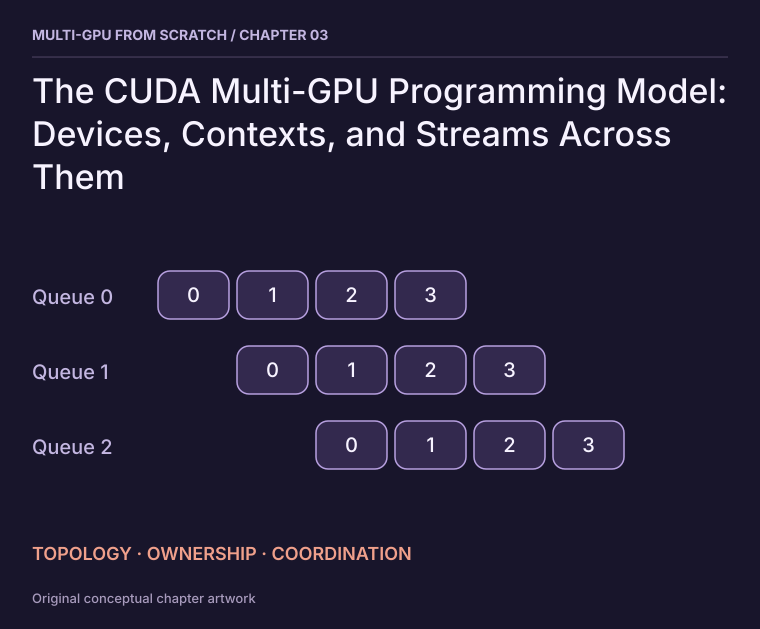
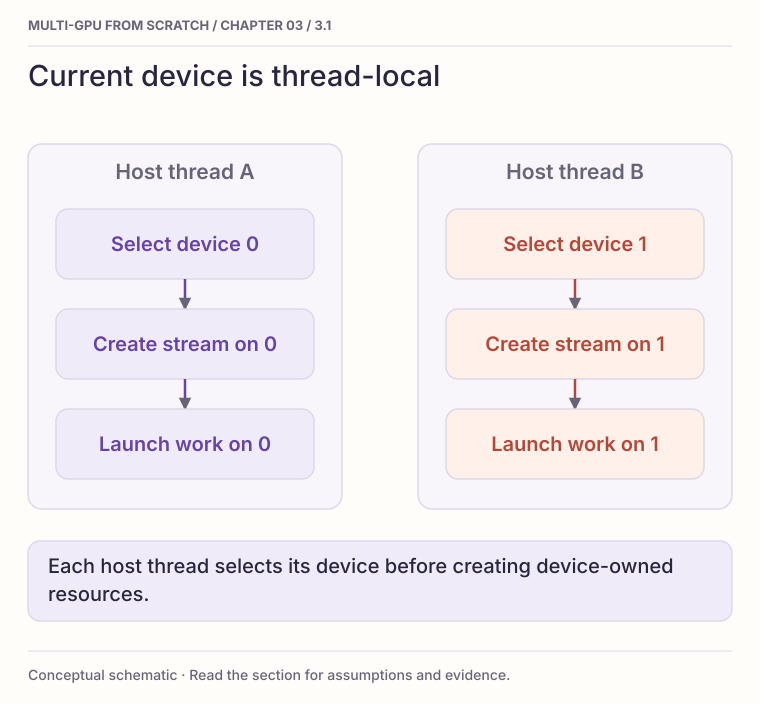
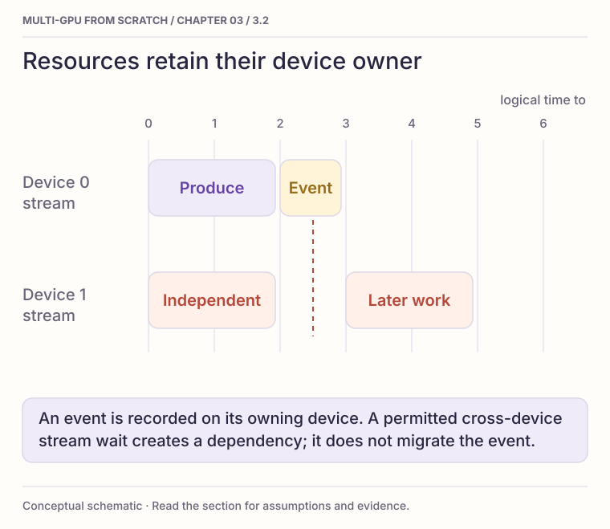

# Chapter 3: The CUDA Multi-GPU Programming Model: Devices, Contexts, and Streams Across Them

<!-- execution:provenance -->
!!! info "Execution provenance"

    Current execution blocks identify the tested source hash, hardware dataset, commands and captured output. References elsewhere on this page to a device-less environment describe the original authoring context. Historical output is superseded by the current record. Displayed output omits the runner command header and trims trailing line whitespace; raw logs remain exact. A host simulation or API validation has its stated scope; neither alone establishes a numerical multi-GPU workload or measured performance.


<!-- mgpu:opener:start -->
[](../images/chapter-openers/03.svg)
<!-- mgpu:opener:end -->

**What you will understand by the end of this chapter:**

- Why "current device" is state that belongs to a host thread, not the process as a whole, and what defaults to when nobody sets it.
- Why a stream or event is permanently bound to whichever device was current when it was created, and the real, documented asymmetry between how strictly that binding is enforced for a kernel launch versus a memory copy.
- The idiomatic loop pattern this book uses for every multi-device program from here on, and why launching on every device before waiting on any of them is what actually lets them run concurrently.
- A real, well-documented multithreading bug this device model invites, and exactly what guards against it.

**What you need to know first:**

- Chapter 1's memory and compute walls, and Chapter 2's interconnect topologies — this chapter is the CUDA-side vocabulary for addressing the devices those chapters described.
- Ordinary single-GPU CUDA usage: `cudaMalloc`, a kernel launch, `cudaMemcpy`, `cudaDeviceSynchronize`.

---

Chapter 2 established that GPUs are wired together in specific, uneven ways. Before this book can move a single byte between two of them, it needs the vocabulary the CUDA Runtime API actually uses to talk about "which device" — because that vocabulary has sharp edges that cause real, well-documented bugs the moment more than one device is involved.

## 3.1 "Current Device" Is a Per-Thread Setting, Not a Global One

<!-- mgpu:figure-1:start -->
[](../images/technical/ch03/1-threads.svg)
<!-- mgpu:figure-1:end -->

### Intuition

Picture a single telephone operator's switchboard with one lever that connects the operator to whichever line was last plugged in. The operator doesn't get to talk to every line at once by default — they talk to exactly the line the lever currently points at, and the lever stays pointed there until someone moves it. If the operator forgets to move the lever before making a call, the call goes out on whatever line the lever was left on, not on the line the operator meant.

### Background

Every CUDA Runtime API call that doesn't take an explicit device argument — `cudaMalloc`, a kernel launch, `cudaStreamCreate` — acts on whatever the calling host thread's *current device* happens to be at that moment. The CUDA Programming Guide's own multi-GPU chapter states this plainly: "a host thread can set the device it is currently operating on at any time by calling `cudaSetDevice()`," and "until a call to `cudaSetDevice()` is made by the host thread, the current device defaults to device 0."

```text
default (no cudaSetDevice() called yet): current device = 0

cudaSetDevice(2);
current device = 2
  -> every un-decorated call from here on (cudaMalloc, a kernel launch,
     cudaStreamCreate, ...) now acts on GPU 2, until the next
     cudaSetDevice() call changes it again
```

This is the single most important fact in this chapter, and nearly everything else follows from it directly. CUDA's lower-level Driver API has an explicit context object — a container for a device's address space, loaded code, and outstanding work — which a program creates and destroys by hand. The Runtime API, used throughout this book, hides that object: the first time a thread touches a given device, the runtime silently creates that device's context and attaches it to the current-device state above. "Current device" *is* "which context is active for this thread," just without a separate object to manage.

!!! warning "[COMMON TRAP] Assuming `cudaSetDevice()` affects every thread"
    `cudaSetDevice()` changes the current-device state for the *calling thread only*. A common, incorrect assumption is that calling it once near the start of a program sets the device for the whole process — it does not. Section 3.4's multithreading pitfall is the direct consequence of forgetting this.

## 3.2 Streams and Events Belong to Whichever Device Was Current When They Were Born

<!-- mgpu:figure-2:start -->
[](../images/technical/ch03/2-events.svg)
<!-- mgpu:figure-2:end -->

### Intuition

A phone line installed at a specific address stays at that address permanently — you cannot later decide the line installed at 12 Main Street should instead ring at 40 Oak Avenue just by wishing it so. A CUDA stream works the same way: it's wired to a specific device the moment it's created, and that wiring never changes afterward, no matter what the current device is when you later try to use it.

### Background

The Programming Guide states this directly: "streams and events are created in association with the currently set device." Once created, that association doesn't change. What makes this a sharp edge rather than a curiosity is a real, documented asymmetry between two kinds of operations issued to a "wrong" stream:

> "A kernel launch will fail if it is issued to a stream that is not associated to the current device." ... "A memory copy will succeed even if it is issued to a stream that is not associated to the current device."

```text
cudaSetDevice(0); cudaStreamCreate(&streamA);   // streamA now belongs to GPU 0, permanently
cudaSetDevice(1); cudaStreamCreate(&streamB);   // streamB now belongs to GPU 1, permanently

cudaSetDevice(1);
myKernel<<<g, b, 0, streamA>>>(...);          // FAILS: streamA belongs to GPU 0, current device is GPU 1
cudaMemcpyAsync(dst, src, n, kind, streamA);  // SUCCEEDS: memcpy is more permissive than a kernel launch
```

A kernel launch checks the stream's owning device against the current device and refuses to run if they don't match. A memory copy does not enforce that check the same way — convenient when it's what you meant, and a silent, confusing correctness bug when it isn't.

!!! warning "[COMMON TRAP] Trusting a memory copy's success as proof a stream was used correctly"
    Because a memory copy issued to the "wrong" device's stream succeeds instead of failing, a program with this bug produces no error at all — it just quietly does the copy anyway, on whatever device the memory copy's own device-inference logic resolves to. A kernel launch on the same wrong stream fails loudly; the exact same mistake with a memory copy fails silently. Chapter 6 (streams, events, and cross-device synchronization) builds directly on this asymmetry.

## 3.3 The Pattern: Single-Device Baseline First, Then the Loop

### Intuition

Before running a relay with four runners, you first make sure one runner can complete their own leg correctly — set up, run, hand off cleanly. Only once that single leg works do you generalize to four runners doing the same thing, each on their own leg, with the added coordination of who starts when. Every multi-device CUDA program in this book is built the same way: the single-device sequence first, generalized into a loop second.

### Background

The single-device sequence is: set the device, allocate, launch, wait, read back, free.

```cpp
// Chapter 3: The CUDA Multi-GPU Programming Model
// 06_single_device_setup.cu
//
// The single-device baseline every multi-device program is built from:
// pick a device, allocate on it, launch on it, wait for it, read the
// result back, free it. Every step's return code is checked -- that
// discipline is what turns "no device present" from a crash into an
// honest, informative report instead.
#include <cstdio>
#include <cuda_runtime.h>

__global__ void addOneKernel(int* data, int n) {
    int i = blockIdx.x * blockDim.x + threadIdx.x;
    if (i < n) data[i] += 1;
}

#define CHECK(call, label) do { \
    cudaError_t _e = (call); \
    printf("%-28s %s (code %d)\n", label, cudaGetErrorString(_e), (int)_e); \
    if (_e != cudaSuccess) { \
        printf("Stopping here -- every step after this one depends on " \
               "this one having succeeded.\n"); \
        return 0; \
    } \
} while (0)

int main() {
    const int N = 8;

    CHECK(cudaSetDevice(0), "cudaSetDevice(0)");

    int* d_data = nullptr;
    CHECK(cudaMalloc(&d_data, N * sizeof(int)), "cudaMalloc");

    int h_in[N] = {0, 1, 2, 3, 4, 5, 6, 7};
    CHECK(cudaMemcpy(d_data, h_in, N * sizeof(int), cudaMemcpyHostToDevice),
          "cudaMemcpy H2D");

    addOneKernel<<<1, N>>>(d_data, N);
    CHECK(cudaGetLastError(), "kernel launch");
    CHECK(cudaDeviceSynchronize(), "cudaDeviceSynchronize");

    int h_out[N] = {0};
    CHECK(cudaMemcpy(h_out, d_data, N * sizeof(int), cudaMemcpyDeviceToHost),
          "cudaMemcpy D2H");

    printf("Result: ");
    for (int i = 0; i < N; ++i) printf("%d ", h_out[i]);
    printf("\n");

    cudaFree(d_data);
    return 0;
}
```

<!-- execution:start:a100:06_single_device_setup.cu -->
> **Current execution — 2026-11-17-a100: API/host demonstration (exit-only).** UTC (program start): `2026-11-18T00:00:15.466514+00:00`. Source SHA-256: `0a16e1d4b5d38ac9091b11d28b12db3a0c353d8dce75f782553003a2e602fe23`.

[Exact tested source](../validation/2026-11-17-a100/06_single_device_setup/06_single_device_setup.cu) · [Compiler log](../validation/2026-11-17-a100/06_single_device_setup/compile.log) · [Execution log](../validation/2026-11-17-a100/06_single_device_setup/run.log). Compile exit: `0`; run exit: `0`.

Commands below use local source/binary names; raw logs retain host paths. Execute in a scratch directory containing the downloaded source.

```bash
nvcc -std=c++17 -O2 -arch=sm_80 06_single_device_setup.cu -o ./example
./example
```

<details markdown="1"><summary>Captured current-source output</summary>

```text
cudaSetDevice(0)             no error (code 0)
cudaMalloc                   no error (code 0)
cudaMemcpy H2D               no error (code 0)
kernel launch                no error (code 0)
cudaDeviceSynchronize        no error (code 0)
cudaMemcpy D2H               no error (code 0)
Result: 1 2 3 4 5 6 7 8
```

</details>
<!-- execution:end:a100:06_single_device_setup.cu -->


<!-- execution:start:h100:06_single_device_setup.cu -->
> **Current execution — 2026-11-17-h100: API/host demonstration (exit-only).** UTC (run-batch start; per-program time unrecorded): `2026-11-17T23:48:18.967387+00:00`. Source SHA-256: `0a16e1d4b5d38ac9091b11d28b12db3a0c353d8dce75f782553003a2e602fe23`.

[Exact tested source](../validation/2026-11-17-h100/06_single_device_setup/06_single_device_setup.cu) · [Compiler log](../validation/2026-11-17-h100/06_single_device_setup/compile.log) · [Execution log](../validation/2026-11-17-h100/06_single_device_setup/run.log). Compile exit: `0`; run exit: `0`.

Commands below use local source/binary names; raw logs retain host paths. Execute in a scratch directory containing the downloaded source.

```bash
nvcc -std=c++17 -O2 -arch=sm_90 06_single_device_setup.cu -o ./example
./example
```

<details markdown="1"><summary>Captured current-source output</summary>

```text
cudaSetDevice(0)             no error (code 0)
cudaMalloc                   no error (code 0)
cudaMemcpy H2D               no error (code 0)
kernel launch                no error (code 0)
cudaDeviceSynchronize        no error (code 0)
cudaMemcpy D2H               no error (code 0)
Result: 1 2 3 4 5 6 7 8
```

</details>
<!-- execution:end:h100:06_single_device_setup.cu -->


```bash
nvcc -arch=sm_80 06_single_device_setup.cu -o single_device_setup
./single_device_setup
```

Output (genuinely compiled with a real `nvcc` and genuinely run; identical across three consecutive runs):

<details markdown="1"><summary>Historical authoring output — superseded by the current execution above</summary>

```text
cudaSetDevice(0)             no CUDA-capable device is detected (code 100)
Stopping here -- every step after this one depends on this one having succeeded.
```

</details>

Checking every single call's return code — rather than assuming success — is what turns this into an honest, one-line diagnostic instead of a crash or a silent wrong answer. Generalizing to N devices means moving each step into a loop over `cudaGetDeviceCount()`'s result, calling `cudaSetDevice(i)` before every single device-`i`-specific operation, because per Section 3.1 none of them remembers "device i" on your behalf:

```cpp
// Chapter 3: The CUDA Multi-GPU Programming Model
// 07_multi_device_loop_pattern.cu
//
// The idiomatic multi-device pattern this book uses from here on: never
// hard-code a device count, loop over whatever cudaGetDeviceCount()
// actually reports, and call cudaSetDevice(i) before every single
// operation meant for device i -- because "current device" is per host
// thread, not per stream or per allocation. A stream or allocation is
// permanently bound to whichever device was current at the moment it
// was created; cudaSetDevice() only changes what happens *next*.
#include <cstdio>
#include <vector>
#include <cuda_runtime.h>

__global__ void addOneKernel(int* data, int n) {
    int i = blockIdx.x * blockDim.x + threadIdx.x;
    if (i < n) data[i] += 1;
}

int main() {
    int deviceCount = 0;
    cudaGetDeviceCount(&deviceCount);
    printf("cudaGetDeviceCount() reports %d device(s).\n", deviceCount);
    printf("The loop below runs its body exactly %d time(s) as a "
           "direct consequence -- not a special case, just what a "
           "correctly-guarded loop over a real count does when that "
           "count happens to be zero.\n\n", deviceCount);

    std::vector<cudaStream_t> streams(deviceCount);
    std::vector<int*> buffers(deviceCount, nullptr);
    const int N = 8;

    // Phase 1: on EACH device, in turn, set it current, then create
    // that device's own stream and allocate that device's own buffer.
    // The stream created while device i is current belongs to device i
    // permanently -- it is illegal to later enqueue work meant for
    // device j onto it.
    for (int i = 0; i < deviceCount; ++i) {
        cudaSetDevice(i);
        cudaStreamCreate(&streams[i]);
        cudaMalloc(&buffers[i], N * sizeof(int));
        printf("Device %d: stream and buffer created while device %d "
               "was current.\n", i, i);
    }

    // Phase 2: launch each device's own kernel on its own stream. This
    // is the pattern every collective in Part 2 builds on: one loop,
    // one cudaSetDevice() per iteration, work enqueued asynchronously
    // on each device's own stream so all devices can run concurrently.
    for (int i = 0; i < deviceCount; ++i) {
        cudaSetDevice(i);
        addOneKernel<<<1, N, 0, streams[i]>>>(buffers[i], N);
    }

    // Phase 3: synchronize each device's own stream. Note this is a
    // SEPARATE loop from phase 2 -- launching everything first, then
    // waiting, is what lets the devices actually overlap; interleaving
    // launch-then-wait-then-launch-then-wait would serialize them.
    for (int i = 0; i < deviceCount; ++i) {
        cudaSetDevice(i);
        cudaStreamSynchronize(streams[i]);
        cudaStreamDestroy(streams[i]);
        cudaFree(buffers[i]);
    }

    printf("Loop body executed %d time(s) total across all three "
           "phases. On real N-GPU hardware, this exact, unmodified "
           "source runs all N devices' kernels concurrently with no "
           "code change -- that's the entire point of writing the loop "
           "this way instead of hard-coding device 0 and device 1.\n",
           deviceCount);

    return 0;
}
```

<!-- execution:start:a100:07_multi_device_loop_pattern.cu -->
> **Current execution — 2026-11-17-a100: API/host demonstration (exit-only).** UTC (program start): `2026-11-18T00:00:19.706136+00:00`. Source SHA-256: `a876bc6228ec5b0d82ea556321644f8d55e5a3f3a3dc7022f4ae0088d8c77805`.

[Exact tested source](../validation/2026-11-17-a100/07_multi_device_loop_pattern/07_multi_device_loop_pattern.cu) · [Compiler log](../validation/2026-11-17-a100/07_multi_device_loop_pattern/compile.log) · [Execution log](../validation/2026-11-17-a100/07_multi_device_loop_pattern/run.log). Compile exit: `0`; run exit: `0`.

Commands below use local source/binary names; raw logs retain host paths. Execute in a scratch directory containing the downloaded source.

```bash
nvcc -std=c++17 -O2 -arch=sm_80 07_multi_device_loop_pattern.cu -o ./example
./example
```

<details markdown="1"><summary>Captured current-source output</summary>

```text
cudaGetDeviceCount() reports 8 device(s).
The loop below runs its body exactly 8 time(s) as a direct consequence -- not a special case, just what a correctly-guarded loop over a real count does when that count happens to be zero.

Device 0: stream and buffer created while device 0 was current.
Device 1: stream and buffer created while device 1 was current.
Device 2: stream and buffer created while device 2 was current.
Device 3: stream and buffer created while device 3 was current.
Device 4: stream and buffer created while device 4 was current.
Device 5: stream and buffer created while device 5 was current.
Device 6: stream and buffer created while device 6 was current.
Device 7: stream and buffer created while device 7 was current.
Loop body executed 8 time(s) total across all three phases. On real N-GPU hardware, this exact, unmodified source runs all N devices' kernels concurrently with no code change -- that's the entire point of writing the loop this way instead of hard-coding device 0 and device 1.
```

</details>
<!-- execution:end:a100:07_multi_device_loop_pattern.cu -->


<!-- execution:start:h100:07_multi_device_loop_pattern.cu -->
> **Current execution — 2026-11-17-h100: API/host demonstration (exit-only).** UTC (run-batch start; per-program time unrecorded): `2026-11-17T23:48:18.967387+00:00`. Source SHA-256: `a876bc6228ec5b0d82ea556321644f8d55e5a3f3a3dc7022f4ae0088d8c77805`.

[Exact tested source](../validation/2026-11-17-h100/07_multi_device_loop_pattern/07_multi_device_loop_pattern.cu) · [Compiler log](../validation/2026-11-17-h100/07_multi_device_loop_pattern/compile.log) · [Execution log](../validation/2026-11-17-h100/07_multi_device_loop_pattern/run.log). Compile exit: `0`; run exit: `0`.

Commands below use local source/binary names; raw logs retain host paths. Execute in a scratch directory containing the downloaded source.

```bash
nvcc -std=c++17 -O2 -arch=sm_90 07_multi_device_loop_pattern.cu -o ./example
./example
```

<details markdown="1"><summary>Captured current-source output</summary>

```text
cudaGetDeviceCount() reports 2 device(s).
The loop below runs its body exactly 2 time(s) as a direct consequence -- not a special case, just what a correctly-guarded loop over a real count does when that count happens to be zero.

Device 0: stream and buffer created while device 0 was current.
Device 1: stream and buffer created while device 1 was current.
Loop body executed 2 time(s) total across all three phases. On real N-GPU hardware, this exact, unmodified source runs all N devices' kernels concurrently with no code change -- that's the entire point of writing the loop this way instead of hard-coding device 0 and device 1.
```

</details>
<!-- execution:end:h100:07_multi_device_loop_pattern.cu -->


```bash
nvcc -arch=sm_80 07_multi_device_loop_pattern.cu -o multi_device_loop
./multi_device_loop
```

Output (genuinely compiled and run; identical across runs):

<details markdown="1"><summary>Historical authoring output — superseded by the current execution above</summary>

```text
cudaGetDeviceCount() reports 0 device(s).
The loop below runs its body exactly 0 time(s) as a direct consequence -- not a special case, just what a correctly-guarded loop over a real count does when that count happens to be zero.

Loop body executed 0 time(s) total across all three phases. On real N-GPU hardware, this exact, unmodified source runs all N devices' kernels concurrently with no code change -- that's the entire point of writing the loop this way instead of hard-coding device 0 and device 1.
```

</details>

!!! warning "[COMMON TRAP] Combining the launch loop and the wait loop into one"
    Writing a single loop that launches device `i`'s kernel and immediately waits for it before moving to device `i+1` looks equivalent to the two-loop version above, but it isn't: waiting on device 0 before device 1's kernel has even been launched forces the two devices to run one after another instead of together, turning an N-GPU program into an N-times-slower single-GPU program in disguise. The separate launch-then-wait loops in Phases 2 and 3 above are what actually let the devices overlap.

## 3.4 The Multithreading Pitfall: A New Thread Starts on Device 0

### Intuition

Go back to the switchboard from Section 3.1, but now hire a second operator and give them their own switchboard. Their lever doesn't start wherever the first operator's lever happens to be pointing; it starts in the factory position, line 0, until the new operator moves it. Telling the first operator "switch to line 1" before the second one starts work changes nothing for the second one.

### Background

Section 3.1's rule has a direct consequence the moment a program uses more than one host thread. Current-device state belongs to each thread separately, and the Programming Guide's default applies to every thread on its own: "until a call to `cudaSetDevice()` is made by the host thread, the current device defaults to device 0." A newly spawned thread does not inherit its parent's choice. NVIDIA's own developer blog post on this exact bug ("CUDA Pro Tip: Always Set the Current Device to Avoid Multithreading Bugs") describes it as a common source of silent errors in multi-threaded, multi-GPU code.

```text
main thread:     cudaSetDevice(1);          // main thread's current device = 1
                 std::thread worker(work);  // spawn a worker

worker thread:   cudaMalloc(&p, bytes);     // worker's current device = 0 (default),
                                            // NOT 1 -- p is allocated on GPU 0
                 kernel<<<g, b>>>(p);       // launched on GPU 0 as well

fixed worker:    cudaSetDevice(1);          // first CUDA action in the thread
                 cudaMalloc(&p, bytes);     // now genuinely on GPU 1
```

Nothing in the unfixed worker returns an error: device 0 exists, so the allocation and the launch both succeed, just on the wrong GPU. On a machine where device 0 is also being driven by another thread, the symptom is device 0 doing twice its share of work and running out of memory early, while device 1 sits idle. The guard is the one Section 3.3's loop already uses: every thread that touches CUDA calls `cudaSetDevice()` for the device it means to drive, as its first CUDA call, rather than relying on whatever any other thread set.

!!! warning "[COMMON TRAP] Setting the device in `main()` and assuming worker threads inherit it"
    Calling `cudaSetDevice()` once in `main()` before spawning workers only configures the main thread. Each worker starts on device 0 unless it calls `cudaSetDevice()` itself, and because device 0 is a valid device, the mistake produces wrong placement rather than an error message.

## Chapter Summary

"Current device" is per-host-thread state, defaulting to device 0, changed only by `cudaSetDevice()` (Section 3.1) — and the Runtime API's context is that same state made implicit, with no separate object to manage. A stream or event is permanently bound to whichever device was current when it was created, enforced strictly for kernel launches but not for memory copies (Section 3.2), an asymmetry Chapter 6 builds on directly. Every multi-device program in this book is Section 3.3's single-device sequence, generalized into a loop that never assumes how many devices exist, with launch and wait kept in separate loops specifically so devices can run concurrently instead of one after another. Because current-device state is per thread, a newly spawned host thread starts on device 0 regardless of what its parent set, so every thread must call `cudaSetDevice()` for itself (Section 3.4).

## Self-Check Questions

1. A program calls `cudaSetDevice(1)` once, at the very top of `main()`, before spawning four worker threads. Does each worker thread then operate on device 1 by default? Justify your answer using Section 3.1's per-thread model.
2. A stream is created while device 0 is current. Later, with device 1 current, code issues both a kernel launch and a `cudaMemcpyAsync` to that same stream. Predict the outcome of each call separately, citing the documented asymmetry from Section 3.2.
3. Phase 1's loop calls `cudaSetDevice(i)` exactly once per iteration, before both `cudaStreamCreate()` and `cudaMalloc()`. Phases 2 and 3 each call `cudaSetDevice(i)` again later. Is Phase 1's call load-bearing, or could it be deleted because the later phases set the device anyway? What would go wrong without it?
4. Rewrite Section 3.3's three-phase loop as a single loop that launches and waits per device before moving to the next. What concurrency property does the rewritten version lose?
5. `06_single_device_setup.cu`'s `CHECK` macro stops the program at the first failing call. In this environment, which specific call fails first, and why does every call after it depend on that one having succeeded?
6. A newly spawned host thread does not inherit its parent thread's current-device setting. Using Section 3.1's default-device-0 rule, predict what device a new thread's very first unguarded CUDA call would act on if that thread never calls `cudaSetDevice()` itself.
7. Suppose a program spawns exactly one host thread per GPU, intending each thread to drive its own device. Using your answer to Question 6, describe the one line each thread must execute first to make that intention actually correct.

## Where We Go Next

Chapter 4 puts this vocabulary to work on the first real multi-device operation: letting one GPU read another GPU's memory directly, without staging the data through the host at all.

## Worked Solutions

**1.** No. Per Section 3.1, "current device" is state belonging to the specific host thread that set it — `cudaSetDevice(1)` called by the main thread only changes the main thread's own current-device state. Each of the four spawned worker threads starts with its own separate current-device state, defaulting to device 0, completely unaffected by what the main thread did before spawning them.

**2.** The kernel launch fails: the stream belongs to device 0 (set when it was created), but the current device is 1 when the launch is issued, and Section 3.2's cited documentation states a kernel launch fails under exactly this mismatch. The `cudaMemcpyAsync` call succeeds despite the identical mismatch, because memory copies are not enforced the same way — the documented asymmetry this section is built around.

**3.** It's load-bearing. Per Section 3.2, a stream belongs to whichever device was current when it was created, and an allocation lands on whichever device was current when `cudaMalloc()` ran; a later `cudaSetDevice(i)` in Phase 2 or 3 cannot move either one after the fact. Without Phase 1's call, nothing in Phase 1 ever changes the current device, so it stays at the default, device 0 (Section 3.1), and every stream and every buffer is created on device 0. Phase 2 then sets device `i` current and launches on `streams[i]`, which belongs to device 0, so for every `i` other than 0 the launch fails, exactly the kernel-launch mismatch Section 3.2 documents.

**4.** The rewrite would call, per device in a single loop: `cudaSetDevice(i); launch kernel; cudaStreamSynchronize(streams[i]);` before moving to `i+1`. It loses concurrency across devices: waiting for device `i`'s stream to finish before ever launching device `i+1`'s kernel forces every device to run strictly one after another, rather than all launching first (Phase 2) and only then all waiting (Phase 3), which is what allows them to execute concurrently.

**5.** `cudaSetDevice(0)` establishes the calling host thread’s current device when device 0 is available. Check its result before allocation, copies or launch. A no-device host fails at that prerequisite; the current two-H100 run has real devices and must be interpreted from its actual log.

The [2026-11-17 H100 execution record](../validation-h100.md) covers two GPUs connected by local NV18. It distinguishes numerical checks, API probes and other executions; a successful exit alone does not establish GPU algorithm correctness.

**6.** Device 0. Section 3.1's rule is that current-device state defaults to device 0 until a thread calls `cudaSetDevice()` itself; a new thread that never makes that call, regardless of what any other thread (including its parent) has done, starts from that same default and stays there for its first (and every subsequent) unguarded call.

**7.** Each thread must call `cudaSetDevice(i)` itself, using its own intended device index `i`, as the very first CUDA-related action it takes — before any allocation, stream creation, or kernel launch. Skipping this in even one thread leaves that thread's current-device state at the default (device 0), so its work silently lands on device 0 instead of the device it was meant to drive, regardless of what the programmer intended when spawning it.

---

**Sources cited in this chapter:**

- [Programming Systems with Multiple GPUs — CUDA Programming Guide](https://docs.nvidia.com/cuda/archive/13.1.0/cuda-programming-guide/03-advanced/multi-gpu-systems.html) -- per-thread current device, device-0 default, stream/event device association, and the kernel-launch-vs-memory-copy enforcement asymmetry.
- [CUDA Pro Tip: Always Set the Current Device to Avoid Multithreading Bugs — NVIDIA Developer Blog](https://developer.nvidia.com/blog/cuda-pro-tip-always-set-current-device-avoid-multithreading-bugs) -- per-thread device state and the new-thread-defaults-to-device-0 pitfall.
