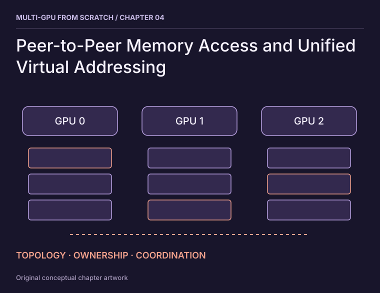
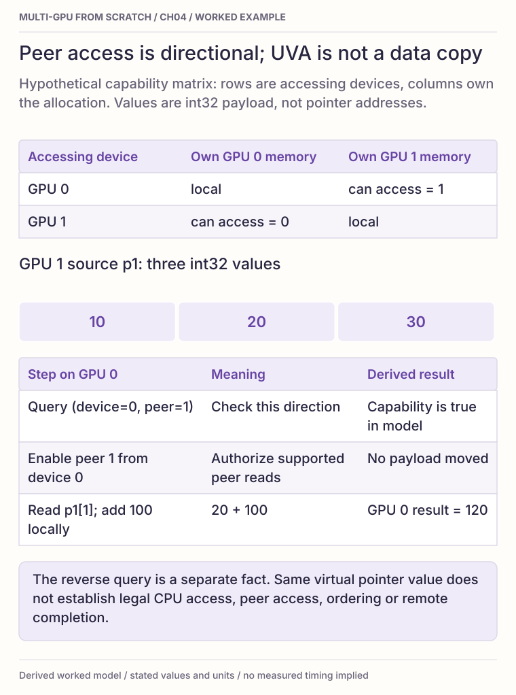
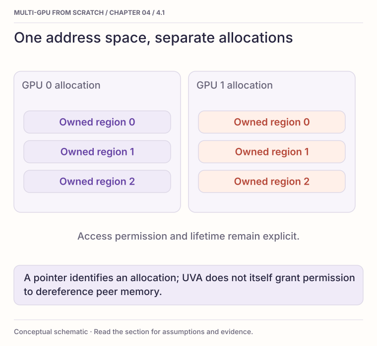
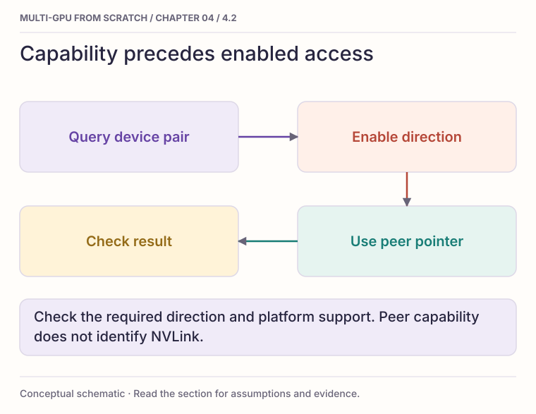

# Chapter 4: Peer-to-Peer Memory Access and Unified Virtual Addressing

<!-- mgpu:opener:start -->
[](../images/chapter-openers/04.svg)
<!-- mgpu:opener:end -->

**What you will understand by the end of this chapter:**

- Why every pointer in a modern multi-GPU CUDA program — host or device, no matter which device allocated it — lives in one single, flat address space, and what `cudaPointerGetAttributes()` can honestly tell you about any pointer in that space.
- Why "peer access" is a real, queryable, *unidirectional* permission between two specific devices, not an automatic consequence of Unified Virtual Addressing existing — and exactly which two Runtime API calls establish it.
- How the GPU transfer checks validate real payloads, while the host simulation independently explores routing and buffer ownership.

**What you need to know first:**

- Chapter 3's per-thread current-device state, and the idiomatic multi-device loop pattern (create → launch → synchronize, kept as three separate loops).
- Chapter 2's topology models: which device pairs have a direct link, and which fall back to a shared, slower path.
- Ordinary C++ containers (`std::vector`) and pointers. No prior CUDA experience beyond Chapters 1-3.

---

Part 0 established device selection, contexts and stream ownership. This chapter adds Unified Virtual Addressing and ordered-pair peer permissions, then checks how pointers and transfers cross device boundaries.

<!-- mgpu:worked:start -->
## Worked example — Peer access is a directional permission

Assume GPU 1 owns p1 = [10, 20, 30] (three int32 values, 12 bytes). A hypothetical capability query reports that GPU 0 can access GPU 1, but the reverse query reports no access.

[](../images/worked/ch04.svg)

1. Call cudaDeviceCanAccessPeer(&can, 0, 1): the first device is the prospective accessor and the second owns the memory. Here can = 1.

2. Select GPU 0, then call cudaDeviceEnablePeerAccess(1, 0). This enables the supported access direction from the current device to peer 1.

3. After GPU 1 has produced p1 and the consumer dependency is established, a GPU 0 kernel may read p1[1] = 20. Adding a local value 100 gives 120.

4. Querying (1, 0) is a separate question. The successful first direction establishes no permission for the reverse direction.

**Expected result and pitfall.** The expected value is 120. Enabling access does not copy the 12 bytes, establish producer completion, or extend the allocation lifetime. UVA identifies addresses; accessibility and ordering still need their own checks.

**Exercise.** How many payload bytes are copied merely by enabling peer access?

**Worked answer.** Zero in this example. A subsequent remote read or explicit copy moves data; the enable call grants permission.
<!-- mgpu:worked:end -->

## 4.1 Unified Virtual Addressing: One Address Space, Many Memories

<!-- mgpu:figure-1:start -->
[](../images/technical/ch04/1-ownership.svg)
<!-- mgpu:figure-1:end -->

### Intuition

Before CUDA 4.0, a raw pointer value was ambiguous: the same numeric address could be a valid host address on one system and simultaneously mean nothing (or something else entirely) as a device address, so the runtime had to be told explicitly, for every copy, which direction the data was moving (`cudaMemcpyHostToDevice`, `cudaMemcpyDeviceToHost`, and so on). Unified Virtual Addressing removes that ambiguity by construction: the host and every visible CUDA device share one flat virtual address range, so a given pointer *value* uniquely identifies where it points — the host's memory, or a specific device's memory, and if the latter, which device. That single fact is what lets `cudaMemcpyDefault` figure out a copy's direction on its own, and — more importantly for this chapter — it's the precondition for peer-to-peer access even being a coherent idea: two devices can only dereference each other's pointers directly because those pointers already live in address ranges both devices agree on the meaning of.

### Background

`cudaPointerGetAttributes()` reports allocation type and, where meaningful, device ownership. On supported UVA systems, inspect the type before interpreting other fields: an unregistered host pointer has no meaningful owning GPU ordinal, and managed memory is a separate type. The current probe checks these reported properties; pointer bits alone do not grant peer access.

The [2026-11-17 H100 execution record](../validation-h100.md) covers two GPUs connected by local NV18. It distinguishes numerical checks, API probes and other executions; a successful exit alone does not establish GPU algorithm correctness.

```cpp
// Chapter 4: Peer-to-Peer Memory Access and Unified Virtual Addressing
// 08_pointer_attributes.cu
//
// A genuine cudaPointerGetAttributes() call, compiled with a real nvcc
// and genuinely run. Under Unified Virtual Addressing, a single flat
// address space covers the host and every device, so this call is what
// answers "whose memory does this pointer actually point into" -- the
// exact mechanism cudaMemcpyDefault relies on to auto-detect a copy's
// direction without being told explicitly.
#include <cstdio>
#include <cuda_runtime.h>

int main() {
    int hostArr[4] = {1, 2, 3, 4};
    cudaPointerAttributes attr;
    cudaError_t e = cudaPointerGetAttributes(&attr, hostArr);
    printf("cudaPointerGetAttributes(ordinary stack array): %s (code %d)\n",
           cudaGetErrorString(e), (int)e);
    if (e == cudaSuccess) {
        printf("  type=%d device=%d\n", (int)attr.type, attr.device);
    }

    void* devPtr = nullptr;
    cudaError_t e2 = cudaMalloc(&devPtr, 16);
    printf("cudaMalloc: %s (code %d)\n", cudaGetErrorString(e2), (int)e2);

    if (e2 == cudaSuccess) {
        cudaPointerAttributes attr2;
        cudaError_t e3 = cudaPointerGetAttributes(&attr2, devPtr);
        printf("cudaPointerGetAttributes(device ptr): %s\n", cudaGetErrorString(e3));
        cudaFree(devPtr);
    }
    return 0;
}
```

<!-- execution:start:h100-rerun:08_pointer_attributes.cu -->
> **Compiled and executed — 2026-11-18-h100: API/host demonstration (exit-only).** Hardware: 2 H100 GPUs. Executed UTC: `2026-11-18T11:20:52.826661+00:00`.

<!-- execution:metadata Source SHA-256: 41c5abf56f01114560b72e04c1db7a3056be50dfe7fc6d9905fbf9998a553e58; recorded UTC (program start): 2026-11-18T11:20:52.211361+00:00 -->

[Exact tested source](../validation/2026-11-18-h100/08_pointer_attributes/08_pointer_attributes.cu) · [Compiler log](../validation/2026-11-18-h100/08_pointer_attributes/compile.log) · [Execution log](../validation/2026-11-18-h100/08_pointer_attributes/run.log). Compile exit: `0`; run exit: `0`.

Commands below use local source/binary names; raw logs retain host paths. Execute in a scratch directory containing the downloaded source.

```bash
nvcc -std=c++17 -O2 -arch=sm_90 08_pointer_attributes.cu -o ./example
./example
```

**Sample output**

```text
cudaPointerGetAttributes(ordinary stack array): no error (code 0)
  type=0 device=-1
cudaMalloc: no error (code 0)
cudaPointerGetAttributes(device ptr): no error
```

<!-- execution:end:h100-rerun:08_pointer_attributes.cu -->


<!-- execution:start:a100:08_pointer_attributes.cu -->
> **Compiled and executed — 2026-11-17-a100: API/host demonstration (exit-only).** Hardware: 8 A100 GPUs. Executed UTC: `2026-11-18T00:00:27.268130+00:00`.

<!-- execution:metadata Source SHA-256: 41c5abf56f01114560b72e04c1db7a3056be50dfe7fc6d9905fbf9998a553e58; recorded UTC (program start): 2026-11-18T00:00:26.201079+00:00 -->

[Exact tested source](../validation/2026-11-17-a100/08_pointer_attributes/08_pointer_attributes.cu) · [Compiler log](../validation/2026-11-17-a100/08_pointer_attributes/compile.log) · [Execution log](../validation/2026-11-17-a100/08_pointer_attributes/run.log). Compile exit: `0`; run exit: `0`.

Commands below use local source/binary names; raw logs retain host paths. Execute in a scratch directory containing the downloaded source.

```bash
nvcc -std=c++17 -O2 -arch=sm_80 08_pointer_attributes.cu -o ./example
./example
```

**Sample output**

```text
cudaPointerGetAttributes(ordinary stack array): no error (code 0)
  type=0 device=-1
cudaMalloc: no error (code 0)
cudaPointerGetAttributes(device ptr): no error
```


<!-- execution:end:a100:08_pointer_attributes.cu -->


<!-- execution:start:h100:08_pointer_attributes.cu -->
> **Compiled and executed — 2026-11-17-h100: API/host demonstration (exit-only).** Hardware: 2 H100 GPUs. Execution record UTC (run-batch start; per-program time unrecorded): `2026-11-17T23:48:18.967387+00:00`.

<!-- execution:metadata Source SHA-256: 41c5abf56f01114560b72e04c1db7a3056be50dfe7fc6d9905fbf9998a553e58; recorded UTC (run-batch start; per-program time unrecorded): 2026-11-17T23:48:18.967387+00:00 -->

[Exact tested source](../validation/2026-11-17-h100/08_pointer_attributes/08_pointer_attributes.cu) · [Compiler log](../validation/2026-11-17-h100/08_pointer_attributes/compile.log) · [Execution log](../validation/2026-11-17-h100/08_pointer_attributes/run.log). Compile exit: `0`; run exit: `0`.

Commands below use local source/binary names; raw logs retain host paths. Execute in a scratch directory containing the downloaded source.

```bash
nvcc -std=c++17 -O2 -arch=sm_90 08_pointer_attributes.cu -o ./example
./example
```

<details markdown="1"><summary>Captured current-source output</summary>

```text
cudaPointerGetAttributes(ordinary stack array): no error (code 0)
  type=0 device=-1
cudaMalloc: no error (code 0)
cudaPointerGetAttributes(device ptr): no error
```

</details>
<!-- execution:end:h100:08_pointer_attributes.cu -->


A query about an ordinary host pointer must be interpreted using its returned allocation type. Do not infer that such a query always fails or requires ownership by a GPU. The old no-driver error was an environment-specific diagnostic; use the current H100 query log for the executed probe.

The [2026-11-17 H100 execution record](../validation-h100.md) covers two GPUs connected by local NV18. It distinguishes numerical checks, API probes and other executions; a successful exit alone does not establish GPU algorithm correctness.

!!! warning "[COMMON TRAP] Assuming a pointer's *type* tells you whether an operation on it is legal"
    `cudaPointerGetAttributes()` tells you what a pointer *is* — host memory, or device memory belonging to a specific device ordinal. It does not tell you what operations are currently *permitted* on it from somewhere else. Knowing that a pointer belongs to device 1 does not mean device 0 can dereference it; that is a completely separate, unidirectional permission — the subject of the next section — that has to be established on its own, regardless of what UVA has already told you about the pointer's identity.

## 4.2 Checking and Enabling Peer Access

<!-- mgpu:figure-2:start -->
[](../images/technical/ch04/2-flow.svg)
<!-- mgpu:figure-2:end -->

### Intuition

UVA means every device's pointers are meaningful, comparable values in one address space. It does not mean every device is *allowed* to dereference every other device's pointers directly. That permission is a separate, explicit, per-ordered-pair setting, because allowing it has real hardware and driver consequences (a PCIe or NVLink route has to actually exist and be usable for the access to work at all — recall Chapter 2's topology models, where not every pair of devices has a direct link). The CUDA Runtime API therefore splits this into two calls: one that only *asks* whether a given ordered pair could work, and a second, separate call that actually *grants* it — and the grant is deliberately one-directional, so a fully bidirectional relationship between two devices takes two calls, one from each side.

### Background

`cudaDeviceCanAccessPeer(&canAccess, device, peerDevice)` answers, for one ordered pair, whether `device` could access `peerDevice`'s memory directly if asked to. It changes nothing by itself. `cudaDeviceEnablePeerAccess(peerDevice, flags)` is what actually grants that access — and it does so from the perspective of *whichever device is currently the caller's current device* (Chapter 3's per-thread state again), granting that current device the ability to access `peerDevice`. The CUDA Runtime API documentation is explicit that the access this grants is unidirectional: enabling device 0 to access device 1 says nothing about whether device 1 can access device 0 — that direction, if wanted, needs its own separate call with the current device set to 1. The idiomatic setup sequence, then, is a loop over every *ordered* pair — not every unordered pair — checking and enabling each direction independently. The CUDA Programming Guide's multi-GPU chapter also notes a real, finite ceiling on this: on non-NVSwitch-enabled systems, each device supports a system-wide maximum of eight peer connections at once, which is exactly the kind of topology-shaped constraint Chapter 2's partial-mesh models already anticipated.

```cpp
// Chapter 4: Peer-to-Peer Memory Access and Unified Virtual Addressing
// 09_peer_access_setup.cu
//
// The real, idiomatic peer-access setup sequence: check every ordered
// pair with cudaDeviceCanAccessPeer(), then enable access with
// cudaDeviceEnablePeerAccess() -- called from the "current" side of the
// pair, since (per the CUDA Runtime API docs) access granted this way
// Peer access is directional; query and enable each ordered device pair.
//
//
#include <cstdio>
#include <cuda_runtime.h>

int main() {
    int deviceCount = 0;
    cudaGetDeviceCount(&deviceCount);
    printf("cudaGetDeviceCount(): %d device(s).\n", deviceCount);

    int enabledPairs = 0;
    for (int i = 0; i < deviceCount; ++i) {
        for (int j = 0; j < deviceCount; ++j) {
            if (i == j) continue;
            int canAccess = 0;
            cudaDeviceCanAccessPeer(&canAccess, i, j);
            if (canAccess) {
                cudaSetDevice(i);
                cudaError_t e = cudaDeviceEnablePeerAccess(j, 0);
                printf("Enabled i=%d -> j=%d: %s\n", i, j,
                       cudaGetErrorString(e));
                if (e == cudaSuccess) ++enabledPairs;
            }
        }
    }
    printf("Peer access enabled for %d ordered pair(s) out of %d "
           "device(s) checked. On real multi-GPU hardware this same "
           "loop enables every accessible ordered pair exactly once, "
           "each direction independently, per the API's own "
           "unidirectional-access note.\n", enabledPairs, deviceCount);
    return 0;
}
```

<!-- execution:start:h100-rerun:09_peer_access_setup.cu -->
> **Compiled and executed — 2026-11-18-h100: API/host demonstration (exit-only).** Hardware: 2 H100 GPUs. Executed UTC: `2026-11-18T11:20:53.857524+00:00`.

<!-- execution:metadata Source SHA-256: 740c8c5876f47659619e118e3c553087839f81fc4ec57913b61dcb4654881bf5; recorded UTC (program start): 2026-11-18T11:20:53.242272+00:00 -->

[Exact tested source](../validation/2026-11-18-h100/09_peer_access_setup/09_peer_access_setup.cu) · [Compiler log](../validation/2026-11-18-h100/09_peer_access_setup/compile.log) · [Execution log](../validation/2026-11-18-h100/09_peer_access_setup/run.log). Compile exit: `0`; run exit: `0`.

Commands below use local source/binary names; raw logs retain host paths. Execute in a scratch directory containing the downloaded source.

```bash
nvcc -std=c++17 -O2 -arch=sm_90 09_peer_access_setup.cu -o ./example
./example
```

**Sample output**

```text
cudaGetDeviceCount(): 2 device(s).
Enabled i=0 -> j=1: no error
Enabled i=1 -> j=0: no error
Peer access enabled for 2 ordered pair(s) out of 2 device(s) checked. On real multi-GPU hardware this same loop enables every accessible ordered pair exactly once, each direction independently, per the API's own unidirectional-access note.
```

<!-- execution:end:h100-rerun:09_peer_access_setup.cu -->


<!-- execution:start:a100:09_peer_access_setup.cu -->
> **Compiled and executed — 2026-11-17-a100: API/host demonstration (exit-only).** Hardware: 8 A100 GPUs. Executed UTC: `2026-11-18T00:00:31.360263+00:00`.

<!-- execution:metadata Source SHA-256: 740c8c5876f47659619e118e3c553087839f81fc4ec57913b61dcb4654881bf5; recorded UTC (program start): 2026-11-18T00:00:30.292363+00:00 -->

[Exact tested source](../validation/2026-11-17-a100/09_peer_access_setup/09_peer_access_setup.cu) · [Compiler log](../validation/2026-11-17-a100/09_peer_access_setup/compile.log) · [Execution log](../validation/2026-11-17-a100/09_peer_access_setup/run.log). Compile exit: `0`; run exit: `0`.

Commands below use local source/binary names; raw logs retain host paths. Execute in a scratch directory containing the downloaded source.

```bash
nvcc -std=c++17 -O2 -arch=sm_80 09_peer_access_setup.cu -o ./example
./example
```

**Sample output**

```text
cudaGetDeviceCount(): 8 device(s).
Enabled i=0 -> j=1: no error
Enabled i=0 -> j=2: no error
Enabled i=0 -> j=3: no error
Enabled i=0 -> j=4: no error
Enabled i=0 -> j=5: no error
Enabled i=0 -> j=6: no error
Enabled i=0 -> j=7: no error
Enabled i=1 -> j=0: no error
Enabled i=1 -> j=2: no error
Enabled i=1 -> j=3: no error
Enabled i=1 -> j=4: no error
Enabled i=1 -> j=5: no error
Enabled i=1 -> j=6: no error
Enabled i=1 -> j=7: no error
Enabled i=2 -> j=0: no error
Enabled i=2 -> j=1: no error
Enabled i=2 -> j=3: no error
Enabled i=2 -> j=4: no error
Enabled i=2 -> j=5: no error
Enabled i=2 -> j=6: no error
Enabled i=2 -> j=7: no error
Enabled i=3 -> j=0: no error
Enabled i=3 -> j=1: no error
Enabled i=3 -> j=2: no error
Enabled i=3 -> j=4: no error
Enabled i=3 -> j=5: no error
Enabled i=3 -> j=6: no error
Enabled i=3 -> j=7: no error
Enabled i=4 -> j=0: no error
Enabled i=4 -> j=1: no error
Enabled i=4 -> j=2: no error
Enabled i=4 -> j=3: no error
Enabled i=4 -> j=5: no error
Enabled i=4 -> j=6: no error
Enabled i=4 -> j=7: no error
Enabled i=5 -> j=0: no error
Enabled i=5 -> j=1: no error
Enabled i=5 -> j=2: no error
Enabled i=5 -> j=3: no error
Enabled i=5 -> j=4: no error
Enabled i=5 -> j=6: no error
Enabled i=5 -> j=7: no error
Enabled i=6 -> j=0: no error
Enabled i=6 -> j=1: no error
Enabled i=6 -> j=2: no error
Enabled i=6 -> j=3: no error
Enabled i=6 -> j=4: no error
Enabled i=6 -> j=5: no error
Enabled i=6 -> j=7: no error
Enabled i=7 -> j=0: no error
Enabled i=7 -> j=1: no error
Enabled i=7 -> j=2: no error
Enabled i=7 -> j=3: no error
Enabled i=7 -> j=4: no error
Enabled i=7 -> j=5: no error
Enabled i=7 -> j=6: no error
Peer access enabled for 56 ordered pair(s) out of 8 device(s) checked. On real multi-GPU hardware this same loop enables every accessible ordered pair exactly once, each direction independently, per the API's own unidirectional-access note.
```


<!-- execution:end:a100:09_peer_access_setup.cu -->


<!-- execution:start:h100:09_peer_access_setup.cu -->
> **Compiled and executed — 2026-11-17-h100: API/host demonstration (exit-only).** Hardware: 2 H100 GPUs. Execution record UTC (run-batch start; per-program time unrecorded): `2026-11-17T23:48:18.967387+00:00`.

<!-- execution:metadata Source SHA-256: 740c8c5876f47659619e118e3c553087839f81fc4ec57913b61dcb4654881bf5; recorded UTC (run-batch start; per-program time unrecorded): 2026-11-17T23:48:18.967387+00:00 -->

[Exact tested source](../validation/2026-11-17-h100/09_peer_access_setup/09_peer_access_setup.cu) · [Compiler log](../validation/2026-11-17-h100/09_peer_access_setup/compile.log) · [Execution log](../validation/2026-11-17-h100/09_peer_access_setup/run.log). Compile exit: `0`; run exit: `0`.

Commands below use local source/binary names; raw logs retain host paths. Execute in a scratch directory containing the downloaded source.

```bash
nvcc -std=c++17 -O2 -arch=sm_90 09_peer_access_setup.cu -o ./example
./example
```

<details markdown="1"><summary>Captured current-source output</summary>

```text
cudaGetDeviceCount(): 2 device(s).
Enabled i=0 -> j=1: no error
Enabled i=1 -> j=0: no error
Peer access enabled for 2 ordered pair(s) out of 2 device(s) checked. On real multi-GPU hardware this same loop enables every accessible ordered pair exactly once, each direction independently, per the API's own unidirectional-access note.
```

</details>
<!-- execution:end:h100:09_peer_access_setup.cu -->


The current ordered-pair loop queries the actual H100 pair and enables supported peer routes with checked API results. Access is directional; enabling one direction does not grant the reverse direction. Capability queries establish permission, not achieved bandwidth.

The [2026-11-17 H100 execution record](../validation-h100.md) covers two GPUs connected by local NV18. It distinguishes numerical checks, API probes and other executions; a successful exit alone does not establish GPU algorithm correctness.

!!! warning "[COMMON TRAP] Enabling peer access once and assuming it covers both directions"
    A single call to `cudaDeviceEnablePeerAccess(1, 0)` made while device 0 is current grants device 0 the ability to access device 1 — and only that direction. If code on device 1 later tries to access device 0's memory without a separate call (`cudaSetDevice(1); cudaDeviceEnablePeerAccess(0, 0);`), that access is not permitted, even though it looks symmetric to the first call. The loop in this section's code checks and enables *both* orderings of every pair for exactly this reason — skipping half the loop silently leaves half the possible accesses disabled.

## 4.3 Verifying the Transfer Logic Without a Second Device

### Intuition

The hardware queries establish the available UVA and peer-access properties. The simulation below independently checks routing logic: direct transfer where peer access is modeled and host staging otherwise. A simulation checks its buffers and arithmetic, not actual CUDA visibility, permissions or stream ordering.

The [2026-11-17 H100 execution record](../validation-h100.md) covers two GPUs connected by local NV18. It distinguishes numerical checks, API probes and other executions; a successful exit alone does not establish GPU algorithm correctness.

### Background

The simulation below models a 4-device system wired as a ring, where each device has a direct link only to its two neighbors (device `i` to `i+1` and `i-1`, wrapping around). That is the same idea as Chapter 2's partial mesh, some pairs wired and some not, but a smaller and simpler shape: Chapter 2's model had 8 GPUs, each wired to its +/-1 and +/-2 neighbors. Here, device 0 has a direct link to device 1 (so peer access is possible and the direct-write path is used), but no direct link to device 2 (so the code must fall back to staging the copy through a separate host buffer). Both transfer functions are written to mirror what real code actually does at each step, not to simplify the problem: `transferDirectP2P()` performs a plain assignment only when a hardcoded peer-access table says the ordered pair is accessible — the simulated equivalent of a kernel dereferencing a UVA pointer that resolves directly into another device's memory, no host involved at all. `transferStagedViaHost()` always works, by construction, because it never depends on peer access at all — it is the same universal fallback real `cudaMemcpy` calls use when peer access isn't available for a given pair. The correctness check compares both destinations against a `reference` buffer that is never touched by either transfer function, so the check cannot pass merely because both sides share a common bug.

```cpp
// Chapter 4: Peer-to-Peer Memory Access and Unified Virtual Addressing
// 10_p2p_simulation.cpp
//
// Plain host C++ -- this book's own honesty-discipline technique for
// multi-device logic (see getting-started.md): N real in-memory buffers
// stand in for N real device memories, and we exchange data between
// them using the exact same message pattern real code would use --
// either a direct write (only valid where peer access exists, mirroring
// a UVA pointer dereference) or a copy staged through a separate host
// buffer (always valid, mirroring the universal fallback) -- then check
// the result against an independently-kept reference.
#include <cstdio>
#include <vector>
#include <cstring>

using Buffer = std::vector<int>;

// Which ordered pairs have peer access, in this simulated 4-device
// system: a 4-device ring where each device has a direct link only to
// its two ring neighbors (+/-1). This is a smaller, simpler shape than
// Chapter 2's 8-GPU partial mesh (which also wired +/-2). Device 0 has a
// direct link to device 1 (peer access possible), but NOT to device 2
// (no direct link -- must fall back to a host-staged copy).
bool peerAccessible(int src, int dst) {
    static const bool table[4][4] = {
        /*        d0     d1     d2     d3 */
        /*d0*/ { false,  true, false,  true },
        /*d1*/ {  true, false,  true, false },
        /*d2*/ { false,  true, false,  true },
        /*d3*/ {  true, false,  true, false },
    };
    return table[src][dst];
}

// Direct P2P write: only valid if peer access exists between src and
// dst. This is the simulated equivalent of a kernel on the source
// device dereferencing a UVA pointer that resolves directly into the
// destination device's memory -- no host involved at all.
bool transferDirectP2P(std::vector<Buffer>& devices, int src, int dst) {
    if (!peerAccessible(src, dst)) return false;
    devices[dst] = devices[src]; // the "direct write", simulated
    return true;
}

// Host-staged transfer: always valid, exactly the universal fallback
// real cudaMemcpy-through-host-buffer code uses when peer access isn't
// available for a given pair.
void transferStagedViaHost(std::vector<Buffer>& devices, Buffer& hostStaging,
                            int src, int dst) {
    hostStaging = devices[src];  // device -> host
    devices[dst] = hostStaging;  // host -> device
}

int main() {
    const int NUM_DEVICES = 4;
    const int N = 6;

    std::vector<Buffer> devices(NUM_DEVICES, Buffer(N, 0));
    Buffer hostStaging(N, 0);

    // Independent reference, kept completely separate from the
    // simulated device buffers, so the check below cannot pass just
    // because both sides share the same underlying bug.
    Buffer reference = {10, 20, 30, 40, 50, 60};
    devices[0] = reference;

    printf("Device 0 initialized. Attempting device 0 -> device 1 "
           "(peer-accessible per the simulated topology) and "
           "device 0 -> device 2 (NOT peer-accessible).\n\n");

    bool usedDirectFor1 = transferDirectP2P(devices, 0, 1);
    printf("Transfer 0->1: %s\n",
           usedDirectFor1 ? "direct P2P write (peer access exists)"
                          : "fell back (should not happen for this pair)");

    bool usedDirectFor2 = transferDirectP2P(devices, 0, 2);
    if (!usedDirectFor2) {
        printf("Transfer 0->2: direct P2P refused (no peer access, "
               "correctly) -- falling back to host-staged copy.\n");
        transferStagedViaHost(devices, hostStaging, 0, 2);
    }

    bool pass1 = (devices[1] == reference);
    bool pass2 = (devices[2] == reference);

    printf("\nCorrectness check, device 1 contents vs. independent "
           "reference: %s\n", pass1 ? "PASS" : "FAIL");
    printf("Correctness check, device 2 contents vs. independent "
           "reference: %s\n", pass2 ? "PASS" : "FAIL");

    printf("\nBoth destinations hold identical, correct data despite "
           "using two different transfer mechanisms -- exactly the "
           "property real P2P code depends on: the *method* changes "
           "with topology, the *result* must not.\n");

    return (pass1 && pass2) ? 0 : 1;
}
```

<!-- execution:start:h100-rerun:10_p2p_simulation.cpp -->
> **Compiled and executed — 2026-11-18-h100: Host program/model (exit-only).** Hardware: 2 H100 GPUs. Executed UTC: `2026-11-18T11:20:54.738108+00:00`.

<!-- execution:metadata Source SHA-256: 8ef2739bea00136f3e1810c7e4d9bb37b7eb346f1d0876f53c99c58ee044aac4; recorded UTC (program start): 2026-11-18T11:20:54.523374+00:00 -->

[Exact tested source](../validation/2026-11-18-h100/10_p2p_simulation/10_p2p_simulation.cpp) · [Compiler log](../validation/2026-11-18-h100/10_p2p_simulation/compile.log) · [Execution log](../validation/2026-11-18-h100/10_p2p_simulation/run.log). Compile exit: `0`; run exit: `0`.

Commands below use local source/binary names; raw logs retain host paths. Execute in a scratch directory containing the downloaded source.

```bash
g++ -std=c++17 -O2 10_p2p_simulation.cpp -o ./example
./example
```

**Sample output**

```text
Device 0 initialized. Attempting device 0 -> device 1 (peer-accessible per the simulated topology) and device 0 -> device 2 (NOT peer-accessible).

Transfer 0->1: direct P2P write (peer access exists)
Transfer 0->2: direct P2P refused (no peer access, correctly) -- falling back to host-staged copy.

Correctness check, device 1 contents vs. independent reference: PASS
Correctness check, device 2 contents vs. independent reference: PASS

Both destinations hold identical, correct data despite using two different transfer mechanisms -- exactly the property real P2P code depends on: the *method* changes with topology, the *result* must not.
```

<!-- execution:end:h100-rerun:10_p2p_simulation.cpp -->


<!-- execution:start:a100:10_p2p_simulation.cpp -->
> **Compiled and executed — 2026-11-17-a100: Host program/model (exit-only).** Hardware: 8 A100 GPUs. Executed UTC: `2026-11-18T00:00:36.653174+00:00`.

<!-- execution:metadata Source SHA-256: 8ef2739bea00136f3e1810c7e4d9bb37b7eb346f1d0876f53c99c58ee044aac4; recorded UTC (program start): 2026-11-18T00:00:36.337372+00:00 -->

[Exact tested source](../validation/2026-11-17-a100/10_p2p_simulation/10_p2p_simulation.cpp) · [Compiler log](../validation/2026-11-17-a100/10_p2p_simulation/compile.log) · [Execution log](../validation/2026-11-17-a100/10_p2p_simulation/run.log). Compile exit: `0`; run exit: `0`.

Commands below use local source/binary names; raw logs retain host paths. Execute in a scratch directory containing the downloaded source.

```bash
g++ -std=c++17 -O2 10_p2p_simulation.cpp -o ./example
./example
```

**Sample output**

```text
Device 0 initialized. Attempting device 0 -> device 1 (peer-accessible per the simulated topology) and device 0 -> device 2 (NOT peer-accessible).

Transfer 0->1: direct P2P write (peer access exists)
Transfer 0->2: direct P2P refused (no peer access, correctly) -- falling back to host-staged copy.

Correctness check, device 1 contents vs. independent reference: PASS
Correctness check, device 2 contents vs. independent reference: PASS

Both destinations hold identical, correct data despite using two different transfer mechanisms -- exactly the property real P2P code depends on: the *method* changes with topology, the *result* must not.
```


<!-- execution:end:a100:10_p2p_simulation.cpp -->


<!-- execution:start:h100:10_p2p_simulation.cpp -->
> **Compiled and executed — 2026-11-17-h100: Host program/model (exit-only).** Hardware: 2 H100 GPUs. Execution record UTC (run-batch start; per-program time unrecorded): `2026-11-17T23:48:18.967387+00:00`.

<!-- execution:metadata Source SHA-256: 8ef2739bea00136f3e1810c7e4d9bb37b7eb346f1d0876f53c99c58ee044aac4; recorded UTC (run-batch start; per-program time unrecorded): 2026-11-17T23:48:18.967387+00:00 -->

[Exact tested source](../validation/2026-11-17-h100/10_p2p_simulation/10_p2p_simulation.cpp) · [Compiler log](../validation/2026-11-17-h100/10_p2p_simulation/compile.log) · [Execution log](../validation/2026-11-17-h100/10_p2p_simulation/run.log). Compile exit: `0`; run exit: `0`.

Commands below use local source/binary names; raw logs retain host paths. Execute in a scratch directory containing the downloaded source.

```bash
g++ -std=c++17 -O2 10_p2p_simulation.cpp -o ./example
./example
```

<details markdown="1"><summary>Captured current-source output</summary>

```text
Device 0 initialized. Attempting device 0 -> device 1 (peer-accessible per the simulated topology) and device 0 -> device 2 (NOT peer-accessible).

Transfer 0->1: direct P2P write (peer access exists)
Transfer 0->2: direct P2P refused (no peer access, correctly) -- falling back to host-staged copy.

Correctness check, device 1 contents vs. independent reference: PASS
Correctness check, device 2 contents vs. independent reference: PASS

Both destinations hold identical, correct data despite using two different transfer mechanisms -- exactly the property real P2P code depends on: the *method* changes with topology, the *result* must not.
```

</details>
<!-- execution:end:h100:10_p2p_simulation.cpp -->


Both destinations end up holding the identical, correct reference data — device 1 via the direct-write path, device 2 via the host-staged fallback — which is exactly the property real multi-device code depends on: which mechanism a transfer uses is a topology decision, but the *result* it produces must never depend on which mechanism was chosen. This is what this simulation verifies honestly, without needing a second real GPU: not the real transfer's bandwidth or latency (Chapter 2 already handled those questions, honestly, as separate cost models), but the correctness of the routing logic itself.

!!! warning "[COMMON TRAP] Treating this simulation as a stand-in for measuring real P2P performance"
    This section's simulation verifies *logic* — does the right buffer end up with the right data, regardless of which transfer path was used — not *performance*. A real direct P2P write over NVLink and a real host-staged copy over PCIe have very different latency and bandwidth characteristics (Chapter 2 modeled exactly that difference in raw GB/s terms), and nothing about this host-only simulation can honestly speak to those numbers. Confusing "the routing logic is correct" with "the routing choice is fast" would undo the entire honesty discipline this book commits to: this simulation earns you confidence in *correctness*, and real hardware is the only thing that can honestly earn you confidence in *speed*.

## Chapter Summary

UVA provides a unified address space; it does not grant peer dereference permission. Interpret pointer attributes by allocation type and query peer capability in each direction before enabling access. The current H100 record exercises the real queries, while the host simulation independently checks direct-versus-staged routing logic. Chapter 5 checks actual transfer mechanisms and destination data.

The [2026-11-17 H100 execution record](../validation-h100.md) covers two GPUs connected by local NV18. It distinguishes numerical checks, API probes and other executions; a successful exit alone does not establish GPU algorithm correctness.

## Self-Check Questions

1. Why must allocation type be inspected before interpreting the device-ownership field returned by `cudaPointerGetAttributes()` for an ordinary host pointer?
2. What specific field does `cudaPointerGetAttributes()` return that lets a caller distinguish "this pointer belongs to device 2" from "this pointer belongs to device 3," and why is that distinction only meaningful because of UVA?
3. Section 4.2 states that `cudaDeviceEnablePeerAccess()` grants access from the perspective of whichever device is currently the caller's *current device*. If a program wants device 0 and device 1 to access each other's memory, how many calls to `cudaDeviceEnablePeerAccess()` are required, and what must happen between them?
4. Section 4.2's loop iterates over every *ordered* pair `(i, j)` with `i != j`, rather than every unordered pair. Explain concretely why an unordered-pair loop would be insufficient, using the unidirectional-access fact from Section 4.2.
5. In Section 4.3's simulation, `peerAccessible(0, 2)` returns `false`. Trace through exactly what `transferDirectP2P(devices, 0, 2)` does in that case, and explain why the calling code in `main()` correctly detects this and falls back to `transferStagedViaHost()`.
6. Why does Section 4.3's `main()` keep a `reference` buffer that neither `transferDirectP2P()` nor `transferStagedViaHost()` ever writes to, instead of just comparing `devices[1]` and `devices[2]` to each other directly?
7. The CUDA Programming Guide notes that non-NVSwitch systems support a maximum of eight peer connections per device. Using Chapter 2's partial-mesh topology model, explain what this ceiling means for how a multi-GPU program on such a system must plan its peer connections.
8. This chapter's Common Trap in Section 4.3 warns against treating the simulation as a performance measurement. Referencing Chapter 2's actual bandwidth figures, give one concrete number the simulation cannot honestly produce, and explain why not.
9. Suppose a fifth simulated device, device 4, is added to Section 4.3's model with peer access to device 1 but not to device 0. Would `transferDirectP2P(devices, 0, 4)` succeed? Would `transferStagedViaHost(devices, hostStaging, 0, 4)` still work? Explain both answers.

## Where We Go Next

Chapter 5 picks up exactly where Section 4.3's simulation left off — the actual `cudaMemcpy` variants (including the peer-aware ones) and asynchronous, stream-ordered copies that a real multi-device program uses to perform the transfers this chapter's simulation only modeled the logic of, and Chapter 6, Section 6.3, then covers what the CUDA Runtime API can honestly report about overlapping a copy with concurrent kernel execution.

## Worked Solutions

**1.** Inspect the query result and allocation type before reading ownership fields. An unregistered host pointer has no meaningful GPU owner.

The [2026-11-17 H100 execution record](../validation-h100.md) covers two GPUs connected by local NV18. It distinguishes numerical checks, API probes and other executions; a successful exit alone does not establish GPU algorithm correctness.

**2.** The `device` field of the `cudaPointerAttributes` struct — an integer device ordinal. This distinction is only meaningful because of UVA: without a single shared address space, there would be no way to even ask "which device does this pointer belong to" using the pointer's value alone, since the same address could independently exist in multiple devices' separate address spaces with different meanings in each.

**3.** Two calls are required: `cudaSetDevice(0); cudaDeviceEnablePeerAccess(1, 0);` grants device 0 access to device 1, and separately `cudaSetDevice(1); cudaDeviceEnablePeerAccess(0, 0);` grants device 1 access to device 0. Between them, the current device must actually change — from 0 to 1 — because each call's effect applies to whichever device is current *at the time of the call*, not to some fixed pair.

**4.** An unordered-pair loop (checking only `(0,1)` and never separately `(1,0)`) would enable at most one direction of access per pair, since `cudaDeviceEnablePeerAccess()` only affects the current device's ability to access the named peer — the reverse direction, needed for device 1 to access device 0's memory, would never be requested at all, silently leaving half of all possible accesses disabled even though the loop appears to have "handled" that pair.

**5.** `peerAccessible(0, 2)` returns `false`, so `transferDirectP2P()`'s very first line, `if (!peerAccessible(src, dst)) return false;`, returns `false` immediately without touching `devices[2]` at all. Back in `main()`, `usedDirectFor2` is set to that returned `false`, and the `if (!usedDirectFor2)` branch correctly detects the refusal and calls `transferStagedViaHost()` — the function only takes the fallback path when the direct function has already, honestly, reported that it did nothing.

**6.** Comparing `devices[1]` to `devices[2]` directly would only prove the two destinations agree with *each other* — which could pass even if both had been corrupted identically by a shared bug in, say, how `Buffer` is initialized. Comparing each destination independently to a `reference` buffer that neither transfer function ever writes to rules that out: the only way both checks pass is if each destination genuinely received the correct original data, through its own transfer path, with no shared blind spot between the check and the thing being checked.

**7.** The Guide states the limit but gives no rationale for it, and it applies to peer connections in general, PCIe peer access included, not only to NVLink wires. So the safe reading is simply that it is a documented limit a program must respect, whatever its underlying cause. In practice, on a system without NVSwitch, a device cannot hold active peer mappings to more than eight others at once, so a program on a larger node cannot enable every ordered pair blindly the way Section 4.2's loop does. It has to choose which pairs get peer access, and Chapter 2's partial-mesh model suggests the natural choice: spend the connections on the pairs that are directly wired, and route the rest through a fallback path, exactly the per-pair topology decision Section 4.3's simulation models. Check `cudaDeviceEnablePeerAccess()`'s return code rather than assuming every request succeeds.

**8.** The simulation cannot honestly produce the 50 GB/s wired / 31.5 GB/s fallback distinction Chapter 2's topology bandwidth model (`04_topology_bandwidth_model.cpp`) computed for its 8-GPU partial mesh (this chapter's 4-device ring is a smaller, simpler wired-or-not topology of the same kind, and has no bandwidth figures of its own), because the host-side simulation moves `std::vector` contents with ordinary CPU memory operations — it has no relationship whatsoever to real PCIe or NVLink transfer rates, and reporting a number from it as if it were real GPU-to-GPU bandwidth would be exactly the kind of fabricated measurement this book's honesty discipline forbids.

**9.** `transferDirectP2P(devices, 0, 4)` would fail (return `false`), because `peerAccessible(0, 4)` is `false` by the stated setup — device 4 only has peer access to device 1, not to device 0. `transferStagedViaHost(devices, hostStaging, 0, 4)` would still work without any changes at all, because that function never consults `peerAccessible()` in the first place — its entire purpose, and the reason it exists as the fallback, is that it is valid for *every* pair regardless of topology.

---

**Sources cited in this chapter:**

- [CUDA Programming Guide — Multi-GPU Systems](https://docs.nvidia.com/cuda/cuda-programming-guide/03-advanced/multi-gpu-systems.html) -- Unified Virtual Addressing across host and devices; eight-peer-connection ceiling on non-NVSwitch systems.
- [CUDA Runtime API — Peer Device Memory Access](https://docs.nvidia.com/cuda/cuda-runtime-api/group__CUDART__PEER.html) -- `cudaDeviceCanAccessPeer()` and `cudaDeviceEnablePeerAccess()` signatures and documented semantics, including the unidirectional nature of access granted by `cudaDeviceEnablePeerAccess()`.
