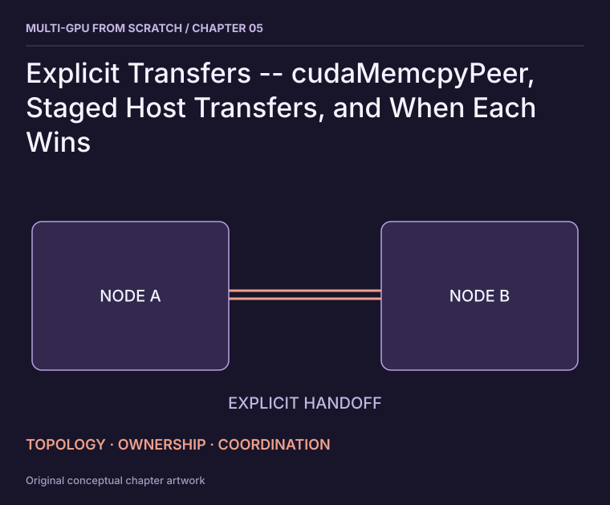
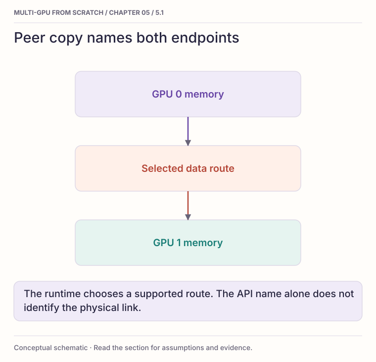
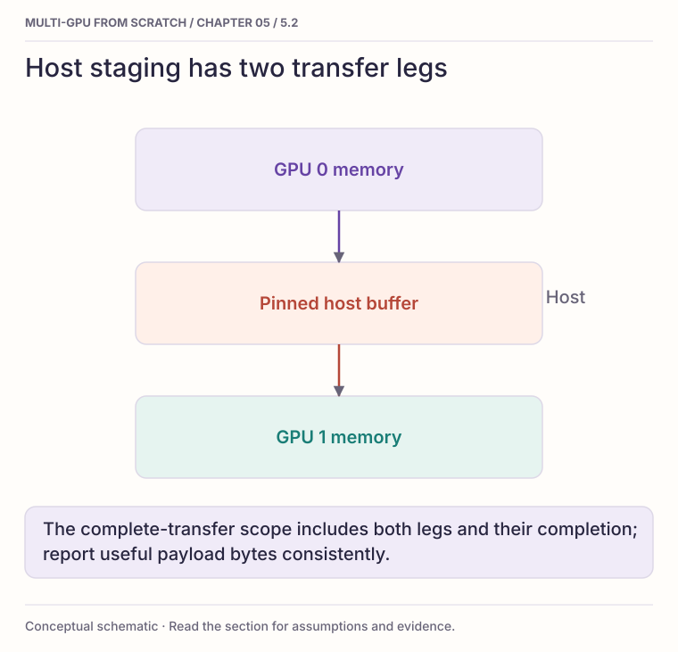

# Chapter 5: Explicit Transfers -- cudaMemcpyPeer, Staged Host Transfers, and When Each Wins

<!-- mgpu:opener:start -->
[](../images/chapter-openers/05.svg)
<!-- mgpu:opener:end -->

**What you will understand by the end of this chapter:**

- The two ways to copy between devices: the dedicated Runtime API call `cudaMemcpyPeer()`, which names both devices explicitly, and the ordinary `cudaMemcpy()` with `cudaMemcpyDeviceToDevice` or `cudaMemcpyDefault`, which works for peer copies too under Unified Virtual Addressing.
- What the documentation says a peer copy falls back to, silently, whenever peer access between two devices has not been enabled -- staging through the host -- and why writing that fallback out explicitly, by hand, at least once is worth doing.
- How to reason quantitatively about which route wins, using only this book's own already-cited hardware bandwidth figures rather than any new fabricated timing.

**What you need to know first:**

- Chapter 4's Unified Virtual Addressing and peer-access setup sequence (`cudaDeviceCanAccessPeer()` / `cudaDeviceEnablePeerAccess()`), and its host-side simulation of correct P2P routing logic.
- Chapter 2's PCIe and NVLink bandwidth figures and partial-mesh topology model.
- Ordinary C++ and the CUDA Runtime API calls from Chapters 1-4. No new CUDA concepts beyond this chapter's own two functions.

---

Chapter 4 established *whether* two devices are allowed to touch each other's memory directly. This chapter is about the calls that actually move the bytes once that permission exists -- and, just as importantly, about what happens when it doesn't. CUDA gives cross-device copies a dedicated function, `cudaMemcpyPeer()`, alongside the ordinary `cudaMemcpy()` interface (which also handles peer copies), and a peer copy's behavior quietly changes shape depending on Chapter 4's peer-access state: fast and direct when peer access is enabled, staged through the host and slower when it isn't, with the same function signature either way. This chapter makes both paths concrete, and then asks the question a real multi-GPU program actually has to answer: given a specific pair of devices and a specific topology, which route wins, and by how much?

## 5.1 cudaMemcpyPeer: The Dedicated Cross-Device Copy Call

<!-- mgpu:figure-1:start -->
[](../images/technical/ch05/1-transfer.svg)
<!-- mgpu:figure-1:end -->

### Intuition

`cudaMemcpy()` with `cudaMemcpyDefault` (Chapter 4) can infer a copy's direction because UVA makes every pointer's owner identifiable, and that includes a copy whose source and destination live on two different devices. The CUDA Programming Guide says so directly: on systems with unified addressing, a peer copy can be done with the ordinary `cudaMemcpy()` using `cudaMemcpyDeviceToDevice` or `cudaMemcpyDefault`, not only with the dedicated peer functions. CUDA also provides an explicit call, `cudaMemcpyPeer()`, that names both devices directly instead of leaving the runtime to work them out from the pointers. This chapter uses `cudaMemcpyPeer()` because naming the two devices keeps the cross-device nature of the copy visible in the code, but either way the route the bytes take depends on Chapter 4's peer-access state, which is per-pair, queryable, and can change at runtime. One copy, two very different execution paths underneath, chosen automatically based on whether Chapter 4's setup sequence has already run for that specific ordered pair.

### Background

`cudaMemcpyPeer(dst, dstDevice, src, srcDevice, count)` copies `count` bytes from `src` on `srcDevice` to `dst` on `dstDevice`. Per the CUDA Runtime API documentation, this call "is asynchronous with respect to the host, but serialized with respect [to] all pending and future asynchronous work in the current device, `srcDevice`, and `dstDevice`" -- meaning it returns to the host immediately, but the copy itself still waits its turn against other work already queued on any of the three devices involved. `cudaMemcpyPeerAsync()` adds an explicit stream argument for finer-grained ordering against other stream-issued work, the same stream-ordering model Chapter 3 introduced. Crucially, the CUDA Programming Guide's multi-GPU chapter states plainly what determines the actual route taken: "If peer-to-peer access is enabled between two devices, ... peer-to-peer memory copies between these two devices no longer need to be staged through the host and are therefore faster." The function signature and its performance are two separate questions -- the call always works the same way from the caller's side; only its internal routing depends on Chapter 4's state.

```cpp
// Chapter 5: checked synchronous and asynchronous peer transfers.
// 11_memcpy_peer.cu
#include <cstdio>
#include <vector>
#include <cuda_runtime.h>
#define CUDA(call) do { cudaError_t status = (call); if (status != cudaSuccess) { \
    fprintf(stderr, "%s: %s\n", #call, cudaGetErrorString(status)); \
    return status == cudaErrorNoDevice || status == cudaErrorInsufficientDriver ? 2 : 1; } } while (0)
int main() {
    int count = 0;
    CUDA(cudaGetDeviceCount(&count));
    if (count < 2) { printf("BLOCKED: requires 2 GPUs; found %d.\n", count); return 2; }
    const int n = 4096;
    const size_t bytes = n * sizeof(float);
    std::vector<float> input(n), output(n);
    for (int i = 0; i < n; ++i) input[i] = float((i * 17) % 4093 - 2046) / 8.0f;
    float *source = nullptr, *destination = nullptr;
    CUDA(cudaSetDevice(0));
    CUDA(cudaMalloc(&source, bytes));
    CUDA(cudaMemcpy(source, input.data(), bytes, cudaMemcpyHostToDevice));
    CUDA(cudaSetDevice(1));
    CUDA(cudaMalloc(&destination, bytes));
    CUDA(cudaMemset(destination, 0, bytes));
    CUDA(cudaMemcpyPeer(destination, 1, source, 0, bytes));
    CUDA(cudaDeviceSynchronize());
    CUDA(cudaMemcpy(output.data(), destination, bytes, cudaMemcpyDeviceToHost));
    for (int i = 0; i < n; ++i) if (output[i] != input[i]) {
        fprintf(stderr, "FAIL: synchronous payload[%d]\n", i); return 1;
    }
    // Reverse direction, after poisoning the original buffer, exercises Async.
    CUDA(cudaSetDevice(0));
    CUDA(cudaMemset(source, 0, bytes));
    cudaStream_t stream = nullptr;
    CUDA(cudaStreamCreate(&stream));
    CUDA(cudaMemcpyPeerAsync(source, 0, destination, 1, bytes, stream));
    CUDA(cudaStreamSynchronize(stream));
    CUDA(cudaMemcpy(output.data(), source, bytes, cudaMemcpyDeviceToHost));
    for (int i = 0; i < n; ++i) if (output[i] != input[i]) {
        fprintf(stderr, "FAIL: asynchronous payload[%d]\n", i); return 1;
    }
    CUDA(cudaStreamDestroy(stream));
    CUDA(cudaFree(source));
    CUDA(cudaSetDevice(1));
    CUDA(cudaFree(destination));
    printf("PASS: 4096 nonuniform values verified in both peer-copy directions.\n");
    printf("Copy success does not identify the physical transfer route or bandwidth.\n");
    return 0;
}
```

<!-- execution:start:a100:11_memcpy_peer.cu -->
> **Compiled and executed — 2026-11-17-a100: Numerical/transport validation (recorded scope).** Hardware: 8 A100 GPUs. Executed UTC: `2026-11-18T00:00:38.026827+00:00`.

<!-- execution:metadata Source SHA-256: f8151f3549665a26fc20ba93fea9ba286120e625b4991dc8342e8c3ee030a299; recorded UTC (program start): 2026-11-18T00:00:36.659156+00:00 -->

[Exact tested source](../validation/2026-11-17-a100/11_memcpy_peer/11_memcpy_peer.cu) · [Compiler log](../validation/2026-11-17-a100/11_memcpy_peer/compile.log) · [Execution log](../validation/2026-11-17-a100/11_memcpy_peer/run.log). Compile exit: `0`; run exit: `0`.

Commands below use local source/binary names; raw logs retain host paths. Execute in a scratch directory containing the downloaded source.

```bash
nvcc -std=c++17 -O2 -arch=sm_80 11_memcpy_peer.cu -o ./example
./example
```

**Sample output**

```text
PASS: 4096 nonuniform values verified in both peer-copy directions.
Copy success does not identify the physical transfer route or bandwidth.
```


<!-- execution:end:a100:11_memcpy_peer.cu -->


<!-- execution:start:h100:11_memcpy_peer.cu -->
> **Compiled and executed — 2026-11-17-h100: Numerical/transport validation (recorded scope).** Hardware: 2 H100 GPUs. Execution record UTC (run-batch start; per-program time unrecorded): `2026-11-17T23:48:18.967387+00:00`.

<!-- execution:metadata Source SHA-256: f8151f3549665a26fc20ba93fea9ba286120e625b4991dc8342e8c3ee030a299; recorded UTC (run-batch start; per-program time unrecorded): 2026-11-17T23:48:18.967387+00:00 -->

[Exact tested source](../validation/2026-11-17-h100/11_memcpy_peer/11_memcpy_peer.cu) · [Compiler log](../validation/2026-11-17-h100/11_memcpy_peer/compile.log) · [Execution log](../validation/2026-11-17-h100/11_memcpy_peer/run.log). Compile exit: `0`; run exit: `0`.

Commands below use local source/binary names; raw logs retain host paths. Execute in a scratch directory containing the downloaded source.

```bash
nvcc -std=c++17 -O2 -arch=sm_90 11_memcpy_peer.cu -o ./example
./example
```

<details markdown="1"><summary>Captured current-source output</summary>

```text
PASS: 4096 nonuniform values verified in both peer-copy directions.
Copy success does not identify the physical transfer route or bandwidth.
```

</details>
<!-- execution:end:h100:11_memcpy_peer.cu -->


The [2026-11-17 H100 execution record](../validation-h100.md) covers two GPUs connected by local NV18. It distinguishes numerical checks, API probes and other executions; a successful exit alone does not establish GPU algorithm correctness.

The current File 11 initializes data, checks actual peer copies and validates the destination on H100. Earlier no-device diagnostics established neither allocation nor data movement.

The [2026-11-17 H100 execution record](../validation-h100.md) covers two GPUs connected by local NV18. It distinguishes numerical checks, API probes and other executions; a successful exit alone does not establish GPU algorithm correctness.

!!! warning "[COMMON TRAP] Assuming cudaMemcpyPeer() itself tells you whether the fast path was used"
    `cudaMemcpyPeer()` returns `cudaSuccess` whether it took the direct peer route or silently fell back to staging through the host -- the function's return value reports *correctness*, not *which mechanism ran*. There is no flag in its signature that reports back which path was taken. The only way to know is to have already checked `cudaDeviceCanAccessPeer()` (Chapter 4, Section 4.2) for that exact ordered pair *before* calling it -- the copy's success tells you the data arrived; it says nothing about how.

## 5.2 Staged Host Transfers: The Fallback, Made Explicit

<!-- mgpu:figure-2:start -->
[](../images/technical/ch05/2-staging.svg)
<!-- mgpu:figure-2:end -->

### Intuition

Section 5.1 quoted the documentation's own description of what happens when peer access isn't enabled: the copy is "staged through the host." That phrase describes a real, ordinary two-step process -- copy the source device's data to a host buffer, then copy that host buffer to the destination device -- using nothing more exotic than two calls this book already introduced in Chapter 3 and 4. Writing that fallback out explicitly, by hand, rather than only invoking it implicitly inside `cudaMemcpyPeer()`, makes concrete exactly what "staged" costs: two separate transfers over the host's PCIe links, each moving the *entire* payload, rather than one transfer over whatever direct link (if any) connects the two devices.

### Background

The staged pattern is two ordinary `cudaMemcpy()` calls with a host buffer as the waypoint: `cudaMemcpy(hostBuffer, srcDevicePtr, bytes, cudaMemcpyDeviceToHost)` followed by `cudaMemcpy(dstDevicePtr, hostBuffer, bytes, cudaMemcpyHostToDevice)`. This is the book's model of what the documentation calls being "staged through the host": the same two hops, device to host and host to device, made visible instead of hidden inside one function call. It is a model, not a copy of the driver's internals, which are not documented; a driver is free to pipeline the two hops in smaller chunks so they overlap, so treat the full two-transfer cost as an upper bound on what the hidden fallback costs. Using a pinned (`cudaMallocHost()`-allocated) host buffer as the waypoint matters here because a pinned allocation is a fixed, DMA-eligible physical address the driver can transfer to and from directly, rather than a page the OS might need to fault in or relocate mid-copy.

```cpp
// 12_staged_host_transfer.cu
// Checked teaching implementation; serial host scheduling favors clarity, not speed.
#include <cstdio>
#include <vector>
#include <algorithm>
#include <cuda_runtime.h>
#define CUDA(call) do { cudaError_t status = (call); if (status != cudaSuccess) { \
 fprintf(stderr,"%s: %s\n",#call,cudaGetErrorString(status)); \
 return status==cudaErrorNoDevice || status==cudaErrorInsufficientDriver ? 2 : 1; } } while(0)
int main(){
 int count=0;CUDA(cudaGetDeviceCount(&count));if(count<2){printf("BLOCKED: requires 2 GPUs; found %d.\n",count);return 2;}
 const int n=4096;const size_t bytes=n*sizeof(float);std::vector<float> input(n),output(n);
 for(int i=0;i<n;++i)input[i]=float((i*17)%4093-2046)/8.0f;
 float *source=nullptr,*destination=nullptr,*staging=nullptr;
 CUDA(cudaSetDevice(0));CUDA(cudaMalloc(&source,bytes));CUDA(cudaMemcpy(source,input.data(),bytes,cudaMemcpyHostToDevice));CUDA(cudaMallocHost(&staging,bytes));
 CUDA(cudaMemcpy(staging,source,bytes,cudaMemcpyDeviceToHost));
 CUDA(cudaSetDevice(1));CUDA(cudaMalloc(&destination,bytes));CUDA(cudaMemset(destination,0,bytes));CUDA(cudaMemcpy(destination,staging,bytes,cudaMemcpyHostToDevice));CUDA(cudaMemcpy(output.data(),destination,bytes,cudaMemcpyDeviceToHost));
 for(int i=0;i<n;++i)if(output[i]!=input[i]){fprintf(stderr,"FAIL staged transfer[%d]\n",i);return 1;}
 CUDA(cudaFree(destination));CUDA(cudaSetDevice(0));CUDA(cudaFree(source));CUDA(cudaFreeHost(staging));
 printf("PASS: 4096 nonuniform values verified through explicit pinned-host staging.\n");return 0;
}
```

<!-- execution:start:a100:12_staged_host_transfer.cu -->
> **Compiled and executed — 2026-11-17-a100: Numerical/transport validation (recorded scope).** Hardware: 8 A100 GPUs. Executed UTC: `2026-11-18T00:00:42.867890+00:00`.

<!-- execution:metadata Source SHA-256: e3d7e938f375c28fbb2bffba8013cb7347447bbca26ea1bac4f61207be4683de; recorded UTC (program start): 2026-11-18T00:00:41.399876+00:00 -->

[Exact tested source](../validation/2026-11-17-a100/12_staged_host_transfer/12_staged_host_transfer.cu) · [Compiler log](../validation/2026-11-17-a100/12_staged_host_transfer/compile.log) · [Execution log](../validation/2026-11-17-a100/12_staged_host_transfer/run.log). Compile exit: `0`; run exit: `0`.

Commands below use local source/binary names; raw logs retain host paths. Execute in a scratch directory containing the downloaded source.

```bash
nvcc -std=c++17 -O2 -arch=sm_80 12_staged_host_transfer.cu -o ./example
./example
```

**Sample output**

```text
PASS: 4096 nonuniform values verified through explicit pinned-host staging.
```


<!-- execution:end:a100:12_staged_host_transfer.cu -->


<!-- execution:start:h100:12_staged_host_transfer.cu -->
> **Compiled and executed — 2026-11-17-h100: Numerical/transport validation (recorded scope).** Hardware: 2 H100 GPUs. Execution record UTC (run-batch start; per-program time unrecorded): `2026-11-17T23:48:18.967387+00:00`.

<!-- execution:metadata Source SHA-256: e3d7e938f375c28fbb2bffba8013cb7347447bbca26ea1bac4f61207be4683de; recorded UTC (run-batch start; per-program time unrecorded): 2026-11-17T23:48:18.967387+00:00 -->

[Exact tested source](../validation/2026-11-17-h100/12_staged_host_transfer/12_staged_host_transfer.cu) · [Compiler log](../validation/2026-11-17-h100/12_staged_host_transfer/compile.log) · [Execution log](../validation/2026-11-17-h100/12_staged_host_transfer/run.log). Compile exit: `0`; run exit: `0`.

Commands below use local source/binary names; raw logs retain host paths. Execute in a scratch directory containing the downloaded source.

```bash
nvcc -std=c++17 -O2 -arch=sm_90 12_staged_host_transfer.cu -o ./example
./example
```

<details markdown="1"><summary>Captured current-source output</summary>

```text
PASS: 4096 nonuniform values verified through explicit pinned-host staging.
```

</details>
<!-- execution:end:h100:12_staged_host_transfer.cu -->


The [2026-11-17 H100 execution record](../validation-h100.md) covers two GPUs connected by local NV18. It distinguishes numerical checks, API probes and other executions; a successful exit alone does not establish GPU algorithm correctness.

File 12 initializes and checks both stages of the actual host-staged H100 transfer. The route requires two full-payload copies and an intermediate host buffer; the cost model below remains distinct from a measured bandwidth benchmark.

!!! warning "[COMMON TRAP] Believing the staged fallback moves half the data each hop"
    Both steps in this section's code copy the *entire* `BYTES`-sized payload -- step 1 moves all of it device-to-host, and step 2 moves all of it again host-to-device. There is no sense in which the two hops split the work; the staged path pays the *full* transfer cost twice, once per hop, which is exactly why Section 5.3's cost model below counts it as `2 * (size / bandwidth)` rather than a single transfer split across two links.

## 5.3 When Each Wins: Peer Access, Topology, and the Real Cost of Staging

### Intuition

Section 5.1 and 5.2 established the two mechanisms; now the actual question a real program has to answer: for a given pair of devices, is the direct peer route worth checking for, or is staging good enough? The honest answer only needs numbers this book has already sourced and cited -- Chapter 2's real PCIe and NVLink bandwidth figures -- arranged into the two routes' costs. No new hardware measurement is needed, and none is fabricated: this is a closed-form arithmetic comparison, exactly like Chapter 2's own ring-bottleneck model.

### Background

The staged route always pays the PCIe rate twice, for the reason Section 5.2's Common Trap just established: `2 * (size / PCIE_GBPS)`. The peer-direct route pays whichever direct link actually connects the two devices exactly once: the NVLink figure if the pair is wired (Chapter 2's partial-mesh model), or the PCIe figure if their only direct connection is PCIe itself. Reusing this book's own already-cited numbers -- PCIe 4.0 x16 at 31.5 GB/s, and a direct wired NVLink pair at 50 GB/s (both from Chapter 2's topology chapter) -- turns "which route wins" into one division per route.

```cpp
// Chapter 5: Explicit Transfers -- cudaMemcpyPeer, Staged Host Transfers,
// and When Each Wins
// 13_when_each_wins_model.cpp
//
// Plain host C++ cost model, reusing this book's own already-cited
// bandwidth figures (Chapter 2, docs/part0/02-multi-gpu-hardware-topology.md):
// PCIe 4.0 x16 per-direction bandwidth (31.5 GB/s) and a direct, wired
// NVLink connection in a partial-mesh topology (50 GB/s). This is a
// closed-form arithmetic model of transfer TIME, not a measurement of
// real hardware -- it answers "which route wins, and by how much" using
// numbers this book has already sourced and cited, not new fabricated
// timings.
#include <cstdio>

int main() {
    const double PCIE_GBPS = 31.5;   // direct PCIe 4.0 x16, per direction
    const double NVLINK_GBPS = 50.0; // direct wired NVLink pair, partial mesh

    const double transferSizeGB = 1.0;

    // Peer-direct route: one hop, over whichever direct link exists.
    // If the pair is NVLink-wired, that's the NVLink figure; if the
    // pair's only direct link is PCIe, that's the PCIe figure.
    double peerTimeNVLink = transferSizeGB / NVLINK_GBPS;
    double peerTimePCIe   = transferSizeGB / PCIE_GBPS;

    // Staged route: two hops through the host, device->host and
    // host->device, each paying the PCIe rate -- the call pattern
    // Section 5.2's explicit two-step transfer exercises. This is the
    // book's cost model for cudaMemcpyPeer's staged fallback, an upper
    // bound: the driver's internal staging is undocumented and may
    // pipeline the two hops, which would bring the real cost below 2x.
    double stagedTime = 2.0 * (transferSizeGB / PCIE_GBPS);

    printf("Transfer size: %.1f GB\n\n", transferSizeGB);
    printf("Peer-direct route, NVLink-wired pair:   %.6f s (%.1f GB/s, one hop)\n",
           peerTimeNVLink, NVLINK_GBPS);
    printf("Peer-direct route, PCIe-only direct pair: %.6f s (%.1f GB/s, one hop)\n",
           peerTimePCIe, PCIE_GBPS);
    printf("Staged host route (any pair):            %.6f s (%.1f GB/s, two hops)\n\n",
           stagedTime, PCIE_GBPS);

    double speedupNVLinkVsStaged = stagedTime / peerTimeNVLink;
    double speedupPCIeDirectVsStaged = stagedTime / peerTimePCIe;

    printf("Peer-direct over NVLink is %.4fx faster than staging, for a wired pair.\n",
           speedupNVLinkVsStaged);
    printf("Peer-direct over a direct PCIe link is %.4fx faster than staging,\n"
           "for a pair with a direct PCIe route but no NVLink wire.\n",
           speedupPCIeDirectVsStaged);
    printf("\nWhen the pair has NO direct link at all (per Chapter 2's partial-mesh\n"
           "topology), peer access cannot be enabled between them in the first\n"
           "place (Chapter 4, Section 4.2) -- staging is then not merely faster\n"
           "or slower, it is the ONLY route that exists.\n");

    return 0;
}
```

<!-- execution:start:a100:13_when_each_wins_model.cpp -->
> **Compiled and executed — 2026-11-17-a100: Host program/model (exit-only).** Hardware: 8 A100 GPUs. Executed UTC: `2026-11-18T00:00:46.325713+00:00`.

<!-- execution:metadata Source SHA-256: 7cc3ed42964e58119cd17db7fe9a35602c88ab0b87905dba6216d6bdb86f6c46; recorded UTC (program start): 2026-11-18T00:00:46.260513+00:00 -->

[Exact tested source](../validation/2026-11-17-a100/13_when_each_wins_model/13_when_each_wins_model.cpp) · [Compiler log](../validation/2026-11-17-a100/13_when_each_wins_model/compile.log) · [Execution log](../validation/2026-11-17-a100/13_when_each_wins_model/run.log). Compile exit: `0`; run exit: `0`.

Commands below use local source/binary names; raw logs retain host paths. Execute in a scratch directory containing the downloaded source.

```bash
g++ -std=c++17 -O2 13_when_each_wins_model.cpp -o ./example
./example
```

**Sample output**

```text
Transfer size: 1.0 GB

Peer-direct route, NVLink-wired pair:   0.020000 s (50.0 GB/s, one hop)
Peer-direct route, PCIe-only direct pair: 0.031746 s (31.5 GB/s, one hop)
Staged host route (any pair):            0.063492 s (31.5 GB/s, two hops)

Peer-direct over NVLink is 3.1746x faster than staging, for a wired pair.
Peer-direct over a direct PCIe link is 2.0000x faster than staging,
for a pair with a direct PCIe route but no NVLink wire.

When the pair has NO direct link at all (per Chapter 2's partial-mesh
topology), peer access cannot be enabled between them in the first
place (Chapter 4, Section 4.2) -- staging is then not merely faster
or slower, it is the ONLY route that exists.
```


<!-- execution:end:a100:13_when_each_wins_model.cpp -->


<!-- execution:start:h100:13_when_each_wins_model.cpp -->
> **Compiled and executed — 2026-11-17-h100: Host program/model (exit-only).** Hardware: 2 H100 GPUs. Execution record UTC (run-batch start; per-program time unrecorded): `2026-11-17T23:48:18.967387+00:00`.

<!-- execution:metadata Source SHA-256: 7cc3ed42964e58119cd17db7fe9a35602c88ab0b87905dba6216d6bdb86f6c46; recorded UTC (run-batch start; per-program time unrecorded): 2026-11-17T23:48:18.967387+00:00 -->

[Exact tested source](../validation/2026-11-17-h100/13_when_each_wins_model/13_when_each_wins_model.cpp) · [Compiler log](../validation/2026-11-17-h100/13_when_each_wins_model/compile.log) · [Execution log](../validation/2026-11-17-h100/13_when_each_wins_model/run.log). Compile exit: `0`; run exit: `0`.

Commands below use local source/binary names; raw logs retain host paths. Execute in a scratch directory containing the downloaded source.

```bash
g++ -std=c++17 -O2 13_when_each_wins_model.cpp -o ./example
./example
```

<details markdown="1"><summary>Captured current-source output</summary>

```text
Transfer size: 1.0 GB

Peer-direct route, NVLink-wired pair:   0.020000 s (50.0 GB/s, one hop)
Peer-direct route, PCIe-only direct pair: 0.031746 s (31.5 GB/s, one hop)
Staged host route (any pair):            0.063492 s (31.5 GB/s, two hops)

Peer-direct over NVLink is 3.1746x faster than staging, for a wired pair.
Peer-direct over a direct PCIe link is 2.0000x faster than staging,
for a pair with a direct PCIe route but no NVLink wire.

When the pair has NO direct link at all (per Chapter 2's partial-mesh
topology), peer access cannot be enabled between them in the first
place (Chapter 4, Section 4.2) -- staging is then not merely faster
or slower, it is the ONLY route that exists.
```

</details>
<!-- execution:end:h100:13_when_each_wins_model.cpp -->


In this model, peer-direct wins whenever it's *available* -- by a factor of 2x when the direct link is itself PCIe (the model's staging pays that same rate twice, an upper bound since real staging may overlap the two hops), and by a larger 3.17x when the direct link is a faster NVLink wire. But "when each wins" has a sharper answer than a speed comparison alone: peer-direct is only ever a *choice* to make when Chapter 4's `cudaDeviceCanAccessPeer()` already says the pair has a direct link at all. When it doesn't, there is no decision to make -- staging isn't the slower option, it's the only one.

!!! warning "[COMMON TRAP] Treating this cost model's numbers as real, measured transfer times"
    Every figure in this section's output is a closed-form arithmetic result from bandwidth numbers Chapter 2 already sourced and cited to real vendor documentation -- not a timing measurement taken on real hardware. Real transfer time also includes fixed per-call latency, driver overhead, and whatever else is competing for the same link, none of which this simple `size / bandwidth` model captures. This model answers "which route is structurally faster, and by roughly what multiple" honestly and exactly -- it does not, and cannot, stand in for benchmarking a real transfer on real GPUs.

## Chapter Summary

`cudaMemcpyPeer()` is CUDA's dedicated cross-device copy call, and per the CUDA Programming Guide's own words, its routing -- direct or staged through the host -- depends entirely on whether Chapter 4's peer-access permission has already been granted for that specific ordered pair, with the function's return value reporting only correctness, never which path ran (Section 5.1). The staged fallback, written out explicitly in Section 5.2 as two ordinary `cudaMemcpy()` calls through a pinned host buffer, makes concrete the book's cost model for staging: the full transfer cost paid twice, once per hop, an upper bound since the driver's undocumented internal staging may overlap the hops. Putting real, already-cited numbers into that shape (Section 5.3) shows peer-direct winning by up to 2x to 3.17x in that model whenever it's available, but also reframes the real question: peer-direct is a choice only when the specific pair supports peer access; when it doesn't, staging is not the slower option but the only one. Chapter 6 builds directly on this by bringing streams and events into the picture -- overlapping a transfer like this chapter's with concurrent kernel execution, and synchronizing correctly across devices when that overlap is in play.

## Self-Check Questions

1. `cudaMemcpyPeer()` returns `cudaSuccess` in both of the following cases: peer access was enabled and the copy went direct, and peer access was not enabled and the copy was staged through the host. What, if anything, in the function's return value tells the caller which case occurred?
2. Section 5.2's staged transfer uses a pinned (`cudaMallocHost()`-allocated) host buffer rather than an ordinary `new`-allocated one. Explain, in your own words, why the physical-address stability of a pinned allocation matters for a DMA-based transfer.
3. Suppose a payload is 2 GB instead of Section 5.3's 1 GB. Using the same bandwidth figures, compute the new staged-route time and the new peer-direct-over-NVLink time. Does the speedup ratio between them change? Why or why not?
4. Section 5.3's model treats the peer-direct route's bandwidth as either the NVLink figure or the PCIe figure, never something in between. Referencing Chapter 2's partial-mesh topology, explain why there is no meaningful "in between" bandwidth for a specific ordered pair of devices.
5. A programmer concludes: "peer-direct access is always the better choice, so I'll always call `cudaDeviceEnablePeerAccess()` for every pair before transferring." Using this chapter's own conclusion, explain what's incomplete about that plan.
6. Section 5.2's code performs two separate `cudaMemcpy()` calls. If a third device were introduced and the data needed to go from device 0 to device 2 by way of being staged through device 1's memory instead of the host, would that still be a "staged" transfer in the sense this chapter uses the term? Explain the distinction.
7. Why does this chapter's cost model (Section 5.3) reuse Chapter 2's bandwidth figures rather than deriving new ones, and why is that a better choice than fabricating a plausible-sounding timing number?
8. Reasoning about what a real transfer involves beyond the cost model's `size / bandwidth` arithmetic, name one reason a real device's *achieved* bandwidth for a staged transfer could come in below the theoretical PCIe rate this chapter's model assumes.

## Where We Go Next

Chapter 6 introduces streams and events as the mechanism for overlapping a transfer -- either of this chapter's two routes -- with concurrent kernel execution on the same or a different device, and for synchronizing correctly across devices once operations are running concurrently rather than one at a time.

## Worked Solutions

**1.** Nothing. `cudaMemcpyPeer()`'s return value (a `cudaError_t`) reports API success or failure, not the internal route or device-side completion. `cudaDeviceCanAccessPeer()` establishes eligibility, not an achieved-bandwidth measurement. Synchronize the relevant work before validating the destination, and profile when route attribution matters.

**2.** A DMA (direct memory access) transfer engine reads or writes host memory using physical addresses, programmed once at the start of the transfer. If the underlying page could be moved or swapped out mid-transfer -- which an ordinary, non-pinned allocation permits, since the OS is free to relocate it -- the DMA engine's already-programmed physical address would become invalid partway through. A pinned (page-locked) allocation is guaranteed by the OS not to move or be paged out for as long as it's pinned, so its physical address stays valid for the DMA engine's entire operation.

**3.** Staged time doubles to `2 * (2.0/31.5) = 0.126984` s, and peer-direct-over-NVLink time doubles to `2.0/50.0 = 0.04` s. The speedup ratio (`stagedTime / peerTimeNVLink`) stays exactly the same, `3.1746`, because both times scaled by the identical factor (2x the data), and that common factor cancels out of the ratio -- the *relative* advantage of peer-direct over staging depends only on the bandwidth figures, not on the transfer size.

**4.** In Chapter 2's partial-mesh topology, a specific ordered pair of devices either has a direct wired NVLink connection between them or it doesn't -- there is no partial, intermediate wiring state for one specific pair. The pair's peer-direct bandwidth is therefore always exactly one of the two discrete figures (NVLink if wired, PCIe if the only direct route is PCIe), never an average or blend of the two, because a "half-wired" link isn't a real hardware configuration.

**5.** Chapter 4's Section 4.2 established that `cudaDeviceEnablePeerAccess()` only succeeds (or is even meaningful to call) between pairs where `cudaDeviceCanAccessPeer()` already returns true -- meaning a supported peer-memory route exists. Calling it "for every pair" doesn't create a link that doesn't exist; between pairs without supported peer access, the enable call itself does nothing useful, and the program still has to use the staged route for those pairs regardless of intent. Peer access can traverse supported PCIe switches or NVSwitch; it does not require a dedicated point-to-point cable. Capability queries determine eligibility, while profiling determines the achieved route and bandwidth.

**6.** No -- this chapter's term "staged" specifically means routed *through host memory*, which is what `cudaMemcpy(..., cudaMemcpyDeviceToHost)` followed by `cudaMemcpy(..., cudaMemcpyHostToDevice)` does. A transfer from device 0 to device 2 that goes by way of device 1's memory (rather than the host's) would be a different thing entirely -- a multi-hop device-to-device relay, which Chapter 2's ring-bottleneck model already discussed in a different context (Section 2.4) and which this chapter's two functions don't perform on their own.

**7.** Chapter 2's figures were already sourced from real vendor documentation (PCIe and NVLink specification tables) and cited at the end of that chapter -- reusing them keeps this chapter's numbers traceable to the same real sources rather than introducing a second, unverified data point. Fabricating a plausible-sounding timing number instead would break this book's own stated honesty discipline: every number in this book is either a genuine, verified program output or a real, cited fact, and a made-up transfer time would be neither.

**8.** A real transfer's achieved bandwidth depends on factors this simple `size / bandwidth` model doesn't include (this is the book's own reasoning, not a quoted documentation claim) -- for example, fixed per-transfer latency overhead that matters more for small transfers, and contention from other traffic sharing the same PCIe root complex or switch at the same time (Chapter 2's own same-switch-vs-cross-socket distinction already showed shared links being a real, modeled cost). A real transfer's *achieved* rate is a ceiling this model's theoretical rate can approach but a real system rarely reaches under contention.

---

**Sources cited in this chapter:**

- [CUDA Programming Guide — Multi-GPU Systems](https://docs.nvidia.com/cuda/cuda-programming-guide/03-advanced/multi-gpu-systems.html) -- peer-to-peer copies no longer needing to be staged through the host once peer access is enabled; the four dedicated peer-copy functions (`cudaMemcpyPeer`, `cudaMemcpyPeerAsync`, `cudaMemcpy3DPeer`, `cudaMemcpy3DPeerAsync`), and that peer copies can equally use plain `cudaMemcpy()` with `cudaMemcpyDeviceToDevice` or `cudaMemcpyDefault`.
- [CUDA Runtime API Reference — Memory Management (`cudaMemcpyPeer`)](https://docs.nvidia.com/cuda/archive/12.8.0/cuda-runtime-api/group__CUDART__MEMORY.html) -- `cudaMemcpyPeer()` signature and its "asynchronous with respect to the host, but serialized" behavior.
- [CUDA Programming Guide — Asynchronous Execution](https://docs.nvidia.com/cuda/cuda-programming-guide/02-basics/asynchronous-execution.html) -- pinned/page-locked host memory as the requirement for genuinely asynchronous transfers.
- Chapter 2 of this book ("Multi-GPU Hardware Topology: PCIe, NVLink, and NVSwitch") -- the PCIe 4.0 x16 (31.5 GB/s) and direct wired NVLink (50 GB/s) figures this chapter's cost model reuses, themselves cited to real vendor sources in that chapter.
