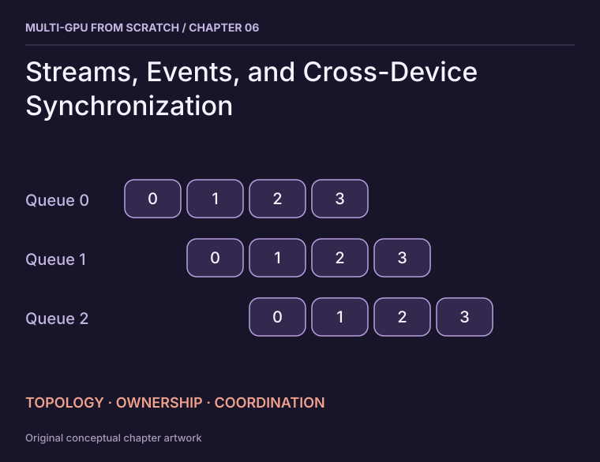
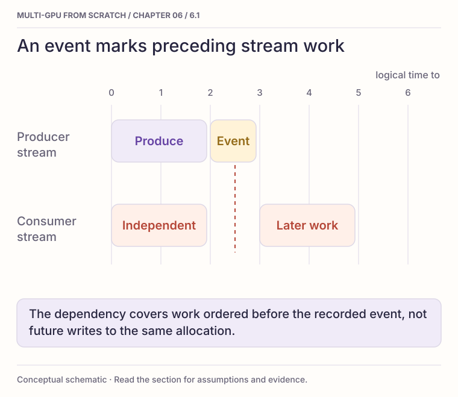
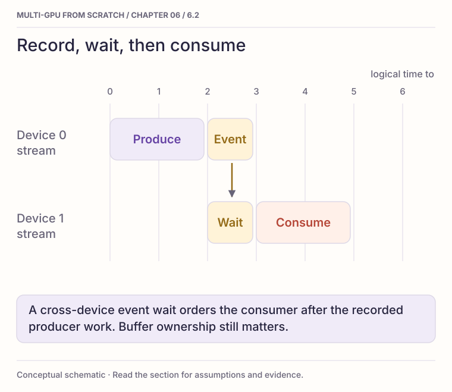

# Chapter 6: Streams, Events, and Cross-Device Synchronization

<!-- mgpu:opener:start -->
[](../images/chapter-openers/06.svg)
<!-- mgpu:opener:end -->

**What you will understand by the end of this chapter:**

- What a CUDA event actually is -- a marker placed into a stream, not a timer that starts running the moment you create it -- and which calls on it block and which don't.
- Why `cudaStreamWaitEvent()`, not `cudaDeviceSynchronize()`, is the real mechanism for making one device's work depend on another's, and why that distinction matters for how much concurrency a multi-GPU program keeps.
- What the CUDA Runtime API can honestly report, right now, about whether a real device is even physically capable of overlapping a data transfer with kernel execution -- and why that capability has to exist before any amount of clever stream arrangement can produce overlap.

**What you need to know first:**

- Chapter 3's streams (creation, device binding, the multi-device loop pattern) and Chapter 5's transfer calls (`cudaMemcpyPeer()`, the staged host fallback).
- Chapter 3's per-thread current-device state and Chapter 2's topology models, referenced again here.
- No new CUDA concepts beyond this chapter's own two APIs (events, and the two device-attribute queries in Section 6.3).

---

Chapters 3 and 5 gave this book streams (an ordered queue of work bound to whichever device was current when the stream was created) and real cross-device copies. What's been missing is a way for work on *one* stream -- possibly on a different device entirely -- to depend on work in *another* stream, without forcing the host to stop and wait, and without forcing an entire device to drain before continuing. That's what events are for. This chapter builds the real dependency-tracking mechanism multi-GPU CUDA code actually uses, and closes with the one thing that has to be true about the hardware itself before any of it can produce real overlap: whether the device has an async copy engine and concurrent-kernel support at all.

## 6.1 Events: Markers, Polling, and Completion

<!-- mgpu:figure-1:start -->
[](../images/technical/ch06/1-events.svg)
<!-- mgpu:figure-1:end -->

### Intuition

An event is not a stopwatch you start -- it's a flag you plant at a specific point in a specific stream's queue of work. Planting the flag (`cudaEventRecord()`) doesn't pause anything; the stream keeps moving, and the flag simply becomes "reached" once every operation queued before it in that stream has actually finished. Everything interesting happens on the *other* side: something else -- another stream, or the host itself -- can ask "has that flag been reached yet?" either by polling (a quick, non-blocking check) or by genuinely waiting for it. Event creation and recording also have overhead. Disable timing for dependency-only events; waits can introduce further stalls.

### Background

`cudaEventCreate(&event)` allocates the event object. `cudaEventRecord(event, stream)` places it into a specific stream's queue -- it enqueues a marker without waiting for that marker’s device completion; API calls may still block for internal resource management. Two different ways exist to ask whether it's been reached: `cudaEventQuery(event)`, which checks once and returns immediately either way (`cudaSuccess` if reached, `cudaErrorNotReady` if not -- never blocking), and `cudaEventSynchronize(event)`, which genuinely blocks the calling host thread until the event is reached. The CUDA Programming Guide describes exactly this pattern -- "By enqueuing an event into a stream directly after the first kernel, but before the second kernel, we can have either a CPU thread or another stream wait for this event to come to the front of the stream" -- which is precisely the query-vs-wait distinction this section's code exercises.

```cpp
// Chapter 6: Streams, Events, and Cross-Device Synchronization
// 14_event_basics.cu
// Guard each lifecycle step; no-device diagnostics are not a GPU pass.
#include <cstdio>
#include <cuda_runtime.h>

static int failure(cudaError_t error) {
    return error == cudaErrorNoDevice || error == cudaErrorInsufficientDriver ? 2 : 1;
}

int main() {
    cudaStream_t stream = nullptr;
    cudaError_t status = cudaStreamCreate(&stream);
    printf("cudaStreamCreate: %s (code %d)\n", cudaGetErrorString(status), (int)status);
    if (status != cudaSuccess) return failure(status);
    cudaEvent_t event = nullptr;
    status = cudaEventCreate(&event);
    printf("cudaEventCreate: %s (code %d)\n", cudaGetErrorString(status), (int)status);
    if (status != cudaSuccess) { cudaStreamDestroy(stream); return failure(status); }
    status = cudaEventRecord(event, stream);
    printf("cudaEventRecord(event, stream): %s (code %d)\n", cudaGetErrorString(status), (int)status);
    int result = status == cudaSuccess ? 0 : failure(status);
    if (result == 0) {
        status = cudaEventQuery(event);
        printf("cudaEventQuery(event) [non-blocking check]: %s (code %d)\n", cudaGetErrorString(status), (int)status);
        if (status != cudaSuccess && status != cudaErrorNotReady) result = failure(status);
    }
    if (result == 0) {
        status = cudaEventSynchronize(event);
        printf("cudaEventSynchronize(event) [blocking wait]: %s (code %d)\n", cudaGetErrorString(status), (int)status);
        if (status != cudaSuccess) result = failure(status);
    }
    if (cudaEventDestroy(event) != cudaSuccess) result = 1;
    if (cudaStreamDestroy(stream) != cudaSuccess) result = 1;
    return result;
}
```

<!-- execution:start:a100:14_event_basics.cu -->
> **Compiled and executed — 2026-11-17-a100: API validation (recorded scope).** Hardware: 8 A100 GPUs. Executed UTC: `2026-11-18T00:00:47.396648+00:00`.

<!-- execution:metadata Source SHA-256: 1141f20f7b822e6460546989f190bb3faf91d2fedb7ec31e06836cd71c6d1f11; recorded UTC (program start): 2026-11-18T00:00:46.329729+00:00 -->

[Exact tested source](../validation/2026-11-17-a100/14_event_basics/14_event_basics.cu) · [Compiler log](../validation/2026-11-17-a100/14_event_basics/compile.log) · [Execution log](../validation/2026-11-17-a100/14_event_basics/run.log). Compile exit: `0`; run exit: `0`.

Commands below use local source/binary names; raw logs retain host paths. Execute in a scratch directory containing the downloaded source.

```bash
nvcc -std=c++17 -O2 -arch=sm_80 14_event_basics.cu -o ./example
./example
```

**Sample output**

```text
cudaStreamCreate: no error (code 0)
cudaEventCreate: no error (code 0)
cudaEventRecord(event, stream): no error (code 0)
cudaEventQuery(event) [non-blocking check]: device not ready (code 600)
cudaEventSynchronize(event) [blocking wait]: no error (code 0)
```


<!-- execution:end:a100:14_event_basics.cu -->


<!-- execution:start:h100:14_event_basics.cu -->
> **Compiled and executed — 2026-11-17-h100: API validation (recorded scope).** Hardware: 2 H100 GPUs. Execution record UTC (run-batch start; per-program time unrecorded): `2026-11-17T23:48:18.967387+00:00`.

<!-- execution:metadata Source SHA-256: 1141f20f7b822e6460546989f190bb3faf91d2fedb7ec31e06836cd71c6d1f11; recorded UTC (run-batch start; per-program time unrecorded): 2026-11-17T23:48:18.967387+00:00 -->

[Exact tested source](../validation/2026-11-17-h100/14_event_basics/14_event_basics.cu) · [Compiler log](../validation/2026-11-17-h100/14_event_basics/compile.log) · [Execution log](../validation/2026-11-17-h100/14_event_basics/run.log). Compile exit: `0`; run exit: `0`.

Commands below use local source/binary names; raw logs retain host paths. Execute in a scratch directory containing the downloaded source.

```bash
nvcc -std=c++17 -O2 -arch=sm_90 14_event_basics.cu -o ./example
./example
```

<details markdown="1"><summary>Captured current-source output</summary>

```text
cudaStreamCreate: no error (code 0)
cudaEventCreate: no error (code 0)
cudaEventRecord(event, stream): no error (code 0)
cudaEventQuery(event) [non-blocking check]: device not ready (code 600)
cudaEventSynchronize(event) [blocking wait]: no error (code 0)
```

</details>
<!-- execution:end:h100:14_event_basics.cu -->


The [2026-11-17 H100 execution record](../validation-h100.md) covers two GPUs connected by local NV18. It distinguishes numerical checks, API probes and other executions; a successful exit alone does not establish GPU algorithm correctness.

The event lifecycle checks creation, recording, querying and completion. `cudaErrorNotReady` is a normal query result for a pending event. Record the intended producer generation before enqueueing its consumer wait.

!!! warning "[COMMON TRAP] Assuming cudaEventRecord() captures a value, like a timestamp, at the moment it's called"
    `cudaEventRecord(event, stream)` does not record *when the call happened* on the host -- it inserts a marker into `stream`'s queue that becomes "reached" only once every operation already queued *ahead* of it in that stream has finished executing on the device. If the stream already has ten seconds of queued kernels ahead of this call, the event doesn't become reached until all ten seconds have elapsed, no matter how quickly `cudaEventRecord()` itself returned to the host. Confusing "the call returned" with "the event fired" is exactly the mistake Section 6.2's cross-device dependency depends on you *not* making.

## 6.2 Cross-Device Synchronization: cudaStreamWaitEvent Across Devices

<!-- mgpu:figure-2:start -->
[](../images/technical/ch06/2-handoff.svg)
<!-- mgpu:figure-2:end -->

### Intuition

Chapter 3 already showed that streams are bound to whichever device was current when they were created, and that the binding is enforced unevenly: a kernel launched into a stream owned by a device other than the current one fails, while a memory copy issued the same way succeeds. That asymmetry is why this chapter's cross-device code calls `cudaSetDevice()` for the owning device before issuing work to each device's stream, and why a copy that succeeds is never taken as proof the right stream was used. Events inherit that same binding -- an event recorded into a device-0 stream is fundamentally a device-0 marker. The useful trick is that the *waiting* side doesn't have to be on that same device: `cudaStreamWaitEvent()` lets a stream on device 1 wait on an event that was recorded on device 0, which is the real, direct mechanism for expressing "this specific piece of device 1's work depends on that specific piece of device 0's work" -- without forcing either device to fully drain, and without the host blocking at all.

### Background

`cudaStreamWaitEvent(stream, event, flags)` makes all *future* work submitted to `stream` wait for `event` before it begins executing -- work already running, or already completed, in `stream` is unaffected. The documentation states this cross-device case explicitly: this synchronization "will be performed efficiently on the device," and "the event ... may be from a different context than stream, in which case this function will perform cross-device synchronization." That's the entire mechanism this section's code exercises: device 0 records an event marking a point in its own stream, and device 1's stream is told to wait on that exact marker before running anything queued after this call -- a targeted, single dependency, rather than the blunt alternative of calling `cudaDeviceSynchronize()` on device 0 and only then starting anything on device 1, which would needlessly stall device 1 behind *all* of device 0's work rather than just the one piece it actually depends on.

```cpp
// Chapter 6: Streams, Events, and Cross-Device Synchronization
// 15_cross_device_wait.cu
// Two real devices, guarded handles, and a checked cross-device dependency.
#include <cstdio>
#include <cuda_runtime.h>

#define CHECK(call) do { cudaError_t status = (call); \
    printf("%s: %s (code %d)\n", #call, cudaGetErrorString(status), (int)status); \
    if (status != cudaSuccess) return status == cudaErrorNoDevice || \
        status == cudaErrorInsufficientDriver ? 2 : 1; } while (0)

int main() {
    int count = 0;
    CHECK(cudaGetDeviceCount(&count));
    if (count < 2) { printf("BLOCKED: requires 2 visible GPUs; found %d.\n", count); return 2; }
    cudaStream_t stream0 = nullptr, stream1 = nullptr;
    cudaEvent_t event0 = nullptr;
    CHECK(cudaSetDevice(0));
    CHECK(cudaStreamCreate(&stream0));
    CHECK(cudaEventCreateWithFlags(&event0, cudaEventDisableTiming));
    CHECK(cudaEventRecord(event0, stream0));
    CHECK(cudaSetDevice(1));
    CHECK(cudaStreamCreate(&stream1));
    CHECK(cudaStreamWaitEvent(stream1, event0, 0));
    printf("Cross-device wait enqueued; host did not wait for event completion.\n");
    // Drain the waiter before releasing resources. This demo checks API success;
    // it does not validate a producer/consumer payload or measure overlap.
    CHECK(cudaStreamSynchronize(stream1));
    CHECK(cudaStreamDestroy(stream1));
    CHECK(cudaSetDevice(0));
    CHECK(cudaEventDestroy(event0));
    CHECK(cudaStreamDestroy(stream0));
    printf("PASS: checked two-device event dependency lifecycle.\n");
    return 0;
}
```

<!-- execution:start:a100:15_cross_device_wait.cu -->
> **Compiled and executed — 2026-11-17-a100: API validation (recorded scope).** Hardware: 8 A100 GPUs. Executed UTC: `2026-11-18T00:00:51.487103+00:00`.

<!-- execution:metadata Source SHA-256: 055596de72b6edec945286a8d7d196c405f70535b56636da683788297e7e2e21; recorded UTC (program start): 2026-11-18T00:00:50.419783+00:00 -->

[Exact tested source](../validation/2026-11-17-a100/15_cross_device_wait/15_cross_device_wait.cu) · [Compiler log](../validation/2026-11-17-a100/15_cross_device_wait/compile.log) · [Execution log](../validation/2026-11-17-a100/15_cross_device_wait/run.log). Compile exit: `0`; run exit: `0`.

Commands below use local source/binary names; raw logs retain host paths. Execute in a scratch directory containing the downloaded source.

```bash
nvcc -std=c++17 -O2 -arch=sm_80 15_cross_device_wait.cu -o ./example
./example
```

**Sample output**

```text
cudaGetDeviceCount(&count): no error (code 0)
cudaSetDevice(0): no error (code 0)
cudaStreamCreate(&stream0): no error (code 0)
cudaEventCreateWithFlags(&event0, cudaEventDisableTiming): no error (code 0)
cudaEventRecord(event0, stream0): no error (code 0)
cudaSetDevice(1): no error (code 0)
cudaStreamCreate(&stream1): no error (code 0)
cudaStreamWaitEvent(stream1, event0, 0): no error (code 0)
Cross-device wait enqueued; host did not wait for event completion.
cudaStreamSynchronize(stream1): no error (code 0)
cudaStreamDestroy(stream1): no error (code 0)
cudaSetDevice(0): no error (code 0)
cudaEventDestroy(event0): no error (code 0)
cudaStreamDestroy(stream0): no error (code 0)
PASS: checked two-device event dependency lifecycle.
```


<!-- execution:end:a100:15_cross_device_wait.cu -->


<!-- execution:start:h100:15_cross_device_wait.cu -->
> **Compiled and executed — 2026-11-17-h100: API validation (recorded scope).** Hardware: 2 H100 GPUs. Execution record UTC (run-batch start; per-program time unrecorded): `2026-11-17T23:48:18.967387+00:00`.

<!-- execution:metadata Source SHA-256: 055596de72b6edec945286a8d7d196c405f70535b56636da683788297e7e2e21; recorded UTC (run-batch start; per-program time unrecorded): 2026-11-17T23:48:18.967387+00:00 -->

[Exact tested source](../validation/2026-11-17-h100/15_cross_device_wait/15_cross_device_wait.cu) · [Compiler log](../validation/2026-11-17-h100/15_cross_device_wait/compile.log) · [Execution log](../validation/2026-11-17-h100/15_cross_device_wait/run.log). Compile exit: `0`; run exit: `0`.

Commands below use local source/binary names; raw logs retain host paths. Execute in a scratch directory containing the downloaded source.

```bash
nvcc -std=c++17 -O2 -arch=sm_90 15_cross_device_wait.cu -o ./example
./example
```

<details markdown="1"><summary>Captured current-source output</summary>

```text
cudaGetDeviceCount(&count): no error (code 0)
cudaSetDevice(0): no error (code 0)
cudaStreamCreate(&stream0): no error (code 0)
cudaEventCreateWithFlags(&event0, cudaEventDisableTiming): no error (code 0)
cudaEventRecord(event0, stream0): no error (code 0)
cudaSetDevice(1): no error (code 0)
cudaStreamCreate(&stream1): no error (code 0)
cudaStreamWaitEvent(stream1, event0, 0): no error (code 0)
Cross-device wait enqueued; host did not wait for event completion.
cudaStreamSynchronize(stream1): no error (code 0)
cudaStreamDestroy(stream1): no error (code 0)
cudaSetDevice(0): no error (code 0)
cudaEventDestroy(event0): no error (code 0)
cudaStreamDestroy(stream0): no error (code 0)
PASS: checked two-device event dependency lifecycle.
```

</details>
<!-- execution:end:h100:15_cross_device_wait.cu -->


The [2026-11-17 H100 execution record](../validation-h100.md) covers two GPUs connected by local NV18. It distinguishes numerical checks, API probes and other executions; a successful exit alone does not establish GPU algorithm correctness.

the recorded execution shows prerequisite failures only. The current source checks two-device availability, never uses a failed creation’s handle, and drains the waiting stream before releasing resources. Its eventual success would establish an API lifecycle, not payload correctness or measured overlap.

!!! warning "[COMMON TRAP] Reaching for cudaDeviceSynchronize() as the 'safe' way to coordinate across devices"
    `cudaDeviceSynchronize()` blocks the host until *every* piece of work already queued on the current device has completed -- not just the one operation another device's stream actually depends on. Using it to coordinate devices (device 0 synchronize, then start device 1's dependent work) is correct but needlessly serializing: it throws away any concurrency device 0 could have kept running on other, unrelated streams while device 1's dependent work began. `cudaStreamWaitEvent()` expresses the *actual* dependency -- one specific point in one specific stream -- and lets everything else keep moving.

## 6.3 Overlapping Transfer and Compute: What the Runtime Can Honestly Report

### Intuition

Sections 6.1 and 6.2 gave this book the *mechanism* for expressing dependencies without unnecessary blocking. But a dependency graph that's free of unnecessary blocking still only produces real overlap -- a transfer genuinely running at the same time as a kernel -- if the underlying hardware has a physically separate engine to run the copy on while the compute engine keeps executing the kernel. That's not a software arrangement; it's a fact about the specific GPU, and the CUDA Runtime API can report it honestly, right now, without needing a real transfer or kernel to actually run.

### Background

Two device properties answer this directly. `asyncEngineCount`, per the CUDA Runtime API's own `cudaDeviceProp` struct reference, is simply the "Number of asynchronous engines" -- the count of hardware copy engines that can move data independently of, and concurrently with, the engine executing kernels; a value of 0 means no such engine exists at all, and overlap between a transfer and a kernel is not physically possible on that device no matter how the streams are arranged. `concurrentKernels` reports whether the "Device can possibly execute multiple kernels concurrently" -- a separate capability from copy/kernel overlap, and a per-device one: it says whether kernels issued to different streams on *that one device* can run at the same time. Different devices have separate compute hardware, but explicit dependencies and shared host/network resources can still couple their progress; this attribute is about sharing within one device. Both are queryable two ways: `cudaDeviceGetAttribute()` for a single value, or `cudaGetDeviceProperties()` for the full struct at once. Chapter 5's Asynchronous Execution citation already established pinned host memory for host/device transfer overlap. That requirement does not apply to a transfer wholly between device allocations. `concurrentKernels` describes kernel/kernel overlap, not a prerequisite for copy/kernel overlap. Stream arrangement, transfer type and actual scheduling still determine whether overlap occurs.


The [2026-11-17 H100 execution record](../validation-h100.md) covers two GPUs connected by local NV18. It distinguishes numerical checks, API probes and other executions; a successful exit alone does not establish GPU algorithm correctness.

```cpp
// 16_overlap_query.cu
// Capability query only: no measured overlap or throughput claim.
#include <cstdio>
#include <cuda_runtime.h>
int main() {
 int count=0; if(cudaGetDeviceCount(&count)!=cudaSuccess || count<1) return 2;
 int engines=-1,kernels=-1,errors=0;
 if(cudaDeviceGetAttribute(&engines,cudaDevAttrAsyncEngineCount,0)!=cudaSuccess) ++errors;
 if(cudaDeviceGetAttribute(&kernels,cudaDevAttrConcurrentKernels,0)!=cudaSuccess) ++errors;
 cudaDeviceProp properties{};
 if(cudaGetDeviceProperties(&properties,0)!=cudaSuccess) ++errors;
 if(engines<0 || engines!=properties.asyncEngineCount || kernels!=properties.concurrentKernels) ++errors;
 printf("device 0: asyncEngineCount=%d concurrentKernels=%d\n",engines,kernels);
 printf("API PROBE %s: capability queries only, no overlap benchmark, errors=%d\n",errors?"FAIL":"PASS",errors);
 return errors?1:0;
}
```

<!-- execution:start:a100:16_overlap_query.cu -->
> **Compiled and executed — 2026-11-17-a100: API validation (recorded scope).** Hardware: 8 A100 GPUs. Executed UTC: `2026-11-18T00:00:55.930844+00:00`.

<!-- execution:metadata Source SHA-256: b233728343488246a8239d354c36f4555fbb6d63fc76286db26aec6de54da837; recorded UTC (program start): 2026-11-18T00:00:54.863486+00:00 -->

[Exact tested source](../validation/2026-11-17-a100/16_overlap_query/16_overlap_query.cu) · [Compiler log](../validation/2026-11-17-a100/16_overlap_query/compile.log) · [Execution log](../validation/2026-11-17-a100/16_overlap_query/run.log). Compile exit: `0`; run exit: `0`.

Commands below use local source/binary names; raw logs retain host paths. Execute in a scratch directory containing the downloaded source.

```bash
nvcc -std=c++17 -O2 -arch=sm_80 16_overlap_query.cu -o ./example
./example
```

**Sample output**

```text
device 0: asyncEngineCount=3 concurrentKernels=1
API PROBE PASS: capability queries only, no overlap benchmark, errors=0
```


<!-- execution:end:a100:16_overlap_query.cu -->


<!-- execution:start:h100:16_overlap_query.cu -->
> **Compiled and executed — 2026-11-17-h100: API validation (recorded scope).** Hardware: 2 H100 GPUs. Executed UTC: `2026-11-17T23:51:12.641215+00:00`.

<!-- execution:metadata Source SHA-256: b233728343488246a8239d354c36f4555fbb6d63fc76286db26aec6de54da837; recorded UTC (program start): 2026-11-17T23:51:11.925996+00:00 -->

[Exact tested source](../validation/2026-11-17-h100/16_overlap_query/16_overlap_query.cu) · [Compiler log](../validation/2026-11-17-h100/16_overlap_query/compile.log) · [Execution log](../validation/2026-11-17-h100/16_overlap_query/run.log). Compile exit: `0`; run exit: `0`.

Commands below use local source/binary names; raw logs retain host paths. Execute in a scratch directory containing the downloaded source.

```bash
nvcc -std=c++17 -O2 -arch=sm_90 16_overlap_query.cu -o ./example
./example
```

<details markdown="1"><summary>Captured current-source output</summary>

```text
device 0: asyncEngineCount=3 concurrentKernels=1
API PROBE PASS: capability queries only, no overlap benchmark, errors=0
```

</details>
<!-- execution:end:h100:16_overlap_query.cu -->


File 16 checks overlap capability queries against the device properties reported by the current H100 driver. This API-probe pass does not measure achieved copy/compute overlap or guarantee that an arbitrary stream schedule overlaps.

The [2026-11-17 H100 execution record](../validation-h100.md) covers two GPUs connected by local NV18. It distinguishes numerical checks, API probes and other executions; a successful exit alone does not establish GPU algorithm correctness.

!!! warning "[COMMON TRAP] Assuming two non-default streams automatically produce overlap"
    Placing a transfer and a kernel on two separate, non-default streams removes the *artificial* serialization the CUDA Programming Guide describes for the default stream ("it will wait for all other blocking streams to complete before it can execute") -- but it does not create hardware that doesn't exist. If the device's `asyncEngineCount` is 0, the device has no engine able to run a copy while a kernel is executing, so the transfer and the kernel still run one after the other, no matter which streams they're issued on. Streams remove a *software* obstacle to concurrency; `asyncEngineCount` and `concurrentKernels` report whether the *hardware* obstacle is also absent.

## Chapter Summary

Events mark completion points in streams. `cudaEventQuery()` polls them, `cudaEventSynchronize()` waits on the host, and `cudaStreamWaitEvent()` establishes a targeted stream dependency, including across devices. Overlap additionally depends on hardware and workload scheduling. Chapter 7 extends memory and event sharing across processes.

## Self-Check Questions

1. Section 6.1's Common Trap warns against confusing "the call returned" with "the event fired." Using the code in that section, identify exactly which line returns immediately regardless of stream state, and which line's return is what actually reflects the event having been reached.
2. `cudaEventQuery()` and `cudaEventSynchronize()` both ask "has this event been reached?" What is the behavioral difference between them when the answer is currently "no"?
3. Section 6.2's code calls `cudaStreamWaitEvent(stream1, event0, 0)` where `event0` was recorded on device 0's stream and `stream1` belongs to device 1. Quote the specific documented behavior that makes this cross-device call legal, rather than an error.
4. A programmer replaces Section 6.2's `cudaStreamWaitEvent()` call with `cudaSetDevice(0); cudaDeviceSynchronize();` immediately before starting device 1's dependent work. Explain concretely what this change costs, using the definition of `cudaDeviceSynchronize()` from Section 6.2's Common Trap.
5. Section 6.3 states that `asyncEngineCount == 0` makes transfer/kernel overlap "not physically possible... no matter how the streams are arranged." Explain in your own words why placing the transfer and kernel on two different streams cannot fix this.
6. Combine Chapter 5's pinned-memory requirement with this chapter's `asyncEngineCount` requirement: list all the conditions that must simultaneously hold for a real transfer and a real kernel to genuinely overlap on real hardware.
7. Why must overlap capabilities be queried from the actual device, and why does a successful capability probe not measure achieved overlap?
8. Suppose a future chapter needs device 1's kernel to depend on TWO separate pieces of device 0's work, completed at different points in device 0's stream. Based on this chapter's model, would that require one event or two? Explain.

## Where We Go Next

Chapter 7 extends synchronization and shared memory access beyond a single process entirely: CUDA's Inter-Process Communication (IPC) support for sharing device memory allocations and events across separate host processes, and what changes about the ownership and lifetime guarantees this book has relied on so far once "another device" becomes "another device, owned by another process."

## Worked Solutions

**1.** `cudaEventRecord(event, stream)` is the line that returns immediately regardless of stream state -- it only inserts the marker, and per Section 6.1's own reasoning, does not wait for anything queued ahead of it. `cudaEventSynchronize(event)` is the line whose return actually reflects the event having been reached -- it genuinely blocks the host thread until that marker is confirmed reached, so by the time it returns, everything queued in that stream ahead of the marker has genuinely finished.

**2.** `cudaEventQuery()` returns immediately either way -- `cudaErrorNotReady` if the event hasn't been reached yet, without waiting even a moment longer. `cudaEventSynchronize()` instead blocks the calling host thread, not returning at all until the event genuinely has been reached -- it trades an immediate answer for a guaranteed one.

**3.** The documentation states that `cudaStreamWaitEvent()`'s synchronization "will be performed efficiently on the device," and explicitly that "the event ... may be from a different context than stream, in which case this function will perform cross-device synchronization." This is the specific, documented behavior that makes an event from device 0 legal to hand to a stream on device 1 -- the function is designed for exactly this case, not merely tolerating it as an edge case.

**4.** `cudaDeviceSynchronize()` on device 0 blocks the host until *every* piece of work already queued on device 0 has completed -- not just the specific event device 1's work actually depends on. If device 0 has other, unrelated streams with their own queued work, this change forces the host to wait for all of that unrelated work to finish too, before device 1's dependent work can even begin, throwing away concurrency that `cudaStreamWaitEvent()`'s single, targeted dependency would have preserved.

**5.** Placing the transfer and kernel on two different streams removes the *default-stream* serialization the CUDA Programming Guide describes -- an artificial, software-level ordering rule that only exists because both operations were being funneled through the same stream. It does nothing about the underlying hardware: an `asyncEngineCount` of 0 means the device has no copy engine that can move data while a kernel is executing, so the device can only perform the transfer before or after the kernel, not during it, regardless of which software queues the two were issued from -- streams schedule work, they don't create additional physical engines.

**6.** All three: (a) the host-side buffer involved in the transfer must be pinned (Chapter 5's Asynchronous Execution citation: unpinned memory makes the copy "revert to a synchronous behavior which will not overlap with other work"), (b) the transfer and the kernel must be issued to separate, non-default streams so software-level serialization from the default stream doesn't apply, and (c) the device must report `asyncEngineCount >= 1` (Section 6.3), meaning it has hardware capable of running the copy and the kernel at the same time in the first place. All three must hold simultaneously -- any one missing means no real overlap, regardless of the other two.

**7.** Report the actual capability queries and their statuses instead of guessing device properties. File 16’s current H100 API probe compares attribute and property results. This establishes reported capabilities, not achieved asynchronous overlap.

**8.** One event. Both pieces of work are in device 0's single stream, and a stream executes in order, so recording one event right after the *later* of the two pieces marks a point that can only be reached once both pieces have finished. Handing that one event to `cudaStreamWaitEvent()` on device 1's stream covers both dependencies. Two events (each with its own `cudaStreamWaitEvent()` call) become necessary only if the two pieces are on *different* streams on device 0, since then neither one's completion implies the other's.

---

**Sources cited in this chapter:**

- [CUDA Programming Guide — Asynchronous Execution](https://docs.nvidia.com/cuda/cuda-programming-guide/02-basics/asynchronous-execution.html) -- the default (NULL) stream's blocking-stream serialization behavior; using an event so "either a CPU thread or another stream" can wait for a point in a stream's progress.
- [cudaStreamWaitEvent — NVIDIA CUDA Runtime API](https://docs.nvidia.com/cuda/cuda-runtime-api/group__CUDART__STREAM.html) -- the exact documented cross-device behavior: "the event may be from a different context than stream, in which case this function will perform cross-device synchronization."
- [CUDA Runtime API Reference — `cudaDeviceProp` struct](https://docs.nvidia.com/cuda/cuda-runtime-api/structcudaDeviceProp.html) -- the `asyncEngineCount` ("Number of asynchronous engines") and `concurrentKernels` ("Device can possibly execute multiple kernels concurrently") field descriptions.
- Chapter 5 of this book ("Explicit Transfers: cudaMemcpyPeer, Staged Host Transfers, and When Each Wins") -- the pinned-memory requirement for genuine transfer asynchrony, reused here as one of the three simultaneous conditions for real transfer/kernel overlap.
