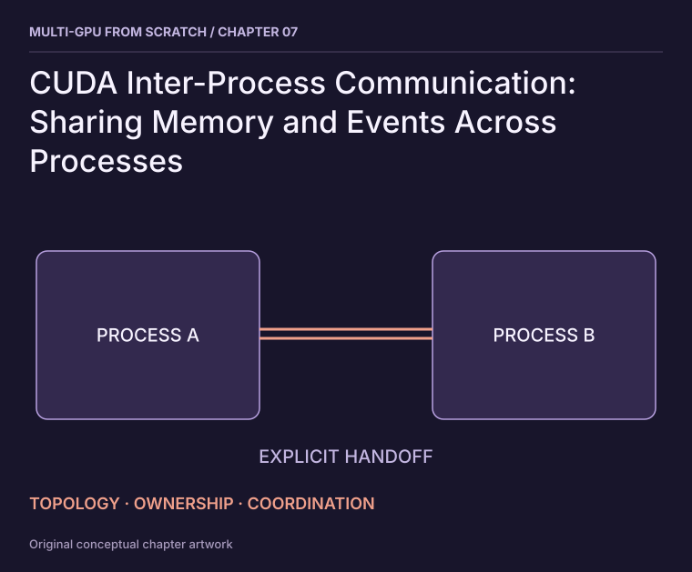
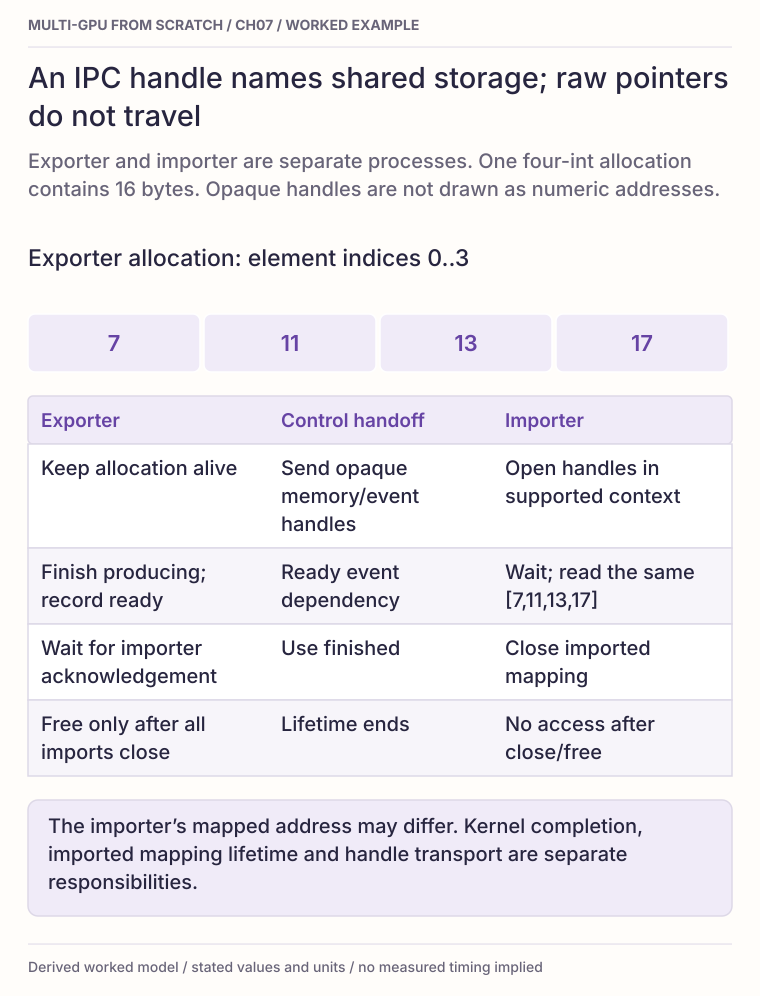
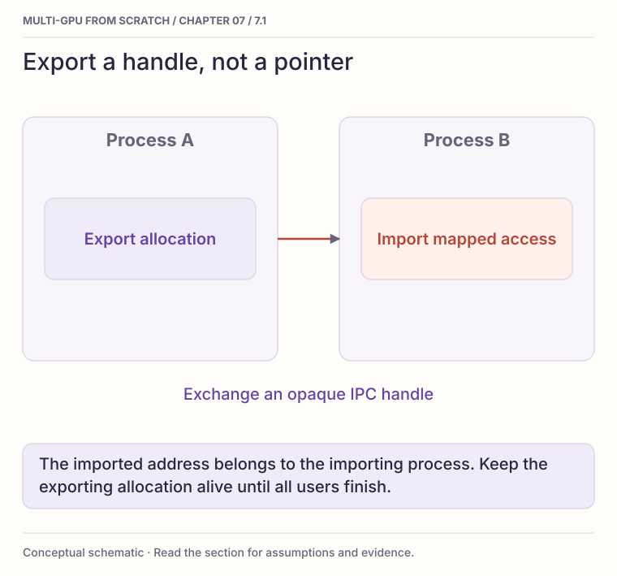
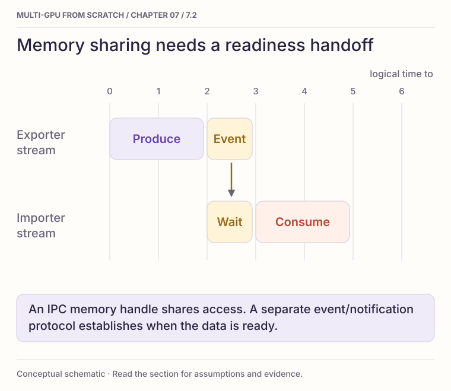

# Chapter 7: CUDA Inter-Process Communication: Sharing Memory and Events Across Processes

<!-- mgpu:opener:start -->
[](../images/chapter-openers/07.svg)
<!-- mgpu:opener:end -->

**What you will understand by the end of this chapter:**

- Why a device pointer that's perfectly meaningful inside the process that allocated it is meaningless to a different operating-system process, even on the very same GPU -- and what `cudaIpcGetMemHandle()`/`cudaIpcOpenMemHandle()` actually exchange to fix that.
- Why sharing an event across processes needs the event created with specific flags up front, and what those flags trade away in exchange for being shareable at all.
- The one property that makes IPC memory sharing fundamentally different from every transfer this book has written since Chapter 5: it moves zero bytes, because both processes end up looking at the exact same physical memory.

**What you need to know first:**

- Chapter 4's Unified Virtual Addressing and `cudaPointerGetAttributes()`, and Chapter 6's event lifecycle (`cudaEventCreate()`/`cudaEventRecord()`/`cudaStreamWaitEvent()`).
- The general idea of an operating-system process having its own private address space, separate from any other process's.
- No new CUDA concepts beyond this chapter's own handle-exchange functions.

---

Every chapter since Chapter 4 has quietly assumed one thing: whoever calls `cudaMalloc()`, `cudaEventCreate()`, or any other allocation-style CUDA call is also the only process that will ever touch the result. UVA (Chapter 4) makes a pointer meaningful across *devices* within that one process -- but it says nothing about a second, entirely separate process, with its own private address space and its own CUDA context, that wants to work with memory or synchronization the first process already set up. That's what CUDA's Inter-Process Communication (IPC) support exists for, and it closes out Part 1: everything from here through Chapter 6 was about getting data and coordination *between devices*; this chapter is about getting that same data and coordination *between processes*, which turns out to need its own dedicated, deliberately narrow API.

Here is where this chapter sits relative to everything Part 1 already built:

```text
Chapter 4 -- within one process, across DEVICES:

    Process A
    +----------------------------------------------+
    |  [ Device 0 ] --peer access-- [ Device 1 ]   |
    +----------------------------------------------+

Chapters 5-6 -- moving data and coordinating those devices:

    Process A
    +------------------------------------------------------+
    |  [ Device 0 ] --cudaMemcpyPeer()--> [ Device 1 ]     |
    |  [ Device 0 stream ] --event--> [ Device 1 stream ]  |
    +------------------------------------------------------+

Chapter 7 (this chapter) -- across PROCESSES entirely:

    Process A                         Process B
    +----------------+   IPC handle   +------------------+
    |  [ Device 0 ]  | -------------> |  (same Device 0  |
    |   owns memory  |   (see 7.1)    |   memory, now    |
    +----------------+                |   visible here)  |
                                      +------------------+
```

Everything above the last block was one process reaching across a device boundary it already controlled. This chapter is a process reaching across a boundary it does *not* control at all -- another process's own private address space -- which is why it needs its own explicit hand-off mechanism instead of just another flavor of the calls Chapters 4-6 already used.

<!-- mgpu:worked:start -->
## Worked example — An IPC handle is not a copied pointer

An exporter process owns an IPC-exportable device allocation containing four int32 values [7, 11, 13, 17], totaling 16 bytes. An importer runs on a supported device/context configuration.

[](../images/worked/ch07.svg)

1. The exporter creates the allocation and obtains an opaque cudaIpcMemHandle_t with cudaIpcGetMemHandle. Send the handle through an ordinary inter-process channel.

2. The importer opens it with cudaIpcOpenMemHandle. Use the returned local pointer; do not assume its numeric virtual address equals the exporter’s pointer.

3. Coordinate production and consumption. Create the IPC event with cudaEventInterprocess | cudaEventDisableTiming. The exporter enqueues the writes and cudaEventRecord, then notifies the importer that this generation has been recorded. Only after that notification does the importer enqueue cudaStreamWaitEvent and its read. Handle exchange alone does not ensure an event has been recorded; waiting on an unrecorded event can act as a no-op. The event may still be pending when the wait is enqueued. See [CUDA event-wait semantics](https://docs.nvidia.com/cuda/archive/12.8.0/cuda-runtime-api/group__CUDART__EVENT.html).

4. After consumption completes, the importer closes its mapping with cudaIpcCloseMemHandle. Only after all users are finished may the exporter free the original allocation.

**Expected result and pitfall.** The expected importer values are [7, 11, 13, 17] after synchronization. Opening a memory handle maps shared storage rather than creating a 16-byte snapshot. Keep both the allocation and synchronization protocol valid through the final consumer.

**Exercise.** If the exporter changes the first element to 19, does the importer hold an independent old copy?

**Worked answer.** No. It refers to shared storage. Observing 19 still requires correctly ordering the update and subsequent read; mapping alone is not a visibility protocol.
<!-- mgpu:worked:end -->

## 7.1 cudaIpcGetMemHandle / cudaIpcOpenMemHandle: Sharing Device Memory Across Processes

<!-- mgpu:figure-1:start -->
[](../images/technical/ch07/1-ipc.svg)
<!-- mgpu:figure-1:end -->

### Intuition

A raw pointer value is just a number, and numbers don't carry any information about which process's address space they're meaningful in. If process A allocates device memory and somehow sends the raw pointer value to process B -- over a pipe, a socket, whatever -- that number means nothing to process B's own CUDA runtime; dereferencing it (directly or through any CUDA call) is simply undefined. What has to cross the process boundary instead is an opaque, driver-issued *handle*: a token process A requests specifically for the purpose of being handed to another process, which process B then presents back to its own CUDA runtime to receive a pointer that *is* valid in its address space, pointing at the exact same underlying physical memory.

```text
   PROCESS A (exporter)                    PROCESS B (importer)
   +----------------------------------+    +-------------------------+
   | address space A                  |    | address space B         |
   |                                  |    |                         |
   |  devPtr ---> [ DEVICE MEMORY ]   |    |                         |
   |   (A owns this allocation)       |    |                         |
   +----------------------------------+    +-------------------------+
             |                                          ^
             | cudaIpcGetMemHandle(&handle, devPtr)     |
             |                                          |
       +-----------+      OS-level transport      +-----------+
       |  handle   | ---(pipe / socket / file,--> |  handle   |
       | (opaque)  |     outside CUDA's scope)    | (opaque)  |
       +-----------+                              +-----------+
                                                        |
                cudaIpcOpenMemHandle(&importedPtr, handle, ...)
                                                        |
                                                        +--> importedPtr
                                                                 |
                                                                 +--> [ SAME DEVICE MEMORY ]
                                                                      (the identical physical
                                                                       bytes A already owns --
                                                                       not a copy)
```

The handle itself carries no data -- it is a description the driver can turn back into a pointer, not a snapshot of the memory it describes. Everything below `[ SAME DEVICE MEMORY ]` in the diagram is one physical allocation with two valid pointers now referring to it, one per process.

### Background

`cudaIpcGetMemHandle(&handle, devPtr)` is the export side. Per the CUDA Runtime API documentation, it "takes a pointer to the base of an existing device memory allocation created with `cudaMalloc` and exports it for use in another process," and importantly, "this is a lightweight operation and may be called multiple times on an allocation without adverse effects" -- it doesn't move or duplicate the underlying bytes, only produces a token describing them. `cudaIpcOpenMemHandle(&devPtr, handle, flags)` is the import side, run in the *other* process: it "opens an interprocess memory handle exported from another process and returns a device pointer usable in the local process." The current [NVIDIA IPC guide](https://docs.nvidia.com/cuda/cuda-programming-guide/04-special-topics/inter-process-communication.html) scopes the legacy IPC APIs used here to Linux and excludes `cudaMallocManaged` allocations. These listings also require POSIX `fork` and pipes; they are not Windows examples. Importers close mappings with `cudaIpcCloseMemHandle`, and the exporter must keep the allocation alive until importers have finished. Driver VMM sharing is a separate API family with broader platform-specific handle support.

```cpp
// Chapter 7: two-process CUDA IPC with a checked nonuniform payload.
// 17_ipc_mem_handle.cu
// Linux/POSIX: fork happens before any CUDA initialization. Producer device 0
// stays alive until consumer device 1 closes its imported resources.
#include <cstdio>
#include <cerrno>
#include <csignal>
#include <cstdint>
#include <vector>
#include <unistd.h>
#include <sys/wait.h>
#include <cuda_runtime.h>

constexpr int COUNT = 4096;
static float expected(int i) { return float((i * 17) % 4093 - 2046) / 8.0f; }
static int error(cudaError_t status, const char* call) {
    if (status == cudaSuccess) return 0;
    fprintf(stderr, "%s: %s (code %d)\n", call, cudaGetErrorString(status), int(status));
    return status == cudaErrorNoDevice || status == cudaErrorInsufficientDriver ? 2 : 1;
}
#define CUDA(call) do { int code = error((call), #call); if (code) return code; } while (0)
static bool transfer(int fd, void* data, size_t size, bool writing) {
    char* bytes = static_cast<char*>(data);
    while (size) {
        ssize_t done = writing ? write(fd, bytes, size) : read(fd, bytes, size);
        if (done < 0 && errno == EINTR) continue;
        if (done <= 0) return false;
        bytes += done; size -= size_t(done);
    }
    return true;
}
struct Handles { cudaIpcMemHandle_t memory;  };

static int consumer(int fd) {
    Handles handles{};
    if (!transfer(fd, &handles, sizeof(handles), false)) {
        fprintf(stderr, "IPC handle transport failed; producer did not publish resources.\n");
        return 1;
    }
    close(fd);
    CUDA(cudaSetDevice(1));
    void* imported = nullptr;
    CUDA(cudaIpcOpenMemHandle(&imported, handles.memory, cudaIpcMemLazyEnablePeerAccess));

    std::vector<float> output(COUNT);
    CUDA(cudaMemcpy(output.data(), imported, COUNT * sizeof(float), cudaMemcpyDeviceToHost));
    int mismatches = 0;
    for (int i = 0; i < COUNT; ++i) if (output[i] != expected(i)) {
        if (mismatches < 4) fprintf(stderr, "Mismatch[%d]: %.9g expected %.9g\n", i, output[i], expected(i));
        ++mismatches;
    }

    CUDA(cudaIpcCloseMemHandle(imported));
    printf("Consumer: %d / %d exact payload values correct.\n", COUNT - mismatches, COUNT);
    return mismatches ? 1 : 0;
}

static int producer(int fd) {
    int count = 0;
    CUDA(cudaGetDeviceCount(&count));
    if (count < 2) { fprintf(stderr, "BLOCKED: requires 2 visible GPUs; found %d.\n", count); return 2; }
    CUDA(cudaSetDevice(0));
    int peer = 0;
    CUDA(cudaDeviceCanAccessPeer(&peer, 1, 0));
    if (!peer) { fprintf(stderr, "BLOCKED: device 1 cannot access device 0 memory.\n"); return 2; }
    std::vector<float> input(COUNT);
    for (int i = 0; i < COUNT; ++i) input[i] = expected(i);
    float* memory = nullptr;
    CUDA(cudaMalloc(&memory, COUNT * sizeof(float)));

    CUDA(cudaMemcpy(memory, input.data(), COUNT * sizeof(float), cudaMemcpyHostToDevice));
    // A pageable H2D cudaMemcpy may return before device DMA completes.
    // Complete the producer write before publishing a handle to another context.
    CUDA(cudaDeviceSynchronize());
    Handles handles{};
    CUDA(cudaIpcGetMemHandle(&handles.memory, memory));

    if (!transfer(fd, &handles, sizeof(handles), true)) {
        fprintf(stderr, "Could not send IPC handles.\n"); return 1;
    }
    close(fd);
    // main waits for child process exit before destroying producer resources.
    // Allocation remains live through cudaIpcCloseMemHandle in the consumer.
    return 0;
}

int main() {
    signal(SIGPIPE, SIG_IGN);
    int descriptors[2];
    if (pipe(descriptors) != 0) { perror("pipe"); return 1; }
    pid_t child = fork(); // No CUDA API has been called in this process yet.
    if (child < 0) { perror("fork"); close(descriptors[0]); close(descriptors[1]); return 1; }
    if (child == 0) {
        close(descriptors[1]);
        int code = consumer(descriptors[0]);
        fflush(nullptr);
        _exit(code);
    }
    close(descriptors[0]);
    int result = producer(descriptors[1]);
    // Closing also releases a consumer blocked on read if production failed.
    if (result != 0) close(descriptors[1]);
    int status = 0;
    while (waitpid(child, &status, 0) < 0) {
        if (errno == EINTR) continue;
        perror("waitpid"); return 1;
    }
    int child_result = WIFEXITED(status) ? WEXITSTATUS(status) : 1;
    if (result == 0) result = child_result;
    // Destroy the producer context only after the importing process is gone.
    if (result != 2) { int cleanup = error(cudaDeviceReset(), "cudaDeviceReset"); if (cleanup) result = 1; }
    if (result == 0) printf("PASS: two-process IPC memory, 4096 nonuniform values checked.\n");
    return result;
}
```

> **Correction verified on November 19:** this exact corrected IPC source (`0a6c761e152bb3d0015b3f96bfb93cf7fa61764b90cde1f23aafdf11539a6388`) passed 20 full-payload runs and two clean memchecks on two H100 GPUs, with physical roles reversed. [System, commands, execution dates and raw logs](../validation-h100-ipc.md). The earlier records below retain their own tested source revisions.

<!-- ipc-revalidation:start -->
**Current corrected-source sample output — November 19, 2026**

Executed UTC: `2026-11-19T15:34:13.886174+00:00`; CUDA 12.8.93, driver 580.105.08, two H100 80GB HBM3 GPUs.

```text
Consumer: 4096 / 4096 exact payload values correct.
PASS: two-process IPC memory, 4096 nonuniform values checked.
```

[Compile command, all 22 execution timestamps and memory-check outputs](../validation-h100-ipc.md#commands-and-captured-outputs).
<!-- ipc-revalidation:end -->

<!-- execution:start:h100-rerun:17_ipc_mem_handle.cu -->
> **Correction verified on November 19:** this exact corrected IPC source (`0a6c761e152bb3d0015b3f96bfb93cf7fa61764b90cde1f23aafdf11539a6388`) passed 20 full-payload runs and two clean memchecks on two H100 GPUs, with physical roles reversed. [System, commands, execution dates and raw logs](../validation-h100-ipc.md). The earlier records below retain their own tested source revisions.


> **Compiled and executed — 2026-11-18-h100: Numerical/transport validation (recorded scope).** Hardware: 2 H100 GPUs. Executed UTC: `2026-11-18T11:21:01.930044+00:00`.

<!-- execution:metadata Source SHA-256: fc4bd504bca901310ce7d63d5c62facc6b5093bb53c7ca06864026ce83df4ee5; recorded UTC (program start): 2026-11-18T11:21:01.064167+00:00 -->

[Exact tested source](../validation/2026-11-18-h100/17_ipc_mem_handle/17_ipc_mem_handle.cu) · [Compiler log](../validation/2026-11-18-h100/17_ipc_mem_handle/compile.log) · [Execution log](../validation/2026-11-18-h100/17_ipc_mem_handle/run.log). Compile exit: `0`; run exit: `0`.

Commands below use local source/binary names; raw logs retain host paths. Execute in a scratch directory containing the downloaded source.

```bash
nvcc -std=c++17 -O2 -arch=sm_90 17_ipc_mem_handle.cu -o ./example
./example
```

**Sample output**

```text
Consumer: 4096 / 4096 exact payload values correct.
PASS: two-process IPC memory, 4096 nonuniform values checked.
```

<!-- execution:end:h100-rerun:17_ipc_mem_handle.cu -->


<!-- execution:start:a100:17_ipc_mem_handle.cu -->
> **Correction verified on November 19:** this exact corrected IPC source (`0a6c761e152bb3d0015b3f96bfb93cf7fa61764b90cde1f23aafdf11539a6388`) passed 20 full-payload runs and two clean memchecks on two H100 GPUs, with physical roles reversed. [System, commands, execution dates and raw logs](../validation-h100-ipc.md). The earlier records below retain their own tested source revisions.


> **Compiled and executed — 2026-11-17-a100: Numerical/transport validation (recorded scope).** Hardware: 8 A100 GPUs. Executed UTC: `2026-11-18T00:01:00.171741+00:00`.

<!-- execution:metadata Source SHA-256: fc4bd504bca901310ce7d63d5c62facc6b5093bb53c7ca06864026ce83df4ee5; recorded UTC (program start): 2026-11-18T00:00:58.753373+00:00 -->

[Exact tested source](../validation/2026-11-17-a100/17_ipc_mem_handle/17_ipc_mem_handle.cu) · [Compiler log](../validation/2026-11-17-a100/17_ipc_mem_handle/compile.log) · [Execution log](../validation/2026-11-17-a100/17_ipc_mem_handle/run.log). Compile exit: `0`; run exit: `0`.

Commands below use local source/binary names; raw logs retain host paths. Execute in a scratch directory containing the downloaded source.

```bash
nvcc -std=c++17 -O2 -arch=sm_80 17_ipc_mem_handle.cu -o ./example
./example
```

**Sample output**

```text
Consumer: 4096 / 4096 exact payload values correct.
PASS: two-process IPC memory, 4096 nonuniform values checked.
```


<!-- execution:end:a100:17_ipc_mem_handle.cu -->


<!-- execution:start:h100:17_ipc_mem_handle.cu -->
> **Correction verified on November 19:** this exact corrected IPC source (`0a6c761e152bb3d0015b3f96bfb93cf7fa61764b90cde1f23aafdf11539a6388`) passed 20 full-payload runs and two clean memchecks on two H100 GPUs, with physical roles reversed. [System, commands, execution dates and raw logs](../validation-h100-ipc.md). The earlier records below retain their own tested source revisions.


> **Compiled and executed — 2026-11-17-h100: Numerical/transport validation (recorded scope).** Hardware: 2 H100 GPUs. Execution record UTC (run-batch start; per-program time unrecorded): `2026-11-17T23:48:18.967387+00:00`.

<!-- execution:metadata Source SHA-256: fc4bd504bca901310ce7d63d5c62facc6b5093bb53c7ca06864026ce83df4ee5; recorded UTC (run-batch start; per-program time unrecorded): 2026-11-17T23:48:18.967387+00:00 -->

[Exact tested source](../validation/2026-11-17-h100/17_ipc_mem_handle/17_ipc_mem_handle.cu) · [Compiler log](../validation/2026-11-17-h100/17_ipc_mem_handle/compile.log) · [Execution log](../validation/2026-11-17-h100/17_ipc_mem_handle/run.log). Compile exit: `0`; run exit: `0`.

Commands below use local source/binary names; raw logs retain host paths. Execute in a scratch directory containing the downloaded source.

```bash
nvcc -std=c++17 -O2 -arch=sm_90 17_ipc_mem_handle.cu -o ./example
./example
```

<details markdown="1"><summary>Captured current-source output</summary>

```text
Consumer: 4096 / 4096 exact payload values correct.
PASS: two-process IPC memory, 4096 nonuniform values checked.
```

</details>
<!-- execution:end:h100:17_ipc_mem_handle.cu -->


The earlier single-process no-device diagnostic did not validate IPC. The current listings fork before CUDA initialization, exchange opaque handles through a pipe, use producer GPU 0 and consumer GPU 1, and check 4,096 nonuniform values. Both IPC programs passed on the H100 pair. The exporter waits for the importer to close its mapping before teardown; the event variant also checks a consumer-stream wait. This is a correctness demonstration, not a transfer-overlap benchmark.

The [2026-11-17 H100 execution record](../validation-h100.md) covers two GPUs connected by local NV18. It distinguishes numerical checks, API probes and other executions; a successful exit alone does not establish GPU algorithm correctness.

!!! warning "[COMMON TRAP] Believing a device pointer's numeric value is portable between processes"
    UVA (Chapter 4) makes a pointer's *meaning* consistent across every device within one process's single address space -- but a process's address space itself is private to that process. Two different processes can each have a perfectly valid, UVA-consistent pointer value that happens to be the identical number, referring to two completely unrelated pieces of memory, or to nothing at all. The handle this section exchanges exists specifically because the pointer's raw value was never going to be safely portable on its own -- only the driver-issued handle, opened through `cudaIpcOpenMemHandle()`, produces a pointer that's actually valid in the *importing* process's own address space.

## 7.2 cudaIpcGetEventHandle / cudaIpcOpenEventHandle: Sharing Synchronization Across Processes

<!-- mgpu:figure-2:start -->
[](../images/technical/ch07/2-handoff.svg)
<!-- mgpu:figure-2:end -->

### Intuition

Sharing the memory itself only solves half the problem: process B now has a way to get a valid pointer to process A's data, but nothing yet tells B *when* that data is actually ready to read. Chapter 6 already built the tool for exactly this kind of question -- an event -- but an ordinary event, like an ordinary pointer, is scoped to the process that created it. Making an event shareable across processes isn't automatic; it has to be requested explicitly, at creation time, because supporting cross-process visibility costs the event one specific capability it would otherwise have.

```text
   PROCESS A                                    PROCESS B
   +----------------------------+               +----------------------------+
   | streamA: [ work ] -> event |               |                            |
   |   (created WITH the two    |               |                            |
   |    required flags, 7.2)    |               |                            |
   +----------------------------+               +----------------------------+
             |                                                ^
             | cudaIpcGetEventHandle(&handle, event)          |
             |                                                |
       +-----------+        OS-level transport          +-----------+
       |  handle   | ---------------------------------> |  handle   |
       +-----------+                                    +-----------+
                                                              |
                 cudaIpcOpenEventHandle(&importedEvent, handle)
                                                              |
                                                              +--> importedEvent
     streamB: cudaStreamWaitEvent(streamB, importedEvent, 0)
     -- streamB's FUTURE work now waits for process A's marker,
        exactly like Chapter 6's cross-DEVICE case, just carried
        across a process boundary instead.
```

The bottom line of this diagram is the payoff: once `importedEvent` exists in process B, it is handed to `cudaStreamWaitEvent()` exactly the way Chapter 6, Section 6.2 used a same-process, cross-device event -- nothing about *waiting* on it changes, only how it got there.

### Background

`cudaEventCreateWithFlags()` is the same event-creation call Chapter 6 used, but with two flags that matter here specifically: the documentation states that `cudaEventInterprocess` "specifies that the created event may be used as an interprocess event by `cudaIpcGetEventHandle()`," and that "`cudaEventInterprocess` must be specified along with `cudaEventDisableTiming`" -- an interprocess event gives up per-event timing data as the cost of being shareable at all. From there, the pattern mirrors Section 7.1 exactly: `cudaIpcGetEventHandle(&handle, event)` exports an opaque handle for an event created with both required flags, and `cudaIpcOpenEventHandle(&importedEvent, handle)`, called in the other process, returns a local `cudaEvent_t` that refers to the same underlying event -- one that can then be handed directly to `cudaStreamWaitEvent()` (Chapter 6, Section 6.2) exactly like any other event, cross-device or not.

```cpp
// Chapter 7: two-process CUDA IPC with a checked nonuniform payload.
// 18_ipc_event_handle.cu
// Linux/POSIX: fork happens before any CUDA initialization. Producer device 0
// stays alive until consumer device 1 closes its imported resources.
#include <cstdio>
#include <cerrno>
#include <csignal>
#include <cstdint>
#include <vector>
#include <unistd.h>
#include <sys/wait.h>
#include <cuda_runtime.h>

constexpr int COUNT = 4096;
static float expected(int i) { return float((i * 17) % 4093 - 2046) / 8.0f; }
static int error(cudaError_t status, const char* call) {
    if (status == cudaSuccess) return 0;
    fprintf(stderr, "%s: %s (code %d)\n", call, cudaGetErrorString(status), int(status));
    return status == cudaErrorNoDevice || status == cudaErrorInsufficientDriver ? 2 : 1;
}
#define CUDA(call) do { int code = error((call), #call); if (code) return code; } while (0)
static bool transfer(int fd, void* data, size_t size, bool writing) {
    char* bytes = static_cast<char*>(data);
    while (size) {
        ssize_t done = writing ? write(fd, bytes, size) : read(fd, bytes, size);
        if (done < 0 && errno == EINTR) continue;
        if (done <= 0) return false;
        bytes += done; size -= size_t(done);
    }
    return true;
}
struct Handles { cudaIpcMemHandle_t memory; cudaIpcEventHandle_t ready; };

static int consumer(int fd) {
    Handles handles{};
    if (!transfer(fd, &handles, sizeof(handles), false)) {
        fprintf(stderr, "IPC handle transport failed; producer did not publish resources.\n");
        return 1;
    }
    close(fd);
    CUDA(cudaSetDevice(1));
    void* imported = nullptr;
    CUDA(cudaIpcOpenMemHandle(&imported, handles.memory, cudaIpcMemLazyEnablePeerAccess));
    cudaEvent_t ready = nullptr;
    CUDA(cudaIpcOpenEventHandle(&ready, handles.ready));
    cudaStream_t stream = nullptr;
    CUDA(cudaStreamCreate(&stream));
    CUDA(cudaStreamWaitEvent(stream, ready, 0));
    std::vector<float> output(COUNT);
    CUDA(cudaMemcpyAsync(output.data(), imported, COUNT * sizeof(float), cudaMemcpyDeviceToHost, stream));
    CUDA(cudaStreamSynchronize(stream));
    int mismatches = 0;
    for (int i = 0; i < COUNT; ++i) if (output[i] != expected(i)) {
        if (mismatches < 4) fprintf(stderr, "Mismatch[%d]: %.9g expected %.9g\n", i, output[i], expected(i));
        ++mismatches;
    }
    CUDA(cudaStreamDestroy(stream));
    CUDA(cudaEventDestroy(ready));
    CUDA(cudaIpcCloseMemHandle(imported));
    printf("Consumer: %d / %d exact payload values correct.\n", COUNT - mismatches, COUNT);
    return mismatches ? 1 : 0;
}

static int producer(int fd) {
    int count = 0;
    CUDA(cudaGetDeviceCount(&count));
    if (count < 2) { fprintf(stderr, "BLOCKED: requires 2 visible GPUs; found %d.\n", count); return 2; }
    CUDA(cudaSetDevice(0));
    int peer = 0;
    CUDA(cudaDeviceCanAccessPeer(&peer, 1, 0));
    if (!peer) { fprintf(stderr, "BLOCKED: device 1 cannot access device 0 memory.\n"); return 2; }
    std::vector<float> input(COUNT);
    for (int i = 0; i < COUNT; ++i) input[i] = expected(i);
    float* memory = nullptr;
    CUDA(cudaMalloc(&memory, COUNT * sizeof(float)));
    cudaEvent_t ready = nullptr;
    CUDA(cudaEventCreateWithFlags(&ready, cudaEventDisableTiming | cudaEventInterprocess));
    cudaStream_t stream = nullptr;
    CUDA(cudaStreamCreate(&stream));
    CUDA(cudaMemcpyAsync(memory, input.data(), COUNT * sizeof(float), cudaMemcpyHostToDevice, stream));
    CUDA(cudaEventRecord(ready, stream));
    Handles handles{};
    CUDA(cudaIpcGetMemHandle(&handles.memory, memory));
    CUDA(cudaIpcGetEventHandle(&handles.ready, ready));
    CUDA(cudaStreamSynchronize(stream));
    if (!transfer(fd, &handles, sizeof(handles), true)) {
        fprintf(stderr, "Could not send IPC handles.\n"); return 1;
    }
    close(fd);
    // main waits for child process exit before destroying producer resources.
    // Allocation remains live through cudaIpcCloseMemHandle in the consumer.
    return 0;
}

int main() {
    signal(SIGPIPE, SIG_IGN);
    int descriptors[2];
    if (pipe(descriptors) != 0) { perror("pipe"); return 1; }
    pid_t child = fork(); // No CUDA API has been called in this process yet.
    if (child < 0) { perror("fork"); close(descriptors[0]); close(descriptors[1]); return 1; }
    if (child == 0) {
        close(descriptors[1]);
        int code = consumer(descriptors[0]);
        fflush(nullptr);
        _exit(code);
    }
    close(descriptors[0]);
    int result = producer(descriptors[1]);
    // Closing also releases a consumer blocked on read if production failed.
    if (result != 0) close(descriptors[1]);
    int status = 0;
    while (waitpid(child, &status, 0) < 0) {
        if (errno == EINTR) continue;
        perror("waitpid"); return 1;
    }
    int child_result = WIFEXITED(status) ? WEXITSTATUS(status) : 1;
    if (result == 0) result = child_result;
    // Destroy the producer context only after the importing process is gone.
    if (result != 2) { int cleanup = error(cudaDeviceReset(), "cudaDeviceReset"); if (cleanup) result = 1; }
    if (result == 0) printf("PASS: two-process IPC memory + event readiness, 4096 nonuniform values checked.\n");
    return result;
}
```

<!-- execution:start:h100-rerun:18_ipc_event_handle.cu -->
> **Compiled and executed — 2026-11-18-h100: Numerical/transport validation (recorded scope).** Hardware: 2 H100 GPUs. Executed UTC: `2026-11-18T11:21:03.612556+00:00`.

<!-- execution:metadata Source SHA-256: 5ca751f5113e67325f9bae932f5e16777800d3202b844a28b4c80bf3afffbebf; recorded UTC (program start): 2026-11-18T11:21:02.746693+00:00 -->

[Exact tested source](../validation/2026-11-18-h100/18_ipc_event_handle/18_ipc_event_handle.cu) · [Compiler log](../validation/2026-11-18-h100/18_ipc_event_handle/compile.log) · [Execution log](../validation/2026-11-18-h100/18_ipc_event_handle/run.log). Compile exit: `0`; run exit: `0`.

Commands below use local source/binary names; raw logs retain host paths. Execute in a scratch directory containing the downloaded source.

```bash
nvcc -std=c++17 -O2 -arch=sm_90 18_ipc_event_handle.cu -o ./example
./example
```

**Sample output**

```text
Consumer: 4096 / 4096 exact payload values correct.
PASS: two-process IPC memory + event readiness, 4096 nonuniform values checked.
```

<!-- execution:end:h100-rerun:18_ipc_event_handle.cu -->


The IPC-event example checks exported event handles, allocation lifetime, and the transferred payload. The producer synchronizes before publishing its handles, so this run does not test a consumer waiting on still-pending producer work.

<!-- execution:start:a100:18_ipc_event_handle.cu -->
> **Compiled and executed — 2026-11-17-a100: Numerical/transport validation (recorded scope).** Hardware: 8 A100 GPUs. Executed UTC: `2026-11-18T00:01:05.264113+00:00`.

<!-- execution:metadata Source SHA-256: 5ca751f5113e67325f9bae932f5e16777800d3202b844a28b4c80bf3afffbebf; recorded UTC (program start): 2026-11-18T00:01:03.795830+00:00 -->

[Exact tested source](../validation/2026-11-17-a100/18_ipc_event_handle/18_ipc_event_handle.cu) · [Compiler log](../validation/2026-11-17-a100/18_ipc_event_handle/compile.log) · [Execution log](../validation/2026-11-17-a100/18_ipc_event_handle/run.log). Compile exit: `0`; run exit: `0`.

Commands below use local source/binary names; raw logs retain host paths. Execute in a scratch directory containing the downloaded source.

```bash
nvcc -std=c++17 -O2 -arch=sm_80 18_ipc_event_handle.cu -o ./example
./example
```

**Sample output**

```text
Consumer: 4096 / 4096 exact payload values correct.
PASS: two-process IPC memory + event readiness, 4096 nonuniform values checked.
```


<!-- execution:end:a100:18_ipc_event_handle.cu -->


<!-- execution:start:h100:18_ipc_event_handle.cu -->
> **Compiled and executed — 2026-11-17-h100: Numerical/transport validation (recorded scope).** Hardware: 2 H100 GPUs. Execution record UTC (run-batch start; per-program time unrecorded): `2026-11-17T23:48:18.967387+00:00`.

<!-- execution:metadata Source SHA-256: 5ca751f5113e67325f9bae932f5e16777800d3202b844a28b4c80bf3afffbebf; recorded UTC (run-batch start; per-program time unrecorded): 2026-11-17T23:48:18.967387+00:00 -->

[Exact tested source](../validation/2026-11-17-h100/18_ipc_event_handle/18_ipc_event_handle.cu) · [Compiler log](../validation/2026-11-17-h100/18_ipc_event_handle/compile.log) · [Execution log](../validation/2026-11-17-h100/18_ipc_event_handle/run.log). Compile exit: `0`; run exit: `0`.

Commands below use local source/binary names; raw logs retain host paths. Execute in a scratch directory containing the downloaded source.

```bash
nvcc -std=c++17 -O2 -arch=sm_90 18_ipc_event_handle.cu -o ./example
./example
```

<details markdown="1"><summary>Captured current-source output</summary>

```text
Consumer: 4096 / 4096 exact payload values correct.
PASS: two-process IPC memory + event readiness, 4096 nonuniform values checked.
```

</details>
<!-- execution:end:h100:18_ipc_event_handle.cu -->


File 18 now checks actual interprocess event/memory handoff with 4,096 nonuniform values on the H100 pair. The timing-disabled interprocess event and exporter/importer lifetimes are checked parts of that test; the earlier no-device diagnostic did not validate them.

!!! warning "[COMMON TRAP] Trying to export an ordinary event created with cudaEventCreate()"
    An event created with the plain `cudaEventCreate()` (Chapter 6, Section 6.1) was never given the `cudaEventInterprocess` flag, because that flag is only available through `cudaEventCreateWithFlags()`. Passing such an event to `cudaIpcGetEventHandle()` is not something the API quietly tolerates -- the interprocess capability has to be requested at the moment the event is created, not added afterward. If Chapter 6's event basics are the pattern in your head, remember that this chapter's events need one extra, deliberate step at creation time that Chapter 6's never did.

## 7.3 Verifying the Handoff Logic Without a Second Process

### Intuition

Files 17 and 18 now execute real two-process CUDA IPC and check 4,096 values on the H100 pair. The model below separately illustrates opaque-handle handoff and shared-storage semantics. It does not replace those hardware checks or establish IPC support across nodes.

The [2026-11-17 H100 execution record](../validation-h100.md) covers two GPUs connected by local NV18. It distinguishes numerical checks, API probes and other executions; a successful exit alone does not establish GPU algorithm correctness.

The one picture that actually distinguishes this chapter's IPC sharing from every transfer this book has written since Chapter 5 is what happens to a LATE mutation -- one made after the hand-off has already happened:

```text
   IPC-STYLE SHARING (this chapter)          COPY-STYLE TRANSFER (Chapter 5)

   g_table[0].data                           src (device 0) = [100,200,300,400]
     = [100,200,300,400]                       |
        ^          ^                           | cudaMemcpy() -- copies the BYTES
        |          |                           |
   exporter's   importer's                     +--> dst (device 1) = [100,200,300,400]
   reference    reference                           (separate storage from here on)

   exporter mutates index 2 -> 9999           src mutates index 2 -> 9999
        |          |                           |
        |          |                           |
   BOTH see 9999 immediately --               dst STILL shows 300 --
   there was only ONE buffer,                 dst is a different allocation;
   so there was nothing to "update"           reflecting the change needs a
   in the importer's view at all              SECOND cudaMemcpy() call
```

Everything Section 7.3's simulation checks reduces to this one picture: the left column has no step where data moves *to* the importer after the initial open, because there is only one underlying buffer to begin with.

### Background

The simulation below plays both roles -- exporter and importer -- using a shared table that stands in for the driver's own internal bookkeeping of exported allocations. The crucial difference from every transfer this book has modeled since Chapter 5 is what `simOpenMemHandle()` returns: not a copy of the data, but a C++ reference to the *exact same* underlying `std::vector`. That's the property this section actually needs to verify -- not "the importer eventually gets a correct copy" (which is what Chapter 4's simulation checked for a `cudaMemcpy`-style transfer), but "the importer and exporter are looking at the same physical thing," which the second check below demonstrates directly: mutating the data through the exporter's own reference, with no further call of any kind, is immediately visible through the importer's reference.

```cpp
// Chapter 7: CUDA Inter-Process Communication -- Sharing Memory and
// Events Across Processes
// 19_ipc_handoff_simulation.cpp
//
// Simulated "device memory table" -- stands in for the driver-level
// bookkeeping a real cudaIpcMemHandle_t addresses. This book's
// simulations exchange the exact real MESSAGE PATTERN real code uses
// (export an opaque handle, open it to get a usable reference), not
// the real opaque bytes -- the table index plays that role here.
#include <cstdio>
#include <vector>

struct SimAllocation {
    std::vector<int> data;
};

std::vector<SimAllocation> g_table;

// Export side: the simulated equivalent of cudaIpcGetMemHandle(). Per
// the real documentation, this "is a lightweight operation" -- it does
// not copy or move the underlying data, only hands back a reference to
// it, exactly like this function does.
int simExportHandle(int allocationIndex) {
    return allocationIndex; // the "opaque handle"
}

// Import side: the simulated equivalent of cudaIpcOpenMemHandle().
// Returns a reference to the SAME underlying storage the exporter
// owns -- no copy at all, which is the entire point of IPC memory
// sharing versus Chapter 5's cudaMemcpy-based transfers.
std::vector<int>& simOpenMemHandle(int handle) {
    return g_table[handle].data;
}

int main() {
    g_table.push_back(SimAllocation{ {100, 200, 300, 400} });
    int handle = simExportHandle(0);
    printf("Exporter allocated data and exported handle %d.\n", handle);

    std::vector<int>& imported = simOpenMemHandle(handle);
    printf("Importer opened handle %d.\n", handle);

    bool initialMatch = (imported == g_table[0].data);
    printf("Immediately after opening, importer's view matches exporter's data: %s\n",
           initialMatch ? "PASS" : "FAIL");

    // The defining property of real IPC memory sharing: it is the SAME
    // physical memory, not a copy. A mutation the exporter makes AFTER
    // the handle was opened must be visible to the importer immediately,
    // with no further transfer call of any kind.
    g_table[0].data[2] = 9999;
    bool liveMatch = (imported[2] == 9999);
    printf("After exporter mutates index 2 with NO further transfer call,\n"
           "importer's view reflects it immediately: %s\n", liveMatch ? "PASS" : "FAIL");

    printf("\nUnsafe sequence (illustration): freeing an exported allocation before\n"
           "the importer closes its mapping violates the required lifetime.\n");
//
//
//
//

    return (initialMatch && liveMatch) ? 0 : 1;
}
```

<!-- execution:start:h100-rerun:19_ipc_handoff_simulation.cpp -->
> **Compiled and executed — 2026-11-18-h100: Host program/model (exit-only).** Hardware: 2 H100 GPUs. Executed UTC: `2026-11-18T11:21:04.493245+00:00`.

<!-- execution:metadata Source SHA-256: 3aa9454c4e495de3b81eaa7c6e447215e78102ea3733ee046b70673513faa6f6; recorded UTC (program start): 2026-11-18T11:21:04.278703+00:00 -->

[Exact tested source](../validation/2026-11-18-h100/19_ipc_handoff_simulation/19_ipc_handoff_simulation.cpp) · [Compiler log](../validation/2026-11-18-h100/19_ipc_handoff_simulation/compile.log) · [Execution log](../validation/2026-11-18-h100/19_ipc_handoff_simulation/run.log). Compile exit: `0`; run exit: `0`.

Commands below use local source/binary names; raw logs retain host paths. Execute in a scratch directory containing the downloaded source.

```bash
g++ -std=c++17 -O2 19_ipc_handoff_simulation.cpp -o ./example
./example
```

**Actual sample output (excerpt)**

```text
Exporter allocated data and exported handle 0.
Importer opened handle 0.
Immediately after opening, importer's view matches exporter's data: PASS
After exporter mutates index 2 with NO further transfer call,
importer's view reflects it immediately: PASS
```

<!-- execution:end:h100-rerun:19_ipc_handoff_simulation.cpp -->


<!-- execution:start:a100:19_ipc_handoff_simulation.cpp -->
> **Compiled and executed — 2026-11-17-a100: Host program/model (exit-only).** Hardware: 8 A100 GPUs. Executed UTC: `2026-11-18T00:01:09.168650+00:00`.

<!-- execution:metadata Source SHA-256: 3aa9454c4e495de3b81eaa7c6e447215e78102ea3733ee046b70673513faa6f6; recorded UTC (program start): 2026-11-18T00:01:08.902977+00:00 -->

[Exact tested source](../validation/2026-11-17-a100/19_ipc_handoff_simulation/19_ipc_handoff_simulation.cpp) · [Compiler log](../validation/2026-11-17-a100/19_ipc_handoff_simulation/compile.log) · [Execution log](../validation/2026-11-17-a100/19_ipc_handoff_simulation/run.log). Compile exit: `0`; run exit: `0`.

Commands below use local source/binary names; raw logs retain host paths. Execute in a scratch directory containing the downloaded source.

```bash
g++ -std=c++17 -O2 19_ipc_handoff_simulation.cpp -o ./example
./example
```

**Actual sample output (excerpt)**

```text
Exporter allocated data and exported handle 0.
Importer opened handle 0.
Immediately after opening, importer's view matches exporter's data: PASS
After exporter mutates index 2 with NO further transfer call,
importer's view reflects it immediately: PASS
```


<!-- execution:end:a100:19_ipc_handoff_simulation.cpp -->


<!-- execution:start:h100:19_ipc_handoff_simulation.cpp -->
> **Compiled and executed — 2026-11-17-h100: Host program/model (exit-only).** Hardware: 2 H100 GPUs. Execution record UTC (run-batch start; per-program time unrecorded): `2026-11-17T23:48:18.967387+00:00`.

<!-- execution:metadata Source SHA-256: 3aa9454c4e495de3b81eaa7c6e447215e78102ea3733ee046b70673513faa6f6; recorded UTC (run-batch start; per-program time unrecorded): 2026-11-17T23:48:18.967387+00:00 -->

[Exact tested source](../validation/2026-11-17-h100/19_ipc_handoff_simulation/19_ipc_handoff_simulation.cpp) · [Compiler log](../validation/2026-11-17-h100/19_ipc_handoff_simulation/compile.log) · [Execution log](../validation/2026-11-17-h100/19_ipc_handoff_simulation/run.log). Compile exit: `0`; run exit: `0`.

Commands below use local source/binary names; raw logs retain host paths. Execute in a scratch directory containing the downloaded source.

```bash
g++ -std=c++17 -O2 19_ipc_handoff_simulation.cpp -o ./example
./example
```

<details markdown="1"><summary>Actual sample output (excerpt)</summary>

**Actual sample output (excerpt)**

```text
Exporter allocated data and exported handle 0.
Importer opened handle 0.
Immediately after opening, importer's view matches exporter's data: PASS
After exporter mutates index 2 with NO further transfer call,
importer's view reflects it immediately: PASS
```

</details>
<!-- execution:end:h100:19_ipc_handoff_simulation.cpp -->


Both checks pass, and the second one is the point of this whole section: no `transferDirectP2P()`-style call, no `cudaMemcpy()`-style call, nothing at all moved the mutated value from the exporter's reference to the importer's -- there was never a second copy to move it *to*. This is the one property that distinguishes IPC memory sharing from every other cross-process or cross-device operation this book has modeled: it shares an allocation instead of creating and explicitly copying a second allocation. Remote loads/stores can still generate interconnect traffic, and producer/consumer ordering and allocation lifetime remain essential. IPC is not zero-cost communication.

!!! warning "[COMMON TRAP] Simulating -- or worse, actually invoking -- the documented undefined behavior to 'test' it"
    This section's simulation deliberately does *not* execute the exporter-frees-before-importer-closes scenario the real documentation warns about, even in simulated form. Undefined behavior has no defined result to check a simulation against -- there is no correct output to assert on, real or simulated, because the real API itself makes no promise about what happens. This book's honesty discipline extends to knowing the difference between verifying a real, defined guarantee (which Sections 7.1-7.3's other checks all do) and a real, explicitly *undefined* one, which can only be reported as a documented warning, never demonstrated as a "correct" result.

## Chapter Summary

A device pointer's numeric value only means anything within the address space of the process that owns it, so sharing device memory across processes needs a dedicated, driver-issued handle -- `cudaIpcGetMemHandle()` to export a lightweight, non-copying token, and `cudaIpcOpenMemHandle()` in the importing process to turn that token into a locally valid pointer, with the documentation's own strict warning that skipping `cudaIpcCloseMemHandle()` before the exporter frees the memory is undefined behavior (Section 7.1). Sharing an event across the same boundary uses the identical export/open pattern, but only works for events created with `cudaEventInterprocess` (which itself requires `cudaEventDisableTiming`) specified up front at creation time, not added afterward (Section 7.2). The recorded two-process programs exercise real memory-handle import and checked payload access; the event variant also exercises an imported event, with its producer completed before handle publication. Section 7.3 separately models shared-storage aliasing: mutating one host reference changes the other because both refer to the same buffer. That host model does not establish GPU visibility or synchronization by itself. This completes Part 1: Chapters 4 through 7 took data and synchronization from "within one process, across devices" (Chapter 4: permission for devices to reach each other's memory) to "moving data and coordinating between those devices" (Chapters 5-6) to "between processes" (Chapter 7). Part 2 starts building actual collective communication patterns -- broadcast and reduce, by hand -- on top of everything Part 1 established.

## Self-Check Questions

1. Two separate processes each hold a device pointer with the identical numeric value. Using Section 7.1's Common Trap, explain why this does not imply they refer to the same memory.
2. Why does `cudaIpcGetMemHandle()`'s documentation describe it as "a lightweight operation" that "may be called multiple times... without adverse effects"? What is it *not* doing that a heavier operation would be doing?
3. What specific, real consequence does the CUDA Runtime API documentation say follows from calling `cudaFree()` on an exported allocation before the importing process calls `cudaIpcCloseMemHandle()`?
4. A programmer creates an event with plain `cudaEventCreate()` and later tries to pass it to `cudaIpcGetEventHandle()`. Using Section 7.2's Background, explain specifically why this event was never eligible for that call, and what should have been done differently at creation time.
5. Section 7.2 states that `cudaEventInterprocess` "must be specified along with `cudaEventDisableTiming`." What capability does an interprocess event give up as a result, referencing Chapter 6's own event-timing discussion if relevant?
6. Section 7.3's simulation checks two things: an "initial match" and a "live match" after a mutation. Explain why the live-match check is the one that actually distinguishes IPC-style sharing from a Chapter 5-style transfer, while the initial-match check alone would not.
7. Why does Section 7.3's code deliberately avoid simulating the exporter-frees-before-importer-closes scenario, even though it could easily write code that does something and prints a result for it?
8. Suppose a third process wants to also import the same memory handle Section 7.1's exporter produced. Based on the `cudaIpcOpenMemHandle()` documentation cited in this chapter's sources, which states that "`cudaIpcMemHandles` from each device in a given process may only be opened by one context per device per other process" (Section 7.1 quotes other parts of that documentation, not this sentence), would this work, and if there's a constraint, what is it?

## Where We Go Next

Part 2 begins with Chapter 8: broadcast and reduce, the first two collective communication patterns, built by hand on top of the peer-access, transfer, and synchronization primitives Part 1 established -- the first point in this book where more than one device's data genuinely has to be combined into a single, correct result.

## Worked Solutions

**1.** A device pointer's numeric value is only meaningful relative to the address-translation state of the specific process that holds it -- there is no global registry mapping numbers to memory that both processes share. Two processes each having the identical number is coincidental at best; without going through the real handle-export/open sequence, there is no guarantee, and generally no truth, to the idea that the same number refers to the same underlying memory in both processes' contexts.

**2.** "Lightweight" and repeatable-without-adverse-effects means the call does not copy, move, or duplicate the underlying device memory it describes -- it only produces a new descriptor (the handle) that points at memory which continues to exist exactly where it already was. A heavier operation, by contrast, would need to actually allocate new storage or physically relocate data each time it was called; `cudaIpcGetMemHandle()` does neither, which is exactly why calling it repeatedly on the same allocation causes no problems.

**3.** The documentation states plainly that "calling `cudaFree` on an exported memory region before calling `cudaIpcCloseMemHandle` in the importing context will result in undefined behavior" -- meaning the real, specific consequence is UB: the CUDA Runtime API makes no guarantee at all about what happens next, which could range from a crash to silent memory corruption, and no defined recovery exists once that ordering has been violated.

**4.** `cudaEventCreate()` does not accept any flags at all, so an event created that way was never given `cudaEventInterprocess` -- and per Section 7.2's Background, that flag is only settable through the separate `cudaEventCreateWithFlags()` call, specified at the moment of creation. There is no API to retroactively add the flag to an already-created event; the fix is to create the event in the first place with `cudaEventCreateWithFlags(&event, cudaEventDisableTiming | cudaEventInterprocess)`.

**5.** It gives up per-event timing data -- the capability `cudaEventElapsedTime()`-style measurement between two events would otherwise use. Chapter 6 didn't cover elapsed-time measurement explicitly, but Section 7.2's Background is direct about the trade-off itself: `cudaEventDisableTiming` is required alongside `cudaEventInterprocess`, meaning an interprocess-shareable event is, by construction, never a timing event.

**6.** The initial-match check alone only shows that the importer's data happens to equal the exporter's data *at the moment of opening* -- which a `cudaMemcpy()`-style copy (Chapter 5) would produce identically, since a fresh, correct copy also matches its source right after being made. The live-match check is the one that actually distinguishes the two: after the mutation, a Chapter-5-style copy would NOT reflect the change (the copy is a separate, independent buffer by then), while this section's simulation shows the importer's view updating with no further call at all -- proving it's the same memory, not a copy that merely started out equal.

**7.** Undefined behavior has no defined correct result to check a simulation's output against -- the real CUDA Runtime API itself makes no promise about what happens in that scenario, so there is nothing honest to assert PASS or FAIL against. Writing code that "does something" and reports a result would necessarily be reporting on this simulation's own arbitrary behavior, not on any real guarantee, which would misrepresent an explicitly undefined case as though it had a defined, verifiable outcome.

**8.** The fuller documentation this section draws from states that "`cudaIpcMemHandles` from each device in a given process may only be opened by one context per device per other process" -- so a third process opening the same handle is a *different* other process relative to the exporter, and is therefore permitted its own single context opening it; what's constrained is a given *pair* of processes (exporter and one specific importer) to one context per device, not the total number of different processes that may each independently import the same handle.

---

**Sources cited in this chapter:**

- [CUDA Runtime API — Device Management (`cudaIpcGetMemHandle`)](https://docs.nvidia.com/cuda/cuda-runtime-api/group__CUDART__DEVICE.html) -- allocation export/import semantics. The recorded examples use CUDA 12.8 on Linux; consult the current Programming Guide below for legacy IPC platform restrictions rather than treating older header comments as the current platform contract.
- [CUDA IPC — NVIDIA Programming Guide](https://docs.nvidia.com/cuda/cuda-programming-guide/04-special-topics/inter-process-communication.html) -- the per-context-per-process open constraint, the `cudaIpcCloseMemHandle()` cleanup requirement, and the documented undefined-behavior warning.
- [CUDA Runtime API — Event Management (`cudaEventCreateWithFlags`)](https://docs.nvidia.com/cuda/archive/12.4.1/cuda-runtime-api/group__CUDART__EVENT.html) -- the exact `cudaEventInterprocess`/`cudaEventDisableTiming` flag requirement for interprocess events.
