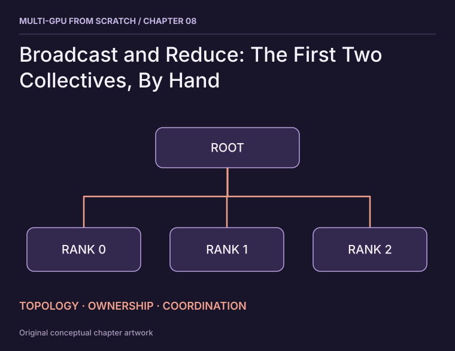
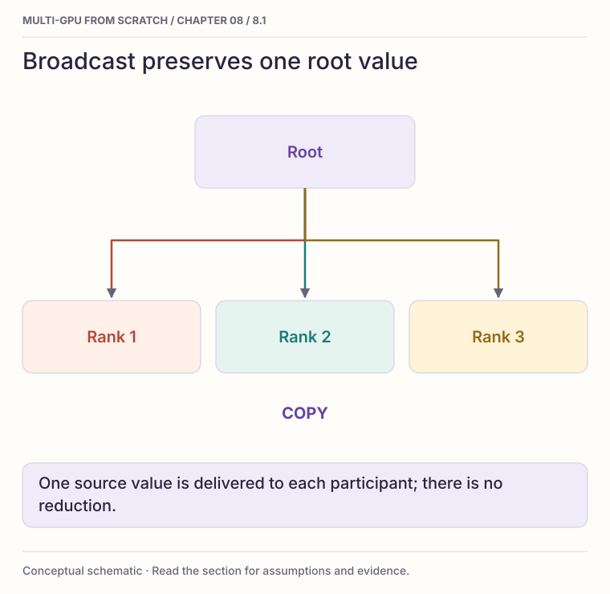
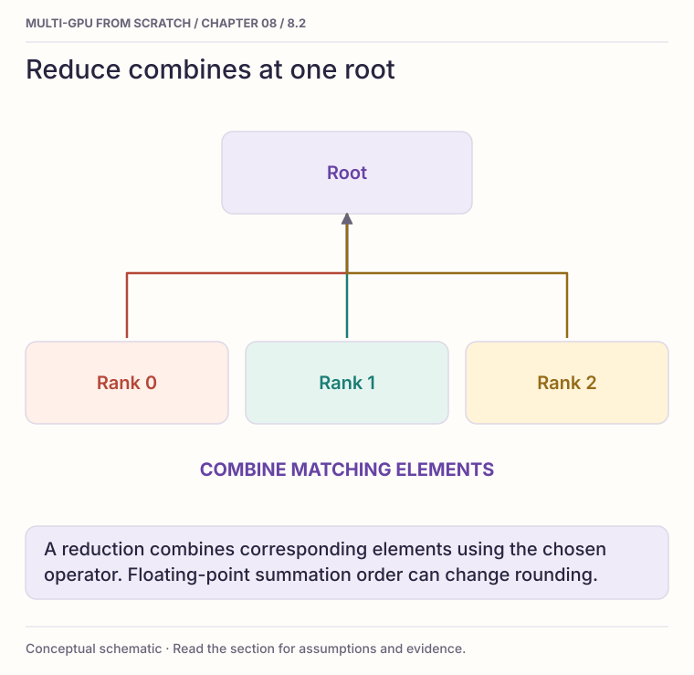

# Chapter 8: Broadcast and Reduce: The First Two Collectives, By Hand

<!-- mgpu:opener:start -->
[](../images/chapter-openers/08.svg)
<!-- mgpu:opener:end -->

**What you will understand by the end of this chapter:**

- What a "collective" operation actually is -- a communication pattern involving every device in a group at once, rather than one specific pair -- and why broadcast and reduce are the two simplest ones to build from what Part 1 already gave this book.
- How to write a correct broadcast and a correct reduce using nothing but the peer-copy and staged-transfer calls from Chapters 5 and the accumulation logic that follows naturally from them.
- Why this book's host-side simulation technique now becomes the primary way to verify correctness in this book, not an occasional substitute -- because a collective's correctness is a genuinely multi-device question that no single honest API call can answer on this machine.

**What you need to know first:**

- Chapter 5's `cudaMemcpyPeer()` and staged host transfers, and Chapter 4's host-side simulation technique.
- Ordinary loops and accumulation in C++. No new CUDA concepts beyond composing calls this book has already introduced.

---

Everything in Part 1 was about moving data or coordinating exactly two participants at a time -- one source device and one destination, one device's stream waiting on another's event, one process's memory shared with one other process's. A collective operation involves an entire group of devices at once, all participating in a single, coordinated communication pattern. Broadcast and reduce are the two simplest collectives, and this chapter builds both by hand, directly on top of Part 1's primitives: broadcast is one device's data reaching every other device, and reduce is every device's data being combined into one. Because correctness here is inherently a question about *multiple* devices' data ending up in the *right relationship to each other*, this chapter also marks a shift in how this book verifies itself: from here through the rest of Part 2, the host-side simulation technique introduced in Chapter 4 stops being an occasional tool and becomes the primary way this book proves a multi-device algorithm is actually correct.

## 8.1 Broadcast, By Hand: One-to-Many, Correctly

<!-- mgpu:figure-1:start -->
[](../images/technical/ch08/1-broadcast.svg)
<!-- mgpu:figure-1:end -->

### Intuition

A broadcast has one job: after it runs, every device in the group holds an identical copy of whatever the *root* device started with. The simplest way to guarantee that is also the most obvious one -- have the root send its data to every other device, one at a time, using nothing more exotic than the cross-device copy call Chapter 5 already built. There's no cleverness needed for correctness here; the cleverness real collective libraries add (broadcasting in a tree pattern across `log₂(N)` rounds instead of `N-1` sequential sends) is a *performance* optimization on top of this same one-to-many idea, not a different idea -- and Part 2 builds toward that later. This chapter's job is to get the simple version right first.

### Background

The straightforward broadcast is a loop: for every non-root device, call `cudaMemcpyPeer()` with the root's pointer as the source and that device's pointer as the destination. Every call in the loop reads from the *same*, unchanging root buffer -- nothing about the root's data changes as the loop progresses, so the order the non-root devices are visited in doesn't affect the result at all. This is the exact same function Chapter 5 introduced, used here in a loop rather than for a single pair, which is really all a broadcast collective *is* at this level: a specific, repeated pattern of an operation this book already has. One detail from Chapter 3 still applies inside the loop: `cudaMalloc()` allocates on whichever device is *current*, so the code calls `cudaSetDevice(dst)` before allocating each destination buffer -- otherwise every "per-device" buffer would silently land on the root, and passing `dst` as `cudaMemcpyPeer()`'s destination device would not make it so.

```cpp
// 20_broadcast_by_hand.cu
// Checked teaching implementation; serial host scheduling favors clarity, not speed.
#include <cstdio>
#include <vector>
#include <algorithm>
#include <cuda_runtime.h>
#define CUDA(call) do { cudaError_t status = (call); if (status != cudaSuccess) { \
 fprintf(stderr,"%s: %s\n",#call,cudaGetErrorString(status)); \
 return status==cudaErrorNoDevice || status==cudaErrorInsufficientDriver ? 2 : 1; } } while(0)
static int pattern(int rank, int i) { return rank*1000+i*3+i%7; }
int main() {
 int count=0; CUDA(cudaGetDeviceCount(&count));
 if(count<2){printf("BLOCKED: requires 2 GPUs; found %d.\n",count);return 2;}
 const int world=std::min(count,4), CHUNK=33;
 const int n=257, out_n=257;
 const size_t bytes=n*sizeof(int), out_bytes=out_n*sizeof(int);
 std::vector<int*> send(world,nullptr),receive(world,nullptr);
 for(int rank=0;rank<world;++rank){
  CUDA(cudaSetDevice(rank));CUDA(cudaMalloc(&send[rank],bytes));CUDA(cudaMalloc(&receive[rank],out_bytes));
  std::vector<int> input(n);for(int i=0;i<n;++i)input[i]=pattern(rank,i);
  CUDA(cudaMemcpy(send[rank],input.data(),bytes,cudaMemcpyHostToDevice));CUDA(cudaMemset(receive[rank],0xff,out_bytes));
 }
 for(int dst=0;dst<world;++dst){CUDA(cudaSetDevice(dst));
 if(dst==0)CUDA(cudaMemcpy(receive[dst],send[0],bytes,cudaMemcpyDeviceToDevice));
 else CUDA(cudaMemcpyPeer(receive[dst],dst,send[0],0,bytes));}
 for(int rank=0;rank<world;++rank){CUDA(cudaSetDevice(rank));CUDA(cudaDeviceSynchronize());}
 for(int rank=0;rank<world;++rank){std::vector<int> output(out_n);CUDA(cudaSetDevice(rank));CUDA(cudaMemcpy(output.data(),receive[rank],out_bytes,cudaMemcpyDeviceToHost));for(int i=0;i<out_n;++i){int expected=pattern(0,i);if(output[i]!=expected){fprintf(stderr,"FAIL rank %d output[%d]: %d expected %d\n",rank,i,output[i],expected);return 1;}}}
 for(int rank=0;rank<world;++rank){CUDA(cudaSetDevice(rank));CUDA(cudaFree(send[rank]));CUDA(cudaFree(receive[rank]));}
 printf("PASS: broadcast on %d GPUs, all nonuniform output values checked.\n",world);
 return 0;
}
```

<!-- execution:start:a100:20_broadcast_by_hand.cu -->
> **Compiled and executed — 2026-11-17-a100: Numerical/transport validation (recorded scope).** Hardware: 8 A100 GPUs. Executed UTC: `2026-11-18T00:01:10.712404+00:00`.

<!-- execution:metadata Source SHA-256: b4f21489e3581a967b24259f6387068c0b98a38ac1ac98ae519b622d4f065433; recorded UTC (program start): 2026-11-18T00:01:09.174909+00:00 -->

[Exact tested source](../validation/2026-11-17-a100/20_broadcast_by_hand/20_broadcast_by_hand.cu) · [Compiler log](../validation/2026-11-17-a100/20_broadcast_by_hand/compile.log) · [Execution log](../validation/2026-11-17-a100/20_broadcast_by_hand/run.log). Compile exit: `0`; run exit: `0`.

Commands below use local source/binary names; raw logs retain host paths. Execute in a scratch directory containing the downloaded source.

```bash
nvcc -std=c++17 -O2 -arch=sm_80 20_broadcast_by_hand.cu -o ./example
./example
```

**Sample output**

```text
PASS: broadcast on 4 GPUs, all nonuniform output values checked.
```


<!-- execution:end:a100:20_broadcast_by_hand.cu -->


<!-- execution:start:h100:20_broadcast_by_hand.cu -->
> **Compiled and executed — 2026-11-17-h100: Numerical/transport validation (recorded scope).** Hardware: 2 H100 GPUs. Execution record UTC (run-batch start; per-program time unrecorded): `2026-11-17T23:48:18.967387+00:00`.

<!-- execution:metadata Source SHA-256: b4f21489e3581a967b24259f6387068c0b98a38ac1ac98ae519b622d4f065433; recorded UTC (run-batch start; per-program time unrecorded): 2026-11-17T23:48:18.967387+00:00 -->

[Exact tested source](../validation/2026-11-17-h100/20_broadcast_by_hand/20_broadcast_by_hand.cu) · [Compiler log](../validation/2026-11-17-h100/20_broadcast_by_hand/compile.log) · [Execution log](../validation/2026-11-17-h100/20_broadcast_by_hand/run.log). Compile exit: `0`; run exit: `0`.

Commands below use local source/binary names; raw logs retain host paths. Execute in a scratch directory containing the downloaded source.

```bash
nvcc -std=c++17 -O2 -arch=sm_90 20_broadcast_by_hand.cu -o ./example
./example
```

<details markdown="1"><summary>Captured current-source output</summary>

```text
PASS: broadcast on 2 GPUs, all nonuniform output values checked.
```

</details>
<!-- execution:end:h100:20_broadcast_by_hand.cu -->


The [2026-11-17 H100 execution record](../validation-h100.md) covers two GPUs connected by local NV18. It distinguishes numerical checks, API probes and other executions; a successful exit alone does not establish GPU algorithm correctness.

File 20 initializes nonuniform data, broadcasts over real GPU transport and checks destination values in the H100 run. The simulation below independently checks the modeled broadcast logic for its stated cases.

The [2026-11-17 H100 execution record](../validation-h100.md) covers two GPUs connected by local NV18. It distinguishes numerical checks, API probes and other executions; a successful exit alone does not establish GPU algorithm correctness.

!!! warning "[COMMON TRAP] Reading the root's data fresh inside the loop, 'just to be safe'"
    Because the root's buffer never changes during a broadcast, re-reading or re-validating it on each loop iteration adds nothing -- every iteration is copying from the exact same source state as every other. The risk runs the other direction: if something *were* allowed to modify the root's buffer partway through the loop (another stream writing to it concurrently, say), different non-root devices could end up with different versions of "the root's data," silently breaking the one guarantee a broadcast exists to provide. The fix isn't re-reading defensively inside the loop -- it's making sure nothing else can write to the root's buffer for the duration of the broadcast in the first place.

## 8.2 Reduce, By Hand: Many-to-One, Order-Independent by Design

<!-- mgpu:figure-2:start -->
[](../images/technical/ch08/2-reduce.svg)
<!-- mgpu:figure-2:end -->

### Intuition

Reduce is broadcast's mirror image: instead of one device's data reaching everyone, every device's data has to be combined into one result. Without a device-side kernel to do the combining on-GPU, the most direct way to build this by hand is to bring each device's data to the host, one at a time, and accumulate it there -- exactly the staged-transfer pattern Chapter 5 already introduced, just called once per device in a loop, with an accumulator standing in for the collective's combining operation.

### Background

The loop first makes the source device current with `cudaSetDevice(src)` (Chapter 3's rule -- without it, every iteration would allocate and read on device 0), then stages that device's buffer to the host with an ordinary `cudaMemcpy(..., cudaMemcpyDeviceToHost)`, and adds it, element by element, into a running host-side accumulator. Nothing here needs a device kernel: the accumulation itself is plain host arithmetic, run once per device, and the combining operation -- sum, in this section's code -- is entirely a property of what the accumulator does with each staged buffer, not of the transfer mechanism itself. A different combining operation (max, say, or a bitwise AND) would only change one line of host code; the transfer loop around it stays identical.

```cpp
// 21_reduce_by_hand.cu
// Checked teaching implementation; serial host scheduling favors clarity, not speed.
#include <cstdio>
#include <vector>
#include <algorithm>
#include <cuda_runtime.h>
#define CUDA(call) do { cudaError_t status = (call); if (status != cudaSuccess) { \
 fprintf(stderr,"%s: %s\n",#call,cudaGetErrorString(status)); \
 return status==cudaErrorNoDevice || status==cudaErrorInsufficientDriver ? 2 : 1; } } while(0)
static int pattern(int rank, int i) { return rank*1000+i*3+i%7; }
int main() {
 int count=0; CUDA(cudaGetDeviceCount(&count));
 if(count<2){printf("BLOCKED: requires 2 GPUs; found %d.\n",count);return 2;}
 const int world=std::min(count,4), CHUNK=33;
 const int n=257, out_n=257;
 const size_t bytes=n*sizeof(int), out_bytes=out_n*sizeof(int);
 std::vector<int*> send(world,nullptr),receive(world,nullptr);
 for(int rank=0;rank<world;++rank){
  CUDA(cudaSetDevice(rank));CUDA(cudaMalloc(&send[rank],bytes));CUDA(cudaMalloc(&receive[rank],out_bytes));
  std::vector<int> input(n);for(int i=0;i<n;++i)input[i]=pattern(rank,i);
  CUDA(cudaMemcpy(send[rank],input.data(),bytes,cudaMemcpyHostToDevice));CUDA(cudaMemset(receive[rank],0xff,out_bytes));
 }
 std::vector<int> sum(n,0), staging(n);
 for(int rank=0;rank<world;++rank){CUDA(cudaSetDevice(rank));CUDA(cudaMemcpy(staging.data(),send[rank],bytes,cudaMemcpyDeviceToHost));for(int i=0;i<n;++i)sum[i]+=staging[i];}
 CUDA(cudaSetDevice(0));CUDA(cudaMemcpy(receive[0],sum.data(),out_bytes,cudaMemcpyHostToDevice));
 for(int rank=0;rank<world;++rank){CUDA(cudaSetDevice(rank));CUDA(cudaDeviceSynchronize());}
 for(int rank=0;rank<1;++rank){std::vector<int> output(out_n);CUDA(cudaSetDevice(rank));CUDA(cudaMemcpy(output.data(),receive[rank],out_bytes,cudaMemcpyDeviceToHost));for(int i=0;i<out_n;++i){int expected=1000*world*(world-1)/2+world*(i*3+i%7);if(output[i]!=expected){fprintf(stderr,"FAIL rank %d output[%d]: %d expected %d\n",rank,i,output[i],expected);return 1;}}}
 for(int rank=0;rank<world;++rank){CUDA(cudaSetDevice(rank));CUDA(cudaFree(send[rank]));CUDA(cudaFree(receive[rank]));}
 printf("PASS: host-staged reduce to root on %d GPUs, all nonuniform output values checked.\n",world);
 return 0;
}
```

<!-- execution:start:a100:21_reduce_by_hand.cu -->
> **Compiled and executed — 2026-11-17-a100: Numerical/transport validation (recorded scope).** Hardware: 8 A100 GPUs. Executed UTC: `2026-11-18T00:01:16.106772+00:00`.

<!-- execution:metadata Source SHA-256: 31af26d63bb08f04ea9be7f5ff0c894aebeda6eb77b8a8462d4e33ee843fe5a9; recorded UTC (program start): 2026-11-18T00:01:14.588057+00:00 -->

[Exact tested source](../validation/2026-11-17-a100/21_reduce_by_hand/21_reduce_by_hand.cu) · [Compiler log](../validation/2026-11-17-a100/21_reduce_by_hand/compile.log) · [Execution log](../validation/2026-11-17-a100/21_reduce_by_hand/run.log). Compile exit: `0`; run exit: `0`.

Commands below use local source/binary names; raw logs retain host paths. Execute in a scratch directory containing the downloaded source.

```bash
nvcc -std=c++17 -O2 -arch=sm_80 21_reduce_by_hand.cu -o ./example
./example
```

**Sample output**

```text
PASS: host-staged reduce to root on 4 GPUs, all nonuniform output values checked.
```


<!-- execution:end:a100:21_reduce_by_hand.cu -->


<!-- execution:start:h100:21_reduce_by_hand.cu -->
> **Compiled and executed — 2026-11-17-h100: Numerical/transport validation (recorded scope).** Hardware: 2 H100 GPUs. Execution record UTC (run-batch start; per-program time unrecorded): `2026-11-17T23:48:18.967387+00:00`.

<!-- execution:metadata Source SHA-256: 31af26d63bb08f04ea9be7f5ff0c894aebeda6eb77b8a8462d4e33ee843fe5a9; recorded UTC (run-batch start; per-program time unrecorded): 2026-11-17T23:48:18.967387+00:00 -->

[Exact tested source](../validation/2026-11-17-h100/21_reduce_by_hand/21_reduce_by_hand.cu) · [Compiler log](../validation/2026-11-17-h100/21_reduce_by_hand/compile.log) · [Execution log](../validation/2026-11-17-h100/21_reduce_by_hand/run.log). Compile exit: `0`; run exit: `0`.

Commands below use local source/binary names; raw logs retain host paths. Execute in a scratch directory containing the downloaded source.

```bash
nvcc -std=c++17 -O2 -arch=sm_90 21_reduce_by_hand.cu -o ./example
./example
```

<details markdown="1"><summary>Captured current-source output</summary>

```text
PASS: host-staged reduce to root on 2 GPUs, all nonuniform output values checked.
```

</details>
<!-- execution:end:h100:21_reduce_by_hand.cu -->


The [2026-11-17 H100 execution record](../validation-h100.md) covers two GPUs connected by local NV18. It distinguishes numerical checks, API probes and other executions; a successful exit alone does not establish GPU algorithm correctness.

File 21 checks GPU transport and host reduction arithmetic against a reference in the H100 run. Its combining arithmetic is on the host; this is not a GPU reduction-kernel benchmark.

The [2026-11-17 H100 execution record](../validation-h100.md) covers two GPUs connected by local NV18. It distinguishes numerical checks, API probes and other executions; a successful exit alone does not establish GPU algorithm correctness.

!!! warning "[COMMON TRAP] Assuming the accumulation order in this loop doesn't matter, for any data type"
    For the `int` (widened to `long long` during accumulation) data this section's code uses, addition is exactly associative and commutative -- summing device 0 then device 1 then device 2 gives the bit-for-bit identical result as summing device 2 then device 0 then device 1. That guarantee is specific to integer arithmetic. It does **not** carry over to floating-point data, where, per NVIDIA's own Floating Point and IEEE 754 documentation, "the results corresponding to the sum `rn(rn(A + B) + C)` and the sum `rn(A + rn(B + C))` are different from each other" -- meaning a real floating-point reduce's *exact* result can depend on the order devices are visited in, even though every individual addition is performed correctly. Section 8.3 verifies this distinction directly rather than asserting it.

## 8.3 Verifying Broadcast and Reduce at N Devices, and Why Order Matters for One But Not the Other

### Intuition

The GPU broadcast and reduce checks validate actual data movement. The host simulation independently explores additional rank counts and arithmetic cases.

The [2026-11-17 H100 execution record](../validation-h100.md) covers two GPUs connected by local NV18. It distinguishes numerical checks, API probes and other executions; a successful exit alone does not establish GPU algorithm correctness.

### Background

The simulation below implements both collectives directly: `broadcast()` copies the root buffer into every other slot, exactly mirroring Section 8.1's loop; `reduceSumInOrder()` sums every device's buffer elementwise in device order 0 through N-1, mirroring Section 8.2's accumulator. A second function, `reduceSumReverseOrder()`, computes the identical reduction but visits the devices in the opposite order -- deliberately, to test this chapter's own claim about integer accumulation being order-independent. Both reduce results are checked against a `reference` buffer computed by hand, completely independently of either function, so the check can't pass merely because both functions share a common bug.

```cpp
// Chapter 8: Broadcast and Reduce -- The First Two Collectives, By Hand
// 22_collectives_simulation.cpp
//
// Plain host C++ -- this book's own honesty-discipline technique,
// used here for the first time to verify a genuinely multi-device
// ALGORITHM (not just a single API call's honest failure): N real
// in-memory buffers stand in for N real device memories, and we run
// the exact real message pattern -- one root, N-1 recipients for
// broadcast; N sources, one accumulator for reduce -- checked against
// an independently-computed reference.
#include <cstdio>
#include <vector>

using Buffer = std::vector<int>;

// Broadcast: every non-root device ends up holding an exact copy of
// the root's data. This is the simulated equivalent of Section 8.1's
// per-device cudaMemcpyPeer loop.
void broadcast(std::vector<Buffer>& devices, int root) {
    for (size_t i = 0; i < devices.size(); ++i) {
        if ((int)i == root) continue;
        devices[i] = devices[root];
    }
}

// Reduce: sum every device's buffer, elementwise, into a single
// result. This is the simulated equivalent of Section 8.2's
// per-device stage-then-accumulate loop -- summed here in device
// order 0, 1, 2, ... N-1. Unlike Section 8.2's accumulator, this one
// stays plain int (no widening to long long): the test values here sum
// to at most 4444, far below int's range, so overflow cannot arise.
Buffer reduceSumInOrder(const std::vector<Buffer>& devices) {
    Buffer result(devices[0].size(), 0);
    for (const Buffer& d : devices) {
        for (size_t i = 0; i < result.size(); ++i) result[i] += d[i];
    }
    return result;
}

// The same reduction, summed in the REVERSE device order. For
// integers, addition is associative and commutative, so (absent
// overflow) this must produce an identical
// result to reduceSumInOrder -- a guarantee that would NOT hold if
// these were floating-point values (see this chapter's Common Trap).
Buffer reduceSumReverseOrder(const std::vector<Buffer>& devices) {
    Buffer result(devices[0].size(), 0);
    for (size_t i = 0; i < result.size(); ++i) {
        long long sum = 0;
        for (int d = (int)devices.size() - 1; d >= 0; --d) sum += devices[d][i];
        result[i] = (int)sum;
    }
    return result;
}

int main() {
    const int NUM_DEVICES = 4;
    const int N = 4;

    // Broadcast check.
    std::vector<Buffer> broadcastDevices(NUM_DEVICES, Buffer(N, 0));
    Buffer rootData = {7, 14, 21, 28};
    broadcastDevices[0] = rootData;
    broadcast(broadcastDevices, 0);

    bool broadcastPass = true;
    for (int i = 0; i < NUM_DEVICES; ++i) {
        if (broadcastDevices[i] != rootData) broadcastPass = false;
    }
    printf("Broadcast: all %d devices hold an identical copy of the root's "
           "data: %s\n", NUM_DEVICES, broadcastPass ? "PASS" : "FAIL");

    // Reduce check.
    std::vector<Buffer> reduceDevices = {
        {1, 2, 3, 4},
        {10, 20, 30, 40},
        {100, 200, 300, 400},
        {1000, 2000, 3000, 4000},
    };
    Buffer reference = {1111, 2222, 3333, 4444}; // computed independently, by hand

    Buffer sumInOrder = reduceSumInOrder(reduceDevices);
    Buffer sumReverse = reduceSumReverseOrder(reduceDevices);

    bool reduceInOrderPass = (sumInOrder == reference);
    bool reduceReversePass = (sumReverse == reference);
    bool orderIndependent = (sumInOrder == sumReverse);

    printf("Reduce (device order 0..3): result matches independent "
           "reference: %s\n", reduceInOrderPass ? "PASS" : "FAIL");
    printf("Reduce (device order 3..0): result matches independent "
           "reference: %s\n", reduceReversePass ? "PASS" : "FAIL");
    printf("Both accumulation orders produce the IDENTICAL result "
           "(true for integers; NOT guaranteed for floating point): %s\n",
           orderIndependent ? "PASS" : "FAIL");

    return (broadcastPass && reduceInOrderPass && reduceReversePass && orderIndependent) ? 0 : 1;
}
```

<!-- execution:start:a100:22_collectives_simulation.cpp -->
> **Compiled and executed — 2026-11-17-a100: Host program/model (exit-only).** Hardware: 8 A100 GPUs. Executed UTC: `2026-11-18T00:01:20.298089+00:00`.

<!-- execution:metadata Source SHA-256: d4ae2885d106db3e9db093ebcad90a1438c83d898eb8f87062a7c9dfc0a8acbb; recorded UTC (program start): 2026-11-18T00:01:19.932180+00:00 -->

[Exact tested source](../validation/2026-11-17-a100/22_collectives_simulation/22_collectives_simulation.cpp) · [Compiler log](../validation/2026-11-17-a100/22_collectives_simulation/compile.log) · [Execution log](../validation/2026-11-17-a100/22_collectives_simulation/run.log). Compile exit: `0`; run exit: `0`.

Commands below use local source/binary names; raw logs retain host paths. Execute in a scratch directory containing the downloaded source.

```bash
g++ -std=c++17 -O2 22_collectives_simulation.cpp -o ./example
./example
```

**Sample output**

```text
Broadcast: all 4 devices hold an identical copy of the root's data: PASS
Reduce (device order 0..3): result matches independent reference: PASS
Reduce (device order 3..0): result matches independent reference: PASS
Both accumulation orders produce the IDENTICAL result (true for integers; NOT guaranteed for floating point): PASS
```


<!-- execution:end:a100:22_collectives_simulation.cpp -->


<!-- execution:start:h100:22_collectives_simulation.cpp -->
> **Compiled and executed — 2026-11-17-h100: Host program/model (exit-only).** Hardware: 2 H100 GPUs. Execution record UTC (run-batch start; per-program time unrecorded): `2026-11-17T23:48:18.967387+00:00`.

<!-- execution:metadata Source SHA-256: d4ae2885d106db3e9db093ebcad90a1438c83d898eb8f87062a7c9dfc0a8acbb; recorded UTC (run-batch start; per-program time unrecorded): 2026-11-17T23:48:18.967387+00:00 -->

[Exact tested source](../validation/2026-11-17-h100/22_collectives_simulation/22_collectives_simulation.cpp) · [Compiler log](../validation/2026-11-17-h100/22_collectives_simulation/compile.log) · [Execution log](../validation/2026-11-17-h100/22_collectives_simulation/run.log). Compile exit: `0`; run exit: `0`.

Commands below use local source/binary names; raw logs retain host paths. Execute in a scratch directory containing the downloaded source.

```bash
g++ -std=c++17 -O2 22_collectives_simulation.cpp -o ./example
./example
```

<details markdown="1"><summary>Captured current-source output</summary>

```text
Broadcast: all 4 devices hold an identical copy of the root's data: PASS
Reduce (device order 0..3): result matches independent reference: PASS
Reduce (device order 3..0): result matches independent reference: PASS
Both accumulation orders produce the IDENTICAL result (true for integers; NOT guaranteed for floating point): PASS
```

</details>
<!-- execution:end:h100:22_collectives_simulation.cpp -->


All four checks pass. The broadcast check confirms Section 8.1's algorithm actually produces identical copies at every device, for real, checkable data -- not just a correctly compiled loop with nothing to verify it against. The two reduce checks confirm the sum is correct regardless of device order, and the fourth check confirms both orderings agree with each other exactly -- the specific property Section 8.2's Common Trap named as true for integers and explicitly not guaranteed for floating point.

!!! warning "[COMMON TRAP] Concluding from this section's PASS results that reduce order never matters"
    This section's four PASS results are honest and correct -- for `int` data. They say nothing about floating-point data, and this chapter does not claim otherwise: NVIDIA's own Floating Point and IEEE 754 documentation states directly that "the final values computed using IEEE 754 arithmetic can depend on implementation choices such as whether... additions are organized in series or parallel," and that changing a parallel reduction's structure "rearranges parentheses in the long string of additions." A future chapter's reduce over floating-point gradients (Part 3 onward, once real training workloads appear) would need to treat accumulation order as a genuine correctness-adjacent decision, not something this chapter's integer result has already settled for good.

## Chapter Summary

Broadcast replicates root data; reduce combines rank inputs into a root result. Files 20 and 21 check actual two-H100 data transport, with reduction arithmetic on the host. The host simulation separately checks additional modeled cases. Integer equality in these bounded tests does not extend to arbitrary overflowing integers or regrouped floating-point reductions. Chapter 9 develops ring all-reduce.

The [2026-11-17 H100 execution record](../validation-h100.md) covers two GPUs connected by local NV18. It distinguishes numerical checks, API probes and other executions; a successful exit alone does not establish GPU algorithm correctness.

## Self-Check Questions

1. Section 8.1's Common Trap warns against re-reading the root's buffer defensively inside the broadcast loop. Explain why doing so would add nothing, assuming nothing else modifies the root's buffer during the broadcast.
2. Section 8.2's reduce loop computes the combining operation (sum) entirely in host code, separately from the transfer loop around it. If the combining operation were changed to "maximum" instead of "sum," which lines of Section 8.2's code would need to change, and which would stay identical?
3. Section 8.3's simulation checks `sumInOrder == sumReverse` as a separate, fourth check, in addition to checking each against the independent `reference`. What would checking only `sumInOrder == reference` and `sumReverse == reference`, without also comparing them to each other, fail to rule out?
4. Quote the specific sentence from NVIDIA's Floating Point and IEEE 754 documentation that this chapter uses to justify why Section 8.3's order-independence result cannot be assumed to generalize to floating-point data.
5. A broadcast implementation copies the root's data to device 1, then modifies the root's buffer, then copies the (now different) root buffer to device 2. Using Section 8.1's Common Trap, explain what breaks and why.
6. Why is `reduceSumReverseOrder()` in Section 8.3's code specifically useful as a test, compared to writing a second function that simply computes the sum a completely different way (say, using a different loop structure but the same device order)?
7. Section 8.2's code widens each accumulated value to `long long` before summing. Referencing the reduce operation's purpose, explain what kind of correctness problem this widening is specifically guarding against, independent of the accumulation-order question this chapter otherwise focuses on.
8. This chapter states that host-side simulation "becomes the primary way this book verifies correctness" starting here. Referencing Chapters 1-7's own verification style, explain what specifically changed about the kind of claim this chapter needed to verify, that made a single honest API call (like `cudaErrorNoDevice` reporting) insufficient on its own.

## Where We Go Next

Chapter 9 builds ring all-reduce -- the algorithm that combines every device's data into an identical result on *every* device (not just one root, as this chapter's reduce did), using a bandwidth-efficient ring topology instead of a root-centered star, and the algorithm behind essentially every real multi-GPU training job's gradient synchronization step.

## Worked Solutions

**1.** The root's buffer is never written to by the broadcast loop itself -- every iteration only reads from it. Since nothing in the loop changes that buffer's contents, every iteration sees the identical data whether it re-reads defensively or not; re-reading would simply retrieve the same bytes again, at the cost of extra work, without changing the algorithm's correctness in any way.

**2.** Only the single line inside the accumulation loop that combines the staged buffer into the running result would change -- `accumulator[i] += hostStaging[i];` would become something like `accumulator[i] = std::max(accumulator[i], (long long)hostStaging[i]);`. The transfer loop around it -- the `cudaMalloc`, `cudaMemcpy(..., cudaMemcpyDeviceToHost)`, and the per-device iteration itself -- stays completely identical, because the combining operation and the transfer mechanism are genuinely independent, exactly as Section 8.2's Background states.

**3.** Logically, nothing: the checks use exact `==`, so if `sumInOrder == reference` and `sumReverse == reference` both hold, then `sumInOrder == sumReverse` follows necessarily -- the fourth check is redundant once the first two pass. What it adds is *explicitness and diagnosis*, not extra logical coverage. It states the order-independence claim as its own named PASS line rather than leaving it implicit, and it stays meaningful in the case where the first two checks *fail*: if both orderings missed the reference but agreed with each other, that points to a shared bug (or a wrong reference), whereas if they disagree, accumulation order itself is implicated. The comparison would only become logically independent if the reference checks were relaxed to a tolerance (as floating-point checks often are) -- two results can each be within tolerance of a reference without being identical to each other.

**4.** "The final values computed using IEEE 754 arithmetic can depend on implementation choices such as whether to use fused multiply-add or whether additions are organized in series or parallel." This is the specific sentence this chapter cites to establish that Section 8.3's integer-specific order-independence result does not carry over to floating-point accumulation.

**5.** This breaks the broadcast's fundamental guarantee: device 1 would end up with the *original* root data, while device 2 would end up with the *modified* root data -- two devices that were supposed to receive an identical broadcast now hold genuinely different values. The Common Trap's point is exactly this: broadcast's correctness assumes the root's buffer is stable for the whole operation; allowing it to change mid-broadcast produces devices that received "a broadcast" in name only, without ever holding identical data.

**6.** A second function using a different loop structure but the *same* device order would only test whether two pieces of code compute the same thing when fed data in the identical sequence -- it would not test the actual claim this chapter makes, which is about accumulation *order* specifically. `reduceSumReverseOrder()` deliberately changes the order data is combined in, which is the one specific variable this chapter's order-independence claim is actually about; a same-order alternative implementation could agree perfectly while never exercising the property being tested at all.

**7.** This widening guards against integer overflow, not accumulation order. Summing several `int`-typed device values could exceed the range a 32-bit `int` can represent, producing a wrapped-around, silently wrong result even though the *order* of accumulation was never in question. Using `long long` for the running accumulator (while the per-device staged values remain `int`, matching what a real device buffer of that type would hold) keeps the intermediate sum correct regardless of how large it grows, which is a separate concern from the order-independence question Section 8.3's simulation focuses on.

**8.** Compare each collective’s completed output with its expected data relationship. The device tests check actual transfers, and the host models independently explore additional algorithm cases.

---

**Sources cited in this chapter:**

- [Floating Point and IEEE 754 — CUDA Toolkit Documentation](https://docs.nvidia.com/cuda/floating-point/index.html) -- floating-point addition's non-associativity, and the explicit statement that parallel-vs-serial reduction structure "rearranges parentheses in the long string of additions," cited to justify why this chapter's integer order-independence result does not generalize to floating point.
