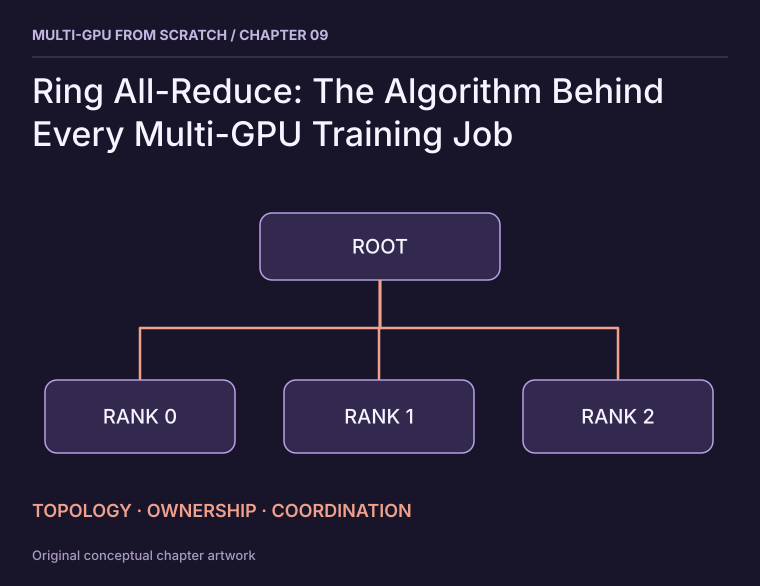
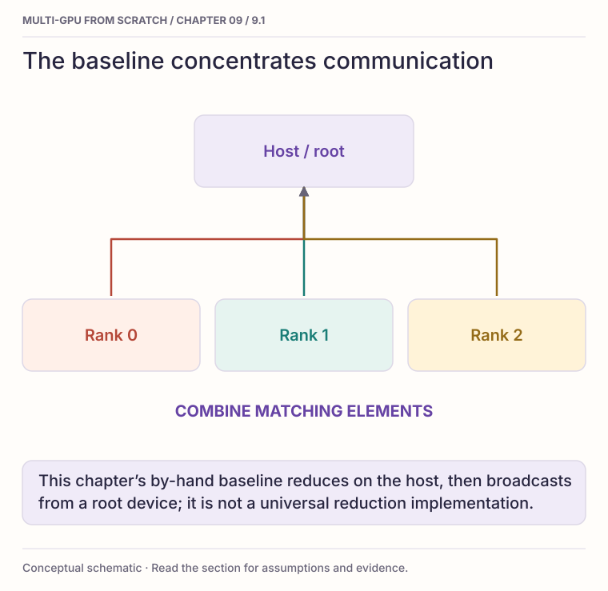
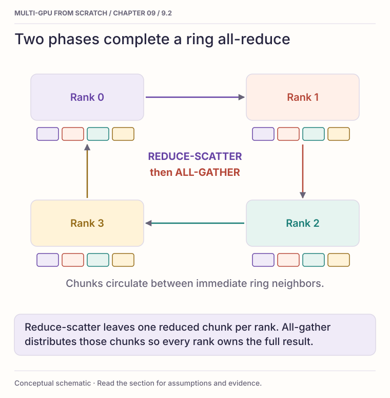
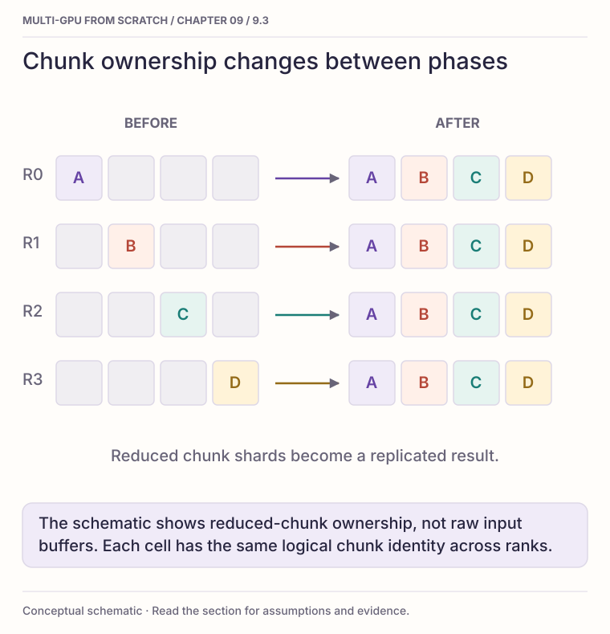

# Chapter 9: Ring All-Reduce: The Algorithm Behind Every Multi-GPU Training Job

<!-- execution:provenance -->
!!! info "Execution provenance"

    Current execution blocks identify the tested source hash, hardware dataset, commands and captured output. References elsewhere on this page to a device-less environment describe the original authoring context. Historical output is superseded by the current record. Displayed output omits the runner command header and trims trailing line whitespace; raw logs remain exact. A host simulation or API validation has its stated scope; neither alone establishes a numerical multi-GPU workload or measured performance.


<!-- mgpu:opener:start -->
[](../images/chapter-openers/09.svg)
<!-- mgpu:opener:end -->

**What you will understand by the end of this chapter:**

- Why all-reduce -- every device ending up with the *same* combined result, not just one root -- is a genuinely different goal from Chapter 8's reduce, and why the simplest way to get there (chain Chapter 8's two collectives together) concentrates all the real work on a single central hub.
- How ring all-reduce spreads that same work evenly across every device by having each one talk only to its immediate ring-neighbor, in two phases: scatter-reduce, then all-gather.
- The real, closed-form reason this algorithm is the one essentially every real multi-GPU training job actually uses for gradient synchronization: it moves a fixed, bounded amount of data per device, no matter how large the group of devices grows.

**What you need to know first:**

- Chapter 8's broadcast and reduce, and its host-side simulation technique, now Part 2's primary verification tool.
- Chapter 2's `ringBottleneck()` model and the general idea that a ring's throughput is set by its slowest edge.
- No new CUDA concepts beyond composing calls this book has already introduced.

---

Chapter 8 built reduce -- every device's data combined into one correct result, on one root device. All-reduce asks for something related but distinct: every device ending up holding that *same* combined result, not just the root. Getting there is easy in principle -- reduce to a root, then broadcast the root's result back out, using nothing but Chapter 8's own two collectives, one after the other. It's also exactly the wrong way to do it at scale, because every byte of that approach passes through one central hub on the way in and again on the way out -- in this chapter's by-hand version, the host during the reduce and the root device during the broadcast. Ring all-reduce fixes this by rethinking who talks to whom: instead of a star with one root at the center, every device sits in a ring and only ever exchanges data with its two immediate neighbors. This is the algorithm underneath essentially every real multi-GPU training job's gradient synchronization step, and this chapter builds it, by hand, directly on top of what Chapters 2 and 8 already gave this book.

```text
NAIVE (Chapter 8's two collectives, chained):

  REDUCE:     dev0 --+
              dev1 --+
              dev2 --+--> [ HUB ]
              dev3 --+

  BROADCAST:            [ HUB ] --+--> dev1
                                  +--> dev2
                                  +--> dev3

  Every byte passes through one hub on the way in (reduce) and again
  on the way out (broadcast). The hub's load grows with N; everyone
  else is idle most of the time. (In this chapter's by-hand code the
  reduce hub is the host and the broadcast hub is the root, dev0.)

RING (this chapter):

  dev0 --> dev1 --> dev2 --> dev3 --+
   ^                                |
   +--------------------------------+
        (dev3's next neighbor is dev0)

  Every device only ever talks to its two ring neighbors -- no device
  is ever singled out, and the per-device load stays bounded.
```

## 9.1 The Naive Baseline: Reduce-to-Root, Then Broadcast

<!-- mgpu:figure-1:start -->
[](../images/technical/ch09/1-hub.svg)
<!-- mgpu:figure-1:end -->

### Intuition

The most direct way to make every device hold the same combined result is to not invent anything new at all: run Chapter 8's reduce to get the correct sum onto one root device, then run Chapter 8's broadcast to send that root's result to everyone else. This is completely correct -- every device really does end up with the right answer -- and it's the natural first thing to reach for. Its cost is concentrated in one central hub per phase: something has to receive everyone's data during the reduce phase, and then the root has to turn around and send the result to everyone else during the broadcast phase. In the textbook version of this star, the root device is the hub for both phases. In this section's by-hand code, which has no device kernel to sum on-GPU, the reduce phase's hub is actually the *host*: every device -- the root included -- copies its full buffer down to host memory, the host sums them, and writes the one result back up to the root, which then broadcasts it. Either way, every other device only ever sends once and receives once.

### Background

The code below is literally Section 8.2's reduce loop followed by Section 8.1's broadcast loop, with one connecting step in between: the host-computed sum has to be written back onto the root device before it can be broadcast from there, since the accumulation itself happened on the host, not on any device. Nothing about either loop changes from Chapter 8 (including Chapter 3's rule of calling `cudaSetDevice()` before each device's own allocation) -- what's new here is only that they're run back-to-back, on the same buffer, which is exactly what turns "a reduce" and "a broadcast" into "an all-reduce." Be precise about the data path this produces: `N` device-to-host copies converge on the host, one host-to-device copy goes to the root, and `N-1` peer copies leave the root. The real bottleneck of the reduce phase is the host (and its PCIe link), not the root device.

```cpp
// 23_naive_allreduce.cu
// Checked teaching implementation; serial host scheduling favors clarity, not speed.
#include <cstdio>
#include <vector>
#include <algorithm>
#include <cuda_runtime.h>
#define CUDA(call) do { cudaError_t status = (call); if (status != cudaSuccess) { \
 fprintf(stderr,"%s: %s\n",#call,cudaGetErrorString(status)); \
 return status==cudaErrorNoDevice || status==cudaErrorInsufficientDriver ? 2 : 1; } } while(0)
static int pattern(int rank, int i) { return rank*1000+i*3+i%7; }
int main() {
 int count=0; CUDA(cudaGetDeviceCount(&count));
 if(count<2){printf("BLOCKED: requires 2 GPUs; found %d.\n",count);return 2;}
 const int world=std::min(count,4), CHUNK=33;
 const int n=257, out_n=257;
 const size_t bytes=n*sizeof(int), out_bytes=out_n*sizeof(int);
 std::vector<int*> send(world,nullptr),receive(world,nullptr);
 for(int rank=0;rank<world;++rank){
  CUDA(cudaSetDevice(rank));CUDA(cudaMalloc(&send[rank],bytes));CUDA(cudaMalloc(&receive[rank],out_bytes));
  std::vector<int> input(n);for(int i=0;i<n;++i)input[i]=pattern(rank,i);
  CUDA(cudaMemcpy(send[rank],input.data(),bytes,cudaMemcpyHostToDevice));CUDA(cudaMemset(receive[rank],0xff,out_bytes));
 }
 std::vector<int> sum(n,0), staging(n);
 for(int rank=0;rank<world;++rank){CUDA(cudaSetDevice(rank));CUDA(cudaMemcpy(staging.data(),send[rank],bytes,cudaMemcpyDeviceToHost));for(int i=0;i<n;++i)sum[i]+=staging[i];}
 CUDA(cudaSetDevice(0));CUDA(cudaMemcpy(receive[0],sum.data(),out_bytes,cudaMemcpyHostToDevice));
 for(int dst=1;dst<world;++dst){CUDA(cudaSetDevice(dst));CUDA(cudaMemcpyPeer(receive[dst],dst,receive[0],0,out_bytes));}
 for(int rank=0;rank<world;++rank){CUDA(cudaSetDevice(rank));CUDA(cudaDeviceSynchronize());}
 for(int rank=0;rank<world;++rank){std::vector<int> output(out_n);CUDA(cudaSetDevice(rank));CUDA(cudaMemcpy(output.data(),receive[rank],out_bytes,cudaMemcpyDeviceToHost));for(int i=0;i<out_n;++i){int expected=1000*world*(world-1)/2+world*(i*3+i%7);if(output[i]!=expected){fprintf(stderr,"FAIL rank %d output[%d]: %d expected %d\n",rank,i,output[i],expected);return 1;}}}
 for(int rank=0;rank<world;++rank){CUDA(cudaSetDevice(rank));CUDA(cudaFree(send[rank]));CUDA(cudaFree(receive[rank]));}
 printf("PASS: naive host-reduce plus peer-broadcast all-reduce on %d GPUs, all nonuniform output values checked.\n",world);
 return 0;
}
```

<!-- execution:start:a100:23_naive_allreduce.cu -->
> **Current execution — 2026-11-17-a100: Numerical/transport validation (recorded scope).** UTC (program start): `2026-11-18T00:01:20.304652+00:00`. Source SHA-256: `f5544339121bb2e49bb8fd519650811b79ab49543007222374435d50b1c7dbe5`.

[Exact tested source](../validation/2026-11-17-a100/23_naive_allreduce/23_naive_allreduce.cu) · [Compiler log](../validation/2026-11-17-a100/23_naive_allreduce/compile.log) · [Execution log](../validation/2026-11-17-a100/23_naive_allreduce/run.log). Compile exit: `0`; run exit: `0`.

Commands below use local source/binary names; raw logs retain host paths. Execute in a scratch directory containing the downloaded source.

```bash
nvcc -std=c++17 -O2 -arch=sm_80 23_naive_allreduce.cu -o ./example
./example
```

<details markdown="1"><summary>Captured current-source output</summary>

```text
PASS: naive host-reduce plus peer-broadcast all-reduce on 4 GPUs, all nonuniform output values checked.
```

</details>
<!-- execution:end:a100:23_naive_allreduce.cu -->


<!-- execution:start:h100:23_naive_allreduce.cu -->
> **Current execution — 2026-11-17-h100: Numerical/transport validation (recorded scope).** UTC (run-batch start; per-program time unrecorded): `2026-11-17T23:48:18.967387+00:00`. Source SHA-256: `f5544339121bb2e49bb8fd519650811b79ab49543007222374435d50b1c7dbe5`.

[Exact tested source](../validation/2026-11-17-h100/23_naive_allreduce/23_naive_allreduce.cu) · [Compiler log](../validation/2026-11-17-h100/23_naive_allreduce/compile.log) · [Execution log](../validation/2026-11-17-h100/23_naive_allreduce/run.log). Compile exit: `0`; run exit: `0`.

Commands below use local source/binary names; raw logs retain host paths. Execute in a scratch directory containing the downloaded source.

```bash
nvcc -std=c++17 -O2 -arch=sm_90 23_naive_allreduce.cu -o ./example
./example
```

<details markdown="1"><summary>Captured current-source output</summary>

```text
PASS: naive host-reduce plus peer-broadcast all-reduce on 2 GPUs, all nonuniform output values checked.
```

</details>
<!-- execution:end:h100:23_naive_allreduce.cu -->


**Current-source scope:** Real device buffers implement naive host-reduce plus peer-broadcast all-reduce; integer reference checks every output. Host-staged reductions deliberately use CPU arithmetic and are not GPU reduction kernels. The current source was compiled and executed in the dated H100 suite; use the linked record for its numerical, API-probe or other-execution scope. The output below is retained from the earlier authoring diagnostic and is not evidence for this replacement source.

The [2026-11-17 H100 execution record](../validation-h100.md) covers two GPUs connected by local NV18. It distinguishes numerical checks, API probes and other executions; a successful exit alone does not establish GPU algorithm correctness.

<details markdown="1"><summary>Historical authoring output — superseded by the current execution above</summary>

```
cudaGetDeviceCount(): 0 device(s).
Broadcast phase, cudaMemcpy(host result -> root device): no CUDA-capable device is detected (code 100)

Reduced 0 device(s) through the host, then broadcast reached
0 non-root device(s). Each phase of this all-reduce funnels
everything through ONE hub: the HOST receives every device's
full buffer during the reduce phase, and the ROOT device sends a
full buffer to every other device during the broadcast phase --
while every other device only ever sends once and receives once.
Section 9.3 puts counted numbers on this star-shaped imbalance.
```

</details>

File 23 checks the actual transported data and host-accumulated result on the H100 pair. Its star-shaped schedule remains a teaching baseline; the simulation below explores its workload distribution separately from measured GPU correctness.

The [2026-11-17 H100 execution record](../validation-h100.md) covers two GPUs connected by local NV18. It distinguishes numerical checks, API probes and other executions; a successful exit alone does not establish GPU algorithm correctness.

!!! warning "[COMMON TRAP] Assuming the hub's extra work is 'fine' because it's still just one loop iteration more per call site"
    Reading Section 9.1's code, the root device's special handling looks like a small, local detail -- one extra `cudaMemcpy()` call, one `continue` statement skipping it in the broadcast loop. What that framing hides is that the hubs' *total* data movement scales with the number of devices in the group: the host receives a full buffer from every device during the reduce phase, and the root sends a full buffer to every other device during the broadcast phase. As the device count grows, the hubs' workload grows right along with it, while every other device's workload stays flat at "one buffer sent, one buffer received." Section 9.3 turns this into an exact ratio rather than an intuition.

## 9.2 Ring All-Reduce: Every Device Talks Only to Its Neighbor

<!-- mgpu:figure-2:start -->
[](../images/technical/ch09/2-ring.svg)
<!-- mgpu:figure-2:end -->

### Intuition

Ring all-reduce solves Section 9.1's imbalance by removing the root entirely. Arrange every device in a ring, so each one has exactly one "next" neighbor and one "previous" neighbor, and split each device's buffer into as many equal chunks as there are devices. The algorithm then runs in two phases, using the *identical* ring communication pattern for both: a **scatter-reduce** phase, where each chunk is passed around the ring, picking up one more device's contribution at every hop, until it has been summed across every device; and an **all-gather** phase, which uses that same ring pattern to forward each now-fully-summed chunk the rest of the way around, so every device ends up holding every chunk. As Andrew Gibiansky's widely-cited description of Baidu's ring-allreduce implementation puts it plainly, "the algorithm proceeds in two steps: first, a scatter-reduce, and then, an allgather" -- and because every device does the same small amount of work at every step, "given the right choice of neighbors for every GPU, this algorithm is bandwidth-optimal."

### Background

One ring step, on its own, is nothing more than a single `cudaMemcpyPeer()` call per device, each one sending its current chunk to `(i+1) % N` -- there is no root, no special case, and every device runs the exact same line of code. The full algorithm (built in Section 9.3) is just this one step, repeated `2*(N-1)` times: `N-1` repetitions for the scatter-reduce phase, then `N-1` more for the all-gather phase.

```text
ONE ring step, all N devices simultaneously:

    dev0 --chunk--> dev1        dev1 --chunk--> dev2
    dev2 --chunk--> dev3        dev3 --chunk--> dev0

Every device: exactly one cudaMemcpyPeer() call, to exactly one
neighbor, moving exactly one chunk. No device does more work than
any other, at any step -- this is the entire structural difference
from Section 9.1's star pattern.
```

```cpp
// 24_ring_step_by_hand.cu
// Checked teaching implementation; serial host scheduling favors clarity, not speed.
#include <cstdio>
#include <vector>
#include <algorithm>
#include <cuda_runtime.h>
#define CUDA(call) do { cudaError_t status = (call); if (status != cudaSuccess) { \
 fprintf(stderr,"%s: %s\n",#call,cudaGetErrorString(status)); \
 return status==cudaErrorNoDevice || status==cudaErrorInsufficientDriver ? 2 : 1; } } while(0)
static int pattern(int rank, int i) { return rank*1000+i*3+i%7; }
int main() {
 int count=0; CUDA(cudaGetDeviceCount(&count));
 if(count<2){printf("BLOCKED: requires 2 GPUs; found %d.\n",count);return 2;}
 const int world=std::min(count,4), CHUNK=33;
 const int n=CHUNK, out_n=CHUNK;
 const size_t bytes=n*sizeof(int), out_bytes=out_n*sizeof(int);
 std::vector<int*> send(world,nullptr),receive(world,nullptr);
 for(int rank=0;rank<world;++rank){
  CUDA(cudaSetDevice(rank));CUDA(cudaMalloc(&send[rank],bytes));CUDA(cudaMalloc(&receive[rank],out_bytes));
  std::vector<int> input(n);for(int i=0;i<n;++i)input[i]=pattern(rank,i);
  CUDA(cudaMemcpy(send[rank],input.data(),bytes,cudaMemcpyHostToDevice));CUDA(cudaMemset(receive[rank],0xff,out_bytes));
 }
 for(int src=0;src<world;++src){int dst=(src+1)%world;CUDA(cudaSetDevice(dst));CUDA(cudaMemcpyPeer(receive[dst],dst,send[src],src,bytes));}
 for(int rank=0;rank<world;++rank){CUDA(cudaSetDevice(rank));CUDA(cudaDeviceSynchronize());}
 for(int rank=0;rank<world;++rank){std::vector<int> output(out_n);CUDA(cudaSetDevice(rank));CUDA(cudaMemcpy(output.data(),receive[rank],out_bytes,cudaMemcpyDeviceToHost));for(int i=0;i<out_n;++i){int expected=pattern((rank+world-1)%world,i);if(output[i]!=expected){fprintf(stderr,"FAIL rank %d output[%d]: %d expected %d\n",rank,i,output[i],expected);return 1;}}}
 for(int rank=0;rank<world;++rank){CUDA(cudaSetDevice(rank));CUDA(cudaFree(send[rank]));CUDA(cudaFree(receive[rank]));}
 printf("PASS: one ring step (distinct send/receive storage) on %d GPUs, all nonuniform output values checked.\n",world);
 return 0;
}
```

<!-- execution:start:a100:24_ring_step_by_hand.cu -->
> **Current execution — 2026-11-17-a100: Numerical/transport validation (recorded scope).** UTC (program start): `2026-11-18T00:01:25.748466+00:00`. Source SHA-256: `56eb9fa1d22abfcbb7b7022a76d3cc429e2665fdbc836427dbc6795a92f97137`.

[Exact tested source](../validation/2026-11-17-a100/24_ring_step_by_hand/24_ring_step_by_hand.cu) · [Compiler log](../validation/2026-11-17-a100/24_ring_step_by_hand/compile.log) · [Execution log](../validation/2026-11-17-a100/24_ring_step_by_hand/run.log). Compile exit: `0`; run exit: `0`.

Commands below use local source/binary names; raw logs retain host paths. Execute in a scratch directory containing the downloaded source.

```bash
nvcc -std=c++17 -O2 -arch=sm_80 24_ring_step_by_hand.cu -o ./example
./example
```

<details markdown="1"><summary>Captured current-source output</summary>

```text
PASS: one ring step (distinct send/receive storage) on 4 GPUs, all nonuniform output values checked.
```

</details>
<!-- execution:end:a100:24_ring_step_by_hand.cu -->


<!-- execution:start:h100:24_ring_step_by_hand.cu -->
> **Current execution — 2026-11-17-h100: Numerical/transport validation (recorded scope).** UTC (run-batch start; per-program time unrecorded): `2026-11-17T23:48:18.967387+00:00`. Source SHA-256: `56eb9fa1d22abfcbb7b7022a76d3cc429e2665fdbc836427dbc6795a92f97137`.

[Exact tested source](../validation/2026-11-17-h100/24_ring_step_by_hand/24_ring_step_by_hand.cu) · [Compiler log](../validation/2026-11-17-h100/24_ring_step_by_hand/compile.log) · [Execution log](../validation/2026-11-17-h100/24_ring_step_by_hand/run.log). Compile exit: `0`; run exit: `0`.

Commands below use local source/binary names; raw logs retain host paths. Execute in a scratch directory containing the downloaded source.

```bash
nvcc -std=c++17 -O2 -arch=sm_90 24_ring_step_by_hand.cu -o ./example
./example
```

<details markdown="1"><summary>Captured current-source output</summary>

```text
PASS: one ring step (distinct send/receive storage) on 2 GPUs, all nonuniform output values checked.
```

</details>
<!-- execution:end:h100:24_ring_step_by_hand.cu -->


**Current-source scope:** Real device buffers implement one ring step (distinct send/receive storage); integer reference checks every output. Host-staged reductions deliberately use CPU arithmetic and are not GPU reduction kernels. The current source was compiled and executed in the dated H100 suite; use the linked record for its numerical, API-probe or other-execution scope. The output below is retained from the earlier authoring diagnostic and is not evidence for this replacement source.

The [2026-11-17 H100 execution record](../validation-h100.md) covers two GPUs connected by local NV18. It distinguishes numerical checks, API probes and other executions; a successful exit alone does not establish GPU algorithm correctness.

<details markdown="1"><summary>Historical authoring output — superseded by the current execution above</summary>

```
cudaGetDeviceCount(): 0 device(s).

0 of 0 device(s) completed this ring step. On real hardware,
every device performs exactly one cudaMemcpyPeer of exactly one
chunk per step -- the same amount of work, every step, no matter
how many devices are in the ring, and no device singled out.
```

</details>

File 24 checks the actual ring transport and its resulting data on two H100 GPUs. The simulation below extends the modeled round structure to other rank counts; those simulated cases are not additional hardware executions.

The [2026-11-17 H100 execution record](../validation-h100.md) covers two GPUs connected by local NV18. It distinguishes numerical checks, API probes and other executions; a successful exit alone does not establish GPU algorithm correctness.

!!! warning "[COMMON TRAP] Thinking one ring step alone constitutes a complete all-reduce"
    A single step like the one in this section's code only moves each device's chunk one hop around the ring -- it does not, by itself, sum anything across every device, and it certainly doesn't leave every device with the same final answer. The scatter-reduce phase needs `N-1` such steps just to get one fully-reduced chunk to its "owner" device, and the all-gather phase needs `N-1` more to spread each owner's completed chunk back out to everyone. One step is the algorithm's atomic building block, not the algorithm.

## 9.3 Verifying Correctness and the Real Data-Volume Advantage

<!-- mgpu:figure-3:start -->
[](../images/technical/ch09/3-chunks.svg)
<!-- mgpu:figure-3:end -->

### Intuition

The preceding GPU examples now have numerical H100 checks. The host simulation adds independent arithmetic and message-pattern checks across modeled rank counts and measures modeled workload distribution; it does not measure physical-link bandwidth or validate scheduling at those other rank counts.

The [2026-11-17 H100 execution record](../validation-h100.md) covers two GPUs connected by local NV18. It distinguishes numerical checks, API probes and other executions; a successful exit alone does not establish GPU algorithm correctness.

### Background

Tracking a single chunk's actual journey around the ring makes the two-phase structure concrete. Using this section's own simulation, with device `i`'s chunk 0 initialized to `(i+1)*10` (so device 0 holds 10, device 1 holds 20, and so on):

```text
Tracking just CHUNK 0 as it travels around the ring (N=4 devices):

SCATTER-REDUCE phase (each hop ADDS the local value in):

  dev0(10) --chunk0=10--> dev1: 20+10 = 30
  dev1(30) --chunk0=30--> dev2: 30+30 = 60
  dev2(60) --chunk0=60--> dev3: 40+60 = 100   (dev3 now owns the FULL
                                                reduced sum for chunk 0)

ALL-GATHER phase (each hop OVERWRITES/forwards, no more adding):

  dev3(100) --chunk0=100--> dev0: now 100
  dev0(100) --chunk0=100--> dev1: now 100
  dev1(100) --chunk0=100--> dev2: now 100

  Every device now holds 100 for chunk 0 -- matching this book's own
  independently-computed reference (10+20+30+40 = 100).
```

The full simulation below runs this same pattern for *every* chunk simultaneously, across all `2*(N-1)` steps, using a single formula -- `sendChunk = (deviceIndex - step) mod N` -- for which chunk moves at every step of both phases; only whether that step *adds* or *overwrites* changes between the two phases. After confirming correctness, the code compares data volume against Section 9.1's naive baseline for this exact problem size. The ring's figures are genuinely *counted*: the simulation loop increments a per-device `sent` and `received` counter on every hop, and the code checks that every device's count is identical. The naive figures are closed-form, in the style of Chapter 5's cost model, for the idealized root-centered star (one hub receiving `N-1` buffers, then sending `N-1`); File 23's host-staged version has the same star shape with the hub's role split between the host and the root. No fabricated timing, only element counts.

```cpp
// Chapter 9: Ring All-Reduce -- The Algorithm Behind Every Multi-GPU
// Training Job
// 25_ring_allreduce_simulation.cpp
//
// Plain host C++ -- verifying the real ring all-reduce algorithm's
// correctness, and comparing its data volume against Section 9.1's
// naive baseline. The ring's traffic is COUNTED from the simulation
// loop itself; the naive baseline's is a closed-form formula. N real in-memory buffers stand in
// for N real device memories; every step below moves exactly one
// chunk per device, exactly like Section 9.2's single real
// cudaMemcpyPeer step, repeated 2*(N-1) times.
#include <cstdio>
#include <vector>

using Chunks = std::vector<int>; // one device's chunks, indexed by chunk id

int main() {
    const int N = 4;

    std::vector<Chunks> devices(N, Chunks(N));
    for (int i = 0; i < N; ++i)
        for (int c = 0; c < N; ++c)
            devices[i][c] = (i + 1) * 10 + c;

    Chunks reference(N, 0);
    for (int c = 0; c < N; ++c)
        for (int i = 0; i < N; ++i)
            reference[c] += devices[i][c];

    printf("Independent reference (sum of all %d devices' chunks): ", N);
    for (int c = 0; c < N; ++c) printf("%d ", reference[c]);
    printf("\n\n");

    const int totalSteps = 2 * (N - 1);
    std::vector<long long> sent(N, 0), received(N, 0); // elements, counted
    for (int step = 0; step < totalSteps; ++step) {
        std::vector<Chunks> snapshot = devices;
        bool scatterReducePhase = (step < N - 1);
        for (int j = 0; j < N; ++j) {
            int sendChunk = ((j - step) % N + N) % N;
            int next = (j + 1) % N;
            ++sent[j];        // one 1-element chunk leaves device j...
            ++received[next]; // ...and arrives at device next
            if (scatterReducePhase) {
                devices[next][sendChunk] = snapshot[next][sendChunk] + snapshot[j][sendChunk];
            } else {
                devices[next][sendChunk] = snapshot[j][sendChunk];
            }
        }
    }

    bool allMatch = true;
    for (int i = 0; i < N; ++i) {
        if (devices[i] != reference) allMatch = false;
    }
    printf("After %d ring steps (scatter-reduce + all-gather), all %d "
           "devices hold the reference sum: %s\n",
           totalSteps, N, allMatch ? "PASS" : "FAIL");

    // Data-volume comparison against Section 9.1's naive
    // reduce-then-broadcast baseline, for this exact same problem size.
    // "Traffic" below counts BOTH directions (sent + received) for
    // every device, so the two algorithms are compared on the same
    // basis. Gibiansky's 2(N-1)K/N counts ONE direction (what each GPU
    // sends, which equals what it receives), so it is exactly half of
    // the two-direction figure -- printed separately below.
    const int bufferSize = N; // elements per device (N chunks of 1 element each)

    // Naive (closed form, idealized root-centered star): the hub
    // receives (N-1)*bufferSize during reduce, then sends
    // (N-1)*bufferSize during broadcast. (File 23 splits this hub
    // between the host and the root; the star shape is the same.)
    long long naiveRootTraffic = 2LL * (N - 1) * bufferSize;
    // Every other device just sends once and receives once, each of
    // one full buffer.
    long long naiveOtherTraffic = 2LL * bufferSize;

    // Ring: counted from the loop above. Every device must have the
    // SAME count -- that equality is the "no device singled out" claim.
    long long ringPerDeviceTraffic = sent[0] + received[0];
    bool ringBalanced = true;
    for (int i = 0; i < N; ++i)
        if (sent[i] + received[i] != ringPerDeviceTraffic || sent[i] != received[i])
            ringBalanced = false;

    printf("\nData-volume comparison for this exact problem (N=%d devices, "
           "%d elements/device):\n", N, bufferSize);
    printf("  Naive hub's traffic (closed form): %lld elements (bottleneck)\n", naiveRootTraffic);
    printf("  Naive non-hub device's traffic:   %lld elements\n", naiveOtherTraffic);
    printf("  Ring: EVERY device's traffic:      %lld elements (counted; all devices equal: %s)\n",
           ringPerDeviceTraffic, ringBalanced ? "PASS" : "FAIL");
    printf("  Ring: elements SENT per device:    %lld = Gibiansky's 2(N-1)K/N = %d\n",
           sent[0], 2 * (N - 1) * bufferSize / N);
    printf("  Ratio (naive hub / ring device):   %.2fx -- equals N/2 exactly.\n",
           (double)naiveRootTraffic / (double)ringPerDeviceTraffic);

    return (allMatch && ringBalanced) ? 0 : 1;
}
```

<!-- execution:start:a100:25_ring_allreduce_simulation.cpp -->
> **Current execution — 2026-11-17-a100: Host program/model (exit-only).** UTC (program start): `2026-11-18T00:01:31.143084+00:00`. Source SHA-256: `df47049aefe87153ff0b4d0aa159a8109ae12c4d23ef95face231ffc5b5d8de4`.

[Exact tested source](../validation/2026-11-17-a100/25_ring_allreduce_simulation/25_ring_allreduce_simulation.cpp) · [Compiler log](../validation/2026-11-17-a100/25_ring_allreduce_simulation/compile.log) · [Execution log](../validation/2026-11-17-a100/25_ring_allreduce_simulation/run.log). Compile exit: `0`; run exit: `0`.

Commands below use local source/binary names; raw logs retain host paths. Execute in a scratch directory containing the downloaded source.

```bash
g++ -std=c++17 -O2 25_ring_allreduce_simulation.cpp -o ./example
./example
```

<details markdown="1"><summary>Captured current-source output</summary>

```text
Independent reference (sum of all 4 devices' chunks): 100 104 108 112

After 6 ring steps (scatter-reduce + all-gather), all 4 devices hold the reference sum: PASS

Data-volume comparison for this exact problem (N=4 devices, 4 elements/device):
  Naive hub's traffic (closed form): 24 elements (bottleneck)
  Naive non-hub device's traffic:   8 elements
  Ring: EVERY device's traffic:      12 elements (counted; all devices equal: PASS)
  Ring: elements SENT per device:    6 = Gibiansky's 2(N-1)K/N = 6
  Ratio (naive hub / ring device):   2.00x -- equals N/2 exactly.
```

</details>
<!-- execution:end:a100:25_ring_allreduce_simulation.cpp -->


<!-- execution:start:h100:25_ring_allreduce_simulation.cpp -->
> **Current execution — 2026-11-17-h100: Host program/model (exit-only).** UTC (run-batch start; per-program time unrecorded): `2026-11-17T23:48:18.967387+00:00`. Source SHA-256: `df47049aefe87153ff0b4d0aa159a8109ae12c4d23ef95face231ffc5b5d8de4`.

[Exact tested source](../validation/2026-11-17-h100/25_ring_allreduce_simulation/25_ring_allreduce_simulation.cpp) · [Compiler log](../validation/2026-11-17-h100/25_ring_allreduce_simulation/compile.log) · [Execution log](../validation/2026-11-17-h100/25_ring_allreduce_simulation/run.log). Compile exit: `0`; run exit: `0`.

Commands below use local source/binary names; raw logs retain host paths. Execute in a scratch directory containing the downloaded source.

```bash
g++ -std=c++17 -O2 25_ring_allreduce_simulation.cpp -o ./example
./example
```

<details markdown="1"><summary>Captured current-source output</summary>

```text
Independent reference (sum of all 4 devices' chunks): 100 104 108 112

After 6 ring steps (scatter-reduce + all-gather), all 4 devices hold the reference sum: PASS

Data-volume comparison for this exact problem (N=4 devices, 4 elements/device):
  Naive hub's traffic (closed form): 24 elements (bottleneck)
  Naive non-hub device's traffic:   8 elements
  Ring: EVERY device's traffic:      12 elements (counted; all devices equal: PASS)
  Ring: elements SENT per device:    6 = Gibiansky's 2(N-1)K/N = 6
  Ratio (naive hub / ring device):   2.00x -- equals N/2 exactly.
```

</details>
<!-- execution:end:h100:25_ring_allreduce_simulation.cpp -->


Genuinely compiled with `g++` and genuinely run. Locked output, deterministic across repeated runs:

<details markdown="1"><summary>Historical authoring output — superseded by the current execution above</summary>

```
Independent reference (sum of all 4 devices' chunks): 100 104 108 112 

After 6 ring steps (scatter-reduce + all-gather), all 4 devices hold the reference sum: PASS

Data-volume comparison for this exact problem (N=4 devices, 4 elements/device):
  Naive hub's traffic (closed form): 24 elements (bottleneck)
  Naive non-hub device's traffic:   8 elements
  Ring: EVERY device's traffic:      12 elements (counted; all devices equal: PASS)
  Ring: elements SENT per device:    6 = Gibiansky's 2(N-1)K/N = 6
  Ratio (naive hub / ring device):   2.00x -- equals N/2 exactly.
```

</details>

The correctness check passes: every device genuinely ends up holding the same, correctly-summed buffer, verified against a reference computed completely independently of the ring algorithm's own logic. The data-volume comparison then makes Section 9.1's Common Trap concrete: for this N=4 example, the naive approach's hub moves exactly 2x as much data as *any single device* in the ring does -- and per Gibiansky's own description, "the total amount of data transferred to and from every GPU is `2(N−1)K/N` which, crucially, is independent of the number of GPUs" (with `K` as the full buffer size). Note the factor of two between that formula and this section's "12 elements": Gibiansky's `2(N−1)K/N` counts each element once per hop -- equivalently, what each GPU *sends* (which equals what it receives) -- giving `2*3*4/4 = 6` here, exactly the counted "SENT per device" line. This section's traffic figure counts *both* directions (sent + received) for every device, naive and ring alike, so it is exactly double Gibiansky's figure; the ratio between the two algorithms is unaffected, because both sides are counted on the same basis. Either way, this means the ring's *per-device* load stays bounded as `N` grows, while the naive approach's hub keeps absorbing more and more of the total traffic as more devices join.

!!! warning "[COMMON TRAP] Assuming the '2.00x' ratio measured here is the whole story as N grows"
    This section's ratio (`naiveRootTraffic / ringPerDeviceTraffic`) works out to exactly `N/2` for the buffer size used here -- 2.00x at N=4, but 5x at N=10, and 50x at N=100. The gap between the two approaches doesn't stay fixed; it widens linearly with the number of devices in the group, because the naive hub's traffic scales with `N` while the ring's per-device traffic (per Gibiansky's cited formula) is asymptotically *independent* of `N`. This section's PASS results establish correctness at N=4; the formula, not the specific number 2.00x, is what generalizes to real training runs with far more than 4 devices.

## Chapter Summary

All-reduce asks for every device to hold an identical, correctly-combined result -- a stronger requirement than Chapter 8's reduce, which only guaranteed that result on one root. The most direct way to get there chains Chapter 8's two collectives together, but concentrates all the real work on a central hub -- in this chapter's by-hand code, the host during the reduce phase and the root device during the broadcast -- whose total traffic grows with the number of devices in the group (Section 9.1). Ring all-reduce removes the root entirely: every device talks only to its immediate ring-neighbor, running the identical single-chunk transfer at every step (Section 9.2), across two phases -- scatter-reduce, then all-gather -- that use the exact same communication pattern for fundamentally different purposes, first accumulating each chunk's sum, then spreading each completed chunk back out. Section 9.3 verified both properties genuinely: the algorithm produces the correct, identical result at every simulated device, with every device's traffic counted and found identical, and its data-volume advantage over the naive baseline is an exact ratio (`N/2` for this section's buffer size, with traffic counted in both directions -- exactly double Gibiansky's one-direction `2(N-1)K/N`) that widens as the device count grows, cited directly to the standard description of Baidu's ring-allreduce implementation. Chapter 10 extends this same ring-based thinking to the remaining core collectives -- all-gather, reduce-scatter, and all-to-all -- each one either a piece of what this chapter already built, or a close relative of it.

## Self-Check Questions

1. Explain, in your own words, the difference between what Chapter 8's reduce guarantees and what this chapter's all-reduce guarantees.
2. Section 9.1's Common Trap says the root's extra call "looks like a small, local detail" but isn't. Using the naive algorithm's two phases, explain specifically what makes the hub's total workload scale with the device count while every other device's does not.
3. Section 9.2 states that one ring step is "the algorithm's atomic building block, not the algorithm." How many total ring steps does the full two-phase algorithm need, for a group of N devices, and how are they split between the two phases?
4. Using Section 9.3's chunk-0 trace, explain why device 3 (not device 0) is the device that ends up holding the fully-reduced sum for chunk 0 at the end of the scatter-reduce phase, for this specific N=4 example.
5. Section 9.3's code uses a single formula, `sendChunk = (deviceIndex - step) mod N`, for every step of both phases. What is the one thing that actually changes between the scatter-reduce phase and the all-gather phase, if the chunk-selection formula itself doesn't?
6. Quote the specific real-world claim this chapter cites to justify that the ring algorithm's per-device data volume does not grow with the number of devices, unlike the naive approach's root.
7. Suppose this chapter's exact simulation were re-run with N=8 devices instead of N=4, keeping one element per chunk. Using the formulas in Section 9.3's code, compute the new naive root traffic, the new ring per-device traffic, and their ratio. Does the ratio match what Section 9.3's Common Trap predicts for N=8?
8. Why does Section 9.3 check the ring algorithm's result against an independently-computed `reference`, rather than simply checking that the naive algorithm and the ring algorithm produce the same result as each other?

## Where We Go Next

Chapter 10 builds the remaining core collectives -- all-gather, reduce-scatter, and all-to-all -- on the same ring-based foundation this chapter established: all-gather is this chapter's second phase used on its own, reduce-scatter is this chapter's first phase used on its own (with one difference in *which* device ends up owning *which* reduced chunk, which Chapter 10 makes precise), and all-to-all is a related but genuinely different pattern this book builds from scratch using the same verification discipline.

## Worked Solutions

**1.** Chapter 8's reduce combines every device's data into a single correct result that exists on exactly one device -- the root. This chapter's all-reduce combines the same data into a single correct result, but requires that result to exist, identically, on *every* device in the group, not just one. All-reduce is strictly the stronger guarantee; reduce is one building block toward it (as Section 9.1's naive approach shows directly), but reduce alone does not satisfy all-reduce's requirement.

**2.** In the idealized root-centered star that Section 9.3's closed form models, the root receives one full buffer from each of the other `N-1` devices during the reduce phase -- `(N-1)` buffers inbound -- and sends one full buffer to each of those same `N-1` devices during the broadcast phase -- another `(N-1)` buffers outbound. Section 9.1's actual by-hand code splits that hub role: the *host* receives a full buffer from all `N` devices during the reduce phase (then writes one result buffer to the root), and the *root* sends `N-1` buffers during the broadcast phase. Either way, every other device sends exactly one buffer (during the reduce phase) and receives exactly one buffer (during the broadcast phase), regardless of how many total devices are in the group. The hub's traffic is tied to `N`; everyone else's is a fixed, small constant.

**3.** The full algorithm needs `2*(N-1)` total ring steps: `N-1` steps for the scatter-reduce phase, and `N-1` more steps for the all-gather phase. Section 9.3's code computes this directly as `totalSteps = 2 * (N - 1)`, and for the N=4 example used throughout this chapter, that's 6 total steps (3 scatter-reduce, 3 all-gather), matching the locked output's "After 6 ring steps."

**4.** Following Section 9.3's chunk-0 trace: chunk 0 starts at device 0 (value 10), and at each scatter-reduce step it moves one hop forward around the ring (`(i+1) % N`), picking up the receiving device's own value by addition. Device 0 -> device 1 (30) -> device 2 (60) -> device 3 (100) is exactly `N-1 = 3` hops, which is precisely enough hops to have picked up all `N = 4` devices' original contributions (device 0's own value was already included when it was first sent). Device 3 is simply the device that chunk 0 happens to land on after traveling exactly `N-1` hops forward from its starting device, device 0 -- for a different chunk index, this "owner" device would be different, following the same `N-1`-hops-forward rule from that chunk's own starting device.

**5.** The single actual difference is whether the receiving device *adds* the incoming chunk to its own existing value (scatter-reduce) or *overwrites* its own value with the incoming one (all-gather) -- in the code, this is the `if (scatterReducePhase) { ... += ... } else { ... = ... }` branch. The chunk-selection formula, and the sender/receiver ring structure, are completely identical between the two phases; only this one arithmetic choice changes.

**6.** "The total amount of data transferred to and from every GPU is `2(N−1)K/N` which, crucially, is independent of the number of GPUs" -- this is the specific claim, cited to the standard description of Baidu's ring-allreduce implementation, that this chapter uses to establish the ring algorithm's per-device traffic does not scale with `N`, unlike the naive approach's root.

**7.** With N=8 and bufferSize=8 (one element per chunk, matching this chapter's convention): naive hub traffic = `2*(N-1)*bufferSize = 2*7*8 = 112` elements. Ring per-device traffic (sent + received, as the simulation counts it) = `2*totalSteps*1 = 2*(2*(N-1))*1 = 2*14*1 = 28` elements -- of which 14 are sent, matching Gibiansky's `2(N-1)K/N = 2*7*8/8 = 14`. The ratio is `112/28 = 4.00`, which is exactly `N/2 = 8/2 = 4` -- confirming Section 9.3's Common Trap's prediction that the ratio equals `N/2` and grows linearly with the device count (2.00 at N=4, 4.00 at N=8).

**8.** Checking the ring algorithm only against the naive algorithm's result would only prove the two approaches agree with *each other* -- which could still pass even if both happened to share an identical, unrelated bug (for instance, both silently using the wrong data type and overflowing identically). Checking against a `reference` computed by an entirely separate, independent calculation (a plain nested loop with no relationship to either algorithm's own internal logic) rules that out: the only way the ring algorithm's PASS result is meaningful is if it independently arrives at the mathematically correct answer, not merely an answer that happens to match a different algorithm built on related assumptions.

---

**Sources cited in this chapter:**

- [Bringing HPC Techniques to Deep Learning — Andrew Gibiansky](https://andrew.gibiansky.com/blog/machine-learning/baidu-allreduce/) -- the two-phase (scatter-reduce, then allgather) structure of ring all-reduce; the bandwidth-optimality claim; and the exact `2(N-1)K/N` per-device data-volume formula (one direction; this chapter's sent+received count is exactly twice it), independent of the number of GPUs.
