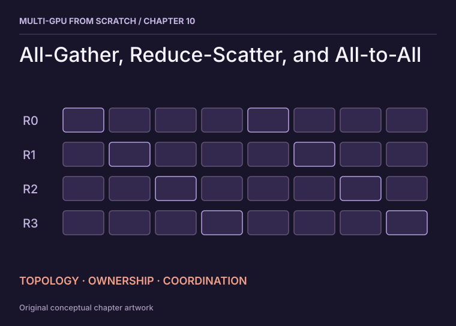
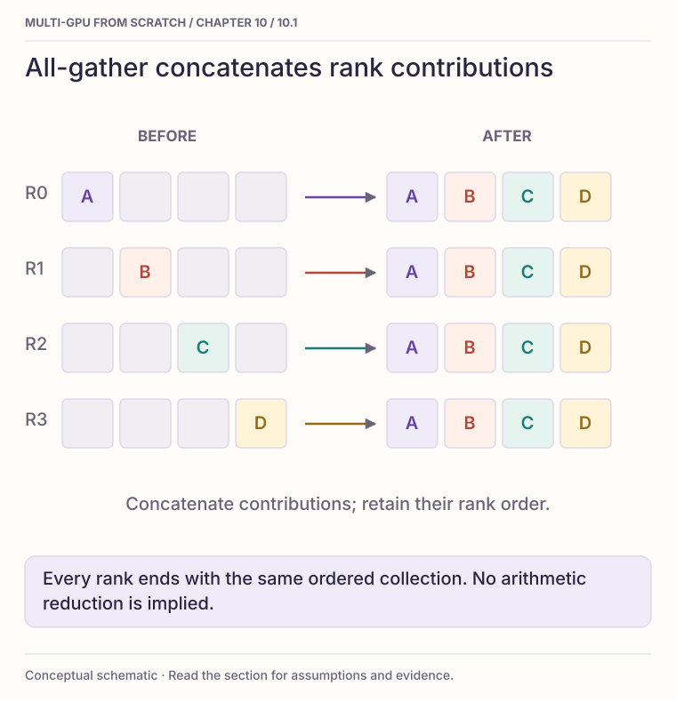
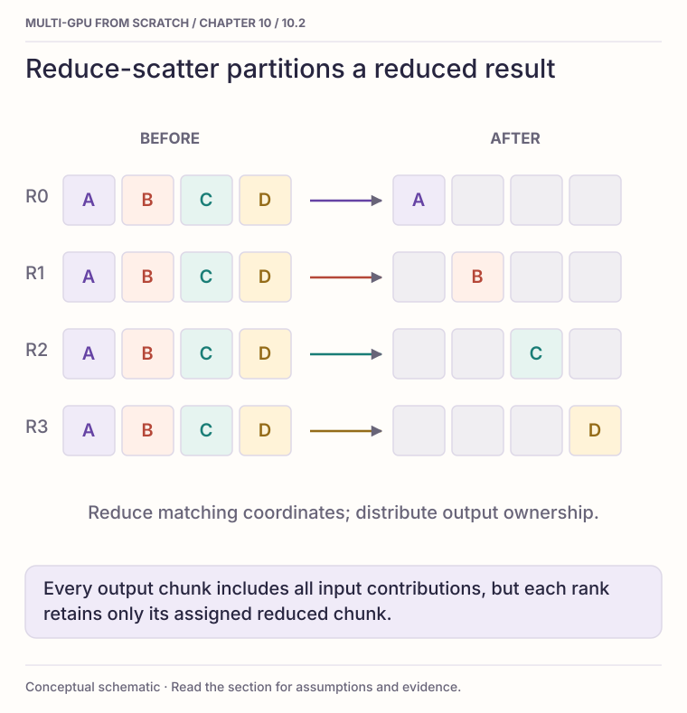
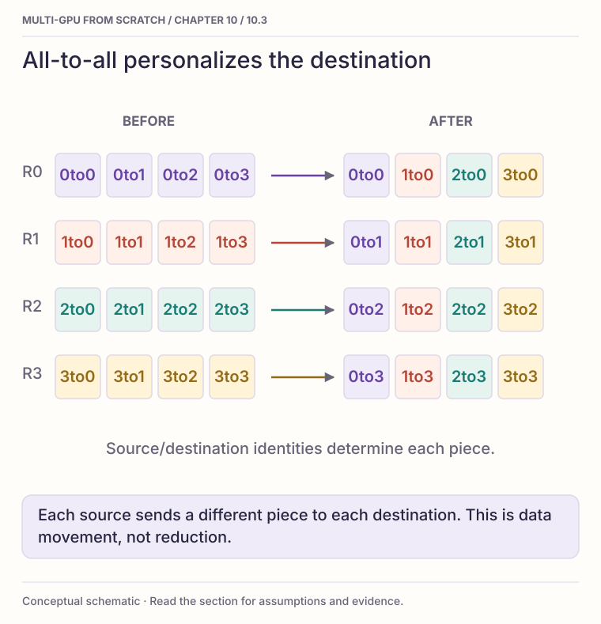

# Chapter 10: All-Gather, Reduce-Scatter, and All-to-All

<!-- mgpu:opener:start -->
[](../images/chapter-openers/10.svg)
<!-- mgpu:opener:end -->

**What you will understand by the end of this chapter:**

- Why all-gather (every device ends up holding *all* the original data, unmodified) and reduce-scatter (every device ends up holding exactly *one* reduced chunk) are, respectively, Chapter 9's all-gather phase and scatter-reduce phase, run alone instead of chained together -- and the one detail (which device owns which reduced chunk) where reduce-scatter's contract differs from what Chapter 9's ring phase happened to produce.
- Why all-to-all -- every device sending a *different* chunk to every other device -- cannot be built from either of Chapter 9's ring phases, and needs its own direct implementation and its own verification.
- Why reduce-scatter needs the host to do real arithmetic (like Chapter 8's reduce), while all-gather and all-to-all never do (like Chapter 8's broadcast) -- because moving bytes and combining values are different operations, and only one of them ever needs a `+`.

**What you need to know first:**

- Chapter 9's two-phase ring all-reduce (scatter-reduce, then all-gather) and its `sendChunk` formula.
- Chapter 8's broadcast (direct `cudaMemcpyPeer` loop) and reduce (host-accumulated `cudaMemcpy` loop) -- this chapter's three collectives are variations on those same two mechanisms.
- This book's host-side simulation technique, Part 2's primary way of checking a multi-device result.

---

Chapter 9 built ring all-reduce as one continuous two-phase algorithm -- scatter-reduce, then all-gather -- with a single ring pattern doing double duty for two different purposes. Both of those phases turn out to be useful operations in their own right, with their own names and their own uses outside of all-reduce entirely. This chapter isolates them: **all-gather** is Chapter 9's all-gather phase, run alone, starting from each device's own original data rather than a partially-reduced one; **reduce-scatter** is Chapter 9's scatter-reduce phase, run alone, stopping before the all-gather step that would normally follow it -- with one difference in chunk ownership, covered in Section 10.2. A third collective, **all-to-all**, is a genuinely different pattern with no reduction step and, as Section 10.3 shows, no ring shortcut at all -- it needs its own implementation built from scratch. Together with Chapter 8's broadcast and reduce and Chapter 9's all-reduce, this completes the standard set of collective operations this book builds by hand, before Chapter 11 turns to NCCL, the library that implements all of them for real -- five as dedicated calls in the NCCL 2.18.3 this book links against, and all-to-all as grouped `ncclSend()`/`ncclRecv()` pairs (a dedicated `ncclAlltoAll()` call only arrived in NCCL 2.28).

```text
This chapter's three collectives, N=4 devices, one chunk per device:

ALL-GATHER (10.1)                    REDUCE-SCATTER (10.2)
collect everything, combine nothing  combine everything, collect nothing

  before:  dev0[10]  dev1[20]          before:  dev0[10 11 12 13]
           dev2[30]  dev3[40]                   dev1[20 21 22 23]
                                                 dev2[30 31 32 33]
  after:   dev0[10 20 30 40]                    dev3[40 41 42 43]
           dev1[10 20 30 40]
           dev2[10 20 30 40]          after:   dev0[100]  dev1[104]
           dev3[10 20 30 40]                   dev2[108]  dev3[112]
  (every device: the SAME 4 values)   (every device: ONE different value --
                                        its own chunk index, summed)

ALL-TO-ALL (10.3): every device sends a DIFFERENT chunk to every other

  dev0 holds, for delivery:  ->dev1: 01   ->dev2: 02   ->dev3: 03
  dev1 holds, for delivery:  ->dev0: 10   ->dev2: 12   ->dev3: 13
  dev2 holds, for delivery:  ->dev0: 20   ->dev1: 21   ->dev3: 23
  dev3 holds, for delivery:  ->dev0: 30   ->dev1: 31   ->dev2: 32

  after: dev1 holds "01" (received from dev0), dev2 holds "02" (from dev0),
  dev0 holds "10" (from dev1), and so on -- a full transpose, no combining.
```

## 10.1 All-Gather: Collecting Without Reducing

<!-- mgpu:figure-1:start -->
[](../images/technical/ch10/1-gather.svg)
<!-- mgpu:figure-1:end -->

### Intuition

Picture N people, each holding one page of a report they wrote independently. All-gather is everyone photocopying their own page and handing a copy to everyone else, until every person is holding the complete, N-page report -- every page exactly as its author wrote it, nothing edited, nothing combined. Contrast that with Chapter 8's broadcast, where only ONE person's page gets copied out to everyone: all-gather is what happens when *every* device is the broadcaster of its *own* one chunk, all at the same time.

```text
All-gather as N simultaneous single-chunk broadcasts:

  dev0 broadcasts chunk "10"  --->  dev1, dev2, dev3 each receive it
  dev1 broadcasts chunk "20"  --->  dev0, dev2, dev3 each receive it
  dev2 broadcasts chunk "30"  --->  dev0, dev1, dev3 each receive it
  dev3 broadcasts chunk "40"  --->  dev0, dev1, dev2 each receive it

  End state, every device: [10, 20, 30, 40] -- identical everywhere.
```

### Background

Because nothing here is combined, all-gather never needs the host at all -- every transfer is a direct, real `cudaMemcpyPeer()` between two devices, exactly like Chapter 8's broadcast. The direct (non-ring) way to implement it is the simplest possible reading of the diagram above: for every ordered pair of distinct devices `(src, dst)`, copy `src`'s own chunk into the slot reserved for it on `dst`. A device's own chunk needs no transfer at all -- it's already there.

```cpp
// 26_allgather_by_hand.cu
// Checked teaching implementation; serial host scheduling favors clarity, not speed.
#include <cstdio>
#include <vector>
#include <algorithm>
#include <cuda_runtime.h>
#define CUDA(call) do { cudaError_t status = (call); if (status != cudaSuccess) { \
 fprintf(stderr,"%s: %s\n",#call,cudaGetErrorString(status)); \
 return status==cudaErrorNoDevice || status==cudaErrorInsufficientDriver ? 2 : 1; } } while(0)
static int pattern(int rank, int i) { return rank*1000+i*3+i%7; }
int main() {
 int count=0; CUDA(cudaGetDeviceCount(&count));
 if(count<2){printf("BLOCKED: requires 2 GPUs; found %d.\n",count);return 2;}
 const int world=std::min(count,4), CHUNK=33;
 const int n=CHUNK, out_n=world*CHUNK;
 const size_t bytes=n*sizeof(int), out_bytes=out_n*sizeof(int);
 std::vector<int*> send(world,nullptr),receive(world,nullptr);
 for(int rank=0;rank<world;++rank){
  CUDA(cudaSetDevice(rank));CUDA(cudaMalloc(&send[rank],bytes));CUDA(cudaMalloc(&receive[rank],out_bytes));
  std::vector<int> input(n);for(int i=0;i<n;++i)input[i]=pattern(rank,i);
  CUDA(cudaMemcpy(send[rank],input.data(),bytes,cudaMemcpyHostToDevice));CUDA(cudaMemset(receive[rank],0xff,out_bytes));
 }
 for(int dst=0;dst<world;++dst)for(int src=0;src<world;++src){CUDA(cudaSetDevice(dst));
 if(src==dst)CUDA(cudaMemcpy(receive[dst]+src*CHUNK,send[src],bytes,cudaMemcpyDeviceToDevice));
 else CUDA(cudaMemcpyPeer(receive[dst]+src*CHUNK,dst,send[src],src,bytes));}
 for(int rank=0;rank<world;++rank){CUDA(cudaSetDevice(rank));CUDA(cudaDeviceSynchronize());}
 for(int rank=0;rank<world;++rank){std::vector<int> output(out_n);CUDA(cudaSetDevice(rank));CUDA(cudaMemcpy(output.data(),receive[rank],out_bytes,cudaMemcpyDeviceToHost));for(int i=0;i<out_n;++i){int expected=pattern(i/CHUNK,i%CHUNK);if(output[i]!=expected){fprintf(stderr,"FAIL rank %d output[%d]: %d expected %d\n",rank,i,output[i],expected);return 1;}}}
 for(int rank=0;rank<world;++rank){CUDA(cudaSetDevice(rank));CUDA(cudaFree(send[rank]));CUDA(cudaFree(receive[rank]));}
 printf("PASS: rank-ordered all-gather on %d GPUs, all nonuniform output values checked.\n",world);
 return 0;
}
```

<!-- execution:start:h100-rerun:26_allgather_by_hand.cu -->
> **Compiled and executed — 2026-11-18-h100: Numerical/transport validation (recorded scope).** Hardware: 2 H100 GPUs. Executed UTC: `2026-11-18T11:21:12.025544+00:00`.

<!-- execution:metadata Source SHA-256: 7aebce9afa5c1fae9a892659b95242e60185232d2a90cab7df1f6bb6fc159d90; recorded UTC (program start): 2026-11-18T11:21:11.109799+00:00 -->

[Exact tested source](../validation/2026-11-18-h100/26_allgather_by_hand/26_allgather_by_hand.cu) · [Compiler log](../validation/2026-11-18-h100/26_allgather_by_hand/compile.log) · [Execution log](../validation/2026-11-18-h100/26_allgather_by_hand/run.log). Compile exit: `0`; run exit: `0`.

Commands below use local source/binary names; raw logs retain host paths. Execute in a scratch directory containing the downloaded source.

```bash
nvcc -std=c++17 -O2 -arch=sm_90 26_allgather_by_hand.cu -o ./example
./example
```

**Sample output**

```text
PASS: rank-ordered all-gather on 2 GPUs, all nonuniform output values checked.
```

<!-- execution:end:h100-rerun:26_allgather_by_hand.cu -->


<!-- execution:start:a100:26_allgather_by_hand.cu -->
> **Compiled and executed — 2026-11-17-a100: Numerical/transport validation (recorded scope).** Hardware: 8 A100 GPUs. Executed UTC: `2026-11-18T00:01:33.020046+00:00`.

<!-- execution:metadata Source SHA-256: 7aebce9afa5c1fae9a892659b95242e60185232d2a90cab7df1f6bb6fc159d90; recorded UTC (program start): 2026-11-18T00:01:31.465743+00:00 -->

[Exact tested source](../validation/2026-11-17-a100/26_allgather_by_hand/26_allgather_by_hand.cu) · [Compiler log](../validation/2026-11-17-a100/26_allgather_by_hand/compile.log) · [Execution log](../validation/2026-11-17-a100/26_allgather_by_hand/run.log). Compile exit: `0`; run exit: `0`.

Commands below use local source/binary names; raw logs retain host paths. Execute in a scratch directory containing the downloaded source.

```bash
nvcc -std=c++17 -O2 -arch=sm_80 26_allgather_by_hand.cu -o ./example
./example
```

**Sample output**

```text
PASS: rank-ordered all-gather on 4 GPUs, all nonuniform output values checked.
```


<!-- execution:end:a100:26_allgather_by_hand.cu -->


<!-- execution:start:h100:26_allgather_by_hand.cu -->
> **Compiled and executed — 2026-11-17-h100: Numerical/transport validation (recorded scope).** Hardware: 2 H100 GPUs. Execution record UTC (run-batch start; per-program time unrecorded): `2026-11-17T23:48:18.967387+00:00`.

<!-- execution:metadata Source SHA-256: 7aebce9afa5c1fae9a892659b95242e60185232d2a90cab7df1f6bb6fc159d90; recorded UTC (run-batch start; per-program time unrecorded): 2026-11-17T23:48:18.967387+00:00 -->

[Exact tested source](../validation/2026-11-17-h100/26_allgather_by_hand/26_allgather_by_hand.cu) · [Compiler log](../validation/2026-11-17-h100/26_allgather_by_hand/compile.log) · [Execution log](../validation/2026-11-17-h100/26_allgather_by_hand/run.log). Compile exit: `0`; run exit: `0`.

Commands below use local source/binary names; raw logs retain host paths. Execute in a scratch directory containing the downloaded source.

```bash
nvcc -std=c++17 -O2 -arch=sm_90 26_allgather_by_hand.cu -o ./example
./example
```

<details markdown="1"><summary>Captured current-source output</summary>

```text
PASS: rank-ordered all-gather on 2 GPUs, all nonuniform output values checked.
```

</details>
<!-- execution:end:h100:26_allgather_by_hand.cu -->


The [2026-11-17 H100 execution record](../validation-h100.md) covers two GPUs connected by local NV18. It distinguishes numerical checks, API probes and other executions; a successful exit alone does not establish GPU algorithm correctness.

File 26 checks the delivered all-gather values over actual two-H100 transport. The simulation below independently checks additional modeled layouts; its rank counts are not additional hardware runs.

The [2026-11-17 H100 execution record](../validation-h100.md) covers two GPUs connected by local NV18. It distinguishes numerical checks, API probes and other executions; a successful exit alone does not establish GPU algorithm correctness.

!!! warning "[COMMON TRAP] Thinking all-gather's N*(N-1) transfers make it as expensive, per device, as a broadcast to everyone"
    A single Chapter-8-style broadcast has one device sending to `N-1` others -- that device's outbound traffic is `N-1` chunks, and everyone else's is just one chunk received. All-gather runs `N` of those broadcasts *simultaneously*, one per device, so **every** device is simultaneously a sender (to `N-1` others) and a receiver (from `N-1` others) -- their traffic is symmetric, not concentrated on one device the way Chapter 9's naive root was. It's easy to see the total `N*(N-1)` transfer count and assume some device is doing `N-1` times the "normal" chunk-worth of broadcast work; in fact every device does exactly the same `N-1`-transfers-out, `N-1`-transfers-in amount of work as every other device.

## 10.2 Reduce-Scatter: Reducing Without Gathering Everywhere

<!-- mgpu:figure-2:start -->
[](../images/technical/ch10/2-scatter.svg)
<!-- mgpu:figure-2:end -->

### Intuition

Now picture N accountants, each holding a full ledger listing every one of N clients' numbers. Reduce-scatter assigns each accountant exactly one client and has them compute that one client's grand total, summed across all N ledgers -- and that's the only total they end up holding. Nobody needs any other accountant's client's total; each accountant's job is narrower than Chapter 8's reduce (where ONE root ends up with every client's total) but the work of actually summing is identical.

```text
Reduce-scatter as N independent single-chunk reduces:

  chunk 0, gathered from all 4 devices and summed: 10+20+30+40 = 100  -> dev0
  chunk 1, gathered from all 4 devices and summed: 11+21+31+41 = 104  -> dev1
  chunk 2, gathered from all 4 devices and summed: 12+22+32+42 = 108  -> dev2
  chunk 3, gathered from all 4 devices and summed: 13+23+33+43 = 112  -> dev3

  End state: dev0 holds ONLY 100, dev1 holds ONLY 104, and so on --
  never the same value twice, never more than one value per device.
```

### Background

Summing values is arithmetic, and neither `cudaMemcpy()` nor `cudaMemcpyPeer()` performs arithmetic -- they only move bytes. That is why reduce-scatter, like Chapter 8's reduce and Chapter 9's naive baseline, has to pull every device's contribution to a host accumulator, add it there with ordinary C++ `+=`, and write only the final sum back -- there is no way to do this reduction purely with device-to-device copies. The code below runs exactly this pattern once per chunk, writing chunk `c`'s reduced sum back only onto device `c`, its owner.

One precise point about "owner." Reduce-scatter's contract is that device `i` ends up holding reduced chunk `i` -- NCCL's own collective documentation states that after `ncclReduceScatter`, the "recvbuff on rank i contains the i-th block" of the result, and the diagram above and this section's code both follow that convention. Chapter 9's ring scatter-reduce phase, run unchanged, does *not* land chunks that way: with its `sendChunk = (deviceIndex - step) mod N` formula, the first `N-1` steps leave device 0 holding the full sum of chunk 1, device 1 chunk 2, device 2 chunk 3, and device 3 chunk 0 (Chapter 9's own Question 4: device 3 owns chunk 0) -- a rotation of the ownership reduce-scatter requires. A ring reduce-scatter fixes this by shifting its starting chunk by one, `sendChunk = (deviceIndex - step - 1) mod N`, which (checked for N = 3, 4, 5, and 8) leaves device `i` holding chunk `i`. So reduce-scatter is Chapter 9's scatter-reduce phase run alone, up to a one-position rotation of which chunk each device owns -- not *exactly* that phase.

```cpp
// 27_reducescatter_by_hand.cu
// Checked teaching implementation; serial host scheduling favors clarity, not speed.
#include <cstdio>
#include <vector>
#include <algorithm>
#include <cuda_runtime.h>
#define CUDA(call) do { cudaError_t status = (call); if (status != cudaSuccess) { \
 fprintf(stderr,"%s: %s\n",#call,cudaGetErrorString(status)); \
 return status==cudaErrorNoDevice || status==cudaErrorInsufficientDriver ? 2 : 1; } } while(0)
static int pattern(int rank, int i) { return rank*1000+i*3+i%7; }
int main() {
 int count=0; CUDA(cudaGetDeviceCount(&count));
 if(count<2){printf("BLOCKED: requires 2 GPUs; found %d.\n",count);return 2;}
 const int world=std::min(count,4), CHUNK=33;
 const int n=world*CHUNK, out_n=CHUNK;
 const size_t bytes=n*sizeof(int), out_bytes=out_n*sizeof(int);
 std::vector<int*> send(world,nullptr),receive(world,nullptr);
 for(int rank=0;rank<world;++rank){
  CUDA(cudaSetDevice(rank));CUDA(cudaMalloc(&send[rank],bytes));CUDA(cudaMalloc(&receive[rank],out_bytes));
  std::vector<int> input(n);for(int i=0;i<n;++i)input[i]=pattern(rank,i);
  CUDA(cudaMemcpy(send[rank],input.data(),bytes,cudaMemcpyHostToDevice));CUDA(cudaMemset(receive[rank],0xff,out_bytes));
 }
 std::vector<int> total(n,0),staging(n);
 for(int src=0;src<world;++src){CUDA(cudaSetDevice(src));CUDA(cudaMemcpy(staging.data(),send[src],bytes,cudaMemcpyDeviceToHost));for(int i=0;i<n;++i)total[i]+=staging[i];}
 for(int owner=0;owner<world;++owner){CUDA(cudaSetDevice(owner));CUDA(cudaMemcpy(receive[owner],total.data()+owner*CHUNK,out_bytes,cudaMemcpyHostToDevice));}
 for(int rank=0;rank<world;++rank){CUDA(cudaSetDevice(rank));CUDA(cudaDeviceSynchronize());}
 for(int rank=0;rank<world;++rank){std::vector<int> output(out_n);CUDA(cudaSetDevice(rank));CUDA(cudaMemcpy(output.data(),receive[rank],out_bytes,cudaMemcpyDeviceToHost));for(int i=0;i<out_n;++i){int expected=1000*world*(world-1)/2+world*((rank*CHUNK+i)*3+(rank*CHUNK+i)%7);if(output[i]!=expected){fprintf(stderr,"FAIL rank %d output[%d]: %d expected %d\n",rank,i,output[i],expected);return 1;}}}
 for(int rank=0;rank<world;++rank){CUDA(cudaSetDevice(rank));CUDA(cudaFree(send[rank]));CUDA(cudaFree(receive[rank]));}
 printf("PASS: host-staged rank-ordered reduce-scatter on %d GPUs, all nonuniform output values checked.\n",world);
 return 0;
}
```

<!-- execution:start:h100-rerun:27_reducescatter_by_hand.cu -->
> **Compiled and executed — 2026-11-18-h100: Numerical/transport validation (recorded scope).** Hardware: 2 H100 GPUs. Executed UTC: `2026-11-18T11:21:13.508122+00:00`.

<!-- execution:metadata Source SHA-256: 1e06d82c07020b03e80788e5723e95642c58c6af4343d7e81413c0f0262c7f4a; recorded UTC (program start): 2026-11-18T11:21:12.592029+00:00 -->

[Exact tested source](../validation/2026-11-18-h100/27_reducescatter_by_hand/27_reducescatter_by_hand.cu) · [Compiler log](../validation/2026-11-18-h100/27_reducescatter_by_hand/compile.log) · [Execution log](../validation/2026-11-18-h100/27_reducescatter_by_hand/run.log). Compile exit: `0`; run exit: `0`.

Commands below use local source/binary names; raw logs retain host paths. Execute in a scratch directory containing the downloaded source.

```bash
nvcc -std=c++17 -O2 -arch=sm_90 27_reducescatter_by_hand.cu -o ./example
./example
```

**Sample output**

```text
PASS: host-staged rank-ordered reduce-scatter on 2 GPUs, all nonuniform output values checked.
```

<!-- execution:end:h100-rerun:27_reducescatter_by_hand.cu -->


<!-- execution:start:a100:27_reducescatter_by_hand.cu -->
> **Compiled and executed — 2026-11-17-a100: Numerical/transport validation (recorded scope).** Hardware: 8 A100 GPUs. Executed UTC: `2026-11-18T00:01:38.414973+00:00`.

<!-- execution:metadata Source SHA-256: 1e06d82c07020b03e80788e5723e95642c58c6af4343d7e81413c0f0262c7f4a; recorded UTC (program start): 2026-11-18T00:01:36.896409+00:00 -->

[Exact tested source](../validation/2026-11-17-a100/27_reducescatter_by_hand/27_reducescatter_by_hand.cu) · [Compiler log](../validation/2026-11-17-a100/27_reducescatter_by_hand/compile.log) · [Execution log](../validation/2026-11-17-a100/27_reducescatter_by_hand/run.log). Compile exit: `0`; run exit: `0`.

Commands below use local source/binary names; raw logs retain host paths. Execute in a scratch directory containing the downloaded source.

```bash
nvcc -std=c++17 -O2 -arch=sm_80 27_reducescatter_by_hand.cu -o ./example
./example
```

**Sample output**

```text
PASS: host-staged rank-ordered reduce-scatter on 4 GPUs, all nonuniform output values checked.
```


<!-- execution:end:a100:27_reducescatter_by_hand.cu -->


<!-- execution:start:h100:27_reducescatter_by_hand.cu -->
> **Compiled and executed — 2026-11-17-h100: Numerical/transport validation (recorded scope).** Hardware: 2 H100 GPUs. Execution record UTC (run-batch start; per-program time unrecorded): `2026-11-17T23:48:18.967387+00:00`.

<!-- execution:metadata Source SHA-256: 1e06d82c07020b03e80788e5723e95642c58c6af4343d7e81413c0f0262c7f4a; recorded UTC (run-batch start; per-program time unrecorded): 2026-11-17T23:48:18.967387+00:00 -->

[Exact tested source](../validation/2026-11-17-h100/27_reducescatter_by_hand/27_reducescatter_by_hand.cu) · [Compiler log](../validation/2026-11-17-h100/27_reducescatter_by_hand/compile.log) · [Execution log](../validation/2026-11-17-h100/27_reducescatter_by_hand/run.log). Compile exit: `0`; run exit: `0`.

Commands below use local source/binary names; raw logs retain host paths. Execute in a scratch directory containing the downloaded source.

```bash
nvcc -std=c++17 -O2 -arch=sm_90 27_reducescatter_by_hand.cu -o ./example
./example
```

<details markdown="1"><summary>Captured current-source output</summary>

```text
PASS: host-staged rank-ordered reduce-scatter on 2 GPUs, all nonuniform output values checked.
```

</details>
<!-- execution:end:h100:27_reducescatter_by_hand.cu -->


The [2026-11-17 H100 execution record](../validation-h100.md) covers two GPUs connected by local NV18. It distinguishes numerical checks, API probes and other executions; a successful exit alone does not establish GPU algorithm correctness.

File 27 checks transported data and host reduce-scatter arithmetic against a reference on two H100 GPUs. The simulation below separately checks the modeled chunk assignment.

The [2026-11-17 H100 execution record](../validation-h100.md) covers two GPUs connected by local NV18. It distinguishes numerical checks, API probes and other executions; a successful exit alone does not establish GPU algorithm correctness.

!!! warning "[COMMON TRAP] Assuming reduce-scatter is simply 'half the cost' of an all-reduce"
    It's tempting to reason that since all-reduce is (per Chapter 9) a reduce-scatter followed by an all-gather, reduce-scatter alone must be "half the work, so half the cost" -- and for total data volume, that's roughly right. But reduce-scatter is a complete, independently useful operation, not merely an incomplete all-reduce: whenever a device genuinely only ever needs *its own* shard of a combined result -- for instance, an optimizer that shards its state across devices, each device owning only the update for the parameters it's responsible for (a direct echo of Chapter 1's ZeRO-style memory-wall discussion) -- reduce-scatter alone is the right, final operation to use, with no all-gather needed or wanted afterward.

## 10.3 All-to-All: Personalized Exchange, No Reduction, No Shortcut

<!-- mgpu:figure-3:start -->
[](../images/technical/ch10/3-alltoall.svg)
<!-- mgpu:figure-3:end -->

### Intuition

Picture N kids at a card-trading table, each holding a stack of N different cards, one earmarked for each of the N kids at the table (including, trivially, one for themselves). All-to-all is everyone trading simultaneously: every kid ends up with a new stack made of exactly one card from every other kid -- and crucially, the card kid A sends to kid B is completely different from the card kid A sends to kid C. That's the one thing that makes all-to-all fundamentally different from everything else in this chapter: all-gather sends the *same* chunk to everyone, and reduce-scatter *combines* chunks together, but all-to-all sends a *different*, uncombined chunk to every single destination.

```text
All-to-all as a full transpose (N=4, chunk "ij" = from device i, for device j):

  BEFORE (each device's own row, ready to send):     AFTER (each device's own column, received):

    dev0: [00, 01, 02, 03]                             dev0: [00, 10, 20, 30]
    dev1: [10, 11, 12, 13]        ===transpose===>     dev1: [01, 11, 21, 31]
    dev2: [20, 21, 22, 23]                             dev2: [02, 12, 22, 32]
    dev3: [30, 31, 32, 33]                             dev3: [03, 13, 23, 33]

  dev0's chunk "02" (meant for dev2) and dev0's chunk "03" (meant for
  dev3) are two DIFFERENT values -- unlike all-gather, where dev0 would
  send the SAME chunk to both.
```

### Background

Nothing about this pattern can be built from Chapter 9's ring phases: a ring hop can forward an all-reduce chunk unchanged because every device, by the end, wants that *same* value -- but all-to-all's chunk "02" and chunk "03" are both currently sitting on device 0, both need to leave device 0, and they need to go to two *different* places. There's no way to combine them into one relay, and no way for a chunk addressed to device 2 to also happen to satisfy device 3 along the way. All-to-all needs exactly `N*(N-1)` distinct point-to-point transfers -- the direct, real `cudaMemcpyPeer()` loop below, covering every ordered pair of distinct devices exactly once, each one carrying data no other transfer could have carried:

```cpp
// 28_alltoall_by_hand.cu
// Checked teaching implementation; serial host scheduling favors clarity, not speed.
#include <cstdio>
#include <vector>
#include <algorithm>
#include <cuda_runtime.h>
#define CUDA(call) do { cudaError_t status = (call); if (status != cudaSuccess) { \
 fprintf(stderr,"%s: %s\n",#call,cudaGetErrorString(status)); \
 return status==cudaErrorNoDevice || status==cudaErrorInsufficientDriver ? 2 : 1; } } while(0)
static int pattern(int rank, int i) { return rank*1000+i*3+i%7; }
int main() {
 int count=0; CUDA(cudaGetDeviceCount(&count));
 if(count<2){printf("BLOCKED: requires 2 GPUs; found %d.\n",count);return 2;}
 const int world=std::min(count,4), CHUNK=33;
 const int n=world*CHUNK, out_n=world*CHUNK;
 const size_t bytes=n*sizeof(int), out_bytes=out_n*sizeof(int);
 std::vector<int*> send(world,nullptr),receive(world,nullptr);
 for(int rank=0;rank<world;++rank){
  CUDA(cudaSetDevice(rank));CUDA(cudaMalloc(&send[rank],bytes));CUDA(cudaMalloc(&receive[rank],out_bytes));
  std::vector<int> input(n);for(int i=0;i<n;++i)input[i]=pattern(rank,i);
  CUDA(cudaMemcpy(send[rank],input.data(),bytes,cudaMemcpyHostToDevice));CUDA(cudaMemset(receive[rank],0xff,out_bytes));
 }
 for(int src=0;src<world;++src)for(int dst=0;dst<world;++dst){CUDA(cudaSetDevice(dst));
 if(src==dst)CUDA(cudaMemcpy(receive[dst]+src*CHUNK,send[src]+dst*CHUNK,CHUNK*sizeof(int),cudaMemcpyDeviceToDevice));
 else CUDA(cudaMemcpyPeer(receive[dst]+src*CHUNK,dst,send[src]+dst*CHUNK,src,CHUNK*sizeof(int)));}
 for(int rank=0;rank<world;++rank){CUDA(cudaSetDevice(rank));CUDA(cudaDeviceSynchronize());}
 for(int rank=0;rank<world;++rank){std::vector<int> output(out_n);CUDA(cudaSetDevice(rank));CUDA(cudaMemcpy(output.data(),receive[rank],out_bytes,cudaMemcpyDeviceToHost));for(int i=0;i<out_n;++i){int expected=pattern(i/CHUNK,rank*CHUNK+i%CHUNK);if(output[i]!=expected){fprintf(stderr,"FAIL rank %d output[%d]: %d expected %d\n",rank,i,output[i],expected);return 1;}}}
 for(int rank=0;rank<world;++rank){CUDA(cudaSetDevice(rank));CUDA(cudaFree(send[rank]));CUDA(cudaFree(receive[rank]));}
 printf("PASS: destination-specific all-to-all on %d GPUs, all nonuniform output values checked.\n",world);
 return 0;
}
```

<!-- execution:start:h100-rerun:28_alltoall_by_hand.cu -->
> **Compiled and executed — 2026-11-18-h100: Numerical/transport validation (recorded scope).** Hardware: 2 H100 GPUs. Executed UTC: `2026-11-18T11:21:15.040689+00:00`.

<!-- execution:metadata Source SHA-256: 4e9ca7b00c130e7c5f97b17cc7e43960421ce609cb3df7e1d40281608601a2c4; recorded UTC (program start): 2026-11-18T11:21:14.124459+00:00 -->

[Exact tested source](../validation/2026-11-18-h100/28_alltoall_by_hand/28_alltoall_by_hand.cu) · [Compiler log](../validation/2026-11-18-h100/28_alltoall_by_hand/compile.log) · [Execution log](../validation/2026-11-18-h100/28_alltoall_by_hand/run.log). Compile exit: `0`; run exit: `0`.

Commands below use local source/binary names; raw logs retain host paths. Execute in a scratch directory containing the downloaded source.

```bash
nvcc -std=c++17 -O2 -arch=sm_90 28_alltoall_by_hand.cu -o ./example
./example
```

**Sample output**

```text
PASS: destination-specific all-to-all on 2 GPUs, all nonuniform output values checked.
```

<!-- execution:end:h100-rerun:28_alltoall_by_hand.cu -->


<!-- execution:start:a100:28_alltoall_by_hand.cu -->
> **Compiled and executed — 2026-11-17-a100: Numerical/transport validation (recorded scope).** Hardware: 8 A100 GPUs. Executed UTC: `2026-11-18T00:01:43.758424+00:00`.

<!-- execution:metadata Source SHA-256: 4e9ca7b00c130e7c5f97b17cc7e43960421ce609cb3df7e1d40281608601a2c4; recorded UTC (program start): 2026-11-18T00:01:42.240026+00:00 -->

[Exact tested source](../validation/2026-11-17-a100/28_alltoall_by_hand/28_alltoall_by_hand.cu) · [Compiler log](../validation/2026-11-17-a100/28_alltoall_by_hand/compile.log) · [Execution log](../validation/2026-11-17-a100/28_alltoall_by_hand/run.log). Compile exit: `0`; run exit: `0`.

Commands below use local source/binary names; raw logs retain host paths. Execute in a scratch directory containing the downloaded source.

```bash
nvcc -std=c++17 -O2 -arch=sm_80 28_alltoall_by_hand.cu -o ./example
./example
```

**Sample output**

```text
PASS: destination-specific all-to-all on 4 GPUs, all nonuniform output values checked.
```


<!-- execution:end:a100:28_alltoall_by_hand.cu -->


<!-- execution:start:h100:28_alltoall_by_hand.cu -->
> **Compiled and executed — 2026-11-17-h100: Numerical/transport validation (recorded scope).** Hardware: 2 H100 GPUs. Execution record UTC (run-batch start; per-program time unrecorded): `2026-11-17T23:48:18.967387+00:00`.

<!-- execution:metadata Source SHA-256: 4e9ca7b00c130e7c5f97b17cc7e43960421ce609cb3df7e1d40281608601a2c4; recorded UTC (run-batch start; per-program time unrecorded): 2026-11-17T23:48:18.967387+00:00 -->

[Exact tested source](../validation/2026-11-17-h100/28_alltoall_by_hand/28_alltoall_by_hand.cu) · [Compiler log](../validation/2026-11-17-h100/28_alltoall_by_hand/compile.log) · [Execution log](../validation/2026-11-17-h100/28_alltoall_by_hand/run.log). Compile exit: `0`; run exit: `0`.

Commands below use local source/binary names; raw logs retain host paths. Execute in a scratch directory containing the downloaded source.

```bash
nvcc -std=c++17 -O2 -arch=sm_90 28_alltoall_by_hand.cu -o ./example
./example
```

<details markdown="1"><summary>Captured current-source output</summary>

```text
PASS: destination-specific all-to-all on 2 GPUs, all nonuniform output values checked.
```

</details>
<!-- execution:end:h100:28_alltoall_by_hand.cu -->


The [2026-11-17 H100 execution record](../validation-h100.md) covers two GPUs connected by local NV18. It distinguishes numerical checks, API probes and other executions; a successful exit alone does not establish GPU algorithm correctness.

File 28 checks all-to-all delivery over actual two-H100 transport. The host simulation separately checks chunk delivery and independent references for its modeled configurations:

The [2026-11-17 H100 execution record](../validation-h100.md) covers two GPUs connected by local NV18. It distinguishes numerical checks, API probes and other executions; a successful exit alone does not establish GPU algorithm correctness.

```cpp
// Chapter 10: All-Gather, Reduce-Scatter, and All-to-All
// 29_collectives_simulation.cpp
//
// Plain host C++ -- verifying all three of this chapter's collectives
// against independent references, the same way Chapter 8's
// 22_collectives_simulation.cpp verified broadcast and reduce. N real
// in-memory buffers stand in for N real device memories.
#include <cstdio>
#include <vector>

using Row = std::vector<int>;

// ---------------------------------------------------------------------
// (a) All-gather: every device starts with ONE chunk (its own) and ends
// with ALL N chunks, unmodified, in the same order for every device.
// ---------------------------------------------------------------------
bool verifyAllGather(int N) {
    std::vector<int> ownChunk(N);
    for (int i = 0; i < N; ++i) ownChunk[i] = (i + 1) * 10; // device i's own chunk

    std::vector<Row> gathered(N, Row(N, 0));
    for (int dst = 0; dst < N; ++dst)
        for (int src = 0; src < N; ++src)
            gathered[dst][src] = ownChunk[src]; // every device collects every chunk

    bool allMatch = true;
    for (int dst = 0; dst < N; ++dst)
        for (int src = 0; src < N; ++src)
            if (gathered[dst][src] != ownChunk[src]) allMatch = false;

    printf("All-gather (N=%d): independent reference chunks: ", N);
    for (int i = 0; i < N; ++i) printf("%d ", ownChunk[i]);
    printf("\n  Every device's gathered array matches the reference: %s\n\n",
           allMatch ? "PASS" : "FAIL");
    return allMatch;
}

// ---------------------------------------------------------------------
// (b) Reduce-scatter: every device starts with N chunks (one contribution
// per destination) and ends with exactly ONE reduced chunk -- the one
// it owns -- summed across all N devices' contributions to that chunk.
// ---------------------------------------------------------------------
bool verifyReduceScatter(int N) {
    std::vector<Row> devices(N, Row(N));
    for (int i = 0; i < N; ++i)
        for (int c = 0; c < N; ++c)
            devices[i][c] = (i + 1) * 10 + c;

    Row reference(N, 0);
    for (int c = 0; c < N; ++c)
        for (int i = 0; i < N; ++i)
            reference[c] += devices[i][c];

    Row scattered(N, 0);
    for (int owner = 0; owner < N; ++owner) {
        long long sum = 0;
        for (int src = 0; src < N; ++src) sum += devices[src][owner];
        scattered[owner] = (int)sum; // owner is the ONLY device holding this
    }

    bool allMatch = (scattered == reference);
    printf("Reduce-scatter (N=%d): independent reference sums: ", N);
    for (int c = 0; c < N; ++c) printf("%d ", reference[c]);
    printf("\n  Device c's scattered chunk matches reference[c] for every c: %s\n\n",
           allMatch ? "PASS" : "FAIL");
    return allMatch;
}

// ---------------------------------------------------------------------
// (c) All-to-all: device i's send-slot[j] is a value meant ONLY for
// device j. After the exchange, device j's recv-slot[i] must equal
// device i's original send-slot[j] -- a full transpose, no reduction.
// ---------------------------------------------------------------------
bool verifyAllToAll(int N) {
    std::vector<Row> sendSlots(N, Row(N));
    for (int i = 0; i < N; ++i)
        for (int j = 0; j < N; ++j)
            sendSlots[i][j] = i * 100 + j; // "chunk from device i, meant for device j"

    std::vector<Row> recvSlots(N, Row(N, 0));
    for (int i = 0; i < N; ++i)
        for (int j = 0; j < N; ++j)
            recvSlots[j][i] = sendSlots[i][j]; // the exchange: a full transpose

    bool allMatch = true;
    for (int i = 0; i < N; ++i)
        for (int j = 0; j < N; ++j)
            if (recvSlots[j][i] != sendSlots[i][j]) allMatch = false;

    printf("All-to-all (N=%d): every device's %d received chunks match the\n"
           "  chunk their sender addressed to them (a full transpose): %s\n\n",
           N, N, allMatch ? "PASS" : "FAIL");
    return allMatch;
}

int main() {
    const int N = 4;
    bool p1 = verifyAllGather(N);
    bool p2 = verifyReduceScatter(N);
    bool p3 = verifyAllToAll(N);

    // Real, counted data-volume note: all-gather and reduce-scatter,
    // done directly (as above, and in 26_/27_.cu), require each device
    // to send or receive N-1 SEPARATE chunks to/from N-1 DIFFERENT
    // remote devices -- the same "farther-apart" communication pattern
    // Thakur, Rabenseifner, and Gropp identify as recursive doubling's
    // weakness relative to a ring's nearest-neighbor-only pattern (see
    // Sources). Chapter 9 already built the ring version of these two
    // operations (its scatter-reduce and all-gather phases -- the ring
    // scatter-reduce just needs its starting chunk shifted by one so
    // device c ends up owning chunk c, as reduce-scatter requires);
    // swapping that same ring pattern in here gets the same nearest-
    // neighbor advantage for these two collectives run alone. All-to-all
    // has no such shortcut: every one of its N*(N-1) chunks is genuinely
    // distinct, so no ring hop can carry more than one destination's
    // data at a time the way all-reduce's identical partial sums can.
    long long directMessagesPerDevice = N - 1;
    long long allToAllMessagesPerDevice = N - 1;
    printf("Direct all-gather/reduce-scatter: %lld message(s) per device, "
           "each to/from a DIFFERENT remote device.\n", directMessagesPerDevice);
    printf("All-to-all: %lld message(s) per device too -- but unlike "
           "all-gather/reduce-scatter, none of them can be replaced by a "
           "cheaper ring relay, because every message is unique.\n",
           allToAllMessagesPerDevice);

    return (p1 && p2 && p3) ? 0 : 1;
}
```

<!-- execution:start:h100-rerun:29_collectives_simulation.cpp -->
> **Compiled and executed — 2026-11-18-h100: Host program/model (exit-only).** Hardware: 2 H100 GPUs. Executed UTC: `2026-11-18T11:21:15.871876+00:00`.

<!-- execution:metadata Source SHA-256: a36e2130a654c06143f478e1fb9a5786106b962893e68851b494ebaba7502203; recorded UTC (program start): 2026-11-18T11:21:15.607188+00:00 -->

[Exact tested source](../validation/2026-11-18-h100/29_collectives_simulation/29_collectives_simulation.cpp) · [Compiler log](../validation/2026-11-18-h100/29_collectives_simulation/compile.log) · [Execution log](../validation/2026-11-18-h100/29_collectives_simulation/run.log). Compile exit: `0`; run exit: `0`.

Commands below use local source/binary names; raw logs retain host paths. Execute in a scratch directory containing the downloaded source.

```bash
g++ -std=c++17 -O2 29_collectives_simulation.cpp -o ./example
./example
```

**Sample output**

```text
All-gather (N=4): independent reference chunks: 10 20 30 40
  Every device's gathered array matches the reference: PASS

Reduce-scatter (N=4): independent reference sums: 100 104 108 112
  Device c's scattered chunk matches reference[c] for every c: PASS

All-to-all (N=4): every device's 4 received chunks match the
  chunk their sender addressed to them (a full transpose): PASS

Direct all-gather/reduce-scatter: 3 message(s) per device, each to/from a DIFFERENT remote device.
All-to-all: 3 message(s) per device too -- but unlike all-gather/reduce-scatter, none of them can be replaced by a cheaper ring relay, because every message is unique.
```

<!-- execution:end:h100-rerun:29_collectives_simulation.cpp -->


<!-- execution:start:a100:29_collectives_simulation.cpp -->
> **Compiled and executed — 2026-11-17-a100: Host program/model (exit-only).** Hardware: 8 A100 GPUs. Executed UTC: `2026-11-18T00:01:47.999704+00:00`.

<!-- execution:metadata Source SHA-256: a36e2130a654c06143f478e1fb9a5786106b962893e68851b494ebaba7502203; recorded UTC (program start): 2026-11-18T00:01:47.633662+00:00 -->

[Exact tested source](../validation/2026-11-17-a100/29_collectives_simulation/29_collectives_simulation.cpp) · [Compiler log](../validation/2026-11-17-a100/29_collectives_simulation/compile.log) · [Execution log](../validation/2026-11-17-a100/29_collectives_simulation/run.log). Compile exit: `0`; run exit: `0`.

Commands below use local source/binary names; raw logs retain host paths. Execute in a scratch directory containing the downloaded source.

```bash
g++ -std=c++17 -O2 29_collectives_simulation.cpp -o ./example
./example
```

**Sample output**

```text
All-gather (N=4): independent reference chunks: 10 20 30 40
  Every device's gathered array matches the reference: PASS

Reduce-scatter (N=4): independent reference sums: 100 104 108 112
  Device c's scattered chunk matches reference[c] for every c: PASS

All-to-all (N=4): every device's 4 received chunks match the
  chunk their sender addressed to them (a full transpose): PASS

Direct all-gather/reduce-scatter: 3 message(s) per device, each to/from a DIFFERENT remote device.
All-to-all: 3 message(s) per device too -- but unlike all-gather/reduce-scatter, none of them can be replaced by a cheaper ring relay, because every message is unique.
```


<!-- execution:end:a100:29_collectives_simulation.cpp -->


<!-- execution:start:h100:29_collectives_simulation.cpp -->
> **Compiled and executed — 2026-11-17-h100: Host program/model (exit-only).** Hardware: 2 H100 GPUs. Execution record UTC (run-batch start; per-program time unrecorded): `2026-11-17T23:48:18.967387+00:00`.

<!-- execution:metadata Source SHA-256: a36e2130a654c06143f478e1fb9a5786106b962893e68851b494ebaba7502203; recorded UTC (run-batch start; per-program time unrecorded): 2026-11-17T23:48:18.967387+00:00 -->

[Exact tested source](../validation/2026-11-17-h100/29_collectives_simulation/29_collectives_simulation.cpp) · [Compiler log](../validation/2026-11-17-h100/29_collectives_simulation/compile.log) · [Execution log](../validation/2026-11-17-h100/29_collectives_simulation/run.log). Compile exit: `0`; run exit: `0`.

Commands below use local source/binary names; raw logs retain host paths. Execute in a scratch directory containing the downloaded source.

```bash
g++ -std=c++17 -O2 29_collectives_simulation.cpp -o ./example
./example
```

<details markdown="1"><summary>Captured current-source output</summary>

```text
All-gather (N=4): independent reference chunks: 10 20 30 40
  Every device's gathered array matches the reference: PASS

Reduce-scatter (N=4): independent reference sums: 100 104 108 112
  Device c's scattered chunk matches reference[c] for every c: PASS

All-to-all (N=4): every device's 4 received chunks match the
  chunk their sender addressed to them (a full transpose): PASS

Direct all-gather/reduce-scatter: 3 message(s) per device, each to/from a DIFFERENT remote device.
All-to-all: 3 message(s) per device too -- but unlike all-gather/reduce-scatter, none of them can be replaced by a cheaper ring relay, because every message is unique.
```

</details>
<!-- execution:end:h100:29_collectives_simulation.cpp -->


All three collectives check out against references computed completely independently of any of this section's own transfer logic -- reusing exactly the same numbers Chapter 8 (10/20/30/40) and Chapter 9 (100/104/108/112) already established, so the continuity between chapters is checkable, not just claimed. The final two lines make the real structural point concrete: all-gather and reduce-scatter, run directly, need the same `N-1`-messages-per-device as all-to-all does -- but only the first two have a cheaper ring alternative (Chapter 9 already built it) waiting to be swapped in.

!!! warning "[COMMON TRAP] Assuming all-to-all's ring-free cost is a special weakness of this particular textbook implementation"
    It's tempting to read Section 10.3's "no ring shortcut" as a limitation of the specific direct loop this chapter wrote, fixable with a cleverer implementation. It isn't -- it's a property of the operation itself. All-to-all's defining feature is that every one of its `N*(N-1)` chunks is genuinely distinct data with a genuinely distinct destination; a ring algorithm's entire speed advantage comes from forwarding *the same* (or *the same running sum of*) data through several hops at once, which requires the data at each hop to be useful to more than one final destination. All-to-all's data structurally can't satisfy that requirement, so real communication libraries use different tricks for it entirely -- for short messages, an approach like Bruck's algorithm (cited in Sources) restructures *which pairs exchange data at which step* to get all-to-all done in only `log(N)` steps instead of `N-1`, but even that isn't a ring relay -- it's a different algorithm serving a fundamentally different data pattern.

## Chapter Summary

All-gather and reduce-scatter are not new algorithms this chapter invents -- they are Chapter 9's own two ring-all-reduce phases, named and run in isolation: all-gather is the phase that spreads an already-known value out to everyone (Section 10.1, here shown starting from each device's own untouched chunk rather than a partially-summed one), and reduce-scatter is the phase that combines values down to one owner per chunk (Section 10.2, here shown stopping short of the all-gather that would turn it into a full all-reduce, and with chunk `i` owned by device `i` rather than Chapter 9's rotated ownership). Because summing needs real arithmetic and moving bytes doesn't, reduce-scatter mirrors Chapter 8's host-mediated reduce while all-gather mirrors Chapter 8's direct, host-free broadcast. All-to-all (Section 10.3) breaks that pattern entirely: every one of its `N*(N-1)` transfers carries data no other transfer could carry, so there is no reduction, no ring relay, and no shortcut borrowed from Chapter 9 -- it needed its own direct implementation and its own independent verification, alongside the other two, in this chapter's simulation. Together with Chapter 8's broadcast and reduce and Chapter 9's all-reduce, this chapter completes the standard set of collective operations this book builds by hand. Chapter 11 turns to NCCL -- the library that implements every one of these operations for real, and this book's chance to check what, if anything, three chapters of hand-built collectives actually got right about how the real thing works.

## Self-Check Questions

1. Explain the difference between what all-gather guarantees ends up on every device and what reduce-scatter guarantees ends up on every device.
2. Which specific phase of Chapter 9's ring all-reduce is structurally identical to this chapter's all-gather, and what's the one thing different about how each device's starting data is initialized?
3. Which specific phase of Chapter 9's ring all-reduce is structurally identical to this chapter's reduce-scatter, and what step would you need to add afterward to turn a reduce-scatter into a full all-reduce?
4. Section 10.2's reduce-scatter code uses `cudaMemcpy` (host-mediated), while Section 10.1's all-gather and Section 10.3's all-to-all both use `cudaMemcpyPeer` directly between devices. Explain why reduce-scatter needs the host in the loop but the other two don't.
5. Section 10.3's Common Trap says all-to-all has "no ring shortcut." Using the fact that a ring hop can forward an all-reduce chunk unchanged but can't do the same for an all-to-all chunk, explain concretely why.
6. Using Section 10.3's simulation setup (`sendSlots[i][j] = i*100 + j`), what value ends up in device 2's `recvSlots[1]` after the all-to-all completes, and why?
7. The NCCL documentation (cited in Sources) defines AllGather as leaving "identical copies of the result in each recvbuff." Using that phrase, explain what specifically distinguishes all-gather's result from reduce-scatter's result on each device.
8. Suppose Section 10.1's direct all-gather code were run with N=6 devices instead of N=4. How many total `cudaMemcpyPeer` calls would it attempt, and how many chunks would each device hold at the end?

## Where We Go Next

Chapter 11 turns to NCCL, the standard library that implements broadcast, reduce, all-reduce, all-gather, reduce-scatter, and all-to-all for real, on real hardware -- the same six operations this book has now built by hand across Chapters 8 through 10. In the NCCL 2.18.3 this book links against, the first five are dedicated one-call collectives and all-to-all is built from grouped `ncclSend()`/`ncclRecv()` point-to-point calls; NCCL 2.28 later added a dedicated `ncclAlltoAll()`. Rather than introducing new algorithms, Chapter 11 is where this book checks its own work: which of NCCL's real design choices (ring topologies, tree topologies, topology auto-detection, multi-node scaling) match what these chapters already predicted, and which go further than a from-scratch implementation would, on its own, ever have reason to.

## Worked Solutions

**1.** All-gather: every device ends up holding ALL `N` original chunks, side by side, completely unmodified -- the same full set of data, identical on every device. Reduce-scatter: every device ends up holding exactly ONE chunk, but that chunk is the SUM of that chunk index's value across all `N` devices -- a different reduced value on each device, never the same result appearing twice (except by coincidence of the underlying data). All-gather multiplies what every device holds; reduce-scatter divides it.

**2.** All-gather is structurally identical to the ALL-GATHER PHASE of Chapter 9's ring all-reduce -- the phase that forwards/overwrites each already-completed chunk the rest of the way around the ring. The one difference: Chapter 9's all-gather phase starts from chunks that have ALREADY been summed by the preceding scatter-reduce phase, while this chapter's all-gather starts directly from each device's own untouched original chunk, since there is no reduction step involved at all.

**3.** Reduce-scatter is structurally the SCATTER-REDUCE PHASE of Chapter 9's ring all-reduce -- the first `N-1` steps, where each hop adds the incoming chunk into the receiving device's own running value -- with one caveat: run unchanged, Chapter 9's phase leaves device `i` owning chunk `(i+1) mod N`, while reduce-scatter's contract puts chunk `i` on device `i`, so a ring reduce-scatter shifts its starting chunk by one (Section 10.2). To turn a reduce-scatter into a full all-reduce, you would need to run an all-gather afterward: forward each now-fully-reduced chunk the rest of the way around (or, as this chapter's direct implementation would, send it to everyone directly) so every device ends up holding every reduced chunk, not just the one it owns.

**4.** Summing values is arithmetic, and neither `cudaMemcpy` nor `cudaMemcpyPeer` performs arithmetic -- both only move bytes from one place to another. Reduce-scatter needs a `+=` at every accumulation step, so, exactly like Chapter 8's reduce and Chapter 9's naive baseline, it has to pull every device's contribution to the host, add it there with ordinary C++ arithmetic, and write only the final sum back. All-gather and all-to-all never combine two chunks' values together -- they only relocate bytes from one device's memory to another's -- so a direct `cudaMemcpyPeer` call, with no host round-trip and no arithmetic, is all either operation ever needs.

**5.** In all-reduce, every version of a chunk traveling around the ring is either identical to, or a partial sum building toward, the exact same final value every device will end up holding -- so one relay chain of hops can serve every device along the way. In all-to-all, device `i`'s chunk meant for device `j` and device `i`'s chunk meant for device `k` are two different, unrelated pieces of data: forwarding the "for `j`" chunk through some intermediate device on its way to `j` does not also happen to deliver the "for `k`" chunk to `k`, the way a ring's shared partial sum happens to serve every device it passes through. Every one of the `N*(N-1)` chunks needs its own dedicated trip; none of them can piggyback on another's.

**6.** `sendSlots[i][j]` represents "the chunk device `i` holds, meant for device `j`," and the exchange rule is `recvSlots[j][i] = sendSlots[i][j]`. For device 2's `recvSlots[1]`, the indices `j=2, i=1` give `recvSlots[2][1] = sendSlots[1][2] = 1*100 + 2 = 102`. Device 2 ends up holding `102` in the slot recording what it received from device 1, matching exactly what device 1 originally addressed to device 2.

**7.** All-gather's result places the SAME complete set of chunks on every device -- "identical copies... in each recvbuff," in NCCL's own phrasing. Reduce-scatter's result is deliberately NOT identical across devices: each device's single chunk is the sum for a DIFFERENT chunk index, so device 0's result and device 1's result are, in general, two different numbers. "Identical" is precisely the word that would be the wrong description of reduce-scatter's output.

**8.** With `N=6`, the direct all-gather attempts `N*(N-1) = 6*5 = 30` total `cudaMemcpyPeer` calls -- one for every ordered pair of distinct devices. At the end, every one of the 6 devices holds all 6 original chunks: the chunk count per device always equals `N`, regardless of how many transfers it took to get there.

---

**Sources cited in this chapter:**

- [Collective Operations — NCCL User Guide](https://docs.nvidia.com/deeplearning/nccl/user-guide/docs/usage/collectives.html) -- the exact AllGather ("gathers N values from k ranks into an output buffer of size k*N, and distributes that result to all ranks," and NCCL's `ncclAllGather` leaving "identical copies of the result in each recvbuff") and ReduceScatter ("the result is scattered in equal-sized blocks between ranks, each rank getting a chunk of data based on its rank index") definitions, and reduce-scatter's ownership contract (`ncclReduceScatter`'s "recvbuff on rank i contains the i-th block"), which Section 10.2 uses to pin down which device owns which reduced chunk.
- [Optimization of Collective Communication Operations in MPICH — Thakur, Rabenseifner, Gropp](https://www.mpich.org/2012/10/24/optimization-of-collective-communication-operations-in-mpich/) -- the nearest-neighbor-vs-farther-apart comparison between ring and recursive-doubling algorithms for allgather/reduce-scatter (the authors offer this explanation as a hedged belief, not a proven cause: "for long messages, the ring algorithm performs better than recursive doubling... We believe this is because it uses a nearest-neighbor communication pattern, whereas in recursive doubling, processes that are much farther apart communicate"); the reduce-scatter-then-allgather decomposition of allreduce; and the Bruck algorithm for short-message all-to-all.
