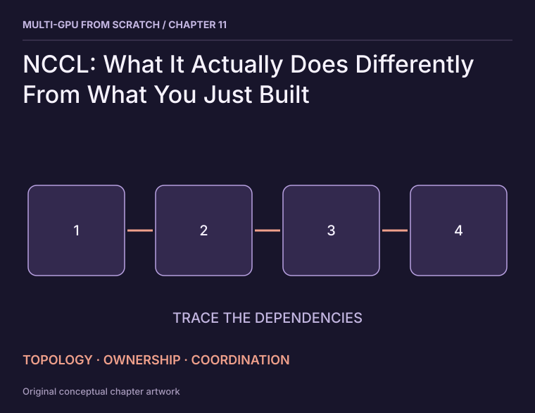
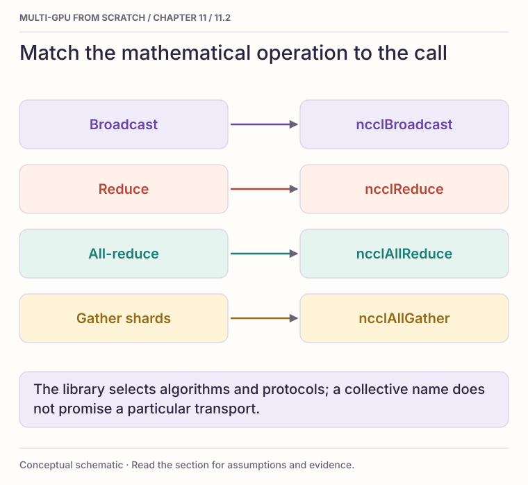

# Chapter 11: NCCL: What It Actually Does Differently From What You Just Built

<!-- execution:provenance -->
!!! info "Execution provenance"

    Current execution blocks identify the tested source hash, hardware dataset, commands and captured output. References elsewhere on this page to a device-less environment describe the original authoring context. Historical output is superseded by the current record. Displayed output omits the runner command header and trims trailing line whitespace; raw logs remain exact. A host simulation or API validation has its stated scope; neither alone establishes a numerical multi-GPU workload or measured performance.


<!-- mgpu:opener:start -->
[](../images/chapter-openers/11.svg)
<!-- mgpu:opener:end -->

**What you will understand by the end of this chapter:**

- How a real `ncclComm_t` communicator relates to the `deviceCount` loops this book has used since Chapter 3, and the two genuinely different ways a real `ncclCommInitAll()` call can honestly fail -- a malformed argument, rejected up front, versus a well-formed request that fails inside CUDA.
- That five of this book's six hand-built collectives (Chapters 8-10) have a real, one-call NCCL equivalent in the NCCL 2.18.3 this book links against, while all-to-all there is built exactly the way Chapter 10 did: from grouped point-to-point transfers. (Newer NCCL, from 2.28, adds a dedicated `ncclAlltoAll()`.)
- The one genuine algorithmic gap between what this book built and what NCCL does for real: ring all-reduce's round count grows linearly with the number of devices, and at large enough scale that stops being good enough -- which is exactly why NCCL added a second algorithm.

**What you need to know first:**

- All six of Chapters 8-10's hand-built collectives: broadcast, reduce, all-reduce (ring), all-gather, reduce-scatter, all-to-all.
- Chapter 9's ring all-reduce round count, `2*(N-1)`.
- This book's closed-form cost/round-count modeling technique (Chapter 2, Chapter 5), used again in Section 11.3.

---

This chapter introduces NCCL communicator construction and expected-error probes. Files 30 and 31 are checked API probes in the current H100 run, not numerical collective algorithms. Subsequent chapters contain initialized-buffer collective checks. Earlier device-less transcripts describe historical diagnostics only.

The [2026-11-17 H100 execution record](../validation-h100.md) covers two GPUs connected by local NV18. It distinguishes numerical checks, API probes and other executions; a successful exit alone does not establish GPU algorithm correctness.

```text
This book's hand-built collectives (Ch8-10)         NCCL's real API (this chapter)

  broadcast:      cudaMemcpyPeer loop, from root  -->  ncclBroadcast()
  reduce:         cudaMemcpy + host accumulator   -->  ncclReduce()
  all-reduce:     two-phase ring, by hand          -->  ncclAllReduce()  (ring OR
                                                          tree, chosen automatically
                                                          -- Section 11.3)
  all-gather:     direct cudaMemcpyPeer loop       -->  ncclAllGather()
  reduce-scatter: host-mediated, by hand           -->  ncclReduceScatter()
  all-to-all:     direct cudaMemcpyPeer all-pairs  -->  ncclSend()/ncclRecv(),
                                                          all-pairs, grouped --
                                                          no dedicated call in
                                                          2.18.3 (ncclAlltoAll()
                                                          arrived in NCCL 2.28)
```

## 11.1 A Real Communicator: `ncclCommInitAll` and the World This Book Has Called `deviceCount`

<!-- mgpu:figure-1:start -->
[](../images/technical/ch11/1-flow.svg)
<!-- mgpu:figure-1:end -->

### Intuition

Every real NCCL collective call needs a communicator -- a single object that names which devices are in the group and how they're numbered, so that a call like "broadcast this buffer" has an actual group to broadcast across. Think of it like a team roster handed out before a group project starts: nobody on the team can be assigned a task until the roster itself exists, with everyone's name and role settled. This book's `deviceCount`-driven loops have quietly done the roster's job themselves, informally, since Chapter 3; NCCL just makes that roster a real, explicit object you create once, up front.

```text
Before any collective call, a real NCCL program needs a communicator:

  cudaGetDeviceCount()  -->  ncclCommInitAll(comms, ndev, devlist)  -->  ncclComm_t[ndev]
        |                              |
        +--> "how many devices         +--> "bind each of these ndev communicators
              do I actually have?"           to a real CUDA device, as one group"

  This chapter's own deviceCount is 0 -- so ndev=0 is exactly what an
  honest program, built the way every prior chapter has been, would
  actually pass here.
```

### Background

`ncclGetVersion()` is the one call in this section that needs nothing from the machine at all -- it reads a version number baked into the library at build time, so it can genuinely succeed even here. `ncclCommInitAll()` is different: it has to actually attach communicators to real CUDA devices, and it can fail in two genuinely different ways depending on *which argument* is wrong. NCCL first runs argument checks: a `NULL` `comms` pointer or a negative `ndev` is rejected immediately as `ncclInvalidArgument` (code 4), before any device is touched. A valid request must additionally complete CUDA setup; a CUDA failure can be reported as `ncclUnhandledCudaError`. The old NCCL 2.18.3 no-device transcript is historical, not a specification for the current library or a successful initialization test. The code below makes all four cases explicit, and every explanation in this section was confirmed by running it with `NCCL_DEBUG=WARN`, which makes NCCL print its own reason for each failure on stderr.

> **Validation update:** This updated source has checked API lifetimes and explicit result checks. API probes establish only the API behavior printed by the program; they do not establish numerical collective correctness or fault recovery. Earlier transcripts below belong to the earlier source. The current source was compiled and executed in the dated H100 suite; use the linked record for its numerical, API-probe or other-execution scope.

The [2026-11-17 H100 execution record](../validation-h100.md) covers two GPUs connected by local NV18. It distinguishes numerical checks, API probes and other executions; a successful exit alone does not establish GPU algorithm correctness.

```cpp
// 30_nccl_comm_init.cu
// API probe: valid communicator lifetimes and rejected malformed arguments.
#include <cstdio>
#include <vector>
#include <cuda_runtime.h>
#include <nccl.h>
int main() {
 int count=0; if(cudaGetDeviceCount(&count)!=cudaSuccess || count<1) return 2;
 std::vector<ncclComm_t> comms(count,nullptr);
 ncclResult_t result=ncclCommInitAll(comms.data(),count,nullptr);
 if(result!=ncclSuccess) { fprintf(stderr,"init: %s\n",ncclGetErrorString(result)); return 1; }
 int errors=0;
 for(auto comm:comms) if(ncclCommDestroy(comm)!=ncclSuccess) ++errors;
 ncclComm_t single=nullptr;
 result=ncclCommInitAll(&single,1,nullptr);
 if(result!=ncclSuccess) ++errors;
 else if(ncclCommDestroy(single)!=ncclSuccess) ++errors;
 ncclComm_t unused=nullptr;
 if(ncclCommInitAll(nullptr,1,nullptr)!=ncclInvalidArgument) ++errors;
 if(ncclCommInitAll(&unused,-1,nullptr)!=ncclInvalidArgument) ++errors;
 printf("API PROBE %s: %d devices, valid initialization/destruction and invalid argument checks, errors=%d\n",errors?"FAIL":"PASS",count,errors);
 return errors?1:0;
}
```

<!-- execution:start:a100:30_nccl_comm_init.cu -->
> **Current execution — 2026-11-17-a100: API validation (recorded scope).** UTC (program start): `2026-11-18T00:01:48.006326+00:00`. Source SHA-256: `8727f9eeaaba6ddea198f70216798f22ba552ebeaf625453234128773ef4074b`.

[Exact tested source](../validation/2026-11-17-a100/30_nccl_comm_init/30_nccl_comm_init.cu) · [Compiler log](../validation/2026-11-17-a100/30_nccl_comm_init/compile.log) · [Execution log](../validation/2026-11-17-a100/30_nccl_comm_init/run.log). Compile exit: `0`; run exit: `0`.

Commands below use local source/binary names; raw logs retain host paths. Execute in a scratch directory containing the downloaded source.

```bash
nvcc -std=c++17 -O2 -arch=sm_80 30_nccl_comm_init.cu -o ./example -lnccl
./example
```

<details markdown="1"><summary>Captured current-source output</summary>

```text
API PROBE PASS: 8 devices, valid initialization/destruction and invalid argument checks, errors=0
```

</details>
<!-- execution:end:a100:30_nccl_comm_init.cu -->


<!-- execution:start:h100:30_nccl_comm_init.cu -->
> **Current execution — 2026-11-17-h100: API validation (recorded scope).** UTC (run-batch start; per-program time unrecorded): `2026-11-17T23:48:18.967387+00:00`. Source SHA-256: `8727f9eeaaba6ddea198f70216798f22ba552ebeaf625453234128773ef4074b`.

[Exact tested source](../validation/2026-11-17-h100/30_nccl_comm_init/30_nccl_comm_init.cu) · [Compiler log](../validation/2026-11-17-h100/30_nccl_comm_init/compile.log) · [Execution log](../validation/2026-11-17-h100/30_nccl_comm_init/run.log). Compile exit: `0`; run exit: `0`.

Commands below use local source/binary names; raw logs retain host paths. Execute in a scratch directory containing the downloaded source.

```bash
nvcc -std=c++17 -O2 -arch=sm_90 30_nccl_comm_init.cu -o ./example -lnccl
./example
```

<details markdown="1"><summary>Captured current-source output</summary>

```text
API PROBE PASS: 2 devices, valid initialization/destruction and invalid argument checks, errors=0
```

</details>
<!-- execution:end:h100:30_nccl_comm_init.cu -->


Genuinely compiled with a real `nvcc`, genuinely linked against a real, installed `libnccl` (version 2.18.3), and genuinely run. Locked output, deterministic across repeated runs:

<details markdown="1"><summary>Historical authoring output — superseded by the current execution above</summary>

```
cudaGetDeviceCount(): 0 device(s).
ncclGetVersion(): no error (code 0), reports version 21803 (major.minor.patch = 2.18.3)

(a) ncclCommInitAll(comms, ndev=0 [this book's real deviceCount]): unhandled cuda error (run with NCCL_DEBUG=INFO for details) (code 1)
(b) ncclCommInitAll(comms, ndev=1): unhandled cuda error (run with NCCL_DEBUG=INFO for details) (code 1)
(c) ncclCommInitAll(comms=nullptr, ndev=1): invalid argument (run with NCCL_DEBUG=WARN for details) (code 4)
(d) ncclCommInitAll(comms, ndev=-1): invalid argument (run with NCCL_DEBUG=WARN for details) (code 4)

Two genuinely different failure modes: a malformed ARGUMENT
(a NULL comms pointer, or a negative device count) is rejected
immediately as ncclInvalidArgument (code 4); a well-formed request
-- including ndev=0 -- gets past argument checking and fails as
ncclUnhandledCudaError (code 1) once NCCL's first CUDA call finds
no device. No communicator was created by any of these calls;
Section 11.2 shows what every collective reports when handed a
comm that is still NULL.
```

</details>

File 30 sizes communicator storage from the actual device count, checks valid initialization and destruction, and separately checks invalid arguments against explicit expected-error results. Use its current H100 log for this source. Earlier zero-device diagnostics cannot establish how a valid communicator or collective behaves.

The [2026-11-17 H100 execution record](../validation-h100.md) covers two GPUs connected by local NV18. It distinguishes numerical checks, API probes and other executions; a successful exit alone does not establish GPU algorithm correctness.

!!! warning "[COMMON TRAP] Inferring an exact root cause from a result code alone"
    `ncclInvalidArgument` identifies an argument error; `ncclUnhandledCudaError` reports a CUDA failure within NCCL. Neither numeric code alone identifies the failed argument or CUDA operation. Read `NCCL_DEBUG=WARN` diagnostics and the checked call context. Expected-error probes are API checks, not successful collective computations.

The [2026-11-17 H100 execution record](../validation-h100.md) covers two GPUs connected by local NV18. It distinguishes numerical checks, API probes and other executions; a successful exit alone does not establish GPU algorithm correctness.

## 11.2 Six Collectives, Six Real Calls (Mostly)

<!-- mgpu:figure-2:start -->
[](../images/technical/ch11/2-mapping.svg)
<!-- mgpu:figure-2:end -->

### Intuition

Chapters 8 through 10 built six collectives by hand, one loop of `cudaMemcpyPeer()` or `cudaMemcpy()` calls at a time. Real NCCL packages five of those six as a single function call each -- the entire loop this book wrote out explicitly, hidden behind one name. The sixth, all-to-all, doesn't get that treatment in the NCCL 2.18.3 this book links against: there it's built from the same kind of point-to-point calls this book used, just NCCL's own `ncclSend()`/`ncclRecv()` instead of `cudaMemcpyPeer()`. That is a version-specific fact, not a permanent one: NCCL 2.28.3's release notes record "Added new host collective APIs: ncclAlltoAll, ncclScatter, and ncclGather," and the current collective-operations documentation includes `ncclAlltoAll`.

```text
Chapter 8-10's six collectives, and their real NCCL 2.18.3 call:

  Ch8 8.1   --> ncclBroadcast()          Ch10 10.1 --> ncclAllGather()
  Ch8 8.2   --> ncclReduce()             Ch10 10.2 --> ncclReduceScatter()
  Ch9       --> ncclAllReduce()          Ch10 10.3 --> ncclSend() + ncclRecv()
                                                       (grouped; no dedicated
                                                        call until NCCL 2.28's
                                                        ncclAlltoAll())
```

### Background

No communicator can be created on this machine (Section 11.1), so every call below is handed a `comm` handle that is literally `nullptr`. NCCL's own argument check rejects that `NULL` handle before any of these calls could do anything with real device memory, so every one of the five collectives reports `ncclInvalidArgument` (code 4) -- and `NCCL_DEBUG=WARN` names the cause precisely, once per call: `NCCL WARN Broadcast : comm argument is NULL`, `Reduce : comm argument is NULL`, and likewise for `AllReduce`, `AllGather`, and `ReduceScatter`. This is the same `NULL`-pointer argument check as Section 11.1's case (c), not anything to do with how many devices were requested -- which also means a real program that ignored a failed `ncclCommInitAll()` and carried on would not necessarily see this particular error, since NCCL makes no promise that a failed init leaves the handle `NULL`.

> **Validation update:** This updated source has checked API lifetimes and explicit result checks. API probes establish only the API behavior printed by the program; they do not establish numerical collective correctness or fault recovery. Earlier transcripts below belong to the earlier source. The current source was compiled and executed in the dated H100 suite; use the linked record for its numerical, API-probe or other-execution scope.

The [2026-11-17 H100 execution record](../validation-h100.md) covers two GPUs connected by local NV18. It distinguishes numerical checks, API probes and other executions; a successful exit alone does not establish GPU algorithm correctness.

```cpp
// 31_nccl_collectives_mapped.cu
// Expected-error API probe; no collective is claimed to execute successfully.
#include <cstdio>
#include <nccl.h>
#include <cuda_runtime.h>
int main() {
 ncclComm_t comm=nullptr; cudaStream_t stream=nullptr; float *buf=nullptr;
 int errors=0;
 auto check=[&](const char *name,ncclResult_t value) {
  printf("%s: %s (expected invalid argument)\n",name,ncclGetErrorString(value));
  if(value!=ncclInvalidArgument) ++errors;
 };
 check("Broadcast",ncclBroadcast(buf,buf,4,ncclFloat,0,comm,stream));
 check("Reduce",ncclReduce(buf,buf,4,ncclFloat,ncclSum,0,comm,stream));
 check("AllReduce",ncclAllReduce(buf,buf,4,ncclFloat,ncclSum,comm,stream));
 check("AllGather",ncclAllGather(buf,buf,4,ncclFloat,comm,stream));
 check("ReduceScatter",ncclReduceScatter(buf,buf,4,ncclFloat,ncclSum,comm,stream));
 check("Send",ncclSend(buf,1,ncclFloat,0,comm,stream));
 check("Recv",ncclRecv(buf,1,ncclFloat,0,comm,stream));
 printf("API PROBE %s: NULL-communicator rejection only, errors=%d\n",errors?"FAIL":"PASS",errors);
 return errors?1:0;
}
```

<!-- execution:start:a100:31_nccl_collectives_mapped.cu -->
> **Current execution — 2026-11-17-a100: API validation (recorded scope).** UTC (program start): `2026-11-18T00:01:57.510122+00:00`. Source SHA-256: `1d7c8fdc5703d2568fad0a308233cb39f8245aa0f25d25c709d493e216f63a2c`.

[Exact tested source](../validation/2026-11-17-a100/31_nccl_collectives_mapped/31_nccl_collectives_mapped.cu) · [Compiler log](../validation/2026-11-17-a100/31_nccl_collectives_mapped/compile.log) · [Execution log](../validation/2026-11-17-a100/31_nccl_collectives_mapped/run.log). Compile exit: `0`; run exit: `0`.

Commands below use local source/binary names; raw logs retain host paths. Execute in a scratch directory containing the downloaded source.

```bash
nvcc -std=c++17 -O2 -arch=sm_80 31_nccl_collectives_mapped.cu -o ./example -lnccl
./example
```

<details markdown="1"><summary>Captured current-source output</summary>

```text
Broadcast: invalid argument (run with NCCL_DEBUG=WARN for details) (expected invalid argument)
Reduce: invalid argument (run with NCCL_DEBUG=WARN for details) (expected invalid argument)
AllReduce: invalid argument (run with NCCL_DEBUG=WARN for details) (expected invalid argument)
AllGather: invalid argument (run with NCCL_DEBUG=WARN for details) (expected invalid argument)
ReduceScatter: invalid argument (run with NCCL_DEBUG=WARN for details) (expected invalid argument)
Send: invalid argument (run with NCCL_DEBUG=WARN for details) (expected invalid argument)
Recv: invalid argument (run with NCCL_DEBUG=WARN for details) (expected invalid argument)
API PROBE PASS: NULL-communicator rejection only, errors=0
```

</details>
<!-- execution:end:a100:31_nccl_collectives_mapped.cu -->


<!-- execution:start:h100:31_nccl_collectives_mapped.cu -->
> **Current execution — 2026-11-17-h100: API validation (recorded scope).** UTC (run-batch start; per-program time unrecorded): `2026-11-17T23:48:18.967387+00:00`. Source SHA-256: `1d7c8fdc5703d2568fad0a308233cb39f8245aa0f25d25c709d493e216f63a2c`.

[Exact tested source](../validation/2026-11-17-h100/31_nccl_collectives_mapped/31_nccl_collectives_mapped.cu) · [Compiler log](../validation/2026-11-17-h100/31_nccl_collectives_mapped/compile.log) · [Execution log](../validation/2026-11-17-h100/31_nccl_collectives_mapped/run.log). Compile exit: `0`; run exit: `0`.

Commands below use local source/binary names; raw logs retain host paths. Execute in a scratch directory containing the downloaded source.

```bash
nvcc -std=c++17 -O2 -arch=sm_90 31_nccl_collectives_mapped.cu -o ./example -lnccl
./example
```

<details markdown="1"><summary>Captured current-source output</summary>

```text
Broadcast: invalid argument (run with NCCL_DEBUG=WARN for details) (expected invalid argument)
Reduce: invalid argument (run with NCCL_DEBUG=WARN for details) (expected invalid argument)
AllReduce: invalid argument (run with NCCL_DEBUG=WARN for details) (expected invalid argument)
AllGather: invalid argument (run with NCCL_DEBUG=WARN for details) (expected invalid argument)
ReduceScatter: invalid argument (run with NCCL_DEBUG=WARN for details) (expected invalid argument)
Send: invalid argument (run with NCCL_DEBUG=WARN for details) (expected invalid argument)
Recv: invalid argument (run with NCCL_DEBUG=WARN for details) (expected invalid argument)
API PROBE PASS: NULL-communicator rejection only, errors=0
```

</details>
<!-- execution:end:h100:31_nccl_collectives_mapped.cu -->


Genuinely compiled with a real `nvcc`, genuinely linked against a real `libnccl`, and genuinely run. Locked output, deterministic across repeated runs:

<details markdown="1"><summary>Historical authoring output — superseded by the current execution above</summary>

```
cudaGetDeviceCount(): 0 device(s).

-- Five of this book's six hand-built collectives, as one
   real NCCL call each: --

ncclBroadcast()      [Chapter 8, Section 8.1's broadcast]:      invalid argument (run with NCCL_DEBUG=WARN for details) (code 4)
ncclReduce()         [Chapter 8, Section 8.2's reduce]:         invalid argument (run with NCCL_DEBUG=WARN for details) (code 4)
ncclAllReduce()      [Chapter 9's ring all-reduce]:             invalid argument (run with NCCL_DEBUG=WARN for details) (code 4)
ncclAllGather()      [Chapter 10, Section 10.1's all-gather]:   invalid argument (run with NCCL_DEBUG=WARN for details) (code 4)
ncclReduceScatter()  [Chapter 10, Section 10.2's reduce-scatter]: invalid argument (run with NCCL_DEBUG=WARN for details) (code 4)

-- All-to-all [Chapter 10, Section 10.3]: no dedicated call in 2.18.3 --
   built from ncclSend()/ncclRecv(), exactly like this book's
   own direct implementation: --

ncclGroupStart(): no error (code 0)
ncclGroupEnd(): no error (code 0)

0 device(s) worth of ncclSend()/ncclRecv() pairs attempted
inside the group, so ncclSend()/ncclRecv() were never actually
called. All five collective calls above report the same
failure: ncclInvalidArgument, because the comm handle they were
given is NULL (NCCL_DEBUG=WARN: "comm argument is NULL").
ncclGroupStart()/ncclGroupEnd() succeed: they touch no comm.
Section 11.3 turns to the one real difference that would
matter if a comm HAD been created: how NCCL chooses an
algorithm for ncclAllReduce().
```

</details>

`ncclGroupStart()` and `ncclGroupEnd()` genuinely succeed -- like `ncclGetVersion()`, they only manage process-local grouping state, not device state, and take no communicator, so they need no real hardware at all. With `deviceCount = 0`, the loop between them never runs, so `ncclSend()`/`ncclRecv()` are never actually called -- the same honest degradation this book has shown for every device-count-driven loop since Chapter 4. So exactly five real NCCL calls fail here, not six, and all five fail for the reason `NCCL_DEBUG=WARN` reports: a `NULL` comm argument.

!!! warning "[COMMON TRAP] Assuming the missing all-to-all call (in NCCL 2.18.3) means all-to-all is somehow a second-class operation in NCCL"
    It would be easy to read "no dedicated call" as "NCCL doesn't really support this." Two things say otherwise. First, the gap is version-specific: NCCL 2.28 added a dedicated `ncclAlltoAll()`, so on a current NCCL the one-call form exists. Second, even in the 2.18.3 this book links against, NCCL's own documentation says otherwise: point-to-point `ncclSend()`/`ncclRecv()` calls "can be fused together with `ncclGroupStart()` and `ncclGroupEnd()` to form more complex communication patterns," and the documentation's own example for exactly this fusion is an all-to-all loop, line for line the same shape as this section's code. All-to-all is fully supported in 2.18.3 -- it's just supported there as a composition of two more primitive calls, the same way this book's own Chapter 10 built it as a composition of `cudaMemcpyPeer()` calls, rather than as one specially-named function.

## 11.3 Ring vs. Tree: The Latency Problem Chapter 9 Never Had to Solve

### Intuition

Chapter 9's ring all-reduce runs in `2*(N-1)` rounds, and at `N=4` that's a perfectly reasonable 6 rounds -- nobody would notice. But `2*(N-1)` is a straight line: double the device count, and you roughly double the number of rounds. At the scale real large training clusters actually reach -- thousands, sometimes tens of thousands of devices -- that straight line stops being a minor detail and starts being the whole bottleneck. NCCL's answer, since version 2.4, is a second algorithm for exactly this situation: instead of a ring, arrange the devices as a tree, where a value only has to climb up to a root and back down, a number of hops set by the tree's *height* rather than its device *count* -- and a balanced tree's height barely grows at all as you add more devices.

```text
Ring (Ch9): every device touches only its 2 neighbors, but a chunk
needs N-1 hops to cross the whole ring once:

  dev0 -> dev1 -> dev2 -> dev3 -> ... -> dev(N-1)     (N-1 hops)

Tree: every device is a node in a tree of height ~log2(N); a value
climbs UP to the root in ~log2(N) hops, then comes back DOWN in
~log2(N) more:

                 root
                   |
          +--------+--------+
          |                 |
         node              node
          |                 |
      +---+---+         +---+---+
      |       |         |       |
     leaf    leaf      leaf    leaf

  N = 4 leaves: height log2(4) = 2 hops from any leaf up to the root
  (3 levels of nodes, counting the leaves themselves). In general a
  balanced binary tree over N leaves has height ceil(log2(N)).
```

### Background

NVIDIA's own announcement of this feature states the ring's problem plainly: "latency scales linearly with the number of GPUs, preventing scaling above hundreds of GPUs." Its fix, the double binary tree, is described as offering "full bandwidth and a logarithmic latency" -- and, importantly, NCCL doesn't force a choice between the two: "NCCL automatically switches back to rings when that pattern results in greater bandwidth," picking whichever algorithm actually wins for the real topology and message size in front of it. The model below doesn't measure any real timing -- it counts, in the same closed-form spirit as Chapter 2's topology model and Chapter 5's cost model, exactly how many communication *rounds* each shape needs, reusing Chapter 9's own `2*(N-1)` ring formula unchanged and adding the matching round count for a tree of height `ceil(log2(N))`.

```cpp
// Chapter 11: NCCL -- What It Actually Does Differently From What You
// Just Built
// 32_ring_vs_tree_model.cpp
//
// Plain host C++ -- a closed-form ROUND-COUNT model, in the same
// spirit as Chapter 2's topology model and Chapter 5's cost model:
// no fabricated timings, only real, defensible structural counts.
// This compares Chapter 9's own ring all-reduce round count against
// a double binary tree's round count, for growing device counts, to
// make the NCCL 2.4 blog post's "latency scales linearly... versus
// logarithmic latency" claim (cited in Sources) concrete as numbers.
#include <cstdio>
#include <cmath>

int main() {
    printf("%-10s %-22s %-22s %-10s\n", "N", "Ring rounds (Ch9)", "Tree rounds (up+down)", "Ratio");
    printf("%-10s %-22s %-22s %-10s\n", "-", "2*(N-1)", "2*ceil(log2(N))", "ring/tree");

    int Ns[] = {4, 8, 16, 64, 256, 1024, 8192, 24576};
    for (int N : Ns) {
        // Ring: Chapter 9's own totalSteps formula, unchanged.
        long long ringRounds = 2LL * (N - 1);

        // Double binary tree: reducing up to a root takes one round per
        // level of the tree, and broadcasting back down takes another
        // round per level -- a balanced binary tree over N leaves has
        // ceil(log2(N)) levels.
        int levels = (int)std::ceil(std::log2((double)N));
        long long treeRounds = 2LL * levels;

        double ratio = (double)ringRounds / (double)treeRounds;
        printf("%-10d %-22lld %-22lld %-10.2fx\n", N, ringRounds, treeRounds, ratio);
    }

    printf("\nRing's round count grows linearly with N (doubling N roughly\n"
           "doubles the rounds needed); the tree's grows logarithmically\n"
           "(doubling N adds only one more level in each direction). This\n"
           "is a structural count of communication ROUNDS, not a measured\n"
           "time -- it makes concrete exactly the shape of the claim this\n"
           "chapter cites from NVIDIA's own NCCL 2.4 announcement, without\n"
           "fabricating a single timing number of its own.\n");

    return 0;
}
```

<!-- execution:start:a100:32_ring_vs_tree_model.cpp -->
> **Current execution — 2026-11-17-a100: Host program/model (exit-only).** UTC (program start): `2026-11-18T00:01:59.285330+00:00`. Source SHA-256: `26cb373d652c1985ee1c42d2aa5edb5bee5a47ca5900dc938ca2e110e76967e5`.

[Exact tested source](../validation/2026-11-17-a100/32_ring_vs_tree_model/32_ring_vs_tree_model.cpp) · [Compiler log](../validation/2026-11-17-a100/32_ring_vs_tree_model/compile.log) · [Execution log](../validation/2026-11-17-a100/32_ring_vs_tree_model/run.log). Compile exit: `0`; run exit: `0`.

Commands below use local source/binary names; raw logs retain host paths. Execute in a scratch directory containing the downloaded source.

```bash
g++ -std=c++17 -O2 32_ring_vs_tree_model.cpp -o ./example
./example
```

<details markdown="1"><summary>Captured current-source output</summary>

```text
N          Ring rounds (Ch9)      Tree rounds (up+down)  Ratio
-          2*(N-1)                2*ceil(log2(N))        ring/tree
4          6                      4                      1.50      x
8          14                     6                      2.33      x
16         30                     8                      3.75      x
64         126                    12                     10.50     x
256        510                    16                     31.88     x
1024       2046                   20                     102.30    x
8192       16382                  26                     630.08    x
24576      49150                  30                     1638.33   x

Ring's round count grows linearly with N (doubling N roughly
doubles the rounds needed); the tree's grows logarithmically
(doubling N adds only one more level in each direction). This
is a structural count of communication ROUNDS, not a measured
time -- it makes concrete exactly the shape of the claim this
chapter cites from NVIDIA's own NCCL 2.4 announcement, without
fabricating a single timing number of its own.
```

</details>
<!-- execution:end:a100:32_ring_vs_tree_model.cpp -->


<!-- execution:start:h100:32_ring_vs_tree_model.cpp -->
> **Current execution — 2026-11-17-h100: Host program/model (exit-only).** UTC (run-batch start; per-program time unrecorded): `2026-11-17T23:48:18.967387+00:00`. Source SHA-256: `26cb373d652c1985ee1c42d2aa5edb5bee5a47ca5900dc938ca2e110e76967e5`.

[Exact tested source](../validation/2026-11-17-h100/32_ring_vs_tree_model/32_ring_vs_tree_model.cpp) · [Compiler log](../validation/2026-11-17-h100/32_ring_vs_tree_model/compile.log) · [Execution log](../validation/2026-11-17-h100/32_ring_vs_tree_model/run.log). Compile exit: `0`; run exit: `0`.

Commands below use local source/binary names; raw logs retain host paths. Execute in a scratch directory containing the downloaded source.

```bash
g++ -std=c++17 -O2 32_ring_vs_tree_model.cpp -o ./example
./example
```

<details markdown="1"><summary>Captured current-source output</summary>

```text
N          Ring rounds (Ch9)      Tree rounds (up+down)  Ratio
-          2*(N-1)                2*ceil(log2(N))        ring/tree
4          6                      4                      1.50      x
8          14                     6                      2.33      x
16         30                     8                      3.75      x
64         126                    12                     10.50     x
256        510                    16                     31.88     x
1024       2046                   20                     102.30    x
8192       16382                  26                     630.08    x
24576      49150                  30                     1638.33   x

Ring's round count grows linearly with N (doubling N roughly
doubles the rounds needed); the tree's grows logarithmically
(doubling N adds only one more level in each direction). This
is a structural count of communication ROUNDS, not a measured
time -- it makes concrete exactly the shape of the claim this
chapter cites from NVIDIA's own NCCL 2.4 announcement, without
fabricating a single timing number of its own.
```

</details>
<!-- execution:end:h100:32_ring_vs_tree_model.cpp -->


Genuinely compiled with `g++` and genuinely run. Locked output, deterministic across repeated runs:

<details markdown="1"><summary>Historical authoring output — superseded by the current execution above</summary>

```
N          Ring rounds (Ch9)      Tree rounds (up+down)  Ratio     
-          2*(N-1)                2*ceil(log2(N))        ring/tree 
4          6                      4                      1.50      x
8          14                     6                      2.33      x
16         30                     8                      3.75      x
64         126                    12                     10.50     x
256        510                    16                     31.88     x
1024       2046                   20                     102.30    x
8192       16382                  26                     630.08    x
24576      49150                  30                     1638.33   x

Ring's round count grows linearly with N (doubling N roughly
doubles the rounds needed); the tree's grows logarithmically
(doubling N adds only one more level in each direction). This
is a structural count of communication ROUNDS, not a measured
time -- it makes concrete exactly the shape of the claim this
chapter cites from NVIDIA's own NCCL 2.4 announcement, without
fabricating a single timing number of its own.
```

</details>

The last row uses `N=24576` deliberately: NVIDIA's own announcement cites testing this exact feature at 24,576 GPUs on the Summit supercomputer, reporting "up to 180x" latency improvement at that scale. This model's own round-count ratio at that same `N` -- 1638.33x -- is not that measured number, and shouldn't be read as if it were; a round-count ratio and a measured latency-improvement ratio are different quantities, computed differently, and this book has no real timing data to produce the second one. What this table *does* honestly establish is the shape both numbers share: at small `N` the two algorithms are close enough that either one is fine, and the gap between them widens dramatically, in the same direction, as `N` grows into the thousands.

!!! warning "[COMMON TRAP] Treating this section's round-count ratio as a measured performance number"
    Section 11.3's table looks, superficially, like a benchmark result -- it has an N column and a ratio column, the same shape a real measured speedup table would have. It is not one. Every number in it is a pure count of communication *rounds*, computed from two closed-form formulas (`2*(N-1)` and `2*ceil(log2(N))`), with no notion of how long any single round actually takes on any real network. The real, measured "up to 180x" figure cited from NVIDIA's own Summit testing is a genuinely different quantity -- and this chapter is careful to cite that number as NVIDIA's own measurement, not to reproduce or approximate it with a model that was never designed to predict real timings in the first place.

## Chapter Summary

This chapter checked this book's own hand-built work in Chapters 8 through 10 against a real, genuinely-linked NCCL library, rather than building a new hand-rolled substitute. A real communicator (Section 11.1) plays exactly the role this book's own `deviceCount` loops have played informally since Chapter 3, and genuinely fails in two different, genuinely informative ways: a malformed argument (a `NULL` `comms` pointer, a negative device count) is rejected up front as `ncclInvalidArgument`, while any well-formed request -- `ndev=0` included -- fails inside CUDA as `ncclUnhandledCudaError`, with `NCCL_DEBUG=WARN` naming the cause in each case. Five of this book's six hand-built collectives turn out to have a literal, one-call NCCL equivalent (Section 11.2), and each one, handed a `NULL` comm, reports "comm argument is NULL"; the sixth, all-to-all, has no dedicated call in the NCCL 2.18.3 this book links against (NCCL 2.28 later added `ncclAlltoAll()`), and there is built the same way Chapter 10 built it -- from repeated point-to-point transfers, just using `ncclSend()`/`ncclRecv()` instead of `cudaMemcpyPeer()`. The one place this book's own algorithm genuinely falls short of what NCCL does for real is scale: Chapter 9's ring all-reduce needs a round count that grows linearly with the number of devices, which is fine at the `N=4` this book has used throughout but becomes a genuine bottleneck at the thousands-of-devices scale real training clusters reach -- which is exactly why NCCL, since version 2.4, automatically chooses between the ring this book built and a second, tree-based algorithm with logarithmic round growth (Section 11.3). With this, **Part 2 is complete**: Chapters 8 through 11 took this book from broadcast and reduce, by hand, all the way to checking that hand-built work against the real library every real multi-GPU training job actually uses. Part 3 turns to what all of this communication infrastructure is actually *for*: the parallelization strategies -- data, model, tensor, and pipeline parallelism -- that decide who computes what, and when they need to talk to each other at all.

## Self-Check Questions

1. What does `ncclGetVersion()` need that `ncclCommInitAll()` does, and why is a version query insufficient to establish successful communicator initialization?
2. Section 11.1 shows two different NCCL error codes across four requests. Explain why `ndev=0` and `ndev=1` (each with a real `comms` array) fail with the *same* code, while a `NULL` `comms` pointer or `ndev=-1` fail with a different one -- and how `NCCL_DEBUG=WARN` lets you tell which argument was at fault.
3. Match each of this book's six hand-built collectives (Chapters 8-10) to its one real NCCL call name from Section 11.2 -- for the one collective with no single matching call in NCCL 2.18.3, explain what it's built from instead, and what changed in NCCL 2.28.
4. Section 11.2's all-to-all code wraps `ncclSend()`/`ncclRecv()` in `ncclGroupStart()`/`ncclGroupEnd()`. Per NCCL's own documented ordering guarantee, what's different about two calls inside that group targeting the SAME peer versus two calls targeting DIFFERENT peers?
5. Quote the specific claim this chapter cites from NVIDIA's NCCL 2.4 announcement explaining why ring all-reduce alone isn't good enough at very large scale.
6. Using Section 11.3's model, compute the ring-to-tree round-count ratio for N=1024, and explain in your own words why that ratio keeps growing as N grows, using the formulas the code actually computes.
7. NCCL automatically switches between ring and tree rather than requiring the caller to pick one. Using this chapter's cited quote about when NCCL "switches back to rings," explain in what circumstance the bandwidth-optimal ring would still win over the lower-latency tree.
8. Chapter 9 never needed to reduce its round count below O(N) -- why not? What's different about the N=4 example Chapter 9 used throughout versus the N=24,576 Summit example this chapter cites?

## Where We Go Next

Part 2 is complete. Part 3 turns to parallelization strategies -- starting with Chapter 12, data parallelism, where every device holds a full replica of the same model and this book's own all-reduce (not hand-built this time, but the real `ncclAllReduce()` this chapter just linked against) is what keeps every replica's gradients in sync.

## Worked Solutions

**1.** `ncclGetVersion()` reads library version information without performing a collective. A valid communicator additionally requires the requested CUDA devices and successful initialization. The current probe checks this lifecycle and handles expected invalid arguments separately.

The [2026-11-17 H100 execution record](../validation-h100.md) covers two GPUs connected by local NV18. It distinguishes numerical checks, API probes and other executions; a successful exit alone does not establish GPU algorithm correctness.

**2.** Separate valid communicator initialization from intentionally invalid pointer/count cases. Use explicit expected-error checks and warning text rather than attributing every failure to device count. A historical no-device error is not a portable specification for `ndev=0` or evidence of a working communicator.

The [2026-11-17 H100 execution record](../validation-h100.md) covers two GPUs connected by local NV18. It distinguishes numerical checks, API probes and other executions; a successful exit alone does not establish GPU algorithm correctness.

**3.** `ncclBroadcast()` <- Chapter 8, Section 8.1 (broadcast); `ncclReduce()` <- Chapter 8, Section 8.2 (reduce); `ncclAllReduce()` <- Chapter 9 (ring all-reduce); `ncclAllGather()` <- Chapter 10, Section 10.1 (all-gather); `ncclReduceScatter()` <- Chapter 10, Section 10.2 (reduce-scatter). All-to-all (Chapter 10, Section 10.3) has no single matching call in this installed NCCL version (2.18.3) -- it's built the same way this book built it, from repeated point-to-point transfers (`ncclSend()`/`ncclRecv()`) covering every ordered pair, fused into one operation with `ncclGroupStart()`/`ncclGroupEnd()`. NCCL 2.28 added a dedicated `ncclAlltoAll()`, so on a current NCCL it does have a one-call form.

**4.** Per NCCL's own documented ordering guarantee, point-to-point calls within a group targeting the SAME peer execute in order -- so two sends to the same peer inside one group would still need to be issued in the correct relative order, or that peer would receive them in the wrong sequence. Calls targeting DIFFERENT peers have no such ordering requirement and can progress concurrently -- which is exactly why Section 11.2's all-to-all loop, issuing one send and one receive per peer, can safely fuse all of them into a single group without worrying about cross-peer ordering.

**5.** "Latency scales linearly with the number of GPUs, preventing scaling above hundreds of GPUs" -- this is the specific limitation of the ring algorithm that motivated NCCL 2.4's double binary tree addition, cited directly from NVIDIA's own announcement.

**6.** From Section 11.3's printed table, N=1024 gives ring rounds = `2*(1024-1) = 2046` and tree rounds = `2*ceil(log2(1024)) = 2*10 = 20`, for a ratio of `2046/20 = 102.30x`. The ratio keeps growing because the numerator (ring rounds) grows linearly in N while the denominator (tree rounds) grows only logarithmically in N -- doubling N roughly doubles the ring's round count but adds only one more level (two more rounds) to the tree's.

**7.** The chapter's cited quote is that "NCCL automatically switches back to rings when that pattern results in greater bandwidth." Both algorithms are described as capable of achieving full bandwidth, but for smaller device counts or particular message-size/topology combinations, the ring's simpler, fully-pipelined pattern can still deliver more actual bandwidth than the tree's; NCCL's automatic selection exists precisely because neither algorithm dominates the other in every situation.

**8.** Chapter 9 never needed to go below O(N) round count because its running example used only N=4 devices, where a linearly-growing round count is a trivial 6 rounds -- nowhere near large enough for the ring's latency problem to matter. NVIDIA's own Summit example, at N=24,576 GPUs, is precisely the regime where a ring's O(N) round count (nearly 50,000 rounds, per Section 11.3's table) becomes genuinely prohibitive, and where a tree's O(log N) round count (only 30 rounds) becomes essential rather than a nice-to-have.

---

**Sources cited in this chapter:**

- [Massively Scale Your Deep Learning Training with NCCL 2.4 — NVIDIA Developer Blog](https://developer.nvidia.com/blog/massively-scale-deep-learning-training-nccl-2-4) -- the ring algorithm's linear latency scaling limitation, the double binary tree's logarithmic-latency design and "each rank is at most a node in one tree and a leaf in the other" structure, NCCL's automatic ring/tree selection ("automatically switches back to rings when that pattern results in greater bandwidth"), and the Summit supercomputer test at 24,576 GPUs with "up to 180x" latency improvement.
- [NCCL User Guide — Communicator API (comms.html)](https://docs.nvidia.com/deeplearning/nccl/user-guide/docs/api/comms.html) -- the exact `ncclGetVersion()`, `ncclCommInitAll()`, and `ncclCommInitRank()` signatures and descriptions, including how rank count and device list determine a communicator clique's size.
- [NCCL User Guide — Point-to-Point Communication (p2p.html)](https://docs.nvidia.com/deeplearning/nccl/user-guide/docs/usage/p2p.html) -- the documented `ncclSend()`/`ncclRecv()` pairing requirement, the `ncclGroupStart()`/`ncclGroupEnd()` fusion mechanism for building "more complex communication patterns," its own all-to-all code example, and the same-peer-vs-different-peer ordering guarantee.
- [NCCL User Guide — Collective Operations (collectives.html)](https://docs.nvidia.com/deeplearning/nccl/user-guide/docs/usage/collectives.html) -- the real `ncclBroadcast()`, `ncclReduce()`, `ncclAllReduce()`, `ncclAllGather()`, and `ncclReduceScatter()` definitions matched against this book's own Chapters 8-10, and (in current versions) the dedicated `ncclAlltoAll`.
- [NCCL Release Notes — NVIDIA](https://docs.nvidia.com/deeplearning/nccl/release-notes/index.html) -- NCCL 2.28.3: "Added new host collective APIs: ncclAlltoAll, ncclScatter, and ncclGather," which dates the end of the no-dedicated-all-to-all situation this chapter describes for 2.18.3.
- Real `NCCL_DEBUG=WARN` output from the installed NCCL 2.18.3 (`misc/argcheck.cc`: "comms argument is NULL" / "comm argument is NULL"; `init.cc`: "Invalid device count requested" and "Cuda failure 'no CUDA-capable device is detected'") -- the evidence for every failure attribution in Sections 11.1 and 11.2.
