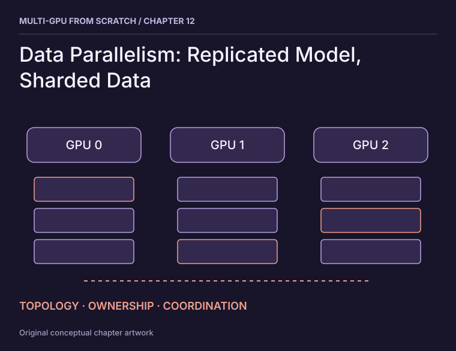
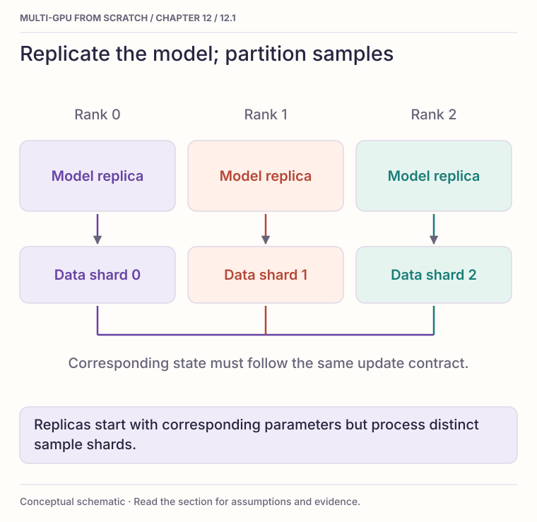
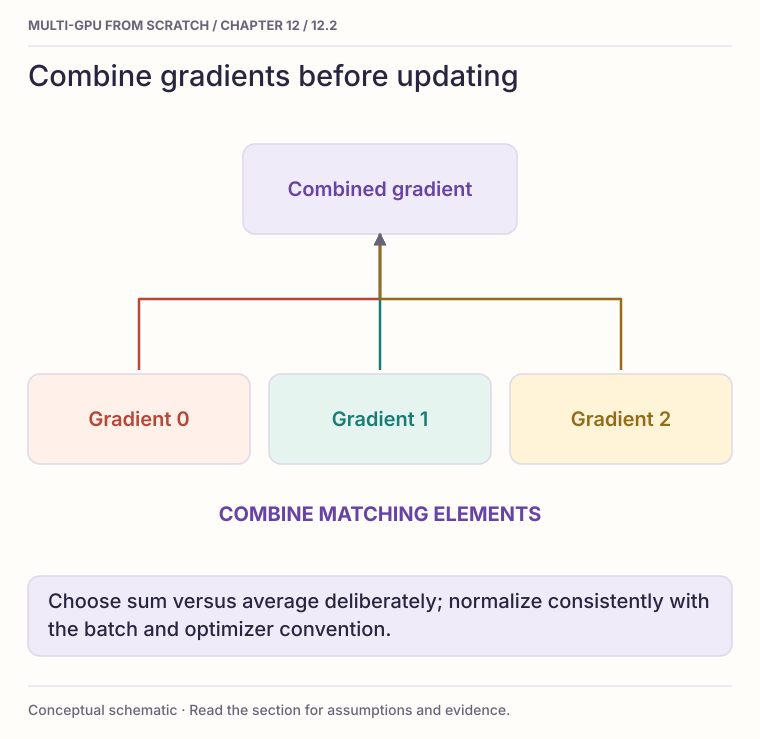

# Chapter 12: Data Parallelism: Replicated Model, Sharded Data

<!-- execution:provenance -->
!!! info "Execution provenance"

    Current execution blocks identify the tested source hash, hardware dataset, commands and captured output. References elsewhere on this page to a device-less environment describe the original authoring context. Historical output is superseded by the current record. Displayed output omits the runner command header and trims trailing line whitespace; raw logs remain exact. A host simulation or API validation has its stated scope; neither alone establishes a numerical multi-GPU workload or measured performance.


<!-- mgpu:opener:start -->
[](../images/chapter-openers/12.svg)
<!-- mgpu:opener:end -->

**What you will understand by the end of this chapter:**

- Why data parallelism replicates the *entire* model on every device but splits only the *data* -- and why PyTorch's own DistributedDataParallel paper states this book's whole Part 2 exists to guarantee exactly one thing: "all model replicas start from the exact same model state, and see the same parameter gradients after every backward pass."
- Why gradients must be *averaged* across every replica before the optimizer step, never summed and never skipped -- and how this book's real `ncclAllReduce()` does the averaging in one call, using a reduction op this chapter introduces: `ncclAvg`.
- The exact mechanism by which skipping that averaging step -- even once -- silently turns N replicas of one model into N different models, verified against an independent reference.

**What you need to know first:**

- Chapter 8's broadcast (used here to give every replica the same initial weights) and Chapter 9/11's all-reduce (used here every training step).
- Chapter 11's real, linked `ncclComm_t`/`ncclAllReduce()` and the two honest failure modes it can report.
- No new CUDA concepts beyond `ncclAvg`, a reduction op this chapter introduces alongside the `ncclSum` this book has used since Chapter 11 (Chapters 8-10 built their reductions by hand and never called NCCL).

---

Part 2 spent four chapters building the machinery to move and combine data across devices. Part 3 starts putting that machinery to work. Data parallelism is the simplest, most common way multi-GPU training actually happens: every device holds a complete, identical copy of the model, and the training data -- not the model -- gets split across them. Each device runs its own forward and backward pass on its own slice of data, producing its own local gradients; those gradients then have to be combined back into one shared update, or "replica" stops meaning anything. This chapter builds exactly that pipeline -- replicate, shard, compute, average, update -- and verifies, with a small checkable example, that averaging is not an optional refinement but the one thing standing between "one model, replicated" and "N different models that happen to share a name."

```text
Data parallelism, N=4 devices, ONE global batch of 16 samples:

  SAME weights, broadcast to every device:      DIFFERENT data, sharded across devices:
  (four identical copies)

    dev0: w = [ . . . . ]                         dev0: samples [0, 4)
    dev1: w = [ . . . . ]                         dev1: samples [4, 8)
    dev2: w = [ . . . . ]                         dev2: samples [8, 12)
    dev3: w = [ . . . . ]                         dev3: samples [12, 16)

Every step: each device computes its OWN gradient from its OWN
shard, then all four gradients are AVERAGED (ncclAllReduce, ncclAvg)
before anyone updates -- so every device's weights stay identical.
```

## 12.1 Same Model, Different Data: What "Replica" Actually Means

<!-- mgpu:figure-1:start -->
[](../images/technical/ch12/1-replicas.svg)
<!-- mgpu:figure-1:end -->

### Intuition

Picture four students given the exact same textbook and the exact same starting answer key, but each assigned a different quarter of the homework problems to practice on. For "replica" to mean anything, two things have to be true before anyone starts: every student's answer key has to start out genuinely identical -- not "close," identical -- and every student's practice problems have to be genuinely different from everyone else's, or there was no point splitting the homework up in the first place. Splitting the problems is just arithmetic -- dividing a stack into four piles needs no coordination. Making sure every answer key starts identical is not arithmetic -- it needs someone to actually hand out identical copies.

```text
Setting up one training step's replicas:

  cudaGetDeviceCount()  ------------------>  "how many replicas?"
        |
        +--> then:
  computeShard(globalBatch, worldSize, rank)  -->  "which samples are MINE?"
        (pure host arithmetic -- no device needed)
        |
        +--> then:
  ncclBroadcast(root=0, weights)  --------->  "make sure everyone starts
        (a real collective -- needs a device)      from the SAME weights"
```

### Background

Sharding a global batch is host index arithmetic. Broadcasting model weights additionally requires valid device buffers, communicators and completion checks. File 33 now checks that actual two-H100 broadcast data matches its initialized reference.

```cpp
// 33_replica_setup.cu
// Real 2--4 GPU teaching workload with independent nonuniform reference checks.
#include <cstdio>
#include <vector>
#include <algorithm>
#include <cmath>
#include <cuda_runtime.h>
#include <nccl.h>
#define CUDA(call) do {cudaError_t e=(call);if(e!=cudaSuccess){fprintf(stderr,"%s: %s\n",#call,cudaGetErrorString(e));return e==cudaErrorNoDevice||e==cudaErrorInsufficientDriver?2:1;}}while(0)
#define NCCL(call) do {ncclResult_t e=(call);if(e!=ncclSuccess){fprintf(stderr,"%s: %s\n",#call,ncclGetErrorString(e));return 1;}}while(0)

int main(){
 int count=0;CUDA(cudaGetDeviceCount(&count));if(count<2){printf("BLOCKED: requires 2 GPUs; found %d.\n",count);return 2;}
 const int world=std::min(count,4), n=257;
 std::vector<ncclComm_t> comm(world,nullptr);NCCL(ncclCommInitAll(comm.data(),world,nullptr));
 std::vector<cudaStream_t> stream(world,nullptr);std::vector<float*> input(world,nullptr),output(world,nullptr);
 for(int rank=0;rank<world;++rank){CUDA(cudaSetDevice(rank));CUDA(cudaStreamCreate(&stream[rank]));CUDA(cudaMalloc(&input[rank],n*sizeof(float)));CUDA(cudaMalloc(&output[rank],n*sizeof(float)));std::vector<float> values(n);
 for(int i=0;i<n;++i)values[i]=rank==0?float((i*17)%251-125)/8.0f:-777.0f;
 CUDA(cudaMemcpy(input[rank],values.data(),n*sizeof(float),cudaMemcpyHostToDevice));CUDA(cudaMemset(output[rank],0xff,n*sizeof(float)));}
 NCCL(ncclGroupStart());for(int rank=0;rank<world;++rank){CUDA(cudaSetDevice(rank));NCCL(ncclBroadcast(input[rank],output[rank],n,ncclFloat,0,comm[rank],stream[rank]));}NCCL(ncclGroupEnd());
 for(int rank=0;rank<world;++rank){CUDA(cudaSetDevice(rank));CUDA(cudaStreamSynchronize(stream[rank]));std::vector<float> got(n);CUDA(cudaMemcpy(got.data(),output[rank],n*sizeof(float),cudaMemcpyDeviceToHost));
 for(int i=0;i<n;++i){float expected=float((i*17)%251-125)/8.0f;if(!std::isfinite(got[i])||std::fabs(got[i]-expected)>1e-5f){fprintf(stderr,"FAIL rank %d output[%d] got %.9g expected %.9g\n",rank,i,got[i],expected);return 1;}}}

 for(int rank=0;rank<world;++rank){CUDA(cudaSetDevice(rank));CUDA(cudaStreamDestroy(stream[rank]));CUDA(cudaFree(input[rank]));CUDA(cudaFree(output[rank]));NCCL(ncclCommDestroy(comm[rank]));}
 printf("PASS: replica initial-weight broadcast on %d GPUs; all reference values checked.\n",world);return 0;
}
```

<!-- execution:start:a100:33_replica_setup.cu -->
> **Current execution — 2026-11-17-a100: Numerical/transport validation (recorded scope).** UTC (program start): `2026-11-18T00:01:59.505525+00:00`. Source SHA-256: `18fdb24c4f1080443b43b0b5dbc4dc54eef777f331150e6b576e957137bf18a5`.

[Exact tested source](../validation/2026-11-17-a100/33_replica_setup/33_replica_setup.cu) · [Compiler log](../validation/2026-11-17-a100/33_replica_setup/compile.log) · [Execution log](../validation/2026-11-17-a100/33_replica_setup/run.log). Compile exit: `0`; run exit: `0`.

Commands below use local source/binary names; raw logs retain host paths. Execute in a scratch directory containing the downloaded source.

```bash
nvcc -std=c++17 -O2 -arch=sm_80 33_replica_setup.cu -o ./example -lnccl
./example
```

<details markdown="1"><summary>Captured current-source output</summary>

```text
PASS: replica initial-weight broadcast on 4 GPUs; all reference values checked.
```

</details>
<!-- execution:end:a100:33_replica_setup.cu -->


<!-- execution:start:h100:33_replica_setup.cu -->
> **Current execution — 2026-11-17-h100: Numerical/transport validation (recorded scope).** UTC (run-batch start; per-program time unrecorded): `2026-11-17T23:48:18.967387+00:00`. Source SHA-256: `18fdb24c4f1080443b43b0b5dbc4dc54eef777f331150e6b576e957137bf18a5`.

[Exact tested source](../validation/2026-11-17-h100/33_replica_setup/33_replica_setup.cu) · [Compiler log](../validation/2026-11-17-h100/33_replica_setup/compile.log) · [Execution log](../validation/2026-11-17-h100/33_replica_setup/run.log). Compile exit: `0`; run exit: `0`.

Commands below use local source/binary names; raw logs retain host paths. Execute in a scratch directory containing the downloaded source.

```bash
nvcc -std=c++17 -O2 -arch=sm_90 33_replica_setup.cu -o ./example -lnccl
./example
```

<details markdown="1"><summary>Captured current-source output</summary>

```text
PASS: replica initial-weight broadcast on 2 GPUs; all reference values checked.
```

</details>
<!-- execution:end:h100:33_replica_setup.cu -->


**Current-source scope:** replica initial-weight broadcast uses real NCCL communicators, grouped rank participation, device buffers and checked stream completion. All output values are checked against a CPU formula; this is not a throughput benchmark. The current source was compiled and executed in the dated H100 suite; use the linked record for its numerical, API-probe or other-execution scope. The output below is retained from the earlier authoring diagnostic and is not evidence for this replacement source.

The [2026-11-17 H100 execution record](../validation-h100.md) covers two GPUs connected by local NV18. It distinguishes numerical checks, API probes and other executions; a successful exit alone does not establish GPU algorithm correctness.

Genuinely compiled with a real `nvcc`, genuinely linked against a real `libnccl`, and genuinely run. Locked output, deterministic across repeated runs:

<details markdown="1"><summary>Historical authoring output — superseded by the current execution above</summary>

```
cudaGetDeviceCount(): 0 device(s).

Sharding a global batch of 16 across this book's own real deviceCount (0):
  (0 device(s) -- nothing to print above.)

The same formula, hypothetically, with world size 4:
  rank 0: samples [0, 4)
  rank 1: samples [4, 8)
  rank 2: samples [8, 12)
  rank 3: samples [12, 16)

ncclBroadcast(root=0, initial weights -> every replica): invalid argument (run with NCCL_DEBUG=WARN for details) (code 4)

Sharding data is arithmetic this chapter can genuinely run;
broadcasting weights is a real collective this chapter can only
genuinely attempt. Section 12.2 covers the other real collective
data parallelism needs every step after that: averaging gradients.
```

</details>

The shard formula is the first calculation in this section of the book that hasn't needed a single device to genuinely succeed -- it ran, honestly, twice: once against this book's own real `deviceCount` (reporting, honestly, that there's nothing to shard across), and once against a hypothetical world size, producing four genuinely correct, non-overlapping ranges. `ncclBroadcast()` is a different kind of call entirely -- it needs a real communicator attached to real devices, and no communicator can be created on this machine, so the `comm` handle it is given is literally `nullptr`. It reports exactly the honest `ncclInvalidArgument` Chapter 11 established for a `NULL` comm -- running with `NCCL_DEBUG=WARN` shows NCCL's own reason, `Broadcast : comm argument is NULL`.

!!! warning "[COMMON TRAP] Assuming a replica's weights start identical just because the training script initializes them the same way"
    Every replica running the *same initialization code* -- the same random seed, the same formula -- can still end up with genuinely different starting weights, because random number generators, floating-point rounding, and even library versions can differ subtly across processes and devices. PyTorch's own DDP paper is explicit that correctness rests on replicas provably starting from "the exact same model state," not merely similar initialization logic -- which is exactly why real frameworks broadcast the actual weight values from one root, the way this section's code attempts, rather than trusting every replica to compute the same values independently.

## 12.2 Averaging Gradients: One Real Call, `ncclAvg`

<!-- mgpu:figure-2:start -->
[](../images/technical/ch12/2-reduce.svg)
<!-- mgpu:figure-2:end -->

### Intuition

Once every replica has computed its own gradient from its own slice of data, the four students from Section 12.1's analogy need to compare notes before anyone updates their answer key. But comparing notes and simply *adding up* everyone's suggested correction would overcorrect by a factor of four -- what the group actually wants is the *average* suggested correction, applied identically to every copy of the answer key. That's a genuinely different operation from every all-reduce this book has built or called so far: Chapters 8 through 11 only ever needed a sum.

```text
Before this chapter: ncclSum only              This chapter: ncclAvg too

  ncclAllReduce(g, ..., ncclSum, ...)            ncclAllReduce(g, ..., ncclAvg, ...)
  every replica ends with SUM(g0..g3)            every replica ends with
  -- N times too large for a gradient step         MEAN(g0..g3) -- exactly the
                                                     step size ONE model training
                                                     on the whole global batch
                                                     would have taken
```

### Background

NCCL's own documentation describes `ncclAvg` plainly: "an average operation, i.e. a sum across all ranks, divided by the number of ranks." That division is the entire difference between this section and every prior all-reduce in this book -- the call shape is identical to Chapter 9's and Chapter 11's `ncclAllReduce()`, only the reduction operation passed in changes.

```cpp
// 34_gradient_allreduce.cu
// Real 2--4 GPU teaching workload with independent nonuniform reference checks.
#include <cstdio>
#include <vector>
#include <algorithm>
#include <cmath>
#include <cuda_runtime.h>
#include <nccl.h>
#define CUDA(call) do {cudaError_t e=(call);if(e!=cudaSuccess){fprintf(stderr,"%s: %s\n",#call,cudaGetErrorString(e));return e==cudaErrorNoDevice||e==cudaErrorInsufficientDriver?2:1;}}while(0)
#define NCCL(call) do {ncclResult_t e=(call);if(e!=ncclSuccess){fprintf(stderr,"%s: %s\n",#call,ncclGetErrorString(e));return 1;}}while(0)

int main(){
 int count=0;CUDA(cudaGetDeviceCount(&count));if(count<2){printf("BLOCKED: requires 2 GPUs; found %d.\n",count);return 2;}
 const int world=std::min(count,4), n=257;
 std::vector<ncclComm_t> comm(world,nullptr);NCCL(ncclCommInitAll(comm.data(),world,nullptr));
 std::vector<cudaStream_t> stream(world,nullptr);std::vector<float*> input(world,nullptr),output(world,nullptr);
 for(int rank=0;rank<world;++rank){CUDA(cudaSetDevice(rank));CUDA(cudaStreamCreate(&stream[rank]));CUDA(cudaMalloc(&input[rank],n*sizeof(float)));CUDA(cudaMalloc(&output[rank],n*sizeof(float)));std::vector<float> values(n);
 for(int i=0;i<n;++i)values[i]=float(rank*16+i%11)/8.0f;
 CUDA(cudaMemcpy(input[rank],values.data(),n*sizeof(float),cudaMemcpyHostToDevice));CUDA(cudaMemset(output[rank],0xff,n*sizeof(float)));}
 NCCL(ncclGroupStart());for(int rank=0;rank<world;++rank){CUDA(cudaSetDevice(rank));NCCL(ncclAllReduce(input[rank],output[rank],n,ncclFloat,ncclAvg,comm[rank],stream[rank]));}NCCL(ncclGroupEnd());
 for(int rank=0;rank<world;++rank){CUDA(cudaSetDevice(rank));CUDA(cudaStreamSynchronize(stream[rank]));std::vector<float> got(n);CUDA(cudaMemcpy(got.data(),output[rank],n*sizeof(float),cudaMemcpyDeviceToHost));
 for(int i=0;i<n;++i){float expected=float(8*(world-1)+i%11)/8.0f;if(!std::isfinite(got[i])||std::fabs(got[i]-expected)>1e-5f){fprintf(stderr,"FAIL rank %d output[%d] got %.9g expected %.9g\n",rank,i,got[i],expected);return 1;}}}
 NCCL(ncclGroupStart());for(int rank=0;rank<world;++rank){CUDA(cudaSetDevice(rank));NCCL(ncclAllReduce(input[rank],output[rank],n,ncclFloat,ncclSum,comm[rank],stream[rank]));}NCCL(ncclGroupEnd());
 for(int rank=0;rank<world;++rank){CUDA(cudaSetDevice(rank));CUDA(cudaStreamSynchronize(stream[rank]));std::vector<float> got(n);CUDA(cudaMemcpy(got.data(),output[rank],n*sizeof(float),cudaMemcpyDeviceToHost));for(int i=0;i<n;++i){float expected=float(8*world*(world-1)+world*(i%11))/8.0f;if(!std::isfinite(got[i])||got[i]!=expected){fprintf(stderr,"FAIL sum gradient rank %d index %d\n",rank,i);return 1;}}}
 for(int rank=0;rank<world;++rank){CUDA(cudaSetDevice(rank));CUDA(cudaStreamDestroy(stream[rank]));CUDA(cudaFree(input[rank]));CUDA(cudaFree(output[rank]));NCCL(ncclCommDestroy(comm[rank]));}
 printf("PASS: average and sum gradient AllReduce on %d GPUs; all reference values checked.\n",world);return 0;
}
```

<!-- execution:start:a100:34_gradient_allreduce.cu -->
> **Current execution — 2026-11-17-a100: Numerical/transport validation (recorded scope).** UTC (program start): `2026-11-18T00:02:06.952824+00:00`. Source SHA-256: `df562388a04106ea487942c8dd1569ba0d32279098ea79149c6e2c6406a0b8d8`.

[Exact tested source](../validation/2026-11-17-a100/34_gradient_allreduce/34_gradient_allreduce.cu) · [Compiler log](../validation/2026-11-17-a100/34_gradient_allreduce/compile.log) · [Execution log](../validation/2026-11-17-a100/34_gradient_allreduce/run.log). Compile exit: `0`; run exit: `0`.

Commands below use local source/binary names; raw logs retain host paths. Execute in a scratch directory containing the downloaded source.

```bash
nvcc -std=c++17 -O2 -arch=sm_80 34_gradient_allreduce.cu -o ./example -lnccl
./example
```

<details markdown="1"><summary>Captured current-source output</summary>

```text
PASS: average and sum gradient AllReduce on 4 GPUs; all reference values checked.
```

</details>
<!-- execution:end:a100:34_gradient_allreduce.cu -->


<!-- execution:start:h100:34_gradient_allreduce.cu -->
> **Current execution — 2026-11-17-h100: Numerical/transport validation (recorded scope).** UTC (run-batch start; per-program time unrecorded): `2026-11-17T23:48:18.967387+00:00`. Source SHA-256: `df562388a04106ea487942c8dd1569ba0d32279098ea79149c6e2c6406a0b8d8`.

[Exact tested source](../validation/2026-11-17-h100/34_gradient_allreduce/34_gradient_allreduce.cu) · [Compiler log](../validation/2026-11-17-h100/34_gradient_allreduce/compile.log) · [Execution log](../validation/2026-11-17-h100/34_gradient_allreduce/run.log). Compile exit: `0`; run exit: `0`.

Commands below use local source/binary names; raw logs retain host paths. Execute in a scratch directory containing the downloaded source.

```bash
nvcc -std=c++17 -O2 -arch=sm_90 34_gradient_allreduce.cu -o ./example -lnccl
./example
```

<details markdown="1"><summary>Captured current-source output</summary>

```text
PASS: average and sum gradient AllReduce on 2 GPUs; all reference values checked.
```

</details>
<!-- execution:end:h100:34_gradient_allreduce.cu -->


**Current-source scope:** average and sum gradient AllReduce uses real NCCL communicators, grouped rank participation, device buffers and checked stream completion. All output values are checked against a CPU formula; this is not a throughput benchmark. The current source was compiled and executed in the dated H100 suite; use the linked record for its numerical, API-probe or other-execution scope. The output below is retained from the earlier authoring diagnostic and is not evidence for this replacement source.

The [2026-11-17 H100 execution record](../validation-h100.md) covers two GPUs connected by local NV18. It distinguishes numerical checks, API probes and other executions; a successful exit alone does not establish GPU algorithm correctness.

Genuinely compiled with a real `nvcc`, genuinely linked against a real `libnccl`, and genuinely run. Locked output, deterministic across repeated runs:

<details markdown="1"><summary>Historical authoring output — superseded by the current execution above</summary>

```
cudaGetDeviceCount(): 0 device(s).
ncclAllReduce(localGradients, ..., ncclAvg, ...): invalid argument (run with NCCL_DEBUG=WARN for details) (code 4)
ncclAllReduce(localGradients, ..., ncclSum, ...): invalid argument (run with NCCL_DEBUG=WARN for details) (code 4)

Both calls report the same honest failure every collective
handed a NULL comm has reported since Chapter 11 (NCCL_DEBUG=WARN:
"comm argument is NULL"). The real difference between ncclAvg
and ncclSum only shows up in what value ends up in the buffer,
which needs a real device to observe. Section 12.3's simulation
checks that difference the way this book always has when
hardware can't: against an independent reference, computed on
the host.
```

</details>

The current gradient example initializes real buffers and checks both reduction variants. For equally weighted ranks, `ncclAvg` and `ncclSum` followed by division implement the same mathematical mean, subject to floating-point rounding. The earlier null-communicator errors were argument-check diagnostics, not checks of either reduction.

The [2026-11-17 H100 execution record](../validation-h100.md) covers two GPUs connected by local NV18. It distinguishes numerical checks, API probes and other executions; a successful exit alone does not establish GPU algorithm correctness.

!!! warning "[COMMON TRAP] Assuming you can just divide by N yourself after an ncclSum, instead of using ncclAvg"
    Manually dividing a summed gradient by `N` after an `ncclSum`-based all-reduce produces the mathematically identical number to `ncclAvg` -- so it's tempting to treat the two as interchangeable, just one extra line of code either way. They aren't equivalent as a matter of what actually executes: `ncclAvg` performs the division inside the same reduction NCCL already has to do, on whatever internal precision NCCL's own implementation uses for the reduction itself, while a separate manual division is a distinct floating-point operation performed afterward, by your own code, on the already-reduced result. For plain sums of well-scaled floating-point gradients the difference is usually invisible; the two are not, however, defined to be bit-identical, and reaching for `ncclAvg` when it exists avoids ever needing to reason about whether that difference matters for a given training run.

An unweighted mean of rank-local mean gradients corresponds to the global sample mean only when each rank contributes equal sample weight. For uneven shards, accumulate local gradient sums and sample counts, reduce both, and divide by the global count (or apply equivalent weighting). `ncclSum` is also valid when normalization is performed explicitly; `ncclAvg` is not intrinsically required. See [NCCL reduction semantics](https://docs.nvidia.com/deeplearning/nccl/user-guide/docs/api/types.html).

## 12.3 Verifying Consistency: Why Skipping the All-Reduce Silently Breaks Everything

### Intuition

Suppose the four students from Section 12.1 stop comparing notes -- each one just keeps privately correcting their own answer key using only their own quarter of the homework. Nobody makes an obviously wrong move at any single step; each correction, on its own, looks completely reasonable. But because each student is nudging their answer key toward *their own* quarter's answers, and those answers aren't the same across students, the four answer keys quietly stop agreeing with each other -- a little after the first correction, more after the second, and so on. Nothing crashes, nothing errors, and nothing about any single step looks wrong in isolation; the only thing that reveals the problem is comparing all four answer keys against each other after the fact.

```text
After just ONE training step, starting all four replicas at w=0:

  WITH all-reduce (average, then same update):    WITHOUT all-reduce (each on its own):

    dev0: 1.4      dev1: 1.4                        dev0: 1.2      dev1: 0.8
    dev2: 1.4      dev3: 1.4                         dev2: 2.0      dev3: 1.6

    still ONE model, replicated four times          four DIFFERENT models already --
                                                       and the gap only grows from here
```

### Background

The current collective examples have numerical H100 checks. This simulation adds an independent, small training model that compares synchronized replicas with a single-model reference and demonstrates divergence when synchronization is omitted; it is not a GPU training benchmark.

```cpp
// Chapter 12: Data Parallelism -- Replicated Model, Sharded Data
// 35_data_parallel_consistency_simulation.cpp
//
// Plain host C++ -- verifying the one property PyTorch's own
// DistributedDataParallel paper states as DDP's actual correctness
// guarantee: "all model replicas start from the exact same model
// state, and see the same parameter gradients after every backward
// pass" (cited in Sources). N real in-memory scalars stand in for N
// real devices' weight replicas; a tiny synthetic linear-regression
// gradient (grad = w - target) stands in for a real backward pass,
// small enough to check by hand.
#include <cstdio>

int main() {
    const int N = 4;
    const double targets[N] = {12.0, 8.0, 20.0, 16.0}; // each device's own data-shard "target"
    const double LR = 0.1;
    const int STEPS = 5;

    double meanTarget = 0.0;
    for (int i = 0; i < N; ++i) meanTarget += targets[i];
    meanTarget /= N;

    // ---------------------------------------------------------------
    // (a) WITH synchronization: every step, average all N replicas'
    // local gradients (this book's real ncclAllReduce(..., ncclAvg,
    // ...) from Section 12.2), then apply that SAME averaged update
    // to every replica -- exactly the mechanism this chapter's cited
    // sources describe.
    // ---------------------------------------------------------------
    double synced[N];
    for (int i = 0; i < N; ++i) synced[i] = 0.0; // Section 12.1's broadcast initial weight

    // Independent reference: a single, non-replicated model trained
    // directly on the mean target -- mathematically what training on
    // the true GLOBAL batch (the union of every shard) would do,
    // since the shards are equal-sized. Computed completely
    // separately from the loop below.
    double reference = 0.0;

    printf("WITH synchronization (average gradients via ncclAvg every step):\n");
    printf("step 0: ");
    for (int i = 0; i < N; ++i) printf("replica%d=%.4f ", i, synced[i]);
    printf(" | reference=%.4f\n", reference);

    for (int step = 1; step <= STEPS; ++step) {
        // Every replica computes its OWN local gradient from its OWN
        // data shard -- and since every replica's weight is still
        // identical going into this step, this is genuinely N
        // separate (but, this step, numerically equal-to-each-other's
        // starting point) local computations, not one computation
        // copied N times.
        double localGrad[N];
        for (int i = 0; i < N; ++i) localGrad[i] = synced[i] - targets[i];

        // ncclAllReduce(..., ncclAvg, ...): average across all N.
        double avgGrad = 0.0;
        for (int i = 0; i < N; ++i) avgGrad += localGrad[i];
        avgGrad /= N;

        // Every replica applies the SAME averaged gradient.
        for (int i = 0; i < N; ++i) synced[i] = synced[i] - LR * avgGrad;

        reference = reference - LR * (reference - meanTarget);

        printf("step %d: ", step);
        for (int i = 0; i < N; ++i) printf("replica%d=%.4f ", i, synced[i]);
        printf(" | reference=%.4f\n", reference);
    }

    // Replica-vs-replica equality is guaranteed: every replica applies
    // the one avgGrad computed above. Replica-vs-reference equality is
    // only ALGEBRAICALLY guaranteed: in floating point, averaging
    // (w - t_i) is not always bit-identical to w - mean(t). It holds
    // bit-for-bit for THESE targets; e.g. targets {0.1, 0.7, 1.3, 2.9}
    // first differ in the last bit at step 19 (see Section 12.3).
    bool allSyncedEqual = true;
    bool allMatchReference = true;
    for (int i = 0; i < N; ++i) {
        if (synced[i] != synced[0]) allSyncedEqual = false;
        if (synced[i] != reference) allMatchReference = false;
    }
    printf("After %d step(s): every replica identical to every other: %s; "
           "every replica matches the independent single-model reference: %s\n\n",
           STEPS, allSyncedEqual ? "PASS" : "FAIL", allMatchReference ? "PASS" : "FAIL");

    // ---------------------------------------------------------------
    // (b) WITHOUT synchronization: every replica applies its OWN
    // local gradient, with no all-reduce at all -- the mistake this
    // book's entire Part 2 exists to prevent.
    // ---------------------------------------------------------------
    double unsynced[N];
    for (int i = 0; i < N; ++i) unsynced[i] = 0.0;

    printf("WITHOUT synchronization (each replica updates from its own local gradient only):\n");
    printf("step 0: ");
    for (int i = 0; i < N; ++i) printf("replica%d=%.4f ", i, unsynced[i]);
    printf("\n");

    for (int step = 1; step <= STEPS; ++step) {
        double localGrad[N];
        for (int i = 0; i < N; ++i) localGrad[i] = unsynced[i] - targets[i];
        for (int i = 0; i < N; ++i) unsynced[i] = unsynced[i] - LR * localGrad[i]; // no averaging

        printf("step %d: ", step);
        for (int i = 0; i < N; ++i) printf("replica%d=%.4f ", i, unsynced[i]);
        printf("\n");
    }

    bool anyDivergence = false;
    for (int i = 1; i < N; ++i) {
        if (unsynced[i] != unsynced[0]) anyDivergence = true;
    }
    printf("After %d step(s) with no synchronization: replicas have "
           "diverged from each other: %s\n", STEPS,
           anyDivergence ? "PASS (divergence correctly demonstrated)" : "FAIL (unexpectedly still identical)");

    return (allSyncedEqual && allMatchReference && anyDivergence) ? 0 : 1;
}
```

<!-- execution:start:a100:35_data_parallel_consistency_simulation.cpp -->
> **Current execution — 2026-11-17-a100: Host program/model (exit-only).** UTC (program start): `2026-11-18T00:02:14.450789+00:00`. Source SHA-256: `fcc474089776db5c52e03eaa13c0358e9ea44e9fcea300ca8a6aecd3b552f2a7`.

[Exact tested source](../validation/2026-11-17-a100/35_data_parallel_consistency_simulation/35_data_parallel_consistency_simulation.cpp) · [Compiler log](../validation/2026-11-17-a100/35_data_parallel_consistency_simulation/compile.log) · [Execution log](../validation/2026-11-17-a100/35_data_parallel_consistency_simulation/run.log). Compile exit: `0`; run exit: `0`.

Commands below use local source/binary names; raw logs retain host paths. Execute in a scratch directory containing the downloaded source.

```bash
g++ -std=c++17 -O2 35_data_parallel_consistency_simulation.cpp -o ./example
./example
```

<details markdown="1"><summary>Captured current-source output</summary>

```text
WITH synchronization (average gradients via ncclAvg every step):
step 0: replica0=0.0000 replica1=0.0000 replica2=0.0000 replica3=0.0000  | reference=0.0000
step 1: replica0=1.4000 replica1=1.4000 replica2=1.4000 replica3=1.4000  | reference=1.4000
step 2: replica0=2.6600 replica1=2.6600 replica2=2.6600 replica3=2.6600  | reference=2.6600
step 3: replica0=3.7940 replica1=3.7940 replica2=3.7940 replica3=3.7940  | reference=3.7940
step 4: replica0=4.8146 replica1=4.8146 replica2=4.8146 replica3=4.8146  | reference=4.8146
step 5: replica0=5.7331 replica1=5.7331 replica2=5.7331 replica3=5.7331  | reference=5.7331
After 5 step(s): every replica identical to every other: PASS; every replica matches the independent single-model reference: PASS

WITHOUT synchronization (each replica updates from its own local gradient only):
step 0: replica0=0.0000 replica1=0.0000 replica2=0.0000 replica3=0.0000
step 1: replica0=1.2000 replica1=0.8000 replica2=2.0000 replica3=1.6000
step 2: replica0=2.2800 replica1=1.5200 replica2=3.8000 replica3=3.0400
step 3: replica0=3.2520 replica1=2.1680 replica2=5.4200 replica3=4.3360
step 4: replica0=4.1268 replica1=2.7512 replica2=6.8780 replica3=5.5024
step 5: replica0=4.9141 replica1=3.2761 replica2=8.1902 replica3=6.5522
After 5 step(s) with no synchronization: replicas have diverged from each other: PASS (divergence correctly demonstrated)
```

</details>
<!-- execution:end:a100:35_data_parallel_consistency_simulation.cpp -->


<!-- execution:start:h100:35_data_parallel_consistency_simulation.cpp -->
> **Current execution — 2026-11-17-h100: Host program/model (exit-only).** UTC (run-batch start; per-program time unrecorded): `2026-11-17T23:48:18.967387+00:00`. Source SHA-256: `fcc474089776db5c52e03eaa13c0358e9ea44e9fcea300ca8a6aecd3b552f2a7`.

[Exact tested source](../validation/2026-11-17-h100/35_data_parallel_consistency_simulation/35_data_parallel_consistency_simulation.cpp) · [Compiler log](../validation/2026-11-17-h100/35_data_parallel_consistency_simulation/compile.log) · [Execution log](../validation/2026-11-17-h100/35_data_parallel_consistency_simulation/run.log). Compile exit: `0`; run exit: `0`.

Commands below use local source/binary names; raw logs retain host paths. Execute in a scratch directory containing the downloaded source.

```bash
g++ -std=c++17 -O2 35_data_parallel_consistency_simulation.cpp -o ./example
./example
```

<details markdown="1"><summary>Captured current-source output</summary>

```text
WITH synchronization (average gradients via ncclAvg every step):
step 0: replica0=0.0000 replica1=0.0000 replica2=0.0000 replica3=0.0000  | reference=0.0000
step 1: replica0=1.4000 replica1=1.4000 replica2=1.4000 replica3=1.4000  | reference=1.4000
step 2: replica0=2.6600 replica1=2.6600 replica2=2.6600 replica3=2.6600  | reference=2.6600
step 3: replica0=3.7940 replica1=3.7940 replica2=3.7940 replica3=3.7940  | reference=3.7940
step 4: replica0=4.8146 replica1=4.8146 replica2=4.8146 replica3=4.8146  | reference=4.8146
step 5: replica0=5.7331 replica1=5.7331 replica2=5.7331 replica3=5.7331  | reference=5.7331
After 5 step(s): every replica identical to every other: PASS; every replica matches the independent single-model reference: PASS

WITHOUT synchronization (each replica updates from its own local gradient only):
step 0: replica0=0.0000 replica1=0.0000 replica2=0.0000 replica3=0.0000
step 1: replica0=1.2000 replica1=0.8000 replica2=2.0000 replica3=1.6000
step 2: replica0=2.2800 replica1=1.5200 replica2=3.8000 replica3=3.0400
step 3: replica0=3.2520 replica1=2.1680 replica2=5.4200 replica3=4.3360
step 4: replica0=4.1268 replica1=2.7512 replica2=6.8780 replica3=5.5024
step 5: replica0=4.9141 replica1=3.2761 replica2=8.1902 replica3=6.5522
After 5 step(s) with no synchronization: replicas have diverged from each other: PASS (divergence correctly demonstrated)
```

</details>
<!-- execution:end:h100:35_data_parallel_consistency_simulation.cpp -->


Genuinely compiled with `g++` and genuinely run. Locked output, deterministic across repeated runs:

<details markdown="1"><summary>Historical authoring output — superseded by the current execution above</summary>

```
WITH synchronization (average gradients via ncclAvg every step):
step 0: replica0=0.0000 replica1=0.0000 replica2=0.0000 replica3=0.0000  | reference=0.0000
step 1: replica0=1.4000 replica1=1.4000 replica2=1.4000 replica3=1.4000  | reference=1.4000
step 2: replica0=2.6600 replica1=2.6600 replica2=2.6600 replica3=2.6600  | reference=2.6600
step 3: replica0=3.7940 replica1=3.7940 replica2=3.7940 replica3=3.7940  | reference=3.7940
step 4: replica0=4.8146 replica1=4.8146 replica2=4.8146 replica3=4.8146  | reference=4.8146
step 5: replica0=5.7331 replica1=5.7331 replica2=5.7331 replica3=5.7331  | reference=5.7331
After 5 step(s): every replica identical to every other: PASS; every replica matches the independent single-model reference: PASS

WITHOUT synchronization (each replica updates from its own local gradient only):
step 0: replica0=0.0000 replica1=0.0000 replica2=0.0000 replica3=0.0000 
step 1: replica0=1.2000 replica1=0.8000 replica2=2.0000 replica3=1.6000 
step 2: replica0=2.2800 replica1=1.5200 replica2=3.8000 replica3=3.0400 
step 3: replica0=3.2520 replica1=2.1680 replica2=5.4200 replica3=4.3360 
step 4: replica0=4.1268 replica1=2.7512 replica2=6.8780 replica3=5.5024 
step 5: replica0=4.9141 replica1=3.2761 replica2=8.1902 replica3=6.5522 
After 5 step(s) with no synchronization: replicas have diverged from each other: PASS (divergence correctly demonstrated)
```

</details>

With synchronization, all four replicas stay bit-identical through all five steps, and match a reference model trained directly on the mean of all four targets -- the mathematical stand-in for "the true global batch" -- at every single step, not just at the end. Two different guarantees are hiding in those two PASS lines, and they are not equally strong. Replica-vs-replica equality is guaranteed unconditionally: every replica applies the *one* `avgGrad` value computed once, so their weights cannot differ. Replica-vs-reference equality is guaranteed only *algebraically*: since every replica's weight is identical entering a step, each local gradient is `w - target_i`, and their average equals `w - mean(target_i)` -- the recurrence the reference runs directly. In floating point, though, "sum the `N` differences, then divide" and "subtract the precomputed mean" round differently, so the two are not bit-identical in general. This section's targets (12, 8, 20, 16) happen to keep them bit-identical (checked for 200 steps), but a scratch copy of this exact program with targets `{0.1, 0.7, 1.3, 2.9}` first diverges in the last bit at step 19 (`1.0811435352908758` vs. `1.081143535290876`), and its reference check reports FAIL at 20 steps. That is Chapter 8's floating-point non-associativity lesson showing up again: the exact `!=` reference check is valid *for these chosen values*, and a reference check on arbitrary floating-point data would need a tolerance. Without synchronization, the four replicas are already different after step 1 (`1.2`, `0.8`, `2.0`, `1.6` instead of one shared `1.4`), and the gap only widens with every further step -- by step 5, replica 2's weight (`8.19`) is more than double replica 1's (`3.28`). Nothing in the loop that produced this divergence looks wrong on its own; the only thing that reveals it is exactly the kind of independent, cross-replica check this section ran.

!!! warning "[COMMON TRAP] Assuming a bug that skips synchronization will be obvious quickly"
    Section 12.3's WITHOUT-synchronization output doesn't crash, doesn't print an error, and doesn't look obviously broken at any single step -- every replica's own weight update is completely ordinary gradient descent, correctly computed from its own data. The only way to notice anything is wrong is to compare replicas against *each other*, which a training script that never does this check has no reason to do until, potentially, results at evaluation time look inexplicably inconsistent between runs. A missing or misconfigured all-reduce call is exactly this kind of bug: syntactically fine, locally correct at every step, and silently catastrophic in aggregate -- which is precisely why this book spent four chapters (8 through 11) building and then linking against the real collective that exists to prevent it.

## Chapter Summary

Data parallelism replicates a full model across every device and splits only the training data, and this chapter showed that "replica" is a claim that has to be actively maintained, not a label that stays true on its own. Section 12.1 split this setup into the two things it actually requires: sharding data, which is pure arithmetic that needs no device at all, and broadcasting the initial weights, a real collective (`ncclBroadcast()`) that enforces every replica starting genuinely identical, the same guarantee Horovod's own `hvd.BroadcastGlobalVariablesHook` and PyTorch DDP's own stated correctness property both describe directly. Section 12.2 introduced `ncclAvg`, a second real reduction op alongside the `ncclSum` this book has used since Chapter 11, used here for equally weighted replica gradients; sum followed by explicit normalization is equivalent under that assumption. Section 12.3 -- an independent host-model check supplementing the current numerical H100 checks -- checked both halves of the claim with a small, checkable simulation: with synchronization, every replica stays bit-identical to every other and (for this section's targets, bit-for-bit; in general, up to floating-point rounding) matches an independently-computed single-model reference at every step; without it, replicas silently diverge starting at step 1, with no error, no crash, and no local sign anything is wrong. Chapter 13 turns to model parallelism -- what to do when replicating the *entire* model on every device isn't an option in the first place, because no single device can hold it.

## Self-Check Questions

1. Explain, using Section 12.1's setup, why sharding the data needs no device at all while broadcasting the weights does.
2. Section 12.2 introduces `ncclAvg`. What real reduction op has this book used for every all-reduce before this chapter, and what result would using it here, uncorrected, produce?
3. Using Section 12.3's simulation, explain in your own words why the WITH-synchronization replicas' *weights* are identical to each other at the start of every step, even though each replica's *local gradient* is computed from its own, different data shard and is genuinely different from the others'.
4. Quote the specific claim this chapter cites from PyTorch's own DistributedDataParallel paper describing what property makes replicas correct.
5. Using Section 12.3's numbers, compute by hand what replica 2's weight would be after step 1 WITHOUT synchronization, and explain why it differs from every other replica's step-1 weight.
6. Section 12.3's WITH-synchronization result matches the independent single-model `reference` bit-for-bit. What mathematical property of averaging makes the two *algebraically* equal, and why is bit-for-bit equality in floating point a property of the specific targets chosen rather than a general guarantee?
7. Section 12.3's Common Trap says a missing all-reduce call is "syntactically fine, locally correct at every step." Explain what checking WOULD have caught the bug in Section 12.3's WITHOUT-synchronization run, and why a normal single-replica training script would never happen to run that check.
8. Using this chapter's own cited quote about Horovod's `hvd.BroadcastGlobalVariablesHook(0)`, explain what specific failure that call is designed to prevent, and how it relates to Section 12.1's own `ncclBroadcast()` call.

## Where We Go Next

Chapter 13 turns to model parallelism: what happens when the model itself doesn't fit on one device, so replication -- this chapter's entire premise -- isn't available at all, and the model has to be split the way this chapter split the data instead.

## Worked Solutions

**1.** Sharding the data is pure host-side index arithmetic -- dividing a known total (`globalBatchSize`) by a known count (`worldSize`) and computing offsets. Nothing about that calculation touches a device, a memory address, or any hardware state, so it can be computed correctly regardless of how many real devices exist. Broadcasting the weights, by contrast, has to move real values into real device memory on every replica -- an actual data transfer across devices, which is exactly the kind of operation this book has needed a real device for since Chapter 4.

**2.** This book has used `ncclSum` for every NCCL all-reduce before this chapter (Chapter 11 -- Chapters 8 and 9 summed by hand, without NCCL). Using `ncclSum`, uncorrected, on N replicas' local gradients would leave every replica holding the SUM of all N gradients -- N times larger than the correct average gradient -- which would make every weight update N times too large.

**3.** The local gradients are *not* identical -- only the weights are. At the start of every step in the WITH-synchronization loop, every replica's weight is identical, because the previous step ended by applying the exact same averaged update to every replica (or, at step 1, every replica started from the exact same broadcast initial weight). Each replica does compute its own gradient from its own different target (`localGrad[i] = synced[i] - targets[i]`), and since the weight `synced[i]` is the same number for every `i` at that point, only the different `targets[i]` values make each replica's own gradient genuinely different from the others -- it's the subsequent averaging step, not identical inputs, that produces the shared result every replica then applies.

**4.** "DDP guarantees the correctness by making sure that all model replicas start from the exact same model state, and see the same parameter gradients after every backward pass" -- this is the specific claim this chapter cites from PyTorch's own DistributedDataParallel paper.

**5.** Without synchronization, replica 2's local gradient at step 1 is `localGrad[2] = synced[2] - targets[2] = 0 - 20 = -20`. Its step-1 weight is `unsynced[2] = 0 - LR * (-20) = 0 - 0.1 * (-20) = 2.0`, matching the locked output's `replica2=2.0000`. It differs from every other replica's step-1 weight because each replica used its OWN `targets[i]` value with no averaging step to reconcile them -- replica 2's larger target (`20`, the largest of the four) produces a larger gradient magnitude and therefore a larger step-1 update than replicas with smaller targets.

**6.** Averaging is a linear operation: the average of `(w - target_i)` across all `i` equals `w - mean(target_i)` by simple algebraic rearrangement. Since every WITH-synchronization replica enters each step holding the identical `w` (established by Q3), the averaged gradient every replica receives is *mathematically* identical to the gradient a single reference model would compute directly against `meanTarget`. In floating point, however, the two sides are computed with different roundings -- summing four differences then dividing, versus subtracting a precomputed mean -- and floating-point arithmetic is not associative (Chapter 8). So the bit-for-bit match is partly a property of this section's chosen targets (12, 8, 20, 16), which happen to round identically on both paths for at least 200 steps; the same program with targets `{0.1, 0.7, 1.3, 2.9}` first differs in the last bit at step 19. The algebra guarantees agreement up to rounding; only replica-vs-replica equality, where every replica applies the one computed `avgGrad`, is guaranteed bit-for-bit.

**7.** The check that would have caught the bug is exactly Section 12.3's own cross-replica comparison -- comparing every replica's weight against every other replica's weight (or against an independent reference) after a training step. A normal single-replica training script has no reason to run this check because it only ever has one copy of the model to begin with; the check only becomes meaningful, and only becomes necessary, once a training setup deliberately introduces multiple replicas that are supposed to stay identical -- exactly the situation data parallelism creates and exactly the situation a missing all-reduce call quietly breaks.

**8.** `hvd.BroadcastGlobalVariablesHook(0)` is designed to prevent replicas from starting training with genuinely different initial weights -- the same failure mode this chapter's own Common Trap in Section 12.1 describes, where identical initialization *code* run independently on each replica does not guarantee identical initialization *values*. It relates directly to Section 12.1's `ncclBroadcast()` call: both are the same fix for the same problem, one from a real, widely-used framework and one from this book's own from-scratch NCCL code -- take one root's actual weight values and copy them, verbatim, to every other replica, rather than trusting every replica to compute the same values on its own.

---

**Sources cited in this chapter:**

- [PyTorch Distributed: Experiences on Accelerating Data Parallel Training — Li et al., VLDB 2020](https://www.vldb.org/pvldb/vol13/p3005-li.pdf) -- the exact correctness guarantee ("all model replicas start from the exact same model state, and see the same parameter gradients after every backward pass") and the statement that gradient communication happens "before the optimizer step to make sure that parameters of all model replicas are updated using exactly the same set of gradients."
- [PyTorch DDP Tutorial: DDP Theory](https://docs.pytorch.org/tutorials/beginner/ddp_series_theory.html) -- "the model is replicated on all the devices," `DistributedSampler` ensuring "each device gets a non-overlapping input batch," and gradient synchronization via "the ring all-reduce algorithm."
- [Horovod: fast and easy distributed deep learning in TensorFlow — Sergeev & Del Balso, 2018](https://arxiv.org/pdf/1802.05799) -- the "average gradients among those multiple copies" description of data-parallel synchronization, and `hvd.BroadcastGlobalVariablesHook(0)` for consistent initialization across workers.
- [NCCL User Guide — Types (ncclRedOp_t)](https://docs.nvidia.com/deeplearning/nccl/user-guide/docs/api/types.html) -- the exact `ncclAvg` definition: "an average operation, i.e. a sum across all ranks, divided by the number of ranks."
