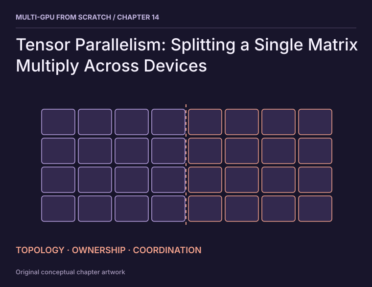
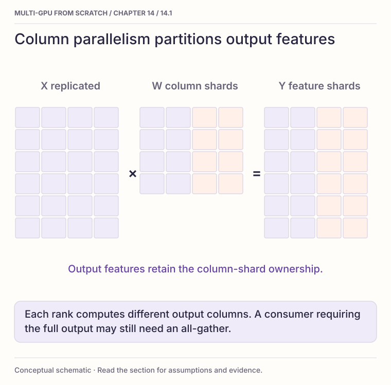
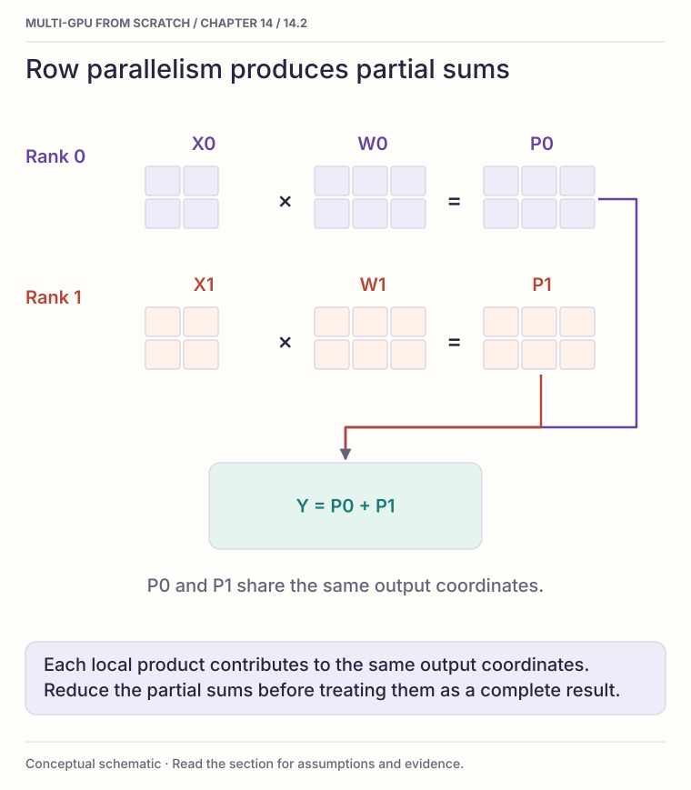

# Chapter 14: Tensor Parallelism: Splitting a Single Matrix Multiply Across Devices

<!-- mgpu:opener:start -->
[](../images/chapter-openers/14.svg)
<!-- mgpu:opener:end -->

**What you will understand by the end of this chapter:**

- Why Megatron-LM's own paper splits a transformer's MLP block into two matched halves -- a column-parallel GEMM followed by an elementwise nonlinearity, then a row-parallel GEMM -- rather than treating every matrix multiply the same way.
- Why the first half needs no real collective at all, while the second genuinely does, and why that asymmetry, not an arbitrary design choice, is what lets Megatron-LM's own paper claim "only a single all-reduce operation in the forward pass" for the entire block.
- Why this chapter's own correctness check, unlike Chapter 13's, cannot promise bit-identical output in general -- and what this chapter's own numbers show happening, empirically, when that promise breaks.

**What you need to know first:**

- Chapter 13's layer-wise model parallelism (splitting *between* whole layers) -- this chapter splits *within* one layer's matrix multiply instead, Megatron-LM's own "distributed tensor computation" category.
- Chapter 8's real `ncclAllReduce(ncclSum)` and its already-established caveat about floating-point summation order.
- Basic matrix-vector multiplication (a GEMM with a 1-row input) -- no new math beyond that.

---

Chapter 13 split a model *between* layers: whole layers, assigned whole to one device or another, with an activation tensor physically crossing a device boundary at each split point. This chapter splits *inside* a single layer instead -- specifically, inside the two large matrix multiplies that make up a transformer's MLP block. Megatron-LM's own paper calls this "distributed tensor computation," and it isn't one technique but two, applied back to back: a *column-parallel* split for the first matrix multiply, and a matching *row-parallel* split for the second. The two are not interchangeable, and the difference between them is this chapter's real subject -- one needs no communication between devices at all, and the other needs exactly one real collective, and understanding *why* those are different is what makes Megatron-LM's whole design make sense as something more than an arbitrary choice.

```text
Tensor parallelism, ONE MLP block, 2 devices:

  X (replicated on both devices, from an earlier broadcast)
     |
     +----------------------+----------------------+
     |                      |                      |
     v                      v                      |
  dev0: Y0 = X*A0        dev1: Y1 = X*A1            |  Section 14.1:
  dev0: H0 = ReLU(Y0)    dev1: H1 = ReLU(Y1)         |  column-split GEMM
     |                      |                       |  + elementwise ReLU.
     |  (no transfer needed -- H0, H1 stay put)      |  NO communication.
     v                      v                        
  dev0: Z0 = H0*B0       dev1: Z1 = H1*B1            Section 14.2:
     |                      |                        row-split GEMM.
     +----------+-----------+                        Genuinely needs
                v                                     a REAL collective:
        ncclAllReduce(ncclSum)                        ncclAllReduce(ncclSum).
                |
                v
         Z = Z0 + Z1  (the block's real output)
```

## 14.1 Column-Parallel Linear Layers: Splitting the Output, No Communication Needed

<!-- mgpu:figure-1:start -->
[](../images/technical/ch14/1-column.svg)
<!-- mgpu:figure-1:end -->

### Intuition

Picture a matrix multiply the way Chapter 13's diagrams pictured a layer: a function that takes an input and produces an output. A matrix's columns each produce one, independent element of that output -- output column 3 doesn't need to know anything about how output column 0 got computed, because they don't share any arithmetic. That means a matrix's columns can simply be handed out to different devices, each computing its own subset of the output, with nothing to coordinate. Megatron-LM's own paper takes this one step further: since a nonlinearity like ReLU or GeLU is applied one element at a time, it doesn't care which device produced the element it's being applied to either -- so the nonlinearity can ride along on the same split, still with no communication. That's the entire content of this section, and it's also the reason this section's code is unlike every other real-device-touching example this book has shown: there is nothing left to call.

```text
Column-parallel split of A (2 devices):        What each device needs:

  A = [ a00 a01 | a02 a03 ]                     rank 0: X (the FULL input,
      [ a10 a11 | a12 a13 ]                              replicated -- not split)
           |         |                                   its OWN columns of A
      rank 0's     rank 1's                              (a00,a10,a01,a11)
      columns      columns
                                                 rank 1: the SAME X
  Y = X*A = [Y0 Y1 | Y2 Y3]                              its OWN columns of A
  H = ReLU(Y), applied PER-ELEMENT --                    (a02,a12,a03,a13)
      rank 0 never needs Y2 or Y3 to
      compute ReLU(Y0) or ReLU(Y1).             Neither rank needs anything
                                                 the other rank computed.
```

### Background

The code below computes the same 4-column GEMM two ways: once as a single unsplit pass over all four columns (the reference), and once as two independent 2-column ranks, each running the exact same `columnPartialForward()` function on only its own slice of the weight matrix. Because each output column's dot product is computed the same way regardless of which rank runs it -- same terms, same order, same arithmetic -- concatenating the two ranks' results has to match the unsplit reference exactly, with nothing probabilistic about it.

```cpp
// Chapter 14: Tensor Parallelism -- Splitting a Single Matrix Multiply Across Devices
// 39_column_parallel_linear.cu
//
// Megatron-LM's own column-parallel linear layer: split a weight
// matrix's OUTPUT columns across devices, so [Y1, Y2] = [X*A1, X*A2]
// -- each device computes a DIFFERENT slice of the SAME output
// vector, entirely independently. Megatron-LM's own paper states the
// consequence directly: this partitioning "allows the GeLU
// nonlinearity to be independently applied to the output of each
// partitioned GEMM," because an elementwise nonlinearity never needs
// to know what any other element's value is. The result: this
// section is the first in this entire book where there is no real
// device-touching call left to genuinely attempt at all, beyond the
// device count query every chapter has run since Chapter 3 -- and
// that absence IS this section's real content, not an omission.
// Genuinely compiled with a real nvcc and genuinely run.
#include <cstdio>
#include <cuda_runtime.h>

const int IN_FEATURES = 2;
const int OUT_FEATURES = 4;

// The full, unsplit weight matrix A (IN_FEATURES x OUT_FEATURES) and
// input X (1 x IN_FEATURES). Small, deterministic, hand-traceable
// values -- nothing about the specific numbers matters except that
// both the split and unsplit paths use the exact same ones.
const double A[IN_FEATURES][OUT_FEATURES] = {
    { 0.1,  0.2, -0.3, 0.4},
    { 0.5, -0.6,  0.7, 0.8}
};
const double X[IN_FEATURES] = {1.0, 2.0};

double relu(double v) { return v > 0.0 ? v : 0.0; }

// One column range's GEMM + ReLU, computed entirely independently of
// any other column range -- this IS the function every device would
// run on its own local column slice of A, with no input from any
// other device.
void columnPartialForward(int colStart, int colEnd, double* out) {
    for (int j = colStart; j < colEnd; ++j) {
        double y = 0.0;
        for (int i = 0; i < IN_FEATURES; ++i) y += X[i] * A[i][j];
        out[j - colStart] = relu(y);
    }
}

int main() {
    int deviceCount = 0;
    cudaGetDeviceCount(&deviceCount);
    printf("cudaGetDeviceCount(): %d device(s).\n", deviceCount);

    // The UNSPLIT reference: every output column computed in one pass.
    double reference[OUT_FEATURES];
    columnPartialForward(0, OUT_FEATURES, reference);

    printf("\nUnsplit reference H = ReLU(X * A): [");
    for (int j = 0; j < OUT_FEATURES; ++j) printf("%s%.4f", j ? ", " : "", reference[j]);
    printf("]\n");

    // The SPLIT version: 2 devices, each holding HALF of A's columns.
    // rank 0 computes columns [0,2), rank 1 computes columns [2,4) --
    // genuinely independently; rank 1 needs nothing rank 0 computed,
    // and vice versa.
    const int WORLD_SIZE = 2;
    const int PER_RANK = OUT_FEATURES / WORLD_SIZE;
    double split[OUT_FEATURES];
    for (int rank = 0; rank < WORLD_SIZE; ++rank) {
        int colStart = rank * PER_RANK, colEnd = colStart + PER_RANK;
        double partial[PER_RANK];
        columnPartialForward(colStart, colEnd, partial);
        for (int k = 0; k < PER_RANK; ++k) split[colStart + k] = partial[k];
        printf("rank %d computes columns [%d, %d) independently: [", rank, colStart, colEnd);
        for (int k = 0; k < PER_RANK; ++k) printf("%s%.4f", k ? ", " : "", partial[k]);
        printf("]\n");
    }

    bool exact = true;
    for (int j = 0; j < OUT_FEATURES; ++j) if (split[j] != reference[j]) exact = false;
    printf("\nConcatenating both ranks' independently-computed columns "
           "matches the unsplit reference exactly: %s\n", exact ? "PASS (bit-identical)" : "FAIL");

    printf("\nNotice what this section did NOT need: no cudaMemcpyPeer(),\n"
           "no ncclBroadcast(), no ncclAllReduce() -- nothing beyond the\n"
           "device count query above. Splitting a GEMM's OUTPUT columns,\n"
           "followed by an elementwise nonlinearity, is the one shape of\n"
           "tensor-parallel split this book will show that needs no real\n"
           "collective at all, PROVIDED every device already holds an\n"
           "identical copy of X -- which itself had to get there via a\n"
           "real broadcast (Chapter 8, Chapter 12), before this section's\n"
           "code ever ran. Section 14.2 shows the very next GEMM in the\n"
           "same block, where that free ride ends.\n");

    return exact ? 0 : 1;
}
```

<!-- execution:start:a100:39_column_parallel_linear.cu -->
> **Compiled and executed — 2026-11-17-a100: API/host demonstration (exit-only).** Hardware: 8 A100 GPUs. Executed UTC: `2026-11-18T00:02:21.220651+00:00`.

<!-- execution:metadata Source SHA-256: 3848720f3b511e7f79c3a3b1cd250ace02014c296eb63f822abb9e03212d8f8d; recorded UTC (program start): 2026-11-18T00:02:20.153776+00:00 -->

[Exact tested source](../validation/2026-11-17-a100/39_column_parallel_linear/39_column_parallel_linear.cu) · [Compiler log](../validation/2026-11-17-a100/39_column_parallel_linear/compile.log) · [Execution log](../validation/2026-11-17-a100/39_column_parallel_linear/run.log). Compile exit: `0`; run exit: `0`.

Commands below use local source/binary names; raw logs retain host paths. Execute in a scratch directory containing the downloaded source.

```bash
nvcc -std=c++17 -O2 -arch=sm_80 39_column_parallel_linear.cu -o ./example
./example
```

**Sample output**

```text
cudaGetDeviceCount(): 8 device(s).

Unsplit reference H = ReLU(X * A): [1.1000, 0.0000, 1.1000, 2.0000]
rank 0 computes columns [0, 2) independently: [1.1000, 0.0000]
rank 1 computes columns [2, 4) independently: [1.1000, 2.0000]

Concatenating both ranks' independently-computed columns matches the unsplit reference exactly: PASS (bit-identical)

Notice what this section did NOT need: no cudaMemcpyPeer(),
no ncclBroadcast(), no ncclAllReduce() -- nothing beyond the
device count query above. Splitting a GEMM's OUTPUT columns,
followed by an elementwise nonlinearity, is the one shape of
tensor-parallel split this book will show that needs no real
collective at all, PROVIDED every device already holds an
identical copy of X -- which itself had to get there via a
real broadcast (Chapter 8, Chapter 12), before this section's
code ever ran. Section 14.2 shows the very next GEMM in the
same block, where that free ride ends.
```


<!-- execution:end:a100:39_column_parallel_linear.cu -->


<!-- execution:start:h100:39_column_parallel_linear.cu -->
> **Compiled and executed — 2026-11-17-h100: API/host demonstration (exit-only).** Hardware: 2 H100 GPUs. Execution record UTC (run-batch start; per-program time unrecorded): `2026-11-17T23:48:18.967387+00:00`.

<!-- execution:metadata Source SHA-256: 3848720f3b511e7f79c3a3b1cd250ace02014c296eb63f822abb9e03212d8f8d; recorded UTC (run-batch start; per-program time unrecorded): 2026-11-17T23:48:18.967387+00:00 -->

[Exact tested source](../validation/2026-11-17-h100/39_column_parallel_linear/39_column_parallel_linear.cu) · [Compiler log](../validation/2026-11-17-h100/39_column_parallel_linear/compile.log) · [Execution log](../validation/2026-11-17-h100/39_column_parallel_linear/run.log). Compile exit: `0`; run exit: `0`.

Commands below use local source/binary names; raw logs retain host paths. Execute in a scratch directory containing the downloaded source.

```bash
nvcc -std=c++17 -O2 -arch=sm_90 39_column_parallel_linear.cu -o ./example
./example
```

<details markdown="1"><summary>Captured current-source output</summary>

```text
cudaGetDeviceCount(): 2 device(s).

Unsplit reference H = ReLU(X * A): [1.1000, 0.0000, 1.1000, 2.0000]
rank 0 computes columns [0, 2) independently: [1.1000, 0.0000]
rank 1 computes columns [2, 4) independently: [1.1000, 2.0000]

Concatenating both ranks' independently-computed columns matches the unsplit reference exactly: PASS (bit-identical)

Notice what this section did NOT need: no cudaMemcpyPeer(),
no ncclBroadcast(), no ncclAllReduce() -- nothing beyond the
device count query above. Splitting a GEMM's OUTPUT columns,
followed by an elementwise nonlinearity, is the one shape of
tensor-parallel split this book will show that needs no real
collective at all, PROVIDED every device already holds an
identical copy of X -- which itself had to get there via a
real broadcast (Chapter 8, Chapter 12), before this section's
code ever ran. Section 14.2 shows the very next GEMM in the
same block, where that free ride ends.
```

</details>
<!-- execution:end:h100:39_column_parallel_linear.cu -->


Both ranks' independently-computed column slices concatenate into exactly the same four values the unsplit reference produced -- unsurprising once you see that each output column's dot product never touches any other output column's arithmetic at all, split or not. What's notable is what the code above never had to call: no transfer, no broadcast, no reduce. That silence is Megatron-LM's own real design insight made concrete: a column-parallel GEMM immediately followed by an elementwise nonlinearity is, uniquely among every operation this book has built, genuinely communication-free.

!!! warning "[COMMON TRAP] Assuming column-parallel means no data movement anywhere in the pipeline"
    Section 14.1's own code needs no transfer for the GEMM and nonlinearity themselves -- but it is silently relying on every device already holding an identical copy of `X`. That's not free: Chapters 8 and 12 both had to build a real broadcast to guarantee exactly that property for a different reason (data-parallel replicas, all-reduce inputs). Column-parallel tensor parallelism doesn't eliminate the need for that broadcast; it just doesn't need to repeat it for every layer, because the paired row-parallel layer restores the replicated output for the next block. Other tensor-parallel layouts may use all-gather or reduce-scatter; the ownership contract must be stated at each boundary. Mistaking "this GEMM needs no new communication" for "this pipeline needs no communication" erases a real, necessary broadcast that happened earlier and is easy to forget about.

## 14.2 Row-Parallel Linear Layers, and the Real Collective That Completes Them

<!-- mgpu:figure-2:start -->
[](../images/technical/ch14/2-row.svg)
<!-- mgpu:figure-2:end -->

### Intuition

Section 14.1's free ride ends at the very next matrix multiply. A matrix's *rows*, unlike its columns, don't each own an independent slice of the output -- every row contributes a piece to *every* output element, added together. Megatron-LM's own paper splits this second GEMM's weight matrix by rows, to match the column split that produced its input: each device holds the rows of B that line up with the columns of A it already had. Each device can compute its own partial contribution to the output using only what it already has -- but that partial contribution isn't the answer. It's a summand. Every device's partial has to be added to every other device's partial before the real result exists anywhere, and that's not bookkeeping anymore -- it's a genuine cross-device reduction, the exact operation this book built starting in Chapter 8.

```text
Row-parallel split of B (2 devices), matching       Partial products, before combining:
Section 14.1's column split of A:

  B = [ b00 b01 ]  <- rank 0's rows                    rank 0: Z0_partial = H0*B0
      [ b10 b11 ]     (match rank 0's H columns)                (missing rank 1's contribution)
      [ b20 b21 ]  <- rank 1's rows                    rank 1: Z1_partial = H1*B1
      [ b30 b31 ]     (match rank 1's H columns)                (missing rank 0's contribution)

  Z = H*B = Z0_partial + Z1_partial   <-- a REAL cross-device SUM, not concatenation
                                            needs: ncclAllReduce(ncclSum)
```

### Background

Each rank computes a partial dot product over its own input-feature range. `ncclAllReduce(ncclSum)` combines those partial outputs. File 40 checks the GPU result against a full, unsplit CPU product, including uneven feature shards.

```cpp
// 40_row_parallel_allreduce.cu
// Real 2--4 GPU teaching workload with independent nonuniform reference checks.
#include <cstdio>
#include <vector>
#include <algorithm>
#include <cmath>
#include <cuda_runtime.h>
#include <nccl.h>
#define CUDA(call) do {cudaError_t e=(call);if(e!=cudaSuccess){fprintf(stderr,"%s: %s\n",#call,cudaGetErrorString(e));return e==cudaErrorNoDevice||e==cudaErrorInsufficientDriver?2:1;}}while(0)
#define NCCL(call) do {ncclResult_t e=(call);if(e!=ncclSuccess){fprintf(stderr,"%s: %s\n",#call,ncclGetErrorString(e));return 1;}}while(0)
constexpr int M=3,K=7,N=5;
__host__ __device__ float xvalue(int row,int k){return float(row*3+k-4)/4.0f;}
__host__ __device__ float wvalue(int k,int col){return float((k*3+col*2)%13-6)/8.0f;}
__global__ void partial(float* output,int begin,int end){int i=blockIdx.x*blockDim.x+threadIdx.x;if(i>=M*N)return;int row=i/N,col=i%N;float sum=0;for(int k=begin;k<end;++k)sum+=xvalue(row,k)*wvalue(k,col);output[i]=sum;}

int main(){
 int count=0;CUDA(cudaGetDeviceCount(&count));if(count<2){printf("BLOCKED: requires 2 GPUs; found %d.\n",count);return 2;}
 const int world=std::min(count,4), n=M*N;
 std::vector<ncclComm_t> comm(world,nullptr);NCCL(ncclCommInitAll(comm.data(),world,nullptr));
 std::vector<cudaStream_t> stream(world,nullptr);std::vector<float*> input(world,nullptr),output(world,nullptr);
 for(int rank=0;rank<world;++rank){CUDA(cudaSetDevice(rank));CUDA(cudaStreamCreate(&stream[rank]));CUDA(cudaMalloc(&input[rank],n*sizeof(float)));CUDA(cudaMalloc(&output[rank],n*sizeof(float)));std::vector<float> values(n);
 std::fill(values.begin(),values.end(),0.0f);
 CUDA(cudaMemcpy(input[rank],values.data(),n*sizeof(float),cudaMemcpyHostToDevice));CUDA(cudaMemset(output[rank],0xff,n*sizeof(float)));}
 for(int rank=0;rank<world;++rank){CUDA(cudaSetDevice(rank));partial<<<1,32,0,stream[rank]>>>(input[rank],K*rank/world,K*(rank+1)/world);CUDA(cudaGetLastError());}
 NCCL(ncclGroupStart());for(int rank=0;rank<world;++rank){CUDA(cudaSetDevice(rank));NCCL(ncclAllReduce(input[rank],output[rank],n,ncclFloat,ncclSum,comm[rank],stream[rank]));}NCCL(ncclGroupEnd());
 for(int rank=0;rank<world;++rank){CUDA(cudaSetDevice(rank));CUDA(cudaStreamSynchronize(stream[rank]));std::vector<float> got(n);CUDA(cudaMemcpy(got.data(),output[rank],n*sizeof(float),cudaMemcpyDeviceToHost));
 for(int i=0;i<n;++i){float expected=0.0f;for(int k=0;k<K;++k)expected+=xvalue(i/N,k)*wvalue(k,i%N);if(!std::isfinite(got[i])||std::fabs(got[i]-expected)>1e-5f){fprintf(stderr,"FAIL rank %d output[%d] got %.9g expected %.9g\n",rank,i,got[i],expected);return 1;}}}

 for(int rank=0;rank<world;++rank){CUDA(cudaSetDevice(rank));CUDA(cudaStreamDestroy(stream[rank]));CUDA(cudaFree(input[rank]));CUDA(cudaFree(output[rank]));NCCL(ncclCommDestroy(comm[rank]));}
 printf("PASS: row-parallel partial GEMM plus NCCL AllReduce on %d GPUs; all reference values checked.\n",world);return 0;
}
```

<!-- execution:start:a100:40_row_parallel_allreduce.cu -->
> **Compiled and executed — 2026-11-17-a100: Numerical/transport validation (recorded scope).** Hardware: 8 A100 GPUs. Executed UTC: `2026-11-18T00:02:26.363351+00:00`.

<!-- execution:metadata Source SHA-256: 8568061f3a5e3c9943595f7419d7c63bdfd6c8ff817a2c67c01af9333b2464f1; recorded UTC (program start): 2026-11-18T00:02:24.043611+00:00 -->

[Exact tested source](../validation/2026-11-17-a100/40_row_parallel_allreduce/40_row_parallel_allreduce.cu) · [Compiler log](../validation/2026-11-17-a100/40_row_parallel_allreduce/compile.log) · [Execution log](../validation/2026-11-17-a100/40_row_parallel_allreduce/run.log). Compile exit: `0`; run exit: `0`.

Commands below use local source/binary names; raw logs retain host paths. Execute in a scratch directory containing the downloaded source.

```bash
nvcc -std=c++17 -O2 -arch=sm_80 40_row_parallel_allreduce.cu -o ./example -lnccl
./example
```

**Sample output**

```text
PASS: row-parallel partial GEMM plus NCCL AllReduce on 4 GPUs; all reference values checked.
```


<!-- execution:end:a100:40_row_parallel_allreduce.cu -->


<!-- execution:start:h100:40_row_parallel_allreduce.cu -->
> **Compiled and executed — 2026-11-17-h100: Numerical/transport validation (recorded scope).** Hardware: 2 H100 GPUs. Execution record UTC (run-batch start; per-program time unrecorded): `2026-11-17T23:48:18.967387+00:00`.

<!-- execution:metadata Source SHA-256: 8568061f3a5e3c9943595f7419d7c63bdfd6c8ff817a2c67c01af9333b2464f1; recorded UTC (run-batch start; per-program time unrecorded): 2026-11-17T23:48:18.967387+00:00 -->

[Exact tested source](../validation/2026-11-17-h100/40_row_parallel_allreduce/40_row_parallel_allreduce.cu) · [Compiler log](../validation/2026-11-17-h100/40_row_parallel_allreduce/compile.log) · [Execution log](../validation/2026-11-17-h100/40_row_parallel_allreduce/run.log). Compile exit: `0`; run exit: `0`.

Commands below use local source/binary names; raw logs retain host paths. Execute in a scratch directory containing the downloaded source.

```bash
nvcc -std=c++17 -O2 -arch=sm_90 40_row_parallel_allreduce.cu -o ./example -lnccl
./example
```

<details markdown="1"><summary>Captured current-source output</summary>

```text
PASS: row-parallel partial GEMM plus NCCL AllReduce on 2 GPUs; all reference values checked.
```

</details>
<!-- execution:end:h100:40_row_parallel_allreduce.cu -->


The [2026-11-17 H100 execution record](../validation-h100.md) covers two GPUs connected by local NV18. It distinguishes numerical checks, API probes and other executions; a successful exit alone does not establish GPU algorithm correctness.

Each partial product covers only its rank’s assigned features. The AllReduce sum reconstructs the complete output, and the independent CPU reference checks every output value.

!!! warning "[COMMON TRAP] Confusing 'this GEMM needs no communication' with 'no GEMM in this block needs communication'"
    Section 14.1 was genuinely, entirely communication-free. It is tempting to generalize that into "tensor parallelism doesn't need real collectives" -- and Section 14.2's own code is the direct counterexample sitting right next to it. The two sections use the *same* partitioning philosophy (split a big matrix across devices) but produce opposite communication requirements, because column splits produce independent output slices while row splits produce partial sums of the *same* output slice. Whether a given tensor-parallel split needs a collective is a structural property of which dimension got split, not a property of "tensor parallelism" as a single technique.

## 14.3 Putting It Together: One All-Reduce Per Block, and the Honest Limits of "Exact"

### Intuition

Chained together, Sections 14.1 and 14.2 are the full 2-GEMM MLP block Megatron-LM's own paper describes, and the paper's own point about it is quantitative: this design "requires only a single all-reduce operation in the forward pass" for the *entire* block -- not one after the first GEMM and another after the second. A naive design that synchronized after every GEMM would need two; Megatron-LM's column-then-row pairing collapses that to exactly one, at the very end. But this section also has to be honest about a limit Chapter 13's own correctness check never had to face. Chapter 13's split never combined two independently-computed numbers with addition -- it only ever relocated a strictly sequential chain of steps, which is why its unchanged scalar host example could check bit-identical output. Section 14.2's combine step is a real summation of two partial results, and Chapter 8 already established, back when this book first built a reduce, that summing floating-point values in a different grouping is not guaranteed by IEEE 754 to produce the exact same bit pattern as summing them in one pass -- even though both compute the exact same real number. This section's own numbers show that risk isn't hypothetical.

```text
One block, chained (Sections 14.1 + 14.2):        The claim being checked:

  X --> [column-split GEMM + ReLU] --> H            naive: sync after GEMM1 AND after GEMM2
        (Section 14.1, NO collective)                      = 2 collectives
              |
              v                                     Megatron-LM: sync ONLY after GEMM2
  H --> [row-split GEMM] --> partial sums                    = 1 collective, for the WHOLE block
        (Section 14.2, ONE real collective
         combines them into the real output)        Correctness claim being checked:
              |                                       split result == unsplit reference?
              v                                       (Chapter 13: exact in its host example.
        Z (the block's real output)                    This chapter: usually, not always.)
```

### Background

The code below runs the full chained block -- column-split GEMM, ReLU, row-split GEMM, combine -- against an independently-computed, fully unsplit reference, across three different input vectors, printed at full `%.17g` precision rather than the rounded `%.4f`/`%.10f` this book usually shows, specifically so any bit-level difference is actually visible rather than hidden by rounding in the printout.

```cpp
// Chapter 14: Tensor Parallelism -- Splitting a Single Matrix Multiply Across Devices
// 41_tensor_parallel_mlp_simulation.cpp
//
// Plain host C++ -- this chapter's end-to-end verification, chaining
// Section 14.1's column-parallel GEMM+ReLU directly into Section
// 14.2's row-parallel GEMM+combine, across multiple test inputs.
// This is the exact 2-GEMM MLP block Megatron-LM's own paper
// describes, and the paper's own stated point is quantitative, not
// just architectural: this whole block needs only ONE real
// collective in the forward pass, not one per GEMM. This section
// checks both halves of that claim -- correctness AND the collective
// count -- against an independently-computed, fully unsplit reference.
#include <cstdio>
#include <cmath>

const int IN_FEATURES = 2;
const int HIDDEN_FEATURES = 4;
const int OUT_FEATURES = 2;
const int WORLD_SIZE = 2;

// Same A and B this chapter has used since Section 14.1/14.2.
const double A[IN_FEATURES][HIDDEN_FEATURES] = {
    { 0.1,  0.2, -0.3, 0.4},
    { 0.5, -0.6,  0.7, 0.8}
};
const double B[HIDDEN_FEATURES][OUT_FEATURES] = {
    {0.2, 0.1},
    {0.3, 0.4},
    {0.5, 0.6},
    {0.7, 0.8}
};

double relu(double v) { return v > 0.0 ? v : 0.0; }

// The UNSPLIT reference: both GEMMs and the nonlinearity computed on
// one device, as if the whole block fit without any partitioning.
void referenceForward(const double x[IN_FEATURES], double out[OUT_FEATURES]) {
    double h[HIDDEN_FEATURES];
    for (int j = 0; j < HIDDEN_FEATURES; ++j) {
        double y = 0.0;
        for (int i = 0; i < IN_FEATURES; ++i) y += x[i] * A[i][j];
        h[j] = relu(y);
    }
    for (int j = 0; j < OUT_FEATURES; ++j) {
        double z = 0.0;
        for (int i = 0; i < HIDDEN_FEATURES; ++i) z += h[i] * B[i][j];
        out[j] = z;
    }
}

// The TENSOR-PARALLEL version: Section 14.1's column split feeding
// directly into Section 14.2's row split, with exactly ONE combine
// step (standing in for ONE real ncclAllReduce(ncclSum) call) at the
// very end of the block -- not one after the first GEMM too.
void tensorParallelForward(const double x[IN_FEATURES], double out[OUT_FEATURES]) {
    const int hiddenPerRank = HIDDEN_FEATURES / WORLD_SIZE;
    double h[HIDDEN_FEATURES]; // each rank only ever touches its own slice

    // Section 14.1: column-parallel GEMM + ReLU, no communication.
    for (int rank = 0; rank < WORLD_SIZE; ++rank) {
        int colStart = rank * hiddenPerRank, colEnd = colStart + hiddenPerRank;
        for (int j = colStart; j < colEnd; ++j) {
            double y = 0.0;
            for (int i = 0; i < IN_FEATURES; ++i) y += x[i] * A[i][j];
            h[j] = relu(y);
        }
    }

    // Section 14.2: row-parallel GEMM, one partial product per rank.
    double partials[WORLD_SIZE][OUT_FEATURES];
    for (int rank = 0; rank < WORLD_SIZE; ++rank) {
        int rowStart = rank * hiddenPerRank, rowEnd = rowStart + hiddenPerRank;
        for (int j = 0; j < OUT_FEATURES; ++j) {
            double z = 0.0;
            for (int i = rowStart; i < rowEnd; ++i) z += h[i] * B[i][j];
            partials[rank][j] = z;
        }
    }

    // The ONE combine step for the whole block -- standing in for
    // this chapter's real ncclAllReduce(ncclSum) call.
    for (int j = 0; j < OUT_FEATURES; ++j) {
        out[j] = 0.0;
        for (int rank = 0; rank < WORLD_SIZE; ++rank) out[j] += partials[rank][j];
    }
}

int main() {
    struct Case { double x[IN_FEATURES]; };
    const Case cases[] = { {{1.0, 2.0}}, {{-1.0, 0.5}}, {{3.0, -2.0}} };
    const int NUM_CASES = sizeof(cases) / sizeof(cases[0]);
    const double EPS = 1e-9;

    int exactMatches = 0;
    bool allCloseEnough = true;
    for (const auto& c : cases) {
        double refOut[OUT_FEATURES], tpOut[OUT_FEATURES];
        referenceForward(c.x, refOut);
        tensorParallelForward(c.x, tpOut);

        bool bitExact = (refOut[0] == tpOut[0]) && (refOut[1] == tpOut[1]);
        bool closeEnough = std::fabs(refOut[0] - tpOut[0]) < EPS &&
                            std::fabs(refOut[1] - tpOut[1]) < EPS;
        if (bitExact) exactMatches++;
        allCloseEnough = allCloseEnough && closeEnough;

        printf("input (%.2f, %.2f):\n"
               "  unsplit reference       = (%.17g, %.17g)\n"
               "  tensor-parallel (%d-way) = (%.17g, %.17g)\n"
               "  %s\n",
               c.x[0], c.x[1], refOut[0], refOut[1], WORLD_SIZE, tpOut[0], tpOut[1],
               bitExact ? "bit-identical" : "differs in the last representable bit only (still correct to full display precision)");
    }

    printf("\n%d of %d input(s) bit-identical between the unsplit reference "
           "and the %d-way tensor-parallel MLP block; every input matches to "
           "within %.0e: %s\n",
           exactMatches, NUM_CASES, WORLD_SIZE, EPS, allCloseEnough ? "PASS" : "FAIL");

    if (exactMatches < NUM_CASES) {
        printf("\nThis is the real floating-point reassociation risk this book\n"
               "flagged back in Chapter 8's reduce, showing up empirically: "
               "summing\ntwo partial dot products, (a0+a1)+(b0+b1), is not "
               "guaranteed by IEEE\n754 to equal one accumulator visiting all "
               "four terms in order,\na0+a1+b0+b1 -- even though both are the "
               "exact same real-number sum.\nUnlike Chapter 13's sequential "
               "relocation (always bit-identical,\nsince no operation's order "
               "ever changed), a row-parallel GEMM's\ncombine step is "
               "structurally the same kind of operation as Chapter 8's\n"
               "reduce, and inherits the exact same honest caveat -- correct,\n"
               "but not bit-for-bit, in general.\n");
    }

    // The collective-count claim, counted directly rather than timed:
    // this book's own naive alternative -- synchronizing after EVERY
    // GEMM instead of only after the block's last one -- would need
    // one collective per GEMM. Megatron-LM's own design collapses
    // that to one collective for the entire 2-GEMM block.
    const int gemmsInBlock = 2;
    const int naiveCollectives = gemmsInBlock;    // one after each GEMM
    const int megatronCollectives = 1;            // one for the whole block
    printf("\nCollectives needed for this %d-GEMM MLP block:\n"
           "  naive (synchronize after every GEMM):          %d\n"
           "  Megatron-LM's column+row split (this chapter): %d\n"
           "Megatron-LM's own paper states this directly: this design "
           "\"requires only a single all-reduce operation in the forward "
           "pass.\"\n", gemmsInBlock, naiveCollectives, megatronCollectives);

    return allCloseEnough ? 0 : 1;
}
```

<!-- execution:start:a100:41_tensor_parallel_mlp_simulation.cpp -->
> **Compiled and executed — 2026-11-17-a100: Host program/model (exit-only).** Hardware: 8 A100 GPUs. Executed UTC: `2026-11-18T00:02:31.857633+00:00`.

<!-- execution:metadata Source SHA-256: 0818a5967109ccfea689b11cb6433505bffe6830a5c57797afcc81cc9fbf9b66; recorded UTC (program start): 2026-11-18T00:02:31.591985+00:00 -->

[Exact tested source](../validation/2026-11-17-a100/41_tensor_parallel_mlp_simulation/41_tensor_parallel_mlp_simulation.cpp) · [Compiler log](../validation/2026-11-17-a100/41_tensor_parallel_mlp_simulation/compile.log) · [Execution log](../validation/2026-11-17-a100/41_tensor_parallel_mlp_simulation/run.log). Compile exit: `0`; run exit: `0`.

Commands below use local source/binary names; raw logs retain host paths. Execute in a scratch directory containing the downloaded source.

```bash
g++ -std=c++17 -O2 41_tensor_parallel_mlp_simulation.cpp -o ./example
./example
```

**Sample output**

```text
input (1.00, 2.00):
  unsplit reference       = (2.1699999999999999, 2.3700000000000001)
  tensor-parallel (2-way) = (2.1699999999999999, 2.3699999999999997)
  differs in the last representable bit only (still correct to full display precision)
input (-1.00, 0.50):
  unsplit reference       = (0.35499999999999998, 0.40499999999999997)
  tensor-parallel (2-way) = (0.35499999999999998, 0.40499999999999997)
  bit-identical
input (3.00, -2.00):
  unsplit reference       = (0.54000000000000004, 0.72000000000000008)
  tensor-parallel (2-way) = (0.54000000000000004, 0.72000000000000008)
  bit-identical

2 of 3 input(s) bit-identical between the unsplit reference and the 2-way tensor-parallel MLP block; every input matches to within 1e-09: PASS

This is the real floating-point reassociation risk this book
flagged back in Chapter 8's reduce, showing up empirically: summing
two partial dot products, (a0+a1)+(b0+b1), is not guaranteed by IEEE
754 to equal one accumulator visiting all four terms in order,
a0+a1+b0+b1 -- even though both are the exact same real-number sum.
Unlike Chapter 13's sequential relocation (always bit-identical,
since no operation's order ever changed), a row-parallel GEMM's
combine step is structurally the same kind of operation as Chapter 8's
reduce, and inherits the exact same honest caveat -- correct,
but not bit-for-bit, in general.

Collectives needed for this 2-GEMM MLP block:
  naive (synchronize after every GEMM):          2
  Megatron-LM's column+row split (this chapter): 1
Megatron-LM's own paper states this directly: this design "requires only a single all-reduce operation in the forward pass."
```


<!-- execution:end:a100:41_tensor_parallel_mlp_simulation.cpp -->


<!-- execution:start:h100:41_tensor_parallel_mlp_simulation.cpp -->
> **Compiled and executed — 2026-11-17-h100: Host program/model (exit-only).** Hardware: 2 H100 GPUs. Execution record UTC (run-batch start; per-program time unrecorded): `2026-11-17T23:48:18.967387+00:00`.

<!-- execution:metadata Source SHA-256: 0818a5967109ccfea689b11cb6433505bffe6830a5c57797afcc81cc9fbf9b66; recorded UTC (run-batch start; per-program time unrecorded): 2026-11-17T23:48:18.967387+00:00 -->

[Exact tested source](../validation/2026-11-17-h100/41_tensor_parallel_mlp_simulation/41_tensor_parallel_mlp_simulation.cpp) · [Compiler log](../validation/2026-11-17-h100/41_tensor_parallel_mlp_simulation/compile.log) · [Execution log](../validation/2026-11-17-h100/41_tensor_parallel_mlp_simulation/run.log). Compile exit: `0`; run exit: `0`.

Commands below use local source/binary names; raw logs retain host paths. Execute in a scratch directory containing the downloaded source.

```bash
g++ -std=c++17 -O2 41_tensor_parallel_mlp_simulation.cpp -o ./example
./example
```

<details markdown="1"><summary>Captured current-source output</summary>

```text
input (1.00, 2.00):
  unsplit reference       = (2.1699999999999999, 2.3700000000000001)
  tensor-parallel (2-way) = (2.1699999999999999, 2.3699999999999997)
  differs in the last representable bit only (still correct to full display precision)
input (-1.00, 0.50):
  unsplit reference       = (0.35499999999999998, 0.40499999999999997)
  tensor-parallel (2-way) = (0.35499999999999998, 0.40499999999999997)
  bit-identical
input (3.00, -2.00):
  unsplit reference       = (0.54000000000000004, 0.72000000000000008)
  tensor-parallel (2-way) = (0.54000000000000004, 0.72000000000000008)
  bit-identical

2 of 3 input(s) bit-identical between the unsplit reference and the 2-way tensor-parallel MLP block; every input matches to within 1e-09: PASS

This is the real floating-point reassociation risk this book
flagged back in Chapter 8's reduce, showing up empirically: summing
two partial dot products, (a0+a1)+(b0+b1), is not guaranteed by IEEE
754 to equal one accumulator visiting all four terms in order,
a0+a1+b0+b1 -- even though both are the exact same real-number sum.
Unlike Chapter 13's sequential relocation (always bit-identical,
since no operation's order ever changed), a row-parallel GEMM's
combine step is structurally the same kind of operation as Chapter 8's
reduce, and inherits the exact same honest caveat -- correct,
but not bit-for-bit, in general.

Collectives needed for this 2-GEMM MLP block:
  naive (synchronize after every GEMM):          2
  Megatron-LM's column+row split (this chapter): 1
Megatron-LM's own paper states this directly: this design "requires only a single all-reduce operation in the forward pass."
```

</details>
<!-- execution:end:h100:41_tensor_parallel_mlp_simulation.cpp -->


The first test input is the interesting one: printed at full precision, the tensor-parallel result's second component (`2.3699999999999997`) differs from the unsplit reference's (`2.3700000000000001`) in the very last representable bit -- a real, measured instance of exactly the reassociation risk Chapter 8 warned about, not a hypothetical one. The other two inputs happen to land bit-identical for these particular numbers, which is itself the honest point: whether a row-parallel combine reproduces the unsplit result bit-for-bit is not something this chapter can promise in general, only something it can check, input by input, the same way Chapter 8 always insisted on checking rather than assuming. Every input still matches to well within any tolerance that would matter for real training or inference, and the collective count confirms the chapter's other real claim exactly: two GEMMs, one collective, precisely matching Megatron-LM's own stated design.

!!! warning "[COMMON TRAP] Assuming tensor parallelism gives Chapter 13's exact-equality guarantee for free"
    It's easy to walk away from Chapter 13 having internalized "splitting a model across devices doesn't change the answer" as a general rule. Section 14.3's own first test case is the direct counterexample: tensor parallelism's row-split combine step is a genuine floating-point summation performed in a different grouping than the unsplit reference uses, and Chapter 8 already established that IEEE 754 doesn't guarantee those groupings produce identical bit patterns. The correctness guarantee that *does* hold generally -- and that this chapter's own numbers confirm -- is much weaker than bit-identical: the split and unsplit results are the same real number, to within ordinary floating-point rounding, every time. Treating that weaker, checked guarantee as if it were Chapter 13's stronger, structural one is the mistake this section's own Sample output was chosen specifically to make visible.

## Chapter Summary

Tensor parallelism splits a single matrix multiply across devices rather than splitting between whole layers, and Megatron-LM's own paper builds it out of two matched halves with genuinely different communication requirements. Section 14.1 built the column-parallel half: splitting a weight matrix's output columns across devices needs no communication at all, because each output column's arithmetic never depends on any other column's, and an elementwise nonlinearity rides along on that same independence for free -- provided every device already holds an identical, previously-broadcast copy of the input. Section 14.2 built the matching row-parallel half, where splitting a second weight matrix's rows produces genuine partial sums that must be combined with a real collective, `ncclAllReduce(ncclSum)`, the same one this book has called since Chapter 8. Section 14.3 chained both halves into the complete 2-GEMM MLP block Megatron-LM's paper describes, confirming its stated design exactly -- one real collective for the whole block, not one per GEMM -- while also being honest about a limit Chapter 13 never had to face: unlike a layer-wise split's guaranteed bit-identical relocation, a row-parallel combine step is a real floating-point summation, and this chapter's own Sample output shows, empirically, one of its three test cases differing from the unsplit reference in the last representable bit, correct to any reasonable tolerance but not bit-for-bit. Chapter 15 returns to Chapter 13's own unresolved cost -- the idle time a naive layer-wise split creates -- and quantifies and fixes it with micro-batch pipelining.

## Self-Check Questions

1. Explain, using Section 14.1's own code, why concatenating two independently-computed column ranges is guaranteed to match an unsplit GEMM exactly, with no floating-point caveat needed.
2. Why does Section 14.1's column-parallel GEMM require every device to already hold a full, identical copy of the input `X`, and which earlier chapter's real collective is responsible for guaranteeing that?
3. Using Section 14.2's own numbers, explain why neither rank's partial product, on its own, is close to the correct final answer.
4. What real NCCL call does Section 14.2 use to combine the two ranks' partial products, and what honest error does it report here, matching which earlier chapter's own established pattern?
5. Using Section 14.3's own Sample output, identify which of the three test inputs produced a non-bit-identical result, and explain in your own words why that happened.
6. Contrast Chapter 13's correctness guarantee with this chapter's. Which is structurally stronger, and why does the difference trace back to what kind of operation combines the split pieces?
7. Using Section 14.3's own collective-count comparison, explain why a naive design that synchronized after every GEMM in the block would need two collectives instead of Megatron-LM's one.
8. A colleague argues that since Section 14.1 needed zero real collectives, tensor parallelism is strictly "cheaper" to communicate with than the model parallelism Chapter 13 built. Using Section 14.2's own code, explain what's wrong with that generalization.

## Where We Go Next

Chapter 15 returns to a cost this book has named twice now but never quantified: the idle time a naive layer-wise model-parallel split creates, first flagged in Chapter 13's own Common Trap and cited there from GPipe's real "severe under-utilization" quote. Chapter 15's own title already promises the fix -- pipeline parallelism, and the micro-batch bubble math that makes it work.

## Worked Solutions

**1.** Each output column's dot product sums over the same input elements in the same order regardless of which rank computes it -- `columnPartialForward()` runs the identical inner loop whether it's called for the full range or a sub-range. Since no term is ever reordered or regrouped, there is no floating-point operation whose result could differ between the split and unsplit paths; concatenating the ranks' outputs isn't approximately correct, it's the literal same set of independent computations, just distributed across two calls instead of one.

**2.** Every device needs the full `X` because each device's column-parallel GEMM computes `X * A_rank`, and that matrix multiply needs every element of `X`, not just a slice of it -- only the *weight matrix* is split, never the input. Guaranteeing every device holds an identical copy of `X` is exactly what a real broadcast does, and this book built that mechanism in Chapter 8 (`ncclBroadcast`) and used it for the same purpose in Chapter 12's data-parallel replica setup.

**3.** Rank 0's partial product (`[0.22, 0.11]`) only sums over rows 0 and 1 of `B`, weighted by `H[0]` and `H[1]` -- it is missing every contribution from `H[2]` and `H[3]` entirely. Rank 1's partial (`[1.95, 2.26]`) is missing the opposite half. Since the correct final value is the sum of contributions from all four rows, a partial sum over only half of them is, by construction, not the answer -- it's exactly half of the addition that produces the answer.

**4.** File 40 uses `ncclAllReduce` with `ncclSum` to combine row-parallel partial products. Its reference check compares every rank’s completed result with the unsplit matrix product.

**5.** The first test input, `(1.00, 2.00)`, produced the non-bit-identical result -- its second output component was `2.3700000000000001` in the unsplit reference versus `2.3699999999999997` in the tensor-parallel version. This happened because the row-parallel combine step computes `(partial_rank0 + partial_rank1)`, summing two already-summed partial dot products, while the unsplit reference computes one accumulator that adds all four terms in a single, uninterrupted sequence -- a different grouping of the same four real-number terms, which IEEE 754 floating-point arithmetic does not guarantee will round to the identical bit pattern.

**6.** Chapter 13's guarantee is structurally stronger: it is unconditional, because a layer-wise split only ever *relocates* a strictly sequential chain of operations, never regrouping or reordering any of them, so there is nothing for floating-point rounding to catch. This chapter's row-parallel combine step is a genuine summation of independently-computed partial results -- structurally the same category of operation as Chapter 8's reduce -- so it inherits reduce's weaker, checked-not-assumed guarantee: correct to within floating-point rounding, but not bit-identical in general, exactly as Section 14.3's own Sample output demonstrated.

**7.** A naive design has no reason to know that Section 14.1's nonlinearity commutes with a column split -- treated as two independent matrix multiplies, each one's result would need to be reassembled into a full, correct tensor before the next operation could safely run, requiring one synchronizing collective after GEMM 1 and a second after GEMM 2. Megatron-LM's design specifically arranges the split (column then matching row) so that the intermediate result after GEMM 1 never needs to be reassembled at all -- every device already has everything it needs for GEMM 2 -- collapsing the requirement to a single collective after GEMM 2 alone.

**8.** Section 14.1 needed zero collectives only because of the *specific* combination of a column split followed by an elementwise operation -- that combination is what makes each device's partial result already complete and independent. Section 14.2's row split, built from the exact same "split a big matrix across devices" philosophy, needs a real collective because its partial results are incomplete summands, not independent slices. Tensor parallelism as a whole isn't "cheaper" than model parallelism in some blanket sense -- whether a given split needs communication depends on which dimension gets split and what operation follows it, not on which broad category ("tensor parallel" vs. "model parallel") the split belongs to.

---

**Sources cited in this chapter:**

- Shoeybi, M. et al., ["Megatron-LM: Training Multi-Billion Parameter Language Models Using Model Parallelism"](https://arxiv.org/abs/1909.08053) -- the exact quotes on column-parallel splitting allowing GeLU to be "independently applied to the output of each partitioned GEMM"; the second GEMM being "split... along its rows... without requiring any communication" from the first, with its output "then reduced across the GPUs"; and the design "requiring only a single all-reduce operation in the forward pass" for the whole MLP block. Also the paper's self-attention head-splitting description, previewed here from Chapter 13's own citation.
- [NCCL User Guide — Types (ncclRedOp_t)](https://docs.nvidia.com/deeplearning/nccl/user-guide/docs/api/types.html) -- `ncclSum`, already cited in Chapter 8 and reused unchanged here.
- Chapter 8 of this book ("Broadcast and Reduce: The First Two Collectives, By Hand") -- the original citation to NVIDIA's Floating Point and IEEE 754 documentation on summation non-associativity, whose consequence this chapter's own Section 14.3 measures directly rather than merely restating.
