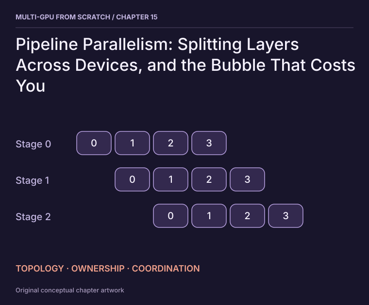
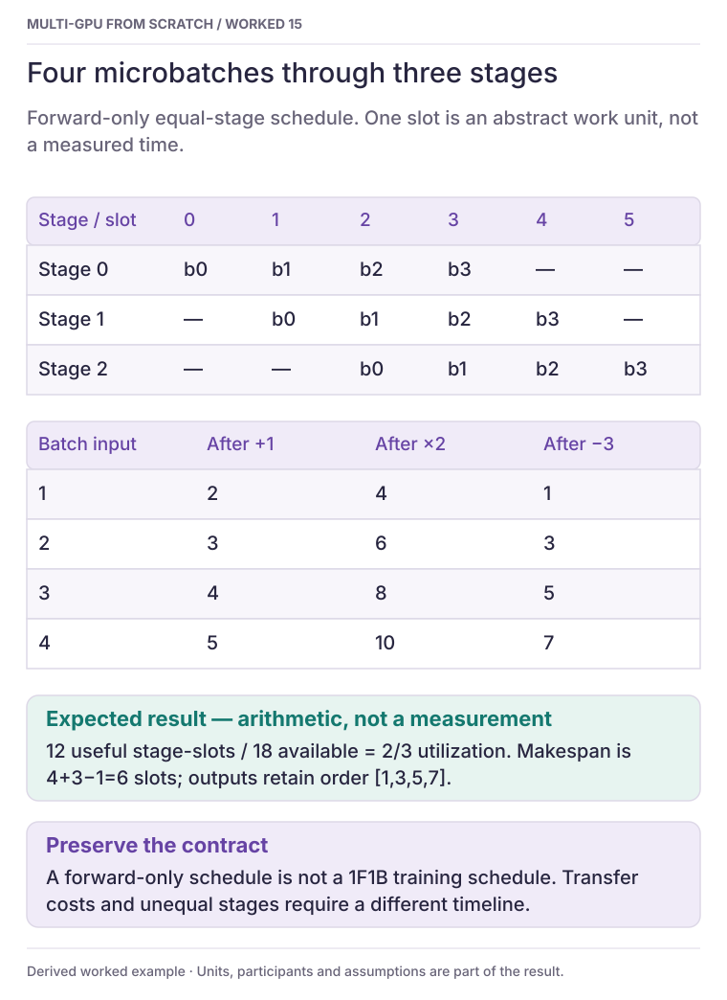
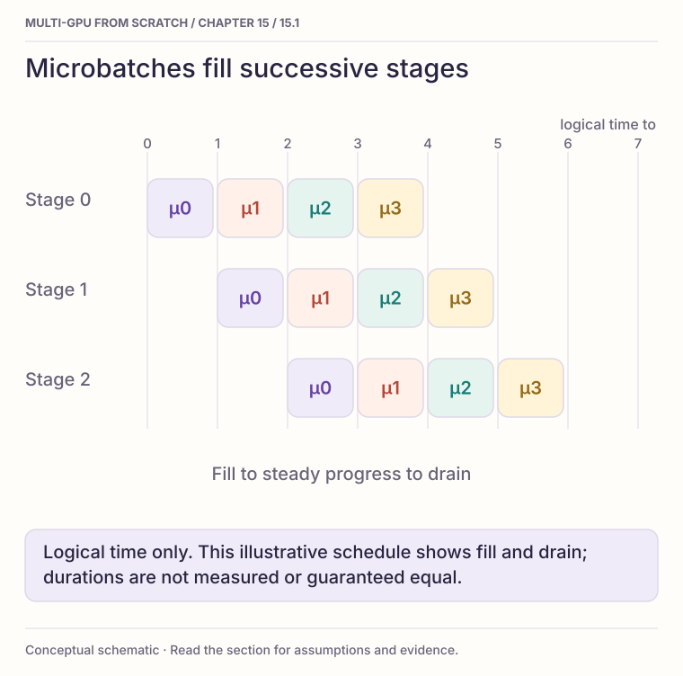
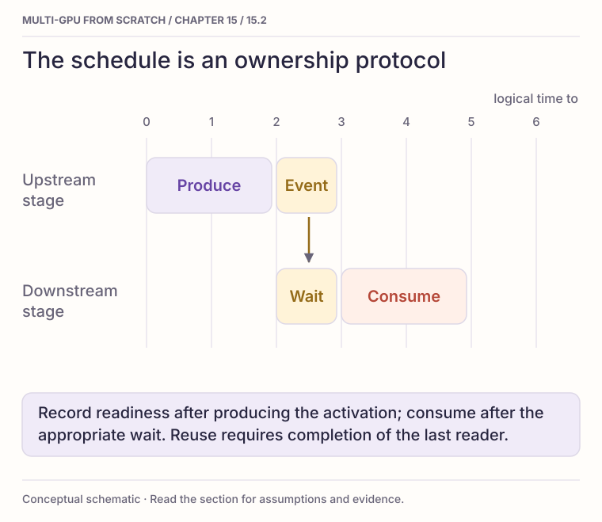

# Chapter 15: Pipeline Parallelism: Splitting Layers Across Devices, and the Bubble That Costs You

<!-- mgpu:opener:start -->
[](../images/chapter-openers/15.svg)
<!-- mgpu:opener:end -->

**What you will understand by the end of this chapter:**

- Why Chapter 13's own layer-wise split leaves every device idle most of the time, and how splitting the *batch* into micro-batches -- not the model any further -- fills that idle time by pipelining several micro-batches through the same device partition at once.
- GPipe's own real bubble-overhead formula, `(K-1)/(M+K-1)`, derived here first by direct counting of an actual pipeline schedule, then cross-checked against GPipe's own cited empirical claim that the overhead becomes negligible once the number of micro-batches reaches `4 x K`.
- Why interleaving several micro-batches in time never changes any single micro-batch's own result -- the same real cross-device event mechanism this book built in Chapter 6 is what makes that guarantee hold, not a new primitive.

**What you need to know first:**

- Chapter 13's layer-wise partitioning (`computeLayerRange()`) and its own named-but-unmeasured cost: GPipe's real "severe under-utilization due to the sequential dependency of the network."
- Chapter 6's real `cudaEventRecord()` / `cudaStreamWaitEvent()` cross-device dependency mechanism.
- Chapter 13's own toy 8-layer network and its bit-identical correctness guarantee for a single, un-pipelined forward pass.

---

Chapter 13 built a real layer-wise split and proved it produces the exact same output as an unsplit model -- and then named, without measuring, the real cost that correctness came with: GPipe's own documented "severe under-utilization due to the sequential dependency of the network." This chapter counts the idle slots in an equal-stage schedule model, and shows how microbatching reduces them, using a technique that doesn't touch the model split at all. GPipe's own real fix is to split the *batch*, not the model any further: cut a batch into several smaller micro-batches, and feed them into the same layer-partitioned pipeline one after another, so that while device 3 works on micro-batch 0, device 0 isn't sitting idle -- it's already started on micro-batch 1. This chapter builds that pipeline schedule, counts its idle time directly rather than assuming a formula, and proves the interleaving it creates never changes what any individual micro-batch computes.

```text
Chapter 13 (ONE micro-batch, K=4 devices):     This chapter (M micro-batches, PIPELINED):

  t=0  dev0: [mb0]                               t=0  dev0:[mb0]
  t=1  dev1: [mb0]        dev0,2,3: IDLE          t=1  dev0:[mb1] dev1:[mb0]
  t=2  dev2: [mb0]        dev0,1,3: IDLE          t=2  dev0:[mb2] dev1:[mb1] dev2:[mb0]
  t=3  dev3: [mb0]        dev0,1,2: IDLE          t=3         dev1:[mb2] dev2:[mb1] dev3:[mb0]
                                                   t=4                dev2:[mb2] dev3:[mb1]
  3 of every 4 device-time slots: IDLE.           t=5                       dev3:[mb2]

                                                   Idle time still exists (the empty
                                                   corners above) -- but far less of it.
```

<!-- mgpu:worked:start -->

## Worked example — Trace the pipeline before optimizing it

Let P=3 stages and B=4 microbatches. Each stage takes one abstract slot; transfer and backward work are excluded. Stages apply f0(x)=x+1, f1(x)=2x and f2(x)=x−3, in that order. Inputs are [1,2,3,4].

1. Stage 0 produces [2,3,4,5] in slots 0–3. Stage 1 starts one slot later and produces [4,6,8,10] in slots 1–4.

2. Stage 2 starts in slot 2 and produces [1,3,5,7] in slots 2–5. Every microbatch crosses both dependencies before its final output exists.

3. The makespan is B+P−1=6 slots. There are P×B=12 useful stage-slots out of P×6=18 available: utilization is 2/3.

[](../images/worked/ch15.svg)

**API connection and scope.** Connect each producer to its transfer and consumer with stream ordering and completion events, for example cudaEventRecord and cudaStreamWaitEvent where supported. Reusing a microbatch buffer requires its last reader to finish. The figure is a forward-only scheduling model, not a measured trace or a 1F1B training schedule.

**Expected check and pitfall.** Check all four outputs in their original order. A fast final event with swapped microbatch identities is still wrong. Unequal stage costs and communication change the timeline.

??? question "Guided exercise: What changes with one microbatch?"

    **Worked answer.** The stages occupy three successive slots, only three of nine stage-slots do useful work, and utilization is 1/3. Input 1 still produces 1.

<!-- mgpu:worked:end -->

## 15.1 Micro-Batching: Filling the Bubble Chapter 13 Left Empty

<!-- mgpu:figure-1:start -->
[](../images/technical/ch15/1-pipeline.svg)
<!-- mgpu:figure-1:end -->

### Intuition

Chapter 13's own diagram showed the problem plainly: with one micro-batch flowing through four devices, only one device is ever doing anything at a time, and the other three are idle. GPipe's fix doesn't touch the model split at all -- it changes what flows *through* it. Instead of one micro-batch making a single trip through the pipeline, GPipe splits the batch into `M` smaller micro-batches and starts feeding them in one after another, a single time step apart. Once the pipeline is full, every device is working on a *different* micro-batch at the same time -- device 0 has already moved on to micro-batch 3 while device 3 is still finishing micro-batch 0. The idle time doesn't vanish entirely (the pipeline still has to fill up at the start and drain at the end), but it stops being the dominant cost.

```text
Micro-batch m enters device 0 at time t=m,          Device d's own busy time steps,
reaches device d at time t=m+d:                     as m ranges over 0..M-1:

  microbatchAt(device, t) = t - device                 t = d, d+1, d+2, ..., d+M-1
  (valid only when 0 <= t-device < M)                   -- exactly M consecutive
                                                          time steps, offset by d.

  Every device does the SAME amount of real work (M micro-batches) --
  they just start and finish at different, staggered times.
```

### Background

The code below builds the actual schedule -- which device processes which micro-batch at which time step -- for a small, hand-traceable `K=4`, `M=6`, using the exact formula GPipe's own pipelining implies: micro-batch `m` reaches device `d` at time step `t=m+d`. Rather than trusting a bubble-overhead formula from a citation, this section counts busy and idle slots directly from that schedule, then checks two self-consistency facts that have to be true if the schedule is right: every device does exactly `M` units of real work, and the total idle time across all devices is exactly `K*(K-1)` slots -- the fill-and-drain cost every device except an infinitely long-running one pays once.

```cpp
// Chapter 15: Pipeline Parallelism -- Splitting Layers Across Devices, and the Bubble That Costs You
// 42_pipeline_schedule.cpp
//
// Plain host C++ -- computing the actual GPipe-style pipeline
// schedule (which device processes which micro-batch at which time
// step) is pure arithmetic, needs no device, and lets this section
// derive Chapter 13's own unmeasured idle-time cost by direct
// counting rather than quoting a formula and trusting it. GPipe's
// own paper splits a batch into M micro-batches pipelined through K
// accelerators; this section builds that schedule for a small,
// hand-traceable K and M, counts every device's busy vs. idle time
// slots directly, and only THEN compares the counted result against
// GPipe's own cited closed-form bubble formula.
#include <cstdio>

// Standard pipeline schedule: micro-batch m enters device 0 at time
// step t=m, and reaches device d at time t=m+d (each stage takes one
// time unit). Device d is therefore busy processing micro-batch m at
// time step (m+d), and idle at every other time step within the
// pipeline's total span.
int microbatchAt(int device, int timeStep) {
    int m = timeStep - device;
    return (m >= 0) ? m : -1; // -1 means idle -- no valid micro-batch yet
}

int main() {
    const int K = 4; // devices (Chapter 13's own layer-partition world size)
    const int M = 6; // micro-batches

    const int totalTimeSteps = M + K - 1; // pipeline's total wall-clock span

    printf("Pipeline schedule, K=%d devices, M=%d micro-batches "
           "(totalTimeSteps = M+K-1 = %d):\n\n", K, M, totalTimeSteps);
    printf("device \\ t ");
    for (int t = 0; t < totalTimeSteps; ++t) printf("%3d", t);
    printf("\n");

    long busySlots = 0;
    for (int d = 0; d < K; ++d) {
        printf("dev %-6d ", d);
        for (int t = 0; t < totalTimeSteps; ++t) {
            int m = microbatchAt(d, t);
            bool busy = (m >= 0 && m < M);
            if (busy) { printf("%3d", m); busySlots++; }
            else printf("  .");
        }
        printf("\n");
    }

    const long totalSlots = (long)K * totalTimeSteps;
    const long idleSlots = totalSlots - busySlots;

    printf("\nCounted directly from the schedule above:\n");
    printf("  total device-time slots (K x totalTimeSteps): %ld\n", totalSlots);
    printf("  busy slots (every device's M real micro-batches):  %ld\n", busySlots);
    printf("  idle slots ('.' above):                             %ld\n", idleSlots);

    // Every device does exactly M units of real work (one per
    // micro-batch) regardless of K -- so busySlots must equal K*M
    // exactly, and idleSlots must equal K*(K-1) exactly: the fill and
    // drain time every device except the very first and very last
    // spends waiting for a micro-batch that isn't ready yet, or with
    // no more micro-batches left to process.
    bool busyMatches = (busySlots == (long)K * M);
    bool idleMatches = (idleSlots == (long)K * (K - 1));
    printf("\nSelf-check: busySlots == K*M (%ld): %s\n", (long)K * M,
           busyMatches ? "PASS" : "FAIL");
    printf("Self-check: idleSlots == K*(K-1) (%ld): %s\n", (long)K * (K - 1),
           idleMatches ? "PASS" : "FAIL");

    return (busyMatches && idleMatches) ? 0 : 1;
}
```

<!-- execution:start:h100-rerun:42_pipeline_schedule.cpp -->
> **Compiled and executed — 2026-11-18-h100: Host program/model (exit-only).** Hardware: 2 H100 GPUs. Executed UTC: `2026-11-18T11:21:33.053273+00:00`.

<!-- execution:metadata Source SHA-256: b6ebe70007adc7b7eea44a90cdf48c24744a894b71d5f387b6d02b02e879a5f5; recorded UTC (program start): 2026-11-18T11:21:32.989253+00:00 -->

[Exact tested source](../validation/2026-11-18-h100/42_pipeline_schedule/42_pipeline_schedule.cpp) · [Compiler log](../validation/2026-11-18-h100/42_pipeline_schedule/compile.log) · [Execution log](../validation/2026-11-18-h100/42_pipeline_schedule/run.log). Compile exit: `0`; run exit: `0`.

Commands below use local source/binary names; raw logs retain host paths. Execute in a scratch directory containing the downloaded source.

```bash
g++ -std=c++17 -O2 42_pipeline_schedule.cpp -o ./example
./example
```

**Sample output**

```text
Pipeline schedule, K=4 devices, M=6 micro-batches (totalTimeSteps = M+K-1 = 9):

device \ t   0  1  2  3  4  5  6  7  8
dev 0        0  1  2  3  4  5  .  .  .
dev 1        .  0  1  2  3  4  5  .  .
dev 2        .  .  0  1  2  3  4  5  .
dev 3        .  .  .  0  1  2  3  4  5

Counted directly from the schedule above:
  total device-time slots (K x totalTimeSteps): 36
  busy slots (every device's M real micro-batches):  24
  idle slots ('.' above):                             12

Self-check: busySlots == K*M (24): PASS
Self-check: idleSlots == K*(K-1) (12): PASS
```

<!-- execution:end:h100-rerun:42_pipeline_schedule.cpp -->


<!-- execution:start:a100:42_pipeline_schedule.cpp -->
> **Compiled and executed — 2026-11-17-a100: Host program/model (exit-only).** Hardware: 8 A100 GPUs. Executed UTC: `2026-11-18T00:02:31.978090+00:00`.

<!-- execution:metadata Source SHA-256: b6ebe70007adc7b7eea44a90cdf48c24744a894b71d5f387b6d02b02e879a5f5; recorded UTC (program start): 2026-11-18T00:02:31.863017+00:00 -->

[Exact tested source](../validation/2026-11-17-a100/42_pipeline_schedule/42_pipeline_schedule.cpp) · [Compiler log](../validation/2026-11-17-a100/42_pipeline_schedule/compile.log) · [Execution log](../validation/2026-11-17-a100/42_pipeline_schedule/run.log). Compile exit: `0`; run exit: `0`.

Commands below use local source/binary names; raw logs retain host paths. Execute in a scratch directory containing the downloaded source.

```bash
g++ -std=c++17 -O2 42_pipeline_schedule.cpp -o ./example
./example
```

**Sample output**

```text
Pipeline schedule, K=4 devices, M=6 micro-batches (totalTimeSteps = M+K-1 = 9):

device \ t   0  1  2  3  4  5  6  7  8
dev 0        0  1  2  3  4  5  .  .  .
dev 1        .  0  1  2  3  4  5  .  .
dev 2        .  .  0  1  2  3  4  5  .
dev 3        .  .  .  0  1  2  3  4  5

Counted directly from the schedule above:
  total device-time slots (K x totalTimeSteps): 36
  busy slots (every device's M real micro-batches):  24
  idle slots ('.' above):                             12

Self-check: busySlots == K*M (24): PASS
Self-check: idleSlots == K*(K-1) (12): PASS
```


<!-- execution:end:a100:42_pipeline_schedule.cpp -->


<!-- execution:start:h100:42_pipeline_schedule.cpp -->
> **Compiled and executed — 2026-11-17-h100: Host program/model (exit-only).** Hardware: 2 H100 GPUs. Execution record UTC (run-batch start; per-program time unrecorded): `2026-11-17T23:48:18.967387+00:00`.

<!-- execution:metadata Source SHA-256: b6ebe70007adc7b7eea44a90cdf48c24744a894b71d5f387b6d02b02e879a5f5; recorded UTC (run-batch start; per-program time unrecorded): 2026-11-17T23:48:18.967387+00:00 -->

[Exact tested source](../validation/2026-11-17-h100/42_pipeline_schedule/42_pipeline_schedule.cpp) · [Compiler log](../validation/2026-11-17-h100/42_pipeline_schedule/compile.log) · [Execution log](../validation/2026-11-17-h100/42_pipeline_schedule/run.log). Compile exit: `0`; run exit: `0`.

Commands below use local source/binary names; raw logs retain host paths. Execute in a scratch directory containing the downloaded source.

```bash
g++ -std=c++17 -O2 42_pipeline_schedule.cpp -o ./example
./example
```

<details markdown="1"><summary>Captured current-source output</summary>

```text
Pipeline schedule, K=4 devices, M=6 micro-batches (totalTimeSteps = M+K-1 = 9):

device \ t   0  1  2  3  4  5  6  7  8
dev 0        0  1  2  3  4  5  .  .  .
dev 1        .  0  1  2  3  4  5  .  .
dev 2        .  .  0  1  2  3  4  5  .
dev 3        .  .  .  0  1  2  3  4  5

Counted directly from the schedule above:
  total device-time slots (K x totalTimeSteps): 36
  busy slots (every device's M real micro-batches):  24
  idle slots ('.' above):                             12

Self-check: busySlots == K*M (24): PASS
Self-check: idleSlots == K*(K-1) (12): PASS
```

</details>
<!-- execution:end:h100:42_pipeline_schedule.cpp -->


The schedule's own shape makes the cost visible without any formula at all: each device's row is a block of `M` consecutive numbers, staggered one time step later than the device before it, with dots everywhere else. Counting those dots directly gives 12 idle slots out of 36 total -- a third of all device-time in this particular small example, all of it concentrated at the pipeline's fill (the staircase of dots in the upper-left) and drain (the staircase in the lower-right). Both self-checks confirm the schedule behaves exactly the way the underlying arithmetic requires: every device does the same `M` units of work, and the total idle time is exactly `K*(K-1)` slots, no more and no less. Section 15.3 takes this counted result and checks it against GPipe's own cited closed-form formula for the general case.

!!! warning "[COMMON TRAP] Assuming micro-batching eliminates the bubble instead of just amortizing it"
    The schedule above still has real idle cells in it -- 12 of them, even with staggered execution. Micro-batching doesn't make the fill-and-drain cost disappear; Section 15.1's own self-check shows that cost is a fixed `K*(K-1)` slots no matter how many micro-batches run through the pipeline. What micro-batching does is spread that fixed cost over more total work: with `M=6`, it's 12 idle slots out of 36 (a third); with a much larger `M`, the same 12-slot fill-and-drain cost would be a much smaller fraction of a much larger total. The bubble is amortized, not eliminated -- and GPipe's own paper is explicit that its overhead is "negligible," not zero, once `M` is large enough relative to `K`.

## 15.2 Enforcing the Schedule: Chapter 6's Real Event Mechanism, Reused

<!-- mgpu:figure-2:start -->
[](../images/technical/ch15/2-handoff.svg)
<!-- mgpu:figure-2:end -->

### Intuition

Section 15.1's schedule says device 1 should start on micro-batch 0 at time step 1 -- but nothing about that number, on its own, makes it true. Something has to actually stop device 1 from starting early, before device 0 has genuinely finished producing micro-batch 0's activations. This is precisely the problem Chapter 6 solved for a completely different reason: a real event, recorded on the producing device's stream, handed to `cudaStreamWaitEvent()` on the consuming device's stream, enforces exactly this kind of dependency -- without the host ever blocking, and without the heavy-handed `cudaDeviceSynchronize()` this book has avoided since Chapter 6. Pipeline parallelism's scheduling problem and Chapter 6's synchronization problem turn out to be the same problem, just with "micro-batch handoff" in place of whatever originally motivated Chapter 6's own example.

```text
Section 15.1's schedule says:              Chapter 6's real mechanism enforces it:

  t=0  dev0 starts micro-batch 0             dev0: ... kernels for mb0 ...
  t=1  dev1 starts micro-batch 0                    cudaEventRecord(mbReady, dev0's stream)
       (but ONLY after dev0 is done!)
                                             dev1: cudaStreamWaitEvent(dev1's stream, mbReady)
                                                    ... kernels for mb0, now safely queued ...

  One cudaEventRecord() + cudaStreamWaitEvent() pair per (device, micro-batch)
  boundary in Section 15.1's own schedule -- K*(M-1) pairs for the whole pipeline.
```

### Background

The code below enacts exactly one cell of Section 15.1's own schedule -- the boundary between device 0 finishing micro-batch 0 and device 1 starting it -- using the identical real API Chapter 6 introduced: `cudaEventRecord()` to mark a producing device's completion point, and `cudaStreamWaitEvent()` to make a different device's stream depend on it. Every other `(device, micro-batch)` boundary in Section 15.1's schedule needs this same pattern, called once per boundary; it's shown here for one rather than repeated mechanically for all of them.

```cpp
// Chapter 15: one checked pipeline-stage readiness boundary
// 43_pipeline_stage_sync.cu
// Two real devices, guarded handles, and a checked cross-device dependency.
#include <cstdio>
#include <cuda_runtime.h>

#define CHECK(call) do { cudaError_t status = (call); \
    printf("%s: %s (code %d)\n", #call, cudaGetErrorString(status), (int)status); \
    if (status != cudaSuccess) return status == cudaErrorNoDevice || \
        status == cudaErrorInsufficientDriver ? 2 : 1; } while (0)

int main() {
    int count = 0;
    CHECK(cudaGetDeviceCount(&count));
    if (count < 2) { printf("BLOCKED: requires 2 visible GPUs; found %d.\n", count); return 2; }
    cudaStream_t stream0 = nullptr, stream1 = nullptr;
    cudaEvent_t event0 = nullptr;
    CHECK(cudaSetDevice(0));
    CHECK(cudaStreamCreate(&stream0));
    CHECK(cudaEventCreateWithFlags(&event0, cudaEventDisableTiming));
    CHECK(cudaEventRecord(event0, stream0));
    CHECK(cudaSetDevice(1));
    CHECK(cudaStreamCreate(&stream1));
    CHECK(cudaStreamWaitEvent(stream1, event0, 0));
    printf("Cross-device wait enqueued; host did not wait for event completion.\n");
    // Drain the waiter before releasing resources. This demo checks API success;
    // it does not validate a producer/consumer payload or measure overlap.
    CHECK(cudaStreamSynchronize(stream1));
    CHECK(cudaStreamDestroy(stream1));
    CHECK(cudaSetDevice(0));
    CHECK(cudaEventDestroy(event0));
    CHECK(cudaStreamDestroy(stream0));
    printf("PASS: checked pipeline-stage event dependency lifecycle.\n");
    return 0;
}
```

<!-- execution:start:h100-rerun:43_pipeline_stage_sync.cu -->
> **Compiled and executed — 2026-11-18-h100: API validation (recorded scope).** Hardware: 2 H100 GPUs. Executed UTC: `2026-11-18T11:21:33.671241+00:00`.

<!-- execution:metadata Source SHA-256: e3d44151b74bd3c1534f9ab075292a9372a7389fa3d42ed29c50a71a0dd25f19; recorded UTC (program start): 2026-11-18T11:21:33.056093+00:00 -->

[Exact tested source](../validation/2026-11-18-h100/43_pipeline_stage_sync/43_pipeline_stage_sync.cu) · [Compiler log](../validation/2026-11-18-h100/43_pipeline_stage_sync/compile.log) · [Execution log](../validation/2026-11-18-h100/43_pipeline_stage_sync/run.log). Compile exit: `0`; run exit: `0`.

Commands below use local source/binary names; raw logs retain host paths. Execute in a scratch directory containing the downloaded source.

```bash
nvcc -std=c++17 -O2 -arch=sm_90 43_pipeline_stage_sync.cu -o ./example
./example
```

**Sample output**

```text
cudaGetDeviceCount(&count): no error (code 0)
cudaSetDevice(0): no error (code 0)
cudaStreamCreate(&stream0): no error (code 0)
cudaEventCreateWithFlags(&event0, cudaEventDisableTiming): no error (code 0)
cudaEventRecord(event0, stream0): no error (code 0)
cudaSetDevice(1): no error (code 0)
cudaStreamCreate(&stream1): no error (code 0)
cudaStreamWaitEvent(stream1, event0, 0): no error (code 0)
Cross-device wait enqueued; host did not wait for event completion.
cudaStreamSynchronize(stream1): no error (code 0)
cudaStreamDestroy(stream1): no error (code 0)
cudaSetDevice(0): no error (code 0)
cudaEventDestroy(event0): no error (code 0)
cudaStreamDestroy(stream0): no error (code 0)
PASS: checked pipeline-stage event dependency lifecycle.
```

<!-- execution:end:h100-rerun:43_pipeline_stage_sync.cu -->


<!-- execution:start:a100:43_pipeline_stage_sync.cu -->
> **Compiled and executed — 2026-11-17-a100: API validation (recorded scope).** Hardware: 8 A100 GPUs. Executed UTC: `2026-11-18T00:02:33.060290+00:00`.

<!-- execution:metadata Source SHA-256: e3d44151b74bd3c1534f9ab075292a9372a7389fa3d42ed29c50a71a0dd25f19; recorded UTC (program start): 2026-11-18T00:02:31.983487+00:00 -->

[Exact tested source](../validation/2026-11-17-a100/43_pipeline_stage_sync/43_pipeline_stage_sync.cu) · [Compiler log](../validation/2026-11-17-a100/43_pipeline_stage_sync/compile.log) · [Execution log](../validation/2026-11-17-a100/43_pipeline_stage_sync/run.log). Compile exit: `0`; run exit: `0`.

Commands below use local source/binary names; raw logs retain host paths. Execute in a scratch directory containing the downloaded source.

```bash
nvcc -std=c++17 -O2 -arch=sm_80 43_pipeline_stage_sync.cu -o ./example
./example
```

**Sample output**

```text
cudaGetDeviceCount(&count): no error (code 0)
cudaSetDevice(0): no error (code 0)
cudaStreamCreate(&stream0): no error (code 0)
cudaEventCreateWithFlags(&event0, cudaEventDisableTiming): no error (code 0)
cudaEventRecord(event0, stream0): no error (code 0)
cudaSetDevice(1): no error (code 0)
cudaStreamCreate(&stream1): no error (code 0)
cudaStreamWaitEvent(stream1, event0, 0): no error (code 0)
Cross-device wait enqueued; host did not wait for event completion.
cudaStreamSynchronize(stream1): no error (code 0)
cudaStreamDestroy(stream1): no error (code 0)
cudaSetDevice(0): no error (code 0)
cudaEventDestroy(event0): no error (code 0)
cudaStreamDestroy(stream0): no error (code 0)
PASS: checked pipeline-stage event dependency lifecycle.
```


<!-- execution:end:a100:43_pipeline_stage_sync.cu -->


<!-- execution:start:h100:43_pipeline_stage_sync.cu -->
> **Compiled and executed — 2026-11-17-h100: API validation (recorded scope).** Hardware: 2 H100 GPUs. Execution record UTC (run-batch start; per-program time unrecorded): `2026-11-17T23:48:18.967387+00:00`.

<!-- execution:metadata Source SHA-256: e3d44151b74bd3c1534f9ab075292a9372a7389fa3d42ed29c50a71a0dd25f19; recorded UTC (run-batch start; per-program time unrecorded): 2026-11-17T23:48:18.967387+00:00 -->

[Exact tested source](../validation/2026-11-17-h100/43_pipeline_stage_sync/43_pipeline_stage_sync.cu) · [Compiler log](../validation/2026-11-17-h100/43_pipeline_stage_sync/compile.log) · [Execution log](../validation/2026-11-17-h100/43_pipeline_stage_sync/run.log). Compile exit: `0`; run exit: `0`.

Commands below use local source/binary names; raw logs retain host paths. Execute in a scratch directory containing the downloaded source.

```bash
nvcc -std=c++17 -O2 -arch=sm_90 43_pipeline_stage_sync.cu -o ./example
./example
```

<details markdown="1"><summary>Captured current-source output</summary>

```text
cudaGetDeviceCount(&count): no error (code 0)
cudaSetDevice(0): no error (code 0)
cudaStreamCreate(&stream0): no error (code 0)
cudaEventCreateWithFlags(&event0, cudaEventDisableTiming): no error (code 0)
cudaEventRecord(event0, stream0): no error (code 0)
cudaSetDevice(1): no error (code 0)
cudaStreamCreate(&stream1): no error (code 0)
cudaStreamWaitEvent(stream1, event0, 0): no error (code 0)
Cross-device wait enqueued; host did not wait for event completion.
cudaStreamSynchronize(stream1): no error (code 0)
cudaStreamDestroy(stream1): no error (code 0)
cudaSetDevice(0): no error (code 0)
cudaEventDestroy(event0): no error (code 0)
cudaStreamDestroy(stream0): no error (code 0)
PASS: checked pipeline-stage event dependency lifecycle.
```

</details>
<!-- execution:end:h100:43_pipeline_stage_sync.cu -->


The [2026-11-17 H100 execution record](../validation-h100.md) covers two GPUs connected by local NV18. It distinguishes numerical checks, API probes and other executions; a successful exit alone does not establish GPU algorithm correctness.

File 43 is a checked stream/event pipeline API probe on the H100 host. It checks submission and synchronization behavior, not a numerical neural-network pipeline or achieved pipeline overlap.

!!! warning "[COMMON TRAP] Synchronizing on a schedule with cudaDeviceSynchronize() instead of per-boundary events"
    In this equal-duration slot model, a host barrier between slots can still allow all active stages within a slot to run concurrently; it does not inherently destroy pipeline overlap. It does add global waiting and can prevent useful asynchronous progress when real stage/transfer costs differ. Narrow event dependencies permit that progress, provided the producer, transfer, consumer and buffer-reuse dependencies are all represented.

## 15.3 Quantifying the Bubble Precisely, and Verifying the Schedule Preserves Correctness

### Intuition

Section 15.1 counted idle slots directly for one small `(K, M)` pair. GPipe's own paper gives a general closed-form formula for the same quantity, and this section's first job is to confirm the two agree -- not assume it. The second job is different in kind: Section 15.1's schedule interleaves several micro-batches in time, meaning device 0 might start micro-batch 2 before device 3 has even touched micro-batch 0. That's a real change in *execution order* across micro-batches. What it must never be allowed to change is any *individual* micro-batch's own result -- Chapter 13 already proved that a single micro-batch's forward pass is bit-identical whether split across devices or not, and this section checks that guarantee survives being interleaved with other, unrelated micro-batches' own independent computations.

```text
Formula vs. counted result (Section 15.1's own K=4, M=6):     Correctness under interleaving:

  (K-1)/(M+K-1) = 3/9 = 0.3333...                                mb0: dev0 -> dev1 -> dev2 -> dev3
  Section 15.1's own counted fraction: 12/36 = 0.3333...          mb1:      dev0 -> dev1 -> dev2 -> dev3
                                                                   mb2:           dev0 -> dev1 -> dev2 -> dev3
  MATCH -- confirmed, not assumed.
                                                                 Each row's own chain is untouched by
                                                                 the OTHER rows running in between it.
```

### Background

The code below does two things in one file. First, it applies GPipe's own closed-form bubble formula, `(K-1)/(M+K-1)`, to real `K` values this book has already used -- Chapter 13's own 2-way split (the 7B-class model) and 35-way split (GPT-3) -- each checked at GPipe's own cited empirical threshold, `M = 4 x K`, where the paper reports the overhead becomes negligible. Second, it reuses Chapter 13's own 8-layer toy network, `computeLayerRange()`, and all three of its original test inputs, verbatim, running them as three micro-batches through Section 15.1's own interleaved schedule -- and checks every micro-batch's final result against Chapter 13's own un-pipelined reference.

```cpp
// Chapter 15: Pipeline Parallelism -- Splitting Layers Across Devices, and the Bubble That Costs You
// 44_bubble_and_pipelined_correctness.cpp
//
// Plain host C++, two checks in one file. Part A: a closed-form model
// -- not fabricated timings -- applying the exact idle-fraction
// formula Section 15.1's own direct counting already confirmed,
// (K-1)/(M+K-1), to realistic K values this book has ALREADY used for
// real (Chapter 13's own 2-way and 35-way model-parallel splits), and
// checking GPipe's own cited empirical claim that overhead is
// negligible once M >= 4*K. Part B: Chapter 13's own toy 8-layer
// network and layer-partition formula, reused verbatim, now run
// through Section 15.1's interleaved pipeline schedule instead of one
// micro-batch at a time -- checking that interleaving execution in
// TIME never changes any individual micro-batch's own result, the
// same guarantee Chapter 13 established for a single micro-batch,
// now extended to several running through the pipeline at once.
#include <cstdio>

// ---------------------------------------------------------------
// Part A: the bubble fraction, closed-form.
// ---------------------------------------------------------------
double bubbleFraction(int K, int M) {
    return (double)(K - 1) / (double)(M + K - 1);
}

// ---------------------------------------------------------------
// Part B: Chapter 13's own toy network, verbatim (same LAYERS, same
// applyLayer weights, same computeLayerRange formula).
// ---------------------------------------------------------------
const int LAYERS = 8;

void applyLayer(int layerIdx, double x0, double x1, double* y0, double* y1) {
    double w00 = 0.50 + 0.01 * layerIdx, w01 = 0.10;
    double w10 = 0.15,                   w11 = 0.55 + 0.01 * layerIdx;
    double b0 = 0.02 * layerIdx, b1 = 0.01 * layerIdx;
    double r0 = w00 * x0 + w01 * x1 + b0;
    double r1 = w10 * x0 + w11 * x1 + b1;
    *y0 = r0 > 0.0 ? r0 : 0.0;
    *y1 = r1 > 0.0 ? r1 : 0.0;
}

void computeLayerRange(int totalLayers, int worldSize, int rank, int* start, int* end) {
    int perDevice = totalLayers / worldSize;
    *start = rank * perDevice;
    *end = *start + perDevice;
}

// Chapter 13's own UNSPLIT, UN-PIPELINED reference: every layer,
// one micro-batch, applied in one unbroken loop.
void referenceForward(double x0, double x1, double* out0, double* out1) {
    double cur0 = x0, cur1 = x1;
    for (int layer = 0; layer < LAYERS; ++layer) {
        double n0, n1;
        applyLayer(layer, cur0, cur1, &n0, &n1);
        cur0 = n0; cur1 = n1;
    }
    *out0 = cur0; *out1 = cur1;
}

// Section 15.1's own schedule function, reused verbatim.
int microbatchAt(int device, int timeStep) {
    int m = timeStep - device;
    return (m >= 0) ? m : -1;
}

int main() {
    // ---------------- Part A ----------------
    printf("Part A: bubble fraction (K-1)/(M+K-1), for real K values this\n"
           "book has already used, checked at GPipe's own empirical\n"
           "threshold M = 4xK:\n\n");
    printf("%-28s %6s %10s %14s\n", "K (source)", "K", "M=4xK", "bubble frac.");
    struct KCase { const char* label; int k; };
    const KCase kcases[] = {
        {"7B-class model (Ch13)",  2},
        {"typical pipeline depth", 4},
        {"typical pipeline depth", 8},
        {"GPT-3 175B (Ch13)",     35},
    };
    for (const auto& kc : kcases) {
        int M = 4 * kc.k;
        double frac = bubbleFraction(kc.k, M);
        printf("%-28s %6d %10d %13.2f%%\n", kc.label, kc.k, M, frac * 100.0);
    }

    // ---------------- Part B ----------------
    const int K = 4;              // pipeline devices (Section 15.1's own K)
    const int TOTAL_TIME_STEPS_UPPER_BOUND = 32; // generous; actual span computed per M

    struct Case { double x0, x1; };
    const Case cases[] = { {1.0, 1.0}, {2.0, -1.0}, {0.5, 3.0} }; // Chapter 13's own 3 inputs
    const int M = sizeof(cases) / sizeof(cases[0]);
    const int totalTimeSteps = M + K - 1;

    double curBuf[M][2];
    for (int m = 0; m < M; ++m) { curBuf[m][0] = cases[m].x0; curBuf[m][1] = cases[m].x1; }

    printf("\nPart B: running Chapter 13's own %d-layer network for %d "
           "micro-batches\nthrough Section 15.1's interleaved K=%d pipeline "
           "schedule (totalTimeSteps=%d):\n\n", LAYERS, M, K, totalTimeSteps);

    for (int t = 0; t < totalTimeSteps && t < TOTAL_TIME_STEPS_UPPER_BOUND; ++t) {
        for (int d = 0; d < K; ++d) {
            int m = microbatchAt(d, t);
            if (m < 0 || m >= M) continue; // idle cell, matches Section 15.1's schedule
            int layerStart, layerEnd;
            computeLayerRange(LAYERS, K, d, &layerStart, &layerEnd);
            for (int layer = layerStart; layer < layerEnd; ++layer) {
                double n0, n1;
                applyLayer(layer, curBuf[m][0], curBuf[m][1], &n0, &n1);
                curBuf[m][0] = n0; curBuf[m][1] = n1;
            }
            printf("  t=%d: device %d processes micro-batch %d (layers [%d,%d))\n",
                   t, d, m, layerStart, layerEnd);
        }
    }

    bool allMatch = true;
    printf("\nComparing each micro-batch's PIPELINED result against Chapter "
           "13's own UN-PIPELINED reference for the same input:\n");
    for (int m = 0; m < M; ++m) {
        double refOut0, refOut1;
        referenceForward(cases[m].x0, cases[m].x1, &refOut0, &refOut1);
        bool matches = (refOut0 == curBuf[m][0]) && (refOut1 == curBuf[m][1]);
        allMatch = allMatch && matches;
        printf("  micro-batch %d, input (%.2f, %.2f): reference = (%.10f, %.10f), "
               "pipelined = (%.10f, %.10f) -- %s\n",
               m, cases[m].x0, cases[m].x1, refOut0, refOut1, curBuf[m][0], curBuf[m][1],
               matches ? "PASS (bit-identical)" : "FAIL");
    }
    printf("\nAll %d micro-batch(es) bit-identical between the pipelined "
           "schedule and Chapter 13's own un-pipelined reference: %s\n",
           M, allMatch ? "PASS" : "FAIL");

    return allMatch ? 0 : 1;
}
```

<!-- execution:start:h100-rerun:44_bubble_and_pipelined_correctness.cpp -->
> **Compiled and executed — 2026-11-18-h100: Host program/model (exit-only).** Hardware: 2 H100 GPUs. Executed UTC: `2026-11-18T11:21:34.402208+00:00`.

<!-- execution:metadata Source SHA-256: d44dc2c57da8948d74c5a45c483d4eb59c4fb7bf8848527038db7c74fe7a8636; recorded UTC (program start): 2026-11-18T11:21:34.287982+00:00 -->

[Exact tested source](../validation/2026-11-18-h100/44_bubble_and_pipelined_correctness/44_bubble_and_pipelined_correctness.cpp) · [Compiler log](../validation/2026-11-18-h100/44_bubble_and_pipelined_correctness/compile.log) · [Execution log](../validation/2026-11-18-h100/44_bubble_and_pipelined_correctness/run.log). Compile exit: `0`; run exit: `0`.

Commands below use local source/binary names; raw logs retain host paths. Execute in a scratch directory containing the downloaded source.

```bash
g++ -std=c++17 -O2 44_bubble_and_pipelined_correctness.cpp -o ./example
./example
```

**Sample output**

```text
Part A: bubble fraction (K-1)/(M+K-1), for real K values this
book has already used, checked at GPipe's own empirical
threshold M = 4xK:

K (source)                        K      M=4xK   bubble frac.
7B-class model (Ch13)             2          8         11.11%
typical pipeline depth            4         16         15.79%
typical pipeline depth            8         32         17.95%
GPT-3 175B (Ch13)                35        140         19.54%

Part B: running Chapter 13's own 8-layer network for 3 micro-batches
through Section 15.1's interleaved K=4 pipeline schedule (totalTimeSteps=6):

  t=0: device 0 processes micro-batch 0 (layers [0,2))
  t=1: device 0 processes micro-batch 1 (layers [0,2))
  t=1: device 1 processes micro-batch 0 (layers [2,4))
  t=2: device 0 processes micro-batch 2 (layers [0,2))
  t=2: device 1 processes micro-batch 1 (layers [2,4))
  t=2: device 2 processes micro-batch 0 (layers [4,6))
  t=3: device 1 processes micro-batch 2 (layers [2,4))
  t=3: device 2 processes micro-batch 1 (layers [4,6))
  t=3: device 3 processes micro-batch 0 (layers [6,8))
  t=4: device 2 processes micro-batch 2 (layers [4,6))
  t=4: device 3 processes micro-batch 1 (layers [6,8))
  t=5: device 3 processes micro-batch 2 (layers [6,8))

Comparing each micro-batch's PIPELINED result against Chapter 13's own UN-PIPELINED reference for the same input:
  micro-batch 0, input (1.00, 1.00): reference = (0.3285223992, 0.2628870847), pipelined = (0.3285223992, 0.2628870847) -- PASS (bit-identical)
  micro-batch 1, input (2.00, -1.00): reference = (0.3181013191, 0.2436102732), pipelined = (0.3181013191, 0.2436102732) -- PASS (bit-identical)
  micro-batch 2, input (0.50, 3.00): reference = (0.3560831617, 0.3077149331), pipelined = (0.3560831617, 0.3077149331) -- PASS (bit-identical)

All 3 micro-batch(es) bit-identical between the pipelined schedule and Chapter 13's own un-pipelined reference: PASS
```

<!-- execution:end:h100-rerun:44_bubble_and_pipelined_correctness.cpp -->


<!-- execution:start:a100:44_bubble_and_pipelined_correctness.cpp -->
> **Compiled and executed — 2026-11-17-a100: Host program/model (exit-only).** Hardware: 8 A100 GPUs. Executed UTC: `2026-11-18T00:02:36.600245+00:00`.

<!-- execution:metadata Source SHA-256: d44dc2c57da8948d74c5a45c483d4eb59c4fb7bf8848527038db7c74fe7a8636; recorded UTC (program start): 2026-11-18T00:02:36.485096+00:00 -->

[Exact tested source](../validation/2026-11-17-a100/44_bubble_and_pipelined_correctness/44_bubble_and_pipelined_correctness.cpp) · [Compiler log](../validation/2026-11-17-a100/44_bubble_and_pipelined_correctness/compile.log) · [Execution log](../validation/2026-11-17-a100/44_bubble_and_pipelined_correctness/run.log). Compile exit: `0`; run exit: `0`.

Commands below use local source/binary names; raw logs retain host paths. Execute in a scratch directory containing the downloaded source.

```bash
g++ -std=c++17 -O2 44_bubble_and_pipelined_correctness.cpp -o ./example
./example
```

**Sample output**

```text
Part A: bubble fraction (K-1)/(M+K-1), for real K values this
book has already used, checked at GPipe's own empirical
threshold M = 4xK:

K (source)                        K      M=4xK   bubble frac.
7B-class model (Ch13)             2          8         11.11%
typical pipeline depth            4         16         15.79%
typical pipeline depth            8         32         17.95%
GPT-3 175B (Ch13)                35        140         19.54%

Part B: running Chapter 13's own 8-layer network for 3 micro-batches
through Section 15.1's interleaved K=4 pipeline schedule (totalTimeSteps=6):

  t=0: device 0 processes micro-batch 0 (layers [0,2))
  t=1: device 0 processes micro-batch 1 (layers [0,2))
  t=1: device 1 processes micro-batch 0 (layers [2,4))
  t=2: device 0 processes micro-batch 2 (layers [0,2))
  t=2: device 1 processes micro-batch 1 (layers [2,4))
  t=2: device 2 processes micro-batch 0 (layers [4,6))
  t=3: device 1 processes micro-batch 2 (layers [2,4))
  t=3: device 2 processes micro-batch 1 (layers [4,6))
  t=3: device 3 processes micro-batch 0 (layers [6,8))
  t=4: device 2 processes micro-batch 2 (layers [4,6))
  t=4: device 3 processes micro-batch 1 (layers [6,8))
  t=5: device 3 processes micro-batch 2 (layers [6,8))

Comparing each micro-batch's PIPELINED result against Chapter 13's own UN-PIPELINED reference for the same input:
  micro-batch 0, input (1.00, 1.00): reference = (0.3285223992, 0.2628870847), pipelined = (0.3285223992, 0.2628870847) -- PASS (bit-identical)
  micro-batch 1, input (2.00, -1.00): reference = (0.3181013191, 0.2436102732), pipelined = (0.3181013191, 0.2436102732) -- PASS (bit-identical)
  micro-batch 2, input (0.50, 3.00): reference = (0.3560831617, 0.3077149331), pipelined = (0.3560831617, 0.3077149331) -- PASS (bit-identical)

All 3 micro-batch(es) bit-identical between the pipelined schedule and Chapter 13's own un-pipelined reference: PASS
```


<!-- execution:end:a100:44_bubble_and_pipelined_correctness.cpp -->


<!-- execution:start:h100:44_bubble_and_pipelined_correctness.cpp -->
> **Compiled and executed — 2026-11-17-h100: Host program/model (exit-only).** Hardware: 2 H100 GPUs. Execution record UTC (run-batch start; per-program time unrecorded): `2026-11-17T23:48:18.967387+00:00`.

<!-- execution:metadata Source SHA-256: d44dc2c57da8948d74c5a45c483d4eb59c4fb7bf8848527038db7c74fe7a8636; recorded UTC (run-batch start; per-program time unrecorded): 2026-11-17T23:48:18.967387+00:00 -->

[Exact tested source](../validation/2026-11-17-h100/44_bubble_and_pipelined_correctness/44_bubble_and_pipelined_correctness.cpp) · [Compiler log](../validation/2026-11-17-h100/44_bubble_and_pipelined_correctness/compile.log) · [Execution log](../validation/2026-11-17-h100/44_bubble_and_pipelined_correctness/run.log). Compile exit: `0`; run exit: `0`.

Commands below use local source/binary names; raw logs retain host paths. Execute in a scratch directory containing the downloaded source.

```bash
g++ -std=c++17 -O2 44_bubble_and_pipelined_correctness.cpp -o ./example
./example
```

<details markdown="1"><summary>Captured current-source output</summary>

```text
Part A: bubble fraction (K-1)/(M+K-1), for real K values this
book has already used, checked at GPipe's own empirical
threshold M = 4xK:

K (source)                        K      M=4xK   bubble frac.
7B-class model (Ch13)             2          8         11.11%
typical pipeline depth            4         16         15.79%
typical pipeline depth            8         32         17.95%
GPT-3 175B (Ch13)                35        140         19.54%

Part B: running Chapter 13's own 8-layer network for 3 micro-batches
through Section 15.1's interleaved K=4 pipeline schedule (totalTimeSteps=6):

  t=0: device 0 processes micro-batch 0 (layers [0,2))
  t=1: device 0 processes micro-batch 1 (layers [0,2))
  t=1: device 1 processes micro-batch 0 (layers [2,4))
  t=2: device 0 processes micro-batch 2 (layers [0,2))
  t=2: device 1 processes micro-batch 1 (layers [2,4))
  t=2: device 2 processes micro-batch 0 (layers [4,6))
  t=3: device 1 processes micro-batch 2 (layers [2,4))
  t=3: device 2 processes micro-batch 1 (layers [4,6))
  t=3: device 3 processes micro-batch 0 (layers [6,8))
  t=4: device 2 processes micro-batch 2 (layers [4,6))
  t=4: device 3 processes micro-batch 1 (layers [6,8))
  t=5: device 3 processes micro-batch 2 (layers [6,8))

Comparing each micro-batch's PIPELINED result against Chapter 13's own UN-PIPELINED reference for the same input:
  micro-batch 0, input (1.00, 1.00): reference = (0.3285223992, 0.2628870847), pipelined = (0.3285223992, 0.2628870847) -- PASS (bit-identical)
  micro-batch 1, input (2.00, -1.00): reference = (0.3181013191, 0.2436102732), pipelined = (0.3181013191, 0.2436102732) -- PASS (bit-identical)
  micro-batch 2, input (0.50, 3.00): reference = (0.3560831617, 0.3077149331), pipelined = (0.3560831617, 0.3077149331) -- PASS (bit-identical)

All 3 micro-batch(es) bit-identical between the pipelined schedule and Chapter 13's own un-pipelined reference: PASS
```

</details>
<!-- execution:end:h100:44_bubble_and_pipelined_correctness.cpp -->


Part A confirms Section 15.1's own counted fraction generalizes exactly: plugging `K=4, M=6` into `(K-1)/(M+K-1)` gives `3/9 = 0.3333...`, matching Section 15.1's directly-counted `12/36` exactly, not approximately. At GPipe's own cited threshold, every real `K` this book has used lands under 20% -- including the 35-way split Chapter 13's own GPT-3 example required -- which is squarely consistent with GPipe's own characterization of that overhead as negligible rather than zero. Part B is this chapter's real correctness verification: even though device 0 raced ahead to start micro-batch 2 while device 3 was still working on micro-batch 0 -- visibly, in the interleaved trace above -- every micro-batch's own final result matches Chapter 13's un-pipelined reference exactly. Interleaving changed *when* each device did its work; it never touched *what* any individual micro-batch's own chain of layers computed.

!!! warning "[COMMON TRAP] Assuming a large M always makes the bubble negligible in practice"
    Section 15.3's own formula shows the bubble fraction shrinking as `M` grows for a fixed `K`, which makes "just use more micro-batches" look like a free lever to pull. It isn't unconditionally free: each micro-batch is a *smaller* slice of the original batch, so very large `M` eventually starves individual kernels of enough work to run efficiently on real hardware, and activation memory depends on microbatch size, simultaneously live activations and recomputation/checkpoint policy. At fixed global batch size, more microbatches do not automatically imply proportionally more activation bytes. GPipe's own `M >= 4 x K` threshold is an empirically observed balance point, not a proof that larger is always better -- pushing `M` far beyond it trades a shrinking, already-small bubble cost for real costs this chapter hasn't modeled at all.

## Chapter Summary

Chapter 13 named a real cost -- GPipe's own "severe under-utilization due to the sequential dependency of the network" -- without measuring it. This chapter counted it in an equal-stage scheduling model, then reduced the modeled bubble, without changing Chapter 13's own model split at all. Section 15.1 built the actual pipeline schedule GPipe's micro-batching creates and counted its idle time by hand, confirming that every device does exactly `M` units of real work while the whole pipeline pays a fixed `K*(K-1)`-slot fill-and-drain cost. Section 15.2 showed that enforcing that schedule needs no new primitive at all -- Chapter 6's own real `cudaEventRecord()`/`cudaStreamWaitEvent()` mechanism, called once per `(device, micro-batch)` boundary, provides the core producer/consumer dependency mechanism. Actual execution also needs correctly ordered transfers, live buffers, resource limits and error checks; the scheduling model alone does not implement full GPipe training. Section 15.3 confirmed Section 15.1's counted result generalizes to GPipe's own closed-form formula, `(K-1)/(M+K-1)`, checked it at GPipe's own cited negligible-overhead threshold for every real `K` this book has used, and then proved the more important claim: interleaving several micro-batches in time, so that different devices work on different micro-batches simultaneously, never changes what any individual micro-batch computes -- Chapter 13's bit-identical guarantee survives completely intact under pipelining. Chapter 16 leaves neural-network parallelism behind and turns to domain decomposition for scientific computing, where the pattern that needs splitting across devices is a physical grid rather than a stack of layers.

## Self-Check Questions

1. Using Section 15.1's own schedule for `K=4, M=6`, explain in your own words why device 1's row starts one time step later than device 0's row.
2. Section 15.1 checked `idleSlots == K*(K-1)` directly. Using the schedule's own shape, explain in your own words what part of the schedule that idle time corresponds to.
3. What real API does Section 15.2 use to enforce a single `(device, micro-batch)` boundary from Section 15.1's schedule, and which earlier chapter introduced it?
4. Using Section 15.3's own Part A table, explain why GPT-3's 35-way split has a higher bubble fraction at `M=4xK` than the 7B-class model's 2-way split, even though both are checked at the same relative threshold.
5. Section 15.3's Part B shows device 0 starting micro-batch 2 before device 3 has even started micro-batch 0. Explain why this does not violate micro-batch 0's own layer-by-layer dependency chain.
6. Contrast this chapter's correctness guarantee with Chapter 14's. Which is closer to Chapter 13's bit-identical scalar-host result, and why?
7. A colleague argues that since larger `M` always reduces the bubble fraction, `M` should be set as large as possible. Using this chapter's own Common Trap, explain what's wrong with that reasoning.
8. Suppose `K=8` devices and a bubble fraction of exactly `12.5%` is measured. Using Section 15.3's own formula, solve for `M`.

## Where We Go Next

Chapter 16 leaves neural-network-specific parallelism strategies behind for the first time since Chapter 12. Domain decomposition splits a physical simulation grid -- not a model's layers or weight matrices -- across devices, and introduces halo exchange: the real communication pattern scientific computing needs at the boundary between two devices' neighboring grid regions, distinct from every collective this book has built so far.

## Worked Solutions

**1.** Micro-batch `m` reaches device `d` at time step `t=m+d` (Section 15.1's own formula). For device 1 specifically, `d=1`, so its earliest possible busy time step is `t=0+1=1` -- micro-batch 0 has to travel through device 0 first, which takes one time step, before device 1 can start working on it. Device 0, with `d=0`, can start on micro-batch 0 immediately at `t=0`, since there's no earlier device it has to wait on.

**2.** The idle time corresponds to the staircase of dots in the schedule's upper-left corner (the "fill," where later devices haven't yet received their first micro-batch) and the staircase of dots in the lower-right corner (the "drain," where earlier devices have already finished all `M` micro-batches and have nothing left to process while later devices are still finishing up). Every device except one experiences some of this fill-or-drain idle time; summed across all `K` devices, it totals exactly `K*(K-1)` slots.

**3.** Section 15.2 uses `cudaEventRecord()` (on the producing device's stream) paired with `cudaStreamWaitEvent()` (on the consuming device's stream) -- the same real cross-device dependency mechanism Chapter 6 introduced.

**4.** The bubble fraction formula is `(K-1)/(M+K-1)`. At `M=4xK`, this becomes `(K-1)/(5K-1)`, which increases toward `1/5` as `K` grows larger -- the `-1` terms matter less relative to `K` as `K` increases. GPT-3's `K=35` is much larger than the 7B-class model's `K=2`, so even though both are evaluated at the same *relative* threshold (`4x` their own `K`), GPT-3's larger `K` produces a bubble fraction closer to the formula's large-`K` limit of `1/5`, while the 7B-class model's small `K=2` is still far from that limit.

**5.** Micro-batch 0's own dependency chain only requires that each device processing it does so *after* the previous device in the chain finished micro-batch 0 specifically -- device 1 needs device 0's micro-batch-0 output, device 2 needs device 1's micro-batch-0 output, and so on. Section 15.1's schedule guarantees exactly this: device `d` processes micro-batch 0 at time `t=d`, strictly increasing with `d`. Device 0 starting on a completely different micro-batch (micro-batch 2) at a later time step has no bearing on micro-batch 0's own chain, because different micro-batches use entirely separate data with no arithmetic connection between them.

**6.** This chapter's guarantee is closer to Chapter 13's unchanged scalar-host result. Chapter 14's row-parallel combine step is a genuine floating-point summation across ranks, inheriting Chapter 8's reduce non-associativity caveat -- correct only to within rounding, not bit-identical in general. This chapter's pipelining never combines anything across micro-batches at all; each micro-batch's chain of operations is executed in the exact same order Chapter 13 already proved bit-identical, just interleaved in time with other, independent micro-batches' own chains. Since interleaving in time never reorders any single micro-batch's own operations, Section 15.3’s Part B result is bit-identical for its unchanged scalar host implementation. GPU pipelines can select different kernels or precision modes, and training schedules that change optimizer-update timing are not automatically equivalent.

**7.** Section 15.3's own Common Trap explains that very large `M` isn't free: each micro-batch becomes a smaller slice of the original batch, which can leave individual kernels without enough work to run efficiently, and activation memory depends on microbatch size, live activation count and checkpoint/recomputation policy. At fixed global batch size, increasing the microbatch count alone does not prove that peak activation bytes increase. The bubble-fraction formula only models idle *time*; it says nothing about kernel efficiency or memory, so minimizing it alone is not the same as minimizing total real cost.

**8.** `0.125 = (K-1)/(M+K-1)` with `K=8` gives `0.125 = 7/(M+7)`. Solving: `M+7 = 7/0.125 = 56`, so `M = 56 - 7 = 49`.

---

**Sources cited in this chapter:**

- Huang, Y. et al., ["GPipe: Efficient Training of Giant Neural Networks using Pipeline Parallelism"](https://arxiv.org/abs/1811.06965) -- already cited in Chapter 13 for the "severe under-utilization" quote; this chapter adds the paper's own bubble-time formula and its empirical claim that "the bubble overhead to be negligible when M ≥ 4 × K," plus its definition of splitting a mini-batch of size N into M micro-batches pipelined through K accelerators.
- Boehm, S., ["Pipeline-Parallelism: Distributed Training via Model Partitioning"](https://siboehm.com/articles/22/pipeline-parallel-training) -- the clean closed-form rendering of GPipe's bubble fraction, `1 - m/(m+n-1)`, used here (with this book's own `K`/`M` naming) to confirm the exact algebraic form implied by GPipe's own (less legibly typeset) formula.
- Chapter 6 of this book ("Streams, Events, and Cross-Device Synchronization") -- the original `cudaEventRecord()`/`cudaStreamWaitEvent()` cross-device dependency mechanism, reused unchanged in Section 15.2.
- Chapter 13 of this book ("Model Parallelism: When One GPU Can't Hold the Weights") -- the toy 8-layer network, `computeLayerRange()`, and the three test inputs reused verbatim in Section 15.3, along with the bit-identical correctness guarantee this chapter extends to the pipelined case.
