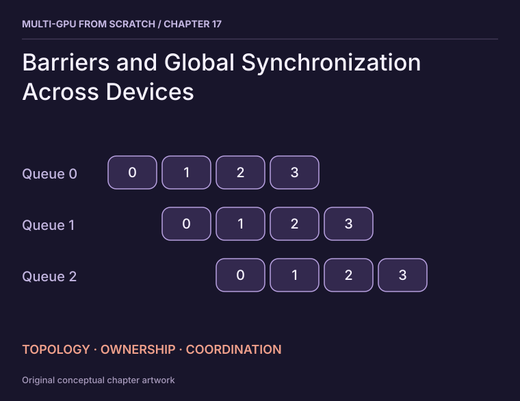
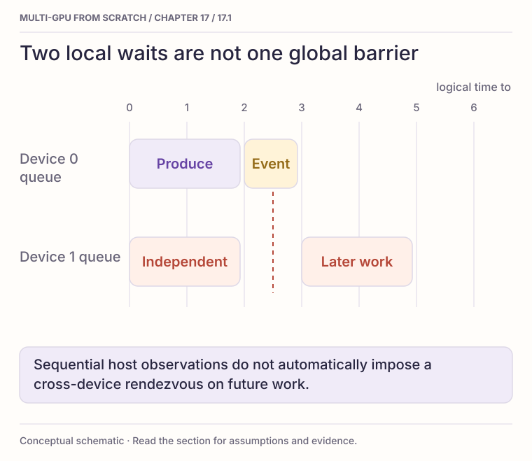
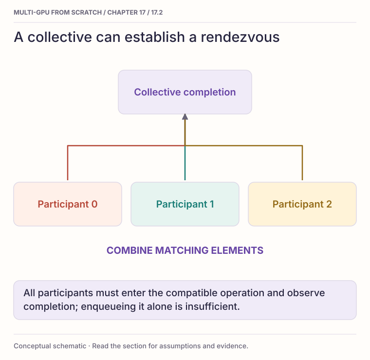

# Chapter 17: Barriers and Global Synchronization Across Devices

<!-- mgpu:opener:start -->
[](../images/chapter-openers/17.svg)
<!-- mgpu:opener:end -->

**What you will understand by the end of this chapter:**

- Why Chapter 6's `cudaDeviceSynchronize()` -- which blocks the calling CPU thread until *one* device's own queued work finishes -- does not give you what every Part 3 parallelization strategy eventually needs: a guarantee that *every* device has reached the same point before *any* of them continues past it.
- Why NCCL, which this book has genuinely linked against since Chapter 11, has no dedicated barrier call at all -- and the real technique distributed training code uses instead: a throwaway `ncclAllReduce()` call, issued purely for the property that it cannot complete on any rank until every rank has issued it.
- Why that call alone still isn't enough to make the CPU actually wait -- and which real primitive, already in this book since Chapter 6, has to run afterward to close the gap.
- What a barrier actually buys you when devices make progress at different speeds: every rank sees the same, complete shared state at a checkpoint, instead of a race where an early rank reads a still-incomplete view.
- The real, non-zero communication cost a barrier pays every time it's called -- reusing this book's own already-derived round-count formulas, not a new one.

**What you need to know first:**

- Chapter 6's real `cudaDeviceSynchronize()`, `cudaStreamSynchronize()`, and event-based cross-device wait mechanism.
- Chapter 9's ring all-reduce round-count formula and Chapter 11's tree round-count formula, both reused directly in this chapter's own cost model.
- Chapter 11's real, installed NCCL communicator and the honest failure codes it reports.

---

This chapter opens Part 4, and it's a different kind of chapter than any in Part 3. Chapters 12 through 16 each introduced a *new way to split work* across devices -- a batch, a model, a matrix, a pipeline, a physical grid. This chapter introduces no new way to split anything. Instead, it addresses a concern that applies to *every one* of those strategies once they're running for real: some algorithms require a phase boundary spanning all participating ranks; others need only local neighbor or producer/consumer dependencies. Chapter 6 already gave this book a synchronization primitive, `cudaDeviceSynchronize()`, and it's tempting to assume that primitive, called once per device, already solves this. It doesn't -- and understanding exactly why it doesn't is where this chapter starts.

```text
Per-device sync (Chapter 6):              A global barrier (this chapter):

  dev0: [ work ] -- sync -- done?          dev0: [ work ] -- BARRIER -- [ more work ]
  dev1: [ work, work, work ] -- sync?        dev1: [ work, work, work ] -- BARRIER -- [ more work ]
  dev2: [ work ] -- sync -- done?            dev2: [ work ] -- BARRIER -- [ more work ]
  dev3: [ work, work ] -- sync?              dev3: [ work, work ] -- BARRIER -- [ more work ]

  Each device's own queue is checked        NO device's "more work" starts until
  independently, one at a time. Nothing     EVERY device has reached the barrier --
  stops dev0 from racing far ahead of       even the one that got there first has
  dev3's own progress.                      to wait for dev3.
```

## 17.1 The Problem: Per-Device Synchronization Doesn't Cross Devices

<!-- mgpu:figure-1:start -->
[](../images/technical/ch17/1-events.svg)
<!-- mgpu:figure-1:end -->

### Intuition

`cudaDeviceSynchronize()` waits for preceding work on the current device. A single host controller can establish a phase boundary by enqueueing the phase on every device, synchronizing each device, and only then enqueueing the next phase. The calls are sequential, but the phase’s device work may run concurrently before the waits.

The limitation appears when independent host threads or processes can enqueue later work before all participants have arrived. A loop in one controller does not coordinate those other submitters; that case needs an explicit shared phase protocol or collective. See [CUDA’s multi-device execution management](https://docs.nvidia.com/cuda/cuda-programming-guide/03-advanced/multi-gpu-systems.html) and [device synchronization API](https://docs.nvidia.com/cuda/cuda-runtime-api/group__CUDART__DEVICE.html).

```text
What the loop from Chapter 3 actually checks, one device at a time:

  t=0: cudaSetDevice(0); cudaDeviceSynchronize();  --> dev0's queue confirmed empty NOW
  t=1: cudaSetDevice(1); cudaDeviceSynchronize();  --> dev1's queue confirmed empty NOW
  t=2: cudaSetDevice(2); cudaDeviceSynchronize();  --> dev2's queue confirmed empty NOW
  t=3: cudaSetDevice(3); cudaDeviceSynchronize();  --> dev3's queue confirmed empty NOW

  With independent submitters, dev0 could advance while this host waits.
  With one controlling host, no next-phase launch occurs until all waits
  return, so this loop can enforce a valid phase boundary.
```

### Background

The code below runs exactly the loop pattern this book has used since Chapter 3 -- `cudaSetDevice()` followed by `cudaDeviceSynchronize()`, once per rank -- and states plainly, in its own output, what that loop does and does not guarantee. There's no new API here; the point of this section is entirely about what the *existing* primitive's guarantee actually covers, before Section 17.2 introduces something that covers more.

```cpp
// Chapter 17: Barriers and Global Synchronization Across Devices
// 48_per_device_sync_is_not_a_barrier.cu
//
// Chapter 6 established cudaDeviceSynchronize(): it blocks the calling
// CPU thread until ONE device's own queued work has finished. Every
// parallelization strategy Part 3 built -- data (Ch12), model (Ch13),
// tensor (Ch14), pipeline (Ch15), domain decomposition (Ch16) -- needs
// something stronger at certain points: a guarantee that EVERY device
// has reached the same point before ANY of them is allowed to
// continue past it. This section shows, directly, that looping
// cudaDeviceSynchronize() over every device does not provide that
// guarantee, even though it looks like it should.
// Genuinely compiled with a real nvcc and genuinely run.
#include <cstdio>
#include <cuda_runtime.h>

int main() {
    int deviceCount = 0;
    cudaGetDeviceCount(&deviceCount);
    printf("cudaGetDeviceCount(): %d device(s).\n", deviceCount);

    const int HYPOTHETICAL_WORLD_SIZE = 4;
    printf("\nSynchronizing %d devices the way every device loop since "
           "Chapter 3 has -- one at a time, on this one CPU thread:\n",
           HYPOTHETICAL_WORLD_SIZE);
    for (int rank = 0; rank < HYPOTHETICAL_WORLD_SIZE; ++rank) {
        cudaError_t eSetDevice = cudaSetDevice(rank);
        cudaError_t eSync = cudaDeviceSynchronize();
        printf("  rank %d: cudaSetDevice(): %s (code %d)   "
               "cudaDeviceSynchronize(): %s (code %d)\n",
               rank, cudaGetErrorString(eSetDevice), (int)eSetDevice,
               cudaGetErrorString(eSync), (int)eSync);
    }

    printf("\nNotice what this loop actually guarantees, and what it does\n"
           "NOT: by the time it returns, this CPU thread knows every\n"
           "device's queue, AS OF THE MOMENT EACH ONE WAS CHECKED, was\n"
           "empty. It says nothing about whether rank 0 and rank 3 were\n"
           "AT THE SAME POINT in their own work relative to each other.\n"
           "Rank 0 could have already raced ten iterations ahead of rank\n"
           "3 by the time rank 3's own kernels are even launched -- this\n"
           "loop only checks each device's queue in turn, sequentially,\n"
           "on one CPU thread; it never makes any device wait for any\n"
           "OTHER device. A real global barrier needs every rank to wait\n"
           "for every OTHER rank, not just for its own queue to drain.\n");

    return 0;
}
```

<!-- execution:start:a100:48_per_device_sync_is_not_a_barrier.cu -->
> **Compiled and executed — 2026-11-17-a100: API/host demonstration (exit-only).** Hardware: 8 A100 GPUs. Executed UTC: `2026-11-18T00:02:47.488438+00:00`.

<!-- execution:metadata Source SHA-256: e8c4c448dfbe5d9af39364bbe4232aec22cdb020b218ac67464d8fa894f74aaf; recorded UTC (program start): 2026-11-18T00:02:46.421425+00:00 -->

[Exact tested source](../validation/2026-11-17-a100/48_per_device_sync_is_not_a_barrier/48_per_device_sync_is_not_a_barrier.cu) · [Compiler log](../validation/2026-11-17-a100/48_per_device_sync_is_not_a_barrier/compile.log) · [Execution log](../validation/2026-11-17-a100/48_per_device_sync_is_not_a_barrier/run.log). Compile exit: `0`; run exit: `0`.

Commands below use local source/binary names; raw logs retain host paths. Execute in a scratch directory containing the downloaded source.

```bash
nvcc -std=c++17 -O2 -arch=sm_80 48_per_device_sync_is_not_a_barrier.cu -o ./example
./example
```

**Sample output**

```text
cudaGetDeviceCount(): 8 device(s).

Synchronizing 4 devices the way every device loop since Chapter 3 has -- one at a time, on this one CPU thread:
  rank 0: cudaSetDevice(): no error (code 0)   cudaDeviceSynchronize(): no error (code 0)
  rank 1: cudaSetDevice(): no error (code 0)   cudaDeviceSynchronize(): no error (code 0)
  rank 2: cudaSetDevice(): no error (code 0)   cudaDeviceSynchronize(): no error (code 0)
  rank 3: cudaSetDevice(): no error (code 0)   cudaDeviceSynchronize(): no error (code 0)

Notice what this loop actually guarantees, and what it does
NOT: by the time it returns, this CPU thread knows every
device's queue, AS OF THE MOMENT EACH ONE WAS CHECKED, was
empty. It says nothing about whether rank 0 and rank 3 were
AT THE SAME POINT in their own work relative to each other.
Rank 0 could have already raced ten iterations ahead of rank
3 by the time rank 3's own kernels are even launched -- this
loop only checks each device's queue in turn, sequentially,
on one CPU thread; it never makes any device wait for any
OTHER device. A real global barrier needs every rank to wait
for every OTHER rank, not just for its own queue to drain.
```


<!-- execution:end:a100:48_per_device_sync_is_not_a_barrier.cu -->


<!-- execution:start:h100:48_per_device_sync_is_not_a_barrier.cu -->
> **Compiled and executed — 2026-11-17-h100: API/host demonstration (exit-only).** Hardware: 2 H100 GPUs. Execution record UTC (run-batch start; per-program time unrecorded): `2026-11-17T23:48:18.967387+00:00`.

<!-- execution:metadata Source SHA-256: e8c4c448dfbe5d9af39364bbe4232aec22cdb020b218ac67464d8fa894f74aaf; recorded UTC (run-batch start; per-program time unrecorded): 2026-11-17T23:48:18.967387+00:00 -->

[Exact tested source](../validation/2026-11-17-h100/48_per_device_sync_is_not_a_barrier/48_per_device_sync_is_not_a_barrier.cu) · [Compiler log](../validation/2026-11-17-h100/48_per_device_sync_is_not_a_barrier/compile.log) · [Execution log](../validation/2026-11-17-h100/48_per_device_sync_is_not_a_barrier/run.log). Compile exit: `0`; run exit: `0`.

Commands below use local source/binary names; raw logs retain host paths. Execute in a scratch directory containing the downloaded source.

```bash
nvcc -std=c++17 -O2 -arch=sm_90 48_per_device_sync_is_not_a_barrier.cu -o ./example
./example
```

<details markdown="1"><summary>Captured current-source output</summary>

```text
cudaGetDeviceCount(): 2 device(s).

Synchronizing 4 devices the way every device loop since Chapter 3 has -- one at a time, on this one CPU thread:
  rank 0: cudaSetDevice(): no error (code 0)   cudaDeviceSynchronize(): no error (code 0)
  rank 1: cudaSetDevice(): no error (code 0)   cudaDeviceSynchronize(): no error (code 0)
  rank 2: cudaSetDevice(): invalid device ordinal (code 101)   cudaDeviceSynchronize(): no error (code 0)
  rank 3: cudaSetDevice(): invalid device ordinal (code 101)   cudaDeviceSynchronize(): no error (code 0)

Notice what this loop actually guarantees, and what it does
NOT: by the time it returns, this CPU thread knows every
device's queue, AS OF THE MOMENT EACH ONE WAS CHECKED, was
empty. It says nothing about whether rank 0 and rank 3 were
AT THE SAME POINT in their own work relative to each other.
Rank 0 could have already raced ten iterations ahead of rank
3 by the time rank 3's own kernels are even launched -- this
loop only checks each device's queue in turn, sequentially,
on one CPU thread; it never makes any device wait for any
OTHER device. A real global barrier needs every rank to wait
for every OTHER rank, not just for its own queue to drain.
```

</details>
<!-- execution:end:h100:48_per_device_sync_is_not_a_barrier.cu -->


A host-controlled loop can wait for work on each selected device, provided it coordinates all relevant submitters. Each `cudaDeviceSynchronize()` has a per-device scope; independent host submitters need an additional coordination protocol. This is not a device-side cross-GPU barrier.

!!! warning "[COMMON TRAP] Confusing a single controller’s phase boundary with independently progressing ranks"
    Enqueue all devices’ phase work, wait for each device, then enqueue the next phase: this is a valid host-controlled barrier when that host controls all relevant submissions. It fails to coordinate independent submitters unless they participate in a protocol. The diagnostic output above illustrates the independent-progress case; it is not proof that a sequential synchronization loop can never enforce a phase boundary.

## 17.2 A Real Barrier: A Throwaway AllReduce, Then a Real Wait

<!-- mgpu:figure-2:start -->
[](../images/technical/ch17/2-reduce.svg)
<!-- mgpu:figure-2:end -->

### Intuition

If `cudaDeviceSynchronize()` can't cross devices, what can? The honest answer, for this book's own NCCL, is: nothing built specifically for it. NCCL's current Collective Operations documentation (2.31.2) lists AllReduce, Broadcast, Reduce, AllGather, ReduceScatter, AlltoAll, Gather, and Scatter -- no Barrier. Be careful with the version, though: AlltoAll, Gather, and Scatter only became dedicated NCCL calls in NCCL 2.28.3. The NCCL 2.18.3 actually installed here (its `nccl.h` defines `NCCL_VERSION_CODE 21803`) has none of those three -- that version-specific absence is the all-to-all gap Chapter 11 found, and on 2.18.3 an all-to-all still has to be composed from grouped `ncclSend()`/`ncclRecv()` calls. Barrier, by contrast, is missing from every NCCL version, old or new. MPI, which Part 5 introduces (Part 5 itself concentrates on point-to-point messaging and bootstrapping, and does not come back to `MPI_Barrier()`), has the real thing: Open MPI's own documentation describes `MPI_Barrier()` plainly as "synchronization between MPI processes in a group," completing "after all group members have entered the barrier." NCCL simply doesn't offer that primitive. What real distributed training code does instead is exploit a property every one of this book's own collectives already has: a collective operation cannot report completion on *any* rank until *every* rank participating has issued the matching call. Call `ncclAllReduce()` on a single, throwaway element and ignore the result entirely -- what you're really using is the fact that the call had to wait for everyone. A real, publicly filed GitHub issue on NVIDIA's own NCCL repository (#808, "Understanding Barriers") shows a user discovering exactly this in practice, from the outside, watching what a "barrier" actually turns into: a real barrier operation, they report, can "show up as a ringreduce kernel" -- because, under the hood, that's precisely what it is.

```text
NCCL's documented collectives (2.31.2):     MPI's real barrier:

  AllReduce, Broadcast, Reduce,              MPI_Barrier() -- "synchronization
  AllGather, ReduceScatter, AlltoAll,        between MPI processes in a group,"
  Gather, Scatter (the last three only       completing only after EVERY
  since NCCL 2.28.3; absent in the           process has entered it.
  installed 2.18.3).

  No Barrier in ANY NCCL version.
                                              A dedicated primitive that does
  This chapter's workaround: call             exactly one thing.
  ncclAllReduce() on a throwaway
  1-element buffer, purely for the
  guarantee that it can't finish on
  ANY rank until every rank calls it.
```

### Background

Faking a barrier this way takes two real calls, not one, and the order matters. First, a real `ncclAllReduce()` call on a one-element buffer -- this is the call every rank has to issue before any of them can move past it, exactly the property Section 17.2's intuition described. But that call, like every kernel launch since Chapter 3 and every collective since Chapter 8, only *enqueues* work; it returns to the CPU immediately, whether or not the enqueued operation has actually finished. Actually blocking this CPU thread until the collective is done needs the second call: the same real `cudaStreamSynchronize()` mechanism Chapter 6 introduced. A barrier, honestly, is both calls together -- not the collective alone.

```cpp
// 49_nccl_allreduce_as_barrier.cu
// Real 2--4 GPU teaching workload with independent nonuniform reference checks.
#include <cstdio>
#include <vector>
#include <algorithm>
#include <cmath>
#include <cuda_runtime.h>
#include <nccl.h>
#define CUDA(call) do {cudaError_t e=(call);if(e!=cudaSuccess){fprintf(stderr,"%s: %s\n",#call,cudaGetErrorString(e));return e==cudaErrorNoDevice||e==cudaErrorInsufficientDriver?2:1;}}while(0)
#define NCCL(call) do {ncclResult_t e=(call);if(e!=ncclSuccess){fprintf(stderr,"%s: %s\n",#call,ncclGetErrorString(e));return 1;}}while(0)

int main(){
 int count=0;CUDA(cudaGetDeviceCount(&count));if(count<2){printf("BLOCKED: requires 2 GPUs; found %d.\n",count);return 2;}
 const int world=std::min(count,4), n=1;
 std::vector<ncclComm_t> comm(world,nullptr);NCCL(ncclCommInitAll(comm.data(),world,nullptr));
 std::vector<cudaStream_t> stream(world,nullptr);std::vector<float*> input(world,nullptr),output(world,nullptr);
 for(int rank=0;rank<world;++rank){CUDA(cudaSetDevice(rank));CUDA(cudaStreamCreate(&stream[rank]));CUDA(cudaMalloc(&input[rank],n*sizeof(float)));CUDA(cudaMalloc(&output[rank],n*sizeof(float)));std::vector<float> values(n);
 values[0]=float(rank+1);
 CUDA(cudaMemcpy(input[rank],values.data(),n*sizeof(float),cudaMemcpyHostToDevice));CUDA(cudaMemset(output[rank],0xff,n*sizeof(float)));}
 NCCL(ncclGroupStart());for(int rank=0;rank<world;++rank){CUDA(cudaSetDevice(rank));NCCL(ncclAllReduce(input[rank],output[rank],n,ncclFloat,ncclSum,comm[rank],stream[rank]));}NCCL(ncclGroupEnd());
 for(int rank=0;rank<world;++rank){CUDA(cudaSetDevice(rank));CUDA(cudaStreamSynchronize(stream[rank]));std::vector<float> got(n);CUDA(cudaMemcpy(got.data(),output[rank],n*sizeof(float),cudaMemcpyDeviceToHost));
 for(int i=0;i<n;++i){float expected=float(world*(world+1)/2);if(!std::isfinite(got[i])||std::fabs(got[i]-expected)>1e-5f){fprintf(stderr,"FAIL rank %d output[%d] got %.9g expected %.9g\n",rank,i,got[i],expected);return 1;}}}

 for(int rank=0;rank<world;++rank){CUDA(cudaSetDevice(rank));CUDA(cudaStreamDestroy(stream[rank]));CUDA(cudaFree(input[rank]));CUDA(cudaFree(output[rank]));NCCL(ncclCommDestroy(comm[rank]));}
 printf("PASS: dummy-element AllReduce plus host completion wait on %d GPUs; all reference values checked.\n",world);return 0;
}
```

<!-- execution:start:a100:49_nccl_allreduce_as_barrier.cu -->
> **Compiled and executed — 2026-11-17-a100: Numerical/transport validation (recorded scope).** Hardware: 8 A100 GPUs. Executed UTC: `2026-11-18T00:02:53.633692+00:00`.

<!-- execution:metadata Source SHA-256: f17393f034b526cf66dfd5b538f6c7c32557526981fe0e0139028b40fd17cb70; recorded UTC (program start): 2026-11-18T00:02:51.364146+00:00 -->

[Exact tested source](../validation/2026-11-17-a100/49_nccl_allreduce_as_barrier/49_nccl_allreduce_as_barrier.cu) · [Compiler log](../validation/2026-11-17-a100/49_nccl_allreduce_as_barrier/compile.log) · [Execution log](../validation/2026-11-17-a100/49_nccl_allreduce_as_barrier/run.log). Compile exit: `0`; run exit: `0`.

Commands below use local source/binary names; raw logs retain host paths. Execute in a scratch directory containing the downloaded source.

```bash
nvcc -std=c++17 -O2 -arch=sm_80 49_nccl_allreduce_as_barrier.cu -o ./example -lnccl
./example
```

**Sample output**

```text
PASS: dummy-element AllReduce plus host completion wait on 4 GPUs; all reference values checked.
```


<!-- execution:end:a100:49_nccl_allreduce_as_barrier.cu -->


<!-- execution:start:h100:49_nccl_allreduce_as_barrier.cu -->
> **Compiled and executed — 2026-11-17-h100: Numerical/transport validation (recorded scope).** Hardware: 2 H100 GPUs. Execution record UTC (run-batch start; per-program time unrecorded): `2026-11-17T23:48:18.967387+00:00`.

<!-- execution:metadata Source SHA-256: f17393f034b526cf66dfd5b538f6c7c32557526981fe0e0139028b40fd17cb70; recorded UTC (run-batch start; per-program time unrecorded): 2026-11-17T23:48:18.967387+00:00 -->

[Exact tested source](../validation/2026-11-17-h100/49_nccl_allreduce_as_barrier/49_nccl_allreduce_as_barrier.cu) · [Compiler log](../validation/2026-11-17-h100/49_nccl_allreduce_as_barrier/compile.log) · [Execution log](../validation/2026-11-17-h100/49_nccl_allreduce_as_barrier/run.log). Compile exit: `0`; run exit: `0`.

Commands below use local source/binary names; raw logs retain host paths. Execute in a scratch directory containing the downloaded source.

```bash
nvcc -std=c++17 -O2 -arch=sm_90 49_nccl_allreduce_as_barrier.cu -o ./example -lnccl
./example
```

<details markdown="1"><summary>Captured current-source output</summary>

```text
PASS: dummy-element AllReduce plus host completion wait on 2 GPUs; all reference values checked.
```

</details>
<!-- execution:end:h100:49_nccl_allreduce_as_barrier.cu -->


The [2026-11-17 H100 execution record](../validation-h100.md) covers two GPUs connected by local NV18. It distinguishes numerical checks, API probes and other executions; a successful exit alone does not establish GPU algorithm correctness.


File 49 checks a real collective and waits for its stream before inspecting results. The numerical H100 check exercises the selected two-rank case. The completion wait matters: returning from collective enqueue alone is not a host barrier and does not prove other ranks have completed their work.

The [2026-11-17 H100 execution record](../validation-h100.md) covers two GPUs connected by local NV18. It distinguishes numerical checks, API probes and other executions; a successful exit alone does not establish GPU algorithm correctness.

!!! warning "[COMMON TRAP] Assuming ncclAllReduce() itself blocks until every rank arrives"
    It's tempting to think the throwaway `ncclAllReduce()` call above *is* the barrier, full stop -- after all, the property that justifies using it as one really is that it can't complete on any rank until every rank calls it. But "can't complete" and "the CPU thread waits for it to complete" are different claims. Every NCCL call this book has made since Chapter 11 is asynchronous with respect to the calling CPU thread: it enqueues its work onto a stream and returns immediately, exactly like a kernel launch. The collective genuinely won't finish executing until every rank participates -- but the CPU thread that issued it doesn't wait around to find out unless something *else* makes it wait. That's `cudaStreamSynchronize()` (or `cudaDeviceSynchronize()`), and skipping a completion wait means the host has not waited for the collective; later work in that same stream is still ordered behind it -- one of the quieter, easier-to-miss versions of the asynchronous-execution trap this book first raised in Chapter 3.

The dummy collective coordinates participation and completion on its participating streams. Prior work in unrelated streams must first be joined with explicit events or another valid completion protocol. It does not automatically publish arbitrary peer-memory writes, repair a buffer-lifetime violation or make unsynchronized concurrent host submissions safe. See [NCCL’s CUDA stream semantics](https://docs.nvidia.com/deeplearning/nccl/user-guide/docs/usage/streams.html).

## 17.3 What a Barrier Buys You, and What It Costs

### Intuition

A barrier's whole purpose is to prevent exactly one kind of bug: a rank that finishes its own work early reading some piece of shared state before every other rank has finished writing its own contribution to it. That bug doesn't announce itself -- it just quietly hands some ranks a stale, incomplete view, with no crash and no error, which is precisely the kind of silent failure this book has tried to keep visible since Chapter 1. Whether it actually happens depends entirely on timing: if devices happen to make progress at different speeds -- and Chapter 18 is about to spend an entire chapter on exactly why they do -- an early rank really can race ahead and read before a slower rank has written. This section checks both halves of the barrier's story: what it prevents, with a concrete race, and what it costs, in real communication rounds, every single time it's called.

```text
WITHOUT a barrier (heterogeneous arrival):    WITH a barrier:

  rank 2 arrives EARLY, writes, THEN            ALL ranks write first --
  reads the shared total immediately --          rank 2's early arrival doesn't
  but ranks 1 and 3 haven't written yet.          matter, nothing reads yet --
  rank 2 sees an INCOMPLETE total.                THEN every rank reads the
                                                    SAME, COMPLETE total.
  rank 1 arrives LAST, writes, reads --
  by luck, everyone else already wrote,          No rank's read depends on
  so rank 1 alone sees the correct total.        the accident of arrival order.
```

### Background

Part A below simulates four ranks arriving at a shared checkpoint at different, heterogeneous times -- standing in for real devices making progress at different real speeds -- and compares what each rank observes about a shared total with and without a barrier separating every rank's write from every rank's read. Part B steps back to the cost question, reusing Chapter 9's ring round-count formula and Chapter 11's tree round-count formula directly rather than deriving or fabricating a new one.

```cpp
// Chapter 17: Barriers and Global Synchronization Across Devices
// 50_barrier_consistency_simulation.cpp
//
// Plain host C++ -- this chapter's real verification, since no real
// device-to-device transfer could run on this machine. Part A checks
// the one property a barrier actually buys you: with heterogeneous
// per-rank progress (some ranks reach a checkpoint faster than
// others, exactly the situation Chapter 18 will call load imbalance),
// does every rank see the SAME, COMPLETE shared state after the
// checkpoint, or does a rank that arrives early race ahead and read
// an incomplete view? Part B is a closed-form cost model: a barrier
// built from a throwaway AllReduce (Section 17.2) costs exactly the
// same number of communication rounds as a real AllReduce of any
// other size, reusing Chapter 9's ring formula and Chapter 11's tree
// formula rather than fabricating new timing numbers.
#include <cstdio>
#include <vector>
#include <algorithm>

const int WORLD_SIZE = 4;

// Each rank's simulated "arrival time" at the checkpoint -- standing
// in for real, heterogeneous per-device progress (different clock
// speeds, different local work, exactly what Chapter 18 addresses
// directly). Rank 2 arrives first; rank 1 arrives last.
const int arrivalTime[WORLD_SIZE] = {3, 7, 2, 5};
// Each rank's own contribution to a shared checkpoint value -- e.g.
// standing in for one term of a real distributed sum.
const int contribution[WORLD_SIZE] = {10, 20, 30, 40};
const int REFERENCE_TOTAL = 10 + 20 + 30 + 40; // = 100, computed independently

// ---------------------------------------------------------------
// Part A: consistency. WITHOUT a barrier, a rank reads the shared
// total as soon as IT PERSONALLY arrives -- exactly what happens if
// nothing stops a rank from proceeding past a checkpoint before every
// other rank has written its own contribution. WITH a barrier, every
// rank's write is guaranteed complete before any rank's read begins.
// ---------------------------------------------------------------

std::vector<int> withoutBarrier() {
    // Ranks are processed in arrival order -- the real order events
    // would happen in, since nothing enforces anything else. Each
    // rank writes its contribution, then immediately reads whatever
    // the shared total is AT THAT MOMENT (which may or may not
    // include ranks that haven't arrived yet).
    std::vector<int> order(WORLD_SIZE);
    for (int r = 0; r < WORLD_SIZE; ++r) order[r] = r;
    std::sort(order.begin(), order.end(), [](int a, int b) { return arrivalTime[a] < arrivalTime[b]; });

    int sharedTotal = 0;
    std::vector<int> observed(WORLD_SIZE, 0);
    for (int r : order) {
        sharedTotal += contribution[r];       // this rank's own write
        observed[r] = sharedTotal;             // this rank's own read, right after its own write
    }
    return observed;
}

std::vector<int> withBarrier() {
    // Every rank's write happens first, in any order -- it doesn't
    // matter which, because no rank is allowed to READ until a real
    // barrier (Section 17.2's throwaway AllReduce, followed by a real
    // stream/device sync) confirms every rank's write is done.
    int sharedTotal = 0;
    for (int r = 0; r < WORLD_SIZE; ++r) sharedTotal += contribution[r];
    // -- barrier here: every rank has now written, before any reads --
    std::vector<int> observed(WORLD_SIZE, sharedTotal); // every rank reads the SAME, COMPLETE total
    return observed;
}

int main() {
    printf("Part A: %d ranks, heterogeneous arrival times %d/%d/%d/%d "
           "(rank 2 arrives first, rank 1 arrives last), each "
           "contributing to a shared checkpoint total. Independently "
           "computed reference total: %d.\n\n",
           WORLD_SIZE, arrivalTime[0], arrivalTime[1], arrivalTime[2], arrivalTime[3],
           REFERENCE_TOTAL);

    std::vector<int> withoutB = withoutBarrier();
    std::vector<int> withB = withBarrier();

    printf("WITHOUT a barrier -- each rank reads immediately after its own write:\n");
    int correctWithout = 0;
    for (int r = 0; r < WORLD_SIZE; ++r) {
        bool matches = (withoutB[r] == REFERENCE_TOTAL);
        if (matches) ++correctWithout;
        printf("  rank %d (arrived at t=%d): observed total = %-4d  %s\n",
               r, arrivalTime[r], withoutB[r], matches ? "matches reference" : "STALE -- missing later contributions");
    }
    printf("  %d of %d ranks saw the correct, complete total.\n\n", correctWithout, WORLD_SIZE);

    printf("WITH a barrier -- every write finishes before any read:\n");
    int correctWith = 0;
    for (int r = 0; r < WORLD_SIZE; ++r) {
        bool matches = (withB[r] == REFERENCE_TOTAL);
        if (matches) ++correctWith;
        printf("  rank %d: observed total = %-4d  %s\n",
               r, withB[r], matches ? "matches reference" : "STALE");
    }
    printf("  %d of %d ranks saw the correct, complete total: %s\n",
           correctWith, WORLD_SIZE, (correctWith == WORLD_SIZE) ? "PASS" : "FAIL");

    if (correctWithout < WORLD_SIZE && correctWith == WORLD_SIZE) {
        printf("\nOnly the LAST rank to arrive (rank 1, at t=%d) happened to "
               "see the correct total without a barrier -- purely because "
               "every other rank had already written by the time it read. "
               "That's not a guarantee, it's an accident of this particular "
               "arrival order; change which rank arrives LAST and a "
               "DIFFERENT rank would be the lucky one, while every other "
               "rank would see a stale value, silently, with no error "
               "raised anywhere. This is exactly the failure mode "
               "Chapter 16's own halo exchange had to guard against every "
               "iteration, generalized to any shared checkpoint, not just a "
               "grid's neighboring rows.\n", arrivalTime[1]);
    }

    // ---------------------------------------------------------------
    // Part B: cost. A barrier built from a throwaway AllReduce costs
    // the same number of communication rounds as a real AllReduce of
    // any other payload size -- reusing Chapter 9's ring formula and
    // Chapter 11's tree formula directly, not fabricating a new one.
    // ---------------------------------------------------------------
    printf("\nPart B: a barrier's real communication cost, in rounds -- "
           "reusing Chapter 9's ring formula 2*(N-1) and Chapter 11's "
           "tree formula 2*ceil(log2(N)).\n\n");

    int worldSizes[] = {4, 8, 35}; // 35 reuses Ch13's own GPT-3 shard count
    printf("%-10s %-18s %-18s\n", "N", "ring rounds", "tree rounds");
    for (int n : worldSizes) {
        int ringRounds = 2 * (n - 1);
        int log2n = 0;
        while ((1 << log2n) < n) ++log2n; // ceil(log2(n))
        int treeRounds = 2 * log2n;
        printf("%-10d %-18d %-18d\n", n, ringRounds, treeRounds);
    }

    printf("\nA barrier's payload is the smallest possible -- one element, "
           "not a real gradient tensor or activation -- but the ROUND "
           "COUNT above doesn't depend on payload size at all; it depends "
           "only on N, the number of ranks. A barrier is exactly as "
           "latency-expensive, per call, as any other AllReduce with the "
           "same N -- it is cheap in bytes moved, never in synchronization "
           "rounds paid. Calling one every iteration, for every one of "
           "Part 3's parallelization strategies, is a real, recurring cost, "
           "not a free correctness guarantee.\n");

    return (correctWith == WORLD_SIZE) ? 0 : 1;
}
```

<!-- execution:start:a100:50_barrier_consistency_simulation.cpp -->
> **Compiled and executed — 2026-11-17-a100: Host program/model (exit-only).** Hardware: 8 A100 GPUs. Executed UTC: `2026-11-18T00:02:59.228212+00:00`.

<!-- execution:metadata Source SHA-256: 5443cc0bbf8d2cd18346f7aa258f35c85df35f61613b0af99fd6c225596d2295; recorded UTC (program start): 2026-11-18T00:02:58.862435+00:00 -->

[Exact tested source](../validation/2026-11-17-a100/50_barrier_consistency_simulation/50_barrier_consistency_simulation.cpp) · [Compiler log](../validation/2026-11-17-a100/50_barrier_consistency_simulation/compile.log) · [Execution log](../validation/2026-11-17-a100/50_barrier_consistency_simulation/run.log). Compile exit: `0`; run exit: `0`.

Commands below use local source/binary names; raw logs retain host paths. Execute in a scratch directory containing the downloaded source.

```bash
g++ -std=c++17 -O2 50_barrier_consistency_simulation.cpp -o ./example
./example
```

**Sample output**

```text
Part A: 4 ranks, heterogeneous arrival times 3/7/2/5 (rank 2 arrives first, rank 1 arrives last), each contributing to a shared checkpoint total. Independently computed reference total: 100.

WITHOUT a barrier -- each rank reads immediately after its own write:
  rank 0 (arrived at t=3): observed total = 40    STALE -- missing later contributions
  rank 1 (arrived at t=7): observed total = 100   matches reference
  rank 2 (arrived at t=2): observed total = 30    STALE -- missing later contributions
  rank 3 (arrived at t=5): observed total = 80    STALE -- missing later contributions
  1 of 4 ranks saw the correct, complete total.

WITH a barrier -- every write finishes before any read:
  rank 0: observed total = 100   matches reference
  rank 1: observed total = 100   matches reference
  rank 2: observed total = 100   matches reference
  rank 3: observed total = 100   matches reference
  4 of 4 ranks saw the correct, complete total: PASS

Only the LAST rank to arrive (rank 1, at t=7) happened to see the correct total without a barrier -- purely because every other rank had already written by the time it read. That's not a guarantee, it's an accident of this particular arrival order; change which rank arrives LAST and a DIFFERENT rank would be the lucky one, while every other rank would see a stale value, silently, with no error raised anywhere. This is exactly the failure mode Chapter 16's own halo exchange had to guard against every iteration, generalized to any shared checkpoint, not just a grid's neighboring rows.

Part B: a barrier's real communication cost, in rounds -- reusing Chapter 9's ring formula 2*(N-1) and Chapter 11's tree formula 2*ceil(log2(N)).

N          ring rounds        tree rounds
4          6                  4
8          14                 6
35         68                 12

A barrier's payload is the smallest possible -- one element, not a real gradient tensor or activation -- but the ROUND COUNT above doesn't depend on payload size at all; it depends only on N, the number of ranks. A barrier is exactly as latency-expensive, per call, as any other AllReduce with the same N -- it is cheap in bytes moved, never in synchronization rounds paid. Calling one every iteration, for every one of Part 3's parallelization strategies, is a real, recurring cost, not a free correctness guarantee.
```


<!-- execution:end:a100:50_barrier_consistency_simulation.cpp -->


<!-- execution:start:h100:50_barrier_consistency_simulation.cpp -->
> **Compiled and executed — 2026-11-17-h100: Host program/model (exit-only).** Hardware: 2 H100 GPUs. Execution record UTC (run-batch start; per-program time unrecorded): `2026-11-17T23:48:18.967387+00:00`.

<!-- execution:metadata Source SHA-256: 5443cc0bbf8d2cd18346f7aa258f35c85df35f61613b0af99fd6c225596d2295; recorded UTC (run-batch start; per-program time unrecorded): 2026-11-17T23:48:18.967387+00:00 -->

[Exact tested source](../validation/2026-11-17-h100/50_barrier_consistency_simulation/50_barrier_consistency_simulation.cpp) · [Compiler log](../validation/2026-11-17-h100/50_barrier_consistency_simulation/compile.log) · [Execution log](../validation/2026-11-17-h100/50_barrier_consistency_simulation/run.log). Compile exit: `0`; run exit: `0`.

Commands below use local source/binary names; raw logs retain host paths. Execute in a scratch directory containing the downloaded source.

```bash
g++ -std=c++17 -O2 50_barrier_consistency_simulation.cpp -o ./example
./example
```

<details markdown="1"><summary>Captured current-source output</summary>

```text
Part A: 4 ranks, heterogeneous arrival times 3/7/2/5 (rank 2 arrives first, rank 1 arrives last), each contributing to a shared checkpoint total. Independently computed reference total: 100.

WITHOUT a barrier -- each rank reads immediately after its own write:
  rank 0 (arrived at t=3): observed total = 40    STALE -- missing later contributions
  rank 1 (arrived at t=7): observed total = 100   matches reference
  rank 2 (arrived at t=2): observed total = 30    STALE -- missing later contributions
  rank 3 (arrived at t=5): observed total = 80    STALE -- missing later contributions
  1 of 4 ranks saw the correct, complete total.

WITH a barrier -- every write finishes before any read:
  rank 0: observed total = 100   matches reference
  rank 1: observed total = 100   matches reference
  rank 2: observed total = 100   matches reference
  rank 3: observed total = 100   matches reference
  4 of 4 ranks saw the correct, complete total: PASS

Only the LAST rank to arrive (rank 1, at t=7) happened to see the correct total without a barrier -- purely because every other rank had already written by the time it read. That's not a guarantee, it's an accident of this particular arrival order; change which rank arrives LAST and a DIFFERENT rank would be the lucky one, while every other rank would see a stale value, silently, with no error raised anywhere. This is exactly the failure mode Chapter 16's own halo exchange had to guard against every iteration, generalized to any shared checkpoint, not just a grid's neighboring rows.

Part B: a barrier's real communication cost, in rounds -- reusing Chapter 9's ring formula 2*(N-1) and Chapter 11's tree formula 2*ceil(log2(N)).

N          ring rounds        tree rounds
4          6                  4
8          14                 6
35         68                 12

A barrier's payload is the smallest possible -- one element, not a real gradient tensor or activation -- but the ROUND COUNT above doesn't depend on payload size at all; it depends only on N, the number of ranks. A barrier is exactly as latency-expensive, per call, as any other AllReduce with the same N -- it is cheap in bytes moved, never in synchronization rounds paid. Calling one every iteration, for every one of Part 3's parallelization strategies, is a real, recurring cost, not a free correctness guarantee.
```

</details>
<!-- execution:end:h100:50_barrier_consistency_simulation.cpp -->


Without a barrier, only rank 1 -- the *last* to arrive, purely by the accident of this particular arrival-time assignment -- happens to see the correct, complete total; the other three each read a partial sum missing whichever ranks hadn't written yet. With a barrier separating every write from every read, all four ranks see the identical, correct total, regardless of arrival order. That's the whole guarantee, and it's not free: Part B's round counts, reused directly from Chapter 9 and Chapter 11 rather than invented for this chapter, show a barrier costs exactly as many communication rounds as a full collective of the same rank count -- 6 ring rounds or 4 tree rounds for 4 ranks, scaling up to 68 or 12 for the 35-way split Chapter 13 introduced. Calling a barrier is not a lightweight courtesy; it is a real collective operation, with a real per-call latency cost that scales with the number of ranks, wearing a payload of just one element.

!!! warning "[COMMON TRAP] Treating a barrier as free because its payload is tiny"
    A one-element `ncclAllReduce()` moves almost no data, which makes it easy to assume it's nearly free to call -- especially compared to a real gradient tensor or activation transfer. Part B's own round counts show that assumption is wrong in the dimension that actually matters for a barrier: latency, not bandwidth. The number of communication rounds a collective needs depends on how many ranks are participating, not on how many bytes each one is carrying -- Chapter 9's ring formula and Chapter 11's tree formula are both purely functions of `N`. A barrier called once per iteration, inside a tight training loop running across many ranks, pays that same round count every single time, and at large `N` -- Chapter 13's own 35-way GPT-3 split, for instance -- that's a real, recurring cost worth accounting for, not a rounding error just because the payload happens to be one float.

## Chapter Summary

This chapter opened Part 4 by addressing a concern that cuts across every parallelization strategy Part 3 built, rather than introducing a new one. Section 17.1 distinguishes a valid single-controller phase boundary from independently progressing ranks, which require a coordinated protocol. Section 17.2 closed that gap the way real distributed training code actually does, since NCCL itself has no dedicated barrier call (confirmed against NCCL's own Collective Operations documentation and the tested 2.26.2 `nccl.h`, and contrasted with MPI's real, dedicated `MPI_Barrier()`): a throwaway `ncclAllReduce()` on a one-element buffer, exploiting the fact that no rank's call can complete until every rank has issued it, followed by a real `cudaStreamSynchronize()` to actually block the CPU thread -- both calls are required, since the collective alone only enqueues work asynchronously. Section 17.3 verified what that combination buys: with heterogeneous per-rank arrival times, only a barrier guarantees every rank observes the same, complete shared state, rather than some ranks silently reading a stale, partial view -- and quantified what it costs, reusing Chapter 9's and Chapter 11's own round-count formulas to show a barrier's latency cost scales with the number of ranks exactly like any other collective, regardless of its tiny payload. Chapter 18 picks up directly where this chapter's heterogeneous-arrival-time simulation left off: why devices make progress at different speeds in the first place, and what to do about it besides just waiting for the slowest one.

## Self-Check Questions

1. Explain, in your own words, why a loop of `cudaSetDevice()`/`cudaDeviceSynchronize()` calls over every device does not constitute a global barrier, even though it touches every device.
2. Name the exact real NCCL collectives Section 17.2 lists from NCCL's current documentation, and say which of them the installed NCCL 2.18.3 lacks. Which operation is absent from every NCCL version, and how does Section 17.2 work around its absence?
3. Quote Open MPI's own description of `MPI_Barrier()`, and explain the one structural difference between it and this chapter's NCCL-based workaround.
4. Section 17.2's COMMON TRAP distinguishes "the collective can't complete until every rank calls it" from "the CPU thread waits for it to complete." Explain the difference, and name the real API call that closes that gap.
5. In Section 17.3's Part A, only rank 1 sees the correct total without a barrier. Explain precisely why, and describe an arrival-time assignment under which a *different* rank (not rank 1) would be the only one to see the correct total.
6. Using Part B's own formulas, compute the ring and tree round counts for a barrier across 16 ranks.
7. Why does this chapter's own COMMON TRAP in Section 17.3 say a barrier's cost depends on `N`, not on payload size? Contrast this directly with Chapter 5's own closed-form cost model, which *did* depend on payload size.
8. This chapter cites a real NCCL GitHub issue (#808) as evidence for how a "barrier" is actually implemented. What did that issue's reporter observe, and what does it confirm about the technique Section 17.2 builds?

## Where We Go Next

Chapter 18 addresses directly what this chapter's own Part A simulation only modeled abstractly: why real devices in a real cluster make progress at genuinely different speeds -- heterogeneous hardware, thermal throttling, uneven work assignment -- and what a system does about that beyond simply making every rank wait at a barrier for the slowest one. Chapter 19 then asks the harder question a barrier's own definition raises but doesn't answer: what happens when a rank doesn't arrive at all.

## Worked Solutions

**1.** If one host controls all submissions, enqueue-all/wait-all/launch-next provides a valid phase boundary. If independent submitters can advance, a loop in one thread alone does not coordinate them. `cudaDeviceSynchronize()`'s guarantee is scoped to exactly one device: it confirms that device's queue is empty at the moment it's called. The host-controlled case is safe because that controller does not enqueue the next phase until every wait returns. The limitation concerns independent submitters that are not part of that protocol.

**2.** Section 17.2 lists AllReduce, Broadcast, Reduce, AllGather, ReduceScatter, AlltoAll, Gather, and Scatter, cited from NCCL's current (2.31.2) Collective Operations documentation. AlltoAll, Gather, and Scatter were only added in NCCL 2.28.3, so the tested 2.26.2 has none of them (grep its `nccl.h` and you'll find `ncclSend`/`ncclRecv` but no `ncclAlltoAll`). Barrier is absent from every version. The workaround is calling `ncclAllReduce()` on a single throwaway element purely for its synchronization side effect -- exploiting that the call cannot complete on any rank until every rank in the communicator has issued it, without caring what value comes back.

**3.** Open MPI describes `MPI_Barrier()` as providing "synchronization between MPI processes in a group," completing "after all group members have entered the barrier." The structural difference is that MPI's version is a single, dedicated, purpose-built primitive, while this chapter's NCCL-based version repurposes a collective (`ncclAllReduce()`) that was designed to move and combine real data, using only its side effect and discarding the result entirely.

**4.** "The collective can't complete until every rank calls it" is a statement about when the underlying operation, running on the GPU/stream, is allowed to finish -- it genuinely can't, regardless of anything the CPU does. "The CPU thread waits for it to complete" is a separate, additional claim: the CPU thread that issued the call only pauses if something explicitly makes it pause. Since `ncclAllReduce()`, like every kernel launch, only enqueues work and returns immediately, the CPU thread does not automatically wait -- `cudaStreamSynchronize()` (or `cudaDeviceSynchronize()`) is the real call needed to close that gap.

**5.** Rank 1 sees the correct total only because it happens to be the *last* rank to arrive in this particular arrival-time assignment (`arrivalTime = {3, 7, 2, 5}`) -- by the time it writes and immediately reads, every other rank has already written its own contribution, so the shared total already happens to be complete. Any arrival-time assignment where a *different* rank is the maximum would make that different rank the one that (accidentally) sees the correct total instead -- for example, `arrivalTime = {9, 1, 2, 5}` would make rank 0 the last arrival, and rank 0 alone would see the correct total under the no-barrier path.

**6.** For `N = 16`: ring rounds = `2 * (16 - 1) = 30`. Tree rounds = `2 * ceil(log2(16)) = 2 * 4 = 8`.

**7.** The COMMON TRAP argues a barrier's round count depends only on `N`, the number of ranks, because Chapter 9's ring formula (`2*(N-1)`) and Chapter 11's tree formula (`2*ceil(log2(N))`) are both pure functions of rank count, with no term for message size at all -- a barrier's one-element payload costs the same number of rounds as it would with any other payload size. Chapter 5's own closed-form cost model, by contrast, explicitly modeled transfer time as scaling with the *number of bytes* moved, divided by a real bandwidth figure -- payload size was the whole point of that model, which is exactly why it doesn't apply the same way to a barrier's negligible payload.

**8.** The issue's reporter, building shared buffers coordinated by a barrier, observed that "barrier action show[s] up as a ringreduce kernel" when they inspected what was actually running -- i.e., what they called a barrier was, under the hood, a real ring-based all-reduce kernel. This confirms, from an independent, real-world source outside this book, exactly the technique Section 17.2 builds deliberately: a barrier implemented as a throwaway AllReduce call.

---

**Sources cited in this chapter:**

- [Overview of NCCL, Collective Operations -- NCCL 2.31.2 documentation](https://docs.nvidia.com/deeplearning/nccl/user-guide/docs/usage/collectives.html) -- the current list of NCCL's named collectives (AllReduce, Broadcast, Reduce, AllGather, ReduceScatter, AlltoAll, Gather, Scatter; the last three added in NCCL 2.28.3 and absent from the tested 2.26.2), confirming Barrier's absence, and each collective's own definition, already cited in earlier chapters and reused here for completeness.
- [MPI_Barrier(3) -- Open MPI v4.1.8 documentation](https://www.open-mpi.org/doc/current/man3/MPI_Barrier.3.php) -- the exact quotes "synchronization between MPI processes in a group" and "an MPI barrier completes after all group members have entered the barrier," used as a contrast to this chapter's NCCL workaround (MPI itself is introduced in Part 5, which does not revisit `MPI_Barrier()`).
- [Understanding Barriers, Issue #808, NVIDIA/nccl (GitHub)](https://github.com/NVIDIA/nccl/issues/808) -- a real, publicly filed issue in which a user building shared buffers coordinated by a barrier reports observing that a "barrier action show[s] up as a ringreduce kernel," independent confirmation of Section 17.2's own throwaway-AllReduce technique.
- This book's own Chapter 3 (the per-device loop pattern and asynchronous kernel-launch semantics), Chapter 6 (`cudaDeviceSynchronize()`, `cudaStreamSynchronize()`), Chapter 9 (the ring round-count formula `2*(N-1)`, reused unchanged in Section 17.3's Part B), Chapter 11 (the real installed NCCL communicator, its honest failure codes, and the tree round-count formula `2*ceil(log2(N))`), Chapter 13 (the 35-way GPT-3 shard count reused as a `N` value in Section 17.3), and Chapter 16 (the halo-exchange consistency argument Section 17.3 generalizes).
