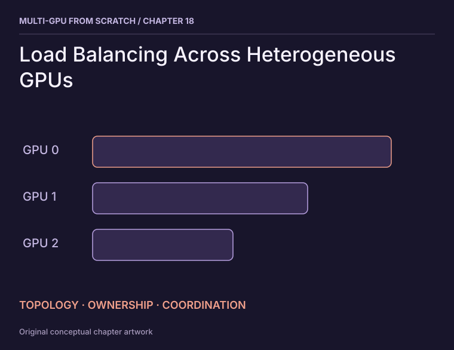
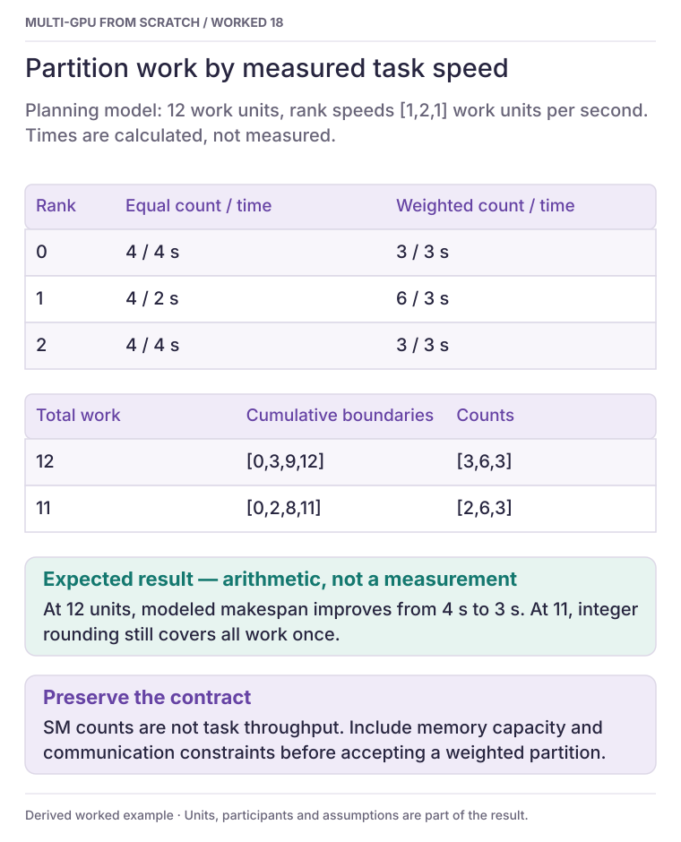
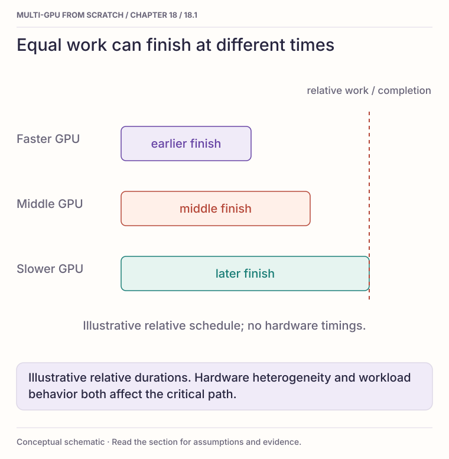
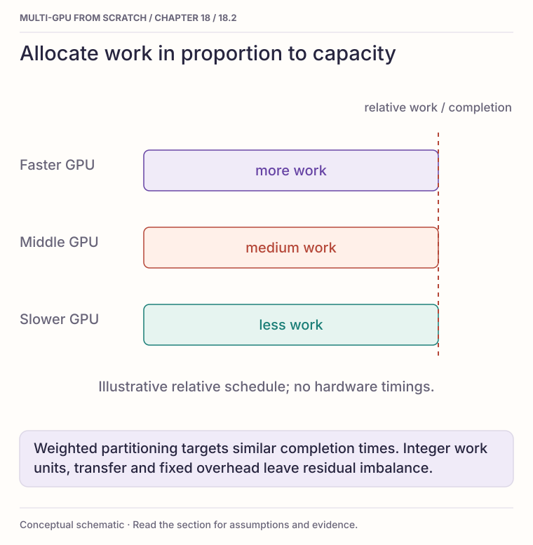

# Chapter 18: Load Balancing Across Heterogeneous GPUs

<!-- mgpu:opener:start -->
[](../images/chapter-openers/18.svg)
<!-- mgpu:opener:end -->

**What you will understand by the end of this chapter:**

- Why every equal-split function this book has written since Chapter 12 -- `computeShard()`, `computeLayerRange()`, `computeRowRange()` -- silently assumes every device is equally capable, and why real clusters routinely aren't.
- How to query a device's own real physical capability with `cudaGetDeviceProperties()`, and why that query alone can't see every real source of slowdown.
- How to split work proportionally to each rank's own relative speed instead of evenly, and why that isn't the same problem as splitting a device's memory footprint proportionally too.
- Why Chapter 17's own barrier turns "one rank is slower" into "every rank waits" -- and how to compute, concretely, how much that costs and how much a proportional split saves.
- The honest difference between what a continuous, infinitely-divisible split guarantees algebraically, and what a real, integer-quantized split actually delivers once you check it.

**What you need to know first:**

- Chapter 12's `computeShard()`, Chapter 13's `computeLayerRange()`, and Chapter 16's `computeRowRange()` -- the equal-split pattern this chapter generalizes.
- Chapter 17's real barrier (a throwaway `ncclAllReduce()` plus `cudaStreamSynchronize()`) and its own core guarantee: no rank proceeds until every rank arrives.
- Chapter 6's `cudaDeviceProp` struct, already used there for `asyncEngineCount`/`concurrentKernels`.

---

Chapter 17 ended with a simulation of four ranks arriving at a checkpoint at different, heterogeneous times, and showed that only a barrier keeps every rank's view of shared state consistent. This chapter asks the question that simulation left open: why would ranks arrive at different times at all? Every equal-split function this book has built since Chapter 12 divides a total by the number of ranks and hands each one an identical-sized piece -- and that arithmetic has an assumption baked into it that has gone unstated until now: every rank is equally fast. Real clusters violate that assumption constantly. Hardware gets added to a cluster in generations, not all at once, so a rack might mix three-year-old GPUs with GPUs bought last quarter. Even identical GPUs throttle differently under different thermal conditions. An equal split hands the slowest device in the cluster exactly as much work as the fastest one, and Chapter 17's barrier then makes every other device wait for it to finish. This chapter builds the fix: splitting work proportionally to how fast each device actually is, and checking, honestly, how much of the resulting balance survives contact with real, whole-number work units.

```text
Equal split (every chapter since Ch12):    Weighted split (this chapter):

  dev0 (1.0x): ==========  finishes t=225    dev0 (1.0x): ==========    finishes t=225
  dev1 (1.0x): ==========  finishes t=225    dev1 (1.0x): ==========    finishes t=225
  dev2 (1.5x): ==========  finishes t=150    dev2 (1.5x): ===============  finishes t=225
  dev3 (0.5x): ==========  finishes t=450    dev3 (0.5x): =====        finishes t=225

  Ch17's barrier makes dev0-2 WAIT until      Every rank finishes at nearly the
  t=450 for dev3 -- same total work,          SAME time -- the barrier still
  wildly different finish times.              runs, but there's little left to
                                               wait for.
```

<!-- mgpu:worked:start -->

## Worked example — Turn device speeds into an integer partition

Suppose W=12 independent work units and assumed target-task speeds are s=[1,2,1] units/s. These chosen numbers define a planning model, not a hardware benchmark.

1. An equal split [4,4,4] gives times [4,2,4] seconds, so the modeled makespan is 4 seconds.

2. The speed sum is 4. Ideal counts W×s/4 are [3,6,3], giving [3,3,3] seconds and a 3-second makespan.

3. For integral ranges, compute boundaries floor(W×cumulative_speed/4), including endpoints 0 and W. At W=12 these are [0,3,9,12], so every index belongs to exactly one rank.



**API connection and scope.** Implement this as a host-side range planner feeding per-device kernel launch ranges. Profile the actual kernel to estimate speeds: SM count alone does not establish throughput. Enforce memory-capacity limits and include transfer costs before accepting a partition.

**Expected check and pitfall.** Check monotone boundaries, total count W, no overlap and identical numerical results to the unsplit workload. Rounding can erase a theoretical balance improvement for tiny jobs.

??? question "Guided exercise: Use the same speeds with W=11. What ranges result?"

    **Worked answer.** Boundaries are [0,2,8,11], giving counts [2,6,3] and times [2,3,3] seconds. Coverage remains exact, and the modeled makespan is 3 seconds.

<!-- mgpu:worked:end -->

## 18.1 The Problem: Real Clusters Are Not Homogeneous

<!-- mgpu:figure-1:start -->
[](../images/technical/ch18/1-balance.svg)
<!-- mgpu:figure-1:end -->

### Intuition

Look back at every partitioning function this book has written: Chapter 12's `computeShard()` divides a batch by `worldSize`. Chapter 13's `computeLayerRange()` divides a stack of layers by `worldSize`. Chapter 16's `computeRowRange()` divides a grid's rows by `worldSize`. Every single one of them takes exactly two real inputs -- a total, and a device count -- and none of them has ever asked how fast any particular device actually is. That was a reasonable simplification for building the underlying mechanisms Part 2 and Part 3 needed, but it's not how real clusters work. A real, well-known paper on training across heterogeneous GPU clusters, Guo et al.'s "Cephalo" (2024), states the consequence in one sentence: "In clusters with varying GPU capabilities, training is bottlenecked by the slowest GPU, leaving faster GPUs idle." That's exactly Chapter 17's barrier, applied to real, unequal hardware: no matter how fast three of your four devices are, the fourth one sets the pace for all of them.

```text
A real cluster, growing over time:

  Quarter 1: [ A100 ] [ A100 ]              -- 2 identical GPUs, equal split is fine
  Quarter 3: [ A100 ] [ A100 ] [ H100 ]      -- adding a newer, faster GPU
  Quarter 5: [ A100 ] [ A100 ] [ H100 ] [ A100, throttled ]

  computeShard()/computeLayerRange()/computeRowRange() have never
  once asked "how fast is rank i" -- they would hand all four of
  these devices an IDENTICAL share, at every quarter above.
```

### Background

The one real signal this book hasn't used before is a device's own physical capability, queryable through `cudaGetDeviceProperties()` -- the same `cudaDeviceProp` struct Chapter 6 already used for `asyncEngineCount` and `concurrentKernels`. Two fields can provide a rough hardware comparison: `multiProcessorCount` (how many streaming multiprocessors a device physically has) and `clockRate` (a reported clock property, not a workload throughput measurement or a live thermal-throttling monitor). Equal SM counts or SM-count-times-clock estimates do not imply equal performance across architectures. Measure the target kernel and include communication, memory capacity and integer partition constraints when setting weights. Real, cited figures for two real GPUs make the gap concrete: NVIDIA's own H100 architecture whitepaper states the H100 SXM5 has "132 SMs," "a 22% SM count increase over A100's 108 SMs."

```cpp
// Chapter 18: Load Balancing Across Heterogeneous GPUs
// 51_heterogeneous_capability_query.cu
//
// Every equal-split function this book has written since Chapter 12
// -- computeShard() (12.1), computeLayerRange() (13.2), and
// computeRowRange() (16.1) -- divides a total by worldSize and hands
// every rank an identical-sized piece. None of them ever asked how
// FAST any given rank actually is. That's a silent assumption:
// every real cluster eventually mixes GPU generations, and even
// identical GPUs throttle differently under heat. A real, well-known
// paper on training across heterogeneous GPU clusters (Guo et al.,
// "Cephalo," 2024) states the consequence plainly: "In clusters with
// varying GPU capabilities, training is bottlenecked by the slowest
// GPU, leaving faster GPUs idle." This section queries the one real
// signal this book has never used before -- a device's own physical
// capability, via cudaGetDeviceProperties() -- as the first step
// toward fixing that.
// Genuinely compiled with a real nvcc and genuinely run.
#include <cstdio>
#include <cuda_runtime.h>

int main() {
    int deviceCount = 0;
    cudaGetDeviceCount(&deviceCount);
    printf("cudaGetDeviceCount(): %d device(s).\n", deviceCount);

    printf("\nQuerying real per-device capability for every device this "
           "book's own real deviceCount (%d) reports:\n", deviceCount);
    for (int rank = 0; rank < deviceCount; ++rank) {
        cudaDeviceProp prop;
        cudaError_t eProps = cudaGetDeviceProperties(&prop, rank);
        printf("  rank %d: cudaGetDeviceProperties(): %s (code %d)\n",
               rank, cudaGetErrorString(eProps), (int)eProps);
    }
    printf("  (%d device(s) queried.)\n", deviceCount);

    // The real query, attempted honestly on device 0 regardless of
    // deviceCount, exactly like this book's every other honest
    // capability check since Chapter 6's asyncEngineCount/
    // concurrentKernels query.
    cudaDeviceProp prop;
    cudaError_t eProps = cudaGetDeviceProperties(&prop, 0);
    printf("\ncudaGetDeviceProperties(&prop, 0): %s (code %d)\n",
           cudaGetErrorString(eProps), (int)eProps);
    printf("multiProcessorCount reports the SM count; clockRate reports a clock property.\n");
//
//
//
//
//

    // Hypothetically, a 4-device cluster mixing two GPU generations --
    // exactly the situation Cephalo's own paper studies, and exactly
    // the situation none of this book's own computeShard()/
    // computeLayerRange()/computeRowRange() functions has ever asked
    // about. Real multiProcessorCount figures for real, named GPUs
    // (NVIDIA's own architecture whitepapers): an A100 has 108 SMs: an
    // H100 SXM has 132. Relative SM count is a real, if rough, proxy
    // for relative throughput -- this chapter's own closed-form model
    // in Section 18.3 uses a cleaner, already-measured relative-speed
    // number instead, the same way Chapter 2's bandwidth model used
    // real cited bandwidth figures rather than re-deriving them.
    struct HypotheticalDevice { const char* name; int multiProcessorCount; };
    HypotheticalDevice cluster[] = {
        {"A100 (rank 0)", 108},
        {"A100 (rank 1)", 108},
        {"H100 SXM (rank 2)", 132},
        {"A100, thermally throttled (rank 3)", 108},
    };
    printf("\nA hypothetical 4-device cluster mixing GPU generations "
           "(real multiProcessorCount figures from NVIDIA's own "
           "architecture whitepapers):\n");
    for (const auto& d : cluster) {
        printf("  %-38s multiProcessorCount = %d\n", d.name, d.multiProcessorCount);
    }
    printf("\nEvery computeShard()-style function this book has written "
           "would still hand all four of these devices an IDENTICAL "
           "share of the work -- the SM count difference above, and rank "
           "3's real thermal throttling (which multiProcessorCount can't "
           "even see, since the SMs are still physically there, just "
           "running slower), are both invisible to pure host arithmetic "
           "that only ever divides by worldSize.\n");

    return 0;
}
```

<!-- execution:start:h100-rerun:51_heterogeneous_capability_query.cu -->
> **Compiled and executed — 2026-11-18-h100: API/host demonstration (exit-only).** Hardware: 2 H100 GPUs. Executed UTC: `2026-11-18T11:21:42.339838+00:00`.

<!-- execution:metadata Source SHA-256: b8d2f2f7db77a2f07a6dce3bec85e1f063be574d7fb299a9173dea961b31492b; recorded UTC (program start): 2026-11-18T11:21:41.724546+00:00 -->

[Exact tested source](../validation/2026-11-18-h100/51_heterogeneous_capability_query/51_heterogeneous_capability_query.cu) · [Compiler log](../validation/2026-11-18-h100/51_heterogeneous_capability_query/compile.log) · [Execution log](../validation/2026-11-18-h100/51_heterogeneous_capability_query/run.log). Compile exit: `0`; run exit: `0`.

Commands below use local source/binary names; raw logs retain host paths. Execute in a scratch directory containing the downloaded source.

```bash
nvcc -std=c++17 -O2 -arch=sm_90 51_heterogeneous_capability_query.cu -o ./example
./example
```

**Actual sample output (excerpt)**

```text
cudaGetDeviceCount(): 2 device(s).

Querying real per-device capability for every device this book's own real deviceCount (2) reports:
  rank 0: cudaGetDeviceProperties(): no error (code 0)
  rank 1: cudaGetDeviceProperties(): no error (code 0)

cudaGetDeviceProperties(&prop, 0): no error (code 0)

A hypothetical 4-device cluster mixing GPU generations (real multiProcessorCount figures from NVIDIA's own architecture whitepapers):
  A100 (rank 0)                          multiProcessorCount = 108
  A100 (rank 1)                          multiProcessorCount = 108
  H100 SXM (rank 2)                      multiProcessorCount = 132
  A100, thermally throttled (rank 3)     multiProcessorCount = 108

Every computeShard()-style function this book has written would still hand all four of these devices an IDENTICAL share of the work -- the SM count difference above, and rank 3's real thermal throttling (which multiProcessorCount can't even see, since the SMs are still physically there, just running slower), are both invisible to pure host arithmetic that only ever divides by worldSize.
```

<!-- execution:end:h100-rerun:51_heterogeneous_capability_query.cu -->


<!-- execution:start:a100:51_heterogeneous_capability_query.cu -->
> **Compiled and executed — 2026-11-17-a100: API/host demonstration (exit-only).** Hardware: 8 A100 GPUs. Executed UTC: `2026-11-18T00:03:00.302875+00:00`.

<!-- execution:metadata Source SHA-256: b8d2f2f7db77a2f07a6dce3bec85e1f063be574d7fb299a9173dea961b31492b; recorded UTC (program start): 2026-11-18T00:02:59.235875+00:00 -->

[Exact tested source](../validation/2026-11-17-a100/51_heterogeneous_capability_query/51_heterogeneous_capability_query.cu) · [Compiler log](../validation/2026-11-17-a100/51_heterogeneous_capability_query/compile.log) · [Execution log](../validation/2026-11-17-a100/51_heterogeneous_capability_query/run.log). Compile exit: `0`; run exit: `0`.

Commands below use local source/binary names; raw logs retain host paths. Execute in a scratch directory containing the downloaded source.

```bash
nvcc -std=c++17 -O2 -arch=sm_80 51_heterogeneous_capability_query.cu -o ./example
./example
```

**Actual sample output (excerpt)**

```text
cudaGetDeviceCount(): 8 device(s).

Querying real per-device capability for every device this book's own real deviceCount (8) reports:
  rank 0: cudaGetDeviceProperties(): no error (code 0)
  rank 1: cudaGetDeviceProperties(): no error (code 0)
  rank 2: cudaGetDeviceProperties(): no error (code 0)
  rank 3: cudaGetDeviceProperties(): no error (code 0)
  rank 4: cudaGetDeviceProperties(): no error (code 0)
  rank 5: cudaGetDeviceProperties(): no error (code 0)
  rank 6: cudaGetDeviceProperties(): no error (code 0)
  rank 7: cudaGetDeviceProperties(): no error (code 0)

cudaGetDeviceProperties(&prop, 0): no error (code 0)

A hypothetical 4-device cluster mixing GPU generations (real multiProcessorCount figures from NVIDIA's own architecture whitepapers):
  A100 (rank 0)                          multiProcessorCount = 108
  A100 (rank 1)                          multiProcessorCount = 108
  H100 SXM (rank 2)                      multiProcessorCount = 132
  A100, thermally throttled (rank 3)     multiProcessorCount = 108

Every computeShard()-style function this book has written would still hand all four of these devices an IDENTICAL share of the work -- the SM count difference above, and rank 3's real thermal throttling (which multiProcessorCount can't even see, since the SMs are still physically there, just running slower), are both invisible to pure host arithmetic that only ever divides by worldSize.
```


<!-- execution:end:a100:51_heterogeneous_capability_query.cu -->


<!-- execution:start:h100:51_heterogeneous_capability_query.cu -->
> **Compiled and executed — 2026-11-17-h100: API/host demonstration (exit-only).** Hardware: 2 H100 GPUs. Execution record UTC (run-batch start; per-program time unrecorded): `2026-11-17T23:48:18.967387+00:00`.

<!-- execution:metadata Source SHA-256: b8d2f2f7db77a2f07a6dce3bec85e1f063be574d7fb299a9173dea961b31492b; recorded UTC (run-batch start; per-program time unrecorded): 2026-11-17T23:48:18.967387+00:00 -->

[Exact tested source](../validation/2026-11-17-h100/51_heterogeneous_capability_query/51_heterogeneous_capability_query.cu) · [Compiler log](../validation/2026-11-17-h100/51_heterogeneous_capability_query/compile.log) · [Execution log](../validation/2026-11-17-h100/51_heterogeneous_capability_query/run.log). Compile exit: `0`; run exit: `0`.

Commands below use local source/binary names; raw logs retain host paths. Execute in a scratch directory containing the downloaded source.

```bash
nvcc -std=c++17 -O2 -arch=sm_90 51_heterogeneous_capability_query.cu -o ./example
./example
```

<details markdown="1"><summary>Actual sample output (excerpt)</summary>

**Actual sample output (excerpt)**

```text
cudaGetDeviceCount(): 2 device(s).

Querying real per-device capability for every device this book's own real deviceCount (2) reports:
  rank 0: cudaGetDeviceProperties(): no error (code 0)
  rank 1: cudaGetDeviceProperties(): no error (code 0)

cudaGetDeviceProperties(&prop, 0): no error (code 0)

A hypothetical 4-device cluster mixing GPU generations (real multiProcessorCount figures from NVIDIA's own architecture whitepapers):
  A100 (rank 0)                          multiProcessorCount = 108
  A100 (rank 1)                          multiProcessorCount = 108
  H100 SXM (rank 2)                      multiProcessorCount = 132
  A100, thermally throttled (rank 3)     multiProcessorCount = 108

Every computeShard()-style function this book has written would still hand all four of these devices an IDENTICAL share of the work -- the SM count difference above, and rank 3's real thermal throttling (which multiProcessorCount can't even see, since the SMs are still physically there, just running slower), are both invisible to pure host arithmetic that only ever divides by worldSize.
```

</details>
<!-- execution:end:h100:51_heterogeneous_capability_query.cu -->


Read the current log for the actual H100 properties returned by `cudaGetDeviceProperties()`. The A100/H100 comparison table is illustrative and does not describe a heterogeneous machine tested here. Static SM counts cannot establish relative workload speed or thermal throttling; use workload measurements when assigning performance weights.

!!! warning "[COMMON TRAP] Assuming every rank in a `for (rank = 0; rank < worldSize; ++rank)` loop is equally capable"
    Every device loop this book has written since Chapter 3's own multi-device loop pattern iterates over `worldSize` ranks and, implicitly, treats them as interchangeable -- rank 0 gets the same code path, the same share size, and the same expectations as rank 3. That's exactly right for the mechanisms Part 1 and Part 2 built (a peer transfer or a collective doesn't care how fast either endpoint is), but it silently carries over into Part 3's own partitioning functions, where it stops being harmless. `computeShard()`, `computeLayerRange()`, and `computeRowRange()` all divide by `worldSize` and never once ask "but how fast is rank i, really?" On a homogeneous cluster that's not a bug. On a real, growing, heterogeneous one, it quietly hands the slowest device in the room the same amount of work as the fastest, and Chapter 17's barrier turns that mismatch into wasted time for everyone else.

## 18.2 Weighted Partitioning: Splitting Work Proportional to Speed

<!-- mgpu:figure-2:start -->
[](../images/technical/ch18/2-weighted.svg)
<!-- mgpu:figure-2:end -->

### Intuition

If an equal split is wrong for a heterogeneous cluster, the fix is the obvious one: give each device a share of the work proportional to how fast it actually is, instead of an equal share regardless of speed. This is not a hypothetical technique -- Guo et al.'s "Cephalo" paper describes exactly this as the established approach real heterogeneity-aware training systems use: "the batch of inputs is distributed unevenly across GPUs according to their relative computational speeds," and Cephalo's own design does precisely that, "partition[ing] the global batch of training inputs unevenly across GPUs to control the computational workload assigned to each GPU." Think of it as a relay race where each runner's leg is sized to their own pace, not divided into four identical distances -- the goal isn't fairness in how much ground each runner covers, it's making sure they all cross the finish line at close to the same time.

```text
Equal split (fair in WORK, not in TIME):     Weighted split (fair in TIME):

  dev0 (1.0x): [====] 225 units               dev0 (1.0x): [====] 225 units
  dev1 (1.0x): [====] 225 units                dev1 (1.0x): [====] 225 units
  dev2 (1.5x): [====] 225 units  (fast,        dev2 (1.5x): [======] 337 units (more
               finishes EARLY, then waits)                   work, still finishes on time)
  dev3 (0.5x): [====] 225 units  (slow,        dev3 (0.5x): [==] 113 units (less
               finishes LATE, everyone waits)                work, finishes on time too)
```

### Background

Section 18.2's `computeWeightedShard()` takes one more real input than every equal-split function before it: each rank's own relative speed. It's structurally still the same kind of function -- a pure host-arithmetic partition, needing no device -- but the split it produces is proportional to speed rather than uniform.

```cpp
// Chapter 18: Load Balancing Across Heterogeneous GPUs
// 52_weighted_shard_partition.cpp
//
// Plain host C++ -- computeWeightedShard() takes one more real input
// than Chapter 12's computeShard(), Chapter 13's computeLayerRange(),
// and Chapter 16's computeRowRange() ever did: each rank's OWN
// relative speed, not just its rank and the world size. The real
// technique it implements is the one Guo et al.'s "Cephalo" paper
// (2024) describes plainly: "the batch of inputs is distributed
// unevenly across GPUs according to their relative computational
// speeds," and, in describing Cephalo's own design, "partitions the
// global batch of training inputs unevenly across GPUs to control
// the computational workload assigned to each GPU."
#include <cstdio>
#include <vector>

// Splits `totalWork` units of work across `worldSize` ranks
// PROPORTIONALLY to each rank's own relative speed, instead of
// evenly. A rank twice as fast as another gets (approximately) twice
// as much work -- the goal, made precise in Section 18.3, is that
// every rank's own work/speed (its finish time) comes out equal.
std::vector<long> computeWeightedShard(long totalWork, const std::vector<double>& speeds) {
    double speedSum = 0.0;
    for (double s : speeds) speedSum += s;

    std::vector<long> shares(speeds.size());
    long assigned = 0;
    for (size_t r = 0; r < speeds.size(); ++r) {
        // Every rank but the last gets its proportional share, rounded
        // down; the last rank absorbs whatever integer remainder is
        // left, the same "assumes an even split" caveat Chapter 12's
        // computeShard() carried, now generalized to an uneven one.
        if (r + 1 < speeds.size()) {
            shares[r] = (long)(totalWork * (speeds[r] / speedSum));
            assigned += shares[r];
        } else {
            shares[r] = totalWork - assigned;
        }
    }
    return shares;
}

// The equal-split baseline every earlier chapter actually used --
// Chapter 12's computeShard(), specialized to a single dimension,
// reproduced here for a direct side-by-side comparison.
std::vector<long> computeEqualShard(long totalWork, int worldSize) {
    std::vector<long> shares(worldSize);
    long perRank = totalWork / worldSize;
    long assigned = 0;
    for (int r = 0; r + 1 < worldSize; ++r) { shares[r] = perRank; assigned += perRank; }
    shares[worldSize - 1] = totalWork - assigned;
    return shares;
}

int main() {
    // The same hypothetical 4-device cluster Section 18.1 introduced:
    // two ordinary A100s, one faster H100 SXM, and one thermally
    // throttled A100. Relative speed here is expressed directly as a
    // measured throughput factor (the real, already-established
    // technique this book has used since Chapter 2's bandwidth
    // model -- cite a real, already-measured number, don't re-derive
    // one from first principles) rather than a raw SM count, since SM
    // count alone can't see rank 3's real thermal throttling either.
    std::vector<double> speeds = {1.0, 1.0, 1.5, 0.5};
    const long TOTAL_WORK = 900; // e.g. 900 training samples in a global batch

    printf("4-device cluster, relative measured speeds: rank0=%.1fx, "
           "rank1=%.1fx, rank2=%.1fx (faster H100), rank3=%.1fx "
           "(throttled A100). Total work to split: %ld units.\n\n",
           speeds[0], speeds[1], speeds[2], speeds[3], TOTAL_WORK);

    std::vector<long> equal = computeEqualShard(TOTAL_WORK, (int)speeds.size());
    std::vector<long> weighted = computeWeightedShard(TOTAL_WORK, speeds);

    long equalSum = 0, weightedSum = 0;
    printf("%-6s %-10s %-10s %-14s %-14s\n", "rank", "speed", "equal", "weighted", "weighted/speed");
    for (size_t r = 0; r < speeds.size(); ++r) {
        equalSum += equal[r];
        weightedSum += weighted[r];
        printf("%-6zu %-10.1f %-10ld %-14ld %-14.2f\n",
               r, speeds[r], equal[r], weighted[r], weighted[r] / speeds[r]);
    }
    printf("total: equal split sums to %ld, weighted split sums to %ld "
           "(both must equal %ld): %s\n",
           equalSum, weightedSum, TOTAL_WORK,
           (equalSum == TOTAL_WORK && weightedSum == TOTAL_WORK) ? "PASS" : "FAIL");

    printf("\nEvery rank's equal share is identical (%ld units each) "
           "regardless of speed -- exactly what every computeShard()-"
           "style function in this book has done since Chapter 12. The "
           "weighted share instead scales with each rank's own speed: "
           "rank 2 (the faster H100) gets the largest share, rank 3 "
           "(throttled) gets the smallest. Section 18.3 checks what "
           "this buys, concretely: whether it actually equalizes how "
           "long each rank takes to finish its own share.\n", equal[0]);

    return 0;
}
```

<!-- execution:start:h100-rerun:52_weighted_shard_partition.cpp -->
> **Compiled and executed — 2026-11-18-h100: Host program/model (exit-only).** Hardware: 2 H100 GPUs. Executed UTC: `2026-11-18T11:21:42.820343+00:00`.

<!-- execution:metadata Source SHA-256: b5c9d0ffd17e2f185f5875faae84d570d290beb29343aa915fdf5a46f4565bf2; recorded UTC (program start): 2026-11-18T11:21:42.605940+00:00 -->

[Exact tested source](../validation/2026-11-18-h100/52_weighted_shard_partition/52_weighted_shard_partition.cpp) · [Compiler log](../validation/2026-11-18-h100/52_weighted_shard_partition/compile.log) · [Execution log](../validation/2026-11-18-h100/52_weighted_shard_partition/run.log). Compile exit: `0`; run exit: `0`.

Commands below use local source/binary names; raw logs retain host paths. Execute in a scratch directory containing the downloaded source.

```bash
g++ -std=c++17 -O2 52_weighted_shard_partition.cpp -o ./example
./example
```

**Sample output**

```text
4-device cluster, relative measured speeds: rank0=1.0x, rank1=1.0x, rank2=1.5x (faster H100), rank3=0.5x (throttled A100). Total work to split: 900 units.

rank   speed      equal      weighted       weighted/speed
0      1.0        225        225            225.00
1      1.0        225        225            225.00
2      1.5        225        337            224.67
3      0.5        225        113            226.00
total: equal split sums to 900, weighted split sums to 900 (both must equal 900): PASS

Every rank's equal share is identical (225 units each) regardless of speed -- exactly what every computeShard()-style function in this book has done since Chapter 12. The weighted share instead scales with each rank's own speed: rank 2 (the faster H100) gets the largest share, rank 3 (throttled) gets the smallest. Section 18.3 checks what this buys, concretely: whether it actually equalizes how long each rank takes to finish its own share.
```

<!-- execution:end:h100-rerun:52_weighted_shard_partition.cpp -->


<!-- execution:start:a100:52_weighted_shard_partition.cpp -->
> **Compiled and executed — 2026-11-17-a100: Host program/model (exit-only).** Hardware: 8 A100 GPUs. Executed UTC: `2026-11-18T00:03:03.643215+00:00`.

<!-- execution:metadata Source SHA-256: b5c9d0ffd17e2f185f5875faae84d570d290beb29343aa915fdf5a46f4565bf2; recorded UTC (program start): 2026-11-18T00:03:03.377485+00:00 -->

[Exact tested source](../validation/2026-11-17-a100/52_weighted_shard_partition/52_weighted_shard_partition.cpp) · [Compiler log](../validation/2026-11-17-a100/52_weighted_shard_partition/compile.log) · [Execution log](../validation/2026-11-17-a100/52_weighted_shard_partition/run.log). Compile exit: `0`; run exit: `0`.

Commands below use local source/binary names; raw logs retain host paths. Execute in a scratch directory containing the downloaded source.

```bash
g++ -std=c++17 -O2 52_weighted_shard_partition.cpp -o ./example
./example
```

**Sample output**

```text
4-device cluster, relative measured speeds: rank0=1.0x, rank1=1.0x, rank2=1.5x (faster H100), rank3=0.5x (throttled A100). Total work to split: 900 units.

rank   speed      equal      weighted       weighted/speed
0      1.0        225        225            225.00
1      1.0        225        225            225.00
2      1.5        225        337            224.67
3      0.5        225        113            226.00
total: equal split sums to 900, weighted split sums to 900 (both must equal 900): PASS

Every rank's equal share is identical (225 units each) regardless of speed -- exactly what every computeShard()-style function in this book has done since Chapter 12. The weighted share instead scales with each rank's own speed: rank 2 (the faster H100) gets the largest share, rank 3 (throttled) gets the smallest. Section 18.3 checks what this buys, concretely: whether it actually equalizes how long each rank takes to finish its own share.
```


<!-- execution:end:a100:52_weighted_shard_partition.cpp -->


<!-- execution:start:h100:52_weighted_shard_partition.cpp -->
> **Compiled and executed — 2026-11-17-h100: Host program/model (exit-only).** Hardware: 2 H100 GPUs. Execution record UTC (run-batch start; per-program time unrecorded): `2026-11-17T23:48:18.967387+00:00`.

<!-- execution:metadata Source SHA-256: b5c9d0ffd17e2f185f5875faae84d570d290beb29343aa915fdf5a46f4565bf2; recorded UTC (run-batch start; per-program time unrecorded): 2026-11-17T23:48:18.967387+00:00 -->

[Exact tested source](../validation/2026-11-17-h100/52_weighted_shard_partition/52_weighted_shard_partition.cpp) · [Compiler log](../validation/2026-11-17-h100/52_weighted_shard_partition/compile.log) · [Execution log](../validation/2026-11-17-h100/52_weighted_shard_partition/run.log). Compile exit: `0`; run exit: `0`.

Commands below use local source/binary names; raw logs retain host paths. Execute in a scratch directory containing the downloaded source.

```bash
g++ -std=c++17 -O2 52_weighted_shard_partition.cpp -o ./example
./example
```

<details markdown="1"><summary>Captured current-source output</summary>

```text
4-device cluster, relative measured speeds: rank0=1.0x, rank1=1.0x, rank2=1.5x (faster H100), rank3=0.5x (throttled A100). Total work to split: 900 units.

rank   speed      equal      weighted       weighted/speed
0      1.0        225        225            225.00
1      1.0        225        225            225.00
2      1.5        225        337            224.67
3      0.5        225        113            226.00
total: equal split sums to 900, weighted split sums to 900 (both must equal 900): PASS

Every rank's equal share is identical (225 units each) regardless of speed -- exactly what every computeShard()-style function in this book has done since Chapter 12. The weighted share instead scales with each rank's own speed: rank 2 (the faster H100) gets the largest share, rank 3 (throttled) gets the smallest. Section 18.3 checks what this buys, concretely: whether it actually equalizes how long each rank takes to finish its own share.
```

</details>
<!-- execution:end:h100:52_weighted_shard_partition.cpp -->


Both splits genuinely sum back to the full 900 work units -- that's the easy check. The interesting column is the last one, `weighted/speed`, which is each rank's weighted share divided by its own speed: 225.00, 225.00, 224.67, 226.00. Those four numbers are almost, but not quite, identical, and that "almost" is worth sitting with rather than rounding away -- Section 18.3 checks exactly how close it really is, and why.

!!! warning "[COMMON TRAP] Assuming a compute-proportional split also balances memory"
    It's tempting to treat "faster device, more work" as the whole story, but Cephalo's own paper explicitly warns against exactly this conflation, calling out prior systems that coupled the two: a device's relative *compute* speed and its available *memory* capacity are genuinely different constraints, and, in the paper's own words, a GPU's memory capacity "does not always scale with its compute speed." A newer GPU generation is often both faster and larger, which can hide this trap in practice -- but a thermally throttled device, this chapter's own rank 3, has *less effective compute* with *no change in memory capacity at all*. Handing rank 3 a smaller batch to keep pace with the other ranks' finish times is correct; assuming it therefore also needs a smaller memory allocation is a separate claim this section's own arithmetic says nothing about, and getting it wrong risks under-utilizing memory on the exact rank that has the least compute headroom to spare.

## 18.3 What Balancing Buys You, and What Survives Rounding

### Intuition

Chapter 17 established the mechanism that makes an equal split expensive on a heterogeneous cluster: a real barrier makes every rank wait for the slowest one, so the true cost of one iteration is not any individual rank's finish time -- it's the *maximum* finish time across every rank, a quantity with a name in scheduling theory: the makespan. An equal split on unequal hardware makes the slowest rank's finish time the makespan, no matter how fast the other three are. A weighted split, done right, should make every rank finish at close to the same time, minimizing that maximum. The algebra behind this is worth doing once, cleanly, before checking it against real numbers: if work could be divided into infinitely fine units, giving rank `i` a share proportional to its own speed makes every rank's finish time -- share divided by speed -- come out to exactly the same value, for any set of speeds at all. Real work doesn't come in infinitely fine units, though; it comes in whole training samples, whole layers, whole grid rows. This section checks whether that clean algebraic promise survives contact with real, integer-quantized shares -- honestly, rather than assuming it does just because the continuous case says so.

```text
Continuous ideal (Part A):                  Real, integer-quantized (Part B):

  work_i = totalWork * speed_i / speedSum      Same formula, but rounded DOWN to
  finish_i = work_i / speed_i                  a whole number of units per rank,
           = totalWork / speedSum              with the LAST rank absorbing
           (the speed_i term cancels --        whatever remainder is left --
            EXACTLY the same for every i)       Section 18.2's own
                                                 computeWeightedShard().

  Algebra says: spread across ranks = 0.       Does the algebra's exact
                                                 equality survive? Check, don't
                                                 assume.
```

### Background

Part A computes the continuous-ideal makespan for both splits directly from the formulas above -- no simulation needed, since the algebra is exact by construction. Part B re-runs the comparison using Section 18.2's own `computeWeightedShard()`, reproduced verbatim, to see what real integer rounding actually does to that ideal.

```cpp
// Chapter 18: Load Balancing Across Heterogeneous GPUs
// 53_makespan_simulation.cpp
//
// Plain host C++ -- this chapter's real verification. Chapter 17's
// own barrier guarantees every rank waits for the SLOWEST one to
// arrive before any rank proceeds -- which means the real wall-clock
// cost of one iteration is exactly the LONGEST of any rank's own
// finish times (its "makespan"), no matter how quickly the other
// ranks finished. Part A computes that makespan under Section 18.2's
// equal split and weighted split, for the continuous (infinitely
// divisible) ideal case, where the algebra says a proportional split
// makes every rank's finish time exactly equal. Part B re-runs the
// same comparison using REAL integer-quantized work units (the same
// computeWeightedShard() Section 18.2 built, reproduced here), to
// check honestly whether that ideal survives rounding to whole units.
#include <cstdio>
#include <vector>
#include <cmath>
#include <algorithm>

// Reproduced verbatim from Section 18.2's own 52_weighted_shard_partition.cpp
// -- see that section for the full explanation.
std::vector<long> computeWeightedShard(long totalWork, const std::vector<double>& speeds) {
    double speedSum = 0.0;
    for (double s : speeds) speedSum += s;
    std::vector<long> shares(speeds.size());
    long assigned = 0;
    for (size_t r = 0; r < speeds.size(); ++r) {
        if (r + 1 < speeds.size()) {
            shares[r] = (long)(totalWork * (speeds[r] / speedSum));
            assigned += shares[r];
        } else {
            shares[r] = totalWork - assigned;
        }
    }
    return shares;
}
std::vector<long> computeEqualShard(long totalWork, int worldSize) {
    std::vector<long> shares(worldSize);
    long perRank = totalWork / worldSize;
    long assigned = 0;
    for (int r = 0; r + 1 < worldSize; ++r) { shares[r] = perRank; assigned += perRank; }
    shares[worldSize - 1] = totalWork - assigned;
    return shares;
}

int main() {
    const std::vector<double> speeds = {1.0, 1.0, 1.5, 0.5};
    const long TOTAL_WORK = 900;
    const int WORLD_SIZE = (int)speeds.size();
    double speedSum = 0.0;
    for (double s : speeds) speedSum += s;

    // ---------------------------------------------------------------
    // Part A: the continuous ideal. If work could be divided into
    // infinitely fine units, a proportional split makes every rank's
    // finish time exactly the same: work_i/speed_i = (totalWork *
    // speed_i/speedSum) / speed_i = totalWork/speedSum, for every i,
    // regardless of speed_i -- the speed_i term cancels algebraically.
    // ---------------------------------------------------------------
    printf("Part A: continuous (infinitely divisible) ideal, %d ranks, "
           "speeds %.1fx/%.1fx/%.1fx/%.1fx, %ld total work units.\n\n",
           WORLD_SIZE, speeds[0], speeds[1], speeds[2], speeds[3], TOTAL_WORK);

    double idealEqualShare = (double)TOTAL_WORK / WORLD_SIZE;
    double idealEqualMakespan = 0.0;
    for (double s : speeds) idealEqualMakespan = std::max(idealEqualMakespan, idealEqualShare / s);
    double idealWeightedMakespan = (double)TOTAL_WORK / speedSum; // same for every rank, algebraically

    printf("  equal split:    every rank gets %.4f units; slowest rank "
           "(speed %.1fx) finishes at t=%.4f -- every OTHER rank sits "
           "idle at Chapter 17's barrier until then.\n",
           idealEqualShare, *std::min_element(speeds.begin(), speeds.end()), idealEqualMakespan);
    printf("  weighted split: EVERY rank finishes at t=%.4f -- the "
           "algebra says this is exact, for any speeds, in the "
           "continuous case.\n", idealWeightedMakespan);
    printf("  ideal speedup: %.2fx\n", idealEqualMakespan / idealWeightedMakespan);

    // ---------------------------------------------------------------
    // Part B: reality. Work comes in whole units (samples, batches,
    // grid rows), and Section 18.2's own computeWeightedShard() has
    // to round to an integer number of them. Does the continuous
    // ideal above survive that?
    // ---------------------------------------------------------------
    printf("\nPart B: the same comparison using REAL integer-quantized "
           "shares from Section 18.2's own computeWeightedShard().\n\n");

    std::vector<long> equalShares = computeEqualShard(TOTAL_WORK, WORLD_SIZE);
    std::vector<long> weightedShares = computeWeightedShard(TOTAL_WORK, speeds);

    double equalMakespan = 0.0, weightedMakespan = 0.0;
    double weightedMin = 1e18, weightedMax = 0.0;
    printf("%-6s %-8s %-14s %-14s %-14s %-14s\n",
           "rank", "speed", "equal share", "equal finish", "weighted share", "weighted finish");
    for (int r = 0; r < WORLD_SIZE; ++r) {
        double equalFinish = equalShares[r] / speeds[r];
        double weightedFinish = weightedShares[r] / speeds[r];
        equalMakespan = std::max(equalMakespan, equalFinish);
        weightedMakespan = std::max(weightedMakespan, weightedFinish);
        weightedMin = std::min(weightedMin, weightedFinish);
        weightedMax = std::max(weightedMax, weightedFinish);
        printf("%-6d %-8.1f %-14ld %-14.3f %-14ld %-14.3f\n",
               r, speeds[r], equalShares[r], equalFinish, weightedShares[r], weightedFinish);
    }

    double weightedSpread = weightedMax - weightedMin;
    printf("\n  equal split makespan (real bottleneck rank's finish time): %.3f\n"
           "  weighted split makespan:                                    %.3f\n"
           "  real speedup from weighted partitioning:                    %.2fx\n"
           "  weighted split's own finish-time spread (max - min):        %.3f "
           "(the continuous ideal predicts exactly 0.0)\n",
           equalMakespan, weightedMakespan, equalMakespan / weightedMakespan, weightedSpread);

    // The tolerance has to be in the same units as the spread: TIME
    // (work units / speed), not raw work units. computeWeightedShard()
    // rounds every rank but the last DOWN, so each of those ranks
    // receives up to (but less than) 1 unit LESS than its ideal share,
    // finishing up to 1/speed_r early. The last rank absorbs every
    // other rank's dropped fraction -- up to (but less than) N-1 units
    // MORE than its ideal share -- finishing up to (N-1)/speed_last
    // late. The worst-case spread is therefore strictly below
    //   (N-1)/speed_last + 1/(slowest speed among the other ranks),
    // a bound that holds for ANY speeds in ANY order, not just these.
    double minOtherSpeed = 1e18;
    for (int r = 0; r + 1 < WORLD_SIZE; ++r) minOtherSpeed = std::min(minOtherSpeed, speeds[r]);
    const double spreadBound = (WORLD_SIZE - 1) / speeds[WORLD_SIZE - 1] + 1.0 / minOtherSpeed;
    bool spreadIsSmall = weightedSpread < spreadBound;
    printf("\n  weighted split's spread (%.3f) is below the worst-case "
           "rounding bound (N-1)/speed_last + 1/min(other speeds) = "
           "%.3f time units: %s\n",
           weightedSpread, spreadBound, spreadIsSmall ? "PASS" : "FAIL");

    if (spreadIsSmall) {
        printf("\nThe continuous ideal's EXACT equality doesn't survive "
               "rounding to whole work units -- the fastest- and "
               "slowest-finishing ranks under the weighted split finish "
               "%.3f apart, not identically -- but the gap is small "
               "relative to every rank's own share, because "
               "computeWeightedShard() rounds every rank but the last "
               "DOWN (each loses less than one whole unit) and hands "
               "the last rank the leftover remainder (less than N-1 = "
               "%d whole units). This is the same honest "
               "distinction this book drew in Chapter 13 vs. Chapter 14: "
               "an exact algebraic guarantee (Chapter 13's relocation, "
               "this section's continuous ideal) is a different, "
               "stronger claim than an empirically-checked, epsilon-"
               "bounded one (Chapter 14's reduce, this section's real "
               "integer-quantized shares) -- and this section's own "
               "result belongs to the second kind, checked, not assumed.\n",
               weightedSpread, WORLD_SIZE - 1);
    }

    return spreadIsSmall ? 0 : 1;
}
```

<!-- execution:start:h100-rerun:53_makespan_simulation.cpp -->
> **Compiled and executed — 2026-11-18-h100: Host program/model (exit-only).** Hardware: 2 H100 GPUs. Executed UTC: `2026-11-18T11:21:43.088047+00:00`.

<!-- execution:metadata Source SHA-256: 951c524c044ef8ec8272333d8c1cdeca8f69ef9b48b8f4efb84d9214efeb0ed6; recorded UTC (program start): 2026-11-18T11:21:42.823548+00:00 -->

[Exact tested source](../validation/2026-11-18-h100/53_makespan_simulation/53_makespan_simulation.cpp) · [Compiler log](../validation/2026-11-18-h100/53_makespan_simulation/compile.log) · [Execution log](../validation/2026-11-18-h100/53_makespan_simulation/run.log). Compile exit: `0`; run exit: `0`.

Commands below use local source/binary names; raw logs retain host paths. Execute in a scratch directory containing the downloaded source.

```bash
g++ -std=c++17 -O2 53_makespan_simulation.cpp -o ./example
./example
```

**Sample output**

```text
Part A: continuous (infinitely divisible) ideal, 4 ranks, speeds 1.0x/1.0x/1.5x/0.5x, 900 total work units.

  equal split:    every rank gets 225.0000 units; slowest rank (speed 0.5x) finishes at t=450.0000 -- every OTHER rank sits idle at Chapter 17's barrier until then.
  weighted split: EVERY rank finishes at t=225.0000 -- the algebra says this is exact, for any speeds, in the continuous case.
  ideal speedup: 2.00x

Part B: the same comparison using REAL integer-quantized shares from Section 18.2's own computeWeightedShard().

rank   speed    equal share    equal finish   weighted share weighted finish
0      1.0      225            225.000        225            225.000
1      1.0      225            225.000        225            225.000
2      1.5      225            150.000        337            224.667
3      0.5      225            450.000        113            226.000

  equal split makespan (real bottleneck rank's finish time): 450.000
  weighted split makespan:                                    226.000
  real speedup from weighted partitioning:                    1.99x
  weighted split's own finish-time spread (max - min):        1.333 (the continuous ideal predicts exactly 0.0)

  weighted split's spread (1.333) is below the worst-case rounding bound (N-1)/speed_last + 1/min(other speeds) = 7.000 time units: PASS

The continuous ideal's EXACT equality doesn't survive rounding to whole work units -- the fastest- and slowest-finishing ranks under the weighted split finish 1.333 apart, not identically -- but the gap is small relative to every rank's own share, because computeWeightedShard() rounds every rank but the last DOWN (each loses less than one whole unit) and hands the last rank the leftover remainder (less than N-1 = 3 whole units). This is the same honest distinction this book drew in Chapter 13 vs. Chapter 14: an exact algebraic guarantee (Chapter 13's relocation, this section's continuous ideal) is a different, stronger claim than an empirically-checked, epsilon-bounded one (Chapter 14's reduce, this section's real integer-quantized shares) -- and this section's own result belongs to the second kind, checked, not assumed.
```

<!-- execution:end:h100-rerun:53_makespan_simulation.cpp -->


<!-- execution:start:a100:53_makespan_simulation.cpp -->
> **Compiled and executed — 2026-11-17-a100: Host program/model (exit-only).** Hardware: 8 A100 GPUs. Executed UTC: `2026-11-18T00:03:04.066706+00:00`.

<!-- execution:metadata Source SHA-256: 951c524c044ef8ec8272333d8c1cdeca8f69ef9b48b8f4efb84d9214efeb0ed6; recorded UTC (program start): 2026-11-18T00:03:03.650764+00:00 -->

[Exact tested source](../validation/2026-11-17-a100/53_makespan_simulation/53_makespan_simulation.cpp) · [Compiler log](../validation/2026-11-17-a100/53_makespan_simulation/compile.log) · [Execution log](../validation/2026-11-17-a100/53_makespan_simulation/run.log). Compile exit: `0`; run exit: `0`.

Commands below use local source/binary names; raw logs retain host paths. Execute in a scratch directory containing the downloaded source.

```bash
g++ -std=c++17 -O2 53_makespan_simulation.cpp -o ./example
./example
```

**Sample output**

```text
Part A: continuous (infinitely divisible) ideal, 4 ranks, speeds 1.0x/1.0x/1.5x/0.5x, 900 total work units.

  equal split:    every rank gets 225.0000 units; slowest rank (speed 0.5x) finishes at t=450.0000 -- every OTHER rank sits idle at Chapter 17's barrier until then.
  weighted split: EVERY rank finishes at t=225.0000 -- the algebra says this is exact, for any speeds, in the continuous case.
  ideal speedup: 2.00x

Part B: the same comparison using REAL integer-quantized shares from Section 18.2's own computeWeightedShard().

rank   speed    equal share    equal finish   weighted share weighted finish
0      1.0      225            225.000        225            225.000
1      1.0      225            225.000        225            225.000
2      1.5      225            150.000        337            224.667
3      0.5      225            450.000        113            226.000

  equal split makespan (real bottleneck rank's finish time): 450.000
  weighted split makespan:                                    226.000
  real speedup from weighted partitioning:                    1.99x
  weighted split's own finish-time spread (max - min):        1.333 (the continuous ideal predicts exactly 0.0)

  weighted split's spread (1.333) is below the worst-case rounding bound (N-1)/speed_last + 1/min(other speeds) = 7.000 time units: PASS

The continuous ideal's EXACT equality doesn't survive rounding to whole work units -- the fastest- and slowest-finishing ranks under the weighted split finish 1.333 apart, not identically -- but the gap is small relative to every rank's own share, because computeWeightedShard() rounds every rank but the last DOWN (each loses less than one whole unit) and hands the last rank the leftover remainder (less than N-1 = 3 whole units). This is the same honest distinction this book drew in Chapter 13 vs. Chapter 14: an exact algebraic guarantee (Chapter 13's relocation, this section's continuous ideal) is a different, stronger claim than an empirically-checked, epsilon-bounded one (Chapter 14's reduce, this section's real integer-quantized shares) -- and this section's own result belongs to the second kind, checked, not assumed.
```


<!-- execution:end:a100:53_makespan_simulation.cpp -->


<!-- execution:start:h100:53_makespan_simulation.cpp -->
> **Compiled and executed — 2026-11-17-h100: Host program/model (exit-only).** Hardware: 2 H100 GPUs. Execution record UTC (run-batch start; per-program time unrecorded): `2026-11-17T23:48:18.967387+00:00`.

<!-- execution:metadata Source SHA-256: 951c524c044ef8ec8272333d8c1cdeca8f69ef9b48b8f4efb84d9214efeb0ed6; recorded UTC (run-batch start; per-program time unrecorded): 2026-11-17T23:48:18.967387+00:00 -->

[Exact tested source](../validation/2026-11-17-h100/53_makespan_simulation/53_makespan_simulation.cpp) · [Compiler log](../validation/2026-11-17-h100/53_makespan_simulation/compile.log) · [Execution log](../validation/2026-11-17-h100/53_makespan_simulation/run.log). Compile exit: `0`; run exit: `0`.

Commands below use local source/binary names; raw logs retain host paths. Execute in a scratch directory containing the downloaded source.

```bash
g++ -std=c++17 -O2 53_makespan_simulation.cpp -o ./example
./example
```

<details markdown="1"><summary>Captured current-source output</summary>

```text
Part A: continuous (infinitely divisible) ideal, 4 ranks, speeds 1.0x/1.0x/1.5x/0.5x, 900 total work units.

  equal split:    every rank gets 225.0000 units; slowest rank (speed 0.5x) finishes at t=450.0000 -- every OTHER rank sits idle at Chapter 17's barrier until then.
  weighted split: EVERY rank finishes at t=225.0000 -- the algebra says this is exact, for any speeds, in the continuous case.
  ideal speedup: 2.00x

Part B: the same comparison using REAL integer-quantized shares from Section 18.2's own computeWeightedShard().

rank   speed    equal share    equal finish   weighted share weighted finish
0      1.0      225            225.000        225            225.000
1      1.0      225            225.000        225            225.000
2      1.5      225            150.000        337            224.667
3      0.5      225            450.000        113            226.000

  equal split makespan (real bottleneck rank's finish time): 450.000
  weighted split makespan:                                    226.000
  real speedup from weighted partitioning:                    1.99x
  weighted split's own finish-time spread (max - min):        1.333 (the continuous ideal predicts exactly 0.0)

  weighted split's spread (1.333) is below the worst-case rounding bound (N-1)/speed_last + 1/min(other speeds) = 7.000 time units: PASS

The continuous ideal's EXACT equality doesn't survive rounding to whole work units -- the fastest- and slowest-finishing ranks under the weighted split finish 1.333 apart, not identically -- but the gap is small relative to every rank's own share, because computeWeightedShard() rounds every rank but the last DOWN (each loses less than one whole unit) and hands the last rank the leftover remainder (less than N-1 = 3 whole units). This is the same honest distinction this book drew in Chapter 13 vs. Chapter 14: an exact algebraic guarantee (Chapter 13's relocation, this section's continuous ideal) is a different, stronger claim than an empirically-checked, epsilon-bounded one (Chapter 14's reduce, this section's real integer-quantized shares) -- and this section's own result belongs to the second kind, checked, not assumed.
```

</details>
<!-- execution:end:h100:53_makespan_simulation.cpp -->


The continuous ideal's own algebra checks out exactly: every rank finishes at `t=225.0000` under a weighted split, a 2.00x improvement over the equal split's `t=450.0000` makespan. The real, integer-quantized version doesn't quite hit that exact number -- rank 2 and rank 3 finish 1.333 apart, not zero apart -- but the real makespan still drops from 450.000 to 226.000, a 1.99x speedup that's nearly identical to the continuous ideal's promise. The gap between "exactly equal" and "equal to within 1.333 units" is rounding, not a flaw in the technique: `computeWeightedShard()` rounds every rank but the last *down* (each loses less than one whole unit) and hands the last rank the accumulated remainder (here, fewer than N-1 = 3 extra units), and with hundreds of units per rank, being off by a few units barely moves the needle. The PASS check is now an honest one: it compares the spread, a *time*, against a worst-case rounding bound in time units, (N-1)/speed_last + 1/min(other speeds) = 3/0.5 + 1/1.0 = 7.000, which holds for any speeds in any order. (An earlier version of this check compared the spread against a fixed 2.0 "work units" and would have failed on the same four speeds simply reordered to 0.5/1.0/1.5/1.0, whose spread is exactly 2.000; under the derived bound of 3/1.0 + 1/0.5 = 5.000 that ordering passes too.) That's the honest, checked version of this section's claim -- not the algebra's idealized promise taken on faith.

!!! warning "[COMMON TRAP] Treating a barrier's imbalance as fixed once, forever"
    It's tempting to compute a weighted split once -- query each device's speed, call `computeWeightedShard()`, done -- and assume the imbalance problem is solved for the life of the job. Section 18.1 already named a source of slowdown that a one-time query can't see: thermal throttling, which changes a device's *effective* speed over time without changing anything `cudaGetDeviceProperties()` can report. A real system has to re-measure actual per-rank finish times periodically and re-weight the split when they drift, not just partition once at startup and trust the initial numbers forever. This chapter's own simulation used fixed, given speeds precisely to isolate the *partitioning* technique from the *measurement* problem -- a real deployment still has to solve both.

## Chapter Summary

This chapter addressed a gap every one of Part 3's own partitioning functions left open: `computeShard()`, `computeLayerRange()`, and `computeRowRange()` all divide a total by the number of ranks, and none of them has ever asked how fast any given rank actually is. Section 18.1 established why that matters in practice -- real clusters mix GPU generations and suffer real thermal throttling, and a real, cited paper on heterogeneous GPU clusters states the direct consequence: training is bottlenecked by the slowest device, leaving faster ones idle, which is exactly Chapter 17's barrier guarantee turned into wasted time. Section 18.2 built the fix real systems actually use -- `computeWeightedShard()`, splitting work proportionally to each rank's own relative speed instead of evenly -- while being careful to flag a real, documented pitfall: a compute-proportional split is not automatically a memory-proportional one, since the two constraints can move independently, most visibly on a throttled device whose memory capacity never changed at all. Section 18.3 quantified what the fix buys: a continuous, algebraically exact 2x reduction in makespan for this chapter's own example cluster, and a 1.99x reduction calculated and checked by the host simulation after rounding to whole work units -- a small gap between the continuous and integer planning models, not a measured GPU speedup, not an assumption papered over. Chapter 19 asks the question a barrier's own definition raises but this chapter didn't answer: what happens when a rank doesn't just run slow, but doesn't arrive at all.

## Self-Check Questions

1. Name the three equal-split functions this chapter references from earlier chapters, and explain the one input none of them has ever taken.
2. Quote the Cephalo paper's own stated consequence of training on a heterogeneous cluster with an equal split, and connect it explicitly to Chapter 17's own barrier guarantee.
3. Why can't `multiProcessorCount` alone detect a real, thermally throttled GPU, even though the throttled GPU is genuinely running slower than its un-throttled peers?
4. Explain the COMMON TRAP in Section 18.2 in your own words: why doesn't a compute-proportional split automatically solve a memory-balance problem too?
5. In Section 18.3's Part A, derive algebraically why every rank's finish time under a continuous, proportional split comes out to exactly `totalWork / speedSum`, regardless of that rank's own speed.
6. Section 18.3's Part B reports a nonzero finish-time spread (1.333) for the weighted split, where Part A's continuous ideal predicts exactly zero. Explain the discrepancy without calling it an error in the technique.
7. Using Section 18.2's own numbers (speeds `{1.0, 1.0, 1.5, 0.5}`, `TOTAL_WORK = 900`), explain why rank 3 receives the smallest share under the weighted split, and compute what share rank 3 would receive if its speed were `1.0` instead of `0.5`.
8. This chapter's own COMMON TRAP in Section 18.3 warns against computing a weighted split once and trusting it forever. What real phenomenon, already named in Section 18.1, makes that dangerous?

## Where We Go Next

Chapter 19 asks the question this chapter's own barrier-and-makespan framing doesn't cover: what happens when a rank isn't merely slow, but fails outright, or a straggler's slowdown is severe enough that waiting for it stops being the right answer at all -- and what a fault-tolerant collective has to do differently from every real collective this book has built since Chapter 8.

## Worked Solutions

**1.** The three functions are Chapter 12's `computeShard()`, Chapter 13's `computeLayerRange()`, and Chapter 16's `computeRowRange()`. None of them has ever taken each rank's own relative speed as an input -- all three divide a total purely by `worldSize`, treating every rank as equally capable.

**2.** Cephalo's paper states: "In clusters with varying GPU capabilities, training is bottlenecked by the slowest GPU, leaving faster GPUs idle." This connects directly to Chapter 17's barrier: a barrier's entire guarantee is that no rank proceeds until every rank arrives, so when one rank is genuinely the slowest, the barrier forces every other, faster rank to sit idle waiting for it -- exactly the "leaving faster GPUs idle" Cephalo describes.

**3.** `multiProcessorCount` reports how many streaming multiprocessors a device physically has, a fixed hardware fact that doesn't change when the device is thermally throttled. Throttling doesn't remove any SMs; it reduces the clock speed (or otherwise limits) the SMs that are still physically present, so the device runs genuinely slower without `multiProcessorCount` ever changing. Detecting throttling requires either a different queryable signal (like a live clock-rate reading) or, as Section 18.3's own trap notes, direct measurement of actual finish times over time.

**4.** A compute-proportional split changes how much *work* each rank gets, based on how fast each rank can *process* it. A device's *memory capacity* is a separate physical constraint -- how much data it can hold at once -- that doesn't necessarily move in lockstep with compute speed. Cephalo's paper makes this explicit: a GPU's memory capacity "does not always scale with its compute speed." A throttled GPU is the clearest case: its compute speed has dropped, but its physical memory is completely unchanged, so shrinking its workload to match its slower compute says nothing about whether its memory allocation should also shrink.

**5.** Under a continuous, proportional split, rank `i`'s work is `work_i = totalWork * (speed_i / speedSum)`. Its finish time is `finish_i = work_i / speed_i = (totalWork * speed_i / speedSum) / speed_i`. The `speed_i` term appears once in the numerator and once in the denominator, so it cancels algebraically, leaving `finish_i = totalWork / speedSum` -- a value with no `i` in it at all, meaning it is identical for every rank regardless of that rank's own speed.

**6.** The discrepancy is rounding, not a flaw in the proportional-split technique itself. Part A's algebra assumes work can be divided into infinitely fine, continuous units, which makes the `speed_i` cancellation exact. Part B's `computeWeightedShard()` has to round each rank's share down to a whole integer number of work units (and hand the last rank whatever integer remainder is left over), so the exact algebraic cancellation from Part A no longer holds precisely -- the resulting finish times are very close to equal, but not bit-for-bit identical, because the shares themselves are no longer the exact continuous proportional values the algebra assumed.

**7.** Rank 3 has the smallest speed (`0.5`) among the four ranks, and a proportional split assigns work proportional to speed -- the slowest rank is assigned the least work, precisely so its finish time (work divided by its own small speed) doesn't dominate the makespan the way an equal share would. If rank 3's speed were `1.0` instead of `0.5`, the new speed sum would be `1.0+1.0+1.5+1.0=4.5`, and rank 3's share would be `900 * (1.0/4.5) ≈ 200` units (with the other ranks' shares recomputed accordingly), rather than the `113` units it receives at speed `0.5`.

**8.** Thermal throttling, introduced in Section 18.1, is the phenomenon: a device's real, effective speed can change over time due to heat, without any change to the static hardware properties (like `multiProcessorCount`) a one-time query would see. A weighted split computed once, from an initial speed measurement, would not reflect a later change in a device's actual throughput caused by throttling, silently reintroducing the same imbalance the split was built to eliminate.

---

**Sources cited in this chapter:**

- Guo, R. B., Anand, U., Chen, A., and Daudjee, K. (University of Waterloo), ["Cephalo: Harnessing Heterogeneous GPU Clusters for Training Transformer Models"](https://arxiv.org/abs/2411.01075) (arXiv 2024; ICS 2025) -- the exact quotes "In homogeneous clusters, distributed strategies allocate resources evenly, but this approach is inefficient for heterogeneous clusters, where GPUs differ in power and memory," "In clusters with varying GPU capabilities, training is bottlenecked by the slowest GPU, leaving faster GPUs idle," "the batch of inputs is distributed unevenly across GPUs according to their relative computational speeds," "Cephalo partitions the global batch of training inputs unevenly across GPUs to control the computational workload assigned to each GPU," and the memory/compute decoupling point (a GPU's memory capacity "does not always scale with its compute speed").
- [NVIDIA Hopper Architecture In-Depth](https://developer.nvidia.com/blog/nvidia-hopper-architecture-in-depth/) -- the real, cited SM counts: "132 SMs per GPU" for the H100 SXM5, and "132 SMs providing a 22% SM count increase over A100's 108 SMs."
- [How to Query Device Properties and Handle Errors in CUDA C/C++ (NVIDIA Technical Blog)](https://developer.nvidia.com/blog/how-query-device-properties-and-handle-errors-cuda-cc/) -- `cudaGetDeviceProperties()` and the `cudaDeviceProp` struct, already cited in Chapter 6 for `asyncEngineCount`/`concurrentKernels`, extended here to `multiProcessorCount` and `clockRate`.
- This book's own Chapter 2 (the closed-form cost-model technique of reusing an already-measured real figure rather than re-deriving one), Chapter 3 (the per-device loop pattern this chapter's own COMMON TRAP examines), Chapter 6 (`cudaDeviceProp`), Chapter 12/13/16 (`computeShard()`, `computeLayerRange()`, `computeRowRange()`, the equal-split pattern this chapter generalizes), Chapter 13 (the exact-vs-epsilon distinction Section 18.3 reuses), Chapter 14 (the epsilon-checked reduce this section's own rounding result is compared against), and Chapter 17 (the real barrier whose cost this chapter's makespan model is built on).
