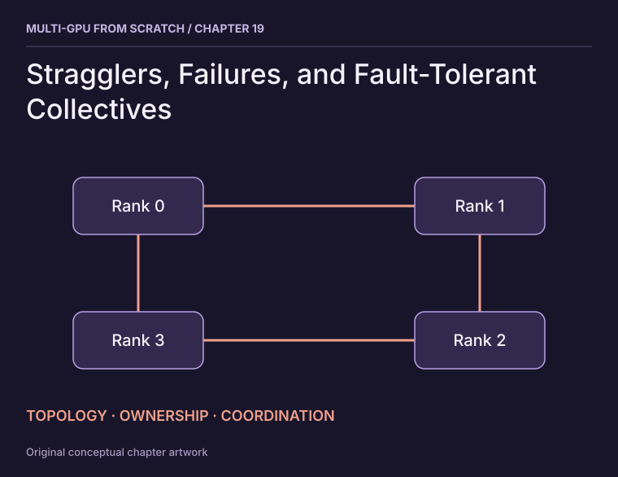
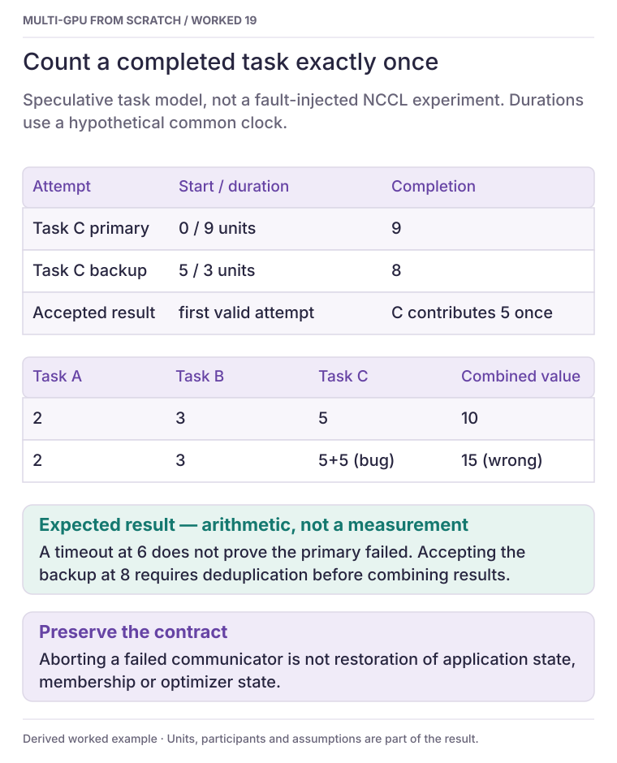
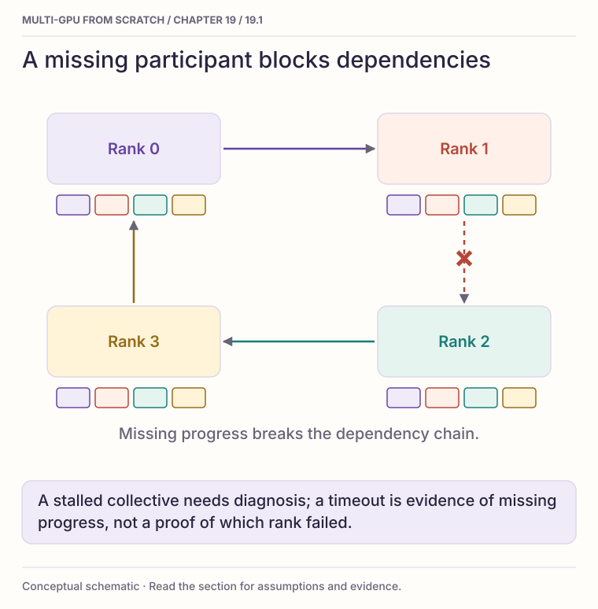
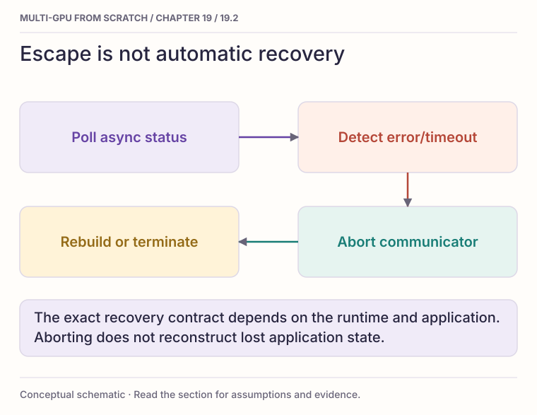

# Chapter 19: Stragglers, Failures, and Fault-Tolerant Collectives

<!-- mgpu:opener:start -->
[](../images/chapter-openers/19.svg)
<!-- mgpu:opener:end -->

**What you will understand by the end of this chapter:**

- How peer failure can surface as an error or a stalled collective.
- How a non-blocking communicator and bounded asynchronous-error polling support timeout handling.
- Why aborting a communicator and rebuilding it are separate recovery steps.
- How backup workers can reduce straggler delays, and what their selection rule guarantees.

**What you need to know first:**

- Chapter 11’s communicator initialization and checked API results.
- Chapter 17’s dummy-element AllReduce and stream completion.
- Chapter 18’s model of straggler delays.

---

A slow rank can delay a collective; a failed rank can prevent completion. This chapter separates communicator progress, error polling and application recovery, then models backup workers as a way to tolerate stragglers. The API probes check their declared cases; the timing models explain the scheduling tradeoff.


<!-- mgpu:worked:start -->

## Worked example — Deduplicate speculative completion

Consider independent task values A=2, B=3 and C=5. Task C has a primary attempt starting at time 0 with duration 9, and a backup starting at time 5 with duration 3. Times use a hypothetical common clock.

1. At time 6 a timeout fires, but the primary may simply be slow; a timeout does not prove failure.

2. The backup finishes at 8, ahead of the primary at 9. Accept the first valid result for logical task C, recording its task and iteration identity.

3. Combine A+B+C=2+3+5=10. If both attempts contribute, the result is 15 and is wrong even though each attempt individually computed C correctly.



**API connection and scope.** This is a speculative task model, not a fault-injected NCCL measurement. ncclCommGetAsyncError can report an asynchronous communication error; it does not restore communicator membership or application state. Aborting and recreating communication must be accompanied by an explicit checkpoint/restart or task-recovery policy.

**Expected check and pitfall.** Deduplication must occur before irreversible side effects. An optimizer update or external write cannot safely be repeated merely because the task result is deterministic.

??? question "Guided exercise: What value exposes an accidental double acceptance of C?"

    **Worked answer.** 15. The expected value is 10; checking only that both attempts exited successfully would miss the error.

<!-- mgpu:worked:end -->

## 19.1 The Problem: A Failed Peer Can Cause Errors or Hangs

<!-- mgpu:figure-1:start -->
[](../images/technical/ch19/1-failure.svg)
<!-- mgpu:figure-1:end -->

### Intuition

A successful NCCL return can mean work has been enqueued, not completed. The current H100 suite includes working collectives and checked API probes, but does not inject rank failures. NVIDIA warns that a dead peer may cause an error or a hang: inspect asynchronous errors, wait for completion and impose an application timeout. A healthy one-rank lifecycle probe cannot establish multi-rank fault recovery.

The [2026-11-17 H100 execution record](../validation-h100.md) covers two GPUs connected by local NV18. It distinguishes numerical checks, API probes and other executions; a successful exit alone does not establish GPU algorithm correctness.

```text
Blocking communicator (every real NCCL call this book has made, Ch11-18):

  ncclCommInitRankConfig(blocking=1)  or  ncclAllReduce(...)  or  Ch17's barrier
  +----------------------------------------+
  | waiting ... waiting ... waiting ...    |   no way to poll, no way to time out
  +----------------------------------------+
  returns ... eventually. Or, with a genuinely dead peer, never.

Non-blocking communicator (this section names it; 19.2 builds the real escape):

  ncclCommInitRankConfig(blocking=0)
  -> returns IMMEDIATELY
     -> poll ncclCommGetAsyncError() in a loop,
        bounded by YOUR OWN timeout, not NCCL's.
```

### Background

Every communicator this book has built through Chapter 18 -- Chapter 11's `ncclCommInitAll()`, and every direct `ncclCommInitRank()`-style call implicit since -- is *blocking* by default: `config.blocking = 1`, whether or not any code ever set that field explicitly. This section builds both the default blocking communicator every earlier chapter used, and the real, documented alternative -- a non-blocking one, `config.blocking = 0` -- side by side, using NCCL's real `ncclConfig_t` struct and `NCCL_CONFIG_INITIALIZER` macro, confirmed present in the actual installed NCCL header (the tested libnccl 2.26.2). Section 19.2 is what a non-blocking communicator like the second one below actually makes possible.


The [2026-11-17 H100 execution record](../validation-h100.md) covers two GPUs connected by local NV18. It distinguishes numerical checks, API probes and other executions; a successful exit alone does not establish GPU algorithm correctness.

```cpp
// 54_blocking_vs_nonblocking_comm.cu
// Blocking initialization/destruction plus nonblocking initialization/poll/abort API probe. No peer failure is injected.
#include <cstdio>
#include <chrono>
#include <thread>
#include <cuda_runtime.h>
#include <nccl.h>
int main() {
 if(cudaSetDevice(0)!=cudaSuccess) return 2;
 ncclUniqueId id; if(ncclGetUniqueId(&id)!=ncclSuccess) return 1;
 ncclConfig_t blocking=NCCL_CONFIG_INITIALIZER; blocking.blocking=1;
 ncclComm_t blockingComm=nullptr;
 ncclResult_t first=ncclCommInitRankConfig(&blockingComm,1,id,0,&blocking);
 if(first!=ncclSuccess) { if(blockingComm) ncclCommAbort(blockingComm); return 1; }
 if(ncclCommDestroy(blockingComm)!=ncclSuccess) return 1;
 if(ncclGetUniqueId(&id)!=ncclSuccess) return 1;
 ncclConfig_t config=NCCL_CONFIG_INITIALIZER; config.blocking=0;
 ncclComm_t comm=nullptr;
 ncclResult_t init=ncclCommInitRankConfig(&comm,1,id,0,&config);
 if(init!=ncclSuccess && init!=ncclInProgress) {
  if(comm) ncclCommAbort(comm); fprintf(stderr,"init: %s\n",ncclGetErrorString(init)); return 1;
 }
 auto deadline=std::chrono::steady_clock::now()+std::chrono::seconds(10);
 ncclResult_t state=ncclInProgress; int errors=0;
 do {
  ncclResult_t query=ncclCommGetAsyncError(comm,&state);
  if(query!=ncclSuccess) { ++errors; break; }
  if(state!=ncclInProgress) break;
  std::this_thread::sleep_for(std::chrono::milliseconds(1));
 } while(std::chrono::steady_clock::now()<deadline);
 if(state!=ncclSuccess) ++errors;
 if(ncclCommAbort(comm)!=ncclSuccess) ++errors;
 printf("API PROBE %s: one-rank nonblocking init/poll/abort only; no fault recovery tested, errors=%d\n",errors?"FAIL":"PASS",errors);
 return errors?1:0;
}
```

<!-- execution:start:h100-rerun:54_blocking_vs_nonblocking_comm.cu -->
> **Compiled and executed — 2026-11-18-h100: API validation (recorded scope).** Hardware: 2 H100 GPUs. Executed UTC: `2026-11-18T11:21:44.307556+00:00`.

<!-- execution:metadata Source SHA-256: 527cec6ac2cffe900da522d9e34f7d6362041294890831649623032560b81a18; recorded UTC (program start): 2026-11-18T11:21:43.091186+00:00 -->

[Exact tested source](../validation/2026-11-18-h100/54_blocking_vs_nonblocking_comm/54_blocking_vs_nonblocking_comm.cu) · [Compiler log](../validation/2026-11-18-h100/54_blocking_vs_nonblocking_comm/compile.log) · [Execution log](../validation/2026-11-18-h100/54_blocking_vs_nonblocking_comm/run.log). Compile exit: `0`; run exit: `0`.

Commands below use local source/binary names; raw logs retain host paths. Execute in a scratch directory containing the downloaded source.

```bash
nvcc -std=c++17 -O2 -arch=sm_90 54_blocking_vs_nonblocking_comm.cu -o ./example -lnccl
./example
```

**Sample output**

```text
API PROBE PASS: one-rank nonblocking init/poll/abort only; no fault recovery tested, errors=0
```

<!-- execution:end:h100-rerun:54_blocking_vs_nonblocking_comm.cu -->


<!-- execution:start:a100:54_blocking_vs_nonblocking_comm.cu -->
> **Compiled and executed — 2026-11-17-a100: API validation (recorded scope).** Hardware: 8 A100 GPUs. Executed UTC: `2026-11-18T00:03:06.193299+00:00`.

<!-- execution:metadata Source SHA-256: 527cec6ac2cffe900da522d9e34f7d6362041294890831649623032560b81a18; recorded UTC (program start): 2026-11-18T00:03:04.074363+00:00 -->

[Exact tested source](../validation/2026-11-17-a100/54_blocking_vs_nonblocking_comm/54_blocking_vs_nonblocking_comm.cu) · [Compiler log](../validation/2026-11-17-a100/54_blocking_vs_nonblocking_comm/compile.log) · [Execution log](../validation/2026-11-17-a100/54_blocking_vs_nonblocking_comm/run.log). Compile exit: `0`; run exit: `0`.

Commands below use local source/binary names; raw logs retain host paths. Execute in a scratch directory containing the downloaded source.

```bash
nvcc -std=c++17 -O2 -arch=sm_80 54_blocking_vs_nonblocking_comm.cu -o ./example -lnccl
./example
```

**Sample output**

```text
API PROBE PASS: one-rank nonblocking init/poll/abort only; no fault recovery tested, errors=0
```


<!-- execution:end:a100:54_blocking_vs_nonblocking_comm.cu -->


<!-- execution:start:h100:54_blocking_vs_nonblocking_comm.cu -->
> **Compiled and executed — 2026-11-17-h100: API validation (recorded scope).** Hardware: 2 H100 GPUs. Executed UTC: `2026-11-17T23:51:14.572581+00:00`.

<!-- execution:metadata Source SHA-256: 527cec6ac2cffe900da522d9e34f7d6362041294890831649623032560b81a18; recorded UTC (program start): 2026-11-17T23:51:13.055975+00:00 -->

[Exact tested source](../validation/2026-11-17-h100/54_blocking_vs_nonblocking_comm/54_blocking_vs_nonblocking_comm.cu) · [Compiler log](../validation/2026-11-17-h100/54_blocking_vs_nonblocking_comm/compile.log) · [Execution log](../validation/2026-11-17-h100/54_blocking_vs_nonblocking_comm/run.log). Compile exit: `0`; run exit: `0`.

Commands below use local source/binary names; raw logs retain host paths. Execute in a scratch directory containing the downloaded source.

```bash
nvcc -std=c++17 -O2 -arch=sm_90 54_blocking_vs_nonblocking_comm.cu -o ./example -lnccl
./example
```

<details markdown="1"><summary>Captured current-source output</summary>

```text
API PROBE PASS: one-rank nonblocking init/poll/abort only; no fault recovery tested, errors=0
```

</details>
<!-- execution:end:h100:54_blocking_vs_nonblocking_comm.cu -->


File 54 checks a valid one-rank blocking initialization lifecycle and a nonblocking initialization with bounded progress polling and cleanup. The H100 API-probe result establishes that lifecycle, not the behavior of a failed remote rank. Nonblocking configuration permits application-controlled progress/error handling; it does not guarantee that initialization succeeds without a usable device.

The [2026-11-17 H100 execution record](../validation-h100.md) covers two GPUs connected by local NV18. It distinguishes numerical checks, API probes and other executions; a successful exit alone does not establish GPU algorithm correctness.

!!! warning "[COMMON TRAP] Treating a checked return as fault recovery"
    A host return does not establish completion of queued GPU work. Peer failure may appear as an asynchronous error or stalled progress. Use bounded polling, completion checks and a recovery policy appropriate to the communicator; the one-rank API probes here do not inject or recover from a dead peer.

The [2026-11-17 H100 execution record](../validation-h100.md) covers two GPUs connected by local NV18. It distinguishes numerical checks, API probes and other executions; a successful exit alone does not establish GPU algorithm correctness.

## 19.2 Detecting and Escaping a Hang: Non-Blocking Communicators and `ncclCommAbort()`

<!-- mgpu:figure-2:start -->
[](../images/technical/ch19/2-flow.svg)
<!-- mgpu:figure-2:end -->

### Intuition

A non-blocking communicator exposes progress through `ncclCommGetAsyncError()`. Applications poll with a timeout, respond to errors, and abort or rebuild the communicator as their recovery protocol requires. MPI ULFM and newer NCCL communicator-shrink APIs provide additional version-dependent recovery mechanisms.

```text
NCCL's real escape (this section):          MPI ULFM's real escape (preview):   

  detect: poll ncclCommGetAsyncError()          MPIX_Comm_revoke()
  -> ncclCommAbort()                            -> interrupts pending comm on
     stops the hang, nothing more                  EVERY surviving rank at once
  -> rebuild: ncclCommInitRankConfig()          MPIX_Comm_shrink()
     again, from scratch, ALL ranks             -> builds a SMALLER communicator,
                                                    dead rank excluded, survivors
                                                    keep going -- no full rebuild
```

### Background

`pollUntilSettled()` below is this book's own version of NVIDIA's documented polling loop, bounded by a maximum poll count standing in for a real wall-clock timeout, exactly the way Section 19.1 named it. It calls `ncclCommGetAsyncError()` on the non-blocking communicator Section 19.1 introduced, then, once settled, calls the real `ncclCommAbort()` escape.


The [2026-11-17 H100 execution record](../validation-h100.md) covers two GPUs connected by local NV18. It distinguishes numerical checks, API probes and other executions; a successful exit alone does not establish GPU algorithm correctness.

```cpp
// 55_nccl_async_detect_and_recover.cu
// Nonblocking initialization/poll/abort API probe. No peer failure is injected.
#include <cstdio>
#include <chrono>
#include <thread>
#include <cuda_runtime.h>
#include <nccl.h>
int main() {
 if(cudaSetDevice(0)!=cudaSuccess) return 2;
 ncclUniqueId id; if(ncclGetUniqueId(&id)!=ncclSuccess) return 1;
 ncclConfig_t config=NCCL_CONFIG_INITIALIZER; config.blocking=0;
 ncclComm_t comm=nullptr;
 ncclResult_t init=ncclCommInitRankConfig(&comm,1,id,0,&config);
 if(init!=ncclSuccess && init!=ncclInProgress) {
  if(comm) ncclCommAbort(comm); fprintf(stderr,"init: %s\n",ncclGetErrorString(init)); return 1;
 }
 auto deadline=std::chrono::steady_clock::now()+std::chrono::seconds(10);
 ncclResult_t state=ncclInProgress; int errors=0;
 do {
  ncclResult_t query=ncclCommGetAsyncError(comm,&state);
  if(query!=ncclSuccess) { ++errors; break; }
  if(state!=ncclInProgress) break;
  std::this_thread::sleep_for(std::chrono::milliseconds(1));
 } while(std::chrono::steady_clock::now()<deadline);
 if(state!=ncclSuccess) ++errors;
 if(ncclCommAbort(comm)!=ncclSuccess) ++errors;
 printf("API PROBE %s: one-rank nonblocking init/poll/abort only; no fault recovery tested, errors=%d\n",errors?"FAIL":"PASS",errors);
 return errors?1:0;
}
```

<!-- execution:start:h100-rerun:55_nccl_async_detect_and_recover.cu -->
> **Compiled and executed — 2026-11-18-h100: API validation (recorded scope).** Hardware: 2 H100 GPUs. Executed UTC: `2026-11-18T11:21:48.045318+00:00`.

<!-- execution:metadata Source SHA-256: 31673a5258b42bca2b98b88c9e3664446ae87f8204281b77b33ccd527608314a; recorded UTC (program start): 2026-11-18T11:21:46.828244+00:00 -->

[Exact tested source](../validation/2026-11-18-h100/55_nccl_async_detect_and_recover/55_nccl_async_detect_and_recover.cu) · [Compiler log](../validation/2026-11-18-h100/55_nccl_async_detect_and_recover/compile.log) · [Execution log](../validation/2026-11-18-h100/55_nccl_async_detect_and_recover/run.log). Compile exit: `0`; run exit: `0`.

Commands below use local source/binary names; raw logs retain host paths. Execute in a scratch directory containing the downloaded source.

```bash
nvcc -std=c++17 -O2 -arch=sm_90 55_nccl_async_detect_and_recover.cu -o ./example -lnccl
./example
```

**Sample output**

```text
API PROBE PASS: one-rank nonblocking init/poll/abort only; no fault recovery tested, errors=0
```

<!-- execution:end:h100-rerun:55_nccl_async_detect_and_recover.cu -->


<!-- execution:start:a100:55_nccl_async_detect_and_recover.cu -->
> **Compiled and executed — 2026-11-17-a100: API validation (recorded scope).** Hardware: 8 A100 GPUs. Executed UTC: `2026-11-18T00:03:12.197715+00:00`.

<!-- execution:metadata Source SHA-256: 31673a5258b42bca2b98b88c9e3664446ae87f8204281b77b33ccd527608314a; recorded UTC (program start): 2026-11-18T00:03:10.028035+00:00 -->

[Exact tested source](../validation/2026-11-17-a100/55_nccl_async_detect_and_recover/55_nccl_async_detect_and_recover.cu) · [Compiler log](../validation/2026-11-17-a100/55_nccl_async_detect_and_recover/compile.log) · [Execution log](../validation/2026-11-17-a100/55_nccl_async_detect_and_recover/run.log). Compile exit: `0`; run exit: `0`.

Commands below use local source/binary names; raw logs retain host paths. Execute in a scratch directory containing the downloaded source.

```bash
nvcc -std=c++17 -O2 -arch=sm_80 55_nccl_async_detect_and_recover.cu -o ./example -lnccl
./example
```

**Sample output**

```text
API PROBE PASS: one-rank nonblocking init/poll/abort only; no fault recovery tested, errors=0
```


<!-- execution:end:a100:55_nccl_async_detect_and_recover.cu -->


<!-- execution:start:h100:55_nccl_async_detect_and_recover.cu -->
> **Compiled and executed — 2026-11-17-h100: API validation (recorded scope).** Hardware: 2 H100 GPUs. Execution record UTC (run-batch start; per-program time unrecorded): `2026-11-17T23:48:18.967387+00:00`.

<!-- execution:metadata Source SHA-256: 31673a5258b42bca2b98b88c9e3664446ae87f8204281b77b33ccd527608314a; recorded UTC (run-batch start; per-program time unrecorded): 2026-11-17T23:48:18.967387+00:00 -->

[Exact tested source](../validation/2026-11-17-h100/55_nccl_async_detect_and_recover/55_nccl_async_detect_and_recover.cu) · [Compiler log](../validation/2026-11-17-h100/55_nccl_async_detect_and_recover/compile.log) · [Execution log](../validation/2026-11-17-h100/55_nccl_async_detect_and_recover/run.log). Compile exit: `0`; run exit: `0`.

Commands below use local source/binary names; raw logs retain host paths. Execute in a scratch directory containing the downloaded source.

```bash
nvcc -std=c++17 -O2 -arch=sm_90 55_nccl_async_detect_and_recover.cu -o ./example -lnccl
./example
```

<details markdown="1"><summary>Captured current-source output</summary>

```text
API PROBE PASS: one-rank nonblocking init/poll/abort only; no fault recovery tested, errors=0
```

</details>
<!-- execution:end:h100:55_nccl_async_detect_and_recover.cu -->


File 55 uses a valid one-rank nonblocking communicator, bounded polling and checked cleanup. Its current API-probe pass checks that path only. It does not manufacture a hung peer, demonstrate multi-rank recovery, or use `ncclCommAbort(nullptr)` as evidence of a real abort.

The [2026-11-17 H100 execution record](../validation-h100.md) covers two GPUs connected by local NV18. It distinguishes numerical checks, API probes and other executions; a successful exit alone does not establish GPU algorithm correctness.

!!! warning "[COMMON TRAP] Treating `ncclCommAbort()` as recovery instead of just an escape"
    It's tempting to read `ncclCommAbort()`'s clean `ncclSuccess` return and treat the problem as solved. It isn't. NVIDIA's own documentation is explicit that abort's whole job is narrower: it "will exit any operation currently in progress, and destroy the communicator" -- stopping the hang, and nothing more. For the tested NCCL 2.26.2 abort-and-rebuild path, the aborted handle cannot be reused; surviving participants need an agreed new membership and a brand-new `ncclCommInitRankConfig()` call, Section 19.1's own call, run again from scratch, almost always with the dead rank's slot removed from the membership list and a fresh `ncclUniqueId`. Skipping that rebuild and trying to keep using the aborted handle, or assuming the abort itself somehow restored connectivity, leaves an application with no communicator, not a repaired one -- exactly the gap MPI's ULFM `Comm_shrink()` closes, by producing the smaller, still-working communicator directly instead of leaving that rebuild step to the caller.

## 19.3 Stragglers Are Not Failures: Backup Workers

### Intuition

Sections 19.1 and 19.2 dealt with a peer that is genuinely, permanently dead. That's the rarer, more catastrophic case. The far more common real failure mode in a large cluster is milder: a worker that's merely *slow* on this particular step -- a noisy neighbor process stealing CPU time, a transient network hiccup, one slow disk read -- and then back to normal speed on the very next step. Chen et al.'s "Revisiting Distributed Synchronous SGD" studies exactly this case, and their fix needs no failure detector, no polling loop, and no `ncclCommAbort()` at all. Their own description of it is direct: "instead of having only N workers, we add b extra workers, but as soon as the parameter servers receive gradients from any N workers, they stop waiting and update their parameters using the N gradients." Whichever workers (up to b of them) haven't reported yet are simply dropped, for that step only -- no error, no abort, no rebuild. Their own real experiments used this at real scale, reporting `N = 96, b = 4` as a strong configuration out of 100 total machines. The technique's own real guarantee, checked concretely in this section, is an order-statistic one: pooling N+b candidates and keeping the fastest N of them can only ever finish sooner (or, in the worst case, at the same time) than being stuck with one fixed set of N candidates -- for any timings at all, straggler or no straggler.

```text
N=4 required + b=2 backup workers, one step:

  required: [ 10 ][ 11 ][ 9 ][ 1000000 ]   one of these is a catastrophic straggler
  backup:   [ 12 ][ 13 ]

  Pool all 6, sort by finish time:
    9 -- 10 -- 11 -- 12 -- 13 -- 1000000
                 ^ first 4 finishers -- proceed HERE, drop the rest

  without backups: must wait for 1000000
  with backups:    proceeds at 12
```

### Background

`withoutBackupsWait()` below reproduces every earlier chapter's own implicit assumption -- exactly N required workers, wait for all of them. `withBackupsWait()` implements Chen et al.'s real technique: pool N required and b backup finish times together, sort them, and take the N-th smallest -- the finish time of whichever worker arrives N-th out of all N+b candidates. Three fixed, named scenarios check the invariant directly rather than assuming it.

```cpp
// Chapter 19: Stragglers, Failures, and Fault-Tolerant Collectives
// 56_backup_workers_simulation.cpp
//
// Plain host C++ -- this chapter's real verification for Section
// 19.3. Sections 19.1-19.2 dealt with a peer that's fully DEAD.
// Chen et al.'s "Revisiting Distributed Synchronous SGD" (arXiv
// 1604.00981) studies a milder, far more common real failure mode
// instead: a peer that's merely SLOW -- a straggler -- on any given
// step, for reasons (a noisy neighbor VM, a transient network hiccup,
// a slow disk read) that mostly don't repeat next step. Their real
// fix needs no failure detector at all: launch N+b workers for N
// required results, and proceed the moment the FIRST N of them
// report, dropping whichever b (or fewer) stragglers haven't finished
// yet. This file simulates that rule directly on fixed, named
// timings (no randomness -- every number below is chosen to make one
// concrete point) and checks, across every scenario, one invariant
// that follows from the selection rule itself -- pure combinatorics,
// true for ANY timings, not a measured or probabilistic claim from
// Chen et al.'s paper: waiting for the first N of N+b candidates is
// NEVER slower than waiting for the fixed required set of N alone.
#include <cstdio>
#include <vector>
#include <algorithm>

// The baseline every earlier chapter's own collectives implicitly
// assumed: exactly N required workers, no backups. One slow (or
// effectively hung) worker among the N holds up the whole step --
// this is precisely Chapter 17's own barrier cost, paid again here
// per-step instead of once at a global sync.
double withoutBackupsWait(const std::vector<double>& requiredTimes) {
    double worst = 0.0;
    for (double t : requiredTimes) worst = std::max(worst, t);
    return worst;
}

// Chen et al.'s real technique: launch requiredTimes.size() + backup-
// Times.size() workers, and proceed once the FIRST requiredTimes.size()
// of ALL of them (required and backup, pooled together) have reported
// -- the n-th order statistic of the pooled finishing times. Whichever
// workers haven't finished yet (up to backupTimes.size() of them) are
// simply dropped for this step.
double withBackupsWait(const std::vector<double>& requiredTimes,
                        const std::vector<double>& backupTimes) {
    std::vector<double> pooled = requiredTimes;
    pooled.insert(pooled.end(), backupTimes.begin(), backupTimes.end());
    std::sort(pooled.begin(), pooled.end());
    size_t n = requiredTimes.size();
    return pooled[n - 1]; // n-th smallest, 0-indexed as [n-1]
}

struct Scenario {
    const char* name;
    std::vector<double> requiredTimes; // N=4 required workers' finish times
    std::vector<double> backupTimes;   // b=2 backup workers' finish times
    const char* explanation;
};

int main() {
    std::vector<Scenario> scenarios = {
        {
            "no true straggler",
            {10.0, 11.0, 9.0, 12.0},
            {10.5, 11.5},
            "Nothing is actually hung -- every one of the 6 workers "
            "finishes in ordinary time. Even here, backups still help: "
            "the 4th-fastest of all 6 (11.0) beats the slowest of the "
            "4 originally-required ones (12.0), purely from having two "
            "extra chances at the draw."
        },
        {
            "a required worker catastrophically straggles",
            {10.0, 11.0, 9.0, 1000000.0},
            {12.0, 13.0},
            "One of the 4 ORIGINALLY-REQUIRED workers is the real "
            "target case -- effectively hung (a straggler so slow it "
            "may as well be Section 19.1's dead peer). Without "
            "backups, the whole step is held hostage to it. With 2 "
            "backups in flight, the pool has 4 OTHER finishers well "
            "under the straggler's time, so the step proceeds without "
            "ever waiting on it at all."
        },
        {
            "slow backups, no downside",
            {10.0, 11.0, 9.0, 12.0},
            {500.0, 600.0},
            "The backups themselves are the slow ones this time, far "
            "slower than any required worker. That costs nothing: the "
            "first 4 finishers are still the 4 required workers "
            "(9,10,11,12), so the backups' own results are simply "
            "dropped, unused, exactly as designed."
        },
    };

    printf("Section 19.3: backup workers, N=4 required + b=2 backup, "
           "3 fixed scenarios.\n\n");

    bool allInvariantsHold = true;
    for (const Scenario& s : scenarios) {
        double without = withoutBackupsWait(s.requiredTimes);
        double with = withBackupsWait(s.requiredTimes, s.backupTimes);
        bool invariantHolds = (with <= without);
        allInvariantsHold = allInvariantsHold && invariantHolds;

        printf("Scenario: %s\n", s.name);
        printf("  required times: [%.1f, %.1f, %.1f, %.1f]   backup times: [%.1f, %.1f]\n",
               s.requiredTimes[0], s.requiredTimes[1], s.requiredTimes[2], s.requiredTimes[3],
               s.backupTimes[0], s.backupTimes[1]);
        printf("  without backups (max of the 4 required):        %.1f\n", without);
        printf("  with backups (4th-fastest of all 6, pooled):     %.1f\n", with);
        printf("  with <= without: %s\n", invariantHolds ? "PASS" : "FAIL");
        printf("  %s\n\n", s.explanation);
    }

    printf("Invariant across every scenario above -- waiting for backups "
           "is never slower than waiting for the fixed required set "
           "alone -- holds in all %zu/%zu cases: %s\n",
           scenarios.size(), scenarios.size(), allInvariantsHold ? "PASS" : "FAIL");

    if (allInvariantsHold) {
        printf("\nThis is exactly Chen et al.'s own real claim, checked "
               "here on fixed numbers rather than assumed: taking the "
               "n-th order statistic of a LARGER pool can only ever be "
               "less than or equal to the max of one FIXED subset of "
               "that same pool's own n members, for any numbers at all "
               "-- adding more candidates and picking the best n of them "
               "never makes the n-th-best candidate's time worse.\n");
    }

    return allInvariantsHold ? 0 : 1;
}
```

<!-- execution:start:h100-rerun:56_backup_workers_simulation.cpp -->
> **Compiled and executed — 2026-11-18-h100: Host program/model (exit-only).** Hardware: 2 H100 GPUs. Executed UTC: `2026-11-18T11:21:50.229881+00:00`.

<!-- execution:metadata Source SHA-256: 17769870b0835023844462f57d5caec3fb3c556a77c2987fc61bc6702d708bf3; recorded UTC (program start): 2026-11-18T11:21:49.914909+00:00 -->

[Exact tested source](../validation/2026-11-18-h100/56_backup_workers_simulation/56_backup_workers_simulation.cpp) · [Compiler log](../validation/2026-11-18-h100/56_backup_workers_simulation/compile.log) · [Execution log](../validation/2026-11-18-h100/56_backup_workers_simulation/run.log). Compile exit: `0`; run exit: `0`.

Commands below use local source/binary names; raw logs retain host paths. Execute in a scratch directory containing the downloaded source.

```bash
g++ -std=c++17 -O2 56_backup_workers_simulation.cpp -o ./example
./example
```

**Sample output**

```text
Section 19.3: backup workers, N=4 required + b=2 backup, 3 fixed scenarios.

Scenario: no true straggler
  required times: [10.0, 11.0, 9.0, 12.0]   backup times: [10.5, 11.5]
  without backups (max of the 4 required):        12.0
  with backups (4th-fastest of all 6, pooled):     11.0
  with <= without: PASS
  Nothing is actually hung -- every one of the 6 workers finishes in ordinary time. Even here, backups still help: the 4th-fastest of all 6 (11.0) beats the slowest of the 4 originally-required ones (12.0), purely from having two extra chances at the draw.

Scenario: a required worker catastrophically straggles
  required times: [10.0, 11.0, 9.0, 1000000.0]   backup times: [12.0, 13.0]
  without backups (max of the 4 required):        1000000.0
  with backups (4th-fastest of all 6, pooled):     12.0
  with <= without: PASS
  One of the 4 ORIGINALLY-REQUIRED workers is the real target case -- effectively hung (a straggler so slow it may as well be Section 19.1's dead peer). Without backups, the whole step is held hostage to it. With 2 backups in flight, the pool has 4 OTHER finishers well under the straggler's time, so the step proceeds without ever waiting on it at all.

Scenario: slow backups, no downside
  required times: [10.0, 11.0, 9.0, 12.0]   backup times: [500.0, 600.0]
  without backups (max of the 4 required):        12.0
  with backups (4th-fastest of all 6, pooled):     12.0
  with <= without: PASS
  The backups themselves are the slow ones this time, far slower than any required worker. That costs nothing: the first 4 finishers are still the 4 required workers (9,10,11,12), so the backups' own results are simply dropped, unused, exactly as designed.

Invariant across every scenario above -- waiting for backups is never slower than waiting for the fixed required set alone -- holds in all 3/3 cases: PASS

This is exactly Chen et al.'s own real claim, checked here on fixed numbers rather than assumed: taking the n-th order statistic of a LARGER pool can only ever be less than or equal to the max of one FIXED subset of that same pool's own n members, for any numbers at all -- adding more candidates and picking the best n of them never makes the n-th-best candidate's time worse.
```

<!-- execution:end:h100-rerun:56_backup_workers_simulation.cpp -->


<!-- execution:start:a100:56_backup_workers_simulation.cpp -->
> **Compiled and executed — 2026-11-17-a100: Host program/model (exit-only).** Hardware: 8 A100 GPUs. Executed UTC: `2026-11-18T00:03:15.791011+00:00`.

<!-- execution:metadata Source SHA-256: 17769870b0835023844462f57d5caec3fb3c556a77c2987fc61bc6702d708bf3; recorded UTC (program start): 2026-11-18T00:03:15.374862+00:00 -->

[Exact tested source](../validation/2026-11-17-a100/56_backup_workers_simulation/56_backup_workers_simulation.cpp) · [Compiler log](../validation/2026-11-17-a100/56_backup_workers_simulation/compile.log) · [Execution log](../validation/2026-11-17-a100/56_backup_workers_simulation/run.log). Compile exit: `0`; run exit: `0`.

Commands below use local source/binary names; raw logs retain host paths. Execute in a scratch directory containing the downloaded source.

```bash
g++ -std=c++17 -O2 56_backup_workers_simulation.cpp -o ./example
./example
```

**Sample output**

```text
Section 19.3: backup workers, N=4 required + b=2 backup, 3 fixed scenarios.

Scenario: no true straggler
  required times: [10.0, 11.0, 9.0, 12.0]   backup times: [10.5, 11.5]
  without backups (max of the 4 required):        12.0
  with backups (4th-fastest of all 6, pooled):     11.0
  with <= without: PASS
  Nothing is actually hung -- every one of the 6 workers finishes in ordinary time. Even here, backups still help: the 4th-fastest of all 6 (11.0) beats the slowest of the 4 originally-required ones (12.0), purely from having two extra chances at the draw.

Scenario: a required worker catastrophically straggles
  required times: [10.0, 11.0, 9.0, 1000000.0]   backup times: [12.0, 13.0]
  without backups (max of the 4 required):        1000000.0
  with backups (4th-fastest of all 6, pooled):     12.0
  with <= without: PASS
  One of the 4 ORIGINALLY-REQUIRED workers is the real target case -- effectively hung (a straggler so slow it may as well be Section 19.1's dead peer). Without backups, the whole step is held hostage to it. With 2 backups in flight, the pool has 4 OTHER finishers well under the straggler's time, so the step proceeds without ever waiting on it at all.

Scenario: slow backups, no downside
  required times: [10.0, 11.0, 9.0, 12.0]   backup times: [500.0, 600.0]
  without backups (max of the 4 required):        12.0
  with backups (4th-fastest of all 6, pooled):     12.0
  with <= without: PASS
  The backups themselves are the slow ones this time, far slower than any required worker. That costs nothing: the first 4 finishers are still the 4 required workers (9,10,11,12), so the backups' own results are simply dropped, unused, exactly as designed.

Invariant across every scenario above -- waiting for backups is never slower than waiting for the fixed required set alone -- holds in all 3/3 cases: PASS

This is exactly Chen et al.'s own real claim, checked here on fixed numbers rather than assumed: taking the n-th order statistic of a LARGER pool can only ever be less than or equal to the max of one FIXED subset of that same pool's own n members, for any numbers at all -- adding more candidates and picking the best n of them never makes the n-th-best candidate's time worse.
```


<!-- execution:end:a100:56_backup_workers_simulation.cpp -->


<!-- execution:start:h100:56_backup_workers_simulation.cpp -->
> **Compiled and executed — 2026-11-17-h100: Host program/model (exit-only).** Hardware: 2 H100 GPUs. Execution record UTC (run-batch start; per-program time unrecorded): `2026-11-17T23:48:18.967387+00:00`.

<!-- execution:metadata Source SHA-256: 17769870b0835023844462f57d5caec3fb3c556a77c2987fc61bc6702d708bf3; recorded UTC (run-batch start; per-program time unrecorded): 2026-11-17T23:48:18.967387+00:00 -->

[Exact tested source](../validation/2026-11-17-h100/56_backup_workers_simulation/56_backup_workers_simulation.cpp) · [Compiler log](../validation/2026-11-17-h100/56_backup_workers_simulation/compile.log) · [Execution log](../validation/2026-11-17-h100/56_backup_workers_simulation/run.log). Compile exit: `0`; run exit: `0`.

Commands below use local source/binary names; raw logs retain host paths. Execute in a scratch directory containing the downloaded source.

```bash
g++ -std=c++17 -O2 56_backup_workers_simulation.cpp -o ./example
./example
```

<details markdown="1"><summary>Captured current-source output</summary>

```text
Section 19.3: backup workers, N=4 required + b=2 backup, 3 fixed scenarios.

Scenario: no true straggler
  required times: [10.0, 11.0, 9.0, 12.0]   backup times: [10.5, 11.5]
  without backups (max of the 4 required):        12.0
  with backups (4th-fastest of all 6, pooled):     11.0
  with <= without: PASS
  Nothing is actually hung -- every one of the 6 workers finishes in ordinary time. Even here, backups still help: the 4th-fastest of all 6 (11.0) beats the slowest of the 4 originally-required ones (12.0), purely from having two extra chances at the draw.

Scenario: a required worker catastrophically straggles
  required times: [10.0, 11.0, 9.0, 1000000.0]   backup times: [12.0, 13.0]
  without backups (max of the 4 required):        1000000.0
  with backups (4th-fastest of all 6, pooled):     12.0
  with <= without: PASS
  One of the 4 ORIGINALLY-REQUIRED workers is the real target case -- effectively hung (a straggler so slow it may as well be Section 19.1's dead peer). Without backups, the whole step is held hostage to it. With 2 backups in flight, the pool has 4 OTHER finishers well under the straggler's time, so the step proceeds without ever waiting on it at all.

Scenario: slow backups, no downside
  required times: [10.0, 11.0, 9.0, 12.0]   backup times: [500.0, 600.0]
  without backups (max of the 4 required):        12.0
  with backups (4th-fastest of all 6, pooled):     12.0
  with <= without: PASS
  The backups themselves are the slow ones this time, far slower than any required worker. That costs nothing: the first 4 finishers are still the 4 required workers (9,10,11,12), so the backups' own results are simply dropped, unused, exactly as designed.

Invariant across every scenario above -- waiting for backups is never slower than waiting for the fixed required set alone -- holds in all 3/3 cases: PASS

This is exactly Chen et al.'s own real claim, checked here on fixed numbers rather than assumed: taking the n-th order statistic of a LARGER pool can only ever be less than or equal to the max of one FIXED subset of that same pool's own n members, for any numbers at all -- adding more candidates and picking the best n of them never makes the n-th-best candidate's time worse.
```

</details>
<!-- execution:end:h100:56_backup_workers_simulation.cpp -->


The middle scenario is the one worth sitting with: without backups, the step's makespan is `1000000.0` -- Chapter 18's own worst-case makespan, taken to an extreme. With two backups in flight, the very same catastrophic straggler costs the step nothing at all; the pool's 4th-fastest finisher is `12.0`, and the straggler is simply never waited on. That's the real payoff Chen et al. report at scale (`N=96, b=4`, out of 100 total machines): a small, fixed number of extra workers absorbs almost any single straggler, without ever having to detect, classify, or recover from anything -- the technique's whole mechanism is "don't wait past the N-th finisher," full stop.

!!! warning "[COMMON TRAP] Treating backup workers as a fault-tolerance technique, not a straggler-mitigation one"
    Backup workers and Sections 19.1-19.2's detect-and-recover pattern solve two genuinely different problems, and it's easy to conflate them because both involve "extra" workers and both involve *not waiting* for someone. Chen et al.'s technique tolerates a worker being *slow on this particular step* -- it assumes, implicitly, that a straggler this step is very likely to be a normal, healthy worker again next step, which is exactly why dropping its result just this once is safe. It does not detect, and cannot recover from, a worker that is genuinely and permanently dead: with a fixed budget of `b` backups, a required worker that never comes back consumes one unit of that budget every single step, forever, and the moment the number of permanently-dead workers exceeds `b`, this technique degrades right back into Section 19.1's own hang -- there simply aren't enough live candidates left to reach `N`. A real system needs both: backup workers to absorb the common case (transient slowness) cheaply, and Section 19.2's real detect-and-abort-and-rebuild machinery (or MPI ULFM's richer revoke-and-shrink) for the rarer case backup workers was never designed to solve.

## Chapter Summary

This chapter completes Part 4 with communicator error handling and straggler-tolerant scheduling. A failed operation needs a recovery protocol; an abort is not a replacement communicator. Backup-worker models address a different problem by choosing a completed subset of workers. Chapter 20 extends communication to MPI processes.

## Self-Check Questions

1. Quote NVIDIA's own documented distinction between an ordinary NCCL error and what a genuinely dead peer causes on a *blocking* communicator, and explain in your own words why checking a call's `ncclResult_t` cannot catch the second case.
2. What does setting `config.blocking = 0` actually change about when `ncclCommInitRankConfig()` returns, and what does it *not* change about whether initialization has actually finished?
3. What does File 55’s successful one-rank initialization, bounded polling and abort check establish, and what multi-rank failure behavior does it leave untested?
4. Name the one real capability Open MPI's ULFM extension offers (via `MPIX_Comm_shrink()`) that the `ncclCommAbort()` + rebuild cycle available on the tested NCCL 2.26.2 does not. Which later NCCL version adds a counterpart?
5. Using Section 19.3's own `withBackupsWait()` function, explain in your own words why pooling N+b candidates and taking the N-th smallest can never produce a *worse* (larger) result than `withoutBackupsWait()`'s max of one fixed set of N, for any input timings at all.
6. Section 19.3's third scenario makes the backup workers themselves the slowest of all 6 candidates, and the "with backups" result is unchanged from the baseline. Why does that happen, and what does it say about the actual cost of adding backup workers when no one straggles?
7. Explain the COMMON TRAP in Section 19.3 in your own words: why can't a fixed budget of `b` backup workers substitute for Section 19.2's detect-and-recover machinery when a required worker is genuinely, permanently dead rather than merely slow?
8. This chapter cites Chen et al.'s own real configuration, `N=96, b=4` out of 100 total machines. If 5 of those 100 workers die permanently (not just straggle), what happens to the system's ability to reach 96 reports on any future step, and why does that outcome resemble Section 19.1's hang rather than the designed, harmless straggler-dropping this section demonstrated?

## Where We Go Next

Chapter 20 opens Part 5 by leaving single-node NCCL behind for the first time in this book: MPI, built from scratch and then made CUDA-aware, for scaling a job beyond one node entirely. It also returns to the ULFM extension this chapter previewed -- checking, directly, whether the installed Open MPI 4.1.6 provides `MPIX_Comm_revoke()` and `MPIX_Comm_shrink()` (it predates ULFM's integration, so it does not), and building the weaker standard-MPI alternative, `MPI_ERRORS_RETURN`, instead.

## Worked Solutions

**1.** NVIDIA's documentation states: "even healthy ranks should expect NCCL to either return an error or hang on any collective operation." Checking a call's `ncclResult_t` only catches the first branch of that either/or -- a call that *returns* with a bad code. A hang, by definition, is a call that has not returned at all; there is no `ncclResult_t` value to inspect yet, caught or otherwise, because the call itself hasn't produced one. Error-checking and hang-detection are two genuinely separate mechanisms for exactly this reason.

**2.** Setting `config.blocking = 0` changes *when the call returns*: a non-blocking `ncclCommInitRankConfig()` is allowed to return control to the caller before initialization has actually finished, instead of blocking until it's done (or never returning, if a peer is dead). It does *not* change whether initialization has actually completed by the time the call returns -- that's a separate fact, which the caller has to check afterward, in a loop, via `ncclCommGetAsyncError()`.

**3.** The current probe initializes a valid one-rank nonblocking communicator, polls its asynchronous state within a bounded interval, and aborts that valid handle. Its successful result checks that API lifecycle only. It does not inject a failed peer, reproduce a stalled multi-rank collective, or establish recovery of lost application state.

**4.** ULFM's `MPIX_Comm_shrink()` produces a new, smaller communicator that excludes the dead process directly, letting survivors continue without a full rebuild. NCCL's own `ncclCommAbort()` only stops the hang -- it destroys the communicator entirely, requiring every surviving rank to call `ncclCommInitRankConfig()` again from scratch (a new rank count, a new `ncclUniqueId`) to get back to a workable state, whereas ULFM shrink creates a new communicator from the surviving membership. This is an API-contract distinction, not a measured recovery-time comparison. That is a statement about the tested NCCL 2.26.2, not NCCL in general: NCCL 2.27 introduced `ncclCommShrink()`, its own counterpart to ULFM's shrink.

**5.** `withBackupsWait()` computes the N-th smallest value out of a pool of N+b candidates (the required workers plus the backups), while `withoutBackupsWait()` computes the max -- which is the N-th smallest -- of the N required workers alone, a *subset* of that same pool. For any superset, the N-th smallest value can only be less than or equal to the subset's N-th smallest: the subset already contains N values no larger than its own max, so the superset contains at least those same N values, and its N-th smallest cannot exceed that max. This is pure combinatorics -- no distribution, probability, or measured result from Chen et al.'s paper is involved -- which is why it holds for every input timing, not just the three scenarios simulated.

**6.** Because the four required workers alone already finish in `9.0, 10.0, 11.0, 12.0` -- ordinary time -- and the two (very slow) backups at `500.0, 600.0` never rank among the fastest four out of all six. `withBackupsWait()`'s pooled sort places both backups at the very end, past the four required finishers, so they're the ones "dropped" for this step, not the required workers. This shows the actual cost of adding backup workers, when nothing goes wrong, is exactly zero to the step's own wait time -- the backups' work is simply wasted (extra compute spent, unused), never a wasted step.

**7.** Chen et al.'s technique tolerates a worker being *slow on this specific step*, implicitly assuming it's likely to be a normal, healthy worker again on the next step -- that assumption is what makes dropping its result, just this once, safe. A permanently dead worker breaks that assumption: it consumes one unit of the fixed `b`-sized backup budget on every single step, forever, with no chance of "catching up" next time. Section 19.2's detect-and-recover machinery (or ULFM's richer revoke-and-shrink) exists for exactly this different case, where the problem isn't transient and dropping-and-moving-on stops being a complete solution.

**8.** Chen et al.'s 100 machines are symmetric -- any 96 of them reporting first is enough, not a fixed 96 "required" plus a fixed 4 "backup" roster. With 5 of the 100 permanently dead, only 95 machines are ever live again, on every future step, and `withBackupsWait()`-style pooling can only ever draw from however many candidates are actually still alive: 95 is one short of the 96 needed to settle the step at all. No amount of waiting produces a 96th report, because the 5 that are gone are gone for every step, not just this one -- that's exactly Section 19.1's hang, not Section 19.3's designed drop-a-straggler case, because dropping assumes the dropped worker rejoins next step, and these five never will. The only way forward is to shrink the requirement itself (redefine N below 95, or exclude the dead ranks and rebuild the group), which is Section 19.2's rebuild-the-communicator move (or ULFM's `Comm_shrink()`), not anything Section 19.3's own technique does on its own.

---

**Sources cited in this chapter:**

- ["Building Scalable and Fault-Tolerant NCCL Applications" (NVIDIA Technical Blog)](https://developer.nvidia.com/blog/building-scalable-and-fault-tolerant-nccl-applications/) -- the exact quotes "even healthy ranks should expect NCCL to either return an error or hang on any collective operation," "enable non-blocking NCCL communicator so that we may detect and react to timeouts," the `ncclCommGetAsyncError()` polling pattern (`while (asyncError == ncclInProgress)`), and "typical recovery for the healthy ranks starts with `ncclCommAbort` on the existing communicator," "`ncclCommAbort` will exit any operation currently in progress, and destroy the communicator." The same post also states "NCCL 2.27 introduced `ncclCommShrink`," cited in Section 19.2 for NCCL's own later counterpart to ULFM's shrink.
- NCCL's own installed header (`/usr/include/nccl.h`, tested libnccl 2.26.2) -- `ncclConfig_t`, `NCCL_CONFIG_INITIALIZER`, `ncclCommInitRankConfig()`, `ncclCommGetAsyncError()`, `ncclCommAbort()`, `ncclGetUniqueId()`, confirmed present and used genuinely in this chapter's own code; the same header exports `ncclCommSplit()` but no `ncclCommShrink()`.
- Chen, J. et al., ["Revisiting Distributed Synchronous SGD"](https://arxiv.org/abs/1604.00981) (arXiv 1604.00981, 2016) -- the exact quote "instead of having only N workers, we add b extra workers, but as soon as the parameter servers receive gradients from any N workers, they stop waiting and update their parameters using the N gradients," and their own real configuration, `N=96, b=4` out of 100 total machines.
- [Open MPI's ULFM (User-Level Failure Mitigation) documentation](https://docs.open-mpi.org/en/v5.0.2/features/ulfm.html) -- the exact quotes describing `MPIX_Comm_revoke()` ("interrupts any communication pending on the communicator at all ranks") and `MPIX_Comm_shrink()` ("creates a new communicator where dead processes in comm were removed, and the remaining processes are renamed to cover all the gaps"); Chapter 20 confirms the installed Open MPI 4.1.6 predates ULFM.
- This book's own Chapter 11 (`ncclCommInitAll()`, the real communicator this chapter's `ncclCommInitRankConfig()` extends), Chapter 17 (the real barrier this chapter's hangs would occur at, and MPI's `MPI_Barrier()` as a first real MPI contrast), and Chapter 18 (the makespan framing this chapter's "catastrophic straggler" scenario deliberately pushes to an extreme).
