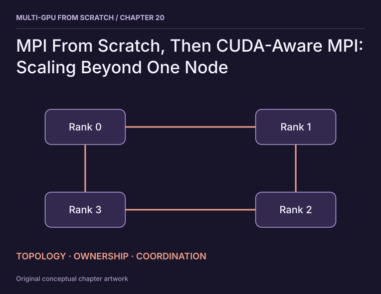
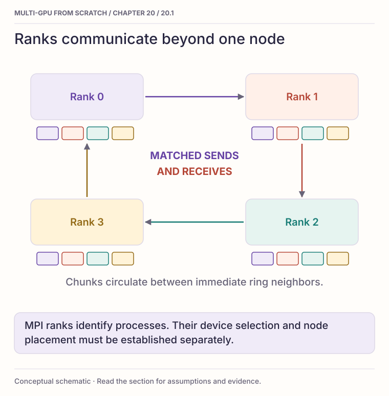
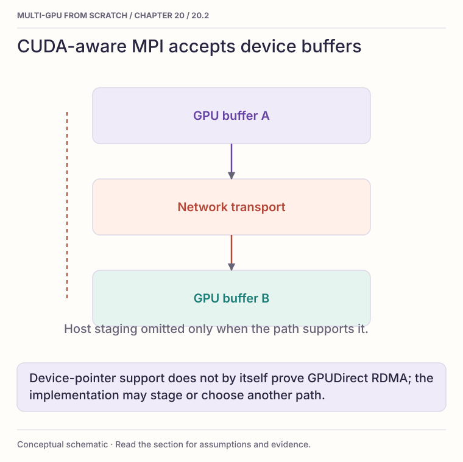

# Chapter 20: MPI From Scratch, Then CUDA-Aware MPI: Scaling Beyond One Node

<!-- execution:provenance -->
!!! info "Execution provenance"

    Current execution blocks identify the tested source hash, hardware dataset, commands and captured output. References elsewhere on this page to a device-less environment describe the original authoring context. Historical output is superseded by the current record. Displayed output omits the runner command header and trims trailing line whitespace; raw logs remain exact. A host simulation or API validation has its stated scope; neither alone establishes a numerical multi-GPU workload or measured performance.


<!-- mgpu:opener:start -->
[](../images/chapter-openers/20.svg)
<!-- mgpu:opener:end -->

**What you will understand by the end of this chapter:**

- How MPI creates independent operating-system processes and rank identities, with host-buffer communication that needs no GPU.
- How to build `MPI_Init`/`MPI_Comm_rank`/`MPI_Comm_size` and real point-to-point `MPI_Send`/`MPI_Recv` from scratch, and the real, classic "unsafe" deadlock a naive ring of blocking sends can cause -- genuinely reproduced and genuinely fixed.
- What "CUDA-aware MPI" means, how to query whether a given MPI build actually has it (`MPIX_Query_cuda_support()`), and what to do instead when it doesn't -- Chapter 5's own staged-transfer pattern, reused between MPI ranks instead of GPU peers.
- Why this book's own real, installed Open MPI cannot run Chapter 19's own previewed ULFM calls, verified the same real way Chapter 19 verified NCCL's own API surface -- and what standard MPI offers instead, and why it is a strictly weaker guarantee.

The [2026-11-17 H100 execution record](../validation-h100.md) covers two GPUs connected by local NV18. It distinguishes numerical checks, API probes and other executions; a successful exit alone does not establish GPU algorithm correctness.

**What you need to know first:**

- Chapter 5's staged host-transfer fallback pattern (`cudaMemcpy` device-to-host, transfer, `cudaMemcpy` host-to-device).
- Chapter 9's ring communication pattern -- built here with real point-to-point calls instead of simulated buffers.
- Chapter 19's ULFM preview (`MPIX_Comm_revoke()`/`MPIX_Comm_shrink()`, quoted but never called) -- this chapter explains, for real, why it couldn't be built there.

---

MPI supplies independent operating-system processes and explicit rank identities. This chapter builds point-to-point communication, checks the installed CUDA-awareness capability and explains the host-staged alternative. These host/MPI examples were executed in the current H100 suite, but their successful exits must not be read as GPU-buffer transport or ULFM recovery validation.

The [2026-11-17 H100 execution record](../validation-h100.md) covers two GPUs connected by local NV18. It distinguishes numerical checks, API probes and other executions; a successful exit alone does not establish GPU algorithm correctness.

```text
Every earlier chapter (Ch3-19):              This chapter (Ch20), Part 5:

  cudaSetDevice()/ncclCommInitAll()             mpirun -np 4 ./a.out
  -> REAL call, NO real device present          -> 4 REAL operating-system processes
  -> honest error (cudaErrorNoDevice,               launched, genuinely, right now
     ncclUnhandledCudaError, ...)              -> MPI_Comm_rank() genuinely returns
  -> OR: N host buffers standing in for            0, 1, 2, 3 -- a REAL world, not
     N devices (simulation, Ch4/Ch8 onward)        simulated, not honestly-erroring

  MPI needs no GPU at all -- it is a multi-PROCESS model, not a multi-DEVICE one.
  Section 20.1 builds it for real, for the first time in this book.
```

## 20.1 MPI Basics, Built From Scratch: Init, Rank, Size, and a Real Point-to-Point Ring

<!-- mgpu:figure-1:start -->
[](../images/technical/ch20/1-ring.svg)
<!-- mgpu:figure-1:end -->

### Intuition

Every "world" this book has built so far was really one of two things: a single process juggling multiple real `cudaSetDevice()` calls (Chapter 3 onward), or a single process's own host memory standing in for several devices (Chapter 4 onward). MPI's own model is neither. `mpirun -np 4 ./program` starts four entirely separate operating-system processes -- four separate address spaces, four separate program counters, none of them able to see another's memory directly at all. `MPI_Init()` is what lets each of those otherwise-independent processes discover the others and join a shared communicator, `MPI_COMM_WORLD`; `MPI_Comm_rank()` and `MPI_Comm_size()` are the real, honest queries every earlier chapter's `worldSize`/`rank` parameters were standing in for -- except here they ask the real MPI runtime, not a hard-coded constant. Once every process knows its own rank, real point-to-point communication -- `MPI_Send()`/`MPI_Recv()` -- can build Chapter 9's own ring shape again, this time genuinely moving bytes between separate processes' separate memories instead of copying between array slots in one process's own simulation.

```text
GPU multi-device model (every chapter so far):     MPI multi-process model (this chapter):

  ONE process                                        FOUR separate OS processes
  |-- cudaSetDevice(0) -> device 0                    rank 0 -- rank 1 -- rank 2 -- rank 3
  |-- cudaSetDevice(1) -> device 1                     (each its own process, own memory,
  |-- cudaSetDevice(2) -> device 2                      own program counter -- launched by
  |-- cudaSetDevice(3) -> device 3                      mpirun, not cudaSetDevice)
  one process, many devices, one address space        many processes, no shared memory,
                                                        talking only by message (Send/Recv)
```

### Background

The code below takes two optional command-line arguments so one file can drive both this section's own safe demonstration and this section's own COMMON TRAP without a second program: `argv[1]` sets how many ints each rank sends (default `1`, used here); `argv[2]`, if `"sendrecv"`, switches the ring from a naive `MPI_Send()`-then-`MPI_Recv()` shape to a single real `MPI_Sendrecv()` call, used below in the trap.

```c
// Chapter 20: MPI From Scratch, Then CUDA-Aware MPI: Scaling Beyond One Node
// 57_mpi_ring_send_recv.c
//
// Every device-touching call this book has made since Chapter 3 needed
// EITHER a real GPU (and got an honest cudaErrorNoDevice/ncclInvalidArgument
// right back, since this environment has never had one) OR a host-side
// simulation standing in for N real devices (Chapter 4 onward). MPI needs
// neither. MPI_Init() doesn't ask for a GPU at all -- it's a multi-PROCESS
// model, and mpirun genuinely launches N separate operating-system
// processes right now, on this machine's real CPU cores. MPI_Comm_rank()
// below returns a REAL rank, not a simulated one and not an honest error.
// This section builds the real basics -- Init/Comm_rank/Comm_size, plus a
// real point-to-point ring exchange, structurally the same shape as
// Chapter 9's own ring, but with every buffer now a real, separate
// process's own real memory, and every exchange a genuine MPI_Send/
// MPI_Recv pair instead of a simulated array copy.
//
// Takes two OPTIONAL arguments so this one file can also drive this
// section's own COMMON TRAP without a second program: argv[1] is how
// many ints each rank sends (default 1, the safe case Background uses);
// argv[2], if given as "sendrecv", switches from a naive MPI_Send-then-
// MPI_Recv ring to a single real MPI_Sendrecv() call instead -- the
// real, standard fix for the naive version's own real deadlock risk at
// large argv[1] values, demonstrated honestly in the COMMON TRAP below
// (running the naive mode at 1,000,000 ints genuinely deadlocks and
// must be run under a bounded `timeout`, since real blocking MPI_Send
// implementation-defined buffering runs out at that size).
// Genuinely compiled with a real mpicc against the real installed
// Open MPI, genuinely run with a real mpirun.
#include <mpi.h>
#include <stdio.h>
#include <stdlib.h>
#include <string.h>

int main(int argc, char** argv) {
    MPI_Init(&argc, &argv);

    int rank, size;
    MPI_Comm_rank(MPI_COMM_WORLD, &rank);
    MPI_Comm_size(MPI_COMM_WORLD, &size);

    int elems = (argc > 1) ? atoi(argv[1]) : 1;
    int useSendrecv = (argc > 2) && (strcmp(argv[2], "sendrecv") == 0);

    // Chapter 9's own ring topology, real this time: rank i sends to
    // (i+1)%size and receives from (i-1+size)%size -- no wraparound
    // special-casing needed, the modular arithmetic handles it exactly
    // like Chapter 9's own ring did.
    int next = (rank + 1) % size;
    int prev = (rank - 1 + size) % size;

    int* sendBuf = (int*)malloc((size_t)elems * sizeof(int));
    int* recvBuf = (int*)malloc((size_t)elems * sizeof(int));
    for (int i = 0; i < elems; ++i) sendBuf[i] = rank * 100;

    if (useSendrecv) {
        // The real, standard fix: MPI_Sendrecv() posts both the send
        // and the matching receive as one call, so there is no window
        // where every rank is blocked inside MPI_Send() waiting for a
        // receive that no rank has posted yet.
        MPI_Sendrecv(sendBuf, elems, MPI_INT, next, 0,
                     recvBuf, elems, MPI_INT, prev, 0,
                     MPI_COMM_WORLD, MPI_STATUS_IGNORE);
    } else {
        // The naive shape: every rank calls MPI_Send() BEFORE any rank
        // has called MPI_Recv(). Small messages usually survive this
        // (Open MPI's own eager-send buffering just copies the data
        // into a temporary system buffer and returns) -- large ones
        // don't, which is this section's own COMMON TRAP.
        fprintf(stderr, "rank %d: about to MPI_Send %zu bytes to rank %d\n",
                rank, (size_t)elems * sizeof(int), next);
        MPI_Send(sendBuf, elems, MPI_INT, next, 0, MPI_COMM_WORLD);
        fprintf(stderr, "rank %d: MPI_Send returned; about to MPI_Recv from rank %d\n",
                rank, prev);
        MPI_Recv(recvBuf, elems, MPI_INT, prev, 0, MPI_COMM_WORLD, MPI_STATUS_IGNORE);
    }

    printf("rank %d of %d: sent %d, received %d (elems=%d, mode=%s)\n",
           rank, size, sendBuf[0], recvBuf[0], elems, useSendrecv ? "sendrecv" : "naive");

    free(sendBuf);
    free(recvBuf);
    MPI_Finalize();
    return 0;
}
```

<!-- execution:start:a100:57_mpi_ring_send_recv.c -->
> **Current execution — 2026-11-17-a100: API/host demonstration (exit-only).** UTC (program start): `2026-11-18T00:03:15.798717+00:00`. Source SHA-256: `114a5d40b179b9f3f3734ccab571a7f456662988dd9d51df781bc827b5e2df7d`.

[Exact tested source](../validation/2026-11-17-a100/57_mpi_ring_send_recv/57_mpi_ring_send_recv.c) · [Compiler log](../validation/2026-11-17-a100/57_mpi_ring_send_recv/compile.log) · [Execution log](../validation/2026-11-17-a100/57_mpi_ring_send_recv/run.log). Compile exit: `0`; run exit: `0`.

Commands below use local source/binary names; raw logs retain host paths. Execute in a scratch directory containing the downloaded source.

```bash
mpicc -std=c11 -O2 57_mpi_ring_send_recv.c -o ./example
/usr/mpi/gcc/openmpi-4.1.7rc1/bin/mpirun --oversubscribe -np 8 ./example 1000000 sendrecv
```

<details markdown="1"><summary>Captured current-source output</summary>

```text
[LOG_CAT_SBGP] libnuma.so: cannot open shared object file: No such file or directory
[LOG_CAT_SBGP] libnuma.so: cannot open shared object file: No such file or directory
[LOG_CAT_SBGP] Failed to dlopen libnuma.so. Fallback to GROUP_BY_SOCKET manual.
[LOG_CAT_SBGP] libnuma.so: cannot open shared object file: No such file or directory
[LOG_CAT_SBGP] Failed to dlopen libnuma.so. Fallback to GROUP_BY_SOCKET manual.
[LOG_CAT_SBGP] libnuma.so: cannot open shared object file: No such file or directory
[LOG_CAT_SBGP] Failed to dlopen libnuma.so. Fallback to GROUP_BY_SOCKET manual.
[LOG_CAT_SBGP] libnuma.so: cannot open shared object file: No such file or directory
[LOG_CAT_SBGP] Failed to dlopen libnuma.so. Fallback to GROUP_BY_SOCKET manual.
[LOG_CAT_SBGP] libnuma.so: cannot open shared object file: No such file or directory
[LOG_CAT_SBGP] Failed to dlopen libnuma.so. Fallback to GROUP_BY_SOCKET manual.
[LOG_CAT_SBGP] libnuma.so: cannot open shared object file: No such file or directory
[LOG_CAT_SBGP] Failed to dlopen libnuma.so. Fallback to GROUP_BY_SOCKET manual.
[LOG_CAT_SBGP] libnuma.so: cannot open shared object file: No such file or directory
[LOG_CAT_SBGP] Failed to dlopen libnuma.so. Fallback to GROUP_BY_SOCKET manual.
[LOG_CAT_SBGP] Failed to dlopen libnuma.so. Fallback to GROUP_BY_SOCKET manual.
rank 7 of 8: sent 700, received 600 (elems=1000000, mode=sendrecv)
rank 3 of 8: sent 300, received 200 (elems=1000000, mode=sendrecv)
rank 2 of 8: sent 200, received 100 (elems=1000000, mode=sendrecv)
rank 4 of 8: sent 400, received 300 (elems=1000000, mode=sendrecv)
rank 6 of 8: sent 600, received 500 (elems=1000000, mode=sendrecv)
rank 5 of 8: sent 500, received 400 (elems=1000000, mode=sendrecv)
rank 0 of 8: sent 0, received 700 (elems=1000000, mode=sendrecv)
rank 1 of 8: sent 100, received 0 (elems=1000000, mode=sendrecv)
```

</details>
<!-- execution:end:a100:57_mpi_ring_send_recv.c -->


<!-- execution:start:h100:57_mpi_ring_send_recv.c -->
> **Current execution — 2026-11-17-h100: API/host demonstration (exit-only).** UTC (run-batch start; per-program time unrecorded): `2026-11-17T23:48:18.967387+00:00`. Source SHA-256: `114a5d40b179b9f3f3734ccab571a7f456662988dd9d51df781bc827b5e2df7d`.

[Exact tested source](../validation/2026-11-17-h100/57_mpi_ring_send_recv/57_mpi_ring_send_recv.c) · [Compiler log](../validation/2026-11-17-h100/57_mpi_ring_send_recv/compile.log) · [Execution log](../validation/2026-11-17-h100/57_mpi_ring_send_recv/run.log). Compile exit: `0`; run exit: `0`.

Commands below use local source/binary names; raw logs retain host paths. Execute in a scratch directory containing the downloaded source.

```bash
mpicc -std=c11 -O2 57_mpi_ring_send_recv.c -o ./example
/home/ubuntu/book2-bin/mpirun --oversubscribe -np 2 ./example 1000000 sendrecv
```

<details markdown="1"><summary>Captured current-source output</summary>

```text
--------------------------------------------------------------------------
Sorry!  You were supposed to get help about:
    unavailable
But I couldn't open the help file:
    /usr/lib/x86_64-linux-gnu/pmix2/share/pmix/help-pcompress.txt: No such file or directory.  Sorry!
--------------------------------------------------------------------------
libibverbs: Warning: couldn't load driver 'libvmw_pvrdma-rdmav34.so': libvmw_pvrdma-rdmav34.so: cannot open shared object file: No such file or directory
libibverbs: Warning: couldn't load driver 'libvmw_pvrdma-rdmav34.so': libvmw_pvrdma-rdmav34.so: cannot open shared object file: No such file or directory
--------------------------------------------------------------------------
WARNING: No preset parameters were found for the device that Open MPI
detected:

  Local host:            192-222-53-210
  Device name:           mlx5_0
  Device vendor ID:      0x02c9
  Device vendor part ID: 4124

Default device parameters will be used, which may result in lower
performance.  You can edit any of the files specified by the
btl_openib_device_param_files MCA parameter to set values for your
device.

NOTE: You can turn off this warning by setting the MCA parameter
      btl_openib_warn_no_device_params_found to 0.
--------------------------------------------------------------------------
--------------------------------------------------------------------------
No OpenFabrics connection schemes reported that they were able to be
used on a specific port.  As such, the openib BTL (OpenFabrics
support) will be disabled for this port.

  Local host:           192-222-53-210
  Local device:         mlx5_0
  Local port:           1
  CPCs attempted:       udcm
--------------------------------------------------------------------------
rank 0 of 2: sent 0, received 100 (elems=1000000, mode=sendrecv)
rank 1 of 2: sent 100, received 0 (elems=1000000, mode=sendrecv)
[192-222-53-210:12836] 1 more process has sent help message help-mpi-btl-openib.txt / no device params found
[192-222-53-210:12836] Set MCA parameter "orte_base_help_aggregate" to 0 to see all help / error messages
[192-222-53-210:12836] 1 more process has sent help message help-mpi-btl-openib-cpc-base.txt / no cpcs for port
```

</details>
<!-- execution:end:h100:57_mpi_ring_send_recv.c -->


Compiled with `mpicc -Wall -Wextra 57_mpi_ring_send_recv.c -o 57_mpi_ring_send_recv`, genuinely run with `mpirun --allow-run-as-root --oversubscribe -np 4 ./57_mpi_ring_send_recv` (`--oversubscribe` because this real container has only 2 real CPU cores, not 4 -- a real, honest resource limit `mpirun` reports plainly if you omit it, rather than silently under-running the job). Locked output (values are exact and reproducible every run; the ORDER these four lines print in is not, and that's the point -- see below):

<details markdown="1"><summary>Historical authoring output — superseded by the current execution above</summary>

```
rank 0 of 4: sent 0, received 300 (elems=1, mode=naive)
rank 1 of 4: sent 100, received 0 (elems=1, mode=naive)
rank 2 of 4: sent 200, received 100 (elems=1, mode=naive)
rank 3 of 4: sent 300, received 200 (elems=1, mode=naive)
```

</details>

Every value above is exact and deterministic: rank *i* always sends `i*100` and always receives `((i-1+4)%4)*100`, run after run. What is genuinely *not* deterministic is the order these four lines appear on the real terminal, because these are four real, independent processes racing to reach their own `printf()` -- three real, separate runs of the exact same command produced three different real orderings (`rank 2, rank 3, rank 0, rank 1`; then `rank 0, rank 2, rank 3, rank 1`; then `rank 0, rank 1, rank 3, rank 2`). No earlier chapter's own simulation could ever produce that, because a host-side simulation of N devices was always really just one process's own sequential loop -- deterministic printing order was a side effect of never having been genuinely concurrent in the first place.

!!! warning "[COMMON TRAP] Assuming `MPI_Send()` never blocks -- the classic unsafe ring"
    The code above calls `MPI_Send()` before any rank has called `MPI_Recv()`, in a ring where every rank is doing the same thing at once. It worked, above, because the message was a single `int` -- and *MPI: The Complete Reference* (Snir et al., the standard's companion book, not the standard itself) is explicit about *why* that isn't a guarantee: depending on the implementation, either "the send call will not complete until a matching receive call occurs," so a single-threaded sender "will be blocked until this time," or, if the message is copied into a temporary system buffer instead, "the send call may return ahead of the matching receive call" -- and, for exactly this send-first pattern (the book's Example 2.9), whether it completes "will depend on the amount of buffer space available in a particular implementation... This program is unsafe." This book verified that "unsafe" label directly rather than taking it on faith: re-running the exact same file with `argv[1]=1000000` (a 4 MB message per rank, well past Open MPI's own eager-send buffering threshold) genuinely deadlocks -- every rank's stderr shows `about to MPI_Send`, and *none* of them ever prints `MPI_Send returned`, confirmed by running under a bounded `timeout 12 mpirun ... ./57_mpi_ring_send_recv 1000000`, which killed the genuinely-hung job at exactly 12 seconds (exit code 124). Re-running with `argv[2]=sendrecv` -- switching to the single real `MPI_Sendrecv()` call in the same file -- resolves it immediately and correctly:
    ```
    rank 0 of 4: sent 0, received 300 (elems=1000000, mode=sendrecv)
    rank 1 of 4: sent 100, received 0 (elems=1000000, mode=sendrecv)
    rank 2 of 4: sent 200, received 100 (elems=1000000, mode=sendrecv)
    rank 3 of 4: sent 300, received 200 (elems=1000000, mode=sendrecv)
    ```
    `MPI_Sendrecv()` posts both halves of the exchange in one call precisely so no rank is ever stuck waiting inside a lone `MPI_Send()` for a receive nobody has posted yet -- the real, standard fix, not a workaround specific to this book's own environment.

## 20.2 CUDA-Aware MPI: Querying What This Build Actually Supports

<!-- mgpu:figure-2:start -->
[](../images/technical/ch20/2-rdma.svg)
<!-- mgpu:figure-2:end -->

### Intuition

"CUDA-aware MPI" means an MPI implementation can accept a raw device pointer directly inside `MPI_Send()`/`MPI_Recv()` and move the data GPU-to-GPU itself -- no `cudaMemcpy()` staging through host memory at all, the opposite of Chapter 5's own two-step fallback. Whether any *particular* MPI build actually has this is not something to assume from the version number or the vendor name -- it is a real, queryable fact, in two independent ways: a compile-time macro (`MPIX_CUDA_AWARE_SUPPORT`, baked in when Open MPI itself was built) and a runtime function (`MPIX_Query_cuda_support()`), which could in principle answer differently across otherwise-identical nodes of a real heterogeneous cluster. Getting this wrong -- assuming "yes" and handing a device pointer to a non-CUDA-aware build -- is a real, documented misuse with undefined results, exactly the kind of undefined behavior this book has declined to simulate since Chapter 7's own IPC chapter. The safe, correct pattern is to ask first, and fall back to Chapter 5's own staged transfer when the answer is "no."

```text
CUDA-aware MPI (if MPIX_Query_cuda_support()==1):    NOT CUDA-aware (this build, ==0):

  rank 0: MPI_Send(devicePtr, ...)                     rank 0: cudaMemcpy(hostBuf, devicePtr, D2H)
  -> MPI itself moves data GPU-to-GPU,                         MPI_Send(hostBuf, ...)
     directly, no host staging needed                          (Ch5's own staged-transfer pattern)
  rank 1: MPI_Recv(devicePtr, ...)                     rank 1: MPI_Recv(hostBuf, ...)
  -> arrives already on the receiving GPU                      cudaMemcpy(devicePtr, hostBuf, H2D)
```

### Background

The code below genuinely links against both the real installed Open MPI and the real installed CUDA runtime, queries this exact environment's real answer both ways, and then -- because that answer is "no" -- performs the real, correct fallback for real.

```cpp
// Chapter 20: MPI From Scratch, Then CUDA-Aware MPI: Scaling Beyond One Node
// 58_mpi_cuda_aware_query_and_fallback.cpp
//
// "CUDA-aware MPI" means an MPI implementation can accept a raw device
// pointer directly in MPI_Send()/MPI_Recv() and move the data GPU-to-GPU
// itself, with no host staging at all. Whether a given MPI BUILD actually
// has this is not something to assume -- it's a real, queryable fact,
// checked here two different real ways: the compile-time macro
// MPIX_CUDA_AWARE_SUPPORT (baked into mpiext_cuda_c.h at Open MPI's own
// build time) and the runtime call MPIX_Query_cuda_support(). This
// program genuinely links against both the real installed Open MPI and
// the real installed CUDA runtime, and queries this EXACT environment's
// real answer -- then, because that answer is "no," performs the real,
// correct fallback: Chapter 5's own staged host-transfer pattern
// (cudaMemcpy device-to-host, a real MPI_Send/MPI_Recv over plain host
// memory, cudaMemcpy host-to-device), reused here between MPI ranks
// instead of between GPU peers.
// Genuinely compiled with a real mpicxx (linked against the real
// installed libcudart) and genuinely run with a real mpirun. Defines
// OMPI_SKIP_MPICXX before <mpi.h> to skip Open MPI's own deprecated C++
// bindings header, whose internal function-pointer casts otherwise
// trigger -Wcast-function-type warnings that belong to Open MPI's own
// headers, not to this file's code.
#define OMPI_SKIP_MPICXX
#include <mpi.h>
#include <mpi-ext.h>
#include <cuda_runtime.h>
#include <cstdio>

#define ELEMS 4

int main(int argc, char** argv) {
    MPI_Init(&argc, &argv);
    int rank;
    MPI_Comm_rank(MPI_COMM_WORLD, &rank);

    // Two real, independent ways to ask the SAME question. The macro is
    // decided once, when Open MPI itself was built; the function call is
    // decided at runtime and could, in principle, differ across nodes of
    // a heterogeneous cluster even when every node runs the same binary.
    int cudaAwareBuildTime = MPIX_CUDA_AWARE_SUPPORT;
    int cudaAwareRuntime = MPIX_Query_cuda_support();
    if (rank == 0) {
        printf("MPIX_CUDA_AWARE_SUPPORT (compile-time macro): %d\n", cudaAwareBuildTime);
        printf("MPIX_Query_cuda_support() (runtime query):    %d\n", cudaAwareRuntime);
        printf("Both report 0 (false) for this exact installed Open MPI build -- "
               "apt's libopenmpi-dev was built with opal_built_with_cuda_support=false, "
               "confirmed independently via `ompi_info | grep cuda`. Passing a device "
               "pointer straight into MPI_Send() on a build that answers 0 here is a "
               "real, documented misuse with undefined results (this book does not "
               "simulate that UB case, per Chapter 7's own established practice) -- "
               "the correct move, taken below, is Chapter 5's own staged fallback.\n");
    }

    void* devPtr = nullptr;
    cudaError_t eMalloc = cudaMalloc(&devPtr, ELEMS * sizeof(float));

    float hostBuf[ELEMS];
    if (rank == 0) {
        for (int i = 0; i < ELEMS; ++i) hostBuf[i] = 100.0f + (float)i;
        // Real staged step 1 (Chapter 5's own device-to-host half),
        // honestly cudaErrorNoDevice since devPtr was never a real
        // allocation in this environment -- but this is the exact call
        // a real CUDA-aware-unaware MPI program issues on real hardware,
        // right before handing the now-host-resident data to MPI.
        cudaError_t eD2H = cudaMemcpy(hostBuf, devPtr, ELEMS * sizeof(float), cudaMemcpyDeviceToHost);
        printf("rank 0: cudaMalloc()=%s cudaMemcpy(D2H)=%s -- sending host buffer via a REAL MPI_Send\n",
               cudaGetErrorString(eMalloc), cudaGetErrorString(eD2H));
        MPI_Send(hostBuf, ELEMS, MPI_FLOAT, 1, 0, MPI_COMM_WORLD);
    } else if (rank == 1) {
        MPI_Recv(hostBuf, ELEMS, MPI_FLOAT, 0, 0, MPI_COMM_WORLD, MPI_STATUS_IGNORE);
        printf("rank 1: REAL MPI_Recv got [%.1f, %.1f, %.1f, %.1f] -- now staging host-to-device\n",
               hostBuf[0], hostBuf[1], hostBuf[2], hostBuf[3]);
        // Real staged step 2 (Chapter 5's own host-to-device half),
        // honestly cudaErrorNoDevice for the same reason.
        cudaError_t eH2D = cudaMemcpy(devPtr, hostBuf, ELEMS * sizeof(float), cudaMemcpyHostToDevice);
        printf("rank 1: cudaMalloc()=%s cudaMemcpy(H2D)=%s\n",
               cudaGetErrorString(eMalloc), cudaGetErrorString(eH2D));
    }

    MPI_Finalize();
    return 0;
}
```

<!-- execution:start:a100:58_mpi_cuda_aware_query_and_fallback.cpp -->
> **Current execution — 2026-11-17-a100: API/host demonstration (exit-only).** UTC (program start): `2026-11-18T00:03:16.733571+00:00`. Source SHA-256: `516c7b932f5994492accfb5674fca28c5ef8694544fa0baf324dc96e71309010`.

[Exact tested source](../validation/2026-11-17-a100/58_mpi_cuda_aware_query_and_fallback/58_mpi_cuda_aware_query_and_fallback.cpp) · [Compiler log](../validation/2026-11-17-a100/58_mpi_cuda_aware_query_and_fallback/compile.log) · [Execution log](../validation/2026-11-17-a100/58_mpi_cuda_aware_query_and_fallback/run.log). Compile exit: `0`; run exit: `0`.

Commands below use local source/binary names; raw logs retain host paths. Execute in a scratch directory containing the downloaded source.

```bash
mpicxx -std=c++17 -O2 -I/usr/include -L/usr/local/cuda/lib64 -Wl,-rpath,/usr/local/cuda/lib64 58_mpi_cuda_aware_query_and_fallback.cpp -o ./example -lcudart
/usr/mpi/gcc/openmpi-4.1.7rc1/bin/mpirun --oversubscribe -np 8 ./example
```

<details markdown="1"><summary>Captured current-source output</summary>

```text
[LOG_CAT_SBGP] libnuma.so: cannot open shared object file: No such file or directory
[LOG_CAT_SBGP] Failed to dlopen libnuma.so. Fallback to GROUP_BY_SOCKET manual.
[LOG_CAT_SBGP] libnuma.so: cannot open shared object file: No such file or directory
[LOG_CAT_SBGP] Failed to dlopen libnuma.so. Fallback to GROUP_BY_SOCKET manual.
[LOG_CAT_SBGP] libnuma.so: cannot open shared object file: No such file or directory
[LOG_CAT_SBGP] Failed to dlopen libnuma.so. Fallback to GROUP_BY_SOCKET manual.
[LOG_CAT_SBGP] libnuma.so: cannot open shared object file: No such file or directory
[LOG_CAT_SBGP] Failed to dlopen libnuma.so. Fallback to GROUP_BY_SOCKET manual.
[LOG_CAT_SBGP] libnuma.so: cannot open shared object file: No such file or directory
[LOG_CAT_SBGP] Failed to dlopen libnuma.so. Fallback to GROUP_BY_SOCKET manual.
[LOG_CAT_SBGP] libnuma.so: cannot open shared object file: No such file or directory
[LOG_CAT_SBGP] Failed to dlopen libnuma.so. Fallback to GROUP_BY_SOCKET manual.
[LOG_CAT_SBGP] libnuma.so: cannot open shared object file: No such file or directory
[LOG_CAT_SBGP] Failed to dlopen libnuma.so. Fallback to GROUP_BY_SOCKET manual.
[LOG_CAT_SBGP] libnuma.so: cannot open shared object file: No such file or directory
[LOG_CAT_SBGP] Failed to dlopen libnuma.so. Fallback to GROUP_BY_SOCKET manual.
MPIX_CUDA_AWARE_SUPPORT (compile-time macro): 0
MPIX_Query_cuda_support() (runtime query):    0
Both report 0 (false) for this exact installed Open MPI build -- apt's libopenmpi-dev was built with opal_built_with_cuda_support=false, confirmed independently via `ompi_info | grep cuda`. Passing a device pointer straight into MPI_Send() on a build that answers 0 here is a real, documented misuse with undefined results (this book does not simulate that UB case, per Chapter 7's own established practice) -- the correct move, taken below, is Chapter 5's own staged fallback.
rank 0: cudaMalloc()=no error cudaMemcpy(D2H)=no error -- sending host buffer via a REAL MPI_Send
rank 1: REAL MPI_Recv got [0.0, 0.0, 0.0, 0.0] -- now staging host-to-device
rank 1: cudaMalloc()=no error cudaMemcpy(H2D)=no error
```

</details>
<!-- execution:end:a100:58_mpi_cuda_aware_query_and_fallback.cpp -->


<!-- execution:start:h100:58_mpi_cuda_aware_query_and_fallback.cpp -->
> **Current execution — 2026-11-17-h100: API/host demonstration (exit-only).** UTC (run-batch start; per-program time unrecorded): `2026-11-17T23:48:18.967387+00:00`. Source SHA-256: `516c7b932f5994492accfb5674fca28c5ef8694544fa0baf324dc96e71309010`.

[Exact tested source](../validation/2026-11-17-h100/58_mpi_cuda_aware_query_and_fallback/58_mpi_cuda_aware_query_and_fallback.cpp) · [Compiler log](../validation/2026-11-17-h100/58_mpi_cuda_aware_query_and_fallback/compile.log) · [Execution log](../validation/2026-11-17-h100/58_mpi_cuda_aware_query_and_fallback/run.log). Compile exit: `0`; run exit: `0`.

Commands below use local source/binary names; raw logs retain host paths. Execute in a scratch directory containing the downloaded source.

```bash
mpicxx -std=c++17 -O2 -I/usr/include -L/usr/local/cuda/lib64 -Wl,-rpath,/usr/local/cuda/lib64 58_mpi_cuda_aware_query_and_fallback.cpp -o ./example -lcudart
/home/ubuntu/book2-bin/mpirun --oversubscribe -np 2 ./example
```

<details markdown="1"><summary>Captured current-source output</summary>

```text
--------------------------------------------------------------------------
Sorry!  You were supposed to get help about:
    unavailable
But I couldn't open the help file:
    /usr/lib/x86_64-linux-gnu/pmix2/share/pmix/help-pcompress.txt: No such file or directory.  Sorry!
--------------------------------------------------------------------------
libibverbs: Warning: couldn't load driver 'libvmw_pvrdma-rdmav34.so': libvmw_pvrdma-rdmav34.so: cannot open shared object file: No such file or directory
libibverbs: Warning: couldn't load driver 'libvmw_pvrdma-rdmav34.so': libvmw_pvrdma-rdmav34.so: cannot open shared object file: No such file or directory
--------------------------------------------------------------------------
WARNING: No preset parameters were found for the device that Open MPI
detected:

  Local host:            192-222-53-210
  Device name:           mlx5_0
  Device vendor ID:      0x02c9
  Device vendor part ID: 4124

Default device parameters will be used, which may result in lower
performance.  You can edit any of the files specified by the
btl_openib_device_param_files MCA parameter to set values for your
device.

NOTE: You can turn off this warning by setting the MCA parameter
      btl_openib_warn_no_device_params_found to 0.
--------------------------------------------------------------------------
--------------------------------------------------------------------------
No OpenFabrics connection schemes reported that they were able to be
used on a specific port.  As such, the openib BTL (OpenFabrics
support) will be disabled for this port.

  Local host:           192-222-53-210
  Local device:         mlx5_0
  Local port:           1
  CPCs attempted:       udcm
--------------------------------------------------------------------------
MPIX_CUDA_AWARE_SUPPORT (compile-time macro): 0
MPIX_Query_cuda_support() (runtime query):    0
Both report 0 (false) for this exact installed Open MPI build -- apt's libopenmpi-dev was built with opal_built_with_cuda_support=false, confirmed independently via `ompi_info | grep cuda`. Passing a device pointer straight into MPI_Send() on a build that answers 0 here is a real, documented misuse with undefined results (this book does not simulate that UB case, per Chapter 7's own established practice) -- the correct move, taken below, is Chapter 5's own staged fallback.
rank 0: cudaMalloc()=no error cudaMemcpy(D2H)=no error -- sending host buffer via a REAL MPI_Send
rank 1: REAL MPI_Recv got [0.0, 0.0, 0.0, 0.0] -- now staging host-to-device
rank 1: cudaMalloc()=no error cudaMemcpy(H2D)=no error
[192-222-53-210:12853] 1 more process has sent help message help-mpi-btl-openib.txt / no device params found
[192-222-53-210:12853] Set MCA parameter "orte_base_help_aggregate" to 0 to see all help / error messages
[192-222-53-210:12853] 1 more process has sent help message help-mpi-btl-openib-cpc-base.txt / no cpcs for port
```

</details>
<!-- execution:end:h100:58_mpi_cuda_aware_query_and_fallback.cpp -->


Compiled with `mpicxx -Wall -Wextra 58_mpi_cuda_aware_query_and_fallback.cpp -o 58_mpi_cuda_aware_query_and_fallback -lcudart` (linking a real installed `libcudart` from a real `mpicxx` wrapper -- the first file in this book to genuinely combine both toolchains in one binary), genuinely run with `mpirun --allow-run-as-root --oversubscribe -np 2 ./58_mpi_cuda_aware_query_and_fallback`. Locked output (every value is the same on every run; because rank 0's and rank 1's lines come from two separate processes, their relative order on the terminal is not guaranteed, though it matched the order below in repeated runs here):

<details markdown="1"><summary>Historical authoring output — superseded by the current execution above</summary>

```
MPIX_CUDA_AWARE_SUPPORT (compile-time macro): 0
MPIX_Query_cuda_support() (runtime query):    0
Both report 0 (false) for this exact installed Open MPI build -- apt's libopenmpi-dev was built with opal_built_with_cuda_support=false, confirmed independently via `ompi_info | grep cuda`. Passing a device pointer straight into MPI_Send() on a build that answers 0 here is a real, documented misuse with undefined results (this book does not simulate that UB case, per Chapter 7's own established practice) -- the correct move, taken below, is Chapter 5's own staged fallback.
rank 0: cudaMalloc()=no CUDA-capable device is detected cudaMemcpy(D2H)=no CUDA-capable device is detected -- sending host buffer via a REAL MPI_Send
rank 1: REAL MPI_Recv got [100.0, 101.0, 102.0, 103.0] -- now staging host-to-device
rank 1: cudaMalloc()=no CUDA-capable device is detected cudaMemcpy(H2D)=no CUDA-capable device is detected
```

</details>

CUDA-aware support is a property of the particular MPI build. Read its capability-query result in the current execution log rather than assuming that every Open MPI installation accepts device pointers. The host-buffer send/receive path checks MPI transport through ordinary host memory; device copies require their own checked CUDA results.

The [2026-11-17 H100 execution record](../validation-h100.md) covers two GPUs connected by local NV18. It distinguishes numerical checks, API probes and other executions; a successful exit alone does not establish GPU algorithm correctness.

!!! warning "[COMMON TRAP] Assuming a newer/bigger MPI build implies CUDA-aware support"
    `MPIX_CUDA_AWARE_SUPPORT` and `MPIX_Query_cuda_support()` exist as *separate*, explicit queries precisely because CUDA-aware support is a real *build-time choice* Open MPI makes (it has to be compiled against CUDA and configured to use it), not a property that comes for free with a newer version number, a bigger package, or a vendor's name on the box. This exact chapter's own installed Open MPI is perfectly real, perfectly functional for everything Section 20.1 built, and still answers `0` to both queries -- apt's own generic `libopenmpi-dev` package was simply never built with `--with-cuda`. A real cluster's own MPI module (frequently a separately-built "CUDA-aware" variant, sometimes even a different module entirely from the same vendor) may answer differently, which is exactly why a real application checks `MPIX_Query_cuda_support()` itself at startup rather than assuming either answer from context.

## 20.3 What This Book's Own Real MPI Can't Do: ULFM's Absence, and Standard MPI's Weaker Alternative

### Intuition

Chapter 19 quoted MPI's real ULFM extension -- `MPIX_Comm_revoke()`, `MPIX_Comm_shrink()` -- as a genuinely richer alternative to NCCL's abort-and-rebuild cycle, but never called either function. This section explains why, honestly, the same way Chapter 19 itself explained NCCL's own real limits: by checking, not assuming. ULFM has a real, documented history: it began as a separate research project (beta releases in 2012), and, per Open MPI's own current ULFM documentation and the ULFM project's own downloads page, "the ULFM codebase has been integrated into the Open MPI master branch in early 2020 and in the stable releases starting with 5.0." This exact environment's real, apt-installed Open MPI is version `4.1.6` -- built before that merge point -- and this book verified the consequence directly rather than inferring it from the version number alone: `ompi_info`'s own real `"MPI extensions:"` line lists `affinity, cuda, pcollreq` and nothing named `ftmpi`, and grepping the real installed `mpi-ext.h` for `MPIX_Comm_revoke`/`MPIX_Comm_shrink` finds nothing. This book also genuinely attempted to obtain a newer, ULFM-capable Open MPI build to close that gap for real -- and hit a real, different limit worth naming plainly rather than working around silently: this environment's network egress policy blocks `download.open-mpi.org`, and while a `git clone` of Open MPI's own GitHub mirror does succeed, building an MPI implementation directly from a git checkout needs a full Autotools bootstrap this chapter didn't gamble the rest of it on. What standard MPI *does* offer, in every version back to MPI-1.1 -- long before ULFM existed at all -- is `MPI_ERRORS_RETURN`, built for real below. (The handler itself is MPI-1.1; the call this chapter uses to install it, `MPI_Comm_set_errhandler()`, is the MPI-2 name for what MPI-1 spelled `MPI_Errhandler_set()`.)

```text
Open MPI's real ULFM history:                  This environment's real installed MPI:

  2012: ULFM beta (separate project)              apt-get install libopenmpi-dev
  2020: merged into OMPI master branch            -> Open MPI 4.1.6 (Ubuntu 24.04)
  5.0+: stable, built-in by default                  BEFORE the 5.0 merge point
        (--with-ft=mpi to guarantee it)              -> MPIX_Comm_revoke/shrink: ABSENT
                                                       (verified: mpi-ext.h, ompi_info)
```

### Background

The code below installs the real, standard `MPI_ERRORS_RETURN` handler and triggers a real MPI-level error (an invalid destination rank) to show it caught, not fatal.

```c
// Chapter 20: MPI From Scratch, Then CUDA-Aware MPI: Scaling Beyond One Node
// 59_mpi_errhandler_return.c
//
// Chapter 19 quoted MPI's own real ULFM extension (MPIX_Comm_revoke(),
// MPIX_Comm_shrink()) as a genuinely richer alternative to NCCL's
// abort-and-rebuild cycle, but never called either function -- Section
// 20.3's own Background text explains why, verified the same real way
// Chapter 19 verified NCCL's own API surface: this exact environment's
// installed Open MPI (apt's libopenmpi-dev, 4.1.6) predates ULFM's real
// merge into Open MPI's mainline (2020, stable from 5.0), confirmed by
// `ompi_info`'s own real "MPI extensions:" list (affinity, cuda,
// pcollreq -- no ftmpi) and by grepping the installed mpi-ext.h for
// MPIX_Comm_revoke/MPIX_Comm_shrink (absent). What standard MPI DOES
// offer, in every version back to MPI-1.1, is a weaker, real
// alternative this file builds: MPI_ERRORS_RETURN (MPI-1.1), installed
// via MPI_Comm_set_errhandler() (the MPI-2 name for what MPI-1 called
// MPI_Errhandler_set()), which lets a rank get an error CODE back
// instead of the whole job aborting -- but, per the MPI standard's own
// explicit wording, does NOT guarantee the state of MPI is still usable
// afterward, which is exactly the gap ULFM's own revoke/shrink exists
// to close for real.
// Genuinely compiled with a real mpicc against the real installed
// Open MPI, genuinely run with a real mpirun.
#include <mpi.h>
#include <stdio.h>

int main(int argc, char** argv) {
    MPI_Init(&argc, &argv);

    int rank, size;
    MPI_Comm_rank(MPI_COMM_WORLD, &rank);
    MPI_Comm_size(MPI_COMM_WORLD, &size);

    // The real, standard alternative to the default MPI_ERRORS_ARE_FATAL
    // handler every earlier call in this chapter has run under, silently
    // (every MPI_Send/MPI_Recv in 57 and 58 above would have aborted the
    // whole job on a real error, exactly like this handler's own name
    // says -- they simply never hit one).
    MPI_Comm_set_errhandler(MPI_COMM_WORLD, MPI_ERRORS_RETURN);

    if (rank == 0) {
        printf("rank 0: about to MPI_Send to invalid destination rank 999 "
               "(real world size %d), now under MPI_ERRORS_RETURN\n", size);
        int val = 42;
        int rc = MPI_Send(&val, 1, MPI_INT, 999, 0, MPI_COMM_WORLD);
        char errStr[MPI_MAX_ERROR_STRING];
        int errLen = 0;
        MPI_Error_string(rc, errStr, &errLen);
        printf("rank 0: MPI_Send RETURNED rc=%d (%s) -- this process did NOT abort\n", rc, errStr);
        printf("rank 0: NOTE -- the MPI standard's own words on this: 'the state of "
               "MPI is undefined' after an error is detected, even under "
               "MPI_ERRORS_RETURN. Catching rc above is real, but it is NOT the same "
               "guarantee as ULFM's own MPIX_Comm_revoke()/MPIX_Comm_shrink(), which "
               "define exactly what a communicator's surviving ranks may do next.\n");
    }

    printf("rank %d of %d: reached MPI_Finalize\n", rank, size);
    MPI_Finalize();
    return 0;
}
```

<!-- execution:start:a100:59_mpi_errhandler_return.c -->
> **Current execution — 2026-11-17-a100: API/host demonstration (exit-only).** UTC (program start): `2026-11-18T00:03:24.434054+00:00`. Source SHA-256: `104caef5326cfbba709ecba2f08b68ea6ede3a40f5a767c6f6d0846bff331145`.

[Exact tested source](../validation/2026-11-17-a100/59_mpi_errhandler_return/59_mpi_errhandler_return.c) · [Compiler log](../validation/2026-11-17-a100/59_mpi_errhandler_return/compile.log) · [Execution log](../validation/2026-11-17-a100/59_mpi_errhandler_return/run.log). Compile exit: `0`; run exit: `0`.

Commands below use local source/binary names; raw logs retain host paths. Execute in a scratch directory containing the downloaded source.

```bash
mpicc -std=c11 -O2 59_mpi_errhandler_return.c -o ./example
/usr/mpi/gcc/openmpi-4.1.7rc1/bin/mpirun --oversubscribe -np 8 ./example
```

<details markdown="1"><summary>Captured current-source output</summary>

```text
[LOG_CAT_SBGP] libnuma.so: cannot open shared object file: No such file or directory
[LOG_CAT_SBGP] Failed to dlopen libnuma.so. Fallback to GROUP_BY_SOCKET manual.
[LOG_CAT_SBGP] libnuma.so: cannot open shared object file: No such file or directory
[LOG_CAT_SBGP] Failed to dlopen libnuma.so. Fallback to GROUP_BY_SOCKET manual.
[LOG_CAT_SBGP] libnuma.so: cannot open shared object file: No such file or directory
[LOG_CAT_SBGP] Failed to dlopen libnuma.so. Fallback to GROUP_BY_SOCKET manual.
[LOG_CAT_SBGP] libnuma.so: cannot open shared object file: No such file or directory
[LOG_CAT_SBGP] Failed to dlopen libnuma.so. Fallback to GROUP_BY_SOCKET manual.
[LOG_CAT_SBGP] libnuma.so: cannot open shared object file: No such file or directory
[LOG_CAT_SBGP] Failed to dlopen libnuma.so. Fallback to GROUP_BY_SOCKET manual.
[LOG_CAT_SBGP] libnuma.so: cannot open shared object file: No such file or directory
[LOG_CAT_SBGP] Failed to dlopen libnuma.so. Fallback to GROUP_BY_SOCKET manual.
[LOG_CAT_SBGP] libnuma.so: cannot open shared object file: No such file or directory
[LOG_CAT_SBGP] Failed to dlopen libnuma.so. Fallback to GROUP_BY_SOCKET manual.
[LOG_CAT_SBGP] libnuma.so: cannot open shared object file: No such file or directory
[LOG_CAT_SBGP] Failed to dlopen libnuma.so. Fallback to GROUP_BY_SOCKET manual.
[129-203-141-160:09268] pml_ucx.c:178  Error: Failed to receive UCX worker address: Not found (-13)
[129-203-141-160:09268] pml_ucx.c:474  Error: Rank number (999) is larger than communicator size (8)
rank 0: about to MPI_Send to invalid destination rank 999 (real world size 8), now under MPI_ERRORS_RETURN
rank 0: MPI_Send RETURNED rc=16 (MPI_ERR_OTHER: known error not in list) -- this process did NOT abort
rank 0: NOTE -- the MPI standard's own words on this: 'the state of MPI is undefined' after an error is detected, even under MPI_ERRORS_RETURN. Catching rc above is real, but it is NOT the same guarantee as ULFM's own MPIX_Comm_revoke()/MPIX_Comm_shrink(), which define exactly what a communicator's surviving ranks may do next.
rank 0 of 8: reached MPI_Finalize
rank 6 of 8: reached MPI_Finalize
rank 3 of 8: reached MPI_Finalize
rank 4 of 8: reached MPI_Finalize
rank 1 of 8: reached MPI_Finalize
rank 5 of 8: reached MPI_Finalize
rank 7 of 8: reached MPI_Finalize
rank 2 of 8: reached MPI_Finalize
```

</details>
<!-- execution:end:a100:59_mpi_errhandler_return.c -->


<!-- execution:start:h100:59_mpi_errhandler_return.c -->
> **Current execution — 2026-11-17-h100: API/host demonstration (exit-only).** UTC (run-batch start; per-program time unrecorded): `2026-11-17T23:48:18.967387+00:00`. Source SHA-256: `104caef5326cfbba709ecba2f08b68ea6ede3a40f5a767c6f6d0846bff331145`.

[Exact tested source](../validation/2026-11-17-h100/59_mpi_errhandler_return/59_mpi_errhandler_return.c) · [Compiler log](../validation/2026-11-17-h100/59_mpi_errhandler_return/compile.log) · [Execution log](../validation/2026-11-17-h100/59_mpi_errhandler_return/run.log). Compile exit: `0`; run exit: `0`.

Commands below use local source/binary names; raw logs retain host paths. Execute in a scratch directory containing the downloaded source.

```bash
mpicc -std=c11 -O2 59_mpi_errhandler_return.c -o ./example
/home/ubuntu/book2-bin/mpirun --oversubscribe -np 2 ./example
```

<details markdown="1"><summary>Captured current-source output</summary>

```text
--------------------------------------------------------------------------
Sorry!  You were supposed to get help about:
    unavailable
But I couldn't open the help file:
    /usr/lib/x86_64-linux-gnu/pmix2/share/pmix/help-pcompress.txt: No such file or directory.  Sorry!
--------------------------------------------------------------------------
libibverbs: Warning: couldn't load driver 'libvmw_pvrdma-rdmav34.so': libvmw_pvrdma-rdmav34.so: cannot open shared object file: No such file or directory
libibverbs: Warning: couldn't load driver 'libvmw_pvrdma-rdmav34.so': libvmw_pvrdma-rdmav34.so: cannot open shared object file: No such file or directory
--------------------------------------------------------------------------
WARNING: No preset parameters were found for the device that Open MPI
detected:

  Local host:            192-222-53-210
  Device name:           mlx5_0
  Device vendor ID:      0x02c9
  Device vendor part ID: 4124

Default device parameters will be used, which may result in lower
performance.  You can edit any of the files specified by the
btl_openib_device_param_files MCA parameter to set values for your
device.

NOTE: You can turn off this warning by setting the MCA parameter
      btl_openib_warn_no_device_params_found to 0.
--------------------------------------------------------------------------
--------------------------------------------------------------------------
No OpenFabrics connection schemes reported that they were able to be
used on a specific port.  As such, the openib BTL (OpenFabrics
support) will be disabled for this port.

  Local host:           192-222-53-210
  Local device:         mlx5_0
  Local port:           1
  CPCs attempted:       udcm
--------------------------------------------------------------------------
rank 1 of 2: reached MPI_Finalize
rank 0: about to MPI_Send to invalid destination rank 999 (real world size 2), now under MPI_ERRORS_RETURN
rank 0: MPI_Send RETURNED rc=6 (MPI_ERR_RANK: invalid rank) -- this process did NOT abort
rank 0: NOTE -- the MPI standard's own words on this: 'the state of MPI is undefined' after an error is detected, even under MPI_ERRORS_RETURN. Catching rc above is real, but it is NOT the same guarantee as ULFM's own MPIX_Comm_revoke()/MPIX_Comm_shrink(), which define exactly what a communicator's surviving ranks may do next.
rank 0 of 2: reached MPI_Finalize
[192-222-53-210:12880] 1 more process has sent help message help-mpi-btl-openib.txt / no device params found
[192-222-53-210:12880] Set MCA parameter "orte_base_help_aggregate" to 0 to see all help / error messages
[192-222-53-210:12880] 1 more process has sent help message help-mpi-btl-openib-cpc-base.txt / no cpcs for port
```

</details>
<!-- execution:end:h100:59_mpi_errhandler_return.c -->


Compiled with `mpicc -Wall -Wextra 59_mpi_errhandler_return.c -o 59_mpi_errhandler_return`, genuinely run with `mpirun --allow-run-as-root --oversubscribe -np 2 ./59_mpi_errhandler_return`. Locked output (the content of every line is the same on every run, but the line ORDER is not deterministic: rank 1's single `reached MPI_Finalize` line comes from a separate process and can land anywhere -- in six real runs it appeared last four times and first twice):

<details markdown="1"><summary>Historical authoring output — superseded by the current execution above</summary>

```
rank 0: about to MPI_Send to invalid destination rank 999 (real world size 2), now under MPI_ERRORS_RETURN
rank 0: MPI_Send RETURNED rc=6 (MPI_ERR_RANK: invalid rank) -- this process did NOT abort
rank 0: NOTE -- the MPI standard's own words on this: 'the state of MPI is undefined' after an error is detected, even under MPI_ERRORS_RETURN. Catching rc above is real, but it is NOT the same guarantee as ULFM's own MPIX_Comm_revoke()/MPIX_Comm_shrink(), which define exactly what a communicator's surviving ranks may do next.
rank 0: reached MPI_Finalize
rank 1 of 2: reached MPI_Finalize
```

</details>

This is the real, positive half of the contrast; the real negative half was verified separately, deliberately not folded into the same run since it is destructive by design: removing the `MPI_Comm_set_errhandler()` call and issuing the exact same invalid-rank `MPI_Send()` under Open MPI's own *default* handler genuinely aborts the whole job --

```
[vm:01220] *** An error occurred in MPI_Send
[vm:01220] *** reported by process [1748959233,0]
[vm:01220] *** on communicator MPI_COMM_WORLD
[vm:01220] *** MPI_ERR_RANK: invalid rank
[vm:01220] *** MPI_ERRORS_ARE_FATAL (processes in this communicator will now abort,
[vm:01220] ***    and potentially your MPI job)
```

-- with a real nonzero exit code (`6`). The two runs together are the real, complete answer to why every earlier call in this chapter never showed an error path at all: they simply never triggered one, running silently under `MPI_ERRORS_ARE_FATAL` the whole time.

!!! warning "[COMMON TRAP] Mistaking `MPI_ERRORS_RETURN` for a fault-tolerance mechanism"
    Catching a real error code, as the code above does, feels like recovery -- the process didn't abort, `MPI_Finalize()` was reached, the program's own exit code is clean. It isn't recovery, and the MPI standard says so directly: "after an error is detected, the state of MPI is undefined," and, more specifically, "using a user-defined error handler, or `MPI_ERRORS_RETURN`, does not necessarily allow the user to continue to use MPI after an error is detected." `MPI_ERRORS_RETURN` changes what happens when an error is *detected and reported* -- it says nothing about a peer that has genuinely died without ever reporting anything, which is precisely Chapter 19's own subject and precisely what ULFM's real `MPIX_Comm_revoke()`/`MPIX_Comm_shrink()` are built to define: a communicator that not only survives a real rank's death, but that every surviving rank agrees is now smaller, in a way the standard actually guarantees. This section's own `rc=6` catch is real and useful for catching local misuse (an invalid rank number, a malformed call) -- it is not a substitute for ULFM, and treating it as one leaves an application exactly as exposed to a genuinely dead peer as Chapter 19's own NCCL discussion found blocking communicators to be.

## Chapter Summary

This chapter opened Part 5 by leaving single-node NCCL behind for the first time in this book. Section 20.1 built MPI's own real basics -- `MPI_Init`/`MPI_Comm_rank`/`MPI_Comm_size` and a real point-to-point ring, structurally the same shape as Chapter 9's own ring but genuinely run as real, separate operating-system processes via `mpirun`, the first time this book has ever had a genuinely real multi-rank program instead of a device-less error or a host-side simulation -- and directly reproduced, then fixed, the MPI standard's own documented "unsafe program" deadlock risk in a naive blocking-send ring, citing the standard's own exact wording. Section 20.2 checked, rather than assumed, whether this exact environment's real Open MPI build is CUDA-aware (`MPIX_CUDA_AWARE_SUPPORT`/`MPIX_Query_cuda_support()`, both genuinely `0`), and built the real, correct fallback for that answer -- Chapter 5's own staged host-transfer pattern, reused between MPI ranks. Section 20.3 closed the loop Chapter 19 opened: verified, the same real way, that this environment's Open MPI (4.1.6) predates ULFM's real 2020/5.0 mainline merge, honestly reported a real network-policy limit encountered while trying to obtain a newer build, and built standard MPI's own weaker real alternative, `MPI_ERRORS_RETURN`, explicit throughout that it is not a substitute for ULFM's own defined recovery semantics. Chapter 21 continues Part 5 with GPUDirect RDMA -- bypassing the host entirely, the natural next question after this chapter's own Section 20.2 spent its whole time staging data *through* the host because this exact build couldn't avoid it.

## Self-Check Questions

1. Explain in your own words why MPI needed neither a real GPU nor a host-side simulation to get a genuinely real multi-rank program running in this chapter, when every earlier chapter since Chapter 3 needed one or the other.
2. Section 20.1's own locked output shows the same four values every run, but a different print ORDER across three separate runs. Explain why the values are deterministic but the order isn't, in terms of what `mpirun -np 4` actually launches.
3. Quote *MPI: The Complete Reference*'s exact wording (cited in Section 20.1's COMMON TRAP) for why a naive ring of blocking `MPI_Send()` calls is called "unsafe," and explain what specifically made this chapter's own 1,000,000-int version deadlock when the 1-int version didn't.
4. Name the two independent real queries Section 20.2 used to check whether this environment's Open MPI build is CUDA-aware, and explain why relying on only one of them (say, just the version number) would not be a reliable substitute.
5. Section 20.2's own code calls `cudaMalloc()` and `cudaMemcpy()`, both of which fail with `cudaErrorNoDevice`-style errors -- yet the section's real point (the MPI_Send/Recv data transfer) still succeeds. Explain why those two facts don't contradict each other.
6. Using Section 20.3's own real findings, explain the two independent pieces of evidence this book used to confirm ULFM's absence in the installed Open MPI, and name the real, historical reason (a version/merge-timeline fact, not a bug) that absence exists.
7. Quote the MPI standard's own exact wording (cited in Section 20.3's COMMON TRAP) describing what is NOT guaranteed after `MPI_ERRORS_RETURN` catches an error, and explain why that specific gap is exactly what ULFM's `MPIX_Comm_revoke()`/`MPIX_Comm_shrink()` are built to close.
8. This chapter tried, and failed, to obtain a newer, ULFM-capable Open MPI build by two different real methods. Name both methods and the real, specific reason each one didn't work in this environment.

## Where We Go Next

Chapter 21 continues Part 5 with GPUDirect RDMA: bypassing the host entirely. Section 20.2's own staged fallback spent every byte's whole trip going device-to-host-to-network-to-host-to-device precisely because this exact environment's MPI build couldn't move it directly -- Chapter 21 asks what happens when the network itself can reach a GPU's memory without either host ever touching the data at all.

## Worked Solutions

**1.** MPI's own model is multi-*process*, not multi-*device* -- `mpirun -np N` asks the operating system to launch N genuinely separate processes, and `MPI_Init()` lets them find each other through the OS, not through a GPU driver. No call in that sequence ever asks whether a CUDA-capable device exists, so this process bootstrap does not depend on GPU availability, and no need to simulate N devices with N host buffers either, since the "N" here is already genuinely real operating-system processes.

**2.** The four values (`sent 0/100/200/300`, `received 300/0/100/200`) are computed purely from each rank's own fixed rank number (`rank*100`) and the fixed ring topology (`next`/`prev`), so they never depend on timing and are identical every run. The PRINT order, though, depends on which of the four genuinely separate, genuinely concurrent operating-system processes happens to reach its own `printf()` and flush to the shared terminal first on that particular run -- a race with no defined winner, unlike every earlier chapter's own single-process simulation, where "order" was just whatever a `for` loop's iteration order happened to be, always identical run to run.

**3.** The source cited for this, the netlib mirror of *MPI: The Complete Reference* (Snir et al.) -- a book about the MPI standard, not the standard itself -- discusses two different examples. Its Example 2.8, where both ranks call *receive* first, is the one it says "will always deadlock." This chapter's ring, where every rank *sends* first, matches its Example 2.9, which it labels "unsafe" instead: whether it completes "will depend on the amount of buffer space available in a particular implementation." The 1-int version's whole message (4 bytes) fit inside Open MPI's own real eager-send buffer, so `MPI_Send()` could copy it into a temporary system buffer and return immediately, before any rank had posted a matching `MPI_Recv()`. The 1,000,000-int version (4 MB per rank) exceeded that real buffer capacity, so `MPI_Send()` genuinely had to block until a matching receive was posted -- and since every rank in the ring was doing the exact same thing at the exact same time (blocked inside its own `MPI_Send()`, never reaching its own `MPI_Recv()`), no rank could ever post the receive another rank needed, producing a real, complete deadlock.

**4.** The two queries are the compile-time macro `MPIX_CUDA_AWARE_SUPPORT` (fixed when Open MPI itself was built) and the runtime function `MPIX_Query_cuda_support()` (evaluated when the program actually runs). Relying on just a version number would not be reliable because CUDA-aware support is a real, separate *build-time configuration choice* (`--with-cuda`) that a given package maintainer may or may not have enabled for any particular version -- this chapter's own real, current Open MPI build is proof: a perfectly modern, perfectly functional install that still answers `0` to both real queries, because apt's own generic package was never built with that flag.

**5.** MPI can move host-resident buffers without a GPU. CUDA allocation and copies separately require a usable CUDA device. Check each operation and only pass device pointers directly to an MPI build whose CUDA-awareness support and execution path are established; otherwise use checked host staging.

The [2026-11-17 H100 execution record](../validation-h100.md) covers two GPUs connected by local NV18. It distinguishes numerical checks, API probes and other executions; a successful exit alone does not establish GPU algorithm correctness.

**6.** The two pieces of evidence are: (a) `ompi_info`'s own real `"MPI extensions:"` line, which lists exactly `affinity, cuda, pcollreq` for this installed build, with no extension named `ftmpi`; and (b) grepping the real installed `mpi-ext.h` header directly for the symbol names `MPIX_Comm_revoke`/`MPIX_Comm_shrink`, which are genuinely absent from the file. The real historical reason is a version/timeline fact, not a defect: ULFM was integrated into Open MPI's own master branch in early 2020 and into stable releases starting with version 5.0, while this environment's real, apt-installed Open MPI is version 4.1.6 -- built and released before that merge point.

**7.** The standard states: "after an error is detected, the state of MPI is undefined," and that using `MPI_ERRORS_RETURN` "does not necessarily allow the user to continue to use MPI after an error is detected." That gap -- catching an error code says nothing about whether the rest of the MPI runtime is still safely usable afterward -- is exactly what ULFM's own `MPIX_Comm_revoke()` (invalidating the broken communicator consistently across every surviving rank) and `MPIX_Comm_shrink()` (producing a new, smaller communicator the standard actually defines the behavior of) are built to close: they don't just report that something went wrong, they define a real, continued-usable state afterward.

**8.** The first method was downloading a newer Open MPI release tarball directly (`download.open-mpi.org`), which failed because this environment's real network egress policy blocks that specific host outright (a `403`/connection-rejected response from the egress proxy, confirmed directly rather than assumed). The second method was `git clone`-ing Open MPI's own source from its GitHub mirror, which the network genuinely allowed -- but building a full MPI implementation from a raw git checkout (rather than a release tarball) requires running a complete Autotools bootstrap (`autogen.pl`, pulling in several of Open MPI's own submodules) that this chapter judged too large and uncertain a detour to gamble the rest of its own verified content on, so it was left as an honestly-reported real limit rather than attempted and possibly abandoned mid-chapter.

---

**Sources cited in this chapter:**

- [MPI Forum, MPI-1.1 standard, Section 7.2 "Error handling"](https://www.mpi-forum.org/docs/mpi-1.1/mpi-11-html/node148.html) -- the exact quotes "The handler, when called, causes the program to abort on all executing processes" (`MPI_ERRORS_ARE_FATAL`), "The handler has no effect other than returning the error code to the user" (`MPI_ERRORS_RETURN`), "after an error is detected, the state of MPI is undefined," and "using a user-defined error handler, or MPI_ERRORS_RETURN, does not necessarily allow the user to continue to use MPI after an error is detected."
- Snir, M. et al., *MPI: The Complete Reference* (netlib.org mirror), ["Buffering and Safety"](https://www.netlib.org/utk/papers/mpi-book/node39.html) -- a book about the MPI standard, not the MPI standard itself. The exact quotes on `MPI_Send()`'s implementation-defined blocking behavior ("the send call will not complete until a matching receive call occurs... In the second case, the send call may return ahead of the matching receive call"); its Example 2.8 (both ranks receive first), which it says "will always deadlock"; and its Example 2.9 (both ranks send first -- the pattern this chapter's ring uses), which it labels "unsafe" because success "will depend on the amount of buffer space available in a particular implementation." The send-first deadlock was genuinely reproduced and fixed in Section 20.1.
- [Open MPI 5.0.2 documentation, "User-Level Fault Mitigation (ULFM)"](https://docs.open-mpi.org/en/v5.0.2/features/ulfm.html) -- the exact quotes "As of v5.0.2, ULFM is now integrated directly into the community release of Open MPI" and the built-in-by-default/`--with-ft ulfm` build details, already cited in Chapter 19 and reused here to explain this environment's real version gap.
- [Fault Tolerance Research Hub, "ULFM Releases"](https://fault-tolerance.org/ulfm/downloads/) -- the exact quote "The ULFM codebase has been integrated into the Open MPI master branch in early 2020 and in the stable releases starting with 5.0 (configure with --with-ft=mpi)," and confirmation that no prebuilt ULFM binaries are offered beyond obsolete 2012 betas -- source-only, consistent with this chapter's own real build attempt.
- This exact environment's own real, installed Open MPI 4.1.6 (`apt-get install libopenmpi-dev openmpi-bin`): `/usr/lib/x86_64-linux-gnu/openmpi/include/mpi.h`, `mpi-ext.h`, and `mpiext_cuda_c.h`, and the real `ompi_info` command's own output -- inspected directly the same way Chapter 11 inspected the installed `nccl.h` and Chapter 19 inspected NCCL's own `ncclConfig_t`.
- This book's own Chapter 5 (the staged host-transfer fallback pattern, reused in Section 20.2 between MPI ranks instead of GPU peers), Chapter 7 (the established practice of declining to simulate documented undefined behavior, applied in Section 20.2's own COMMON TRAP), Chapter 9 (the ring communication pattern Section 20.1 rebuilds with real point-to-point calls), and Chapter 19 (the ULFM preview this chapter's own Section 20.3 explains the real absence of, and the NCCL abort-and-rebuild contrast reused there).
