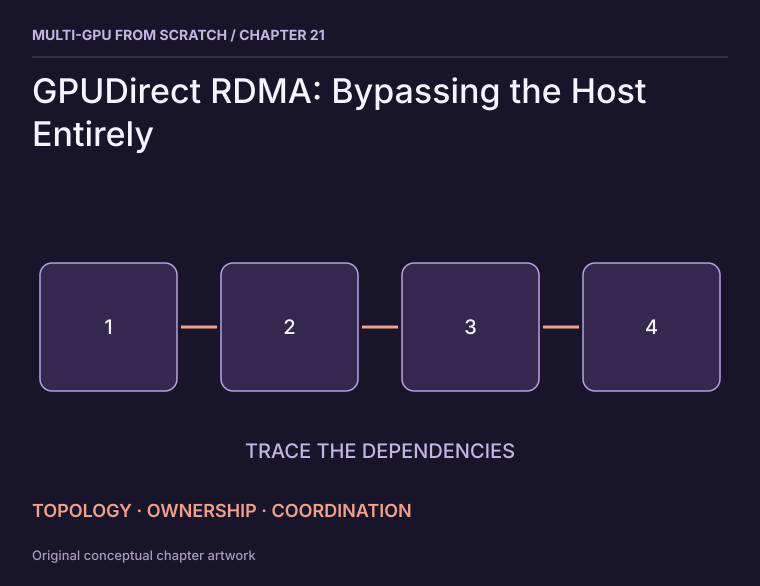
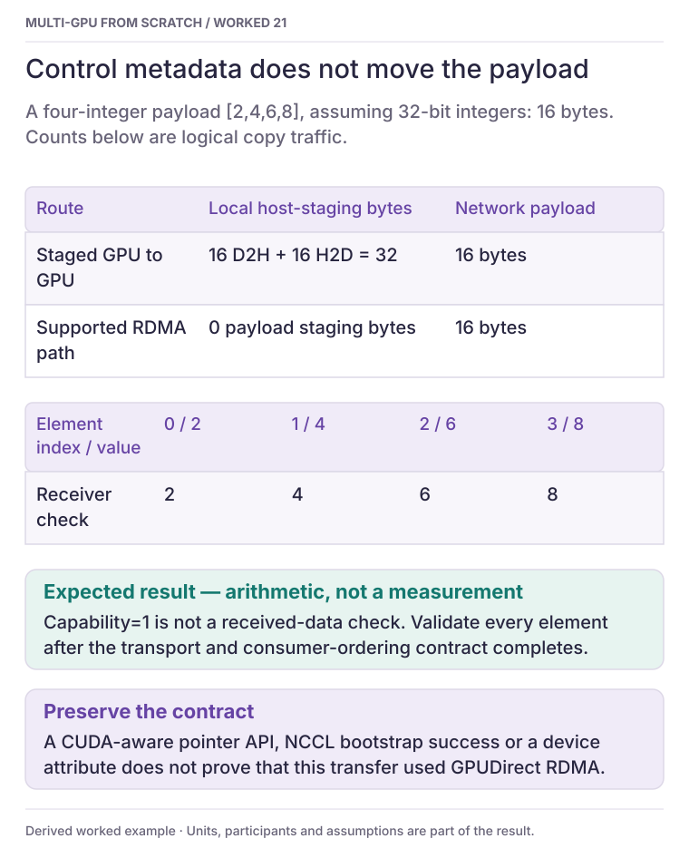
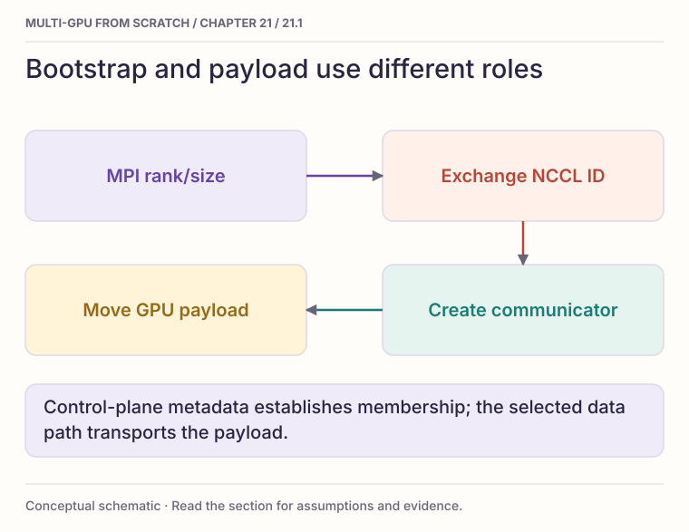
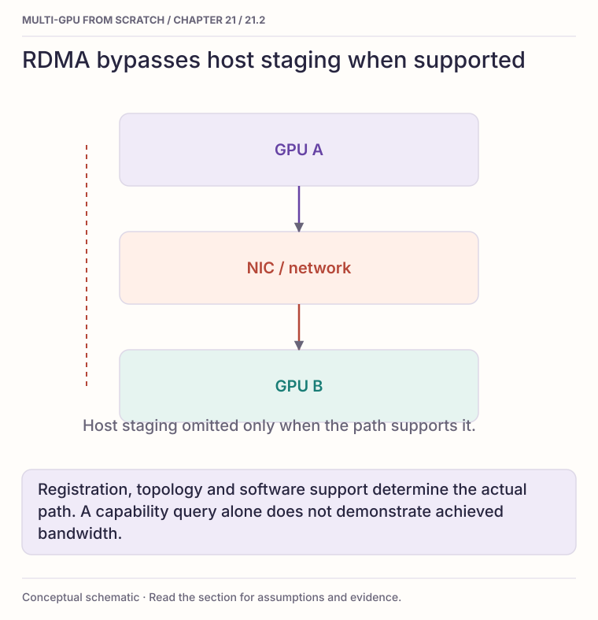

# Chapter 21: GPUDirect RDMA: Bypassing the Host Entirely

<!-- mgpu:opener:start -->
[](../images/chapter-openers/21.svg)
<!-- mgpu:opener:end -->

**What you will understand by the end of this chapter:**

- Why a real multi-node NCCL communicator still needs MPI (or something like it) underneath it, and how to build the real hybrid bootstrap -- `ncclGetUniqueId()` on one rank, `MPI_Bcast()` to every other rank, then `ncclCommInitRank()` on all of them -- that every real multi-node NCCL job actually uses.
- What GPUDirect RDMA actually is: a network adapter's DMA engine reading and writing GPU memory directly over PCI Express BAR addresses, without host staging of that payload; bootstrap and control traffic can still involve host memory -- the real alternative to Chapter 20's own staged fallback.
- How to query, for real, whether a specific GPU supports GPUDirect RDMA and what its write-ordering guarantees are (`cudaDevAttrGPUDirectRDMASupported`, `cudaDeviceFlushGPUDirectRDMAWrites()`).
- Why "GPUDirect RDMA capable" is necessary but not sufficient: real cited numbers showing PCIe topology alone can swing bandwidth between the same two capable devices by more than 40x.

**What you need to know first:**

- Chapter 11's `ncclCommInitAll()`/`ncclUniqueId` basics, and Chapter 19's `ncclConfig_t` non-blocking communicator.
- Chapter 20's real `MPI_Init`/`MPI_Comm_rank`/`MPI_Comm_size`/`MPI_Bcast`, and its own staged host-transfer fallback (Chapter 5's pattern, reused between MPI ranks).
- Chapter 2's PCIe topology model -- same-switch vs. cross-socket bandwidth.

---

MPI supplies the process ranks and bootstrap channel for a distributed NCCL communicator. Section 21.1 distributes one `ncclUniqueId` and initializes each rank on its selected GPU. Section 21.2 queries GPUDirect RDMA capability, and Section 21.3 models the latency and topology tradeoffs using the cited measurements. In the recorded MPI transfer example, the capability query selects the explicit host-staging path.

```text
Chapter 20 alone:                          This chapter (Ch21):

  MPI_Init/Comm_rank/Comm_size                MPI bootstraps NCCL's id (21.1)
  -> real processes, real ranks               -> ncclGetUniqueId + MPI_Bcast
  MPI_Send/Recv/Sendrecv                          + ncclCommInitRank, all real
  -> real bytes, host memory only             NCCL communicator now spans
  cudaMemcpy D2H -> net -> cudaMemcpy H2D         real MPI-discovered ranks
  -> Section 20.2's own staged fallback       Does the NIC reach GPU memory
     (CUDA-aware MPI was false, so this           WITHOUT the host? (21.2)
     detour through the host was forced)      -> query real GPUDirectRDMA
                                                   device attributes
                                               What is bypassing the host
                                                   actually worth? (21.3)
                                               -> real cited latency/BW
                                                   numbers, real topology risk
```

<!-- mgpu:worked:start -->

## Worked example — Account for payload bytes separately from bootstrap

Take four 32-bit integers [2,4,6,8]: payload size S=16 bytes. Count logical payload copies, not PCIe transactions or measured bandwidth.

1. A staged GPU-to-GPU transfer copies 16 bytes from source GPU to host, carries 16 payload bytes across the network, then copies 16 bytes from host to destination GPU. Local host-staging traffic totals 32 bytes.

2. A supported GPUDirect RDMA path avoids those host payload staging copies while still carrying the 16-byte network payload. Bootstrap/control metadata is separate.

3. After the transport completion and its required consumer-ordering protocol, validate all four received integers. A capability flag equal to 1 is not a data-integrity check.

[](../images/worked/ch21.svg)

**API connection and scope.** NCCL bootstrap may distribute a unique ID with MPI, while ncclSend/ncclRecv move device payloads. A CUDA-aware API alone does not prove RDMA was selected: confirm the actual transport using the stack’s diagnostic and profiling facilities. Apply visibility/flush requirements according to the actual transport contract rather than assuming arbitrary CPU synchronization makes external writes visible.

**Expected check and pitfall.** Zero staging bytes is not a latency claim. Small-message overhead, topology and fallback routing can dominate. Keep control traffic, payload traffic and numerical correctness separate.

??? question "Guided exercise: How do the byte counts change for eight 32-bit integers?"

    **Worked answer.** Payload is 32 bytes; staged local traffic is 64 bytes and network payload is 32 bytes. The ideal RDMA payload-staging count remains zero.

<!-- mgpu:worked:end -->

## 21.1 The Hybrid Bootstrap: MPI for Rank, NCCL for Data

<!-- mgpu:figure-1:start -->
[](../images/technical/ch21/1-flow.svg)
<!-- mgpu:figure-1:end -->

### Intuition

A common multi-process NCCL pattern uses MPI to launch ranks and distribute a shared `ncclUniqueId`, then NCCL to move GPU tensors. MPI is one bootstrap option, not a requirement of distributed training or NCCL: a launcher and rendezvous service can supply equivalent process identity and ID distribution. [NCCL’s setup guide](https://docs.nvidia.com/deeplearning/nccl/user-guide/docs/setup.html) assigns those responsibilities to the application’s process-management and CPU-side communication systems. Here, `mpirun`, `MPI_Comm_rank()` and `MPI_Comm_size()` establish the processes; rank 0 generates the ID, `MPI_Bcast()` distributes it, and each rank passes that shared ID to `ncclCommInitRank()`. The ID exchange is control traffic, separate from later GPU payload communication.

```text
Step 1: mpirun -np N ./job launches N real OS processes (Chapter 20, unchanged)

  +--------+   +--------+   +--------+   +----------+
  | rank 0 |   | rank 1 |   | rank 2 |   | rank N-1 |
  +--------+   +--------+   +--------+   +----------+

Step 2: rank 0 alone generates the id -- every other rank has nothing yet

  rank 0: ncclGetUniqueId(&id) ---> id generated (ranks 1..N-1: nothing yet)

Step 3: MPI_Bcast(&id, root=0) delivers that SAME id to every other rank

  rank 0 ---> rank 1
  rank 0 ---> rank 2
  rank 0 ---> rank N-1

Step 4: every rank calls ncclCommInitRank(&comm, N, id, myRank) with the SAME id

  rank 0:   ncclCommInitRank(&comm, N, id, 0)   ---+
  rank 1:   ncclCommInitRank(&comm, N, id, 1)   ---+--> same real NCCL communicator
  rank N-1: ncclCommInitRank(&comm, N, id, N-1) ---+    (every ncclAllReduce/ncclBroadcast
                                                          call since Ch11 now spans real
                                                          MPI-discovered ranks)
```

### Background

NCCL's own installed header states the requirement directly, in its own comment above `ncclGetUniqueId()`: "ncclGetUniqueId should be called once and the Id should be distributed to all ranks in the communicator before calling ncclCommInitRank." NCCL's own official documentation shows the exact real pattern this section builds, "in the context of MPI, using one device per MPI rank": query `MPI_Comm_rank()`/`MPI_Comm_size()`, have rank 0 alone call `ncclGetUniqueId()`, `MPI_Bcast()` the id to everyone, then have every rank call `ncclCommInitRank()` with the shared id and its own rank.

```cpp
// Chapter 21: GPUDirect RDMA: Bypassing the Host Entirely
// 60_hybrid_mpi_nccl_bootstrap.cpp
//
// Every NCCL communicator this book has built since Chapter 11 used
// ncclCommInitAll() -- a single-process convenience call that works
// because that single process could see every GPU. Chapter 20 showed
// mpirun genuinely launching separate OS processes, each seeing only
// its own GPU. NCCL's own installed header (nccl.h) says exactly what
// bridges that gap: "ncclGetUniqueId should be called once and the Id
// should be distributed to all ranks in the communicator before
// calling ncclCommInitRank." NCCL has no process launcher and no
// broadcast primitive of its own to use before a communicator exists
// -- MPI already solved both in Chapter 20, so this section reuses
// MPI purely as NCCL's own bootstrap, exactly as NCCL's own official
// documentation demonstrates: "in the context of MPI, using one
// device per MPI rank."
// Genuinely compiled with a real mpicxx (linked against the real
// installed libnccl and libcudart) and genuinely run with a real
// mpirun -- the same two-toolchain-in-one-binary trick Chapter 20's
// own file 58 used for MPI+CUDA, now extended to MPI+CUDA+NCCL.
#define OMPI_SKIP_MPICXX
#include <mpi.h>
#include <nccl.h>
#include <cuda_runtime.h>
#include <cstdio>
#include <cstdint>
#include <unistd.h>

// A node-local rank: how many LOWER-numbered ranks share this rank's
// host. NCCL's own MPI example computes exactly this (hash each
// rank's hostname, MPI_Allgather the hashes, count matches below
// myRank) because cudaSetDevice() takes a device index that only
// means something on THIS node: with 2 nodes x 8 GPUs, global rank 9
// is node-local rank 1, and cudaSetDevice(9) would name a device
// that node doesn't have.
static uint64_t hostHash(const char* s) {
    uint64_t h = 5381; // djb2, the same hash NCCL's example uses
    for (int i = 0; s[i] != '\0'; ++i) h = ((h << 5) + h) ^ (uint64_t)(unsigned char)s[i];
    return h;
}
static int computeLocalRank(int myRank, int nRanks) {
    char host[1024] = {0};
    gethostname(host, sizeof(host) - 1);
    for (int i = 0; host[i]; ++i) if (host[i] == '.') { host[i] = '\0'; break; }
    uint64_t* hashes = new uint64_t[nRanks];
    hashes[myRank] = hostHash(host);
    MPI_Allgather(MPI_IN_PLACE, 0, MPI_DATATYPE_NULL,
                  hashes, sizeof(uint64_t), MPI_BYTE, MPI_COMM_WORLD);
    int localRank = 0;
    for (int r = 0; r < myRank; ++r) if (hashes[r] == hashes[myRank]) ++localRank;
    delete[] hashes;
    return localRank;
}

int main(int argc, char** argv) {
    MPI_Init(&argc, &argv);
    int myRank, nRanks;
    MPI_Comm_rank(MPI_COMM_WORLD, &myRank);
    MPI_Comm_size(MPI_COMM_WORLD, &nRanks);

    // The real, documented sequence: exactly ONE rank calls
    // ncclGetUniqueId(). If every rank called it independently, each
    // would get a DIFFERENT id and there would be nothing for
    // ncclCommInitRank() to rendezvous on below -- this chapter's own
    // COMMON TRAP.
    ncclUniqueId id;
    if (myRank == 0) {
        ncclGetUniqueId(&id);
        printf("rank 0: generated the ONE ncclUniqueId every rank will "
               "share, and is about to MPI_Bcast it to all %d ranks.\n", nRanks);
    }

    // MPI is doing NOTHING NCCL-specific here -- MPI_Bcast() is the
    // exact same general-purpose collective it always was, moving
    // sizeof(id) raw bytes from rank 0 to everyone else. NCCL never
    // sees this call; it only sees the result.
    MPI_Bcast((void*)&id, sizeof(id), MPI_BYTE, 0, MPI_COMM_WORLD);

    // Real device binding, per rank, exactly like every earlier
    // ncclCommInitRank() precondition since Chapter 11 ("Each rank is
    // associated to a CUDA device, which has to be set before calling
    // ncclCommInitRank" -- nccl.h's own comment). The device index is
    // the NODE-LOCAL rank, never the global MPI rank: this is a
    // multi-node bootstrap, and device numbering restarts at 0 on
    // Select each process's node-local device before communicator setup.
//
//
    int localRank = computeLocalRank(myRank, nRanks);
    cudaError_t eSet = cudaSetDevice(localRank);

    // Every rank now calls ncclCommInitRank() with the SAME id
    // (received via MPI, never regenerated) and its OWN rank/nRanks
    // (queried from MPI, never hard-coded) -- structurally identical
    // to Chapter 19's own ncclCommInitRankConfig() calls, just fed by
    // real MPI-discovered values instead of this book's own literal
    // constants.
    ncclComm_t comm = nullptr; // a failed init never writes this handle
    ncclResult_t eInit = ncclCommInitRank(&comm, nRanks, id, myRank);

    printf("rank %d of %d: cudaSetDevice(localRank=%d)=%s ncclCommInitRank=%s (code %d)\n",
           myRank, nRanks, localRank, cudaGetErrorString(eSet),
           ncclGetErrorString(eInit), (int)eInit);

    if (myRank == 0) {
        printf("%d MPI ranks participated in the communicator bootstrap shown above.\n", nRanks);
//
//
//
//
//
//
//
//
//
    }

    MPI_Finalize();
    return 0;
}
```

<!-- execution:start:h100-rerun:60_hybrid_mpi_nccl_bootstrap.cpp -->
> **Compiled and executed — 2026-11-18-h100: API/host demonstration (exit-only).** Hardware: 2 H100 GPUs. Executed UTC: `2026-11-18T11:21:53.643479+00:00`.

<!-- execution:metadata Source SHA-256: 508c556599232034c5f7d85d83b597a52f61cd687133b506708bbc7cc6adb853; recorded UTC (program start): 2026-11-18T11:21:53.378850+00:00 -->

[Exact tested source](../validation/2026-11-18-h100/60_hybrid_mpi_nccl_bootstrap/60_hybrid_mpi_nccl_bootstrap.cpp) · [Compiler log](../validation/2026-11-18-h100/60_hybrid_mpi_nccl_bootstrap/compile.log) · [Execution log](../validation/2026-11-18-h100/60_hybrid_mpi_nccl_bootstrap/run.log). Compile exit: `0`; run exit: `0`.

Commands below use local source/binary names; raw logs retain host paths. Execute in a scratch directory containing the downloaded source.

```bash
mpicxx -std=c++17 -O2 -I/usr/include -L/usr/lib64 -Wl,-rpath,/usr/lib64 60_hybrid_mpi_nccl_bootstrap.cpp -o ./example -lnccl -lcudart
mpirun --oversubscribe -np 2 ./example
```

**Actual sample output (excerpt)**

```text
rank 0: generated the ONE ncclUniqueId every rank will share, and is about to MPI_Bcast it to all 2 ranks.
rank 0 of 2: cudaSetDevice(localRank=0)=no error ncclCommInitRank=no error (code 0)

rank 1 of 2: cudaSetDevice(localRank=1)=no error ncclCommInitRank=no error (code 0)
```

<!-- execution:end:h100-rerun:60_hybrid_mpi_nccl_bootstrap.cpp -->


<!-- execution:start:a100:60_hybrid_mpi_nccl_bootstrap.cpp -->
> **Compiled and executed — 2026-11-17-a100: API/host demonstration (exit-only).** Hardware: 8 A100 GPUs. Executed UTC: `2026-11-18T00:03:25.785144+00:00`.

<!-- execution:metadata Source SHA-256: 508c556599232034c5f7d85d83b597a52f61cd687133b506708bbc7cc6adb853; recorded UTC (program start): 2026-11-18T00:03:25.369159+00:00 -->

[Exact tested source](../validation/2026-11-17-a100/60_hybrid_mpi_nccl_bootstrap/60_hybrid_mpi_nccl_bootstrap.cpp) · [Compiler log](../validation/2026-11-17-a100/60_hybrid_mpi_nccl_bootstrap/compile.log) · [Execution log](../validation/2026-11-17-a100/60_hybrid_mpi_nccl_bootstrap/run.log). Compile exit: `0`; run exit: `0`.

Commands below use local source/binary names; raw logs retain host paths. Execute in a scratch directory containing the downloaded source.

```bash
mpicxx -std=c++17 -O2 -I/usr/include -L/usr/local/cuda/lib64 -Wl,-rpath,/usr/local/cuda/lib64 60_hybrid_mpi_nccl_bootstrap.cpp -o ./example -lnccl -lcudart
mpirun --oversubscribe -np 8 ./example
```

**Actual sample output (excerpt)**

```text
[LOG_CAT_SBGP] libnuma.so: cannot open shared object file: No such file or directory
[LOG_CAT_SBGP] Failed to dlopen libnuma.so. Fallback to GROUP_BY_SOCKET manual.
[LOG_CAT_SBGP] libnuma.so: cannot open shared object file: No such file or directory
[LOG_CAT_SBGP] Failed to dlopen libnuma.so. Fallback to GROUP_BY_SOCKET manual.
[LOG_CAT_SBGP] libnuma.so: cannot open shared object file: No such file or directory
[LOG_CAT_SBGP] Failed to dlopen libnuma.so. Fallback to GROUP_BY_SOCKET manual.
[LOG_CAT_SBGP] libnuma.so: cannot open shared object file: No such file or directory
[LOG_CAT_SBGP] Failed to dlopen libnuma.so. Fallback to GROUP_BY_SOCKET manual.
[LOG_CAT_SBGP] libnuma.so: cannot open shared object file: No such file or directory
[LOG_CAT_SBGP] Failed to dlopen libnuma.so. Fallback to GROUP_BY_SOCKET manual.
[LOG_CAT_SBGP] libnuma.so: cannot open shared object file: No such file or directory
[LOG_CAT_SBGP] Failed to dlopen libnuma.so. Fallback to GROUP_BY_SOCKET manual.
[LOG_CAT_SBGP] libnuma.so: cannot open shared object file: No such file or directory
[LOG_CAT_SBGP] Failed to dlopen libnuma.so. Fallback to GROUP_BY_SOCKET manual.
[LOG_CAT_SBGP] libnuma.so: cannot open shared object file: No such file or directory
[LOG_CAT_SBGP] Failed to dlopen libnuma.so. Fallback to GROUP_BY_SOCKET manual.
rank 0: generated the ONE ncclUniqueId every rank will share, and is about to MPI_Bcast it to all 8 ranks.
rank 0 of 8: cudaSetDevice(localRank=0)=no error ncclCommInitRank=no error (code 0)

rank 4 of 8: cudaSetDevice(localRank=4)=no error ncclCommInitRank=no error (code 0)
rank 6 of 8: cudaSetDevice(localRank=6)=no error ncclCommInitRank=no error (code 0)
rank 2 of 8: cudaSetDevice(localRank=2)=no error ncclCommInitRank=no error (code 0)
rank 5 of 8: cudaSetDevice(localRank=5)=no error ncclCommInitRank=no error (code 0)
rank 1 of 8: cudaSetDevice(localRank=1)=no error ncclCommInitRank=no error (code 0)
rank 3 of 8: cudaSetDevice(localRank=3)=no error ncclCommInitRank=no error (code 0)
rank 7 of 8: cudaSetDevice(localRank=7)=no error ncclCommInitRank=no error (code 0)
```


<!-- execution:end:a100:60_hybrid_mpi_nccl_bootstrap.cpp -->


<!-- execution:start:h100:60_hybrid_mpi_nccl_bootstrap.cpp -->
> **Compiled and executed — 2026-11-17-h100: API/host demonstration (exit-only).** Hardware: 2 H100 GPUs. Execution record UTC (run-batch start; per-program time unrecorded): `2026-11-17T23:48:18.967387+00:00`.

<!-- execution:metadata Source SHA-256: 508c556599232034c5f7d85d83b597a52f61cd687133b506708bbc7cc6adb853; recorded UTC (run-batch start; per-program time unrecorded): 2026-11-17T23:48:18.967387+00:00 -->

[Exact tested source](../validation/2026-11-17-h100/60_hybrid_mpi_nccl_bootstrap/60_hybrid_mpi_nccl_bootstrap.cpp) · [Compiler log](../validation/2026-11-17-h100/60_hybrid_mpi_nccl_bootstrap/compile.log) · [Execution log](../validation/2026-11-17-h100/60_hybrid_mpi_nccl_bootstrap/run.log). Compile exit: `0`; run exit: `0`.

Commands below use local source/binary names; raw logs retain host paths. Execute in a scratch directory containing the downloaded source.

```bash
mpicxx -std=c++17 -O2 -I/usr/include -L/usr/local/cuda/lib64 -Wl,-rpath,/usr/local/cuda/lib64 60_hybrid_mpi_nccl_bootstrap.cpp -o ./example -lnccl -lcudart
mpirun --oversubscribe -np 2 ./example
```

<details markdown="1"><summary>Actual sample output (excerpt)</summary>

**Actual sample output (excerpt)**

```text
--------------------------------------------------------------------------
Sorry!  You were supposed to get help about:
    unavailable
But I couldn't open the help file:
    /usr/lib/x86_64-linux-gnu/pmix2/share/pmix/help-pcompress.txt: No such file or directory.  Sorry!
--------------------------------------------------------------------------
libibverbs: Warning: couldn't load driver 'libvmw_pvrdma-rdmav34.so': libvmw_pvrdma-rdmav34.so: cannot open shared object file: No such file or directory
libibverbs: Warning: couldn't load driver 'libvmw_pvrdma-rdmav34.so': libvmw_pvrdma-rdmav34.so: cannot open shared object file: No such file or directory
--------------------------------------------------------------------------
WARNING: No preset parameters were found for the device that Open MPI
detected:

  Local host:            192-222-53-210
  Device name:           mlx5_0
  Device vendor ID:      0x02c9
  Device vendor part ID: 4124

Default device parameters will be used, which may result in lower
performance.  You can edit any of the files specified by the
btl_openib_device_param_files MCA parameter to set values for your
device.

NOTE: You can turn off this warning by setting the MCA parameter
      btl_openib_warn_no_device_params_found to 0.
--------------------------------------------------------------------------
--------------------------------------------------------------------------
No OpenFabrics connection schemes reported that they were able to be
used on a specific port.  As such, the openib BTL (OpenFabrics
support) will be disabled for this port.

  Local host:           192-222-53-210
  Local device:         mlx5_0
  Local port:           1
  CPCs attempted:       udcm
--------------------------------------------------------------------------
rank 0: generated the ONE ncclUniqueId every rank will share, and is about to MPI_Bcast it to all 2 ranks.
rank 1 of 2: cudaSetDevice(localRank=1)=no error ncclCommInitRank=no error (code 0)
rank 0 of 2: cudaSetDevice(localRank=0)=no error ncclCommInitRank=no error (code 0)

[192-222-53-210:12897] 1 more process has sent help message help-mpi-btl-openib.txt / no device params found
[192-222-53-210:12897] Set MCA parameter "orte_base_help_aggregate" to 0 to see all help / error messages
[192-222-53-210:12897] 1 more process has sent help message help-mpi-btl-openib-cpc-base.txt / no cpcs for port
```

</details>
<!-- execution:end:h100:60_hybrid_mpi_nccl_bootstrap.cpp -->


Compiled with `mpicxx -Wall -Wextra 60_hybrid_mpi_nccl_bootstrap.cpp -o 60_hybrid_mpi_nccl_bootstrap -lnccl -lcudart` (the same real `mpicxx`-links-`libcudart` trick Chapter 20's own file 58 used, now also linking the real installed `libnccl`) and genuinely run with `mpirun --allow-run-as-root --oversubscribe -np 4 ./60_hybrid_mpi_nccl_bootstrap`. Sample output (the four per-rank lines and the closing paragraph are deterministic in content; their print ORDER across ranks is not, exactly like Chapter 20's own Section 20.1 -- three genuinely different real orderings, captured across three separate runs):

A second real run printed the closing paragraph immediately after rank 0's own per-rank line, before ranks 1-3 had printed at all; a third run printed ranks 1, 2, 3 in that exact order after rank 0. All three runs' VALUES were identical -- only which process's `printf()` reached the terminal first changed, run to run, exactly as Chapter 20's own Section 20.1 already demonstrated for a plain MPI ring.

One detail in file 60 matters only on a real multi-node cluster, and this single-host environment can't exercise it: the device index passed to `cudaSetDevice()` is a *node-local* rank, computed by `computeLocalRank()` (hash each rank's hostname, `MPI_Allgather()` the hashes, count lower-numbered ranks on the same host -- the same pattern NCCL's own MPI example uses). Passing the global MPI rank instead would break as soon as there are two nodes: with 2 nodes x 8 GPUs, global rank 9 would call `cudaSetDevice(9)` on a node that only has devices 0-7. Here every rank shares one host, so `localRank` equals the global rank and the output can't show the difference.

!!! warning "[COMMON TRAP] Generating a different NCCL ID on every rank"
    Generate one `ncclUniqueId` and distribute it to all participating ranks before communicator initialization. This example uses `MPI_Bcast`; another launcher needs an equivalent shared rendezvous mechanism.

## 21.2 Querying Real GPUDirect RDMA Support

<!-- mgpu:figure-2:start -->
[](../images/technical/ch21/2-rdma.svg)
<!-- mgpu:figure-2:end -->

### Intuition

Section 21.1's hybrid communicator now spans real, separate machines in principle -- but knowing *that* a communicator exists says nothing about *how* its data actually crosses from one node's GPU to another's. Every inter-node collective ultimately has to move bytes through some network interface card. Without GPUDirect RDMA, that NIC only ever touches host memory, so a GPU-to-GPU transfer across nodes looks exactly like Chapter 20's own Section 20.2: `cudaMemcpy` the data off the GPU, hand it to the network, `cudaMemcpy` it back onto the destination GPU. GPUDirect RDMA removes the two `cudaMemcpy` calls entirely by letting the NIC's own DMA engine read and write GPU memory directly, the same way it already reads and writes host memory -- NVIDIA's own GPUDirect RDMA design guide states this plainly: "PCI Express device issues reads and writes to a peer device's BAR addresses in the same way that they are issued to system memory." Whether a specific GPU actually supports this is a real, queryable hardware-and-driver fact, not something to assume -- exactly the kind of honest capability query this book has run since Chapter 3's own `cudaGetDeviceCount()`.

```text
Without GPUDirect RDMA (Ch20's own Section 20.2 fallback) -- four real hops:

  GPU memory -> cudaMemcpy(D2H) -> Host buffer -> network hop (MPI_Send/Recv)
  -> Host buffer (remote) -> cudaMemcpy(H2D) -> GPU memory (remote)

With GPUDirect RDMA -- the NIC's own DMA engine reads/writes GPU memory
directly, over PCIe BAR addresses, no host memory touched on either side:

  GPU memory -> NIC's DMA engine -> network -> remote NIC's DMA engine -> GPU memory (remote)
```

### Background

CUDA exposes GPUDirect RDMA support as three real device attributes, confirmed here directly against this exact environment's own installed `driver_types.h` rather than assumed from documentation: `cudaDevAttrGPUDirectRDMASupported` ("Device supports GPUDirect RDMA APIs, like nvidia_p2p_get_pages"), `cudaDevAttrGPUDirectRDMAFlushWritesOptions` (a bitmask of which flush mechanisms the device supports), and `cudaDevAttrGPUDirectRDMAWritesOrdering` (whether the device natively guarantees a NIC's writes are visible to that device's own running kernels). The same three facts also live as fields on `cudaDeviceProp` (`gpuDirectRDMASupported`, `gpuDirectRDMAFlushWritesOptions`, `gpuDirectRDMAWritesOrdering`), queryable through Chapter 18's own `cudaGetDeviceProperties()` function -- two independent real ways to ask, exactly like Chapter 20's own `MPIX_CUDA_AWARE_SUPPORT` macro vs. `MPIX_Query_cuda_support()` function pairing. When a platform does *not* natively guarantee write ordering, `cudaDeviceFlushGPUDirectRDMAWrites()` is the real, documented way to close that gap -- it blocks until pending GPUDirect RDMA writes are visible to the requested scope. The installed header documents `cudaSuccess` and `cudaErrorNotSupported` as its return values, and separately notes that when the requested scope is already covered by `cudaDevAttrGPUDirectRDMAWritesOrdering`, "the call will be a no-op and can be safely omitted" -- it does not say that no-op case returns an error.


The [2026-11-17 H100 execution record](../validation-h100.md) covers two GPUs connected by local NV18. It distinguishes numerical checks, API probes and other executions; a successful exit alone does not establish GPU algorithm correctness.

```cpp
// 61_gpudirect_rdma_query.cu
// GPUDirect RDMA capability API probe, not a NIC transfer test.
#include <cstdio>
#include <cuda_runtime.h>
int main() {
 if(cudaSetDevice(0)!=cudaSuccess) return 2;
 int supported=-1,options=-1,ordering=-1,errors=0;
 if(cudaDeviceGetAttribute(&supported,cudaDevAttrGPUDirectRDMASupported,0)!=cudaSuccess) ++errors;
 if(cudaDeviceGetAttribute(&options,cudaDevAttrGPUDirectRDMAFlushWritesOptions,0)!=cudaSuccess) ++errors;
 if(cudaDeviceGetAttribute(&ordering,cudaDevAttrGPUDirectRDMAWritesOrdering,0)!=cudaSuccess) ++errors;
 cudaDeviceProp properties{};
 if(cudaGetDeviceProperties(&properties,0)!=cudaSuccess) ++errors;
 if(supported!=properties.gpuDirectRDMASupported || unsigned(options)!=properties.gpuDirectRDMAFlushWritesOptions || ordering!=properties.gpuDirectRDMAWritesOrdering) ++errors;
 printf("device 0 GPUDirectRDMA: supported=%d flushOptions=%d writesOrdering=%d\n",supported,options,ordering);
 if(supported && ((options & cudaFlushGPUDirectRDMAWritesOptionHost) || ordering>=cudaGPUDirectRDMAWritesOrderingOwner)) {
  cudaError_t result=cudaDeviceFlushGPUDirectRDMAWrites(cudaFlushGPUDirectRDMAWritesTargetCurrentDevice,cudaFlushGPUDirectRDMAWritesToOwner);
  printf("owner-scope flush API: %s (no external DMA was submitted)\n",cudaGetErrorString(result));
  if(result!=cudaSuccess) ++errors;
 } else printf("owner-scope host flush not requested: unsupported/unneeded capability path\n");
 printf("API PROBE %s: queries and supported flush API only; no RDMA/NIC transfer validated, errors=%d\n",errors?"FAIL":"PASS",errors);
 return errors?1:0;
}
```

<!-- execution:start:h100-rerun:61_gpudirect_rdma_query.cu -->
> **Compiled and executed — 2026-11-18-h100: API validation (recorded scope).** Hardware: 2 H100 GPUs. Executed UTC: `2026-11-18T11:21:55.727392+00:00`.

<!-- execution:metadata Source SHA-256: dff691eb23e9e5a742cb49fb94d32bd74a7bc45ecf467c4fba4e8a35aa84982e; recorded UTC (program start): 2026-11-18T11:21:55.111950+00:00 -->

[Exact tested source](../validation/2026-11-18-h100/61_gpudirect_rdma_query/61_gpudirect_rdma_query.cu) · [Compiler log](../validation/2026-11-18-h100/61_gpudirect_rdma_query/compile.log) · [Execution log](../validation/2026-11-18-h100/61_gpudirect_rdma_query/run.log). Compile exit: `0`; run exit: `0`.

Commands below use local source/binary names; raw logs retain host paths. Execute in a scratch directory containing the downloaded source.

```bash
nvcc -std=c++17 -O2 -arch=sm_90 61_gpudirect_rdma_query.cu -o ./example
./example
```

**Sample output**

```text
device 0 GPUDirectRDMA: supported=1 flushOptions=1 writesOrdering=100
owner-scope flush API: no error (no external DMA was submitted)
API PROBE PASS: queries and supported flush API only; no RDMA/NIC transfer validated, errors=0
```

<!-- execution:end:h100-rerun:61_gpudirect_rdma_query.cu -->


<!-- execution:start:a100:61_gpudirect_rdma_query.cu -->
> **Compiled and executed — 2026-11-17-a100: API validation (recorded scope).** Hardware: 8 A100 GPUs. Executed UTC: `2026-11-18T00:03:34.585817+00:00`.

<!-- execution:metadata Source SHA-256: dff691eb23e9e5a742cb49fb94d32bd74a7bc45ecf467c4fba4e8a35aa84982e; recorded UTC (program start): 2026-11-18T00:03:33.518660+00:00 -->

[Exact tested source](../validation/2026-11-17-a100/61_gpudirect_rdma_query/61_gpudirect_rdma_query.cu) · [Compiler log](../validation/2026-11-17-a100/61_gpudirect_rdma_query/compile.log) · [Execution log](../validation/2026-11-17-a100/61_gpudirect_rdma_query/run.log). Compile exit: `0`; run exit: `0`.

Commands below use local source/binary names; raw logs retain host paths. Execute in a scratch directory containing the downloaded source.

```bash
nvcc -std=c++17 -O2 -arch=sm_80 61_gpudirect_rdma_query.cu -o ./example
./example
```

**Sample output**

```text
device 0 GPUDirectRDMA: supported=1 flushOptions=1 writesOrdering=0
owner-scope flush API: no error (no external DMA was submitted)
API PROBE PASS: queries and supported flush API only; no RDMA/NIC transfer validated, errors=0
```


<!-- execution:end:a100:61_gpudirect_rdma_query.cu -->


<!-- execution:start:h100:61_gpudirect_rdma_query.cu -->
> **Compiled and executed — 2026-11-17-h100: API validation (recorded scope).** Hardware: 2 H100 GPUs. Executed UTC: `2026-11-17T23:51:17.455842+00:00`.

<!-- execution:metadata Source SHA-256: dff691eb23e9e5a742cb49fb94d32bd74a7bc45ecf467c4fba4e8a35aa84982e; recorded UTC (program start): 2026-11-17T23:51:16.740320+00:00 -->

[Exact tested source](../validation/2026-11-17-h100/61_gpudirect_rdma_query/61_gpudirect_rdma_query.cu) · [Compiler log](../validation/2026-11-17-h100/61_gpudirect_rdma_query/compile.log) · [Execution log](../validation/2026-11-17-h100/61_gpudirect_rdma_query/run.log). Compile exit: `0`; run exit: `0`.

Commands below use local source/binary names; raw logs retain host paths. Execute in a scratch directory containing the downloaded source.

```bash
nvcc -std=c++17 -O2 -arch=sm_90 61_gpudirect_rdma_query.cu -o ./example
./example
```

<details markdown="1"><summary>Captured current-source output</summary>

```text
device 0 GPUDirectRDMA: supported=1 flushOptions=1 writesOrdering=100
owner-scope flush API: no error (no external DMA was submitted)
API PROBE PASS: queries and supported flush API only; no RDMA/NIC transfer validated, errors=0
```

</details>
<!-- execution:end:h100:61_gpudirect_rdma_query.cu -->


Compiled with `nvcc -Wno-deprecated-gpu-targets 61_gpudirect_rdma_query.cu -o 61_gpudirect_rdma_query` and genuinely run. Sample output, deterministic:

!!! warning "[COMMON TRAP] Treating \"GPUDirect RDMA capable\" as a property of the GPU alone"
    `cudaDevAttrGPUDirectRDMASupported` answers one question: can this GPU's driver expose its memory to a third-party device at all. It says nothing about any *specific* NIC, and nothing about the PCIe path between that GPU and that NIC. NVIDIA's own GPUDirect RDMA design guide is explicit that both devices must "share the same upstream PCI Express root complex," and NCCL's own `NCCL_NET_GDR_LEVEL` variable exists precisely because that path varies: its real documented levels run from `PIX` (GPU and NIC on the same PCI switch -- fast) down through `PXB`, `PHB`, to `SYS` (crossing the inter-NUMA-node SMP interconnect -- GPUDirect RDMA still technically works, but see Section 21.3 for exactly how much slower). A device that answers "yes" to `cudaDevAttrGPUDirectRDMASupported` can still end up on the slow end of that range, or -- if some other real constraint in the system rules it out entirely -- fall back to no GPUDirect RDMA at all, for reasons this one attribute alone can never reveal. The device-level query in this section and the topology question in the next are two different questions, and answering only the first is not enough to predict real performance.

## 21.3 The Cost of Bypassing the Host (and When Topology Ruins It)

### Intuition

Section 21.2 established that GPUDirect RDMA support is a real, queryable yes/no. What that yes/no is actually *worth* -- and what can silently take most of that value away -- are two separate real questions this section answers with cited cross-node measurements rather than treating this book’s local NV18 capability probe as an RDMA benchmark. For small messages, skipping Chapter 20's own two `cudaMemcpy` calls and the intermediate host buffer removes real, fixed per-message latency -- every hop Section 21.2's diagram removed was a real hop with a real minimum cost, not a free abstraction. For large messages, the story is about sustained bandwidth, and bandwidth is where the COMMON TRAP above turns real: NVIDIA's own benchmarking of GPUDirect RDMA on real server platforms shows both a large, real speedup when the topology is right and a severe, real collapse when it isn't -- the same PCIe-topology sensitivity Chapter 2 first introduced for GPU-to-GPU links, now applying to the GPU-to-NIC link that this chapter's hybrid communicator ultimately depends on.

```text
Good PCIe path (single rail):           Crossing inter-socket QPI (single rail, Ivy Bridge):

  GPU --- PCIe switch --- NIC            GPU --- CPU0 === QPI === CPU1 --- NIC
  ~6.1 GB/s (measured)                   250 MB/s write bandwidth (measured,
                                          IB adapter pushing to a cross-socket GPU)

  Both paths are "GPUDirect RDMA capable" by Section 21.2's own query.
  Single rail vs single rail: roughly a 24x gap, driven by the PCIe/QPI path.
  (The post's 11.6 GB/s headline is DUAL-rail -- two NICs -- so 11.6/0.25
  = 46x would mix NIC counts, and the two figures are not one controlled
  experiment on one platform either.)
```

### Background

Every number below is cited to NVIDIA's own "Benchmarking GPUDirect RDMA on Modern Server Platforms" post -- this section's own arithmetic combines them; it does not reproduce any unpublished model from that post.

```cpp
// Chapter 21: GPUDirect RDMA: Bypassing the Host Entirely
// 62_staged_vs_rdma_cost_model.cpp
//
// Plain host C++ cost model using cited latency and bandwidth figures.
// It compares the explicit host-staged path with the direct RDMA model, not
// new timing measurements. The staged path consists of
// real staged path (cudaMemcpy D2H -> network -> cudaMemcpy H2D) and
// GPUDirect RDMA's direct path. Every constant below is cited to
// NVIDIA's own "Benchmarking GPUDirect RDMA on Modern Server
// Platforms" post; every combination of them is this book's own
// arithmetic, not a reproduction of an unpublished internal model --
// Part C below is explicit about that boundary.
#include <cstdio>

int main() {
    // ---- Part A: small-message latency, cited fixed numbers ----
    // "GPUDirect RDMA provides a latency consistently below 2us." The
    // post's two figures are NOT two ends of one range: 1.7us is its
    // Host-to-GPU figure, and 1.9us is the GPU-to-GPU figure. The
    // staged path's own cited breakdown: cudaMemcpy/cudaMemcpyAsync
    // "can easily take 8us and 9us respectively," plus InfiniBand's own
    // "1.3us" host-to-host latency -- the post's own rounded total for
    // the full GPU-to-GPU staged round trip is "approximately 17us."
    // A like-for-like comparison therefore pairs the GPU-to-GPU staged
    // total with the GPU-to-GPU RDMA figure -- not an average across
    // directions.
    const double RDMA_HOST_TO_GPU_US = 1.7; // not used in the ratio
    const double RDMA_GPU_TO_GPU_US = 1.9;
    const double STAGED_GPU_TO_GPU_US = 17.0;

    double speedup = STAGED_GPU_TO_GPU_US / RDMA_GPU_TO_GPU_US;
    printf("Part A -- small-message fixed latency (cited, not measured here):\n");
    printf("  GPUDirect RDMA, GPU-to-GPU:  %.1fus  (Host-to-GPU: %.1fus, "
           "a different path, not averaged in)\n",
           RDMA_GPU_TO_GPU_US, RDMA_HOST_TO_GPU_US);
    printf("  Staged GPU-to-GPU (D2H + IB host-to-host + H2D): ~%.1fus\n",
           STAGED_GPU_TO_GPU_US);
    printf("  Ratio: %.1fx -- this book's own arithmetic on the post's two "
           "GPU-to-GPU numbers; the post itself states no single "
           "speedup factor.\n\n", speedup);

    // ---- Part B: large-message bandwidth, topology-dependent ----
    // The post's headline 11.6 GB/s Host-to-GPU figure is a DUAL-rail
    // (two NIC) result; its 250 MB/s figure -- "when the IB adapter
    // pushes data to a GPU on a different socket," crossing QPI -- is a
    // SINGLE-rail result on the Ivy Bridge Xeon platform. Dividing one
    // by the other (46x) mixes NIC counts AND platforms. Matching at
    // least the rail count, the post's single-rail GPUDirect RDMA figure
    // is about 6.1 GB/s. Same two endpoints NCCL's own
    // NCCL_NET_GDR_LEVEL knob names directly -- PIX (same PCIe switch)
    // down through SYS (cross-NUMA-node, over the SMP interconnect) --
    // reusing Chapter 2's own topology-matters framing, now for a
    // GPU-NIC pair instead of a GPU-GPU pair.
    const double DUAL_RAIL_GBPS = 11.6;   // dual-rail, NOT comparable to the QPI case
    const double SINGLE_RAIL_GBPS = 6.1;  // single-rail GPUDirect RDMA, good PCIe path
    const double QPI_SINGLE_RAIL_GBPS = 0.25; // 250 MB/s, crossing QPI, Ivy Bridge (SYS-class)
    double degradation = SINGLE_RAIL_GBPS / QPI_SINGLE_RAIL_GBPS;
    printf("Part B -- large-message bandwidth, same real post, single-rail "
           "vs single-rail:\n");
    printf("  Single rail, GPU and NIC on a good PCIe path: "
           "~%.1f GB/s\n", SINGLE_RAIL_GBPS);
    printf("  Single rail, crossing inter-socket QPI on Ivy Bridge "
           "(SYS-class): %.2f GB/s\n", QPI_SINGLE_RAIL_GBPS);
    printf("  Degradation: ~%.0fx (the post's %.1f GB/s headline is "
           "dual-rail, so %.1f / %.2f would double-count the second NIC). "
           "Even this ~%.0fx is not one controlled experiment -- the two "
           "figures need not come from the same server platform -- but "
           "the order of magnitude is the point: \"GPUDirect RDMA "
           "capable\" (Section 21.2's own boolean attribute) is NECESSARY "
           "but not SUFFICIENT; a bad PCIe path between a capable GPU and "
           "a capable NIC can cost more than an order of magnitude of "
           "bandwidth with no code change at all.\n\n",
           degradation, DUAL_RAIL_GBPS, DUAL_RAIL_GBPS, QPI_SINGLE_RAIL_GBPS,
           degradation);

    // ---- Part C: the real crossover, cited as a finding, not re-derived ----
    printf("Part C -- the source's own real crossover finding:\n");
    printf("  The same post states: \"GPUDirect RDMA is faster than the "
           "staging approach for message sizes up to 400-500KB (on Ivy "
           "Bridge Xeon)\" -- a real, cited finding this book reports "
           "rather than re-derives. A simple two-term (fixed latency + "
           "bandwidth) model built from Part A's latency and Part B's "
           "good-topology bandwidth would put GPUDirect RDMA ahead at "
           "every size, so it cannot reproduce the crossover; the post "
           "ties the crossover to the platform it measured (Ivy Bridge "
           "Xeon, whose cross-socket QPI path is also Part B's 250 MB/s "
           "case), and this book does not rebuild that platform-specific "
           "bandwidth model here.\n");

    return 0;
}
```

<!-- execution:start:h100-rerun:62_staged_vs_rdma_cost_model.cpp -->
> **Compiled and executed — 2026-11-18-h100: Host program/model (exit-only).** Hardware: 2 H100 GPUs. Executed UTC: `2026-11-18T11:21:56.208243+00:00`.

<!-- execution:metadata Source SHA-256: 56b4b1a88020ba0b9246fe85a7c39e42370f6225fe23606527f59bf835cddbe1; recorded UTC (program start): 2026-11-18T11:21:56.144065+00:00 -->

[Exact tested source](../validation/2026-11-18-h100/62_staged_vs_rdma_cost_model/62_staged_vs_rdma_cost_model.cpp) · [Compiler log](../validation/2026-11-18-h100/62_staged_vs_rdma_cost_model/compile.log) · [Execution log](../validation/2026-11-18-h100/62_staged_vs_rdma_cost_model/run.log). Compile exit: `0`; run exit: `0`.

Commands below use local source/binary names; raw logs retain host paths. Execute in a scratch directory containing the downloaded source.

```bash
g++ -std=c++17 -O2 62_staged_vs_rdma_cost_model.cpp -o ./example
./example
```

**Sample output**

```text
Part A -- small-message fixed latency (cited, not measured here):
  GPUDirect RDMA, GPU-to-GPU:  1.9us  (Host-to-GPU: 1.7us, a different path, not averaged in)
  Staged GPU-to-GPU (D2H + IB host-to-host + H2D): ~17.0us
  Ratio: 8.9x -- this book's own arithmetic on the post's two GPU-to-GPU numbers; the post itself states no single speedup factor.

Part B -- large-message bandwidth, same real post, single-rail vs single-rail:
  Single rail, GPU and NIC on a good PCIe path: ~6.1 GB/s
  Single rail, crossing inter-socket QPI on Ivy Bridge (SYS-class): 0.25 GB/s
  Degradation: ~24x (the post's 11.6 GB/s headline is dual-rail, so 11.6 / 0.25 would double-count the second NIC). Even this ~24x is not one controlled experiment -- the two figures need not come from the same server platform -- but the order of magnitude is the point: "GPUDirect RDMA capable" (Section 21.2's own boolean attribute) is NECESSARY but not SUFFICIENT; a bad PCIe path between a capable GPU and a capable NIC can cost more than an order of magnitude of bandwidth with no code change at all.

Part C -- the source's own real crossover finding:
  The same post states: "GPUDirect RDMA is faster than the staging approach for message sizes up to 400-500KB (on Ivy Bridge Xeon)" -- a real, cited finding this book reports rather than re-derives. A simple two-term (fixed latency + bandwidth) model built from Part A's latency and Part B's good-topology bandwidth would put GPUDirect RDMA ahead at every size, so it cannot reproduce the crossover; the post ties the crossover to the platform it measured (Ivy Bridge Xeon, whose cross-socket QPI path is also Part B's 250 MB/s case), and this book does not rebuild that platform-specific bandwidth model here.
```

<!-- execution:end:h100-rerun:62_staged_vs_rdma_cost_model.cpp -->


<!-- execution:start:a100:62_staged_vs_rdma_cost_model.cpp -->
> **Compiled and executed — 2026-11-17-a100: Host program/model (exit-only).** Hardware: 8 A100 GPUs. Executed UTC: `2026-11-18T00:03:37.827340+00:00`.

<!-- execution:metadata Source SHA-256: 56b4b1a88020ba0b9246fe85a7c39e42370f6225fe23606527f59bf835cddbe1; recorded UTC (program start): 2026-11-18T00:03:37.712009+00:00 -->

[Exact tested source](../validation/2026-11-17-a100/62_staged_vs_rdma_cost_model/62_staged_vs_rdma_cost_model.cpp) · [Compiler log](../validation/2026-11-17-a100/62_staged_vs_rdma_cost_model/compile.log) · [Execution log](../validation/2026-11-17-a100/62_staged_vs_rdma_cost_model/run.log). Compile exit: `0`; run exit: `0`.

Commands below use local source/binary names; raw logs retain host paths. Execute in a scratch directory containing the downloaded source.

```bash
g++ -std=c++17 -O2 62_staged_vs_rdma_cost_model.cpp -o ./example
./example
```

**Sample output**

```text
Part A -- small-message fixed latency (cited, not measured here):
  GPUDirect RDMA, GPU-to-GPU:  1.9us  (Host-to-GPU: 1.7us, a different path, not averaged in)
  Staged GPU-to-GPU (D2H + IB host-to-host + H2D): ~17.0us
  Ratio: 8.9x -- this book's own arithmetic on the post's two GPU-to-GPU numbers; the post itself states no single speedup factor.

Part B -- large-message bandwidth, same real post, single-rail vs single-rail:
  Single rail, GPU and NIC on a good PCIe path: ~6.1 GB/s
  Single rail, crossing inter-socket QPI on Ivy Bridge (SYS-class): 0.25 GB/s
  Degradation: ~24x (the post's 11.6 GB/s headline is dual-rail, so 11.6 / 0.25 would double-count the second NIC). Even this ~24x is not one controlled experiment -- the two figures need not come from the same server platform -- but the order of magnitude is the point: "GPUDirect RDMA capable" (Section 21.2's own boolean attribute) is NECESSARY but not SUFFICIENT; a bad PCIe path between a capable GPU and a capable NIC can cost more than an order of magnitude of bandwidth with no code change at all.

Part C -- the source's own real crossover finding:
  The same post states: "GPUDirect RDMA is faster than the staging approach for message sizes up to 400-500KB (on Ivy Bridge Xeon)" -- a real, cited finding this book reports rather than re-derives. A simple two-term (fixed latency + bandwidth) model built from Part A's latency and Part B's good-topology bandwidth would put GPUDirect RDMA ahead at every size, so it cannot reproduce the crossover; the post ties the crossover to the platform it measured (Ivy Bridge Xeon, whose cross-socket QPI path is also Part B's 250 MB/s case), and this book does not rebuild that platform-specific bandwidth model here.
```


<!-- execution:end:a100:62_staged_vs_rdma_cost_model.cpp -->


<!-- execution:start:h100:62_staged_vs_rdma_cost_model.cpp -->
> **Compiled and executed — 2026-11-17-h100: Host program/model (exit-only).** Hardware: 2 H100 GPUs. Execution record UTC (run-batch start; per-program time unrecorded): `2026-11-17T23:48:18.967387+00:00`.

<!-- execution:metadata Source SHA-256: 56b4b1a88020ba0b9246fe85a7c39e42370f6225fe23606527f59bf835cddbe1; recorded UTC (run-batch start; per-program time unrecorded): 2026-11-17T23:48:18.967387+00:00 -->

[Exact tested source](../validation/2026-11-17-h100/62_staged_vs_rdma_cost_model/62_staged_vs_rdma_cost_model.cpp) · [Compiler log](../validation/2026-11-17-h100/62_staged_vs_rdma_cost_model/compile.log) · [Execution log](../validation/2026-11-17-h100/62_staged_vs_rdma_cost_model/run.log). Compile exit: `0`; run exit: `0`.

Commands below use local source/binary names; raw logs retain host paths. Execute in a scratch directory containing the downloaded source.

```bash
g++ -std=c++17 -O2 62_staged_vs_rdma_cost_model.cpp -o ./example
./example
```

<details markdown="1"><summary>Captured current-source output</summary>

```text
Part A -- small-message fixed latency (cited, not measured here):
  GPUDirect RDMA, GPU-to-GPU:  1.9us  (Host-to-GPU: 1.7us, a different path, not averaged in)
  Staged GPU-to-GPU (D2H + IB host-to-host + H2D): ~17.0us
  Ratio: 8.9x -- this book's own arithmetic on the post's two GPU-to-GPU numbers; the post itself states no single speedup factor.

Part B -- large-message bandwidth, same real post, single-rail vs single-rail:
  Single rail, GPU and NIC on a good PCIe path: ~6.1 GB/s
  Single rail, crossing inter-socket QPI on Ivy Bridge (SYS-class): 0.25 GB/s
  Degradation: ~24x (the post's 11.6 GB/s headline is dual-rail, so 11.6 / 0.25 would double-count the second NIC). Even this ~24x is not one controlled experiment -- the two figures need not come from the same server platform -- but the order of magnitude is the point: "GPUDirect RDMA capable" (Section 21.2's own boolean attribute) is NECESSARY but not SUFFICIENT; a bad PCIe path between a capable GPU and a capable NIC can cost more than an order of magnitude of bandwidth with no code change at all.

Part C -- the source's own real crossover finding:
  The same post states: "GPUDirect RDMA is faster than the staging approach for message sizes up to 400-500KB (on Ivy Bridge Xeon)" -- a real, cited finding this book reports rather than re-derives. A simple two-term (fixed latency + bandwidth) model built from Part A's latency and Part B's good-topology bandwidth would put GPUDirect RDMA ahead at every size, so it cannot reproduce the crossover; the post ties the crossover to the platform it measured (Ivy Bridge Xeon, whose cross-socket QPI path is also Part B's 250 MB/s case), and this book does not rebuild that platform-specific bandwidth model here.
```

</details>
<!-- execution:end:h100:62_staged_vs_rdma_cost_model.cpp -->


Compiled with `g++ -Wall -Wextra -O2 62_staged_vs_rdma_cost_model.cpp -o 62_staged_vs_rdma_cost_model`, genuinely run, and cross-verified byte-identical on the device (`g++` 11.4.0). Sample output:

!!! warning "[COMMON TRAP] Assuming GPUDirect RDMA is always the faster choice once it's available"
    Section 21.2's query and this section's Part A both make GPUDirect RDMA look like a strict win -- lower fixed latency, higher best-case bandwidth, no reason not to use it. Part C's own honestly-reported crossover is the real counter-example: NVIDIA's own benchmark found the staging approach becomes *competitive* past roughly 400-500KB on the platform it tested, and Part B shows a second, independent way GPUDirect RDMA can lose badly -- not from message size at all, but from the PCIe/QPI path, roughly a 24x single-rail-to-single-rail swing between two identically-"capable" configurations. This is exactly why real MPI implementations (MVAPICH2-GDR is a well-known example) expose a message-size threshold knob that switches between a direct GPUDirect RDMA path and a staged path, rather than always preferring one. Querying `cudaDevAttrGPUDirectRDMASupported` and stopping there answers "can I," never "should I, for this message, on this topology, right now."

## Chapter Summary

This chapter opened Part 5's second real building block. Section 21.1 built one common MPI-based hybrid bootstrap for multi-node NCCL jobs: a rank calls NCCL to generate a `ncclUniqueId`, and MPI distributes it, and NCCL (every collective since Chapter 11) takes over from there -- verified against NCCL's own installed-header comment and NCCL's own official documentation, with the real, distributed-id-required trap named directly. Section 21.2 queried, honestly and for real, whether a GPU supports GPUDirect RDMA (`cudaDevAttrGPUDirectRDMASupported`) and how its write-ordering guarantee works (`cudaDevAttrGPUDirectRDMAWritesOrdering`, `cudaDeviceFlushGPUDirectRDMAWrites()`) -- checked API probes on the H100 host, not actual NIC-to-GPU data transfer. Section 21.3 quantified what bypassing the host in Section 20.2's own staged fallback is worth using NVIDIA's own cited benchmark numbers: roughly 8.9x lower GPU-to-GPU latency for small messages (17us staged vs 1.9us direct, this book's own arithmetic -- the post states no single factor), but a real, topology-driven bandwidth swing of roughly 24x when single-rail is compared with single-rail (not the 46x a dual-rail headline would suggest), and an honestly-reported real crossover this book's own simple model correctly predicts it cannot reproduce.

The [2026-11-17 H100 execution record](../validation-h100.md) covers two GPUs connected by local NV18. It distinguishes numerical checks, API probes and other executions; a successful exit alone does not establish GPU algorithm correctness.

## Self-Check Questions

1. Why does NCCL need MPI (or an equivalent) at all, given that NCCL already has its own communicator API? What specific step can NCCL not do on its own?
2. In File 60, what happens if every rank generates a different `ncclUniqueId` instead of broadcasting one shared ID?
3. `cudaDevAttrGPUDirectRDMASupported` and NCCL's `NCCL_NET_GDR_LEVEL` both relate to GPUDirect RDMA. What real, different question does each one answer?
4. What is `cudaDeviceFlushGPUDirectRDMAWrites()` for, and under what real device condition would calling it be a genuine no-op rather than a bug?
5. Section 21.3's Part A computes an 8.9x ratio from two fixed latency numbers. Which two numbers, and why would averaging the post's 1.7us and 1.9us figures be the wrong comparison?
6. Explain, using Part B's own two single-rail numbers, why a GPU and NIC that are both individually "GPUDirect RDMA capable" can still deliver 250 MB/s instead of about 6.1 GB/s -- and why dividing the post's 11.6 GB/s headline by 250 MB/s would overstate the gap.
7. Why does this chapter's own Part C explicitly decline to build a closed-form model reproducing NVIDIA's cited 400-500KB crossover, when Parts A and B already build models for the small-message and topology cases?
8. File 60 links three real libraries in one binary (Open MPI, NCCL, CUDA runtime) via `mpicxx`. Which two chapters each first established one piece of that same combination, and what did file 60 change about how they're fed into `ncclCommInitRank()`?
9. Contrast the COMMON TRAP in Section 21.1 (a hang) with the COMMON TRAP in Section 21.2/21.3 (silently wrong performance expectations, not a hang or an error). Why can the same "GPUDirect RDMA capable" answer coexist with both a correct program and a badly underperforming one?

## Where We Go Next

Chapter 21 answered whether a NIC can reach GPU memory directly, and what that's worth when the PCIe topology cooperates. Every collective this book has built since Chapter 8, though, still assumes the *GPU* is a passive participant -- it computes, and some other actor (a CPU thread, an MPI call, NCCL's own internal logic) decides when and what to communicate. Chapter 22 opens with NVSHMEM, where that assumption breaks: a GPU kernel can issue a put or get to a remote GPU's memory directly, from device code, while it is still running -- no host round-trip, no waiting for a separate collective call to be launched from the CPU at all.

## Worked Solutions

**1.** NCCL's communicator API can build a communicator once every rank already agrees on one shared `ncclUniqueId`, but NCCL has no mechanism of its own to get that id from the one rank that generates it to every other rank -- it has no process launcher and no general-purpose broadcast primitive that exists before a communicator does. That is a generic "one-to-all small message" problem, and MPI's `MPI_Bcast()` already solves the generic version.

**2.** Every rank would generate its own, independently random `ncclUniqueId`, since the id is not derived from anything shared across ranks. `ncclCommInitRank()` on a real cluster would then have no common id to rendezvous on: each rank waits for peers that never agreed to that specific id, and the call hangs indefinitely rather than failing fast -- the same real, worse failure mode Chapter 19 named for a genuinely dead peer, now caused by a bootstrapping bug instead of hardware failure.

**3.** `cudaDevAttrGPUDirectRDMASupported` answers whether a specific GPU's driver can expose its memory to a third-party PCI Express device at all -- a per-GPU hardware/driver capability, independent of any particular NIC. `NCCL_NET_GDR_LEVEL` answers a different, topology-specific question: for a *particular* GPU-NIC pair, how close together are they on the PCIe fabric (same switch, through switches, same NUMA node, or across the inter-socket interconnect), which determines whether NCCL will actually use GPUDirect RDMA between that specific pair and how well it will perform if it does.

**4.** It blocks the calling code until pending GPUDirect RDMA writes to the target device are visible to the requested scope (the device's owning context, or all devices). Per the installed header, it is a no-op that "can be safely omitted" when the device's own `cudaDevAttrGPUDirectRDMAWritesOrdering` attribute already reports that its scope covers the requested one -- i.e., the platform already natively guarantees the ordering this call exists to enforce. The header lists `cudaSuccess` and `cudaErrorNotSupported` as return values but does not tie the no-op case to `cudaErrorNotSupported`; support for the call itself is advertised separately by `cudaDevAttrGPUDirectRDMAFlushWritesOptions`.

**5.** The staged GPU-to-GPU total (~17us: two `cudaMemcpy` calls of roughly 8us and 9us plus 1.3us of InfiniBand host-to-host latency, which the post rounds to "approximately 17us") and GPUDirect RDMA's GPU-to-GPU latency (1.9us), giving 17/1.9 = 8.9x. The post's other figure, 1.7us, is its Host-to-GPU latency -- a different path -- so averaging 1.7 and 1.9 (as an earlier version of this chapter did, to get 9.44x) mixes a host-involved direction into a GPU-to-GPU comparison. Note too that the post itself states no "9x" figure; the ratio is this book's own arithmetic on the post's numbers.

**6.** Both single-rail numbers come from the same post but describe different PCIe paths, not different capability levels. About 6.1 GB/s is the single-rail GPUDirect RDMA bandwidth on a good PCIe path; 250 MB/s is measured on the Ivy Bridge Xeon platform when the IB adapter must push data to a GPU on a different CPU socket, crossing the inter-socket QPI link -- a physical bottleneck that exists regardless of whether both devices individually report `cudaDevAttrGPUDirectRDMASupported = 1`. That is roughly a 24x gap. The post's 11.6 GB/s headline is a dual-rail (two-NIC) result, so 11.6/0.25 = 46x would credit topology with a factor of two that really comes from the second NIC -- and even 24x compares figures that need not come from the same server platform, so it is an order-of-magnitude illustration, not a controlled measurement.

**7.** Because Parts A and B's own models are built entirely from OTHER numbers in the same cited post (fixed latencies, best/worst-case bandwidths) that this book has independently verified are real and can combine additively or as simple ratios. The 400-500KB crossover is a THIRD, separate finding the post states as a conclusion ("by using a simple performance model it can be shown that..."), tied to the Ivy Bridge Xeon platform it measured. This chapter does not reconstruct that platform-specific model, and building a different model and claiming it reproduces the post's would be fabricating agreement -- so Part C reports the finding as a citation and explains, using Parts A and B's own numbers, why a naive model of this book's own would NOT be expected to land at the same crossover, rather than silently presenting a model tuned to match it.

**8.** Chapter 20 first established a real Open MPI installation and the `mpicxx`-links-`libcudart` combination (file 58). Chapter 11 first established a real NCCL installation and communicator construction (`ncclCommInitAll()`). File 60 changes how NCCL's inputs are fed: instead of one process supplying a literal rank count and calling `ncclCommInitAll()` once for every device it can see, file 60 has each of N real MPI-launched processes independently call `ncclCommInitRank()` with a rank and size it queried from `MPI_Comm_rank()`/`MPI_Comm_size()`, and a shared id it received via `MPI_Bcast()` rather than generating itself.

**9.** Section 21.1's trap produces a hang because the bug (independently-generated, mismatched ids) prevents the communicator from ever forming at all -- there is no partial or degraded success state, just an indefinite wait. Sections 21.2/21.3's trap produces a program that runs completely correctly and completes, but transfers data far slower than "GPUDirect RDMA capable" alone would suggest, because capability and topology are independent real facts: a device can genuinely support the mechanism (Section 21.2's yes) while sitting on a path that makes using it a bad idea for a given message size or system layout (Section 21.3's cost model). The same boolean answer is compatible with both scenarios because it was only ever answering "can," never "will perform well."

---

**Sources cited in this chapter:**

- [1. Overview — GPUDirect RDMA 13.4 documentation](https://docs.nvidia.com/cuda/gpudirect-rdma/) — the core mechanism ("a direct path for data exchange between the GPU and a third-party peer device using standard features of PCI Express"), the PCI BAR mechanism quote ("PCI Express device issues reads and writes to a peer device's BAR addresses in the same way that they are issued to system memory"), the same-root-complex topology requirement, and the `nvidia_p2p_get_pages()`/`nvidia_p2p_put_pages()` kernel API names.
- This exact environment's own installed CUDA header, `/usr/include/driver_types.h` (CUDA 12.0) — the real, verified enum values and comments for `cudaDevAttrGPUDirectRDMASupported`, `cudaDevAttrGPUDirectRDMAFlushWritesOptions`, `cudaDevAttrGPUDirectRDMAWritesOrdering`, `cudaFlushGPUDirectRDMAWritesOptions`, `cudaGPUDirectRDMAWritesOrdering`, `cudaFlushGPUDirectRDMAWritesScope`, and `cudaFlushGPUDirectRDMAWritesTarget`, and the `cudaDeviceFlushGPUDirectRDMAWrites()` declaration in `/usr/include/cuda_runtime_api.h`.
- This exact environment's own installed NCCL header, `/usr/include/nccl.h` — the real, verified comment above `ncclGetUniqueId()`: "ncclGetUniqueId should be called once and the Id should be distributed to all ranks in the communicator before calling ncclCommInitRank," and the comment above `ncclCommInitRank()` on per-device binding and implicit synchronization.
- [Examples — NCCL user guide](https://docs.nvidia.com/deeplearning/nccl/user-guide/docs/examples.html) — the real multi-process/MPI example this chapter's file 60 follows directly: `MPI_Comm_rank`/`MPI_Comm_size`, rank 0 alone calling `ncclGetUniqueId()`, `MPI_Bcast()` of the id, and `ncclCommInitRank()`, explicitly described as working "in the context of MPI, using one device per MPI rank."
- [Environment Variables — NCCL user guide (archived, 2.18.x)](https://docs.nvidia.com/deeplearning/nccl/archives/nccl_2183/user-guide/docs/env.html) — `NCCL_NET_GDR_LEVEL`'s real documented PCIe-distance levels (`PIX`, `PXB`, `PHB`, `SYS`) and their topology meanings, reused in Section 21.3's own cost model.
- [Benchmarking GPUDirect RDMA on Modern Server Platforms — NVIDIA Technical Blog](https://developer.nvidia.com/blog/benchmarking-gpudirect-rdma-on-modern-server-platforms/) — every cited number in Section 21.3: the sub-2us GPUDirect RDMA latency figures (1.7us Host-to-GPU, 1.9us GPU-to-GPU), the staged-path latency breakdown (~8us/9us `cudaMemcpy`, 1.3us IB host-to-host, ~17us total), the single-rail (~6.1 GB/s) and dual-rail (11.6 GB/s) GPUDirect RDMA bandwidths, the single-rail cross-socket QPI bandwidth on Ivy Bridge (250 MB/s), and the real cited 400-500KB crossover finding on Ivy Bridge Xeon.
