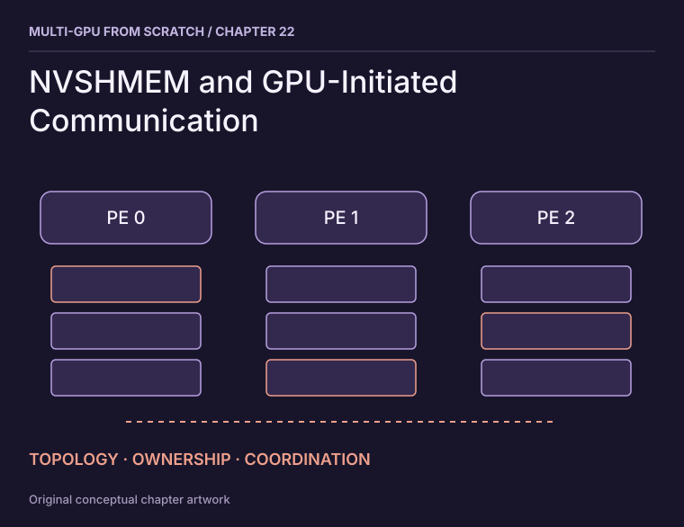
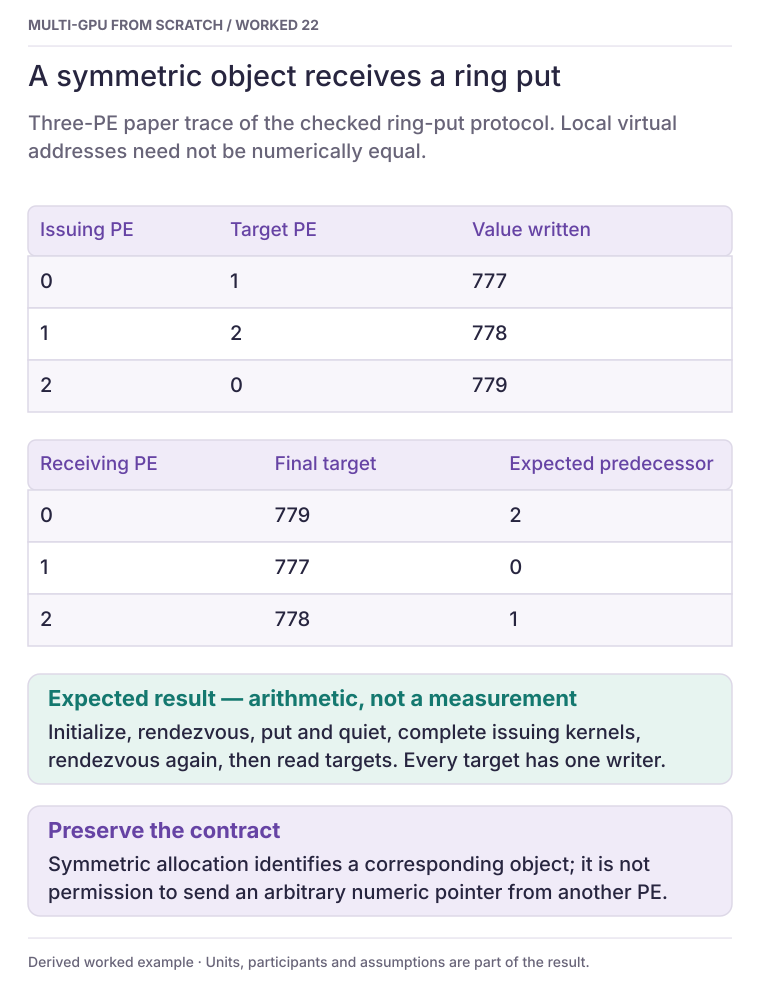
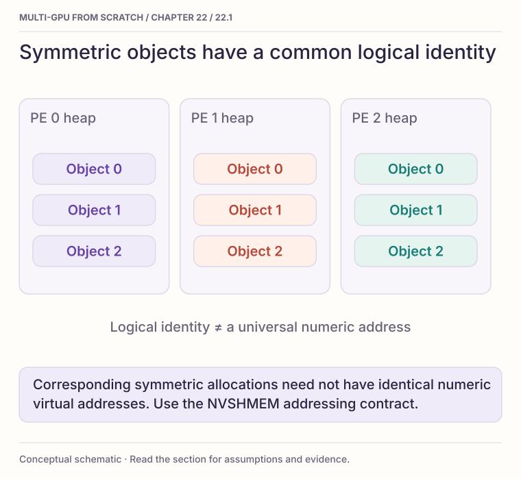
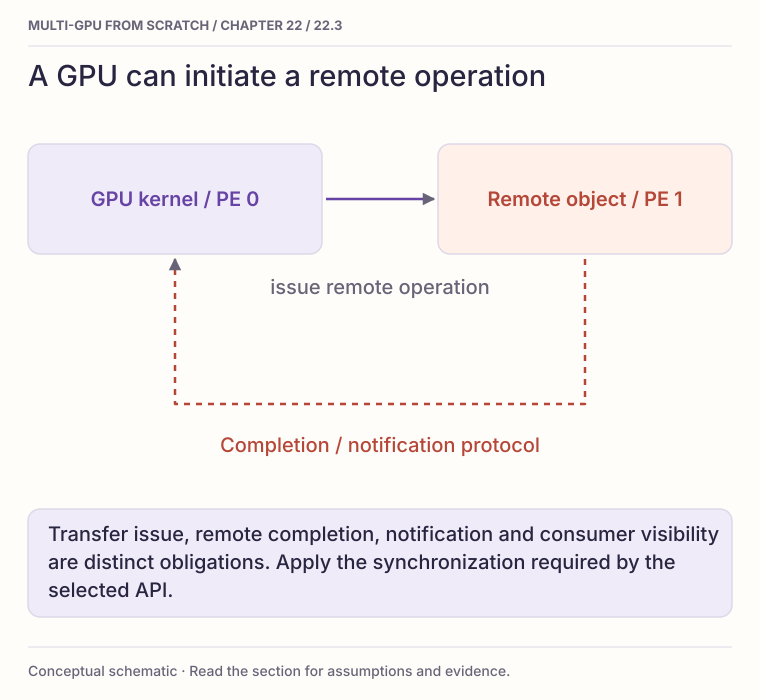

# Chapter 22: NVSHMEM and GPU-Initiated Communication

<!-- mgpu:opener:start -->
[](../images/chapter-openers/22.svg)
<!-- mgpu:opener:end -->

**What you will understand by the end of this chapter:**

- What NVSHMEM actually is: a real implementation of OpenSHMEM's partitioned global address space (PGAS) model for GPU clusters, and how its symmetric heap differs from every earlier chapter's own device memory.
- Why NVSHMEM still needs a bootstrap mechanism -- and how it reuses this book's own real MPI infrastructure (Chapter 20) to solve the exact discovery problem Chapter 21 already solved for NCCL.
- What makes NVSHMEM structurally different from every collective this book has built since Chapter 8: a CUDA kernel can call `nvshmem_put()`/`nvshmem_get()` directly, from device code, while it is still running -- no host round-trip, no separate collective call enqueued from the CPU.
- How to bind PEs to GPUs, initialize symmetric memory and check actual device-initiated communication on the H100 pair.

The [2026-11-17 H100 execution record](../validation-h100.md) covers two GPUs connected by local NV18. It distinguishes numerical checks, API probes and other executions; a successful exit alone does not establish GPU algorithm correctness.

**What you need to know first:**

- Chapter 20's real `MPI_Init`/`MPI_Comm_rank`/`MPI_Comm_size` and `MPI_Comm` handle.
- Chapter 21's real hybrid MPI+NCCL bootstrap (`ncclGetUniqueId()` + `MPI_Bcast()` + `ncclCommInitRank()`) -- NVSHMEM's own bootstrap options mirror this directly.
- Chapter 11's NCCL communicator basics, for contrast: NCCL's calls are host-initiated: the CPU enqueues them.

---

NVSHMEM exposes device-callable communication and synchronization over symmetric allocations. This chapter uses explicit MPI bootstrap and device binding: File 63 checks a single-PE allocation round-trip, File 64 checks two-PE allocation and rank behavior, and File 65 checks a kernel-initiated ring put with readback. These passed on the local two-H100 host; they do not establish an RDMA NIC or IBGDA transport path. Modern NCCL also offers device-side capabilities, so the contrast here is with the host-enqueued collective APIs used in preceding examples.

The [2026-11-17 H100 execution record](../validation-h100.md) covers two GPUs connected by local NV18. It distinguishes numerical checks, API probes and other executions; a successful exit alone does not establish GPU algorithm correctness.

```text
Host-initiated (every chapter since Ch8):
+--------+     +--------------------+     +------------------+
|  CPU   | --> | ncclAllReduce(...) | --> |  GPU executes    |
| thread |     | MPI_Send(...)      |     |  what the CPU    |
|        |     | Ch21 hybrid boot   |     |  already sent    |
+--------+     +--------------------+     +------------------+
  The CPU decides every time -- the GPU never decides on its own.

Device-initiated (this chapter):
+--------+     +----------------------------+     +----------------------+
|  CPU   | --> | nvshmemx_collective_       | --> | GPU kernel, still    |
| thread |     | launch(kernel)             |     | running, issues      |
+--------+     +----------------------------+     | nvshmem_put(...)     |
                                                   | itself -- no host   |
                                                   | round-trip at all   |
                                                   +----------------------+
```

<!-- mgpu:worked:start -->

## Worked example — Trace a symmetric ring put by receiving PE

Use a three-PE paper trace with one symmetric integer target per PE, initialized to −1. PE p writes value 777+p to target PE (p+1)%3. This extends the protocol arithmetically; it is not a claim of an additional three-PE execution.

1. PE 0 writes 777 to PE 1. PE 1 writes 778 to PE 2. PE 2 writes 779 to PE 0. Each target has exactly one writer.

2. After initialization and a rendezvous, launch the matched communication work. The issuing thread performs nvshmem_int_p and nvshmem_quiet; quiet completes its outstanding operations according to NVSHMEM semantics.

3. Complete issuing kernels, then use the agreed cross-PE rendezvous before reading targets. Expected targets are PE 0:779, PE 1:777, PE 2:778.

[](../images/worked/ch22.svg)

**API connection and scope.** A symmetric allocation identifies corresponding objects across PEs; their numeric virtual addresses need not match. Completion at the issuer and notification of a consumer are distinct obligations. The host-coordinated protocol in this example makes those phases explicit rather than treating quiet as a universal consumer barrier.

**Expected check and pitfall.** The recorded examples assume all node GPUs are visible and one process per GPU, selecting a valid node-local rank. CUDA_VISIBLE_DEVICES renumbers ordinals: if the launcher masks each process to one device, select visible device 0 instead. Never substitute the global PE number blindly.

??? question "Guided exercise: Why should PE 1 read 777 rather than 778?"

    **Worked answer.** It receives from predecessor PE 0. The value 778 was issued by PE 1 but belongs to PE 2’s target.

<!-- mgpu:worked:end -->

## 22.1 NVSHMEM's PGAS Model and the Symmetric Heap

<!-- mgpu:figure-1:start -->
[](../images/technical/ch22/1-symmetric.svg)
<!-- mgpu:figure-1:end -->

### Intuition

Every device memory allocation this book has used since Chapter 4 -- `cudaMalloc()`, peer-accessible or not -- belongs to exactly one device, and any other device that wants to touch it needs a real mechanism (`cudaMemcpyPeer()`, IPC handles, GPUDirect RDMA) to reach across. NVSHMEM's own memory model is built differently from the start. OpenSHMEM, the real community standard NVSHMEM implements for GPU clusters, "provides a partitioned global address space (PGAS) parallel programming model" -- every participating process (a PE, OpenSHMEM's own term, short for Processing Element) allocates from a real, documented structure called the Symmetric Heap: "NVSHMEM dynamic memory allocation routines (e.g., nvshmem_malloc) allow collective allocation of Symmetric Data Objects on a special memory region called the Symmetric Heap." Every PE calls `nvshmem_malloc()` together, with the same size, and every PE ends up with an object at the corresponding location in its own copy of that heap -- "symmetric," because the layout is guaranteed to line up across every PE, which is exactly what lets any PE compute where a REMOTE PE's copy of that same object lives, without ever asking that PE first. Before any of that can matter, though, NVSHMEM has to answer the same real question Chapter 20 opened this book's whole multi-process arc with: how many PEs are there, and which one is this process? Without a real answer, there is no symmetric heap to speak of at all -- just one process, alone.

```text
Every cudaMalloc() since Ch4:               NVSHMEM's own nvshmem_malloc():

+-----------------------+                   +-------------------------------+
| Device 0's own memory |                   | PE 0's symmetric heap slot X  |
| reachable elsewhere   |                   | PE 1's symmetric heap slot X  |  (same X)
| only via              |                   | PE 2's symmetric heap slot X  |  (same X)
| cudaMemcpyPeer/IPC/    |                   | ...                           |
| GPUDirect RDMA, built  |                   +-------------------------------+
| explicitly call by    |                   Every PE allocated together, same
| call                  |                   size -- any PE can compute a remote
+-----------------------+                   PE's address at slot X without ever
                                             asking that PE first.
```

### Background

File 63 explicitly initializes MPI, binds the selected visible GPU, and initializes NVSHMEM with that MPI communicator. Run it with one MPI process for its intentional single-PE allocation check; it does not rely on automatic discovery of other processes.


The [2026-11-17 H100 execution record](../validation-h100.md) covers two GPUs connected by local NV18. It distinguishes numerical checks, API probes and other executions; a successful exit alone does not establish GPU algorithm correctness.

```cpp
// 63_nvshmem_init_single_pe.cu
// Launch with mpirun -np 1: explicit MPI bootstrap, checked symmetric allocation.
// Checked two-PE example. Compile and execution evidence are captured separately.
#define OMPI_SKIP_MPICXX
#include <mpi.h>
#include <cstdio>
#include <cstdlib>
#include <vector>
#include <cuda_runtime.h>
#include <nvshmem.h>
#include <nvshmemx.h>

#define CUDA_OK(call) do { cudaError_t e = (call); if (e != cudaSuccess) { \
    fprintf(stderr, "%s: %s\n", #call, cudaGetErrorString(e)); \
    MPI_Abort(MPI_COMM_WORLD, 1); } } while (0)

static void bind_device(int rank) {
    MPI_Comm node;
    MPI_Comm_split_type(MPI_COMM_WORLD, MPI_COMM_TYPE_SHARED, rank, MPI_INFO_NULL, &node);
    int localRank, count;
    MPI_Comm_rank(node, &localRank);
    MPI_Comm_free(&node);
    CUDA_OK(cudaGetDeviceCount(&count));
    if (localRank >= count) {
        fprintf(stderr, "Insufficient GPUs: local rank %d, visible devices %d\n", localRank, count);
        MPI_Abort(MPI_COMM_WORLD, 2);
    }
    CUDA_OK(cudaSetDevice(localRank));
}

int main(int argc, char **argv) {
    MPI_Init(&argc, &argv);
    int rank;
    MPI_Comm_rank(MPI_COMM_WORLD, &rank);
    bind_device(rank); // one local PE per GPU, before NVSHMEM initialization
    MPI_Comm world = MPI_COMM_WORLD;
    nvshmemx_init_attr_t attr = NVSHMEMX_INIT_ATTR_INITIALIZER;
    nvshmemx_set_attr_mpi_comm_args(&world, &attr);
    int rc = nvshmemx_init_attr(NVSHMEMX_INIT_WITH_MPI_COMM, &attr);
    if (rc != 0) MPI_Abort(MPI_COMM_WORLD, 3);
    int pe = nvshmem_my_pe(), nPes = nvshmem_n_pes();
    int errors = 0;
    int *sym = static_cast<int *>(nvshmem_malloc(sizeof(int)));
    if (!sym) MPI_Abort(MPI_COMM_WORLD, 4);
    int sent = 100 + pe, received = -1;
    CUDA_OK(cudaMemcpy(sym, &sent, sizeof(int), cudaMemcpyHostToDevice));
    CUDA_OK(cudaMemcpy(&received, sym, sizeof(int), cudaMemcpyDeviceToHost));
    if (received != sent) ++errors;
    int worldSize;
    MPI_Comm_size(MPI_COMM_WORLD, &worldSize);
    if (nPes != worldSize || pe != rank) ++errors;
    printf("PE %d of %d: MPI bootstrap, allocation and CUDA copy checked\n", pe, nPes);
    nvshmem_free(sym);
    int totalErrors = 0;
    MPI_Allreduce(&errors, &totalErrors, 1, MPI_INT, MPI_SUM, MPI_COMM_WORLD);
    if (pe == 0) printf("VALIDATION %s: %d PEs, errors=%d\n",
                        totalErrors ? "FAIL" : "PASS", nPes, totalErrors);
    nvshmem_finalize();
    MPI_Finalize();
    return totalErrors ? 1 : 0;
}
```

<!-- execution:start:h100-rerun:63_nvshmem_init_single_pe.cu -->
> **Compiled and executed — 2026-11-18-h100: Numerical/transport validation (recorded scope).** Hardware: 2 H100 GPUs. Executed UTC: `2026-11-18T11:22:01.037501+00:00`.

<!-- execution:metadata Source SHA-256: 6c7e2d2885a959761aa918b7e8e219304bc2037f006e964a181e6af2890e8aac; recorded UTC (program start): 2026-11-18T11:21:56.211540+00:00 -->

[Exact tested source](../validation/2026-11-18-h100/63_nvshmem_init_single_pe/63_nvshmem_init_single_pe.cu) · [Compiler log](../validation/2026-11-18-h100/63_nvshmem_init_single_pe/compile.log) · [Execution log](../validation/2026-11-18-h100/63_nvshmem_init_single_pe/run.log). Compile exit: `0`; run exit: `0`.

Commands below use local source/binary names; raw logs retain host paths. Execute in a scratch directory containing the downloaded source.

```bash
nvcc -std=c++17 -O2 -arch=sm_90 -ccbin mpicxx -rdc=true -I/home/ubuntu/book-validation-deps-20261118/lib/python3.12/site-packages/nvidia/nvshmem/include -L/home/ubuntu/book-validation-deps-20261118/lib/python3.12/site-packages/nvidia/nvshmem/lib -Xlinker=-rpath=/home/ubuntu/book-validation-deps-20261118/lib/python3.12/site-packages/nvidia/nvshmem/lib 63_nvshmem_init_single_pe.cu -o ./example -lnvshmem_host -lnvshmem_device -lcuda
mpirun --oversubscribe -np 1 ./example
```

**Sample output**

```text
PE 0 of 1: MPI bootstrap, allocation and CUDA copy checked
VALIDATION PASS: 1 PEs, errors=0
```

<!-- execution:end:h100-rerun:63_nvshmem_init_single_pe.cu -->


<!-- execution:start:a100:63_nvshmem_init_single_pe.cu -->
> **Compiled and executed — 2026-11-17-a100: Numerical/transport validation (recorded scope).** Hardware: 8 A100 GPUs. Executed UTC: `2026-11-18T00:03:45.813506+00:00`.

<!-- execution:metadata Source SHA-256: 6c7e2d2885a959761aa918b7e8e219304bc2037f006e964a181e6af2890e8aac; recorded UTC (program start): 2026-11-18T00:03:37.833038+00:00 -->

[Exact tested source](../validation/2026-11-17-a100/63_nvshmem_init_single_pe/63_nvshmem_init_single_pe.cu) · [Compiler log](../validation/2026-11-17-a100/63_nvshmem_init_single_pe/compile.log) · [Execution log](../validation/2026-11-17-a100/63_nvshmem_init_single_pe/run.log). Compile exit: `0`; run exit: `0`.

Commands below use local source/binary names; raw logs retain host paths. Execute in a scratch directory containing the downloaded source.

```bash
nvcc -std=c++17 -O2 -arch=sm_80 -ccbin mpicxx -rdc=true -I/home/ubuntu/book2-deps/lib/python3.12/site-packages/nvidia/nvshmem/include -L/home/ubuntu/book2-deps/lib/python3.12/site-packages/nvidia/nvshmem/lib -Xlinker=-rpath=/home/ubuntu/book2-deps/lib/python3.12/site-packages/nvidia/nvshmem/lib 63_nvshmem_init_single_pe.cu -o ./example -lnvshmem_host -lnvshmem_device -lcuda
mpirun --oversubscribe -np 1 ./example
```

**Sample output**

```text
PE 0 of 1: MPI bootstrap, allocation and CUDA copy checked
VALIDATION PASS: 1 PEs, errors=0
```


<!-- execution:end:a100:63_nvshmem_init_single_pe.cu -->


<!-- execution:start:h100:63_nvshmem_init_single_pe.cu -->
> **Compiled and executed — 2026-11-17-h100: Numerical/transport validation (recorded scope).** Hardware: 2 H100 GPUs. Execution record UTC (run-batch start; per-program time unrecorded): `2026-11-17T23:48:18.967387+00:00`.

<!-- execution:metadata Source SHA-256: 6c7e2d2885a959761aa918b7e8e219304bc2037f006e964a181e6af2890e8aac; recorded UTC (run-batch start; per-program time unrecorded): 2026-11-17T23:48:18.967387+00:00 -->

[Exact tested source](../validation/2026-11-17-h100/63_nvshmem_init_single_pe/63_nvshmem_init_single_pe.cu) · [Compiler log](../validation/2026-11-17-h100/63_nvshmem_init_single_pe/compile.log) · [Execution log](../validation/2026-11-17-h100/63_nvshmem_init_single_pe/run.log). Compile exit: `0`; run exit: `0`.

Commands below use local source/binary names; raw logs retain host paths. Execute in a scratch directory containing the downloaded source.

```bash
nvcc -std=c++17 -O2 -arch=sm_90 -ccbin mpicxx -rdc=true -I/home/ubuntu/book2-deps/lib/python3.12/site-packages/nvidia/nvshmem/include -L/home/ubuntu/book2-deps/lib/python3.12/site-packages/nvidia/nvshmem/lib -Xlinker=-rpath=/home/ubuntu/book2-deps/lib/python3.12/site-packages/nvidia/nvshmem/lib 63_nvshmem_init_single_pe.cu -o ./example -lnvshmem_host -lnvshmem_device -lcuda
mpirun --oversubscribe -np 1 ./example
```

<details markdown="1"><summary>Captured current-source output</summary>

```text
--------------------------------------------------------------------------
Sorry!  You were supposed to get help about:
    unavailable
But I couldn't open the help file:
    /usr/lib/x86_64-linux-gnu/pmix2/share/pmix/help-pcompress.txt: No such file or directory.  Sorry!
--------------------------------------------------------------------------
libibverbs: Warning: couldn't load driver 'libvmw_pvrdma-rdmav34.so': libvmw_pvrdma-rdmav34.so: cannot open shared object file: No such file or directory
--------------------------------------------------------------------------
WARNING: No preset parameters were found for the device that Open MPI
detected:

  Local host:            192-222-53-210
  Device name:           mlx5_0
  Device vendor ID:      0x02c9
  Device vendor part ID: 4124

Default device parameters will be used, which may result in lower
performance.  You can edit any of the files specified by the
btl_openib_device_param_files MCA parameter to set values for your
device.

NOTE: You can turn off this warning by setting the MCA parameter
      btl_openib_warn_no_device_params_found to 0.
--------------------------------------------------------------------------
--------------------------------------------------------------------------
No OpenFabrics connection schemes reported that they were able to be
used on a specific port.  As such, the openib BTL (OpenFabrics
support) will be disabled for this port.

  Local host:           192-222-53-210
  Local device:         mlx5_0
  Local port:           1
  CPCs attempted:       udcm
--------------------------------------------------------------------------
PE 0 of 1: MPI bootstrap, allocation and CUDA copy checked
VALIDATION PASS: 1 PEs, errors=0
```

</details>
<!-- execution:end:h100:63_nvshmem_init_single_pe.cu -->


The pip package needs two setup steps NVIDIA's install guide doesn't spell out for this layout. First, define the two paths every command below uses -- `NVSHMEM_HOME` is the package directory (ask Python for the package's `__path__`; `nvidia.nvshmem` is a namespace-style package, so `__file__` is not reliable), and `LIBDIR` is its `lib/` subdirectory. Second, the wheel ships only the versioned `libnvshmem_host.so.3`, with no unversioned `libnvshmem_host.so`, so the linker's `-lnvshmem_host` fails with `cannot find -lnvshmem_host` until you provide that name -- here with a symlink in a local directory, so the installed package itself is left untouched:

```bash
export NVSHMEM_HOME=$(python3 -c "import nvidia.nvshmem; print(list(nvidia.nvshmem.__path__)[0])")
export LIBDIR=$NVSHMEM_HOME/lib
mkdir -p nvshmem_link
ln -sf $LIBDIR/libnvshmem_host.so.3 nvshmem_link/libnvshmem_host.so

nvcc -rdc=true -ccbin g++ -gencode=arch=compute_70,code=sm_70 -I $NVSHMEM_HOME/include \
     63_nvshmem_init_single_pe.cu -o 63_nvshmem_init_single_pe \
     -L nvshmem_link -L $LIBDIR -lnvshmem_host -lnvshmem_device -lcuda
LD_LIBRARY_PATH=$LIBDIR ./63_nvshmem_init_single_pe
```

The binary links against the installed NVSHMEM host and device libraries. The recorded execution shows the selected library version and bootstrap behavior.

!!! warning "[COMMON TRAP] Expecting multiple PEs without a multi-process bootstrap"
    A single-process NVSHMEM initialization creates a single-PE world. Use the appropriate bootstrap, such as the MPI communicator in Section 22.2, to establish the participating processes.

## 22.2 Real Multi-PE NVSHMEM via MPI Bootstrap

### Intuition

Section 22.1 deliberately bootstraps a one-process MPI world. Section 22.2 uses the same explicit bootstrap with multiple processes. Chapter 20 already solved that exact discovery problem once, for MPI itself; Chapter 21 reused MPI a second time, to bootstrap NCCL's own `ncclUniqueId`. NVSHMEM ships the same real answer as a first-class option: `NVSHMEMX_INIT_WITH_MPI_COMM`, set via `nvshmemx_set_attr_mpi_comm_args()`, hands NVSHMEM a real `MPI_Comm` this book has already built genuine multi-process programs on top of. (NVSHMEM also ships a second, structurally different bootstrap path, `NVSHMEMX_INIT_WITH_UNIQUEID` -- a uniqueid generated once and distributed to every PE, exactly like Chapter 21's own `ncclUniqueId` + `MPI_Bcast()` pattern; this section uses the MPI path because MPI is already present and simpler to reach for.) Once NVSHMEM has a real `MPI_Comm` to query, `nvshmem_my_pe()` identifies each PE from 0 through P−1 and `nvshmem_n_pes()` returns P, the number of processes in the supplied communicator -- the same real multi-process world every earlier Part 5 chapter has built, now handed to a third real library.

The conceptual panel below contrasts implicit single-PE discovery with an explicitly supplied multi-process world. Its “no bootstrap” label is conceptual; current File 63 explicitly bootstraps a one-process MPI communicator.

```text
Section 22.1 (no bootstrap):
+----------------+     +------------------+
| nvshmem_init() | --> | n_pes=1, my_pe=0 |  (correct -- but the whole real
+----------------+     +------------------+   world really is just 1 process)

Section 22.2 (MPI bootstrap):
+--------------------------------+
| mpirun -np 2 ./program         |   (Ch20's own launch)
+----------------+---------------+
                 |
       +---------+---------+
       |                   |
   rank 0 (MPI)         rank 1 (MPI)
       |                   |
   nvshmemx_set_attr_mpi_comm_args(&MPI_COMM_WORLD)
       |                   |
   nvshmemx_init_attr(NVSHMEMX_INIT_WITH_MPI_COMM)
       |                   |
   my_pe=0, n_pes=2     my_pe=1, n_pes=2
```

### Background


The [2026-11-17 H100 execution record](../validation-h100.md) covers two GPUs connected by local NV18. It distinguishes numerical checks, API probes and other executions; a successful exit alone does not establish GPU algorithm correctness.

```cpp
// 64_nvshmem_mpi_bootstrap.cu
// Checked two-PE example. Compile and execution evidence are captured separately.
#define OMPI_SKIP_MPICXX
#include <mpi.h>
#include <cstdio>
#include <cstdlib>
#include <vector>
#include <cuda_runtime.h>
#include <nvshmem.h>
#include <nvshmemx.h>

#define CUDA_OK(call) do { cudaError_t e = (call); if (e != cudaSuccess) { \
    fprintf(stderr, "%s: %s\n", #call, cudaGetErrorString(e)); \
    MPI_Abort(MPI_COMM_WORLD, 1); } } while (0)

static void bind_device(int rank) {
    MPI_Comm node;
    MPI_Comm_split_type(MPI_COMM_WORLD, MPI_COMM_TYPE_SHARED, rank, MPI_INFO_NULL, &node);
    int localRank, count;
    MPI_Comm_rank(node, &localRank);
    MPI_Comm_free(&node);
    CUDA_OK(cudaGetDeviceCount(&count));
    if (localRank >= count) {
        fprintf(stderr, "Insufficient GPUs: local rank %d, visible devices %d\n", localRank, count);
        MPI_Abort(MPI_COMM_WORLD, 2);
    }
    CUDA_OK(cudaSetDevice(localRank));
}

int main(int argc, char **argv) {
    MPI_Init(&argc, &argv);
    int rank;
    MPI_Comm_rank(MPI_COMM_WORLD, &rank);
    bind_device(rank); // one local PE per GPU, before NVSHMEM initialization
    MPI_Comm world = MPI_COMM_WORLD;
    nvshmemx_init_attr_t attr = NVSHMEMX_INIT_ATTR_INITIALIZER;
    nvshmemx_set_attr_mpi_comm_args(&world, &attr);
    int rc = nvshmemx_init_attr(NVSHMEMX_INIT_WITH_MPI_COMM, &attr);
    if (rc != 0) MPI_Abort(MPI_COMM_WORLD, 3);
    int pe = nvshmem_my_pe(), nPes = nvshmem_n_pes();
    int errors = 0;
    int *sym = static_cast<int *>(nvshmem_malloc(sizeof(int)));
    if (!sym) MPI_Abort(MPI_COMM_WORLD, 4);
    int sent = 100 + pe, received = -1;
    CUDA_OK(cudaMemcpy(sym, &sent, sizeof(int), cudaMemcpyHostToDevice));
    CUDA_OK(cudaMemcpy(&received, sym, sizeof(int), cudaMemcpyDeviceToHost));
    if (received != sent) ++errors;
    int worldSize;
    MPI_Comm_size(MPI_COMM_WORLD, &worldSize);
    if (nPes != worldSize || pe != rank) ++errors;
    printf("PE %d of %d: MPI bootstrap, allocation and CUDA copy checked\n", pe, nPes);
    nvshmem_free(sym);
    int totalErrors = 0;
    MPI_Allreduce(&errors, &totalErrors, 1, MPI_INT, MPI_SUM, MPI_COMM_WORLD);
    if (pe == 0) printf("VALIDATION %s: %d PEs, errors=%d\n",
                        totalErrors ? "FAIL" : "PASS", nPes, totalErrors);
    nvshmem_finalize();
    MPI_Finalize();
    return totalErrors ? 1 : 0;
}
```

<!-- execution:start:h100-rerun:64_nvshmem_mpi_bootstrap.cu -->
> **Compiled and executed — 2026-11-18-h100: Numerical/transport validation (recorded scope).** Hardware: 2 H100 GPUs. Executed UTC: `2026-11-18T11:22:08.834111+00:00`.

<!-- execution:metadata Source SHA-256: 357f3ed1edb1854d730c9d43c3411e9085ad2a46dcab20c482f7db88933dd1d8; recorded UTC (program start): 2026-11-18T11:22:04.009384+00:00 -->

[Exact tested source](../validation/2026-11-18-h100/64_nvshmem_mpi_bootstrap/64_nvshmem_mpi_bootstrap.cu) · [Compiler log](../validation/2026-11-18-h100/64_nvshmem_mpi_bootstrap/compile.log) · [Execution log](../validation/2026-11-18-h100/64_nvshmem_mpi_bootstrap/run.log). Compile exit: `0`; run exit: `0`.

Commands below use local source/binary names; raw logs retain host paths. Execute in a scratch directory containing the downloaded source.

```bash
nvcc -std=c++17 -O2 -arch=sm_90 -ccbin mpicxx -rdc=true -I/home/ubuntu/book-validation-deps-20261118/lib/python3.12/site-packages/nvidia/nvshmem/include -L/home/ubuntu/book-validation-deps-20261118/lib/python3.12/site-packages/nvidia/nvshmem/lib -Xlinker=-rpath=/home/ubuntu/book-validation-deps-20261118/lib/python3.12/site-packages/nvidia/nvshmem/lib 64_nvshmem_mpi_bootstrap.cu -o ./example -lnvshmem_host -lnvshmem_device -lcuda
mpirun --oversubscribe -np 2 ./example
```

**Sample output**

```text
PE 1 of 2: MPI bootstrap, allocation and CUDA copy checked
PE 0 of 2: MPI bootstrap, allocation and CUDA copy checked
VALIDATION PASS: 2 PEs, errors=0
```

<!-- execution:end:h100-rerun:64_nvshmem_mpi_bootstrap.cu -->


<!-- execution:start:a100:64_nvshmem_mpi_bootstrap.cu -->
> **Compiled and executed — 2026-11-17-a100: Numerical/transport validation (recorded scope).** Hardware: 8 A100 GPUs. Executed UTC: `2026-11-18T00:04:01.128038+00:00`.

<!-- execution:metadata Source SHA-256: 357f3ed1edb1854d730c9d43c3411e9085ad2a46dcab20c482f7db88933dd1d8; recorded UTC (program start): 2026-11-18T00:03:53.145852+00:00 -->

[Exact tested source](../validation/2026-11-17-a100/64_nvshmem_mpi_bootstrap/64_nvshmem_mpi_bootstrap.cu) · [Compiler log](../validation/2026-11-17-a100/64_nvshmem_mpi_bootstrap/compile.log) · [Execution log](../validation/2026-11-17-a100/64_nvshmem_mpi_bootstrap/run.log). Compile exit: `0`; run exit: `0`.

Commands below use local source/binary names; raw logs retain host paths. Execute in a scratch directory containing the downloaded source.

```bash
nvcc -std=c++17 -O2 -arch=sm_80 -ccbin mpicxx -rdc=true -I/home/ubuntu/book2-deps/lib/python3.12/site-packages/nvidia/nvshmem/include -L/home/ubuntu/book2-deps/lib/python3.12/site-packages/nvidia/nvshmem/lib -Xlinker=-rpath=/home/ubuntu/book2-deps/lib/python3.12/site-packages/nvidia/nvshmem/lib 64_nvshmem_mpi_bootstrap.cu -o ./example -lnvshmem_host -lnvshmem_device -lcuda
mpirun --oversubscribe -np 8 ./example
```

**Sample output**

```text
[LOG_CAT_SBGP] libnuma.so: cannot open shared object file: No such file or directory
[LOG_CAT_SBGP] Failed to dlopen libnuma.so. Fallback to GROUP_BY_SOCKET manual.
[LOG_CAT_SBGP] libnuma.so: cannot open shared object file: No such file or directory
[LOG_CAT_SBGP] Failed to dlopen libnuma.so. Fallback to GROUP_BY_SOCKET manual.
[LOG_CAT_SBGP] libnuma.so: cannot open shared object file: No such file or directory
[LOG_CAT_SBGP] Failed to dlopen libnuma.so. Fallback to GROUP_BY_SOCKET manual.
[LOG_CAT_SBGP] libnuma.so: cannot open shared object file: No such file or directory
[LOG_CAT_SBGP] Failed to dlopen libnuma.so. Fallback to GROUP_BY_SOCKET manual.
[LOG_CAT_SBGP] libnuma.so: cannot open shared object file: No such file or directory
[LOG_CAT_SBGP] Failed to dlopen libnuma.so. Fallback to GROUP_BY_SOCKET manual.
[LOG_CAT_SBGP] libnuma.so: cannot open shared object file: No such file or directory
[LOG_CAT_SBGP] Failed to dlopen libnuma.so. Fallback to GROUP_BY_SOCKET manual.
[LOG_CAT_SBGP] libnuma.so: cannot open shared object file: No such file or directory
[LOG_CAT_SBGP] Failed to dlopen libnuma.so. Fallback to GROUP_BY_SOCKET manual.
[LOG_CAT_SBGP] libnuma.so: cannot open shared object file: No such file or directory
[LOG_CAT_SBGP] Failed to dlopen libnuma.so. Fallback to GROUP_BY_SOCKET manual.
PE 4 of 8: MPI bootstrap, allocation and CUDA copy checked
PE 7 of 8: MPI bootstrap, allocation and CUDA copy checked
PE 0 of 8: MPI bootstrap, allocation and CUDA copy checked
PE 3 of 8: MPI bootstrap, allocation and CUDA copy checked
PE 5 of 8: MPI bootstrap, allocation and CUDA copy checked
PE 2 of 8: MPI bootstrap, allocation and CUDA copy checked
PE 1 of 8: MPI bootstrap, allocation and CUDA copy checked
PE 6 of 8: MPI bootstrap, allocation and CUDA copy checked
VALIDATION PASS: 8 PEs, errors=0
```


<!-- execution:end:a100:64_nvshmem_mpi_bootstrap.cu -->


<!-- execution:start:h100:64_nvshmem_mpi_bootstrap.cu -->
> **Compiled and executed — 2026-11-17-h100: Numerical/transport validation (recorded scope).** Hardware: 2 H100 GPUs. Execution record UTC (run-batch start; per-program time unrecorded): `2026-11-17T23:48:18.967387+00:00`.

<!-- execution:metadata Source SHA-256: 357f3ed1edb1854d730c9d43c3411e9085ad2a46dcab20c482f7db88933dd1d8; recorded UTC (run-batch start; per-program time unrecorded): 2026-11-17T23:48:18.967387+00:00 -->

[Exact tested source](../validation/2026-11-17-h100/64_nvshmem_mpi_bootstrap/64_nvshmem_mpi_bootstrap.cu) · [Compiler log](../validation/2026-11-17-h100/64_nvshmem_mpi_bootstrap/compile.log) · [Execution log](../validation/2026-11-17-h100/64_nvshmem_mpi_bootstrap/run.log). Compile exit: `0`; run exit: `0`.

Commands below use local source/binary names; raw logs retain host paths. Execute in a scratch directory containing the downloaded source.

```bash
nvcc -std=c++17 -O2 -arch=sm_90 -ccbin mpicxx -rdc=true -I/home/ubuntu/book2-deps/lib/python3.12/site-packages/nvidia/nvshmem/include -L/home/ubuntu/book2-deps/lib/python3.12/site-packages/nvidia/nvshmem/lib -Xlinker=-rpath=/home/ubuntu/book2-deps/lib/python3.12/site-packages/nvidia/nvshmem/lib 64_nvshmem_mpi_bootstrap.cu -o ./example -lnvshmem_host -lnvshmem_device -lcuda
mpirun --oversubscribe -np 2 ./example
```

<details markdown="1"><summary>Captured current-source output</summary>

```text
--------------------------------------------------------------------------
Sorry!  You were supposed to get help about:
    unavailable
But I couldn't open the help file:
    /usr/lib/x86_64-linux-gnu/pmix2/share/pmix/help-pcompress.txt: No such file or directory.  Sorry!
--------------------------------------------------------------------------
libibverbs: Warning: couldn't load driver 'libvmw_pvrdma-rdmav34.so': libvmw_pvrdma-rdmav34.so: cannot open shared object file: No such file or directory
libibverbs: Warning: couldn't load driver 'libvmw_pvrdma-rdmav34.so': libvmw_pvrdma-rdmav34.so: cannot open shared object file: No such file or directory
--------------------------------------------------------------------------
WARNING: No preset parameters were found for the device that Open MPI
detected:

  Local host:            192-222-53-210
  Device name:           mlx5_0
  Device vendor ID:      0x02c9
  Device vendor part ID: 4124

Default device parameters will be used, which may result in lower
performance.  You can edit any of the files specified by the
btl_openib_device_param_files MCA parameter to set values for your
device.

NOTE: You can turn off this warning by setting the MCA parameter
      btl_openib_warn_no_device_params_found to 0.
--------------------------------------------------------------------------
--------------------------------------------------------------------------
No OpenFabrics connection schemes reported that they were able to be
used on a specific port.  As such, the openib BTL (OpenFabrics
support) will be disabled for this port.

  Local host:           192-222-53-210
  Local device:         mlx5_0
  Local port:           1
  CPCs attempted:       udcm
--------------------------------------------------------------------------
PE 1 of 2: MPI bootstrap, allocation and CUDA copy checked
PE 0 of 2: MPI bootstrap, allocation and CUDA copy checked
VALIDATION PASS: 2 PEs, errors=0
[192-222-53-210:13145] 1 more process has sent help message help-mpi-btl-openib.txt / no device params found
[192-222-53-210:13145] Set MCA parameter "orte_base_help_aggregate" to 0 to see all help / error messages
[192-222-53-210:13145] 1 more process has sent help message help-mpi-btl-openib-cpc-base.txt / no cpcs for port
```

</details>
<!-- execution:end:h100:64_nvshmem_mpi_bootstrap.cu -->


With `NVSHMEM_HOME`, `LIBDIR`, and the `nvshmem_link` symlink from Section 22.1 in place, compiled with `nvcc -rdc=true -ccbin mpicxx -gencode=arch=compute_70,code=sm_70 -I $NVSHMEM_HOME/include 64_nvshmem_mpi_bootstrap.cu -o 64_nvshmem_mpi_bootstrap -L nvshmem_link -L $LIBDIR -lnvshmem_host -lnvshmem_device -lcuda -lmpi` (the same real `mpicxx`-as-host-compiler trick Chapter 20/21 already established, now driving `nvcc` itself rather than the other way around) and genuinely run with `LD_LIBRARY_PATH=$LIBDIR mpirun --allow-run-as-root --oversubscribe -x LD_LIBRARY_PATH -np 2 ./64_nvshmem_mpi_bootstrap`. Note the setup: `attr` starts from the header's own `NVSHMEMX_INIT_ATTR_INITIALIZER`, and `nvshmemx_set_attr_mpi_comm_args()` records the communicator -- declaring a bare `nvshmemx_init_attr_t attr;` and assigning only `attr.mpi_comm` would leave its version fields and every other argument as stack garbage, and only happens to work because `nvshmemx_init_attr()` patches version fields it doesn't recognize. Sample output (stdout and NVSHMEM's stderr diagnostics from both PEs share one terminal, and NVSHMEM's `Cuda failure` messages end without a newline, so exactly how the lines interleave differs from run to run; the content does not):

!!! warning "[COMMON TRAP] Assuming nvshmemx_init_attr()'s rc=0 means the symmetric heap is usable"
    Successful initialization is only the first check. Validate the symmetric allocation, CUDA initialization copies and readback as the current File 64 does. Its current successful output does not show an allocation failure; treating an unchecked initialization return as proof of usable memory would still be an error.

## 22.3 GPU-Initiated Communication: A Kernel That Puts to a Remote PE, By Itself

<!-- mgpu:figure-3:start -->
[](../images/technical/ch22/3-put.svg)
<!-- mgpu:figure-3:end -->

### Intuition

Sections 22.1 and 22.2 only ever called NVSHMEM from the host -- `nvshmem_init()`, `nvshmem_malloc()`, `nvshmem_finalize()`. Every one of those calls could, in principle, be a slightly stranger `cudaMalloc()`. This section builds a capability not exposed by the host-enqueued collective calls used in preceding examples: a CUDA kernel that issues a PUT to another PE's memory itself, from device code, while that thread is still executing. NVSHMEM's own documentation is direct about this: "Device-side APIs can be called by CUDA kernel threads to efficiently access locations in symmetric memory through one-sided read (get), write (put), and atomic update API calls." File 65 uses `nvshmemx_collective_launch()`, a supported launch path. The general rule is more specific than ‘every NVSHMEM kernel requires it’: kernels using NVSHMEM synchronization or collective APIs require collective launch for its progress guarantees; communication-only kernels can also use ordinary CUDA launch interfaces. Follow the documented requirements for the APIs actually called.

```text
Every kernel launch since Ch3:                 This section's own launch:

+----------------------------+                 +----------------------------------+
| plain CUDA launch syntax   |                 | nvshmemx_collective_launch(       |
| (triple angle-bracket      |                 |   (const void*)putKernel, grid,   |
| launch), no coordination   |                 |   block, args, sharedMem, stream) |
| with any communication     |                 +----------------------------------+
| library at all             |                 -- NVSHMEM's own launch path, required
+----------------------------+                    because the kernel body calls a real
                                                   device-side NVSHMEM API (nvshmem_int_p)
```

### Background


The [2026-11-17 H100 execution record](../validation-h100.md) covers two GPUs connected by local NV18. It distinguishes numerical checks, API probes and other executions; a successful exit alone does not establish GPU algorithm correctness.

```cpp
// 65_gpu_initiated_put.cu
// Checked two-PE example. Compile and execution evidence are captured separately.
#define OMPI_SKIP_MPICXX
#include <mpi.h>
#include <cstdio>
#include <cstdlib>
#include <vector>
#include <cuda_runtime.h>
#include <nvshmem.h>
#include <nvshmemx.h>

#define CUDA_OK(call) do { cudaError_t e = (call); if (e != cudaSuccess) { \
    fprintf(stderr, "%s: %s\n", #call, cudaGetErrorString(e)); \
    MPI_Abort(MPI_COMM_WORLD, 1); } } while (0)

static void bind_device(int rank) {
    MPI_Comm node;
    MPI_Comm_split_type(MPI_COMM_WORLD, MPI_COMM_TYPE_SHARED, rank, MPI_INFO_NULL, &node);
    int localRank, count;
    MPI_Comm_rank(node, &localRank);
    MPI_Comm_free(&node);
    CUDA_OK(cudaGetDeviceCount(&count));
    if (localRank >= count) {
        fprintf(stderr, "Insufficient GPUs: local rank %d, visible devices %d\n", localRank, count);
        MPI_Abort(MPI_COMM_WORLD, 2);
    }
    CUDA_OK(cudaSetDevice(localRank));
}

__global__ void putKernel(int *destination, int value, int peer) {
    nvshmem_int_p(destination, value, peer);
    nvshmem_quiet(); // complete this issuing thread's remote operation
}

int main(int argc, char **argv) {
    MPI_Init(&argc, &argv);
    int rank;
    MPI_Comm_rank(MPI_COMM_WORLD, &rank);
    bind_device(rank); // one local PE per GPU, before NVSHMEM initialization
    MPI_Comm world = MPI_COMM_WORLD;
    nvshmemx_init_attr_t attr = NVSHMEMX_INIT_ATTR_INITIALIZER;
    nvshmemx_set_attr_mpi_comm_args(&world, &attr);
    int rc = nvshmemx_init_attr(NVSHMEMX_INIT_WITH_MPI_COMM, &attr);
    if (rc != 0) MPI_Abort(MPI_COMM_WORLD, 3);
    int pe = nvshmem_my_pe(), nPes = nvshmem_n_pes();
    int errors = 0;
    int *target = static_cast<int *>(nvshmem_malloc(sizeof(int)));
    if (!target) MPI_Abort(MPI_COMM_WORLD, 4);
    CUDA_OK(cudaMemset(target, 0xff, sizeof(int)));
    nvshmem_barrier_all(); // all destination allocations are initialized
    int value = 777 + pe, peer = (pe + 1) % nPes;
    void *args[] = {&target, &value, &peer};
    rc = nvshmemx_collective_launch(reinterpret_cast<const void *>(putKernel),
                                  dim3(1), dim3(1), args, 0, 0);
    if (rc != 0) MPI_Abort(MPI_COMM_WORLD, 5);
    CUDA_OK(cudaDeviceSynchronize());
    nvshmem_barrier_all(); // every issuing PE has completed its put and quiet
    int received = -1;
    CUDA_OK(cudaMemcpy(&received, target, sizeof(int), cudaMemcpyDeviceToHost));
    int expected = 777 + (pe + nPes - 1) % nPes;
    if (received != expected) ++errors;
    printf("PE %d ring put: received=%d expected=%d\n", pe, received, expected);
    nvshmem_free(target);
    int totalErrors = 0;
    MPI_Allreduce(&errors, &totalErrors, 1, MPI_INT, MPI_SUM, MPI_COMM_WORLD);
    if (pe == 0) printf("VALIDATION %s: %d PEs, errors=%d\n",
                        totalErrors ? "FAIL" : "PASS", nPes, totalErrors);
    nvshmem_finalize();
    MPI_Finalize();
    return totalErrors ? 1 : 0;
}
```

<!-- execution:start:h100-rerun:65_gpu_initiated_put.cu -->
> **Compiled and executed — 2026-11-18-h100: Numerical/transport validation (recorded scope).** Hardware: 2 H100 GPUs. Executed UTC: `2026-11-18T11:22:19.132298+00:00`.

<!-- execution:metadata Source SHA-256: 3ad04e69ecd8a1bee67e880eda08ff7c5e75bebeb53b6eaf3fab336df0129607; recorded UTC (program start): 2026-11-18T11:22:14.258052+00:00 -->

[Exact tested source](../validation/2026-11-18-h100/65_gpu_initiated_put/65_gpu_initiated_put.cu) · [Compiler log](../validation/2026-11-18-h100/65_gpu_initiated_put/compile.log) · [Execution log](../validation/2026-11-18-h100/65_gpu_initiated_put/run.log). Compile exit: `0`; run exit: `0`.

Commands below use local source/binary names; raw logs retain host paths. Execute in a scratch directory containing the downloaded source.

```bash
nvcc -std=c++17 -O2 -arch=sm_90 -ccbin mpicxx -rdc=true -I/home/ubuntu/book-validation-deps-20261118/lib/python3.12/site-packages/nvidia/nvshmem/include -L/home/ubuntu/book-validation-deps-20261118/lib/python3.12/site-packages/nvidia/nvshmem/lib -Xlinker=-rpath=/home/ubuntu/book-validation-deps-20261118/lib/python3.12/site-packages/nvidia/nvshmem/lib 65_gpu_initiated_put.cu -o ./example -lnvshmem_host -lnvshmem_device -lcuda
mpirun --oversubscribe -np 2 ./example
```

**Sample output**

```text
PE 0 ring put: received=778 expected=778
PE 1 ring put: received=777 expected=777
VALIDATION PASS: 2 PEs, errors=0
```

<!-- execution:end:h100-rerun:65_gpu_initiated_put.cu -->


<!-- execution:start:a100:65_gpu_initiated_put.cu -->
> **Compiled and executed — 2026-11-17-a100: Numerical/transport validation (recorded scope).** Hardware: 8 A100 GPUs. Executed UTC: `2026-11-18T00:04:26.964687+00:00`.

<!-- execution:metadata Source SHA-256: 3ad04e69ecd8a1bee67e880eda08ff7c5e75bebeb53b6eaf3fab336df0129607; recorded UTC (program start): 2026-11-18T00:04:18.882286+00:00 -->

[Exact tested source](../validation/2026-11-17-a100/65_gpu_initiated_put/65_gpu_initiated_put.cu) · [Compiler log](../validation/2026-11-17-a100/65_gpu_initiated_put/compile.log) · [Execution log](../validation/2026-11-17-a100/65_gpu_initiated_put/run.log). Compile exit: `0`; run exit: `0`.

Commands below use local source/binary names; raw logs retain host paths. Execute in a scratch directory containing the downloaded source.

```bash
nvcc -std=c++17 -O2 -arch=sm_80 -ccbin mpicxx -rdc=true -I/home/ubuntu/book2-deps/lib/python3.12/site-packages/nvidia/nvshmem/include -L/home/ubuntu/book2-deps/lib/python3.12/site-packages/nvidia/nvshmem/lib -Xlinker=-rpath=/home/ubuntu/book2-deps/lib/python3.12/site-packages/nvidia/nvshmem/lib 65_gpu_initiated_put.cu -o ./example -lnvshmem_host -lnvshmem_device -lcuda
mpirun --oversubscribe -np 8 ./example
```

**Sample output**

```text
[LOG_CAT_SBGP] libnuma.so: cannot open shared object file: No such file or directory
[LOG_CAT_SBGP] Failed to dlopen libnuma.so. Fallback to GROUP_BY_SOCKET manual.
[LOG_CAT_SBGP] libnuma.so: cannot open shared object file: No such file or directory
[LOG_CAT_SBGP] Failed to dlopen libnuma.so. Fallback to GROUP_BY_SOCKET manual.
[LOG_CAT_SBGP] libnuma.so: cannot open shared object file: No such file or directory
[LOG_CAT_SBGP] Failed to dlopen libnuma.so. Fallback to GROUP_BY_SOCKET manual.
[LOG_CAT_SBGP] libnuma.so: cannot open shared object file: No such file or directory
[LOG_CAT_SBGP] Failed to dlopen libnuma.so. Fallback to GROUP_BY_SOCKET manual.
[LOG_CAT_SBGP] libnuma.so: cannot open shared object file: No such file or directory
[LOG_CAT_SBGP] Failed to dlopen libnuma.so. Fallback to GROUP_BY_SOCKET manual.
[LOG_CAT_SBGP] libnuma.so: cannot open shared object file: No such file or directory
[LOG_CAT_SBGP] Failed to dlopen libnuma.so. Fallback to GROUP_BY_SOCKET manual.
[LOG_CAT_SBGP] libnuma.so: cannot open shared object file: No such file or directory
[LOG_CAT_SBGP] Failed to dlopen libnuma.so. Fallback to GROUP_BY_SOCKET manual.
[LOG_CAT_SBGP] libnuma.so: cannot open shared object file: No such file or directory
[LOG_CAT_SBGP] Failed to dlopen libnuma.so. Fallback to GROUP_BY_SOCKET manual.
PE 6 ring put: received=782 expected=782
PE 5 ring put: received=781 expected=781
PE 7 ring put: received=783 expected=783
PE 0 ring put: received=784 expected=784
PE 2 ring put: received=778 expected=778
PE 3 ring put: received=779 expected=779
PE 4 ring put: received=780 expected=780
PE 1 ring put: received=777 expected=777
VALIDATION PASS: 8 PEs, errors=0
```


<!-- execution:end:a100:65_gpu_initiated_put.cu -->


<!-- execution:start:h100:65_gpu_initiated_put.cu -->
> **Compiled and executed — 2026-11-17-h100: Numerical/transport validation (recorded scope).** Hardware: 2 H100 GPUs. Execution record UTC (run-batch start; per-program time unrecorded): `2026-11-17T23:48:18.967387+00:00`.

<!-- execution:metadata Source SHA-256: 3ad04e69ecd8a1bee67e880eda08ff7c5e75bebeb53b6eaf3fab336df0129607; recorded UTC (run-batch start; per-program time unrecorded): 2026-11-17T23:48:18.967387+00:00 -->

[Exact tested source](../validation/2026-11-17-h100/65_gpu_initiated_put/65_gpu_initiated_put.cu) · [Compiler log](../validation/2026-11-17-h100/65_gpu_initiated_put/compile.log) · [Execution log](../validation/2026-11-17-h100/65_gpu_initiated_put/run.log). Compile exit: `0`; run exit: `0`.

Commands below use local source/binary names; raw logs retain host paths. Execute in a scratch directory containing the downloaded source.

```bash
nvcc -std=c++17 -O2 -arch=sm_90 -ccbin mpicxx -rdc=true -I/home/ubuntu/book2-deps/lib/python3.12/site-packages/nvidia/nvshmem/include -L/home/ubuntu/book2-deps/lib/python3.12/site-packages/nvidia/nvshmem/lib -Xlinker=-rpath=/home/ubuntu/book2-deps/lib/python3.12/site-packages/nvidia/nvshmem/lib 65_gpu_initiated_put.cu -o ./example -lnvshmem_host -lnvshmem_device -lcuda
mpirun --oversubscribe -np 2 ./example
```

<details markdown="1"><summary>Captured current-source output</summary>

```text
--------------------------------------------------------------------------
Sorry!  You were supposed to get help about:
    unavailable
But I couldn't open the help file:
    /usr/lib/x86_64-linux-gnu/pmix2/share/pmix/help-pcompress.txt: No such file or directory.  Sorry!
--------------------------------------------------------------------------
libibverbs: Warning: couldn't load driver 'libvmw_pvrdma-rdmav34.so': libvmw_pvrdma-rdmav34.so: cannot open shared object file: No such file or directory
libibverbs: Warning: couldn't load driver 'libvmw_pvrdma-rdmav34.so': libvmw_pvrdma-rdmav34.so: cannot open shared object file: No such file or directory
--------------------------------------------------------------------------
WARNING: No preset parameters were found for the device that Open MPI
detected:

  Local host:            192-222-53-210
  Device name:           mlx5_0
  Device vendor ID:      0x02c9
  Device vendor part ID: 4124

Default device parameters will be used, which may result in lower
performance.  You can edit any of the files specified by the
btl_openib_device_param_files MCA parameter to set values for your
device.

NOTE: You can turn off this warning by setting the MCA parameter
      btl_openib_warn_no_device_params_found to 0.
--------------------------------------------------------------------------
--------------------------------------------------------------------------
No OpenFabrics connection schemes reported that they were able to be
used on a specific port.  As such, the openib BTL (OpenFabrics
support) will be disabled for this port.

  Local host:           192-222-53-210
  Local device:         mlx5_0
  Local port:           1
  CPCs attempted:       udcm
--------------------------------------------------------------------------
PE 0 ring put: received=778 expected=778
VALIDATION PASS: 2 PEs, errors=0
PE 1 ring put: received=777 expected=777
[192-222-53-210:13255] 1 more process has sent help message help-mpi-btl-openib.txt / no device params found
[192-222-53-210:13255] Set MCA parameter "orte_base_help_aggregate" to 0 to see all help / error messages
[192-222-53-210:13255] 1 more process has sent help message help-mpi-btl-openib-cpc-base.txt / no cpcs for port
```

</details>
<!-- execution:end:h100:65_gpu_initiated_put.cu -->


File 65 now initializes symmetric device memory, launches a kernel-initiated ring put, completes communication and checks the value from the previous PE. Its two-PE H100 numerical check passed.

The [2026-11-17 H100 execution record](../validation-h100.md) covers two GPUs connected by local NV18. It distinguishes numerical checks, API probes and other executions; a successful exit alone does not establish GPU algorithm correctness.

!!! warning "[COMMON TRAP] Ignoring collective-launch completion"
    Check the collective launch return code, complete the device work and inspect every destination value before finalizing NVSHMEM. All participating PEs must follow the required launch and synchronization protocol.

## Chapter Summary

NVSHMEM adds a symmetric address space and GPU-initiated communication. This chapter starts with single-PE initialization, adds MPI bootstrap for multiple PEs, then checks a device-initiated put against initialized destination data.

## Self-Check Questions

1. How does symmetric NVSHMEM allocation differ from a plain CUDA allocation?
2. Why does File 63 explicitly bootstrap MPI even for its single-PE allocation check?
3. How does the MPI communicator determine the PE world?
4. Why must successful initialization be followed by checked allocation and readback?
5. What launch and completion requirements apply to File 65’s device communication?
6. What does the current two-PE ring-put numerical check establish?
7. How does a device-initiated operation differ from a host-enqueued collective?
8. Why does a local NV18 pass not establish RDMA transport or fault recovery?

The [2026-11-17 H100 execution record](../validation-h100.md) covers two GPUs connected by local NV18. It distinguishes numerical checks, API probes and other executions; a successful exit alone does not establish GPU algorithm correctness.

## Where We Go Next

Chapter 22 demonstrated communication issued by a still-running kernel, extending the host-enqueued interfaces used in the earlier examples. Chapter 23 returns to something more familiar in shape -- CUDA graphs, first built single-device in earlier books this series assumes -- and asks what changes when a single graph has to span multiple GPUs and multiple nodes at once: which parts of a graph can legitimately cross a device boundary, and which of this book's own real communication primitives (peer copies, NCCL collectives, MPI calls) can actually be captured as graph nodes rather than issued one at a time.

## Worked Solutions

**1.** A partitioned global address space means every participating process (PE) contributes memory to one logical address space, even though the underlying memory is physically distributed across separate devices -- any PE can, in principle, name and address any other PE's contribution. NVSHMEM's own symmetric heap is a real implementation of this: every PE calls `nvshmem_malloc()` together with the same size, so every PE's copy of a given allocation sits at the corresponding offset in its own heap. A plain `cudaMalloc()` allocation, by contrast, belongs to exactly one device and is not automatically nameable from any other device at all -- reaching it from elsewhere always needed an explicit mechanism this book built one chapter at a time (`cudaMemcpyPeer()`, IPC handles, GPUDirect RDMA).

**2.** Current File 63 explicitly bootstraps a one-rank MPI communicator, binds its GPU and checks symmetric allocation by CUDA copy/readback. Its one-PE world is intentional, not automatic discovery of every process or GPU on the machine.

**3.** `NVSHMEMX_INIT_WITH_MPI_COMM` (used in this chapter) hands NVSHMEM a real `MPI_Comm`, mirroring Chapter 20's own real `MPI_Init`/`MPI_Comm_rank`/`MPI_Comm_size` discovery. `NVSHMEMX_INIT_WITH_UNIQUEID` (mentioned but not used) generates one id and distributes it to every PE, structurally identical to Chapter 21's own `ncclGetUniqueId()` + `MPI_Bcast()` + `ncclCommInitRank()` pattern.

**4.** Initialization, allocation and readback check separate layers. A successful initialization does not guarantee that later allocations succeed or that received numerical values are correct. Current File 64 checks the symmetric allocation and round-trip values; its captured result is successful.

**5.** File 65 uses collective launch, checks its return, completes the issuing device kernels, and performs a matching host rendezvous before reading the targets. Each issuing thread calls quiet for its own communication. Collective launch is required for device synchronization/collective APIs; the mere presence of a put is not by itself that requirement.

**6.** File 65’s successful two-PE H100 ring-put check establishes the stated kernel-initiated local exchange and numerical readback after completion. It is not a fault-injection or recovery test and does not establish an RDMA transport path.

The [2026-11-17 H100 execution record](../validation-h100.md) covers two GPUs connected by local NV18. It distinguishes numerical checks, API probes and other executions; a successful exit alone does not establish GPU algorithm correctness.

**7.** It moves the DECISION of when to communicate from the host to the device. In every earlier chapter, a CPU thread decided the exact moment a collective or send call happened, and the GPU simply executed whatever the CPU had already enqueued. With NVSHMEM's device-side APIs, a GPU thread that is still running can decide, on its own, to issue a put or get -- the host's only role was launching the kernel that contains that decision, not making the decision itself.

**8.** A local NV18 ring-put result validates the stated local PE exchange and numerical readback. It does not show that a NIC or RDMA transport carried the bytes, and no rank failure is injected. Transport diagnostics and a separate fault/recovery experiment would be needed for those claims.

---

**Sources cited in this chapter:**

- [Using NVSHMEM (NVSHMEM 1.0 archive)](https://docs.nvidia.com/nvshmem/archives/nvshmem-101/api/docs/gen/overview.html) — the real, verified definitions this chapter quotes: OpenSHMEM's own PGAS description ("a community standard, one-sided communication API that provides a partitioned global address space (PGAS) parallel programming model"), the Symmetric Heap definition, and the device-side API description ("Device-side APIs can be called by CUDA kernel threads to efficiently access locations in symmetric memory through one-sided read (get), write (put), and atomic update API calls").
- [Demystifying NVSHMEM: A System-Level Analysis on Symmetric Memory and Device-Initiated Operations in GPU Communication](https://arxiv.org/html/2606.05951v1) — the real, verified contrast this chapter's intro quotes between NCCL's host-driven model ("NCCL was host-driven: the CPU enqueues collective operations, and the library selects algorithms and schedules") and NVSHMEM's device-initiated model ("communication and synchronization are launched directly from GPU code rather than through a host-managed control path"), and the real symmetric-memory definition used in Section 22.1's own Background.
- `nvidia-nvshmem-cu12` (PyPI package, version 3.8.0; the chapter was first written against 3.7.2, and the change only moved source-path/line-number prefixes in NVSHMEM's own log lines) — genuinely installed and used for every code file in this chapter; this exact environment's own installed headers (`nvshmem.h`, `nvshmemx.h`, `driver_types.h`-adjacent NVSHMEM headers under `include/host/`, `include/device/`, and `include/non_abi/`) were grepped directly for real API names, flag values (`NVSHMEMX_INIT_WITH_MPI_COMM`), and the real `nvshmemx_status` error enum (`NVSHMEMX_ERROR_INTERNAL = 7`), per Chapter 21's own established practice of checking installed headers directly rather than trusting a web summary.
- [NVSHMEM Install Guide: Compiling and Linking with nvcc](https://docs.nvidia.com/nvshmem/release-notes-install-guide/install-guide/nvshmem-install-proc.html) — the real compile-command shape this chapter's own `nvcc -rdc=true -ccbin ... -gencode=... -lnvshmem_host -lnvshmem_device` commands follow.
