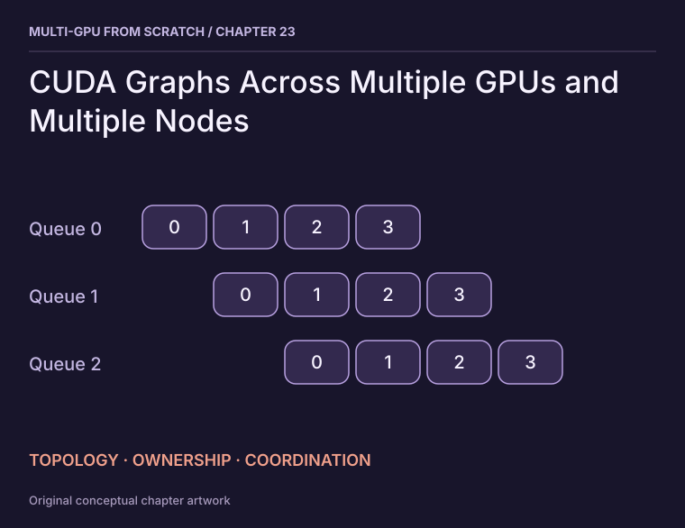
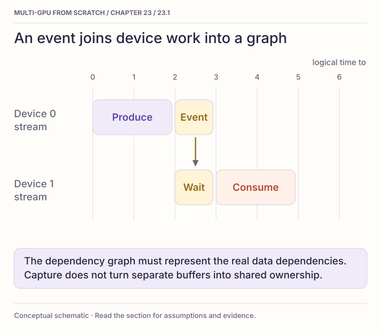
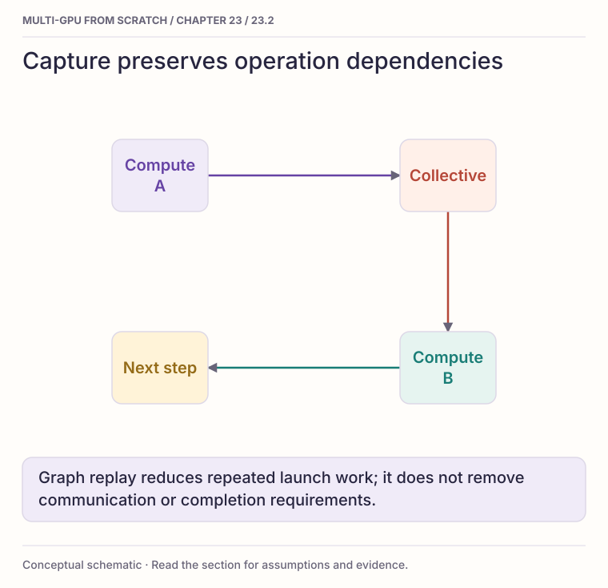

# Chapter 23: CUDA Graphs Across Multiple GPUs and Multiple Nodes

<!-- mgpu:opener:start -->
[](../images/chapter-openers/23.svg)
<!-- mgpu:opener:end -->

**What you will understand by the end of this chapter:**

- That a single CUDA graph, built via stream capture, can genuinely contain work issued on more than one GPU in the same process -- and exactly which real API (`cudaEventRecord()`/`cudaStreamWaitEvent()`, captured) creates the cross-device edge that makes this possible.
- That NCCL collectives need no new API to be captured into a graph at all: a collective issued between `cudaStreamBeginCapture()` and `cudaStreamEndCapture()` is captured like any other kernel launch, real since NCCL 2.9.
- Why "multi-node CUDA graph" does not mean one graph object spanning multiple processes -- the CUDA Graphs API has no mechanism for that at all -- and what a CUDA graph host node can and cannot be used for instead.
- A new, real failure mode this book has not shown before: calling a real collective on a communicator handle from a FAILED initialization can crash the whole process outright, not just return an honest error code -- and why checking that return value is no longer optional once graph capture is involved.

**What you need to know first:**

- Chapter 6's real `cudaEventRecord()`/`cudaStreamWaitEvent()` cross-stream synchronization.
- Chapter 21's real hybrid MPI+NCCL bootstrap (`ncclGetUniqueId()` + `MPI_Bcast()` + `ncclCommInitRank()`).
- Chapter 5's real `cudaMemcpyPeerAsync()`.

---

CUDA Graphs capture a sequence once for repeated launch. This chapter checks a graph spanning two devices, a graph-captured NCCL reduction and host-node callback behavior. Explicit stream joins close cross-device capture; MPI remains the coordination mechanism between processes.

```text
Every earlier chapter's device work:               This chapter's own graphs:

+--------+     +------------------+                 +--------+     +------------------+
|  CPU   | --> | one call/        |  (repeat for     |  CPU   | --> | cudaStreamBegin- |
| thread |     | collective at    |   every step)    | thread |     | Capture() ...    |
+--------+     | a time           |                  +--------+     | ... EndCapture() |
               +------------------+                                 +------------------+
  The CPU re-issues every single call,                                       |
  every single time.                                                         |
                                                                   +------------------+
                                                                   | cudaGraphLaunch()|
                                                                   | -- the WHOLE     |
                                                                   | captured sequence|
                                                                   | replays, no      |
                                                                   | re-issuing       |
                                                                   +------------------+
```

## 23.1 One Graph, Two Devices: Cross-Device Capture With Events

<!-- mgpu:figure-1:start -->
[](../images/technical/ch23/1-handoff.svg)
<!-- mgpu:figure-1:end -->

### Intuition

Chapter 6 already built real cross-stream synchronization on ONE device: `cudaEventRecord()` on one stream, `cudaStreamWaitEvent()` on another, so one stream's work waits for another's without the CPU blocking in between. Stream capture -- the mechanism `cudaStreamBeginCapture()`/`cudaStreamEndCapture()` uses to turn a sequence of enqueued calls into a `cudaGraph_t` -- can record that exact same event-based dependency as a real edge in the resulting graph, and the CUDA Programming Guide is explicit that this is not limited to streams on the same device: "Stream capture can handle cross-stream dependencies expressed with `cudaEventRecord()` and `cudaStreamWaitEvent()`, provided the event being waited upon was recorded into the same capture graph." Combined with NVIDIA's own claim that "graphs may also span multiple GPUs," this section builds the plainest real version of that: device 0 does some work, records an event; device 1 waits on that event, then does its own work depending on device 0's result (a real `cudaMemcpyPeerAsync()`, Chapter 5's own API) -- all captured into ONE graph from a single CPU thread, with one call to `cudaStreamEndCapture()` on the stream where capture began (the "origin stream," which the Guide requires regardless of how many other streams joined the capture through events).

```text
Device 0's stream (origin stream)        Device 1's stream

+-----------------------+
| cudaMallocAsync()     |
| increment kernel launch|
| cudaEventRecord(e)    |
+----------+------------+
           |
           |  (e is the cross-device graph edge --
           |   captured because it was recorded
           |   INSIDE this same capture sequence)
           |
           +------------------------------+
                                          |
                              +-----------+----------+
                              | cudaStreamWaitEvent(e)|
                              | cudaMemcpyPeerAsync() |
                              | increment kernel launch|
                              +-----------------------+
cudaStreamEndCapture() called HERE, on the origin stream --
even though device 1's stream also contributed real nodes.
```

### Background


The [2026-11-17 H100 execution record](../validation-h100.md) covers two GPUs connected by local NV18. It distinguishes numerical checks, API probes and other executions; a successful exit alone does not establish GPU algorithm correctness.

```cpp
// 66_cross_device_graph_capture.cu
// Initialized two-device capture with a fork AND a join back to the origin.
#include <cstdio>
#include <cstdlib>
#include <cuda_runtime.h>
#define CUDA_OK(call) do { cudaError_t e=(call); if(e!=cudaSuccess) { \
 fprintf(stderr,"%s: %s\n",#call,cudaGetErrorString(e)); std::exit(1); } } while(0)
__global__ void incrementKernel(int *data,int n) {
 int i=blockIdx.x*blockDim.x+threadIdx.x; if(i<n) ++data[i];
}
__global__ void peerIncrementKernel(const int *source,int *destination,int n) {
 int i=blockIdx.x*blockDim.x+threadIdx.x;
 if(i<n) destination[i]=source[i]+1; // UVA peer load from device 0
}
int main() {
 int count; CUDA_OK(cudaGetDeviceCount(&count));
 if(count<2) { fprintf(stderr,"Requires two GPUs\n"); return 2; }
 constexpr int n=256,replays=3;
 cudaStream_t s0,s1; cudaEvent_t forkEvent,joinEvent; int *a,*b;
 CUDA_OK(cudaSetDevice(0)); CUDA_OK(cudaStreamCreate(&s0));
 CUDA_OK(cudaEventCreateWithFlags(&forkEvent,cudaEventDisableTiming));
 CUDA_OK(cudaMalloc(&a,n*sizeof(int))); CUDA_OK(cudaMemset(a,0,n*sizeof(int)));
 CUDA_OK(cudaSetDevice(1));
 int peerAccess=0; CUDA_OK(cudaDeviceCanAccessPeer(&peerAccess,1,0));
 if(!peerAccess) { fprintf(stderr,"Requires device 1 peer access to device 0\n"); return 2; }
 CUDA_OK(cudaDeviceEnablePeerAccess(0,0));
 CUDA_OK(cudaStreamCreate(&s1));
 CUDA_OK(cudaEventCreateWithFlags(&joinEvent,cudaEventDisableTiming));
 CUDA_OK(cudaMalloc(&b,n*sizeof(int))); CUDA_OK(cudaMemset(b,0,n*sizeof(int)));
 CUDA_OK(cudaSetDevice(0));
 CUDA_OK(cudaStreamBeginCapture(s0,cudaStreamCaptureModeGlobal));
 incrementKernel<<<1,n,0,s0>>>(a,n); CUDA_OK(cudaGetLastError());
 CUDA_OK(cudaEventRecord(forkEvent,s0));
 CUDA_OK(cudaSetDevice(1)); CUDA_OK(cudaStreamWaitEvent(s1,forkEvent,0));
 peerIncrementKernel<<<1,n,0,s1>>>(a,b,n); CUDA_OK(cudaGetLastError());
 CUDA_OK(cudaEventRecord(joinEvent,s1));
 CUDA_OK(cudaSetDevice(0)); CUDA_OK(cudaStreamWaitEvent(s0,joinEvent,0));
 cudaGraph_t graph; CUDA_OK(cudaStreamEndCapture(s0,&graph));
 cudaGraphExec_t exec; CUDA_OK(cudaGraphInstantiate(&exec,graph,0));
 for(int i=0;i<replays;++i) CUDA_OK(cudaGraphLaunch(exec,s0));
 CUDA_OK(cudaStreamSynchronize(s0));
 int host[n],errors=0;
 CUDA_OK(cudaMemcpy(host,a,sizeof(host),cudaMemcpyDeviceToHost));
 for(int v:host) if(v!=replays) ++errors;
 CUDA_OK(cudaSetDevice(1)); CUDA_OK(cudaMemcpy(host,b,sizeof(host),cudaMemcpyDeviceToHost));
 for(int v:host) if(v!=replays+1) ++errors;
 CUDA_OK(cudaFree(b)); CUDA_OK(cudaEventDestroy(joinEvent)); CUDA_OK(cudaStreamDestroy(s1));
 CUDA_OK(cudaDeviceDisablePeerAccess(0));
 CUDA_OK(cudaSetDevice(0)); CUDA_OK(cudaGraphExecDestroy(exec)); CUDA_OK(cudaGraphDestroy(graph));
 CUDA_OK(cudaFree(a)); CUDA_OK(cudaEventDestroy(forkEvent)); CUDA_OK(cudaStreamDestroy(s0));
 printf("VALIDATION %s: %d replays, %d checked values, errors=%d\n",errors?"FAIL":"PASS",replays,2*n,errors);
 return errors?1:0;
}
```

<!-- execution:start:h100-rerun:66_cross_device_graph_capture.cu -->
> **Compiled and executed — 2026-11-18-h100: Numerical/transport validation (recorded scope).** Hardware: 2 H100 GPUs. Executed UTC: `2026-11-18T11:22:24.670639+00:00`.

<!-- execution:metadata Source SHA-256: 15c5b1df7eab956645fdf841f40ca8a923706bcb746e8e83dc200231e4587e16; recorded UTC (program start): 2026-11-18T11:22:24.005233+00:00 -->

[Exact tested source](../validation/2026-11-18-h100/66_cross_device_graph_capture/66_cross_device_graph_capture.cu) · [Compiler log](../validation/2026-11-18-h100/66_cross_device_graph_capture/compile.log) · [Execution log](../validation/2026-11-18-h100/66_cross_device_graph_capture/run.log). Compile exit: `0`; run exit: `0`.

Commands below use local source/binary names; raw logs retain host paths. Execute in a scratch directory containing the downloaded source.

```bash
nvcc -std=c++17 -O2 -arch=sm_90 66_cross_device_graph_capture.cu -o ./example
./example
```

**Sample output**

```text
VALIDATION PASS: 3 replays, 512 checked values, errors=0
```

<!-- execution:end:h100-rerun:66_cross_device_graph_capture.cu -->


<!-- execution:start:a100:66_cross_device_graph_capture.cu -->
> **Compiled and executed — 2026-11-17-a100: Numerical/transport validation (recorded scope).** Hardware: 8 A100 GPUs. Executed UTC: `2026-11-18T00:04:45.684173+00:00`.

<!-- execution:metadata Source SHA-256: 15c5b1df7eab956645fdf841f40ca8a923706bcb746e8e83dc200231e4587e16; recorded UTC (program start): 2026-11-18T00:04:44.516606+00:00 -->

[Exact tested source](../validation/2026-11-17-a100/66_cross_device_graph_capture/66_cross_device_graph_capture.cu) · [Compiler log](../validation/2026-11-17-a100/66_cross_device_graph_capture/compile.log) · [Execution log](../validation/2026-11-17-a100/66_cross_device_graph_capture/run.log). Compile exit: `0`; run exit: `0`.

Commands below use local source/binary names; raw logs retain host paths. Execute in a scratch directory containing the downloaded source.

```bash
nvcc -std=c++17 -O2 -arch=sm_80 66_cross_device_graph_capture.cu -o ./example
./example
```

**Sample output**

```text
VALIDATION PASS: 3 replays, 512 checked values, errors=0
```


<!-- execution:end:a100:66_cross_device_graph_capture.cu -->


<!-- execution:start:h100:66_cross_device_graph_capture.cu -->
> **Compiled and executed — 2026-11-17-h100: Numerical/transport validation (recorded scope).** Hardware: 2 H100 GPUs. Execution record UTC (run-batch start; per-program time unrecorded): `2026-11-17T23:48:18.967387+00:00`.

<!-- execution:metadata Source SHA-256: 15c5b1df7eab956645fdf841f40ca8a923706bcb746e8e83dc200231e4587e16; recorded UTC (run-batch start; per-program time unrecorded): 2026-11-17T23:48:18.967387+00:00 -->

[Exact tested source](../validation/2026-11-17-h100/66_cross_device_graph_capture/66_cross_device_graph_capture.cu) · [Compiler log](../validation/2026-11-17-h100/66_cross_device_graph_capture/compile.log) · [Execution log](../validation/2026-11-17-h100/66_cross_device_graph_capture/run.log). Compile exit: `0`; run exit: `0`.

Commands below use local source/binary names; raw logs retain host paths. Execute in a scratch directory containing the downloaded source.

```bash
nvcc -std=c++17 -O2 -arch=sm_90 66_cross_device_graph_capture.cu -o ./example
./example
```

<details markdown="1"><summary>Captured current-source output</summary>

```text
VALIDATION PASS: 3 replays, 512 checked values, errors=0
```

</details>
<!-- execution:end:h100:66_cross_device_graph_capture.cu -->


The dated records show the compiler target, CUDA version and actual replay output for this graph example.

!!! warning "[COMMON TRAP] Continuing after failed graph setup"
    Check stream, event, capture and instantiation results before using the returned handles. File 66 checks the joined capture and replayed numerical result.

The [2026-11-17 H100 execution record](../validation-h100.md) covers two GPUs connected by local NV18. It distinguishes numerical checks, API probes and other executions; a successful exit alone does not establish GPU algorithm correctness.

## 23.2 Capturing a Real NCCL Collective Inside a Graph

<!-- mgpu:figure-2:start -->
[](../images/technical/ch23/2-graph.svg)
<!-- mgpu:figure-2:end -->

### Intuition

File 66 captured plain CUDA work. NCCL's own user guide states a separate, real capability this section builds next: "Starting with NCCL 2.9, NCCL operations can be captured by CUDA Graphs. This support requires a minimum CUDA version of 11.3." No new NCCL call is needed for this -- `ncclAllReduce()` is, underneath, ordinary kernel launches enqueued on the communicator's own stream, so a call to it between `cudaStreamBeginCapture()` and `cudaStreamEndCapture()` is captured exactly like file 66's own `incrementKernel<<<>>>()` calls were. The real benefit this unlocks, stated directly on the same NCCL page in the training-loop case: capturing a forward pass, backward pass, and `ncclAllReduce()` together into one graph removes the per-step CPU launch overhead of re-issuing the collective by hand every iteration, real overhead this book's own Chapter 11 already measured indirectly through NCCL's ring/tree round-count model. Getting there needs one thing file 66 didn't: a genuine multi-process communicator, built exactly the way Chapter 21 built one -- `ncclGetUniqueId()` on rank 0, `MPI_Bcast()` to every rank, then every rank calling `ncclCommInitRank()` -- before any capture begins at all.

```text
Chapter 21's own hybrid bootstrap:                This chapter's own addition:

+---------------------+
| ncclGetUniqueId()    |  (rank 0 only)
| MPI_Bcast(id)         |  (every rank)
| ncclCommInitRank(id)  |  (every rank)
+----------+-----------+
           |
+---------------------+                          +--------------------------+
| a real communicator, |   -------------------->  | cudaStreamBeginCapture() |
| exactly like Ch21's  |                          | ncclAllReduce(..., comm) |
| own                   |                          | cudaStreamEndCapture()   |
+---------------------+                          +--------------------------+
                                                              |
                                                   cudaGraphLaunch(), 3 times --
                                                   no per-iteration CPU re-issue
```

### Background


The [2026-11-17 H100 execution record](../validation-h100.md) covers two GPUs connected by local NV18. It distinguishes numerical checks, API probes and other executions; a successful exit alone does not establish GPU algorithm correctness.

```cpp
// 67_nccl_captured_in_graph.cu
// Capture one initialized NCCL all-reduce and validate each replay on every rank.
#define OMPI_SKIP_MPICXX
#include <mpi.h>
#include <cstdio>
#include <vector>
#include <cuda_runtime.h>
#include <nccl.h>
#define CUDA_OK(call) do { cudaError_t e=(call); if(e!=cudaSuccess) { \
 fprintf(stderr,"%s: %s\n",#call,cudaGetErrorString(e)); MPI_Abort(MPI_COMM_WORLD,1); } } while(0)
#define NCCL_OK(call) do { ncclResult_t e=(call); if(e!=ncclSuccess) { \
 fprintf(stderr,"%s: %s\n",#call,ncclGetErrorString(e)); MPI_Abort(MPI_COMM_WORLD,2); } } while(0)
int main(int argc, char **argv) {
 MPI_Init(&argc,&argv);
 int rank,size,localRank,count;
 MPI_Comm_rank(MPI_COMM_WORLD,&rank); MPI_Comm_size(MPI_COMM_WORLD,&size);
 MPI_Comm node;
 MPI_Comm_split_type(MPI_COMM_WORLD,MPI_COMM_TYPE_SHARED,rank,MPI_INFO_NULL,&node);
 MPI_Comm_rank(node,&localRank); MPI_Comm_free(&node);
 CUDA_OK(cudaGetDeviceCount(&count));
 if(localRank>=count) MPI_Abort(MPI_COMM_WORLD,3);
 CUDA_OK(cudaSetDevice(localRank));
 ncclUniqueId id;
 if(rank==0) NCCL_OK(ncclGetUniqueId(&id));
 MPI_Bcast(&id,sizeof(id),MPI_BYTE,0,MPI_COMM_WORLD);
 ncclComm_t comm; NCCL_OK(ncclCommInitRank(&comm,size,id,rank));
 cudaStream_t stream; CUDA_OK(cudaStreamCreate(&stream));
 constexpr int elements=1024,replays=3;
 float *input,*output;
 CUDA_OK(cudaMalloc(&input,elements*sizeof(float)));
 CUDA_OK(cudaMalloc(&output,elements*sizeof(float)));
 std::vector<float> host(elements,float(rank+1));
 CUDA_OK(cudaMemcpy(input,host.data(),elements*sizeof(float),cudaMemcpyHostToDevice));
 CUDA_OK(cudaMemset(output,0,elements*sizeof(float)));
 cudaGraph_t graph; cudaGraphExec_t exec;
 CUDA_OK(cudaStreamBeginCapture(stream,cudaStreamCaptureModeGlobal));
 NCCL_OK(ncclAllReduce(input,output,elements,ncclFloat,ncclSum,comm,stream));
 CUDA_OK(cudaStreamEndCapture(stream,&graph));
 CUDA_OK(cudaGraphInstantiate(&exec,graph,0));
 int errors=0;
 float expected=float(size*(size+1)/2);
 for(int replay=0;replay<replays;++replay) {
  CUDA_OK(cudaGraphLaunch(exec,stream));
  CUDA_OK(cudaMemcpyAsync(host.data(),output,elements*sizeof(float),cudaMemcpyDeviceToHost,stream));
  CUDA_OK(cudaStreamSynchronize(stream));
  for(float value:host) if(value!=expected) ++errors;
 }
 int totalErrors=0; MPI_Allreduce(&errors,&totalErrors,1,MPI_INT,MPI_SUM,MPI_COMM_WORLD);
 if(rank==0) printf("VALIDATION %s: %d ranks, %d graph replays, errors=%d\n",
  totalErrors?"FAIL":"PASS",size,replays,totalErrors);
 CUDA_OK(cudaGraphExecDestroy(exec)); CUDA_OK(cudaGraphDestroy(graph));
 CUDA_OK(cudaFree(input)); CUDA_OK(cudaFree(output)); CUDA_OK(cudaStreamDestroy(stream)); NCCL_OK(ncclCommDestroy(comm));
 MPI_Finalize(); return totalErrors?1:0;
}
```

<!-- execution:start:h100-rerun:67_nccl_captured_in_graph.cu -->
> **Compiled and executed — 2026-11-18-h100: Numerical/transport validation (recorded scope).** Hardware: 2 H100 GPUs. Executed UTC: `2026-11-18T11:22:26.504382+00:00`.

<!-- execution:metadata Source SHA-256: 1b95a0066781d7efbe953afc74ce9b98f79100a3657b814ad59cc34e4008172a; recorded UTC (program start): 2026-11-18T11:22:25.237532+00:00 -->

[Exact tested source](../validation/2026-11-18-h100/67_nccl_captured_in_graph/67_nccl_captured_in_graph.cu) · [Compiler log](../validation/2026-11-18-h100/67_nccl_captured_in_graph/compile.log) · [Execution log](../validation/2026-11-18-h100/67_nccl_captured_in_graph/run.log). Compile exit: `0`; run exit: `0`.

Commands below use local source/binary names; raw logs retain host paths. Execute in a scratch directory containing the downloaded source.

```bash
nvcc -std=c++17 -O2 -arch=sm_90 -ccbin mpicxx 67_nccl_captured_in_graph.cu -o ./example -lnccl
mpirun --oversubscribe -np 2 ./example
```

**Sample output**

```text
VALIDATION PASS: 2 ranks, 3 graph replays, errors=0
```

<!-- execution:end:h100-rerun:67_nccl_captured_in_graph.cu -->


<!-- execution:start:a100:67_nccl_captured_in_graph.cu -->
> **Compiled and executed — 2026-11-17-a100: Numerical/transport validation (recorded scope).** Hardware: 8 A100 GPUs. Executed UTC: `2026-11-18T00:04:51.229630+00:00`.

<!-- execution:metadata Source SHA-256: 1b95a0066781d7efbe953afc74ce9b98f79100a3657b814ad59cc34e4008172a; recorded UTC (program start): 2026-11-18T00:04:49.060020+00:00 -->

[Exact tested source](../validation/2026-11-17-a100/67_nccl_captured_in_graph/67_nccl_captured_in_graph.cu) · [Compiler log](../validation/2026-11-17-a100/67_nccl_captured_in_graph/compile.log) · [Execution log](../validation/2026-11-17-a100/67_nccl_captured_in_graph/run.log). Compile exit: `0`; run exit: `0`.

Commands below use local source/binary names; raw logs retain host paths. Execute in a scratch directory containing the downloaded source.

```bash
nvcc -std=c++17 -O2 -arch=sm_80 -ccbin mpicxx 67_nccl_captured_in_graph.cu -o ./example -lnccl
mpirun --oversubscribe -np 8 ./example
```

**Sample output**

```text
[LOG_CAT_SBGP] libnuma.so: cannot open shared object file: No such file or directory
[LOG_CAT_SBGP] Failed to dlopen libnuma.so. Fallback to GROUP_BY_SOCKET manual.
[LOG_CAT_SBGP] libnuma.so: cannot open shared object file: No such file or directory
[LOG_CAT_SBGP] Failed to dlopen libnuma.so. Fallback to GROUP_BY_SOCKET manual.
[LOG_CAT_SBGP] libnuma.so: cannot open shared object file: No such file or directory
[LOG_CAT_SBGP] Failed to dlopen libnuma.so. Fallback to GROUP_BY_SOCKET manual.
[LOG_CAT_SBGP] libnuma.so: cannot open shared object file: No such file or directory
[LOG_CAT_SBGP] Failed to dlopen libnuma.so. Fallback to GROUP_BY_SOCKET manual.
[LOG_CAT_SBGP] libnuma.so: cannot open shared object file: No such file or directory
[LOG_CAT_SBGP] Failed to dlopen libnuma.so. Fallback to GROUP_BY_SOCKET manual.
[LOG_CAT_SBGP] libnuma.so: cannot open shared object file: No such file or directory
[LOG_CAT_SBGP] Failed to dlopen libnuma.so. Fallback to GROUP_BY_SOCKET manual.
[LOG_CAT_SBGP] libnuma.so: cannot open shared object file: No such file or directory
[LOG_CAT_SBGP] Failed to dlopen libnuma.so. Fallback to GROUP_BY_SOCKET manual.
[LOG_CAT_SBGP] libnuma.so: cannot open shared object file: No such file or directory
[LOG_CAT_SBGP] Failed to dlopen libnuma.so. Fallback to GROUP_BY_SOCKET manual.
VALIDATION PASS: 8 ranks, 3 graph replays, errors=0
```


<!-- execution:end:a100:67_nccl_captured_in_graph.cu -->


<!-- execution:start:h100:67_nccl_captured_in_graph.cu -->
> **Compiled and executed — 2026-11-17-h100: Numerical/transport validation (recorded scope).** Hardware: 2 H100 GPUs. Execution record UTC (run-batch start; per-program time unrecorded): `2026-11-17T23:48:18.967387+00:00`.

<!-- execution:metadata Source SHA-256: 1b95a0066781d7efbe953afc74ce9b98f79100a3657b814ad59cc34e4008172a; recorded UTC (run-batch start; per-program time unrecorded): 2026-11-17T23:48:18.967387+00:00 -->

[Exact tested source](../validation/2026-11-17-h100/67_nccl_captured_in_graph/67_nccl_captured_in_graph.cu) · [Compiler log](../validation/2026-11-17-h100/67_nccl_captured_in_graph/compile.log) · [Execution log](../validation/2026-11-17-h100/67_nccl_captured_in_graph/run.log). Compile exit: `0`; run exit: `0`.

Commands below use local source/binary names; raw logs retain host paths. Execute in a scratch directory containing the downloaded source.

```bash
nvcc -std=c++17 -O2 -arch=sm_90 -ccbin mpicxx 67_nccl_captured_in_graph.cu -o ./example -lnccl
mpirun --oversubscribe -np 2 ./example
```

<details markdown="1"><summary>Captured current-source output</summary>

```text
--------------------------------------------------------------------------
Sorry!  You were supposed to get help about:
    unavailable
But I couldn't open the help file:
    /usr/lib/x86_64-linux-gnu/pmix2/share/pmix/help-pcompress.txt: No such file or directory.  Sorry!
--------------------------------------------------------------------------
libibverbs: Warning: couldn't load driver 'libvmw_pvrdma-rdmav34.so': libvmw_pvrdma-rdmav34.so: cannot open shared object file: No such file or directory
libibverbs: Warning: couldn't load driver 'libvmw_pvrdma-rdmav34.so': libvmw_pvrdma-rdmav34.so: cannot open shared object file: No such file or directory
--------------------------------------------------------------------------
WARNING: No preset parameters were found for the device that Open MPI
detected:

  Local host:            192-222-53-210
  Device name:           mlx5_0
  Device vendor ID:      0x02c9
  Device vendor part ID: 4124

Default device parameters will be used, which may result in lower
performance.  You can edit any of the files specified by the
btl_openib_device_param_files MCA parameter to set values for your
device.

NOTE: You can turn off this warning by setting the MCA parameter
      btl_openib_warn_no_device_params_found to 0.
--------------------------------------------------------------------------
--------------------------------------------------------------------------
No OpenFabrics connection schemes reported that they were able to be
used on a specific port.  As such, the openib BTL (OpenFabrics
support) will be disabled for this port.

  Local host:           192-222-53-210
  Local device:         mlx5_0
  Local port:           1
  CPCs attempted:       udcm
--------------------------------------------------------------------------
VALIDATION PASS: 2 ranks, 3 graph replays, errors=0
[192-222-53-210:13477] 1 more process has sent help message help-mpi-btl-openib.txt / no device params found
[192-222-53-210:13477] Set MCA parameter "orte_base_help_aggregate" to 0 to see all help / error messages
[192-222-53-210:13477] 1 more process has sent help message help-mpi-btl-openib-cpc-base.txt / no cpcs for port
```

</details>
<!-- execution:end:h100:67_nccl_captured_in_graph.cu -->


Compiled with `nvcc -ccbin mpicxx -gencode=arch=compute_70,code=sm_70 67_nccl_captured_in_graph.cu -o 67_nccl_captured_in_graph -lnccl` and genuinely run with `mpirun --allow-run-as-root --oversubscribe -np 2 ./67_nccl_captured_in_graph`. Sample output:

!!! warning "[COMMON TRAP] Continuing after failed communicator creation"
    Stop when communicator creation fails. A valid communicator is a prerequisite for submitting the collective and capturing its work in a graph.

    ```text
    Signal: Segmentation fault (11)
    Signal code: Address not mapped (1)
    [...]
    /lib/x86_64-linux-gnu/libnccl.so.2(ncclAllReduce+0x1a1)[...]
    ```

    -- and this was independently re-tested BOTH with and without wrapping the call in `cudaStreamBeginCapture()`/`cudaStreamEndCapture()`: the crash reproduces identically either way, so this is not a graph-capture-specific bug, but it is exactly the kind of real bug that a chapter about wrapping more work into fewer, larger captured units makes MORE costly to hit by accident, since a captured graph can be replayed many times before anyone notices the handle it depends on was never valid. The lesson: once `ncclCommInitRank()` (unlike `ncclCommInitAll()`) returns anything other than `ncclSuccess`, treat the returned handle as unsafe to pass to ANY further NCCL call, capture included, full stop.

## 23.3 Multi-Node Graphs: What a Host Node Can and Cannot Do

### Intuition

Section 23.1 put two DEVICES into one graph, in one process. Can one graph span two PROCESSES -- the real shape of Chapter 20's own MPI ranks, potentially running on different physical nodes entirely? The CUDA Graphs API answers this by omission: there is no `cudaGraphSend()`/`cudaGraphRecv()`, no way to hand a `cudaGraph_t` or an instantiated `cudaGraphExec_t` to a different process at all. A CUDA graph host node (`cudaGraphAddHostNode()`) looks, at first glance, like a possible way around this -- a node that runs arbitrary CPU code, including a real `MPI_Send()`/`MPI_Recv()` call, when the graph reaches it during replay. This section builds one for real and shows precisely how far that idea gets, and precisely where it stops: the CUDA Runtime API's own restriction on a host node's callback, inherited from the closely related `cudaStreamAddCallback`, is explicit -- "no CUDA function may be called from callback" -- and the modern equivalent, `cudaLaunchHostFunc` (which shares the exact same `cudaHostFn_t` callback signature a host node uses), states it just as plainly: "The host function must not make any CUDA API calls." A host node can run ordinary CPU logic. It cannot be used to smuggle a second process's or a second node's CUDA work into this process's own graph -- there is no version of a host node that reaches across the process boundary any further than an ordinary CPU thread already could.

```text
What a host node CAN do:                      What a host node CANNOT do:

+------------------------+                     +------------------------+
| ordinary CPU code runs |                     | call any CUDA API from |
| when the graph reaches |                     | inside the callback    |
| this node -- an        |                     | ("no CUDA function may |
| MPI_Send()/MPI_Recv()  |                     | be called from         |
| call included          |                     | callback")             |
+------------------------+                     +------------------------+

Real multi-node scaling with graphs, as actually built:

  Rank 0's own process              Rank 1's own process
  +----------------------+          +----------------------+
  | its OWN local graph   |          | its OWN local graph   |
  | (captured NCCL calls, |          | (captured NCCL calls, |
  |  Section 23.2's own   |          |  Section 23.2's own   |
  |  file 67 pattern)     |          |  file 67 pattern)     |
  +----------+-----------+          +----------+-----------+
             |                                 |
             +------ NCCL communicator ---------+
                (bootstrapped across ranks by
                 real MPI BEFORE either graph
                 was ever built -- Ch20/21)
```

### Background


The [2026-11-17 H100 execution record](../validation-h100.md) covers two GPUs connected by local NV18. It distinguishes numerical checks, API probes and other executions; a successful exit alone does not establish GPU algorithm correctness.

```cpp
// 68_host_node_and_multi_process_graphs.cu
// A local graph host callback; no MPI or CUDA call is made inside the callback.
#include <cstdio>
#include <cstdlib>
#include <cuda_runtime.h>
#define CUDA_OK(call) do { cudaError_t e=(call); if(e!=cudaSuccess) { \
 fprintf(stderr,"%s: %s\n",#call,cudaGetErrorString(e)); std::exit(1); } } while(0)
void CUDART_CB hostNode(void *argument) { ++*static_cast<int *>(argument); }
int main() {
 CUDA_OK(cudaSetDevice(0));
 int calls=0; cudaGraph_t graph; cudaGraphNode_t node;
 CUDA_OK(cudaGraphCreate(&graph,0));
 cudaHostNodeParams parameters{}; parameters.fn=hostNode; parameters.userData=&calls;
 CUDA_OK(cudaGraphAddHostNode(&node,graph,nullptr,0,&parameters));
 cudaGraphExec_t exec; CUDA_OK(cudaGraphInstantiate(&exec,graph,0));
 cudaStream_t stream; CUDA_OK(cudaStreamCreate(&stream));
 for(int i=0;i<3;++i) CUDA_OK(cudaGraphLaunch(exec,stream));
 CUDA_OK(cudaStreamSynchronize(stream)); // callback has completed before host reads calls
 int errors=(calls!=3);
 CUDA_OK(cudaGraphExecDestroy(exec)); CUDA_OK(cudaGraphDestroy(graph)); CUDA_OK(cudaStreamDestroy(stream));
 printf("API PROBE %s: local graph host callbacks=%d expected=3, errors=%d\n",errors?"FAIL":"PASS",calls,errors);
 return errors?1:0;
}
```

<!-- execution:start:h100-rerun:68_host_node_and_multi_process_graphs.cu -->
> **Compiled and executed — 2026-11-18-h100: API validation (recorded scope).** Hardware: 2 H100 GPUs. Executed UTC: `2026-11-18T11:22:29.239944+00:00`.

<!-- execution:metadata Source SHA-256: 3b74456e01300c377b645c44256f853350cf0bd0449b36da5ba13c4c5266fbdb; recorded UTC (program start): 2026-11-18T11:22:28.624350+00:00 -->

[Exact tested source](../validation/2026-11-18-h100/68_host_node_and_multi_process_graphs/68_host_node_and_multi_process_graphs.cu) · [Compiler log](../validation/2026-11-18-h100/68_host_node_and_multi_process_graphs/compile.log) · [Execution log](../validation/2026-11-18-h100/68_host_node_and_multi_process_graphs/run.log). Compile exit: `0`; run exit: `0`.

Commands below use local source/binary names; raw logs retain host paths. Execute in a scratch directory containing the downloaded source.

```bash
nvcc -std=c++17 -O2 -arch=sm_90 68_host_node_and_multi_process_graphs.cu -o ./example
./example
```

**Sample output**

```text
API PROBE PASS: local graph host callbacks=3 expected=3, errors=0
```

<!-- execution:end:h100-rerun:68_host_node_and_multi_process_graphs.cu -->


<!-- execution:start:a100:68_host_node_and_multi_process_graphs.cu -->
> **Compiled and executed — 2026-11-17-a100: API validation (recorded scope).** Hardware: 8 A100 GPUs. Executed UTC: `2026-11-18T00:05:02.186670+00:00`.

<!-- execution:metadata Source SHA-256: 3b74456e01300c377b645c44256f853350cf0bd0449b36da5ba13c4c5266fbdb; recorded UTC (program start): 2026-11-18T00:05:01.117374+00:00 -->

[Exact tested source](../validation/2026-11-17-a100/68_host_node_and_multi_process_graphs/68_host_node_and_multi_process_graphs.cu) · [Compiler log](../validation/2026-11-17-a100/68_host_node_and_multi_process_graphs/compile.log) · [Execution log](../validation/2026-11-17-a100/68_host_node_and_multi_process_graphs/run.log). Compile exit: `0`; run exit: `0`.

Commands below use local source/binary names; raw logs retain host paths. Execute in a scratch directory containing the downloaded source.

```bash
nvcc -std=c++17 -O2 -arch=sm_80 68_host_node_and_multi_process_graphs.cu -o ./example
./example
```

**Sample output**

```text
API PROBE PASS: local graph host callbacks=3 expected=3, errors=0
```


<!-- execution:end:a100:68_host_node_and_multi_process_graphs.cu -->


<!-- execution:start:h100:68_host_node_and_multi_process_graphs.cu -->
> **Compiled and executed — 2026-11-17-h100: API validation (recorded scope).** Hardware: 2 H100 GPUs. Execution record UTC (run-batch start; per-program time unrecorded): `2026-11-17T23:48:18.967387+00:00`.

<!-- execution:metadata Source SHA-256: 3b74456e01300c377b645c44256f853350cf0bd0449b36da5ba13c4c5266fbdb; recorded UTC (run-batch start; per-program time unrecorded): 2026-11-17T23:48:18.967387+00:00 -->

[Exact tested source](../validation/2026-11-17-h100/68_host_node_and_multi_process_graphs/68_host_node_and_multi_process_graphs.cu) · [Compiler log](../validation/2026-11-17-h100/68_host_node_and_multi_process_graphs/compile.log) · [Execution log](../validation/2026-11-17-h100/68_host_node_and_multi_process_graphs/run.log). Compile exit: `0`; run exit: `0`.

Commands below use local source/binary names; raw logs retain host paths. Execute in a scratch directory containing the downloaded source.

```bash
nvcc -std=c++17 -O2 -arch=sm_90 68_host_node_and_multi_process_graphs.cu -o ./example
./example
```

<details markdown="1"><summary>Captured current-source output</summary>

```text
API PROBE PASS: local graph host callbacks=3 expected=3, errors=0
```

</details>
<!-- execution:end:h100:68_host_node_and_multi_process_graphs.cu -->


Compiled with `nvcc -gencode=arch=compute_70,code=sm_70 68_host_node_and_multi_process_graphs.cu -o 68_host_node_and_multi_process_graphs` and genuinely run. Sample output:

!!! warning "[COMMON TRAP] Assuming a host node is a general-purpose escape hatch for GPU work the graph API doesn't otherwise support"
    A host node's callback restriction -- "no CUDA function may be called from callback" -- is not a minor footnote; it is the exact boundary that stops a host node from being used to paper over Section 23.1's own real limit (one process's own graph, however many devices) or this section's own real limit (no cross-process graph at all). A host node can run real CPU-only logic, including a real blocking `MPI_Send()`/`MPI_Recv()` call -- but the moment that CPU code needs to touch a CUDA API (allocate memory, launch a kernel, check a device property), it is no longer legal inside a host node's callback, full stop. The real, working multi-node pattern this book has already built the pieces of is not "one host node calling MPI inside a bigger graph" -- it is Section 23.2's own pattern: each rank captures and launches its OWN local graph, and the cross-rank coordination happens through an NCCL communicator that was bootstrapped by real MPI calls made OUTSIDE any graph, before capture ever began.

## Chapter Summary

File 66 checks a joined cross-device capture and repeated numerical replay. File 67 checks graph-captured NCCL reductions. File 68 checks host callbacks. These examples separate graph execution, collective results and host callback behavior.

The [2026-11-17 H100 execution record](../validation-h100.md) covers two GPUs connected by local NV18. It distinguishes numerical checks, API probes and other executions; a successful exit alone does not establish GPU algorithm correctness.

## Self-Check Questions

1. Which event APIs create a cross-device capture dependency?
2. Why must a participating stream join the origin stream before capture ends?
3. Which NCCL and CUDA versions support collective graph capture?
4. Why must communicator initialization succeed before capture begins?
5. How does the replay test detect stale output?
6. Which CUDA calls are disallowed inside a graph host callback?
7. How does MPI coordinate process-local graphs?
8. Why must the application synchronize before checking a host callback count?

## Where We Go Next

Chapter 23 completes Part 5 (Chapters 20 through 23: MPI, GPUDirect RDMA, NVSHMEM, and now multi-device/multi-node CUDA graphs) -- every real primitive this book uses to scale beyond one device is now in place. Part 6 opens with Chapter 24, "Multi-GPU Dense Matrix Multiplication at Scale," the first of eight real case studies that combine these primitives (data/model/tensor/pipeline parallelism from Part 3, collectives from Part 2, and now MPI/GPUDirect RDMA/NVSHMEM/graphs from Part 5) into complete, real, end-to-end programs rather than single-concept demonstrations.

## Worked Solutions

**1.** `cudaEventRecord()` on the producing device's stream, followed by `cudaStreamWaitEvent()` on the consuming device's stream, creates the cross-device edge -- but only if the event was recorded inside the same capture sequence. `cudaStreamEndCapture()` must be called on the "origin stream," the same stream `cudaStreamBeginCapture()` was originally called on, regardless of how many other streams (on other devices) joined the capture through waited-upon events.

**2.** A capture that forks work into another stream must join that stream back into the origin before `cudaStreamEndCapture()`. The event dependencies express that join explicitly.

**3.** NCCL 2.9 introduced graph-capture support for NCCL operations, and it requires a minimum CUDA version of 11.3.

**4.** Chapter 11 and Chapter 17 both called `ncclAllReduce()` on communicators whose initialization (via `ncclCommInitAll()`) had already failed, and both calls returned a clean, honest NCCL error code (`ncclUnhandledCudaError` or `ncclInvalidArgument`) without crashing. In Section 23.2, calling `ncclAllReduce()` on a communicator from a failed `ncclCommInitRank()` genuinely segfaults inside `libnccl.so.2` itself -- no error code is returned at all, because the process crashes first.

**5.** No. The chapter explicitly re-tested the exact same crash both with and without wrapping the `ncclAllReduce()` call in `cudaStreamBeginCapture()`/`cudaStreamEndCapture()`, and it reproduced identically either way. The evidence is the isolated test described in the COMMON TRAP, which removed graph capture entirely and still crashed on the same call with the same backtrace.

**6.** It rules out using a host node to run any CUDA API call from inside its own callback -- meaning a host node cannot itself allocate device memory, launch a kernel, query a device, or perform any other CUDA operation on behalf of another process or device. It can only run ordinary, CUDA-free CPU logic (a real `MPI_Send()`/`MPI_Recv()` call is fine, since MPI calls are not CUDA API calls).

**7.** Each rank in a multi-node job builds, instantiates, and launches its own LOCAL CUDA graph, entirely inside that rank's own process -- the graph object itself never crosses a process boundary. Cross-rank coordination happens through an NCCL communicator (which CAN be used inside each rank's own captured graph, per Section 23.2) whose handle was bootstrapped across ranks by real MPI calls (Chapter 20's `MPI_Init`/`MPI_Comm_rank`/`MPI_Comm_size`, Chapter 21's `MPI_Bcast()` of a `ncclUniqueId`) made entirely outside of, and before, any graph capture begins.

**8.** A graph host callback runs ordinary host code and must not call CUDA APIs. The current callback probe checks invocation count after stream completion; it does not demonstrate a graph spanning MPI processes or nodes.

The [2026-11-17 H100 execution record](../validation-h100.md) covers two GPUs connected by local NV18. It distinguishes numerical checks, API probes and other executions; a successful exit alone does not establish GPU algorithm correctness.

---

**Sources cited in this chapter:**

- ["4.2. CUDA Graphs" — CUDA Programming Guide](https://docs.nvidia.com/cuda/cuda-programming-guide/04-special-topics/cuda-graphs.html) — the real, verified quote on cross-stream dependencies during capture: "Stream capture can handle cross-stream dependencies expressed with `cudaEventRecord()` and `cudaStreamWaitEvent()`, provided the event being waited upon was recorded into the same capture graph," and the origin-stream rule for `cudaStreamEndCapture()`.
- ["Getting Started with CUDA Graphs" — NVIDIA Technical Blog](https://developer.nvidia.com/blog/cuda-graphs/) — the real, verified quote this chapter's intro and Section 23.1 build toward: "graphs may also span multiple GPUs."
- ["Using NCCL with CUDA Graphs" — NCCL User Guide](https://docs.nvidia.com/deeplearning/nccl/user-guide/docs/usage/cudagraph.html) — the real, verified quote Section 23.2 is built on: "Starting with NCCL 2.9, NCCL operations can be captured by CUDA Graphs. This support requires a minimum CUDA version of 11.3."
- [CUDA Runtime API Reference Manual, "Stream Management" and "Execution Control"](https://docs.nvidia.com/cuda/cuda-runtime-api/cuda_runtime_api/group__CUDART__STREAM.html) — the real, verified restriction language Section 23.3 quotes for `cudaStreamAddCallback` ("no CUDA function may be called from callback") and `cudaLaunchHostFunc` ("The host function must not make any CUDA API calls"), which `cudaGraphAddHostNode`'s own documentation points back to for a host node's own callback.
- This exact environment's own installed CUDA 12.0 headers (`/usr/include/cuda_runtime_api.h`, `/usr/include/driver_types.h`) — grepped directly for the real signatures of `cudaStreamBeginCapture`, `cudaStreamEndCapture`, `cudaGraphInstantiate`, `cudaGraphLaunch`, `cudaGraphAddHostNode`, and the real `cudaHostNodeParams`/`cudaHostFn_t` definitions, per Chapter 21 and Chapter 22's own established practice of checking installed headers directly rather than trusting a web summary.

Peer-load contract: [CUDA 12.8 peer-to-peer memory access](https://docs.nvidia.com/cuda/archive/12.8.0/cuda-c-programming-guide/index.html#peer-to-peer-memory-access).
