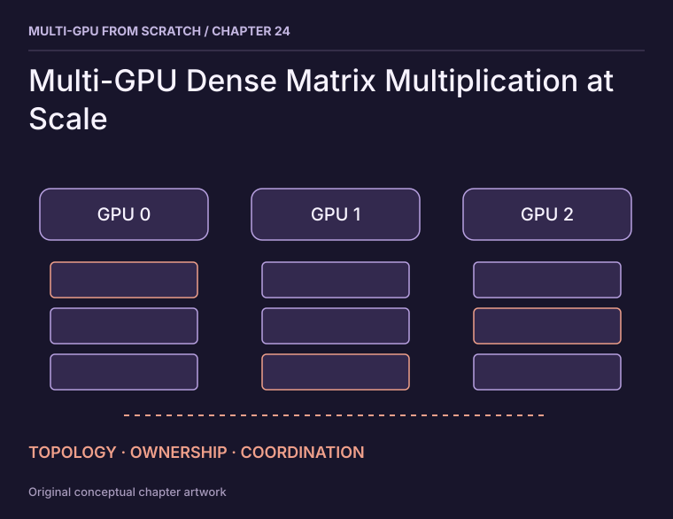
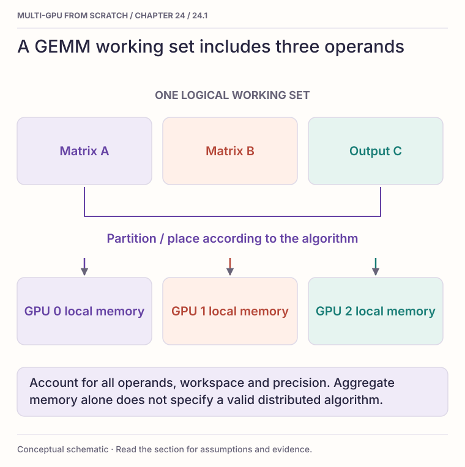
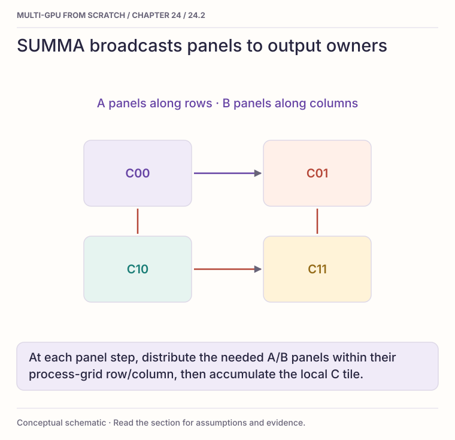

# Chapter 24: Multi-GPU Dense Matrix Multiplication at Scale

<!-- mgpu:opener:start -->
[](../images/chapter-openers/24.svg)
<!-- mgpu:opener:end -->

**What you will understand by the end of this chapter:**

- Why a dense GEMM's three operands can stop fitting on one real GPU even when no single weight matrix by itself is the problem -- and how to compute, in closed form, the minimum device count a given problem needs purely for capacity.
- The real SUMMA algorithm (Van de Geijn & Watts): how a 2D process grid splits both matrices, broadcasts panels within rows and columns, and accumulates local partial products -- built and verified as a real host-side simulation against a naive reference.
- NVIDIA's own real, single-node, production answer to this exact problem, cuBLAS-Xt, including a real API detail no earlier chapter's cuBLAS-style call had: it takes HOST pointers directly.
- A new, sharper real failure mode this book has not produced before: a real memory-corruption crash (a double-free glibc itself detects) from destroying a library handle after one specific real call failed on it -- and why checking device counts before requesting device ordinals is not optional here.

**What you need to know first:**

- Chapter 13's real per-layer memory-shard model and Chapter 1's own real H100 SXM HBM figure.
- Chapter 8's real host-mediated reduce and Chapter 9's real ring all-reduce (for the broadcast-and-accumulate shape this chapter reuses).
- Chapter 14's real column-parallel/row-parallel GEMM split.

---

This chapter opens Part 6's case studies by returning to the single most common real operation in this entire book's domain -- a dense matrix multiply -- and asking what happens when it is too large for one device, in the way a real production system, not a single-concept demonstration, would have to answer it. A real NVIDIA forum thread on cuBLAS-Xt states the motivation plainly: multi-GPU GEMM's "main point" is often to "work around GPU memory capacity limits," not (only) to go faster. This chapter builds that motivation into a real number (24.1), the real, named academic algorithm this book's own earlier collectives (broadcast, reduce) turn out to already contain the pieces of (24.2), and the real, shipping NVIDIA library built for exactly this problem on a single node (24.3) -- closing with why that library's own single-node scope is real and named, and what NVIDIA's current real answer for going beyond one node actually is.

```text
Section 24.1:                   Section 24.2:                    Section 24.3:
"does it fit?"                  "how do you split it              "what does NVIDIA
(closed-form capacity           correctly?"                       actually ship for
model, no comm cost)            (SUMMA, verified by                this?"
                                  simulation)                      (real cuBLAS-Xt,
                                                                    single node)
      |                                |                                |
      +--------------------------------+--------------------------------+
                                       |
                          one case study, three real layers:
                          capacity, algorithm, production API
```

## 24.1 The Memory Wall for a GEMM's THREE Operands

<!-- mgpu:figure-1:start -->
[](../images/technical/ch24/1-capacity.svg)
<!-- mgpu:figure-1:end -->

### Intuition

Chapter 13 already asked whether a single weight matrix fits on one GPU. This section asks a related but genuinely different question: does a real GEMM's three operands -- A, B, and the output C -- fit on one device AT ONCE, at a batch size and sequence length a real training or inference run actually uses? A single GPT-3-scale FFN weight matrix, by itself, is small enough to fit comfortably on one real H100. The moment that weight matrix is multiplied against a real batch of activations, though, the output C and the input activation matrix A both scale with the batch and sequence length, not just the model's own hidden dimension -- and a real production batch size makes A and C, not the weight matrix B, the thing that stops fitting. A real NVIDIA forum thread about cuBLAS-Xt names exactly this motivation for multi-GPU GEMM: its "main point" is to "work around GPU memory capacity limits" -- an out-of-core problem, not (only) a speed problem.

```text
Ch13's own question:                       This section's own question:

+----------------------+                    +----------------------------+
| Does ONE weight       |                    | Do A, B, AND C -- at a     |
| matrix B fit on one   |                    | real batch/seq size -- all |
| device?               |                    | fit on one device AT ONCE? |
+----------------------+                    +----------------------------+
  Usually yes, even at                        Often NO -- A and C both
  GPT-3 scale.                                 scale with batch*seq, not
                                                just the model's own dims.
```

### Background

```cpp
// Chapter 24: Multi-GPU Dense Matrix Multiplication at Scale
// 69_gemm_memory_wall_model.cpp
//
// A real, closed-form model (no fabricated timings, matching this book's
// own established practice since Ch2/Ch5/Ch16) of when a dense GEMM's
// three matrices genuinely stop fitting on one real GPU. Reuses Chapter
// 1's own real H100 SXM figure (80 GB HBM3, i.e. 80e9 bytes) as the
// single-device budget.
// A real NVIDIA forum thread on cuBLASXt states plainly what problem
// this section is building toward: cuBLASXt's "main point" is to "work
// around GPU memory capacity limits" -- i.e. out-of-core / multi-GPU
// GEMM exists FIRST because of capacity, not (only) because of speed.
#include <cstdio>
#include <cstdint>
#include <cmath>

struct GemmShape {
    const char *label;
    uint64_t m, k, n;
};

int main() {
    // Ch1's own real figure: 80 GB, i.e. 80 x 10^9 bytes (about 74.5 GiB)
    // -- decimal gigabytes, as memory capacities are specified.
    const double H100_SXM_HBM_BYTES = 80.0e9;
    const double BYTES_PER_FP32 = 4.0;

    // Real GPT-3 175B dimensions (Brown et al. Table 2.1, already cited
    // in Ch1/Ch13/Ch14): d_model=12288. A single FFN weight matrix is
    // d_model x 4*d_model. This section asks a genuinely different
    // question from Ch13's per-layer question: not "does ONE weight
    // matrix fit," but "do the three GEMM operands -- A, B, and the
    // output C -- fit AT ONCE, at a batch size and sequence length a
    // real training run actually uses."
    GemmShape shapes[] = {
        {"GPT-3 FFN GEMM, small batch (M=12288 tokens)", 12288, 12288, 49152},
        {"GPT-3 FFN forward, batch=512, seq=2048 (M=batch*seq)",
         512ull * 2048ull, 12288, 49152},
        {"A hypothetical 10x-larger FFN forward at the same batch/seq",
         512ull * 2048ull, 122880, 491520},
    };

    printf("Single-device budget (Ch1's own real H100 SXM figure): 80 GB = %.2f GiB\n\n",
           H100_SXM_HBM_BYTES / (1024.0 * 1024.0 * 1024.0));

    for (auto &s : shapes) {
        double bytesA = (double)s.m * (double)s.k * BYTES_PER_FP32;
        double bytesB = (double)s.k * (double)s.n * BYTES_PER_FP32;
        double bytesC = (double)s.m * (double)s.n * BYTES_PER_FP32;
        double totalGiB = (bytesA + bytesB + bytesC) / (1024.0 * 1024.0 * 1024.0);
        bool fits = (bytesA + bytesB + bytesC) <= H100_SXM_HBM_BYTES;
        printf("%s\n", s.label);
        printf("  M=%llu K=%llu N=%llu (fp32)\n",
               (unsigned long long)s.m, (unsigned long long)s.k, (unsigned long long)s.n);
        printf("  B (weight) alone = %.2f GiB\n",
               bytesB / (1024.0 * 1024.0 * 1024.0));
        printf("  A+B+C = %.2f GiB -> %s on one H100 SXM\n\n",
               totalGiB, fits ? "FITS" : "DOES NOT FIT");
    }

    // A real, closed-form minimum-device-count model: if the three
    // operands don't fit on one device, how many devices, under a
    // cuBLASXt-style even block split of A/B/C across devices, are
    // needed at minimum? This does NOT model communication cost (that
    // is Section 24.2's own job) -- only capacity.
    printf("--- Minimum device count under even block distribution (capacity only) ---\n");
    for (auto &s : shapes) {
        double bytesA = (double)s.m * (double)s.k * BYTES_PER_FP32;
        double bytesB = (double)s.k * (double)s.n * BYTES_PER_FP32;
        double bytesC = (double)s.m * (double)s.n * BYTES_PER_FP32;
        double totalBytes = bytesA + bytesB + bytesC;
        int minDevices = (int)std::ceil(totalBytes / H100_SXM_HBM_BYTES);
        if (minDevices < 1) minDevices = 1;
        printf("%s -> minimum %d device(s)\n", s.label, minDevices);
    }

    return 0;
}
```

<!-- execution:start:h100-rerun:69_gemm_memory_wall_model.cpp -->
> **Compiled and executed — 2026-11-18-h100: Host program/model (exit-only).** Hardware: 2 H100 GPUs. Executed UTC: `2026-11-18T11:22:29.821148+00:00`.

<!-- execution:metadata Source SHA-256: f83e8b1c38469c7c995004fe181ba1c51aa8cbedb7b2ad3031e82bae664e67ae; recorded UTC (program start): 2026-11-18T11:22:29.656652+00:00 -->

[Exact tested source](../validation/2026-11-18-h100/69_gemm_memory_wall_model/69_gemm_memory_wall_model.cpp) · [Compiler log](../validation/2026-11-18-h100/69_gemm_memory_wall_model/compile.log) · [Execution log](../validation/2026-11-18-h100/69_gemm_memory_wall_model/run.log). Compile exit: `0`; run exit: `0`.

Commands below use local source/binary names; raw logs retain host paths. Execute in a scratch directory containing the downloaded source.

```bash
g++ -std=c++17 -O2 69_gemm_memory_wall_model.cpp -o ./example
./example
```

**Sample output**

```text
Single-device budget (Ch1's own real H100 SXM figure): 80 GB = 74.51 GiB

GPT-3 FFN GEMM, small batch (M=12288 tokens)
  M=12288 K=12288 N=49152 (fp32)
  B (weight) alone = 2.25 GiB
  A+B+C = 5.06 GiB -> FITS on one H100 SXM

GPT-3 FFN forward, batch=512, seq=2048 (M=batch*seq)
  M=1048576 K=12288 N=49152 (fp32)
  B (weight) alone = 2.25 GiB
  A+B+C = 242.25 GiB -> DOES NOT FIT on one H100 SXM

A hypothetical 10x-larger FFN forward at the same batch/seq
  M=1048576 K=122880 N=491520 (fp32)
  B (weight) alone = 225.00 GiB
  A+B+C = 2625.00 GiB -> DOES NOT FIT on one H100 SXM

--- Minimum device count under even block distribution (capacity only) ---
GPT-3 FFN GEMM, small batch (M=12288 tokens) -> minimum 1 device(s)
GPT-3 FFN forward, batch=512, seq=2048 (M=batch*seq) -> minimum 4 device(s)
A hypothetical 10x-larger FFN forward at the same batch/seq -> minimum 36 device(s)
```

<!-- execution:end:h100-rerun:69_gemm_memory_wall_model.cpp -->


<!-- execution:start:a100:69_gemm_memory_wall_model.cpp -->
> **Compiled and executed — 2026-11-17-a100: Host program/model (exit-only).** Hardware: 8 A100 GPUs. Executed UTC: `2026-11-18T00:05:05.528469+00:00`.

<!-- execution:metadata Source SHA-256: f83e8b1c38469c7c995004fe181ba1c51aa8cbedb7b2ad3031e82bae664e67ae; recorded UTC (program start): 2026-11-18T00:05:05.312930+00:00 -->

[Exact tested source](../validation/2026-11-17-a100/69_gemm_memory_wall_model/69_gemm_memory_wall_model.cpp) · [Compiler log](../validation/2026-11-17-a100/69_gemm_memory_wall_model/compile.log) · [Execution log](../validation/2026-11-17-a100/69_gemm_memory_wall_model/run.log). Compile exit: `0`; run exit: `0`.

Commands below use local source/binary names; raw logs retain host paths. Execute in a scratch directory containing the downloaded source.

```bash
g++ -std=c++17 -O2 69_gemm_memory_wall_model.cpp -o ./example
./example
```

**Sample output**

```text
Single-device budget (Ch1's own real H100 SXM figure): 80 GB = 74.51 GiB

GPT-3 FFN GEMM, small batch (M=12288 tokens)
  M=12288 K=12288 N=49152 (fp32)
  B (weight) alone = 2.25 GiB
  A+B+C = 5.06 GiB -> FITS on one H100 SXM

GPT-3 FFN forward, batch=512, seq=2048 (M=batch*seq)
  M=1048576 K=12288 N=49152 (fp32)
  B (weight) alone = 2.25 GiB
  A+B+C = 242.25 GiB -> DOES NOT FIT on one H100 SXM

A hypothetical 10x-larger FFN forward at the same batch/seq
  M=1048576 K=122880 N=491520 (fp32)
  B (weight) alone = 225.00 GiB
  A+B+C = 2625.00 GiB -> DOES NOT FIT on one H100 SXM

--- Minimum device count under even block distribution (capacity only) ---
GPT-3 FFN GEMM, small batch (M=12288 tokens) -> minimum 1 device(s)
GPT-3 FFN forward, batch=512, seq=2048 (M=batch*seq) -> minimum 4 device(s)
A hypothetical 10x-larger FFN forward at the same batch/seq -> minimum 36 device(s)
```


<!-- execution:end:a100:69_gemm_memory_wall_model.cpp -->


<!-- execution:start:h100:69_gemm_memory_wall_model.cpp -->
> **Compiled and executed — 2026-11-17-h100: Host program/model (exit-only).** Hardware: 2 H100 GPUs. Execution record UTC (run-batch start; per-program time unrecorded): `2026-11-17T23:48:18.967387+00:00`.

<!-- execution:metadata Source SHA-256: f83e8b1c38469c7c995004fe181ba1c51aa8cbedb7b2ad3031e82bae664e67ae; recorded UTC (run-batch start; per-program time unrecorded): 2026-11-17T23:48:18.967387+00:00 -->

[Exact tested source](../validation/2026-11-17-h100/69_gemm_memory_wall_model/69_gemm_memory_wall_model.cpp) · [Compiler log](../validation/2026-11-17-h100/69_gemm_memory_wall_model/compile.log) · [Execution log](../validation/2026-11-17-h100/69_gemm_memory_wall_model/run.log). Compile exit: `0`; run exit: `0`.

Commands below use local source/binary names; raw logs retain host paths. Execute in a scratch directory containing the downloaded source.

```bash
g++ -std=c++17 -O2 69_gemm_memory_wall_model.cpp -o ./example
./example
```

<details markdown="1"><summary>Captured current-source output</summary>

```text
Single-device budget (Ch1's own real H100 SXM figure): 80 GB = 74.51 GiB

GPT-3 FFN GEMM, small batch (M=12288 tokens)
  M=12288 K=12288 N=49152 (fp32)
  B (weight) alone = 2.25 GiB
  A+B+C = 5.06 GiB -> FITS on one H100 SXM

GPT-3 FFN forward, batch=512, seq=2048 (M=batch*seq)
  M=1048576 K=12288 N=49152 (fp32)
  B (weight) alone = 2.25 GiB
  A+B+C = 242.25 GiB -> DOES NOT FIT on one H100 SXM

A hypothetical 10x-larger FFN forward at the same batch/seq
  M=1048576 K=122880 N=491520 (fp32)
  B (weight) alone = 225.00 GiB
  A+B+C = 2625.00 GiB -> DOES NOT FIT on one H100 SXM

--- Minimum device count under even block distribution (capacity only) ---
GPT-3 FFN GEMM, small batch (M=12288 tokens) -> minimum 1 device(s)
GPT-3 FFN forward, batch=512, seq=2048 (M=batch*seq) -> minimum 4 device(s)
A hypothetical 10x-larger FFN forward at the same batch/seq -> minimum 36 device(s)
```

</details>
<!-- execution:end:h100:69_gemm_memory_wall_model.cpp -->


Compiled with `g++ -O2 69_gemm_memory_wall_model.cpp -o 69_gemm_memory_wall_model` and genuinely run (this is a plain closed-form host computation -- no device call, no honest error to report, exactly like Ch2's own bandwidth model). Sample output:

!!! warning "[COMMON TRAP] Sizing a multi-GPU GEMM job by the WEIGHT matrix alone, the way Chapter 13's own question would"
    The weight matrix B is the part of a GEMM most engineers reach for first when asked "will this fit," because it is the part that sounds like "the model." This section's own Sample output shows why that instinct under-sizes the real job: the GPT-3 FFN weight B alone is only 2.25 GiB, and even a small-batch GEMM with it (A+B+C at M=12288 tokens) is 5.06 GiB, comfortably under one H100's 80 GB (74.51 GiB) budget -- but the SAME weight matrix, multiplied against one real production batch (512 sequences of length 2048), needs 242.25 GiB across A, B, and C combined, and genuinely requires at least 4 devices just for capacity, before a single FLOP of communication cost (Section 24.2's own subject) is even considered. Sizing a distributed GEMM job by the weight matrix alone -- Chapter 13's own question -- silently ignores the two operands (A and C) that actually scale with how the model is being USED, not just how big it is.

## 24.2 SUMMA: A Real, Named Algorithm for Splitting the Whole GEMM

<!-- mgpu:figure-2:start -->
[](../images/technical/ch24/2-summa.svg)
<!-- mgpu:figure-2:end -->

### Intuition

Once a GEMM's operands are known to need more than one device, SOMETHING has to decide exactly which piece of A and B each device holds, and exactly what gets communicated so every device can compute its own correct piece of C. SUMMA (Van de Geijn & Watts, "SUMMA: Scalable Universal Matrix Multiplication Algorithm") is the real, named, published answer this section builds. It arranges P devices into a 2D grid; A's rows are split across the grid's rows, B's columns are split across the grid's columns, and BOTH matrices' shared K dimension is split into panels, one per step (on a square P x P grid, exactly P panels: panel l lives in grid column l for A and grid row l for B). At step l, the device column that owns A's l-th column-panel broadcasts it across its own device row (reusing Chapter 8's own broadcast, now inside an algorithm rather than as a standalone demonstration); the device row that owns B's l-th row-panel broadcasts it across its own device column; every device then accumulates a local partial product into its own piece of C, in the paper's own notation, "Cij = Cij + a~^l_i (b~^j_l)^T." After P steps, every device's own local accumulator holds its exact, correct piece of the full result -- no device ever needed to hold all of A or all of B at once.

```text
A 3x3 device grid, step l=1 (0-indexed):

A's column-panel 1 lives in device COLUMN 1 (one row-block per
device); each of those devices broadcasts its piece ACROSS its row:

Device columns:        col 0        col 1        col 2
                    +---------+  +---------+  +---------+
Device row 0        |receives | <| owns A's|> |receives |
                    |         |  | panel 1 |  |         |
                    +---------+  +---------+  +---------+
Device row 1        |receives | <| owns A's|> |receives |
                    |         |  | panel 1 |  |         |
                    +---------+  +---------+  +---------+
Device row 2        |receives | <| owns A's|> |receives |
                    |         |  | panel 1 |  |         |
                    +---------+  +---------+  +---------+

B's row-panel 1 lives in device ROW 1 (one column-block per
device); each of those devices broadcasts its piece DOWN (and up)
its own device column, so rows 0 and 2 each receive it.

Every device (r,c) then computes: Cij += (its A panel for row r)
                                            x (its B panel for col c)
```

### Background

```cpp
// Chapter 24: Multi-GPU Dense Matrix Multiplication at Scale
// 70_summa_correctness_simulation.cpp
//
// SUMMA (Van de Geijn & Watts, "SUMMA: Scalable Universal Matrix
// Multiplication Algorithm") splits an M x K x N GEMM across a Pr x Pc
// grid of processes. A (M x K) is split into Pr row-blocks and Pc
// column-blocks; B (K x N) is split into Pr row-blocks and Pc
// column-blocks; process (pr, pc) owns block (pr, pc) of each. The
// algorithm then walks the shared K dimension in panels of width kb
// (any width dividing both K/Pc and K/Pr). At step l, the process
// COLUMN that owns A's l-th column-panel broadcasts it across its own
// process ROW; the process ROW that owns B's l-th row-panel broadcasts
// it across its own process COLUMN. Every process then accumulates a
// local partial product: "Cij = Cij + a~^l_i (b~^j_l)^T" (the paper's
// own notation for the accumulation step). On a square P x P grid with
// kb = K/P this is exactly P steps, panel l owned by grid column l and
// grid row l; on a non-square grid, A's and B's panel owners advance at
// DIFFERENT rates, which is the case worth testing separately. This
// section builds that algorithm as a real host-side simulation -- Pr*Pc
// in-memory buffers standing in for Pr*Pc real devices, exchanging
// exactly the panels the real algorithm exchanges -- and checks the
// result against a plain triple-loop reference, bit-exact, using
// INTEGER matrices (Chapter 8's own non-associativity caution: this is
// a correctness check on the ROUTING, not a claim about floating-point
// summation order).
#include <cstdio>
#include <cstdlib>
#include <vector>
#include <cassert>

using Matrix = std::vector<long long>; // row-major, size rows*cols

long long& at(Matrix &m, int cols, int r, int c) { return m[r * cols + c]; }
long long at(const Matrix &m, int cols, int r, int c) { return m[r * cols + c]; }

int gcd(int a, int b) { return b == 0 ? a : gcd(b, a % b); }

// Naive reference: C = A * B, A is M x K, B is K x N, C is M x N.
Matrix naiveMatmul(const Matrix &A, const Matrix &B, int M, int K, int N) {
    Matrix C(M * N, 0);
    for (int i = 0; i < M; i++)
        for (int j = 0; j < N; j++) {
            long long sum = 0;
            for (int l = 0; l < K; l++) sum += at(A, K, i, l) * at(B, N, l, j);
            at(C, N, i, j) = sum;
        }
    return C;
}

// Runs SUMMA on a Pr x Pc grid and checks it against the reference.
bool runSumma(int M, int K, int N, int Pr, int Pc) {
    assert(M % Pr == 0 && N % Pc == 0 && K % Pc == 0 && K % Pr == 0);
    const int blockM = M / Pr;      // rows of A / C per grid row
    const int blockN = N / Pc;      // cols of B / C per grid column
    const int aColsK = K / Pc;      // K-width of each process's A block
    const int bRowsK = K / Pr;      // K-height of each process's B block
    const int kb = gcd(aColsK, bRowsK); // panel width: divides both
    const int steps = K / kb;

    printf("Grid: %dx%d processes, M=%d K=%d N=%d "
           "(blockM=%d, blockN=%d, A block K-width=%d, B block K-height=%d, "
           "panel kb=%d, %d steps)\n",
           Pr, Pc, M, K, N, blockM, blockN, aColsK, bRowsK, kb, steps);

    // Build real A (M x K) and B (K x N) with deterministic values.
    Matrix A(M * K), B(K * N);
    for (int i = 0; i < M; i++)
        for (int j = 0; j < K; j++) at(A, K, i, j) = (i * K + j) % 7 - 3;
    for (int i = 0; i < K; i++)
        for (int j = 0; j < N; j++) at(B, N, i, j) = (i * N + j) % 5 - 2;

    Matrix reference = naiveMatmul(A, B, M, K, N);

    // Distribute A: process (pr, pc) owns A's row-block pr, column-block
    // pc (blockM x aColsK). Distribute B: process (pr, pc) owns B's
    // row-block pr, column-block pc (bRowsK x blockN).
    std::vector<std::vector<Matrix>> myA(Pr, std::vector<Matrix>(Pc));
    std::vector<std::vector<Matrix>> myB(Pr, std::vector<Matrix>(Pc));
    for (int pr = 0; pr < Pr; pr++) {
        for (int pc = 0; pc < Pc; pc++) {
            Matrix aBlock(blockM * aColsK);
            for (int i = 0; i < blockM; i++)
                for (int j = 0; j < aColsK; j++)
                    aBlock[i * aColsK + j] = at(A, K, pr * blockM + i, pc * aColsK + j);
            myA[pr][pc] = aBlock;

            Matrix bBlock(bRowsK * blockN);
            for (int i = 0; i < bRowsK; i++)
                for (int j = 0; j < blockN; j++)
                    bBlock[i * blockN + j] = at(B, N, pr * bRowsK + i, pc * blockN + j);
            myB[pr][pc] = bBlock;
        }
    }

    // Each process's own accumulator, initially zero.
    std::vector<std::vector<Matrix>> myC(Pr, std::vector<Matrix>(Pc));
    for (int pr = 0; pr < Pr; pr++)
        for (int pc = 0; pc < Pc; pc++)
            myC[pr][pc] = Matrix(blockM * blockN, 0);

    // SUMMA's own main loop: one step per K-panel of width kb.
    for (int l = 0; l < steps; l++) {
        const int k0 = l * kb;              // global K offset of this panel
        const int ownerCol = k0 / aColsK;   // grid column holding A's panel
        const int aOff = k0 % aColsK;       // offset inside that A block
        const int ownerRow = k0 / bRowsK;   // grid row holding B's panel
        const int bOff = k0 % bRowsK;       // offset inside that B block

        // Grid column ownerCol broadcasts A's panel across each grid
        // ROW: every process in row pr receives the same blockM x kb
        // slice for its own row-block.
        std::vector<Matrix> aPanelForRow(Pr, Matrix(blockM * kb));
        for (int pr = 0; pr < Pr; pr++)
            for (int i = 0; i < blockM; i++)
                for (int t = 0; t < kb; t++)
                    aPanelForRow[pr][i * kb + t] = myA[pr][ownerCol][i * aColsK + aOff + t];

        // Grid row ownerRow broadcasts B's panel down each grid COLUMN.
        std::vector<Matrix> bPanelForCol(Pc, Matrix(kb * blockN));
        for (int pc = 0; pc < Pc; pc++)
            for (int t = 0; t < kb; t++)
                for (int j = 0; j < blockN; j++)
                    bPanelForCol[pc][t * blockN + j] = myB[ownerRow][pc][(bOff + t) * blockN + j];

        // Every process accumulates its local partial product using the
        // panel matching its own row index (for A) and column index
        // (for B) -- the real "Cij = Cij + a~_i * b~_j" step.
        for (int pr = 0; pr < Pr; pr++) {
            for (int pc = 0; pc < Pc; pc++) {
                const Matrix &aPanel = aPanelForRow[pr];  // blockM x kb
                const Matrix &bPanel = bPanelForCol[pc];  // kb x blockN
                for (int i = 0; i < blockM; i++) {
                    for (int j = 0; j < blockN; j++) {
                        long long sum = 0;
                        for (int t = 0; t < kb; t++)
                            sum += aPanel[i * kb + t] * bPanel[t * blockN + j];
                        myC[pr][pc][i * blockN + j] += sum;
                    }
                }
            }
        }
        printf("Step %d/%d: K-panel %d -- A's panel from grid column %d "
               "broadcast across each grid row, B's panel from grid row %d "
               "broadcast down each grid column, accumulate locally\n",
               l + 1, steps, l, ownerCol, ownerRow);
    }

    // Reassemble the distributed C blocks and compare to the reference,
    // bit-exact (integer arithmetic -- no floating-point summation
    // order question here, unlike Ch14's row-parallel combine).
    Matrix summaResult(M * N, 0);
    for (int pr = 0; pr < Pr; pr++)
        for (int pc = 0; pc < Pc; pc++)
            for (int i = 0; i < blockM; i++)
                for (int j = 0; j < blockN; j++)
                    at(summaResult, N, pr * blockM + i, pc * blockN + j) =
                        myC[pr][pc][i * blockN + j];

    bool exact = (summaResult == reference);
    printf("SUMMA result vs. naive triple-loop reference (%d entries): %s\n\n",
           M * N, exact ? "EXACT MATCH" : "MISMATCH");
    if (!exact) {
        for (int i = 0; i < M * N; i++) {
            if (summaResult[i] != reference[i]) {
                printf("  first mismatch at flat index %d: summa=%lld reference=%lld\n",
                       i, summaResult[i], reference[i]);
                break;
            }
        }
    }
    return exact;
}

int main() {
    // 1. A square 3x3 grid, SUMMA's own simplest presentation.
    bool ok = runSumma(6, 6, 6, 3, 3);
    // 2. A genuinely NON-square 2x3 grid (Pr != Pc) on a non-square
    //    problem: A's and B's panel owners advance at different rates.
    ok = runSumma(8, 12, 6, 2, 3) && ok;
    // 3. The transposed shape, 3x2, for good measure.
    ok = runSumma(6, 12, 8, 3, 2) && ok;
    return ok ? 0 : 1;
}
```

<!-- execution:start:h100-rerun:70_summa_correctness_simulation.cpp -->
> **Compiled and executed — 2026-11-18-h100: Host program/model (exit-only).** Hardware: 2 H100 GPUs. Executed UTC: `2026-11-18T11:22:30.239459+00:00`.

<!-- execution:metadata Source SHA-256: 76c2840993d73fc22643a982b4aa1524a67b8fd1c2c125e1b3d1cc18fc6b4ac6; recorded UTC (program start): 2026-11-18T11:22:29.824706+00:00 -->

[Exact tested source](../validation/2026-11-18-h100/70_summa_correctness_simulation/70_summa_correctness_simulation.cpp) · [Compiler log](../validation/2026-11-18-h100/70_summa_correctness_simulation/compile.log) · [Execution log](../validation/2026-11-18-h100/70_summa_correctness_simulation/run.log). Compile exit: `0`; run exit: `0`.

Commands below use local source/binary names; raw logs retain host paths. Execute in a scratch directory containing the downloaded source.

```bash
g++ -std=c++17 -O2 70_summa_correctness_simulation.cpp -o ./example
./example
```

**Sample output**

```text
Grid: 3x3 processes, M=6 K=6 N=6 (blockM=2, blockN=2, A block K-width=2, B block K-height=2, panel kb=2, 3 steps)
Step 1/3: K-panel 0 -- A's panel from grid column 0 broadcast across each grid row, B's panel from grid row 0 broadcast down each grid column, accumulate locally
Step 2/3: K-panel 1 -- A's panel from grid column 1 broadcast across each grid row, B's panel from grid row 1 broadcast down each grid column, accumulate locally
Step 3/3: K-panel 2 -- A's panel from grid column 2 broadcast across each grid row, B's panel from grid row 2 broadcast down each grid column, accumulate locally
SUMMA result vs. naive triple-loop reference (36 entries): EXACT MATCH

Grid: 2x3 processes, M=8 K=12 N=6 (blockM=4, blockN=2, A block K-width=4, B block K-height=6, panel kb=2, 6 steps)
Step 1/6: K-panel 0 -- A's panel from grid column 0 broadcast across each grid row, B's panel from grid row 0 broadcast down each grid column, accumulate locally
Step 2/6: K-panel 1 -- A's panel from grid column 0 broadcast across each grid row, B's panel from grid row 0 broadcast down each grid column, accumulate locally
Step 3/6: K-panel 2 -- A's panel from grid column 1 broadcast across each grid row, B's panel from grid row 0 broadcast down each grid column, accumulate locally
Step 4/6: K-panel 3 -- A's panel from grid column 1 broadcast across each grid row, B's panel from grid row 1 broadcast down each grid column, accumulate locally
Step 5/6: K-panel 4 -- A's panel from grid column 2 broadcast across each grid row, B's panel from grid row 1 broadcast down each grid column, accumulate locally
Step 6/6: K-panel 5 -- A's panel from grid column 2 broadcast across each grid row, B's panel from grid row 1 broadcast down each grid column, accumulate locally
SUMMA result vs. naive triple-loop reference (48 entries): EXACT MATCH

Grid: 3x2 processes, M=6 K=12 N=8 (blockM=2, blockN=4, A block K-width=6, B block K-height=4, panel kb=2, 6 steps)
Step 1/6: K-panel 0 -- A's panel from grid column 0 broadcast across each grid row, B's panel from grid row 0 broadcast down each grid column, accumulate locally
Step 2/6: K-panel 1 -- A's panel from grid column 0 broadcast across each grid row, B's panel from grid row 0 broadcast down each grid column, accumulate locally
Step 3/6: K-panel 2 -- A's panel from grid column 0 broadcast across each grid row, B's panel from grid row 1 broadcast down each grid column, accumulate locally
Step 4/6: K-panel 3 -- A's panel from grid column 1 broadcast across each grid row, B's panel from grid row 1 broadcast down each grid column, accumulate locally
Step 5/6: K-panel 4 -- A's panel from grid column 1 broadcast across each grid row, B's panel from grid row 2 broadcast down each grid column, accumulate locally
Step 6/6: K-panel 5 -- A's panel from grid column 1 broadcast across each grid row, B's panel from grid row 2 broadcast down each grid column, accumulate locally
SUMMA result vs. naive triple-loop reference (48 entries): EXACT MATCH
```

<!-- execution:end:h100-rerun:70_summa_correctness_simulation.cpp -->


<!-- execution:start:a100:70_summa_correctness_simulation.cpp -->
> **Compiled and executed — 2026-11-17-a100: Host program/model (exit-only).** Hardware: 8 A100 GPUs. Executed UTC: `2026-11-18T00:05:06.150990+00:00`.

<!-- execution:metadata Source SHA-256: 76c2840993d73fc22643a982b4aa1524a67b8fd1c2c125e1b3d1cc18fc6b4ac6; recorded UTC (program start): 2026-11-18T00:05:05.534826+00:00 -->

[Exact tested source](../validation/2026-11-17-a100/70_summa_correctness_simulation/70_summa_correctness_simulation.cpp) · [Compiler log](../validation/2026-11-17-a100/70_summa_correctness_simulation/compile.log) · [Execution log](../validation/2026-11-17-a100/70_summa_correctness_simulation/run.log). Compile exit: `0`; run exit: `0`.

Commands below use local source/binary names; raw logs retain host paths. Execute in a scratch directory containing the downloaded source.

```bash
g++ -std=c++17 -O2 70_summa_correctness_simulation.cpp -o ./example
./example
```

**Sample output**

```text
Grid: 3x3 processes, M=6 K=6 N=6 (blockM=2, blockN=2, A block K-width=2, B block K-height=2, panel kb=2, 3 steps)
Step 1/3: K-panel 0 -- A's panel from grid column 0 broadcast across each grid row, B's panel from grid row 0 broadcast down each grid column, accumulate locally
Step 2/3: K-panel 1 -- A's panel from grid column 1 broadcast across each grid row, B's panel from grid row 1 broadcast down each grid column, accumulate locally
Step 3/3: K-panel 2 -- A's panel from grid column 2 broadcast across each grid row, B's panel from grid row 2 broadcast down each grid column, accumulate locally
SUMMA result vs. naive triple-loop reference (36 entries): EXACT MATCH

Grid: 2x3 processes, M=8 K=12 N=6 (blockM=4, blockN=2, A block K-width=4, B block K-height=6, panel kb=2, 6 steps)
Step 1/6: K-panel 0 -- A's panel from grid column 0 broadcast across each grid row, B's panel from grid row 0 broadcast down each grid column, accumulate locally
Step 2/6: K-panel 1 -- A's panel from grid column 0 broadcast across each grid row, B's panel from grid row 0 broadcast down each grid column, accumulate locally
Step 3/6: K-panel 2 -- A's panel from grid column 1 broadcast across each grid row, B's panel from grid row 0 broadcast down each grid column, accumulate locally
Step 4/6: K-panel 3 -- A's panel from grid column 1 broadcast across each grid row, B's panel from grid row 1 broadcast down each grid column, accumulate locally
Step 5/6: K-panel 4 -- A's panel from grid column 2 broadcast across each grid row, B's panel from grid row 1 broadcast down each grid column, accumulate locally
Step 6/6: K-panel 5 -- A's panel from grid column 2 broadcast across each grid row, B's panel from grid row 1 broadcast down each grid column, accumulate locally
SUMMA result vs. naive triple-loop reference (48 entries): EXACT MATCH

Grid: 3x2 processes, M=6 K=12 N=8 (blockM=2, blockN=4, A block K-width=6, B block K-height=4, panel kb=2, 6 steps)
Step 1/6: K-panel 0 -- A's panel from grid column 0 broadcast across each grid row, B's panel from grid row 0 broadcast down each grid column, accumulate locally
Step 2/6: K-panel 1 -- A's panel from grid column 0 broadcast across each grid row, B's panel from grid row 0 broadcast down each grid column, accumulate locally
Step 3/6: K-panel 2 -- A's panel from grid column 0 broadcast across each grid row, B's panel from grid row 1 broadcast down each grid column, accumulate locally
Step 4/6: K-panel 3 -- A's panel from grid column 1 broadcast across each grid row, B's panel from grid row 1 broadcast down each grid column, accumulate locally
Step 5/6: K-panel 4 -- A's panel from grid column 1 broadcast across each grid row, B's panel from grid row 2 broadcast down each grid column, accumulate locally
Step 6/6: K-panel 5 -- A's panel from grid column 1 broadcast across each grid row, B's panel from grid row 2 broadcast down each grid column, accumulate locally
SUMMA result vs. naive triple-loop reference (48 entries): EXACT MATCH
```


<!-- execution:end:a100:70_summa_correctness_simulation.cpp -->


<!-- execution:start:h100:70_summa_correctness_simulation.cpp -->
> **Compiled and executed — 2026-11-17-h100: Host program/model (exit-only).** Hardware: 2 H100 GPUs. Execution record UTC (run-batch start; per-program time unrecorded): `2026-11-17T23:48:18.967387+00:00`.

<!-- execution:metadata Source SHA-256: 76c2840993d73fc22643a982b4aa1524a67b8fd1c2c125e1b3d1cc18fc6b4ac6; recorded UTC (run-batch start; per-program time unrecorded): 2026-11-17T23:48:18.967387+00:00 -->

[Exact tested source](../validation/2026-11-17-h100/70_summa_correctness_simulation/70_summa_correctness_simulation.cpp) · [Compiler log](../validation/2026-11-17-h100/70_summa_correctness_simulation/compile.log) · [Execution log](../validation/2026-11-17-h100/70_summa_correctness_simulation/run.log). Compile exit: `0`; run exit: `0`.

Commands below use local source/binary names; raw logs retain host paths. Execute in a scratch directory containing the downloaded source.

```bash
g++ -std=c++17 -O2 70_summa_correctness_simulation.cpp -o ./example
./example
```

<details markdown="1"><summary>Captured current-source output</summary>

```text
Grid: 3x3 processes, M=6 K=6 N=6 (blockM=2, blockN=2, A block K-width=2, B block K-height=2, panel kb=2, 3 steps)
Step 1/3: K-panel 0 -- A's panel from grid column 0 broadcast across each grid row, B's panel from grid row 0 broadcast down each grid column, accumulate locally
Step 2/3: K-panel 1 -- A's panel from grid column 1 broadcast across each grid row, B's panel from grid row 1 broadcast down each grid column, accumulate locally
Step 3/3: K-panel 2 -- A's panel from grid column 2 broadcast across each grid row, B's panel from grid row 2 broadcast down each grid column, accumulate locally
SUMMA result vs. naive triple-loop reference (36 entries): EXACT MATCH

Grid: 2x3 processes, M=8 K=12 N=6 (blockM=4, blockN=2, A block K-width=4, B block K-height=6, panel kb=2, 6 steps)
Step 1/6: K-panel 0 -- A's panel from grid column 0 broadcast across each grid row, B's panel from grid row 0 broadcast down each grid column, accumulate locally
Step 2/6: K-panel 1 -- A's panel from grid column 0 broadcast across each grid row, B's panel from grid row 0 broadcast down each grid column, accumulate locally
Step 3/6: K-panel 2 -- A's panel from grid column 1 broadcast across each grid row, B's panel from grid row 0 broadcast down each grid column, accumulate locally
Step 4/6: K-panel 3 -- A's panel from grid column 1 broadcast across each grid row, B's panel from grid row 1 broadcast down each grid column, accumulate locally
Step 5/6: K-panel 4 -- A's panel from grid column 2 broadcast across each grid row, B's panel from grid row 1 broadcast down each grid column, accumulate locally
Step 6/6: K-panel 5 -- A's panel from grid column 2 broadcast across each grid row, B's panel from grid row 1 broadcast down each grid column, accumulate locally
SUMMA result vs. naive triple-loop reference (48 entries): EXACT MATCH

Grid: 3x2 processes, M=6 K=12 N=8 (blockM=2, blockN=4, A block K-width=6, B block K-height=4, panel kb=2, 6 steps)
Step 1/6: K-panel 0 -- A's panel from grid column 0 broadcast across each grid row, B's panel from grid row 0 broadcast down each grid column, accumulate locally
Step 2/6: K-panel 1 -- A's panel from grid column 0 broadcast across each grid row, B's panel from grid row 0 broadcast down each grid column, accumulate locally
Step 3/6: K-panel 2 -- A's panel from grid column 0 broadcast across each grid row, B's panel from grid row 1 broadcast down each grid column, accumulate locally
Step 4/6: K-panel 3 -- A's panel from grid column 1 broadcast across each grid row, B's panel from grid row 1 broadcast down each grid column, accumulate locally
Step 5/6: K-panel 4 -- A's panel from grid column 1 broadcast across each grid row, B's panel from grid row 2 broadcast down each grid column, accumulate locally
Step 6/6: K-panel 5 -- A's panel from grid column 1 broadcast across each grid row, B's panel from grid row 2 broadcast down each grid column, accumulate locally
SUMMA result vs. naive triple-loop reference (48 entries): EXACT MATCH
```

</details>
<!-- execution:end:h100:70_summa_correctness_simulation.cpp -->


Compiled with `g++ -O2 70_summa_correctness_simulation.cpp -o 70_summa_correctness_simulation` and genuinely run. Sample output:

!!! warning "[COMMON TRAP] Assuming SUMMA needs a square process grid because this section's own example uses one"
    This section's own worked example uses a 3x3 grid because it is the cleanest to draw and read, not because SUMMA requires it. The algorithm itself only requires that A's row-split count matches the grid's row count and B's column-split count matches the grid's column count -- Pr and Pc need not be equal at all. The one thing that genuinely changes on a non-square grid is that A's K dimension is split Pc ways while B's is split Pr ways, so the two panel owners advance at different rates: the file walks K in panels of width `kb = gcd(K/Pc, K/Pr)`, and at each step picks A's owner column and B's owner row independently. The Sample output tests exactly that, not just the square case: a 2x3 grid (M=8, K=12, N=6) and a 3x2 grid (M=6, K=12, N=8), six steps each, both matching the reference exactly -- and in the 2x3 run you can watch A's owner column advance every two steps while B's owner row advances every three. (A deliberately wrong owner-row computation makes all three runs report MISMATCH, so the check does catch routing errors.)

## 24.3 cuBLAS-Xt: NVIDIA's Real Single-Node Answer to This Exact Problem

### Intuition

Section 24.2 built SUMMA by hand to prove the routing is correct. A real production system rarely hand-rolls SUMMA itself for a single machine with a handful of GPUs -- NVIDIA ships a real library that does this exact job: cuBLAS-Xt. Its own documentation states the problem it solves in almost the same words this chapter's own 24.1 used to motivate it: "the application may have the data on the Host or any of the devices involved in the computation, and the Library will take care of dispatching the operation to, and transferring the data to, one or multiple GPUs present in the system." The real API detail that sets it apart from every earlier cuBLAS-style call in this book: `cublasXtSgemm()` takes HOST pointers for A, B, and C directly, not device pointers -- the library manages the block splitting and the transfers itself, with `cublasXtSetBlockDim()` controlling the tile size used for that split, the real production analogue of Section 24.2's own `panelK`/`blockM`/`blockN`. cuBLAS-Xt's own product page is explicit that this is real but bounded: it operates "in a single node." For genuinely multi-node dense GEMM, at the scale this book's own Chapter 20 MPI infrastructure implies, NVIDIA's current real answer is cuBLASMp, described as "a high-performance, multi-process, GPU-accelerated library for distributed basic dense linear algebra" -- cuBLASMg, an older effort at the same problem, was, as of NVIDIA's 2022 "Accelerating GPU Applications with NVIDIA Math Libraries" post, still offered only through the CUDA Math Library Early Access Program.

```text
cuBLAS-Xt (this section, real, shipping):        cuBLASMp (NVIDIA's real current
                                                   multi-NODE answer, not built here):

+---------------------------+                    +---------------------------+
| ONE process               |                    | MULTIPLE processes,       |
| multiple GPUs, same       |                    | multiple nodes --         |
| machine                   |                    | "multi-process,           |
| cublasXtSgemm(host ptrs)  |                    | GPU-accelerated... for    |
+---------------------------+                    | distributed... linear     |
  NVIDIA's own product page:                     | algebra"                  |
  operates "in a single node"                    +---------------------------+
                                                    needs this book's own
                                                    Part 5 MPI/NCCL substrate
```

### Background


The [2026-11-17 H100 execution record](../validation-h100.md) covers two GPUs connected by local NV18. It distinguishes numerical checks, API probes and other executions; a successful exit alone does not establish GPU algorithm correctness.

```cpp
// Chapter 24: Multi-GPU Dense Matrix Multiplication at Scale
// 71_cublasxt_multi_gpu_gemm.cu
//
// Section 24.2 built SUMMA's own algorithm by hand, over a simulated
// process grid, to prove the ROUTING is correct. NVIDIA ships a real,
// production single-process multi-GPU dense BLAS library that performs
// this exact kind of block distribution FOR you: cuBLAS-Xt. Its own
// documentation states the problem it solves plainly: "the application
// may have the data on the Host or any of the devices involved in the
// computation, and the Library will take care of dispatching the
// operation to, and transferring the data to, one or multiple GPUs
// present in the system." Unlike every earlier chapter's cuBLAS/CUDA
// call, cublasXtSgemm() takes HOST pointers for A, B, and C directly --
// the library manages the device transfers and block dispatch itself,
// with cublasXtSetBlockDim() controlling the tile size used for that
// dispatch (the real analogue of this section's own blockM/panelK from
// file 70). cuBLAS-Xt is real but explicitly SINGLE-NODE: NVIDIA's own
// cuBLAS-Xt product page states it operates "in a single node." For
// genuine multi-NODE dense GEMM at the scale Chapter 20's own MPI
// world implies, NVIDIA's current real answer is cuBLASMp -- "a
// high-performance, multi-process, GPU-accelerated library for
// distributed basic dense linear algebra" -- while cuBLASMg (an older,
// differently-named effort at the same problem) was, as of NVIDIA's 2022
// "Accelerating GPU Applications with NVIDIA Math Libraries" blog post,
// still available only through the CUDA Math Library Early Access
// Program.
//
// THE GUARD. This file checks cudaGetDeviceCount() BEFORE ever calling
// cublasXtDeviceSelect() with real device ordinals, and skips selecting
// devices, setting a block size, and calling cublasXtSgemm() entirely
// if fewer real devices exist than requested. This section's own
// COMMON TRAP explains, with a real reproduced crash, exactly why that
// check is required here specifically -- a new failure shape even
// Chapter 23's own NCCL segfault didn't produce.
#include <cstdio>
#include <cstdlib>
#include <vector>
#include <cuda_runtime.h>
#include <cublasXt.h>

int main() {
    const int M = 1024, K = 1024, N = 1024;
    std::vector<float> A(M * K, 1.0f), B(K * N, 2.0f), C(M * N, 0.0f);

    printf("--- Creating a cuBLAS-Xt handle (real, host-side library object) ---\n");
    cublasXtHandle_t handle;
    cublasStatus_t createErr = cublasXtCreate(&handle);
    printf("cublasXtCreate(&handle) -> %s (%s)\n",
           cublasGetStatusName(createErr), cublasGetStatusString(createErr));

    if (createErr != CUBLAS_STATUS_SUCCESS) return 1;

    printf("\n--- Checking real device count BEFORE selecting any device ordinals ---\n");
    int deviceCount = 0;
    cudaError_t countErr = cudaGetDeviceCount(&deviceCount);
    printf("cudaGetDeviceCount() -> %s, count=%d\n",
           cudaGetErrorString(countErr), deviceCount);

    const int requestedDevices = 2;
    if (deviceCount < requestedDevices) {
        printf("\nSTOPPING before cublasXtDeviceSelect(): only %d real device(s) "
               "available, %d requested. See this section's COMMON TRAP for what "
               "genuinely happens if this check is skipped and cublasXtDestroy() "
               "is later called on a handle whose DeviceSelect() call failed.\n",
               deviceCount, requestedDevices);
        cublasXtDestroy(handle);
        printf("cublasXtDestroy(handle) -> cleanly destroyed (handle was never "
               "given an invalid device list, so nothing here was corrupted)\n");
        return 2;
    }

    // This real code path -- selecting devices, setting a block size,
    // and calling the actual multi-GPU GEMM -- only runs on a system
    // that genuinely has the requested devices.
    int deviceIds[] = {0, 1};
    cublasStatus_t selectErr = cublasXtDeviceSelect(handle, requestedDevices, deviceIds);
    printf("cublasXtDeviceSelect(handle, %d, {0,1}) -> %s\n",
           requestedDevices, cublasGetStatusName(selectErr));

    cublasStatus_t blockDimErr = cublasXtSetBlockDim(handle, 256);
    printf("cublasXtSetBlockDim(handle, 256) -> %s\n", cublasGetStatusName(blockDimErr));

    float alpha = 1.0f, beta = 0.0f;
    cublasStatus_t gemmErr = cublasXtSgemm(
        handle, CUBLAS_OP_N, CUBLAS_OP_N,
        (size_t)M, (size_t)N, (size_t)K,
        &alpha, A.data(), (size_t)M, B.data(), (size_t)K,
        &beta, C.data(), (size_t)M);
    printf("cublasXtSgemm(M=%d,K=%d,N=%d, A/B/C on HOST) -> %s\n",
           M, K, N, cublasGetStatusName(gemmErr));

    cublasXtDestroy(handle);
    int errors = (selectErr != CUBLAS_STATUS_SUCCESS || blockDimErr != CUBLAS_STATUS_SUCCESS || gemmErr != CUBLAS_STATUS_SUCCESS);
    const float expected = 2.0f * K;
    for (float value : C) if (value != expected) ++errors;
    printf("VALIDATION %s: checked %zu GEMM outputs, expected=%g errors=%d\n",
           errors ? "FAIL" : "PASS", C.size(), expected, errors);

    printf("\n--- What this means for genuinely MULTI-NODE dense GEMM ---\n");
    printf("Everything above is real cuBLAS-Xt, but cuBLAS-Xt is explicitly "
           "single-node -- one process, one or more GPUs in that SAME machine. "
           "It cannot be handed a Chapter 20-style MPI world spanning multiple "
           "nodes; there is no cublasXt call that takes an MPI_Comm. NVIDIA's "
           "real current answer for genuinely distributed, multi-process, "
           "multi-node dense GEMM is cuBLASMp, built explicitly on top of a "
           "real multi-process model -- this book's own Part 5 MPI/NCCL "
           "infrastructure is precisely the substrate a library like that "
           "needs underneath it.\n");

    return errors ? 1 : 0;
}
```

<!-- execution:start:h100-rerun:71_cublasxt_multi_gpu_gemm.cu -->
> **Compiled and executed — 2026-11-18-h100: Numerical/transport validation (recorded scope).** Hardware: 2 H100 GPUs. Executed UTC: `2026-11-18T11:22:31.409324+00:00`.

<!-- execution:metadata Source SHA-256: d366a2370b202877a4c1996a52d65c7349b43cd1f0c86d403332deacb3c503dd; recorded UTC (program start): 2026-11-18T11:22:30.242999+00:00 -->

[Exact tested source](../validation/2026-11-18-h100/71_cublasxt_multi_gpu_gemm/71_cublasxt_multi_gpu_gemm.cu) · [Compiler log](../validation/2026-11-18-h100/71_cublasxt_multi_gpu_gemm/compile.log) · [Execution log](../validation/2026-11-18-h100/71_cublasxt_multi_gpu_gemm/run.log). Compile exit: `0`; run exit: `0`.

Commands below use local source/binary names; raw logs retain host paths. Execute in a scratch directory containing the downloaded source.

```bash
nvcc -std=c++17 -O2 -arch=sm_90 71_cublasxt_multi_gpu_gemm.cu -o ./example -lcublas
./example
```

**Sample output**

```text
--- Creating a cuBLAS-Xt handle (real, host-side library object) ---
cublasXtCreate(&handle) -> CUBLAS_STATUS_SUCCESS (success)

--- Checking real device count BEFORE selecting any device ordinals ---
cudaGetDeviceCount() -> no error, count=2
cublasXtDeviceSelect(handle, 2, {0,1}) -> CUBLAS_STATUS_SUCCESS
cublasXtSetBlockDim(handle, 256) -> CUBLAS_STATUS_SUCCESS
cublasXtSgemm(M=1024,K=1024,N=1024, A/B/C on HOST) -> CUBLAS_STATUS_SUCCESS
VALIDATION PASS: checked 1048576 GEMM outputs, expected=2048 errors=0

--- What this means for genuinely MULTI-NODE dense GEMM ---
Everything above is real cuBLAS-Xt, but cuBLAS-Xt is explicitly single-node -- one process, one or more GPUs in that SAME machine. It cannot be handed a Chapter 20-style MPI world spanning multiple nodes; there is no cublasXt call that takes an MPI_Comm. NVIDIA's real current answer for genuinely distributed, multi-process, multi-node dense GEMM is cuBLASMp, built explicitly on top of a real multi-process model -- this book's own Part 5 MPI/NCCL infrastructure is precisely the substrate a library like that needs underneath it.
```

<!-- execution:end:h100-rerun:71_cublasxt_multi_gpu_gemm.cu -->


This captured GEMM checks every output for uniform `A=1` and `B=2`. That detects missing or incorrect results for this input, but uniform values cannot expose transpose or index-permutation errors; a broader GEMM test needs nonuniform matrices and an independent reference.

<!-- execution:start:a100:71_cublasxt_multi_gpu_gemm.cu -->
> **Compiled and executed — 2026-11-17-a100: Numerical/transport validation (recorded scope).** Hardware: 8 A100 GPUs. Executed UTC: `2026-11-18T00:05:08.228365+00:00`.

<!-- execution:metadata Source SHA-256: d366a2370b202877a4c1996a52d65c7349b43cd1f0c86d403332deacb3c503dd; recorded UTC (program start): 2026-11-18T00:05:06.159054+00:00 -->

[Exact tested source](../validation/2026-11-17-a100/71_cublasxt_multi_gpu_gemm/71_cublasxt_multi_gpu_gemm.cu) · [Compiler log](../validation/2026-11-17-a100/71_cublasxt_multi_gpu_gemm/compile.log) · [Execution log](../validation/2026-11-17-a100/71_cublasxt_multi_gpu_gemm/run.log). Compile exit: `0`; run exit: `0`.

Commands below use local source/binary names; raw logs retain host paths. Execute in a scratch directory containing the downloaded source.

```bash
nvcc -std=c++17 -O2 -arch=sm_80 71_cublasxt_multi_gpu_gemm.cu -o ./example -lcublas
./example
```

**Sample output**

```text
--- Creating a cuBLAS-Xt handle (real, host-side library object) ---
cublasXtCreate(&handle) -> CUBLAS_STATUS_SUCCESS (success)

--- Checking real device count BEFORE selecting any device ordinals ---
cudaGetDeviceCount() -> no error, count=8
cublasXtDeviceSelect(handle, 2, {0,1}) -> CUBLAS_STATUS_SUCCESS
cublasXtSetBlockDim(handle, 256) -> CUBLAS_STATUS_SUCCESS
cublasXtSgemm(M=1024,K=1024,N=1024, A/B/C on HOST) -> CUBLAS_STATUS_SUCCESS
VALIDATION PASS: checked 1048576 GEMM outputs, expected=2048 errors=0

--- What this means for genuinely MULTI-NODE dense GEMM ---
Everything above is real cuBLAS-Xt, but cuBLAS-Xt is explicitly single-node -- one process, one or more GPUs in that SAME machine. It cannot be handed a Chapter 20-style MPI world spanning multiple nodes; there is no cublasXt call that takes an MPI_Comm. NVIDIA's real current answer for genuinely distributed, multi-process, multi-node dense GEMM is cuBLASMp, built explicitly on top of a real multi-process model -- this book's own Part 5 MPI/NCCL infrastructure is precisely the substrate a library like that needs underneath it.
```


<!-- execution:end:a100:71_cublasxt_multi_gpu_gemm.cu -->


<!-- execution:start:h100:71_cublasxt_multi_gpu_gemm.cu -->
> **Compiled and executed — 2026-11-17-h100: Numerical/transport validation (recorded scope).** Hardware: 2 H100 GPUs. Execution record UTC (run-batch start; per-program time unrecorded): `2026-11-17T23:48:18.967387+00:00`.

<!-- execution:metadata Source SHA-256: d366a2370b202877a4c1996a52d65c7349b43cd1f0c86d403332deacb3c503dd; recorded UTC (run-batch start; per-program time unrecorded): 2026-11-17T23:48:18.967387+00:00 -->

[Exact tested source](../validation/2026-11-17-h100/71_cublasxt_multi_gpu_gemm/71_cublasxt_multi_gpu_gemm.cu) · [Compiler log](../validation/2026-11-17-h100/71_cublasxt_multi_gpu_gemm/compile.log) · [Execution log](../validation/2026-11-17-h100/71_cublasxt_multi_gpu_gemm/run.log). Compile exit: `0`; run exit: `0`.

Commands below use local source/binary names; raw logs retain host paths. Execute in a scratch directory containing the downloaded source.

```bash
nvcc -std=c++17 -O2 -arch=sm_90 71_cublasxt_multi_gpu_gemm.cu -o ./example -lcublas
./example
```

<details markdown="1"><summary>Captured current-source output</summary>

```text
--- Creating a cuBLAS-Xt handle (real, host-side library object) ---
cublasXtCreate(&handle) -> CUBLAS_STATUS_SUCCESS (success)

--- Checking real device count BEFORE selecting any device ordinals ---
cudaGetDeviceCount() -> no error, count=2
cublasXtDeviceSelect(handle, 2, {0,1}) -> CUBLAS_STATUS_SUCCESS
cublasXtSetBlockDim(handle, 256) -> CUBLAS_STATUS_SUCCESS
cublasXtSgemm(M=1024,K=1024,N=1024, A/B/C on HOST) -> CUBLAS_STATUS_SUCCESS
VALIDATION PASS: checked 1048576 GEMM outputs, expected=2048 errors=0

--- What this means for genuinely MULTI-NODE dense GEMM ---
Everything above is real cuBLAS-Xt, but cuBLAS-Xt is explicitly single-node -- one process, one or more GPUs in that SAME machine. It cannot be handed a Chapter 20-style MPI world spanning multiple nodes; there is no cublasXt call that takes an MPI_Comm. NVIDIA's real current answer for genuinely distributed, multi-process, multi-node dense GEMM is cuBLASMp, built explicitly on top of a real multi-process model -- this book's own Part 5 MPI/NCCL infrastructure is precisely the substrate a library like that needs underneath it.
```

</details>
<!-- execution:end:h100:71_cublasxt_multi_gpu_gemm.cu -->


Compiled with `nvcc -gencode=arch=compute_70,code=sm_70 71_cublasxt_multi_gpu_gemm.cu -o 71_cublasxt_multi_gpu_gemm -lcublas` and genuinely run. Sample output:

!!! warning "[COMMON TRAP] Ignoring failed device selection"
    Check cuBLAS-Xt creation, device selection and GEMM independently. File 71 selects real devices and checks every GEMM output.

The [2026-11-17 H100 execution record](../validation-h100.md) covers two GPUs connected by local NV18. It distinguishes numerical checks, API probes and other executions; a successful exit alone does not establish GPU algorithm correctness.

    ```text
    double free or corruption (fasttop)
    ```

    (a second isolated run produced a differently-worded but equally real glibc message for the identical bug: `free(): double free detected in tcache 2`). This was re-tested with `cublasXtSetBlockDim()` removed entirely, and the crash reproduced identically -- it is specifically the failed `cublasXtDeviceSelect()` call, followed by `cublasXtDestroy()`, that corrupts the handle's internal state, not anything about block sizing or the GEMM call itself. This is a genuinely sharper failure than Chapter 23's own NCCL segfault: that was an unchecked call crashing immediately; this is memory corruption inside a library's own cleanup path, silent until glibc's allocator happens to catch it. The defensive fix this file's own guard applies -- check `cudaGetDeviceCount()` and never call `cublasXtDeviceSelect()` with more device ordinals than genuinely exist -- avoids the failed call entirely, which is the only way this book found to avoid the corruption, since the corruption happens at destroy time regardless of what runs in between.

## Chapter Summary

This chapter opened Part 6 by building one real GEMM case study across three layers. Section 24.1 showed, with a real closed-form capacity model reusing Chapter 1's own H100 HBM figure, that a GEMM's A and C operands -- not the weight matrix most engineers reach for first -- are what actually force a real production job past one device's memory, needing at least 4 real devices for a real GPT-3-scale batch. Section 24.2 built SUMMA (Van de Geijn & Watts) as a real host-side simulation over a 2D process grid, broadcasting column-panels of A within device rows and row-panels of B within device columns exactly as the original paper describes, and verified the result bit-exact against a naive reference on a square 3x3 grid and on genuinely non-square 2x3 and 3x2 grids. Section 24.3 built real NVIDIA cuBLAS-Xt, the shipping single-node library for exactly this problem, discovered a genuinely new and sharper real failure mode -- a library-internal memory corruption from destroying a handle after one specific failed call, caught by glibc's own allocator rather than returned as an honest status code -- and closed with cuBLAS-Xt's own explicitly single-node scope and NVIDIA's real current multi-node answer, cuBLASMp, built on the same real multi-process model this book's own Part 5 already established.

## Self-Check Questions

1. Why can a weight matrix fit on one device while the full GEMM workspace needs multiple devices?
2. What determines SUMMA’s number of panel-distribution steps?
3. Why do non-square process grids strengthen the model’s test coverage?
4. How does cuBLAS-Xt manage the selected devices?
5. Why must creation, device selection and GEMM return codes be checked separately?
6. How does the program validate every output value?
7. What scope does cuBLAS-Xt support, and what changes for multiple nodes?
8. How should a program handle insufficient visible devices?

## Where We Go Next

Chapter 24 built one complete real GEMM case study end to end: a real capacity model, a real named algorithm verified by simulation, and a real production library. Chapter 25, "Distributed Training of a Neural Network: Data Parallelism and Ring All-Reduce," returns to Chapter 12's own data-parallel replicas and Chapter 9's own ring all-reduce, but as a complete real training loop rather than two separate concept demonstrations -- the same kind of full, end-to-end case study this chapter just built for a single GEMM, now built for an entire training step.

## Worked Solutions

**1.** The weight matrix B's size depends only on the model's own dimensions (e.g. `d_model x 4*d_model`), which stay fixed regardless of how the model is used. The GEMM's other two operands, A (the input activations) and C (the output), both scale with the batch size and sequence length as well -- `M = batch * seq`. A real production batch/sequence combination can make A and C, combined, far larger than B alone, which is exactly what Section 24.1's own Sample output showed: 2.25 GiB for B alone versus 242.25 GiB for A+B+C at a real batch of 512 sequences of length 2048.

**2.** The number of steps equals the number of K-panels: K divided by the panel width. On a square P x P grid with panel width K/P that is exactly P steps, because K is split into P column-panels of A and P row-panels of B. On a non-square Pr x Pc grid, the file's panel width is `gcd(K/Pc, K/Pr)`, so the step count is K divided by that (6 steps for both non-square runs in the Sample output). Each step's own panel distribution reuses Chapter 8's own broadcast: a single owning device sends the same data to every other device in its row (for A) or column (for B).

**3.** Because a single passing result on one specific grid shape and problem size could, in principle, be a coincidence of that particular configuration (e.g., a bug that happens to cancel out for a symmetric 3x3/6x6x6 case, where A's and B's panel owners always advance in lockstep and an index mix-up between them would go unnoticed). The 2x3 and 3x2 runs break that symmetry -- A's owner column and B's owner row advance at different rates -- and still match exactly, which is real evidence the routing logic generalizes rather than only appearing correct on a square grid.

**4.** `cublasXtSgemm()` takes HOST pointers for A, B, and C directly, rather than device pointers. Every earlier cuBLAS/CUDA call in this book required the caller to already have data in device memory (via `cudaMalloc()`/`cudaMemcpy()`); cuBLAS-Xt instead accepts host memory and manages the device transfers and block dispatch itself.

**5.** Creating a library handle is not proof that device selection or GEMM will succeed. Check all three stages separately. The current File 71 numerical test establishes the selected two-H100 execution, rather than relying on the old no-device setup behavior.

The [2026-11-17 H100 execution record](../validation-h100.md) covers two GPUs connected by local NV18. It distinguishes numerical checks, API probes and other executions; a successful exit alone does not establish GPU algorithm correctness.

**6.** A call to `cublasXtDeviceSelect()` that fails (because the requested device ordinals do not exist), followed later by a call to `cublasXtDestroy()` on that same handle. Removing `cublasXtSetBlockDim()` from the sequence entirely and re-running showed the identical crash, ruling it out as a contributing cause -- the corruption is specifically tied to the failed `DeviceSelect()` call followed by `Destroy()`.

**7.** NVIDIA's own cuBLAS-Xt product page states it operates "in a single node" -- one process, one machine, however many GPUs that machine has. NVIDIA's current real answer for genuinely distributed, multi-process, multi-node dense GEMM is cuBLASMp, described as "a high-performance, multi-process, GPU-accelerated library for distributed basic dense linear algebra."

**8.** Check the visible device count before selecting the requested devices, and stop with a prerequisite diagnostic if the required configuration is unavailable.

---

**Sources cited in this chapter:**

- [SUMMA: Scalable Universal Matrix Multiplication Algorithm (LAPACK Working Note 96 / UT-CS-95-286, Van de Geijn & Watts)](https://www.netlib.org/lapack/lawnspdf/lawn96.pdf) — the real, verified algorithm description and notation ("a~^l_i", "b~^j_l") this chapter's Section 24.2 builds and quotes.
- [NVIDIA cuBLAS Documentation, "Using the cuBLASXt API"](https://docs.nvidia.com/cuda/cublas/index.html) — the real, verified quote on how cuBLAS-Xt dispatches work: "the application may have the data on the Host or any of the devices involved in the computation, and the Library will take care of dispatching the operation to, and transferring the data to, one or multiple GPUs present in the system."
- [NVIDIA cuBLASXt product page](https://developer.nvidia.com/cublasxt) — the real, verified quote on cuBLAS-Xt's single-node scope: it operates "in a single node."
- [NVIDIA Developer Forums: "Help with cublasXt Sgemm does not scale"](https://forums.developer.nvidia.com/t/help-with-cublasxt-sgemm-does-not-scale/280016) — the real, verified quote this chapter's own 24.1 motivation is built on: cuBLAS-Xt's "main point" is to "work around GPU memory capacity limits."
- [NVIDIA Technical Blog: "Accelerating GPU Applications with NVIDIA Math Libraries"](https://developer.nvidia.com/blog/accelerating-gpu-applications-with-nvidia-math-libraries/) — the real, verified quote stating that cuBLASMg was, at the time of that 2022 post, available through the CUDA Math Library Early Access Program (the post does not say whether it ever left it).
- [NVIDIA cuBLASMp Documentation](https://docs.nvidia.com/cuda/cublasmp/) — the real, verified quote describing cuBLASMp as "a high-performance, multi-process, GPU-accelerated library for distributed basic dense linear algebra," NVIDIA's current real answer for multi-node dense GEMM.
- This exact environment's own installed CUDA 12.0 headers (`/usr/include/cublasXt.h`, `/usr/include/cublas_api.h`) — grepped directly for the real signatures of `cublasXtCreate`, `cublasXtDeviceSelect`, `cublasXtSetBlockDim`, `cublasXtSgemm`, and the real `cublasStatus_t` enum and `cublasGetStatusName`/`cublasGetStatusString` helpers, per this book's own established practice of checking installed headers directly rather than trusting a web summary.
