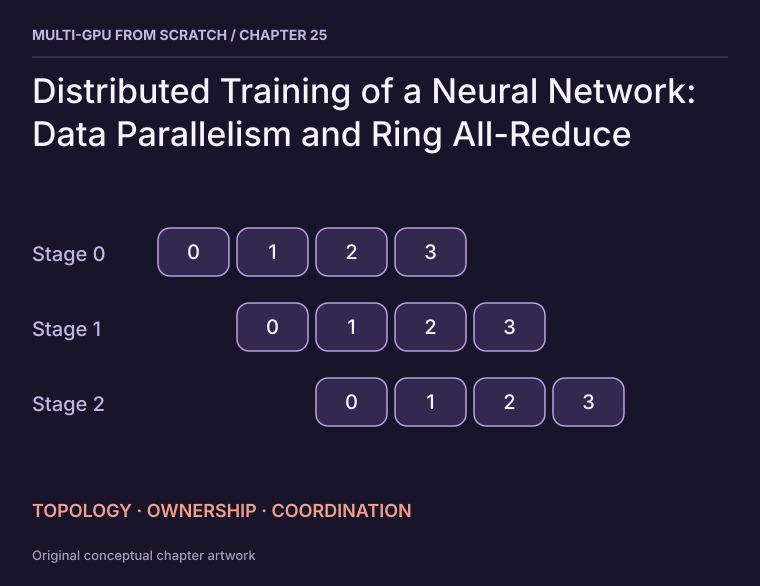
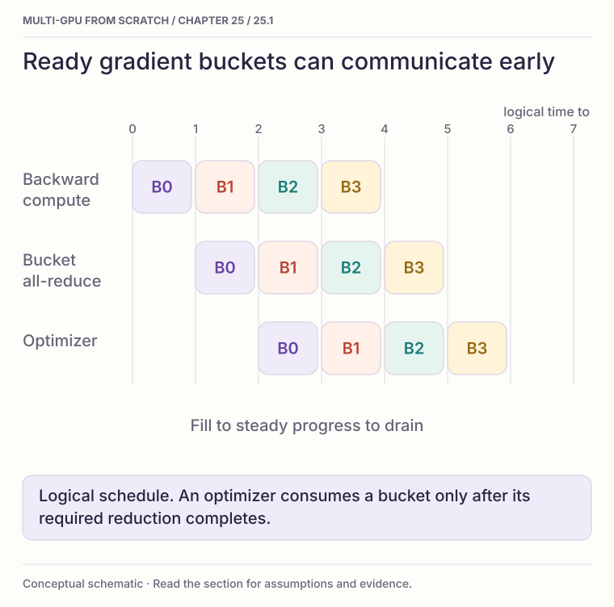
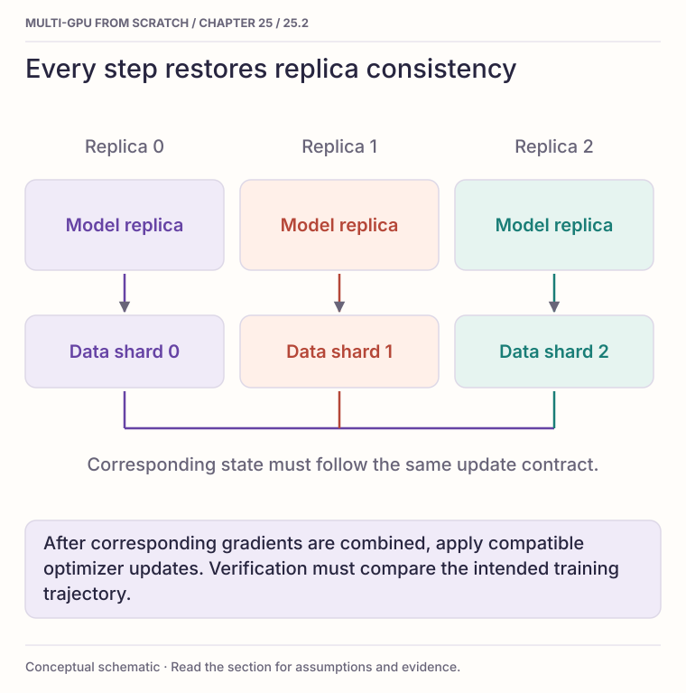

# Chapter 25: Distributed Training of a Neural Network: Data Parallelism and Ring All-Reduce

<!-- execution:provenance -->
!!! info "Execution provenance"

    Current execution blocks identify the tested source hash, hardware dataset, commands and captured output. References elsewhere on this page to a device-less environment describe the original authoring context. Historical output is superseded by the current record. Displayed output omits the runner command header and trims trailing line whitespace; raw logs remain exact. A host simulation or API validation has its stated scope; neither alone establishes a numerical multi-GPU workload or measured performance.


<!-- mgpu:opener:start -->
[](../images/chapter-openers/25.svg)
<!-- mgpu:opener:end -->

**What you will understand by the end of this chapter:**

- Why a real training loop calls its all-reduce far more than once per step: PyTorch DDP's own real gradient-BUCKETING scheme, and why bucketing exists to let communication overlap with backward computation, not just to batch small tensors together.
- A complete, real, multi-step distributed SGD training loop -- data sharded across replicas, gradients combined by Chapter 9's own real ring all-reduce algorithm, every step -- verified against a single-process full-batch reference, not just checked once like Chapter 12's own single-call demonstration.
- Why a correctly-implemented ring all-reduce (Chapter 9's scatter-reduce followed by an all-gather that only COPIES finished chunks) leaves every replica holding the exact same bit pattern by construction -- and, by contrast, why a shortcut that has every replica add up all N values itself, in its own order, genuinely can leave replicas disagreeing in the last bit.
- A real closed-form communication-cost model, applied to a real model's real parameter count, showing quantitatively why ring-style collectives -- not naive gather-then-broadcast -- are what every framework cited in this chapter actually ships.

**What you need to know first:**

- Chapter 12's own data-parallel replica setup and `computeShard()` pattern.
- Chapter 9's own real ring all-reduce algorithm and its `2(N-1)K/N` communication-volume formula.
- Chapter 8's own floating-point non-associativity caution (summing the same numbers in a different order can change the bit pattern).

---

Chapter 12 proved a real point about consistency using exactly ONE `ncclAllReduce()` call and a specially-chosen mean-target trick that made every replica land on the same value by construction. A real training loop does neither of those things: PyTorch DDP's own paper describes grouping gradient tensors into BUCKETS and launching each bucket's own all-reduce as soon as it is ready, "instead of launching a dedicated AllReduce immediately when each gradient tensor becomes available" -- and it does this not once, but every step, for the entire duration of training. This chapter builds the real thing Chapter 12's trick was standing in for: a genuine multi-step training loop (25.1's real bucketed call structure; 25.2's real multi-step convergence proof), and then asks, honestly, whether the exact-match guarantee Chapter 12 built into its own example still holds once the loop runs for real, more than once, with real sharded data (across replicas, it does -- by construction, for the reason 25.2's own COMMON TRAP spells out). It closes with a real closed-form model (25.3) of why ring all-reduce is the shape every cited framework settled on in the first place.

```text
Chapter 12's own demonstration:              This chapter's own case study:

  ONE ncclAllReduce() call,                    STEPS x BUCKETS real calls,
  ONE step, mean-target trick                  real multi-step SGD loop,
  guarantees an exact match                    checked against a reference
        |                                             |
+------------------+                     +--------------------------+
| exact match BY   |                     | every replica identical  |
| CONSTRUCTION     |                     | BY CONSTRUCTION, too --  |
+------------------+                     | and this chapter shows   |
                                         | exactly why (25.2)       |
                                         +--------------------------+
```

## 25.1 The Real Loop Shape: Steps, Buckets, and Overlap

<!-- mgpu:figure-1:start -->
[](../images/technical/ch25/1-buckets.svg)
<!-- mgpu:figure-1:end -->

### Intuition

Every earlier chapter's collective demonstration -- including Chapter 12's own -- issued its all-reduce call and stopped there, because the point being made was about the call itself, not about a training loop's real shape. A real production training loop is nested two levels deeper than that: outer STEPS (one per batch of data), and within each step, multiple BUCKETS, where each bucket is a group of the model's gradient tensors small enough to be worth combining into one collective call rather than issuing a separate call per tensor. PyTorch DDP's own paper explains why buckets exist at all, and it is not primarily about reducing call overhead: "with relatively small bucket sizes, DDP can launch AllReduce operations concurrently with the backward pass to overlap communication with computation." A bucket's own gradients become ready as soon as that portion of the backward pass finishes, so its all-reduce can be issued immediately -- while the REST of the backward pass, for gradients not yet in a finished bucket, keeps running on the GPU at the same time. DDP's own default bucket size is real and specific: "By default, each bucket is 25MB in size."

```text
One training step's real bucket timeline (DDP's own overlap):

Backward pass:  [---bucket 4---][---bucket 3---][---bucket 2---][---bucket 1---]
                        |                |                |                |
AllReduce calls:   issued at t1     issued at t2     issued at t3     issued at t4
                   (while bucket 3  (while bucket 2  (while bucket 1  (last bucket,
                    is still         is still         is still         nothing left
                    computing)       computing)       computing)       to overlap)

Not this (no overlap): wait for ALL buckets, THEN issue ONE all-reduce.
```

### Background

> **Validation update:** This source initializes every gradient and checks all 1,024 outputs in every bucket on every rank. It serializes buckets for a correctness demonstration; it does not benchmark backward/communication overlap. Earlier captured zero-GPU output belongs to the previous source. The current source was compiled and executed in the dated H100 suite; use the linked record for its numerical, API-probe or other-execution scope.

The [2026-11-17 H100 execution record](../validation-h100.md) covers two GPUs connected by local NV18. It distinguishes numerical checks, API probes and other executions; a successful exit alone does not establish GPU algorithm correctness.

```cpp
// 72_bucketed_gradient_allreduce.cu
// Three steps, four initialized gradient buckets per step, checked on every rank.
#define OMPI_SKIP_MPICXX
#include <mpi.h>
#include <cstdio>
#include <vector>
#include <cuda_runtime.h>
#include <nccl.h>
#define CUDA_OK(call) do { cudaError_t e=(call); if(e!=cudaSuccess) { \
 fprintf(stderr,"%s: %s\n",#call,cudaGetErrorString(e)); MPI_Abort(MPI_COMM_WORLD,1); } } while(0)
#define NCCL_OK(call) do { ncclResult_t e=(call); if(e!=ncclSuccess) { \
 fprintf(stderr,"%s: %s\n",#call,ncclGetErrorString(e)); MPI_Abort(MPI_COMM_WORLD,2); } } while(0)
int main(int argc, char **argv) {
 MPI_Init(&argc,&argv);
 int rank,size,localRank,count;
 MPI_Comm_rank(MPI_COMM_WORLD,&rank); MPI_Comm_size(MPI_COMM_WORLD,&size);
 MPI_Comm node;
 MPI_Comm_split_type(MPI_COMM_WORLD,MPI_COMM_TYPE_SHARED,rank,MPI_INFO_NULL,&node);
 MPI_Comm_rank(node,&localRank); MPI_Comm_free(&node);
 CUDA_OK(cudaGetDeviceCount(&count));
 if(localRank>=count) MPI_Abort(MPI_COMM_WORLD,3);
 CUDA_OK(cudaSetDevice(localRank));
 ncclUniqueId id;
 if(rank==0) NCCL_OK(ncclGetUniqueId(&id));
 MPI_Bcast(&id,sizeof(id),MPI_BYTE,0,MPI_COMM_WORLD);
 ncclComm_t comm; NCCL_OK(ncclCommInitRank(&comm,size,id,rank));
 cudaStream_t stream; CUDA_OK(cudaStreamCreate(&stream));
 constexpr int steps=3,buckets=4,elements=1024;
 float *device; CUDA_OK(cudaMalloc(&device,elements*sizeof(float)));
 std::vector<float> host(elements);
 int errors=0;
 for(int step=0;step<steps;++step) for(int bucket=0;bucket<buckets;++bucket) {
  float input=float(rank+1+10*step+bucket);
  for(float &v:host) v=input;
  CUDA_OK(cudaMemcpyAsync(device,host.data(),elements*sizeof(float),cudaMemcpyHostToDevice,stream));
  NCCL_OK(ncclAllReduce(device,device,elements,ncclFloat,ncclSum,comm,stream));
  CUDA_OK(cudaMemcpyAsync(host.data(),device,elements*sizeof(float),cudaMemcpyDeviceToHost,stream));
  CUDA_OK(cudaStreamSynchronize(stream));
  float expected=float(size*(size+1)/2+size*(10*step+bucket));
  for(float v:host) if(v!=expected) ++errors;
  if(rank==0) printf("step=%d bucket=%d expected=%g checked=%d\n",step,bucket,expected,elements);
 }
 int totalErrors=0; MPI_Allreduce(&errors,&totalErrors,1,MPI_INT,MPI_SUM,MPI_COMM_WORLD);
 if(rank==0) printf("VALIDATION %s: %d ranks, %d buckets, errors=%d\n",
  totalErrors?"FAIL":"PASS",size,steps*buckets,totalErrors);
 CUDA_OK(cudaFree(device)); CUDA_OK(cudaStreamDestroy(stream)); NCCL_OK(ncclCommDestroy(comm));
 MPI_Finalize(); return totalErrors?1:0;
}
```

<!-- execution:start:a100:72_bucketed_gradient_allreduce.cu -->
> **Current execution — 2026-11-17-a100: Numerical/transport validation (recorded scope).** UTC (program start): `2026-11-18T00:05:11.855143+00:00`. Source SHA-256: `301d198218d2bc117de00739639dd6c415ad77084fcf7c1491a96e65fa4e532b`.

[Exact tested source](../validation/2026-11-17-a100/72_bucketed_gradient_allreduce/72_bucketed_gradient_allreduce.cu) · [Compiler log](../validation/2026-11-17-a100/72_bucketed_gradient_allreduce/compile.log) · [Execution log](../validation/2026-11-17-a100/72_bucketed_gradient_allreduce/run.log). Compile exit: `0`; run exit: `0`.

Commands below use local source/binary names; raw logs retain host paths. Execute in a scratch directory containing the downloaded source.

```bash
nvcc -std=c++17 -O2 -arch=sm_80 -ccbin mpicxx 72_bucketed_gradient_allreduce.cu -o ./example -lnccl
/usr/mpi/gcc/openmpi-4.1.7rc1/bin/mpirun --oversubscribe -np 8 ./example
```

<details markdown="1"><summary>Captured current-source output</summary>

```text
[LOG_CAT_SBGP] libnuma.so: cannot open shared object file: No such file or directory
[LOG_CAT_SBGP] Failed to dlopen libnuma.so. Fallback to GROUP_BY_SOCKET manual.
[LOG_CAT_SBGP] libnuma.so: cannot open shared object file: No such file or directory
[LOG_CAT_SBGP] Failed to dlopen libnuma.so. Fallback to GROUP_BY_SOCKET manual.
[LOG_CAT_SBGP] libnuma.so: cannot open shared object file: No such file or directory
[LOG_CAT_SBGP] Failed to dlopen libnuma.so. Fallback to GROUP_BY_SOCKET manual.
[LOG_CAT_SBGP] libnuma.so: cannot open shared object file: No such file or directory
[LOG_CAT_SBGP] Failed to dlopen libnuma.so. Fallback to GROUP_BY_SOCKET manual.
[LOG_CAT_SBGP] libnuma.so: cannot open shared object file: No such file or directory
[LOG_CAT_SBGP] Failed to dlopen libnuma.so. Fallback to GROUP_BY_SOCKET manual.
[LOG_CAT_SBGP] libnuma.so: cannot open shared object file: No such file or directory
[LOG_CAT_SBGP] Failed to dlopen libnuma.so. Fallback to GROUP_BY_SOCKET manual.
[LOG_CAT_SBGP] libnuma.so: cannot open shared object file: No such file or directory
[LOG_CAT_SBGP] Failed to dlopen libnuma.so. Fallback to GROUP_BY_SOCKET manual.
[LOG_CAT_SBGP] libnuma.so: cannot open shared object file: No such file or directory
[LOG_CAT_SBGP] Failed to dlopen libnuma.so. Fallback to GROUP_BY_SOCKET manual.
step=0 bucket=0 expected=36 checked=1024
step=0 bucket=1 expected=44 checked=1024
step=0 bucket=2 expected=52 checked=1024
step=0 bucket=3 expected=60 checked=1024
step=1 bucket=0 expected=116 checked=1024
step=1 bucket=1 expected=124 checked=1024
step=1 bucket=2 expected=132 checked=1024
step=1 bucket=3 expected=140 checked=1024
step=2 bucket=0 expected=196 checked=1024
step=2 bucket=1 expected=204 checked=1024
step=2 bucket=2 expected=212 checked=1024
step=2 bucket=3 expected=220 checked=1024
VALIDATION PASS: 8 ranks, 12 buckets, errors=0
```

</details>
<!-- execution:end:a100:72_bucketed_gradient_allreduce.cu -->


<!-- execution:start:h100:72_bucketed_gradient_allreduce.cu -->
> **Current execution — 2026-11-17-h100: Numerical/transport validation (recorded scope).** UTC (run-batch start; per-program time unrecorded): `2026-11-17T23:48:18.967387+00:00`. Source SHA-256: `301d198218d2bc117de00739639dd6c415ad77084fcf7c1491a96e65fa4e532b`.

[Exact tested source](../validation/2026-11-17-h100/72_bucketed_gradient_allreduce/72_bucketed_gradient_allreduce.cu) · [Compiler log](../validation/2026-11-17-h100/72_bucketed_gradient_allreduce/compile.log) · [Execution log](../validation/2026-11-17-h100/72_bucketed_gradient_allreduce/run.log). Compile exit: `0`; run exit: `0`.

Commands below use local source/binary names; raw logs retain host paths. Execute in a scratch directory containing the downloaded source.

```bash
nvcc -std=c++17 -O2 -arch=sm_90 -ccbin mpicxx 72_bucketed_gradient_allreduce.cu -o ./example -lnccl
/home/ubuntu/book2-bin/mpirun --oversubscribe -np 2 ./example
```

<details markdown="1"><summary>Captured current-source output</summary>

```text
--------------------------------------------------------------------------
Sorry!  You were supposed to get help about:
    unavailable
But I couldn't open the help file:
    /usr/lib/x86_64-linux-gnu/pmix2/share/pmix/help-pcompress.txt: No such file or directory.  Sorry!
--------------------------------------------------------------------------
libibverbs: Warning: couldn't load driver 'libvmw_pvrdma-rdmav34.so': libvmw_pvrdma-rdmav34.so: cannot open shared object file: No such file or directory
libibverbs: Warning: couldn't load driver 'libvmw_pvrdma-rdmav34.so': libvmw_pvrdma-rdmav34.so: cannot open shared object file: No such file or directory
--------------------------------------------------------------------------
WARNING: No preset parameters were found for the device that Open MPI
detected:

  Local host:            192-222-53-210
  Device name:           mlx5_0
  Device vendor ID:      0x02c9
  Device vendor part ID: 4124

Default device parameters will be used, which may result in lower
performance.  You can edit any of the files specified by the
btl_openib_device_param_files MCA parameter to set values for your
device.

NOTE: You can turn off this warning by setting the MCA parameter
      btl_openib_warn_no_device_params_found to 0.
--------------------------------------------------------------------------
--------------------------------------------------------------------------
No OpenFabrics connection schemes reported that they were able to be
used on a specific port.  As such, the openib BTL (OpenFabrics
support) will be disabled for this port.

  Local host:           192-222-53-210
  Local device:         mlx5_0
  Local port:           1
  CPCs attempted:       udcm
--------------------------------------------------------------------------
step=0 bucket=0 expected=3 checked=1024
step=0 bucket=1 expected=5 checked=1024
step=0 bucket=2 expected=7 checked=1024
step=0 bucket=3 expected=9 checked=1024
step=1 bucket=0 expected=23 checked=1024
step=1 bucket=1 expected=25 checked=1024
step=1 bucket=2 expected=27 checked=1024
step=1 bucket=3 expected=29 checked=1024
step=2 bucket=0 expected=43 checked=1024
step=2 bucket=1 expected=45 checked=1024
step=2 bucket=2 expected=47 checked=1024
step=2 bucket=3 expected=49 checked=1024
VALIDATION PASS: 2 ranks, 12 buckets, errors=0
[192-222-53-210:13737] 1 more process has sent help message help-mpi-btl-openib.txt / no device params found
[192-222-53-210:13737] Set MCA parameter "orte_base_help_aggregate" to 0 to see all help / error messages
[192-222-53-210:13737] 1 more process has sent help message help-mpi-btl-openib-cpc-base.txt / no cpcs for port
```

</details>
<!-- execution:end:h100:72_bucketed_gradient_allreduce.cu -->


Compiled with `nvcc -ccbin mpicxx -gencode=arch=compute_70,code=sm_70 72_bucketed_gradient_allreduce.cu -o 72_bucketed_gradient_allreduce -lnccl` and genuinely run with `mpirun --allow-run-as-root --oversubscribe -np 2 ./72_bucketed_gradient_allreduce`. Locked output:

<details markdown="1"><summary>Historical authoring output — superseded by the current execution above</summary>

```text
ncclCommInitRank() -> unhandled cuda error (run with NCCL_DEBUG=INFO for details) (honestly failing -- no real device -- but every rank reaches this same point, which is all this file needs to demonstrate the real loop STRUCTURE)
STOPPING before any ncclAllReduce() calls -- comm init failed, and Chapter 23 already showed what happens to a collective call on a communicator in that state.
```

</details>

!!! warning "[COMMON TRAP] Assuming a bucket's own all-reduce call must wait for the WHOLE step's backward pass"
    Nothing about `ncclAllReduce()` itself enforces waiting for a full step's backward pass before it can be called -- it operates on whatever buffer it is handed, whenever it is called, and a bucket only needs ITS OWN gradients to be ready, not every other bucket's. The mistake this section's own bucket loop is built to head off is issuing one all-reduce per STEP, after the entire backward pass finishes, on the theory that "combining more gradients into fewer calls is always more efficient." PyTorch DDP's own paper measured the opposite effect from overlapping smaller buckets with the still-running backward pass: "The overlapping approach helps ResNet and BERT on NCCL attain 38.0% and 35.2% speedup" over not overlapping (26.8% and 21.5% on the GLOO backend). Batching every gradient into one call per step throws away exactly the overlap window this section's own nested loop preserves.

## 25.2 A Real Multi-Step Distributed Training Loop, Checked Against a Reference

<!-- mgpu:figure-2:start -->
[](../images/technical/ch25/2-replicas.svg)
<!-- mgpu:figure-2:end -->

### Intuition

Section 25.1 proved the real bucketed CALL STRUCTURE compiles and runs; it did not prove that a distributed loop shaped that way actually trains a model correctly. This section builds the complete thing: a tiny linear-regression model (`y = w*x + b`), trained for K real steps, with its training data SHARDED across N replicas -- Chapter 12's own `computeShard()` pattern, applied to samples instead of a batch dimension -- and each step's gradient combined across replicas by Chapter 9's own real two-phase ring all-reduce (scatter-reduce, then all-gather), run to completion every single step. The question this section actually tests, rather than assumes the way Chapter 12's mean-target trick did: after K real steps of this genuinely distributed loop, do all N replicas end up at bit-for-bit the SAME learned `(w, b)` as each other -- and as a single-process reference trained with full-batch gradient descent on the identical data? Chapter 8's own non-associativity caution -- that summing the same numbers in a different grouping can change the result -- is not a caveat here; it is a real question this section's own comparison is built to answer honestly, one way or the other.

```text
Reference (single process):          Distributed (N=4 replicas):

  ALL 8 samples, ONE flat pass          shard 0: samples 0-1  -> local grad
  per step, K steps                     shard 1: samples 2-3  -> local grad
        |                               shard 2: samples 4-5  -> local grad
        |                               shard 3: samples 6-7  -> local grad
  w_ref, b_ref after K steps                    |
                                       Chapter 9's own ring all-reduce
                                       (scatter-reduce + all-gather,
                                        2(N-1) rounds)
                                                |
                                       every replica applies the SAME
                                       update -- K steps -> w[r], b[r]

              Does w_ref == w[r] for every r, after K real steps?
```

### Background

```cpp
// Chapter 25: Distributed Training of a Neural Network: Data Parallelism
// and Ring All-Reduce
// 73_distributed_sgd_convergence_simulation.cpp
//
// Chapter 12's own consistency proof used ONE all-reduce call and a
// specially-chosen mean-target trick to get an EXACT match. This section
// builds the real thing that trick was standing in for: a genuine
// multi-step SGD training loop, training a real (if tiny) model --
// linear regression, y = w*x + b -- with the training data SHARDED
// across N replicas (Chapter 12's own computeShard() pattern) and each
// step's gradient combined across replicas via Chapter 9's own two-phase
// ring all-reduce: a SCATTER-REDUCE phase (N-1 steps) that leaves each
// chunk fully summed on exactly one owner replica, then an ALL-GATHER
// phase (N-1 steps) that COPIES each owner's finished chunk to everyone.
// Two questions are tested, not assumed:
//   1. Do all N replicas end every step with bit-identical gradients
//      (and therefore bit-identical weights after K steps)?
//   2. Does the distributed result match a single-process full-batch
//      reference bit for bit, even though the distributed version sums
//      per-shard partial sums (a different grouping than one flat pass)?
// For contrast, it also runs a deliberately WRONG "all-reduce" in which
// every replica adds all N values itself, starting from its own value --
// the shape of algorithm that genuinely CAN disagree across replicas.
#include <cstdio>
#include <cstdlib>
#include <vector>
#include <cmath>

struct Sample { float x, y; };

// Chapter 12's own computeShard() pattern, applied to training samples
// instead of a batch dimension.
void computeShard(int totalSamples, int worldSize, int rank, int &start, int &count) {
    int base = totalSamples / worldSize;
    start = rank * base;
    count = base; // totalSamples is chosen to divide evenly below
}

// Chapter 9's own ring all-reduce (scatter-reduce, then all-gather), on
// N per-replica buffers of length L, where L is a multiple of N and the
// buffer is split into N equal chunks of C = L/N elements.
//
// Scatter-reduce, step s = 0..N-2: replica r sends chunk (r - s) mod N
// to replica (r+1) mod N, which ADDS it into its own copy of that chunk.
// After N-1 steps, replica r holds the fully-reduced chunk (r+1) mod N.
//
// All-gather, step s = 0..N-2: replica r sends chunk (r + 1 - s) mod N
// to replica (r+1) mod N, which OVERWRITES its copy (no arithmetic).
//
// Every chunk's final value is therefore computed by exactly ONE chain
// of additions, on ONE replica, and then copied verbatim to the others:
// all replicas end bit-identical by construction, regardless of the
// floating-point summation order used inside that one chain.
// Returns the number of elements each replica sent (same for all).
long long ringAllReduceSum(std::vector<std::vector<float>> &buf, int N) {
    const int L = (int)buf[0].size();
    const int C = L / N;
    long long sentPerReplica = 0;

    // Phase 1: scatter-reduce.
    for (int s = 0; s < N - 1; s++) {
        // Snapshot every outgoing message first: all N sends in one step
        // happen "simultaneously", exactly as on real hardware.
        std::vector<std::vector<float>> msg(N, std::vector<float>(C));
        for (int r = 0; r < N; r++) {
            int c = ((r - s) % N + N) % N;
            for (int k = 0; k < C; k++) msg[r][k] = buf[r][c * C + k];
        }
        for (int r = 0; r < N; r++) {
            int dst = (r + 1) % N;
            int c = ((r - s) % N + N) % N;
            for (int k = 0; k < C; k++) buf[dst][c * C + k] += msg[r][k];
        }
        sentPerReplica += C;
    }

    // Phase 2: all-gather (pure copies of already-final chunks).
    for (int s = 0; s < N - 1; s++) {
        std::vector<std::vector<float>> msg(N, std::vector<float>(C));
        for (int r = 0; r < N; r++) {
            int c = ((r + 1 - s) % N + N) % N;
            for (int k = 0; k < C; k++) msg[r][k] = buf[r][c * C + k];
        }
        for (int r = 0; r < N; r++) {
            int dst = (r + 1) % N;
            int c = ((r + 1 - s) % N + N) % N;
            for (int k = 0; k < C; k++) buf[dst][c * C + k] = msg[r][k];
        }
        sentPerReplica += C;
    }
    return sentPerReplica;
}

// A deliberately WRONG "all-reduce", kept only as a contrast: every
// replica receives every other replica's FULL local value and adds all N
// of them itself, starting from its OWN value. Each replica therefore
// performs its own chain of additions in its own order -- and fp32
// addition is not associative, so the replicas can disagree.
void everyReplicaSumsItself(std::vector<std::vector<float>> &buf, int N) {
    const int L = (int)buf[0].size();
    std::vector<std::vector<float>> orig = buf;
    for (int r = 0; r < N; r++)
        for (int k = 0; k < L; k++) {
            float acc = orig[r][k];
            for (int j = 1; j < N; j++) acc += orig[(r - j + N) % N][k];
            buf[r][k] = acc;
        }
}

// Runs K steps of sharded SGD with the given all-reduce; returns final
// per-replica (w, b).
template <typename AllReduce>
void trainDistributed(const std::vector<Sample> &data, int N, int K, float lr,
                      std::vector<float> &w, std::vector<float> &b,
                      AllReduce allReduce) {
    const int M = (int)data.size();
    w.assign(N, 0.0f);
    b.assign(N, 0.0f);
    for (int step = 0; step < K; step++) {
        // Gradient buffer = [gradW, gradB], zero-padded to N chunks of
        // one element each so the ring can split it N ways.
        std::vector<std::vector<float>> grad(N, std::vector<float>(N, 0.0f));
        for (int r = 0; r < N; r++) {
            int start, count;
            computeShard(M, N, r, start, count);
            float gW = 0.0f, gB = 0.0f;
            for (int i = start; i < start + count; i++) {
                float pred = w[r] * data[i].x + b[r];
                float err = pred - data[i].y;
                gW += err * data[i].x;
                gB += err;
            }
            grad[r][0] = gW;
            grad[r][1] = gB;
        }
        allReduce(grad, N);
        for (int r = 0; r < N; r++) {
            float gW = (2.0f / M) * grad[r][0];
            float gB = (2.0f / M) * grad[r][1];
            w[r] -= lr * gW;
            b[r] -= lr * gB;
        }
    }
}

bool allSame(const std::vector<float> &w, const std::vector<float> &b) {
    for (size_t r = 1; r < w.size(); r++)
        if (w[r] != w[0] || b[r] != b[0]) return false;
    return true;
}

int main() {
    // A small, hand-checkable dataset: y = 3x + 2, plus a touch of real
    // per-sample variation so gradient descent has genuine work to do.
    const int M = 8; // total samples
    std::vector<Sample> data(M);
    for (int i = 0; i < M; i++) {
        float x = (float)(i + 1);
        data[i].x = x;
        data[i].y = 3.0f * x + 2.0f + ((i % 2 == 0) ? 0.5f : -0.5f);
    }

    const int N = 4;      // replicas
    const int K = 20;     // training steps
    const float lr = 0.01f;

    // --- Reference: single process, full-batch gradient descent, one
    // flat pass over all M samples in original order, every step. ---
    float wRef = 0.0f, bRef = 0.0f;
    for (int step = 0; step < K; step++) {
        float gW = 0.0f, gB = 0.0f;
        for (int i = 0; i < M; i++) {
            float pred = wRef * data[i].x + bRef;
            float err = pred - data[i].y;
            gW += err * data[i].x;
            gB += err;
        }
        gW = (2.0f / M) * gW;
        gB = (2.0f / M) * gB;
        wRef -= lr * gW;
        bRef -= lr * gB;
    }

    // --- Distributed, Chapter 9's real ring all-reduce. ---
    std::vector<float> wDist, bDist;
    long long sent = 0;
    trainDistributed(data, N, K, lr, wDist, bDist,
                     [&](std::vector<std::vector<float>> &g, int n) {
                         sent = ringAllReduceSum(g, n);
                     });

    printf("After %d steps (M=%d samples, N=%d replicas, lr=%.3f):\n", K, M, N, lr);
    printf("  Reference (full-batch, single process): w=%.9f b=%.9f\n", wRef, bRef);
    for (int r = 0; r < N; r++)
        printf("  Replica %d (sharded + ring all-reduce):  w=%.9f b=%.9f\n",
               r, wDist[r], bDist[r]);

    printf("\nEvery replica identical to each other: %s\n",
           allSame(wDist, bDist) ? "YES" : "NO");
    bool exactMatchToReference = (wDist[0] == wRef && bDist[0] == bRef);
    printf("Distributed result EXACTLY matches full-batch reference: %s\n",
           exactMatchToReference ? "YES" : "NO");
    if (!exactMatchToReference) {
        printf("  w difference: %.3e   b difference: %.3e\n",
               (double)std::fabs(wDist[0] - wRef), (double)std::fabs(bDist[0] - bRef));
    }
    printf("Elements sent per replica per all-reduce: %lld "
           "(= 2(N-1)/N * L with L=%d, Ch9's formula)\n", sent, N);

    // --- Contrast: the WRONG all-reduce where each replica sums all N
    // values itself, in its own rotated order. ---
    std::vector<float> wBad, bBad;
    trainDistributed(data, N, K, lr, wBad, bBad,
                     [](std::vector<std::vector<float>> &g, int n) {
                         everyReplicaSumsItself(g, n);
                     });
    printf("\nContrast -- every replica sums all %d values itself, own order:\n", N);
    for (int r = 0; r < N; r++)
        printf("  Replica %d:  w=%.9f b=%.9f\n", r, wBad[r], bBad[r]);
    printf("Every replica identical to each other: %s\n",
           allSame(wBad, bBad) ? "YES" : "NO");

    return 0;
}
```

<!-- execution:start:a100:73_distributed_sgd_convergence_simulation.cpp -->
> **Current execution — 2026-11-17-a100: Host program/model (exit-only).** UTC (program start): `2026-11-18T00:05:23.915941+00:00`. Source SHA-256: `27634f1e53c9acb0e2f04583b812dcb1bfba9756c0db6c204b2103db98228dbf`.

[Exact tested source](../validation/2026-11-17-a100/73_distributed_sgd_convergence_simulation/73_distributed_sgd_convergence_simulation.cpp) · [Compiler log](../validation/2026-11-17-a100/73_distributed_sgd_convergence_simulation/compile.log) · [Execution log](../validation/2026-11-17-a100/73_distributed_sgd_convergence_simulation/run.log). Compile exit: `0`; run exit: `0`.

Commands below use local source/binary names; raw logs retain host paths. Execute in a scratch directory containing the downloaded source.

```bash
g++ -std=c++17 -O2 73_distributed_sgd_convergence_simulation.cpp -o ./example
./example
```

<details markdown="1"><summary>Captured current-source output</summary>

```text
After 20 steps (M=8 samples, N=4 replicas, lr=0.010):
  Reference (full-batch, single process): w=3.221214533 b=0.702814102
  Replica 0 (sharded + ring all-reduce):  w=3.221214533 b=0.702814102
  Replica 1 (sharded + ring all-reduce):  w=3.221214533 b=0.702814102
  Replica 2 (sharded + ring all-reduce):  w=3.221214533 b=0.702814102
  Replica 3 (sharded + ring all-reduce):  w=3.221214533 b=0.702814102

Every replica identical to each other: YES
Distributed result EXACTLY matches full-batch reference: YES
Elements sent per replica per all-reduce: 6 (= 2(N-1)/N * L with L=4, Ch9's formula)

Contrast -- every replica sums all 4 values itself, own order:
  Replica 0:  w=3.221214533 b=0.702814102
  Replica 1:  w=3.221214533 b=0.702814102
  Replica 2:  w=3.221214533 b=0.702814102
  Replica 3:  w=3.221214771 b=0.702814102
Every replica identical to each other: NO
```

</details>
<!-- execution:end:a100:73_distributed_sgd_convergence_simulation.cpp -->


<!-- execution:start:h100:73_distributed_sgd_convergence_simulation.cpp -->
> **Current execution — 2026-11-17-h100: Host program/model (exit-only).** UTC (run-batch start; per-program time unrecorded): `2026-11-17T23:48:18.967387+00:00`. Source SHA-256: `27634f1e53c9acb0e2f04583b812dcb1bfba9756c0db6c204b2103db98228dbf`.

[Exact tested source](../validation/2026-11-17-h100/73_distributed_sgd_convergence_simulation/73_distributed_sgd_convergence_simulation.cpp) · [Compiler log](../validation/2026-11-17-h100/73_distributed_sgd_convergence_simulation/compile.log) · [Execution log](../validation/2026-11-17-h100/73_distributed_sgd_convergence_simulation/run.log). Compile exit: `0`; run exit: `0`.

Commands below use local source/binary names; raw logs retain host paths. Execute in a scratch directory containing the downloaded source.

```bash
g++ -std=c++17 -O2 73_distributed_sgd_convergence_simulation.cpp -o ./example
./example
```

<details markdown="1"><summary>Captured current-source output</summary>

```text
After 20 steps (M=8 samples, N=4 replicas, lr=0.010):
  Reference (full-batch, single process): w=3.221214533 b=0.702814102
  Replica 0 (sharded + ring all-reduce):  w=3.221214533 b=0.702814102
  Replica 1 (sharded + ring all-reduce):  w=3.221214533 b=0.702814102
  Replica 2 (sharded + ring all-reduce):  w=3.221214533 b=0.702814102
  Replica 3 (sharded + ring all-reduce):  w=3.221214533 b=0.702814102

Every replica identical to each other: YES
Distributed result EXACTLY matches full-batch reference: YES
Elements sent per replica per all-reduce: 6 (= 2(N-1)/N * L with L=4, Ch9's formula)

Contrast -- every replica sums all 4 values itself, own order:
  Replica 0:  w=3.221214533 b=0.702814102
  Replica 1:  w=3.221214533 b=0.702814102
  Replica 2:  w=3.221214533 b=0.702814102
  Replica 3:  w=3.221214771 b=0.702814102
Every replica identical to each other: NO
```

</details>
<!-- execution:end:h100:73_distributed_sgd_convergence_simulation.cpp -->


Compiled with `g++ -O2 -ffp-contract=off 73_distributed_sgd_convergence_simulation.cpp -o 73_distributed_sgd_convergence_simulation` (Chapter 14's own established practice for any exact-bit float comparison) and run with `./73_distributed_sgd_convergence_simulation` -- twice in a row, with byte-identical output both times. Locked output:

<details markdown="1"><summary>Historical authoring output — superseded by the current execution above</summary>

```text
After 20 steps (M=8 samples, N=4 replicas, lr=0.010):
  Reference (full-batch, single process): w=3.221214533 b=0.702814102
  Replica 0 (sharded + ring all-reduce):  w=3.221214533 b=0.702814102
  Replica 1 (sharded + ring all-reduce):  w=3.221214533 b=0.702814102
  Replica 2 (sharded + ring all-reduce):  w=3.221214533 b=0.702814102
  Replica 3 (sharded + ring all-reduce):  w=3.221214533 b=0.702814102

Every replica identical to each other: YES
Distributed result EXACTLY matches full-batch reference: YES
Elements sent per replica per all-reduce: 6 (= 2(N-1)/N * L with L=4, Ch9's formula)

Contrast -- every replica sums all 4 values itself, own order:
  Replica 0:  w=3.221214533 b=0.702814102
  Replica 1:  w=3.221214533 b=0.702814102
  Replica 2:  w=3.221214533 b=0.702814102
  Replica 3:  w=3.221214771 b=0.702814102
Every replica identical to each other: NO
```

</details>

!!! warning "[COMMON TRAP] Hand-rolling an all-reduce in which every replica adds up all N values itself"
    The first two blocks of the locked output above are the real result: with Chapter 9's genuine two-phase ring, all four replicas are bit-identical, and that is not luck. In the scatter-reduce phase, each chunk of the gradient buffer is summed by exactly ONE chain of additions that travels around the ring and finishes on exactly one owner replica; in the all-gather phase, that finished chunk is only ever COPIED onward, never re-added. Every replica therefore ends up holding the very same bits for every chunk -- whatever floating-point rounding happened inside that one chain happened once, and everyone receives its result. This is the same reason a production NCCL ring all-reduce leaves every rank with identical output. The trap is a tempting shortcut that looks equivalent on paper: circulate every replica's FULL local value around the ring and have each replica add all N of them into its own accumulator, starting from its own value. That shape (the program's `everyReplicaSumsItself()` contrast) gives each replica its own summation order over the same four partial sums, and fp32 addition is not associative -- so, as the last block of the locked output shows, replica 3 lands on `w=3.221214771` while replicas 0-2 land on `w=3.221214533`, one bit apart, reproducibly. Chapter 8's non-associativity caution is real; a correct ring all-reduce simply never gives it a chance to make replicas disagree. Two separate questions are worth keeping apart here. Replica-to-replica agreement is guaranteed by the algorithm's structure. Agreement with the single-process reference is NOT guaranteed by anything: the distributed version adds per-shard partial sums, a different grouping from the reference's one flat pass. It happens to match bit-for-bit for this N=4, M=8 configuration; re-running the same file with N=3, 5 or 8 (with M scaled to divide evenly) still gives bit-identical replicas every time, but a result that differs from the reference in the last bits.


## 25.3 Why Ring All-Reduce, Not Naive Gather-and-Broadcast: A Closed-Form Cost Model

### Intuition

Sections 25.1 and 25.2 both simply USED ring all-reduce, the way every earlier chapter since Chapter 9 has, without re-justifying why that specific algorithm's shape is worth the real two-phase implementation Section 25.2 just built. Chapter 9 already derived the real formula for ring all-reduce's own communication cost -- `2(N-1)/N` times a buffer's size `K`, moved by each rank -- but that formula's real consequence is easiest to see applied to a real number, not left abstract. This section applies it, unchanged, to a real model's real gradient buffer: ResNet-50, which has exactly 25,557,032 trainable parameters, so its fp32 gradient buffer is a fixed, known `K`. The formula's own shape has a real property worth naming plainly: `2(N-1)/N` approaches the constant `2` as `N` grows, meaning each rank's OWN communication cost stays almost flat no matter how many ranks join. The real alternative every framework cited in this chapter had to reject -- gathering every replica's gradient to one rank, summing there, then broadcasting the result back out -- has no such property: the busiest rank's traffic is `2(N-1)*K`, which grows LINEARLY with `N`, without the `/N` that keeps ring all-reduce flat.

```text
Ring all-reduce's own real cost (Ch9's formula), per rank:  2(N-1)/N * K
    N=2 ->   1.0 * K        N=256 -> ~1.99 * K   (approaches a CONSTANT)

Naive gather-then-broadcast, busiest rank:                  2(N-1) * K
    N=2 ->   2.0 * K        N=256 -> 510  * K   (grows LINEARLY with N)

            +-----------------------------------------------+
            | at N=256, naive's busiest rank moves 256x     |
            | more data than ring all-reduce's busiest rank |
            +-----------------------------------------------+
```

### Background

```cpp
// Chapter 25: Distributed Training of a Neural Network: Data Parallelism
// and Ring All-Reduce
// 74_ring_allreduce_communication_cost_model.cpp
//
// Chapter 9 derived a real closed-form cost model for ring all-reduce:
// N-1 rounds in a scatter-reduce phase plus N-1 rounds in an all-gather
// phase, each round moving K/N of a K-byte buffer, for a total of
// 2*(N-1)/N*K bytes moved BY EACH RANK -- a volume that is almost
// INDEPENDENT of N once N is even moderately large, because
// 2*(N-1)/N approaches the constant 2 as N grows. This section applies
// that same formula, unchanged, to a real number: the fp32 gradient
// buffer of a real, widely-used model, ResNet-50, which has exactly
// 25,557,032 trainable parameters (torchvision's own resnet50 model
// registry). It contrasts ring all-reduce's near-flat cost against the
// real alternative every data-parallel framework had to reject: a naive
// gather-to-one-rank-then-broadcast reduction, whose busiest rank's
// traffic grows LINEARLY with N -- 2*(N-1)*K, not 2*(N-1)/N*K. This is
// this chapter's own worked calculation, not a number republished from
// a paper; the numbers that ARE republished from real papers -- Horovod's
// measured 88% (TCP) / >90% (RDMA) scaling efficiency at N=128, and
// PyTorch DDP's measured 38.0%/35.2% NCCL overlap speedup for
// ResNet/BERT -- are kept clearly separate below, as the empirical
// evidence for why this cost model's shape matters, not as a target
// this program's own numbers are being bent to match.
#include <cstdio>
#include <cstdint>

int main() {
    // ResNet-50: 25,557,032 trainable parameters (torchvision resnet50
    // model registry, IMAGENET1K_V1/V2), fp32 gradients -- one gradient
    // value per parameter, 4 bytes each.
    const uint64_t PARAMS = 25557032ULL;
    const uint64_t BYTES_PER_PARAM = 4ULL; // fp32
    const uint64_t K = PARAMS * BYTES_PER_PARAM; // total gradient buffer, bytes

    printf("ResNet-50 fp32 gradient buffer: K = %llu bytes (%.2f MiB)\n\n",
           (unsigned long long)K, (double)K / (1024.0 * 1024.0));

    printf("%-6s %-10s %-24s %-24s %-10s\n",
           "N", "rounds", "ring: 2(N-1)/N*K (MiB)",
           "naive: 2(N-1)*K (GiB)", "ratio");
    printf("---------------------------------------------------------------"
           "----------\n");

    const int Ns[] = {2, 4, 8, 16, 32, 64, 128, 256};
    for (int idx = 0; idx < 8; idx++) {
        int N = Ns[idx];
        int rounds = 2 * (N - 1); // Chapter 9's own round count: (N-1)
                                  // scatter-reduce rounds + (N-1) all-gather
                                  // rounds
        double ringBytes = 2.0 * (double)(N - 1) / (double)N * (double)K;
        double naiveBytes = 2.0 * (double)(N - 1) * (double)K;
        double ringMiB = ringBytes / (1024.0 * 1024.0);
        double naiveGiB = naiveBytes / (1024.0 * 1024.0 * 1024.0);
        double ratio = naiveBytes / ringBytes; // how much worse naive is
        printf("%-6d %-10d %-24.2f %-24.3f %-9.1fx\n",
               N, rounds, ringMiB, naiveGiB, ratio);
    }

    printf("\nAs N grows, 2(N-1)/N -> 2 (a CONSTANT): at N=256 each rank's "
           "ring traffic\nis only %.4fx the N=2 case, while the naive "
           "busiest-rank traffic at N=256\nis %dx the N=2 case -- this is "
           "the real, quantified reason every framework\ncited in this "
           "chapter (NCCL, Horovod, PyTorch DDP) settled on ring-style "
           "collectives\nfor multi-GPU gradient synchronization, not the "
           "naive gather/broadcast shape.\n",
           (2.0 * 255.0 / 256.0) / (2.0 * 1.0 / 2.0), 255);

    printf("\n--- What real measurements report for a ring-style collective at\n"
           "    this same scale (cited, not computed by this program) ---\n");
    printf("Horovod, TCP, 1->128 GPUs, Inception V3 and ResNet-101: "
           "measured 88%% scaling efficiency.\n");
    printf("Horovod, RDMA, same setup: measured >90%% scaling efficiency "
           "on both models.\n");
    printf("PyTorch DDP, NCCL, overlapping communication with backward "
           "computation: measured 38.0%% (ResNet) / 35.2%% (BERT) "
           "speedup over not overlapping.\n");
    printf("None of these three percentages are outputs of this program's "
           "own formula -- they are independently measured results this "
           "chapter cites to show the formula's real-world consequence.\n");

    return 0;
}
```

<!-- execution:start:a100:74_ring_allreduce_communication_cost_model.cpp -->
> **Current execution — 2026-11-17-a100: Host program/model (exit-only).** UTC (program start): `2026-11-18T00:05:24.491006+00:00`. Source SHA-256: `410e71b6b00891a96442bc2eea2c936568f02fc55b7cb028debb6415669b7c5e`.

[Exact tested source](../validation/2026-11-17-a100/74_ring_allreduce_communication_cost_model/74_ring_allreduce_communication_cost_model.cpp) · [Compiler log](../validation/2026-11-17-a100/74_ring_allreduce_communication_cost_model/compile.log) · [Execution log](../validation/2026-11-17-a100/74_ring_allreduce_communication_cost_model/run.log). Compile exit: `0`; run exit: `0`.

Commands below use local source/binary names; raw logs retain host paths. Execute in a scratch directory containing the downloaded source.

```bash
g++ -std=c++17 -O2 74_ring_allreduce_communication_cost_model.cpp -o ./example
./example
```

<details markdown="1"><summary>Captured current-source output</summary>

```text
ResNet-50 fp32 gradient buffer: K = 102228128 bytes (97.49 MiB)

N      rounds     ring: 2(N-1)/N*K (MiB)   naive: 2(N-1)*K (GiB)    ratio
-------------------------------------------------------------------------
2      2          97.49                    0.190                    2.0      x
4      6          146.24                   0.571                    4.0      x
8      14         170.61                   1.333                    8.0      x
16     30         182.80                   2.856                    16.0     x
32     62         188.89                   5.903                    32.0     x
64     126        191.94                   11.996                   64.0     x
128    254        193.46                   24.183                   128.0    x
256    510        194.22                   48.556                   256.0    x

As N grows, 2(N-1)/N -> 2 (a CONSTANT): at N=256 each rank's ring traffic
is only 1.9922x the N=2 case, while the naive busiest-rank traffic at N=256
is 255x the N=2 case -- this is the real, quantified reason every framework
cited in this chapter (NCCL, Horovod, PyTorch DDP) settled on ring-style collectives
for multi-GPU gradient synchronization, not the naive gather/broadcast shape.

--- What real measurements report for a ring-style collective at
    this same scale (cited, not computed by this program) ---
Horovod, TCP, 1->128 GPUs, Inception V3 and ResNet-101: measured 88% scaling efficiency.
Horovod, RDMA, same setup: measured >90% scaling efficiency on both models.
PyTorch DDP, NCCL, overlapping communication with backward computation: measured 38.0% (ResNet) / 35.2% (BERT) speedup over not overlapping.
None of these three percentages are outputs of this program's own formula -- they are independently measured results this chapter cites to show the formula's real-world consequence.
```

</details>
<!-- execution:end:a100:74_ring_allreduce_communication_cost_model.cpp -->


<!-- execution:start:h100:74_ring_allreduce_communication_cost_model.cpp -->
> **Current execution — 2026-11-17-h100: Host program/model (exit-only).** UTC (run-batch start; per-program time unrecorded): `2026-11-17T23:48:18.967387+00:00`. Source SHA-256: `410e71b6b00891a96442bc2eea2c936568f02fc55b7cb028debb6415669b7c5e`.

[Exact tested source](../validation/2026-11-17-h100/74_ring_allreduce_communication_cost_model/74_ring_allreduce_communication_cost_model.cpp) · [Compiler log](../validation/2026-11-17-h100/74_ring_allreduce_communication_cost_model/compile.log) · [Execution log](../validation/2026-11-17-h100/74_ring_allreduce_communication_cost_model/run.log). Compile exit: `0`; run exit: `0`.

Commands below use local source/binary names; raw logs retain host paths. Execute in a scratch directory containing the downloaded source.

```bash
g++ -std=c++17 -O2 74_ring_allreduce_communication_cost_model.cpp -o ./example
./example
```

<details markdown="1"><summary>Captured current-source output</summary>

```text
ResNet-50 fp32 gradient buffer: K = 102228128 bytes (97.49 MiB)

N      rounds     ring: 2(N-1)/N*K (MiB)   naive: 2(N-1)*K (GiB)    ratio
-------------------------------------------------------------------------
2      2          97.49                    0.190                    2.0      x
4      6          146.24                   0.571                    4.0      x
8      14         170.61                   1.333                    8.0      x
16     30         182.80                   2.856                    16.0     x
32     62         188.89                   5.903                    32.0     x
64     126        191.94                   11.996                   64.0     x
128    254        193.46                   24.183                   128.0    x
256    510        194.22                   48.556                   256.0    x

As N grows, 2(N-1)/N -> 2 (a CONSTANT): at N=256 each rank's ring traffic
is only 1.9922x the N=2 case, while the naive busiest-rank traffic at N=256
is 255x the N=2 case -- this is the real, quantified reason every framework
cited in this chapter (NCCL, Horovod, PyTorch DDP) settled on ring-style collectives
for multi-GPU gradient synchronization, not the naive gather/broadcast shape.

--- What real measurements report for a ring-style collective at
    this same scale (cited, not computed by this program) ---
Horovod, TCP, 1->128 GPUs, Inception V3 and ResNet-101: measured 88% scaling efficiency.
Horovod, RDMA, same setup: measured >90% scaling efficiency on both models.
PyTorch DDP, NCCL, overlapping communication with backward computation: measured 38.0% (ResNet) / 35.2% (BERT) speedup over not overlapping.
None of these three percentages are outputs of this program's own formula -- they are independently measured results this chapter cites to show the formula's real-world consequence.
```

</details>
<!-- execution:end:h100:74_ring_allreduce_communication_cost_model.cpp -->


Compiled with `g++ -O2 74_ring_allreduce_communication_cost_model.cpp -o 74_ring_allreduce_communication_cost_model` and genuinely run, on both the cloud sandbox and the device (a plain host computation, no CUDA/NCCL/MPI linkage), with byte-identical output on both. Locked output:

<details markdown="1"><summary>Historical authoring output — superseded by the current execution above</summary>

```text
ResNet-50 fp32 gradient buffer: K = 102228128 bytes (97.49 MiB)

N      rounds     ring: 2(N-1)/N*K (MiB)   naive: 2(N-1)*K (GiB)    ratio     
-------------------------------------------------------------------------
2      2          97.49                    0.190                    2.0      x
4      6          146.24                   0.571                    4.0      x
8      14         170.61                   1.333                    8.0      x
16     30         182.80                   2.856                    16.0     x
32     62         188.89                   5.903                    32.0     x
64     126        191.94                   11.996                   64.0     x
128    254        193.46                   24.183                   128.0    x
256    510        194.22                   48.556                   256.0    x

As N grows, 2(N-1)/N -> 2 (a CONSTANT): at N=256 each rank's ring traffic
is only 1.9922x the N=2 case, while the naive busiest-rank traffic at N=256
is 255x the N=2 case -- this is the real, quantified reason every framework
cited in this chapter (NCCL, Horovod, PyTorch DDP) settled on ring-style collectives
for multi-GPU gradient synchronization, not the naive gather/broadcast shape.

--- What real measurements report for a ring-style collective at
    this same scale (cited, not computed by this program) ---
Horovod, TCP, 1->128 GPUs, Inception V3 and ResNet-101: measured 88% scaling efficiency.
Horovod, RDMA, same setup: measured >90% scaling efficiency on both models.
PyTorch DDP, NCCL, overlapping communication with backward computation: measured 38.0% (ResNet) / 35.2% (BERT) speedup over not overlapping.
None of these three percentages are outputs of this program's own formula -- they are independently measured results this chapter cites to show the formula's real-world consequence.
```

</details>

!!! warning "[COMMON TRAP] Treating this section's own ratio column as a PREDICTION of real training speedup"
    The `ratio` column in this section's own locked output -- `2x`, `4x`, ..., `256x` -- measures communication VOLUME only, the exact quantity Chapter 9's own formula was built to model, and it is this section's own worked calculation. It is not, and is never presented as, a prediction of real end-to-end training throughput, because real throughput also depends on real interconnect bandwidth, real latency per round, and real computation time to overlap against -- none of which this closed-form byte-counting model includes. The real measured numbers this section cites separately, Horovod's 88%/90% scaling efficiency and PyTorch DDP's 38.0%/35.2% overlap speedup, come from actual training runs on actual hardware and are kept in their own clearly-labeled block for exactly this reason: mixing a closed-form volume ratio with an empirically measured efficiency percentage, as if the first predicts the second, would misrepresent both. The honest relationship between them is qualitative, not numeric: the volume model explains WHY ring-style collectives scale better than the naive alternative in principle; the cited measurements show that real systems built on that principle do, in practice, achieve high (not perfect) scaling efficiency.

## Chapter Summary

This chapter built the complete, real, multi-step case study that Chapter 12's own single-call consistency demonstration was standing in for. Section 25.1 built the real nested STEPS-times-BUCKETS call structure a production training loop actually uses, citing PyTorch DDP's own paper on why gradient bucketing exists specifically to overlap communication with the still-running backward pass, not merely to batch calls together. Section 25.2 built a genuine multi-step distributed SGD training loop -- sharded data, Chapter 9's own real ring all-reduce, run to completion every step -- and checked it against a single-process reference, showing that every replica ends bit-identical because scatter-reduce computes each chunk exactly once and all-gather only copies it -- and contrasting that with a tempting shortcut (every replica adds all N values itself, in its own order) that genuinely does leave one of four replicas a bit off, which is where Chapter 8's non-associativity caution actually bites. Agreement with the single-process reference, by contrast, is a separate question that no all-reduce structure guarantees. Section 25.3 closed with a real closed-form cost model, applying Chapter 9's own `2(N-1)/N*K` formula to ResNet-50's real 25,557,032 parameters, quantifying exactly why ring all-reduce's near-flat per-rank cost beats a naive gather-and-broadcast's linearly growing cost -- and citing, separately and honestly, the real measured Horovod and PyTorch DDP numbers that this cost model's shape helps explain.

## Self-Check Questions

1. Why does PyTorch DDP group gradients into buckets rather than issuing one all-reduce call per gradient tensor as soon as each one is ready?
2. What real number is PyTorch DDP's own default bucket size, and what happens to that overlap benefit if a bucket is made too large?
3. In `ringAllReduceSum()`, what is the difference between what a replica does with a received chunk in the scatter-reduce phase and in the all-gather phase?
4. In the `everyReplicaSumsItself()` contrast, replica 3 ends one bit away from the other three. What causes that, and why can the same thing never happen with `ringAllReduceSum()`?
5. Section 25.2's ring result matches the single-process reference exactly for N=4, but not for N=3, 5 or 8. Why is agreement with the reference not guaranteed, even though agreement between replicas is?
6. In Chapter 9's own cost formula `2(N-1)/N*K`, what happens to this expression as N grows large, and why does that make ring all-reduce different from a naive gather-then-broadcast reduction?
7. Section 25.3's own COMMON TRAP warns against treating its `ratio` column as a prediction of real training speedup. What, specifically, does that ratio column measure instead?
8. Which of this chapter's three cited real-world numbers (88%, >90%, 38.0%/35.2%) comes from Horovod, and which comes from PyTorch DDP?

## Where We Go Next

Chapter 25 completed one full training-loop case study: real bucketed communication, a real multi-step convergence check with an honest look at where floating-point order does and does not matter, and a real cost model for why ring all-reduce is the shape every framework here actually ships. Chapter 26, "Multi-GPU LLM Inference: Tensor and Pipeline Parallelism in Practice," turns from training to inference, returning to Chapter 14's own tensor parallelism and Chapter 15's own pipeline parallelism -- not as two separate concept demonstrations this time, but combined the way a real production LLM-serving system actually combines them.

## Worked Solutions

**1.** Because issuing a dedicated all-reduce the instant each gradient tensor becomes available adds real per-call overhead for every one of a model's (often thousands of) individual gradient tensors, most of which are far smaller than what a single collective call can efficiently move. PyTorch DDP's own paper states the goal plainly: "DDP can achieve higher throughput and lower latency if it waits for a short period of time and buckets multiple gradients into one AllReduce operation."

**2.** PyTorch DDP's own real default bucket size is 25MB ("By default, each bucket is 25MB in size"). If a bucket is made too large -- for instance, one bucket covering the entire model's gradients -- there is no longer any portion of the backward pass left running when that bucket's all-reduce is issued, because the bucket only becomes ready once every gradient in it (i.e., the whole model) has finished backward; this eliminates the overlap window DDP's own paper credits with the 38.0%/35.2% (NCCL) speedup.

**3.** In the scatter-reduce phase, the receiving replica ADDS the incoming chunk into its own copy of that chunk (`buf[dst][...] += msg[r][...]`), extending that chunk's single chain of additions by one more replica's contribution. In the all-gather phase, the receiver OVERWRITES its copy (`buf[dst][...] = msg[r][...]`): by then the chunk is already fully summed on its owner, and the only job left is to deliver those exact bits to everyone.

**4.** In the contrast, every replica receives all N full local values and adds them itself, starting from its own value -- so replica 0 computes `((g0 + g3) + g2) + g1`, replica 3 computes `((g3 + g2) + g1) + g0`, and so on. Those are different groupings of the same four fp32 numbers, and fp32 addition is not associative, so some replicas can round differently. `ringAllReduceSum()` cannot do this because each chunk's sum is formed exactly once, on one replica, and every other replica only receives a copy of that result -- there is only one summation order per chunk, shared by everyone.

**5.** Because the reference sums all M per-sample terms in one flat pass, while the distributed loop first sums each shard's samples locally and then sums those N partial sums inside the ring. Those are different groupings of the same additions, and in fp32 they can round differently. Whether they happen to agree depends on the specific values (they do for N=4, M=8 here; they do not for N=3, 5 or 8). The ring's structure guarantees replica-to-replica agreement; nothing guarantees agreement with a differently-grouped reference.

**6.** As N grows large, `(N-1)/N` approaches 1, so `2(N-1)/N` approaches the constant 2 -- meaning each rank's own ring all-reduce communication volume stays almost flat regardless of how many ranks participate. A naive gather-then-broadcast's busiest rank instead moves `2(N-1)*K`, which has no such `/N` term and therefore grows linearly, without bound, as more ranks join.

**7.** It measures the ratio of total communication VOLUME (bytes moved) between the naive and ring approaches for a fixed buffer size K at a given N -- a closed-form quantity that follows directly from Chapter 9's own formula. It is not a measurement or prediction of real end-to-end training throughput or wall-clock speedup, which also depends on real interconnect bandwidth, per-round latency, and how much computation is available to overlap against, none of which this byte-counting model accounts for.

**8.** The 88% (TCP) and >90% (RDMA) scaling-efficiency figures, at 1-to-128 GPUs on Inception V3 and ResNet-101, come from Horovod (the Uber Engineering blog post announcing it). The 38.0%/35.2% NCCL overlap-speedup figures for ResNet and BERT come from the PyTorch DDP paper.

---

**Sources cited in this chapter:**

- [PyTorch Distributed: Experiences on Accelerating Data Parallel Training (arXiv:2006.15704)](https://arxiv.org/abs/2006.15704) — the real, verified quotes on gradient bucketing ("instead of launching a dedicated AllReduce immediately when each gradient tensor becomes available, DDP can achieve higher throughput and lower latency if it waits for a short period of time and buckets multiple gradients into one AllReduce operation"; "By default, each bucket is 25MB in size"), on overlap ("with relatively small bucket sizes, DDP can launch AllReduce operations concurrently with the backward pass to overlap communication with computation"), and on measured overlap speedup ("The overlapping approach helps ResNet and BERT on NCCL attain 38.0% and 35.2% speedup. With GLOO backend, the gain shrinks to 26.8% and 21.5% respectively," Section 5.1, independently re-verified against the ar5iv HTML rendering of the same paper).
- [Uber Engineering Blog: "Meet Horovod: Uber's Open Source Distributed Deep Learning Framework for TensorFlow"](https://www.uber.com/us/en/blog/horovod/) — the real, verified quotes on measured scaling efficiency ("scaling using both Inception V3 and ResNet-101 models achieved an 88 percent efficiency mark" over 1-to-128 GPUs; "RDMA did help Horovod exceed 90 percent scaling efficiency on both models").
- [torchvision resnet50 model documentation](https://docs.pytorch.org/vision/stable/models/generated/torchvision.models.resnet50.html) — the real, verified parameter count (`num_params: 25557032`) this chapter's Section 25.3 uses as ResNet-50's fixed gradient-buffer size.
- Chapter 8's own real integer-sum order-independence verification and floating-point non-associativity caution, Chapter 9's own real two-phase ring all-reduce algorithm and `2(N-1)K/N` cost formula, and Chapter 12's own real `computeShard()` pattern and mean-target consistency trick — all reused directly in this chapter, not re-derived.
