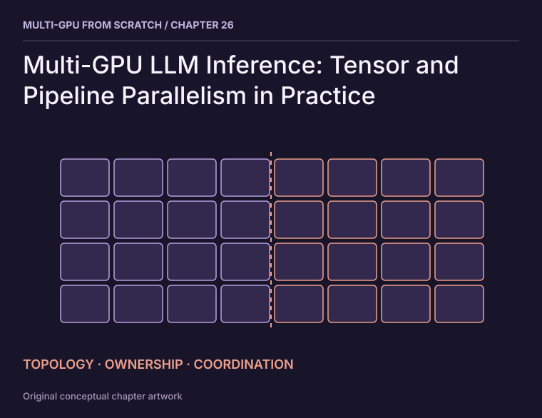
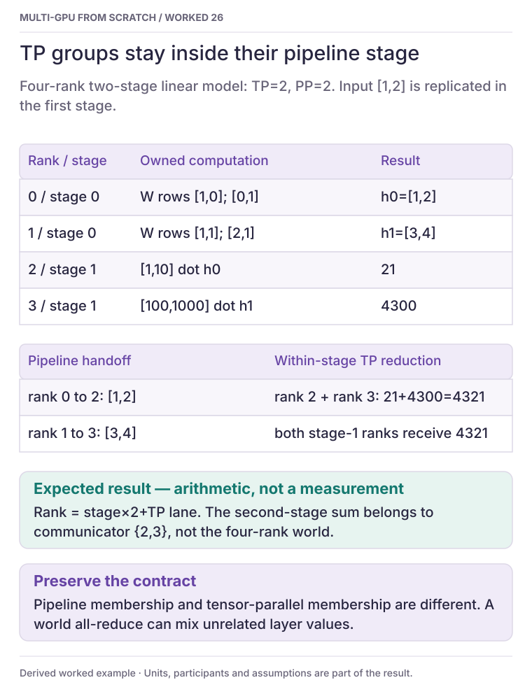
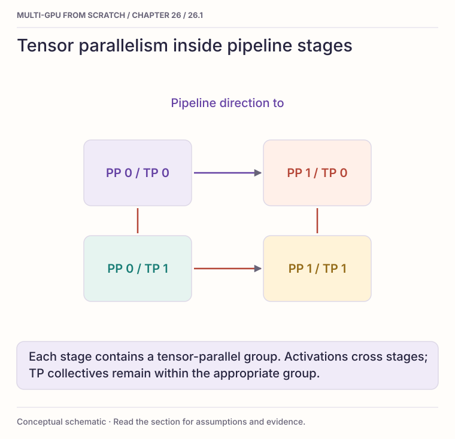
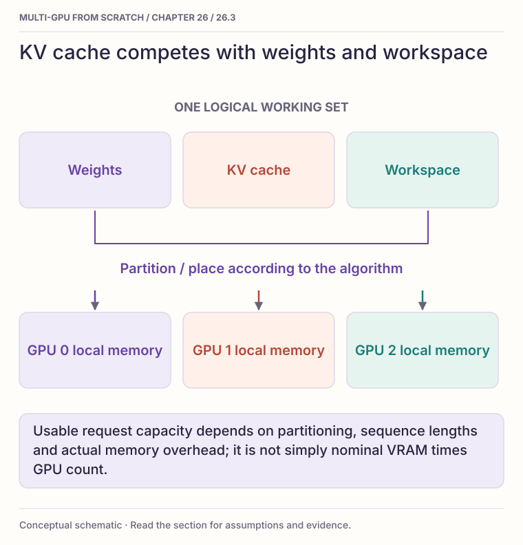

# Chapter 26: Multi-GPU LLM Inference: Tensor and Pipeline Parallelism in Practice

<!-- mgpu:opener:start -->
[](../images/chapter-openers/26.svg)
<!-- mgpu:opener:end -->

**What you will understand by the end of this chapter:**

- Why a real production LLM inference system combines Chapter 14's own tensor parallelism and Chapter 15's own pipeline parallelism over ONE device grid, rather than choosing between them, and a real, quoted rule for exactly where each one is applied.
- A real, verified 2D-grid correctness simulation -- pipeline stages, each itself a tensor-parallel group -- checked bit-exact against a naive, unsplit reference, exposing the real routing property that makes the combination safe: a tensor-parallel all-reduce never crosses a pipeline-stage boundary.
- A genuinely counter-intuitive real finding about WHY tensor parallelism stays bounded to one server's own GPU count: not primarily because of communication volume (which Chapter 9 and 25 already showed stays nearly flat), but because of round count, which does not.
- A real, cited super-linear memory effect from vLLM's own production serving system, and this chapter's own worked model of the mechanism that plausibly produces it -- along with an honest published gap this chapter does not paper over.

**What you need to know first:**

- Chapter 14's own Megatron-LM column-parallel/row-parallel tensor-parallel GEMM split.
- Chapter 15's own GPipe pipeline-parallel micro-batch schedule.
- Chapter 9's own ring all-reduce round-count and volume formulas, and Chapter 13's own per-shard capacity model.

---

Chapter 14 built tensor parallelism and Chapter 15 built pipeline parallelism as two separate concept demonstrations, each proven correct on its own. A real production LLM inference system does not pick one -- it runs both, over the same physical GPUs, at the same time, and the Megatron-LM paper states exactly where the line between them is drawn: "tensor model parallelism should generally be used up to degree g when using g-GPU servers, and then pipeline model parallelism can be used to scale up to larger models across servers." This chapter builds that combined shape as one real 2D device grid and checks it for correctness (26.1), applies it to a real, named, 530-billion-parameter production model's real configuration to find out why that specific boundary matters (26.2), and closes with a real measured effect from vLLM's own production serving system that neither Chapter 14 nor Chapter 15's own isolated demonstration could have shown (26.3).

```text
Chapter 14 (isolated):        Chapter 15 (isolated):        This chapter (combined):

  TP split ONE GEMM             PP split LAYERS across         PP_STAGES x TP_DEGREE,
  across TP_DEGREE               PIPELINE stages                ONE real 2D grid:
  devices, ONE all-reduce                                       TP all-reduce INSIDE
        |                              |                        each stage only,
        |                              |                        PP handoff BETWEEN
        +--------------+---------------+                        stages only
                       |
              "tensor model parallelism... up to degree g
               when using g-GPU servers, and then pipeline
               model parallelism... to scale... across servers"
                       |
                 this chapter's own real, combined case study
```

<!-- mgpu:worked:start -->

## Worked example — Keep tensor-parallel groups inside pipeline stages

Use TP=2, PP=2 and rank=stage×2+lane. Here vectors are columns and each matrix row computes one output dot product (W x), the transpose convention of Chapter 14’s row-vector XW notation. This is a two-layer linear arithmetic model, not a complete transformer. Replicate input x=[1,2] across ranks 0 and 1.

1. Rank 0 owns first-layer rows [1,0] and [0,1], so h0=[1,2]. Rank 1 owns rows [1,1] and [2,1], so h1=[3,4].

2. Send h0 from rank 0 to rank 2 and h1 from rank 1 to rank 3. The next layer has row [1,10,100,1000], partitioned along its input dimension.

3. Rank 2 computes [1,10] dot h0=21. Rank 3 computes [100,1000] dot h1=4300. A sum inside communicator {2,3} produces 4321 on both second-stage ranks.



**API connection and scope.** Column-parallel output shards can feed compatible row-parallel input shards without assembling the complete intermediate vector on every rank. Match pipeline sends/receives by microbatch and shard identity; use a tensor-parallel reduction only for the partial outputs of the same layer.

**Expected check and pitfall.** A world all-reduce across all four ranks mixes pipeline stages and changes the computation. Real transformer blocks add normalization, nonlinearities, attention and cache-layout contracts; the linear example isolates only ownership and reduction.

??? question "Guided exercise: Replace the final coefficient 1000 with 100. What changes?"

    **Worked answer.** Rank 3 computes 100×3+100×4=700. Rank 2 remains 21, so the final value is 721.

<!-- mgpu:worked:end -->

## 26.1 One Real 2D Grid: Tensor Parallelism Inside, Pipeline Parallelism Across

<!-- mgpu:figure-1:start -->
[](../images/technical/ch26/1-tpgrid.svg)
<!-- mgpu:figure-1:end -->

### Intuition

Chapter 14's own tensor-parallel MLP split needed exactly one all-reduce, scoped to however many devices were splitting that ONE GEMM. Chapter 15's own pipeline schedule needed exactly one activation handoff, scoped to two ADJACENT stages. Combining them means every device in a real system now plays both roles at once: it belongs to a pipeline STAGE, and within that stage, it belongs to a tensor-parallel GROUP. The real correctness property this creates, and the one this section's own simulation is built to check, is that these two kinds of communication must never cross into each other: a tensor-parallel all-reduce stays inside its own stage's own group, and the full-MLP stage implementation below hands off its already-combined output. This is that implementation’s layout contract, not a universal ban on sharded pipeline boundaries: the opening two-layer worked model deliberately carries compatible activation shards between stages and reduces only the second layer’s contributions. This chapter is about LLM INFERENCE specifically, which changes the pipeline shape from Chapter 15's own training loop in one real way: there is no backward pass, so the pipeline is forward-only, and Chapter 15's own bubble formula, built for a schedule with both a forward AND a backward phase per microbatch, does not apply here unchanged.

```text
A 2 x 2 grid: PP_STAGES=2, TP_DEGREE=2 (4 devices total)

Stage 0                              Stage 1
+----------------+----------------+  +----------------+----------------+
| TP rank 0      | TP rank 1      |  | TP rank 0      | TP rank 1      |
| col-parallel    | col-parallel   |  | col-parallel    | col-parallel   |
| GEMM1 (no comm) | GEMM1 (no comm)|  | GEMM1 (no comm) | GEMM1 (no comm)|
| row-parallel    | row-parallel   |  | row-parallel    | row-parallel   |
| GEMM2 -+        | GEMM2 -+       |  | GEMM2 -+        | GEMM2 -+       |
+--------|--------+--------|-------+  +--------|--------+--------|-------+
         +--- all-reduce --+                   +--- all-reduce --+
         (stays INSIDE stage 0)                (stays INSIDE stage 1)
                  |
                  +----- PP handoff: stage 0's own COMBINED result ----->
                         (never a partial TP shard)
```

### Background

```cpp
// Chapter 26: Multi-GPU LLM Inference: Tensor and Pipeline Parallelism in
// Practice
// 75_tp_pp_combined_correctness_simulation.cpp
//
// Chapter 14 built Megatron-LM's real tensor-parallel MLP split (column-
// parallel GEMM1, no communication, then row-parallel GEMM2, ONE
// ncclAllReduce()) in isolation. Chapter 15 built GPipe's real pipeline
// schedule -- layers split across stages, microbatches flowing through
// them -- also in isolation. A real production LLM inference system
// combines BOTH, at the same time, over the SAME device grid: the
// Megatron-LM paper's own words for why: "tensor model parallelism
// should generally be used up to degree g when using g-GPU servers, and
// then pipeline model parallelism can be used to scale up to larger
// models across servers." This file builds that combined shape as a
// real host-side simulation -- a 2D device grid, PP_STAGES x TP_DEGREE
// -- and checks its ROUTING, the way Chapter 24's own SUMMA simulation
// did: using long long INTEGER matrices (Chapter 8's own non-
// associativity caution -- this is a correctness check on the routing,
// not a claim about floating-point summation order), so the combined
// result can be compared bit-exact against a naive, unsplit reference,
// with no rounding ambiguity possible.
#include <cstdio>
#include <cstdlib>
#include <vector>
#include <cassert>

const int D = 4;             // per-layer input/output dimension
const int H_TOTAL = 8;       // per-layer hidden dimension
const int NUM_LAYERS = 4;    // total MLP layers in this toy model
const int TP_DEGREE = 2;     // tensor-parallel devices PER stage
const int PP_STAGES = 2;     // pipeline stages
const int LAYERS_PER_STAGE = NUM_LAYERS / PP_STAGES;
const int H_PER_TP = H_TOTAL / TP_DEGREE;
const int M = 4;             // microbatches (this chapter is INFERENCE --
                              // forward passes only, no backward pass)

using Vec = std::vector<long long>;
using Mat = std::vector<long long>; // row-major

long long relu(long long x) { return x > 0 ? x : 0; }

// Deterministic real-valued (integer) weights for layer l -- Chapter
// 14's own W1 (D x H_TOTAL, column-parallel) and W2 (H_TOTAL x D,
// row-parallel) shapes, reused unchanged.
Mat makeW1(int l) {
    Mat W(D * H_TOTAL);
    for (int i = 0; i < D; i++)
        for (int h = 0; h < H_TOTAL; h++)
            W[i * H_TOTAL + h] = ((l + 1) * 13 + i * 7 + h * 3) % 7 - 3;
    return W;
}
Mat makeW2(int l) {
    Mat W(H_TOTAL * D);
    for (int h = 0; h < H_TOTAL; h++)
        for (int j = 0; j < D; j++)
            W[h * D + j] = ((l + 1) * 17 + h * 5 + j * 11) % 7 - 3;
    return W;
}

// --- Naive reference: one process, no TP, no PP, one flat pass through
// every layer, exactly the way an unsplit forward pass would run. ---
Vec naiveForward(Vec x, const std::vector<Mat> &W1s, const std::vector<Mat> &W2s) {
    for (int l = 0; l < NUM_LAYERS; l++) {
        Vec hidden(H_TOTAL, 0);
        for (int h = 0; h < H_TOTAL; h++) {
            long long s = 0;
            for (int i = 0; i < D; i++) s += x[i] * W1s[l][i * H_TOTAL + h];
            hidden[h] = relu(s);
        }
        Vec out(D, 0);
        for (int j = 0; j < D; j++) {
            long long s = 0;
            for (int h = 0; h < H_TOTAL; h++) s += hidden[h] * W2s[l][h * D + j];
            out[j] = s;
        }
        x = out;
    }
    return x;
}

// --- Combined TP+PP: one layer's real Megatron-style TP split, run
// entirely within ONE pipeline stage's own TP group. Column-parallel
// GEMM1 needs NO communication (each TP rank computes its own hidden
// shard); row-parallel GEMM2 needs exactly ONE all-reduce, SCOPED TO
// THIS STAGE'S OWN TP GROUP ONLY -- never crossing a pipeline-stage
// boundary, which is the real property this file's own COMMON TRAP is
// built around. ---
Vec layerForwardTP(Vec x, const Mat &W1, const Mat &W2) {
    std::vector<Vec> localOut(TP_DEGREE, Vec(D, 0));
    for (int r = 0; r < TP_DEGREE; r++) {
        // Column-parallel GEMM1: rank r owns hidden columns
        // [r*H_PER_TP, (r+1)*H_PER_TP) -- no communication needed here.
        Vec hiddenShard(H_PER_TP, 0);
        for (int hh = 0; hh < H_PER_TP; hh++) {
            int h = r * H_PER_TP + hh;
            long long s = 0;
            for (int i = 0; i < D; i++) s += x[i] * W1[i * H_TOTAL + h];
            hiddenShard[hh] = relu(s);
        }
        // Row-parallel GEMM2: rank r owns the H_PER_TP rows of W2
        // matching its own hidden shard, producing a PARTIAL D-vector.
        for (int j = 0; j < D; j++) {
            long long s = 0;
            for (int hh = 0; hh < H_PER_TP; hh++) {
                int h = r * H_PER_TP + hh;
                s += hiddenShard[hh] * W2[h * D + j];
            }
            localOut[r][j] = s;
        }
    }
    // ONE real all-reduce (SUM), scoped to this stage's TP group of
    // TP_DEGREE ranks -- Chapter 14's own real row-parallel pattern,
    // reused unchanged.
    Vec combined(D, 0);
    for (int r = 0; r < TP_DEGREE; r++)
        for (int j = 0; j < D; j++) combined[j] += localOut[r][j];
    return combined;
}

Vec combinedForward(Vec x, const std::vector<Mat> &W1s, const std::vector<Mat> &W2s) {
    for (int stage = 0; stage < PP_STAGES; stage++) {
        for (int li = 0; li < LAYERS_PER_STAGE; li++) {
            int l = stage * LAYERS_PER_STAGE + li;
            x = layerForwardTP(x, W1s[l], W2s[l]);
        }
        // PP handoff: the stage's OWN fully-combined activation (every
        // TP rank in this stage already holds the identical value,
        // after the all-reduce above) is what crosses to the next
        // stage -- Chapter 13's own cudaMemcpyPeer()-style activation
        // transfer, simulated here as a plain array copy. No partial,
        // not-yet-all-reduced value ever crosses a stage boundary.
    }
    return x;
}

int main() {
    std::vector<Mat> W1s(NUM_LAYERS), W2s(NUM_LAYERS);
    for (int l = 0; l < NUM_LAYERS; l++) { W1s[l] = makeW1(l); W2s[l] = makeW2(l); }

    printf("Grid: PP_STAGES=%d x TP_DEGREE=%d = %d total simulated devices, "
           "%d layers (%d per stage), %d microbatches (inference: forward only)\n\n",
           PP_STAGES, TP_DEGREE, PP_STAGES * TP_DEGREE, NUM_LAYERS,
           LAYERS_PER_STAGE, M);

    bool allExact = true;
    for (int m = 0; m < M; m++) {
        Vec x0(D);
        for (int d = 0; d < D; d++) x0[d] = (m * 3 + d) % 5 - 2;

        Vec refOut = naiveForward(x0, W1s, W2s);
        Vec combOut = combinedForward(x0, W1s, W2s);

        bool exact = (refOut == combOut);
        allExact = allExact && exact;
        printf("Microbatch %d: naive=[", m);
        for (int d = 0; d < D; d++) printf("%lld%s", refOut[d], d + 1 < D ? "," : "");
        printf("]  combined-TP+PP=[");
        for (int d = 0; d < D; d++) printf("%lld%s", combOut[d], d + 1 < D ? "," : "");
        printf("]  %s\n", exact ? "EXACT MATCH" : "MISMATCH");
    }

    printf("\nAll %d microbatches EXACT MATCH between naive and combined "
           "TP+PP: %s\n", M, allExact ? "YES" : "NO");

    // A real, direct forward-only pipeline-schedule count, as an
    // independent cross-check of Chapter 15's own bubble formula
    // (K-1)/(M+K-1), which Chapter 15 derived from exactly this kind of
    // forward-only schedule: M microbatches through PP_STAGES stages,
    // one stage-slot per microbatch per stage, take exactly
    // M + PP_STAGES - 1 total time steps to drain.
    int totalSteps = M + PP_STAGES - 1;
    int totalSlots = totalSteps * PP_STAGES;
    int busySlots = M * PP_STAGES;
    int idleSlots = totalSlots - busySlots;
    printf("\nForward-only inference pipeline schedule: %d microbatches, "
           "%d stages -> %d total time steps, %d/%d stage-slots busy, "
           "%d idle (%.1f%% bubble)\n",
           M, PP_STAGES, totalSteps, busySlots, totalSlots, idleSlots,
           100.0 * idleSlots / totalSlots);

    return allExact ? 0 : 1;
}
```

<!-- execution:start:h100-rerun:75_tp_pp_combined_correctness_simulation.cpp -->
> **Compiled and executed — 2026-11-18-h100: Host program/model (exit-only).** Hardware: 2 H100 GPUs. Executed UTC: `2026-11-18T11:22:36.364805+00:00`.

<!-- execution:metadata Source SHA-256: e7ce19914b34c55778fce459991872fb157e8f6d4d6cdbb7857b2dd62ee94dfe; recorded UTC (program start): 2026-11-18T11:22:36.100355+00:00 -->

[Exact tested source](../validation/2026-11-18-h100/75_tp_pp_combined_correctness_simulation/75_tp_pp_combined_correctness_simulation.cpp) · [Compiler log](../validation/2026-11-18-h100/75_tp_pp_combined_correctness_simulation/compile.log) · [Execution log](../validation/2026-11-18-h100/75_tp_pp_combined_correctness_simulation/run.log). Compile exit: `0`; run exit: `0`.

Commands below use local source/binary names; raw logs retain host paths. Execute in a scratch directory containing the downloaded source.

```bash
g++ -std=c++17 -O2 75_tp_pp_combined_correctness_simulation.cpp -o ./example
./example
```

**Sample output**

```text
Grid: PP_STAGES=2 x TP_DEGREE=2 = 4 total simulated devices, 4 layers (2 per stage), 4 microbatches (inference: forward only)

Microbatch 0: naive=[-1152,128,-384,896]  combined-TP+PP=[-1152,128,-384,896]  EXACT MATCH
Microbatch 1: naive=[0,0,0,0]  combined-TP+PP=[0,0,0,0]  EXACT MATCH
Microbatch 2: naive=[-6624,736,-2208,5152]  combined-TP+PP=[-6624,736,-2208,5152]  EXACT MATCH
Microbatch 3: naive=[-576,64,-192,448]  combined-TP+PP=[-576,64,-192,448]  EXACT MATCH

All 4 microbatches EXACT MATCH between naive and combined TP+PP: YES

Forward-only inference pipeline schedule: 4 microbatches, 2 stages -> 5 total time steps, 8/10 stage-slots busy, 2 idle (20.0% bubble)
```

<!-- execution:end:h100-rerun:75_tp_pp_combined_correctness_simulation.cpp -->


<!-- execution:start:a100:75_tp_pp_combined_correctness_simulation.cpp -->
> **Compiled and executed — 2026-11-17-a100: Host program/model (exit-only).** Hardware: 8 A100 GPUs. Executed UTC: `2026-11-18T00:05:25.027225+00:00`.

<!-- execution:metadata Source SHA-256: e7ce19914b34c55778fce459991872fb157e8f6d4d6cdbb7857b2dd62ee94dfe; recorded UTC (program start): 2026-11-18T00:05:24.611949+00:00 -->

[Exact tested source](../validation/2026-11-17-a100/75_tp_pp_combined_correctness_simulation/75_tp_pp_combined_correctness_simulation.cpp) · [Compiler log](../validation/2026-11-17-a100/75_tp_pp_combined_correctness_simulation/compile.log) · [Execution log](../validation/2026-11-17-a100/75_tp_pp_combined_correctness_simulation/run.log). Compile exit: `0`; run exit: `0`.

Commands below use local source/binary names; raw logs retain host paths. Execute in a scratch directory containing the downloaded source.

```bash
g++ -std=c++17 -O2 75_tp_pp_combined_correctness_simulation.cpp -o ./example
./example
```

**Sample output**

```text
Grid: PP_STAGES=2 x TP_DEGREE=2 = 4 total simulated devices, 4 layers (2 per stage), 4 microbatches (inference: forward only)

Microbatch 0: naive=[-1152,128,-384,896]  combined-TP+PP=[-1152,128,-384,896]  EXACT MATCH
Microbatch 1: naive=[0,0,0,0]  combined-TP+PP=[0,0,0,0]  EXACT MATCH
Microbatch 2: naive=[-6624,736,-2208,5152]  combined-TP+PP=[-6624,736,-2208,5152]  EXACT MATCH
Microbatch 3: naive=[-576,64,-192,448]  combined-TP+PP=[-576,64,-192,448]  EXACT MATCH

All 4 microbatches EXACT MATCH between naive and combined TP+PP: YES

Forward-only inference pipeline schedule: 4 microbatches, 2 stages -> 5 total time steps, 8/10 stage-slots busy, 2 idle (20.0% bubble)
```


<!-- execution:end:a100:75_tp_pp_combined_correctness_simulation.cpp -->


<!-- execution:start:h100:75_tp_pp_combined_correctness_simulation.cpp -->
> **Compiled and executed — 2026-11-17-h100: Host program/model (exit-only).** Hardware: 2 H100 GPUs. Execution record UTC (run-batch start; per-program time unrecorded): `2026-11-17T23:48:18.967387+00:00`.

<!-- execution:metadata Source SHA-256: e7ce19914b34c55778fce459991872fb157e8f6d4d6cdbb7857b2dd62ee94dfe; recorded UTC (run-batch start; per-program time unrecorded): 2026-11-17T23:48:18.967387+00:00 -->

[Exact tested source](../validation/2026-11-17-h100/75_tp_pp_combined_correctness_simulation/75_tp_pp_combined_correctness_simulation.cpp) · [Compiler log](../validation/2026-11-17-h100/75_tp_pp_combined_correctness_simulation/compile.log) · [Execution log](../validation/2026-11-17-h100/75_tp_pp_combined_correctness_simulation/run.log). Compile exit: `0`; run exit: `0`.

Commands below use local source/binary names; raw logs retain host paths. Execute in a scratch directory containing the downloaded source.

```bash
g++ -std=c++17 -O2 75_tp_pp_combined_correctness_simulation.cpp -o ./example
./example
```

<details markdown="1"><summary>Captured current-source output</summary>

```text
Grid: PP_STAGES=2 x TP_DEGREE=2 = 4 total simulated devices, 4 layers (2 per stage), 4 microbatches (inference: forward only)

Microbatch 0: naive=[-1152,128,-384,896]  combined-TP+PP=[-1152,128,-384,896]  EXACT MATCH
Microbatch 1: naive=[0,0,0,0]  combined-TP+PP=[0,0,0,0]  EXACT MATCH
Microbatch 2: naive=[-6624,736,-2208,5152]  combined-TP+PP=[-6624,736,-2208,5152]  EXACT MATCH
Microbatch 3: naive=[-576,64,-192,448]  combined-TP+PP=[-576,64,-192,448]  EXACT MATCH

All 4 microbatches EXACT MATCH between naive and combined TP+PP: YES

Forward-only inference pipeline schedule: 4 microbatches, 2 stages -> 5 total time steps, 8/10 stage-slots busy, 2 idle (20.0% bubble)
```

</details>
<!-- execution:end:h100:75_tp_pp_combined_correctness_simulation.cpp -->


Compiled with `g++ -O2 75_tp_pp_combined_correctness_simulation.cpp -o 75_tp_pp_combined_correctness_simulation` and genuinely run, on the recorded H100 and A100 hosts (a plain host computation), with the execution output recorded above.

Read this check for what it is, and no more. Microbatch 1 produces an all-zero output, so it would match under almost any routing; and in a host simulation the tensor-parallel "all-reduce" and the pipeline "handoff" are a plain sum and a plain copy, so they cannot fail the way a real collective on a wrong communicator can. What the three non-zero microbatches do confirm is the index bookkeeping: each TP shard multiplies the right slice of each layer's weights, and each stage consumes the previous stage's combined output rather than a partial one.

!!! warning "[COMMON TRAP] Assuming Chapter 15's bubble formula, `(K-1)/(M+K-1)`, is training-only and needs re-deriving for inference"
    It is tempting to think a pipeline-bubble formula from a training chapter must carry hidden backward-pass terms, and so cannot be reused for a forward-only inference server. Chapter 15's formula has no such terms: Chapter 15 derived it by directly counting a forward-only schedule -- micro-batches staggered one time step per stage -- exactly the shape an inference pipeline runs. It applies unchanged. This section's own Sample output is an independent cross-check of that, not a replacement: counting stage-slots directly, `M` microbatches through `PP_STAGES` stages take `M + PP_STAGES - 1` total time steps, of which `M * PP_STAGES` stage-slots are busy, leaving 2 of 10 idle -- 20%. Chapter 15's formula with K=2 stages and M=4 microbatches gives `(2-1)/(4+2-1) = 1/5`, the same 20%. What genuinely differs in a real serving system is not the formula but its inputs: requests arrive continuously rather than as one fixed batch of M microbatches, so the effective M depends on load and on how the server schedules incoming requests.

## 26.2 Why 8-Way, Why 35-Way: A Real 530-Billion-Parameter Config

### Intuition

Section 26.1 proved a small, toy combined grid is correct. The real question a production system has to answer is where, specifically, to draw the line between tensor-parallel degree and pipeline-parallel degree for a real model at real scale. The Megatron-Turing NLG 530B paper (Smith et al.) states its own real answer directly: "each 530 billion parameter model replica spans 280 NVIDIA A100 GPUs, with 8-way tensor-slicing within a node and 35-way pipeline parallelism across nodes" -- and `8 x 35 = 280`, exactly matching the GPU count. The Megatron-LM paper explains why the line is drawn exactly at the node boundary: "the all-reduce communication required for tensor parallelism needs to go through inter-server links, which are slower than the high-bandwidth NVLink available within a multi-GPU server." This section's own worked model asks what, precisely, would go wrong if tensor parallelism were pushed past that boundary -- and the honest answer, reusing Chapter 9's own real ring all-reduce formula, is more specific than "it would be slower": it is not primarily the data VOLUME moved (which Chapter 9 and Chapter 25 both already showed stays nearly flat as the group grows), but the ROUND COUNT, which grows directly with the group size and does not flatten out at all.

```text
Real config: TP=8 (within ONE node)      Hypothetical: TP=280 (whole replica,
             PP=35 (across nodes)                      no PP at all)

  8 GPUs' own ring all-reduce:              280 GPUs' own ring all-reduce:
  2(N-1) = 14 rounds                        2(N-1) = 558 rounds  (39.9x more)
  ALL 14 stay on fast NVLink                ALL 558 would cross the SLOWER
  (inside one node)                         inter-server link (Megatron-LM's
                                             own named reason to avoid this)

  per-rank VOLUME factor: 1.75              per-rank VOLUME factor: 1.9929
  (only 1.14x more than TP=8 -- volume        (nearly flat, same as Ch9/25's
   is NOT the driving cost here)              own finding -- ALSO not the point)
```

### Background

```cpp
// Chapter 26: Multi-GPU LLM Inference: Tensor and Pipeline Parallelism in
// Practice
// 76_tp_pp_scale_cost_model.cpp
//
// Section 26.1 proved the combined TP+PP grid's ROUTING is correct at
// toy scale. This section asks the real question that shape answers:
// why 8-way tensor parallelism and 35-way pipeline parallelism,
// specifically, for a real 530-billion-parameter model? The Megatron-
// Turing NLG 530B paper (Smith et al.) states its own real config
// directly: "each 530 billion parameter model replica spans 280 NVIDIA
// A100 GPUs, with 8-way tensor-slicing within a node and 35-way
// pipeline parallelism across nodes" (8 x 35 = 280). The Megatron-LM
// paper explains WHY the split is drawn exactly at the node boundary:
// "the all-reduce communication required for tensor parallelism needs
// to go through inter-server links, which are slower than the high-
// bandwidth NVLink available within a multi-GPU server," and therefore
// "tensor model parallelism should generally be used up to degree g
// when using g-GPU servers, and then pipeline model parallelism can be
// used to scale up to larger models across servers." This section
// builds a real closed-form model of exactly WHY that specific
// boundary matters, reusing Chapter 9's own ring all-reduce cost
// formula -- and finds, honestly, that the answer is NOT primarily
// about communication VOLUME (which Chapter 9/25 already showed stays
// nearly flat regardless of N), but about ROUND COUNT, which does NOT
// stay flat, combined with the real fact that every one of those extra
// rounds would have to cross the slower inter-server link the
// Megatron-LM paper's own quote names.
#include <cstdio>
#include <cstdint>
#include <initializer_list>

int main() {
    // Real Megatron-Turing NLG 530B configuration (Smith et al.):
    const uint64_t PARAMS = 530000000000ULL; // 530 billion
    const int TP_DEGREE = 8;   // real: within a node
    const int PP_DEGREE = 35;  // real: across nodes
    const int TOTAL_GPUS = TP_DEGREE * PP_DEGREE; // 280, matches the paper

    printf("Megatron-Turing NLG 530B (Smith et al.): %llu params, "
           "TP=%d (within a node), PP=%d (across nodes), TOTAL=%d GPUs "
           "per model replica\n\n",
           (unsigned long long)PARAMS, TP_DEGREE, PP_DEGREE, TOTAL_GPUS);

    // --- Capacity: this chapter's own worked calculation, reusing
    // Chapter 13's own per-shard memory model. fp16 (2 bytes/param) is
    // this section's own stated assumption -- a common LLM-serving
    // precision, not itself a number quoted from the paper. ---
    const double BYTES_PER_PARAM_FP16 = 2.0;
    double totalBytes = (double)PARAMS * BYTES_PER_PARAM_FP16;
    double totalGiB = totalBytes / (1024.0 * 1024.0 * 1024.0);
    double perGpuGiB = totalGiB / TOTAL_GPUS;
    printf("Total fp16 parameter bytes: %.2f GiB. Sharded evenly across "
           "all %d GPUs (TP x PP combined): %.3f GiB/GPU -- this chapter's "
           "own worked calculation, not a number from the paper.\n\n",
           totalGiB, TOTAL_GPUS, perGpuGiB);

    // --- Communication: Chapter 9's own real ring all-reduce formula,
    // applied to TWO cases -- the REAL TP=8 config, and a HYPOTHETICAL
    // TP=280 (using tensor parallelism for the ENTIRE replica, with no
    // pipeline parallelism at all). K is left symbolic (an arbitrary
    // activation buffer size) since this section compares RATIOS, not
    // absolute bytes -- no fabricated timing, matching this book's own
    // established practice (Ch21/Ch25). ---
    printf("--- Ch9's own ring all-reduce formula, applied to TWO cases ---\n");
    for (int N : {TP_DEGREE, TOTAL_GPUS}) {
        int rounds = 2 * (N - 1);
        double volumeRatioToConstant = 2.0 * (double)(N - 1) / (double)N; // -> 2 as N grows
        printf("N=%-4d rounds=2(N-1)=%-4d   per-rank volume factor 2(N-1)/N = %.4f "
               "(approaches the constant 2 either way)\n",
               N, rounds, volumeRatioToConstant);
    }

    double volN8 = 2.0 * (TP_DEGREE - 1) / (double)TP_DEGREE;
    double volN280 = 2.0 * (TOTAL_GPUS - 1) / (double)TOTAL_GPUS;
    int roundsN8 = 2 * (TP_DEGREE - 1);
    int roundsN280 = 2 * (TOTAL_GPUS - 1);
    printf("\nCommunication VOLUME ratio, TP=280 vs TP=8: %.4fx "
           "(nearly flat -- Chapter 9/25's own finding still holds: volume "
           "barely grows with N).\n", volN280 / volN8);
    printf("Communication ROUND-COUNT ratio, TP=280 vs TP=8: %dx / %dx = %.1fx "
           "(this does NOT stay flat -- it scales directly with N-1).\n",
           roundsN280, roundsN8, (double)roundsN280 / (double)roundsN8);

    printf("\nAnd critically: EVERY one of TP=8's %d rounds stays inside "
           "one node (real NVLink, per the Megatron-LM paper's own "
           "quote), while ALL %d of TP=280's rounds would have to cross "
           "the slower inter-server link the SAME paper names as the "
           "real reason to keep tensor parallelism inside a node.\n",
           roundsN8, roundsN280);

    return 0;
}
```

<!-- execution:start:h100-rerun:76_tp_pp_scale_cost_model.cpp -->
> **Compiled and executed — 2026-11-18-h100: Host program/model (exit-only).** Hardware: 2 H100 GPUs. Executed UTC: `2026-11-18T11:22:36.432584+00:00`.

<!-- execution:metadata Source SHA-256: 7bd6884382e03f87763b8653318789753609ab156fd7f5858392476334c0a208; recorded UTC (program start): 2026-11-18T11:22:36.368527+00:00 -->

[Exact tested source](../validation/2026-11-18-h100/76_tp_pp_scale_cost_model/76_tp_pp_scale_cost_model.cpp) · [Compiler log](../validation/2026-11-18-h100/76_tp_pp_scale_cost_model/compile.log) · [Execution log](../validation/2026-11-18-h100/76_tp_pp_scale_cost_model/run.log). Compile exit: `0`; run exit: `0`.

Commands below use local source/binary names; raw logs retain host paths. Execute in a scratch directory containing the downloaded source.

```bash
g++ -std=c++17 -O2 76_tp_pp_scale_cost_model.cpp -o ./example
./example
```

**Sample output**

```text
Megatron-Turing NLG 530B (Smith et al.): 530000000000 params, TP=8 (within a node), PP=35 (across nodes), TOTAL=280 GPUs per model replica

Total fp16 parameter bytes: 987.20 GiB. Sharded evenly across all 280 GPUs (TP x PP combined): 3.526 GiB/GPU -- this chapter's own worked calculation, not a number from the paper.

--- Ch9's own ring all-reduce formula, applied to TWO cases ---
N=8    rounds=2(N-1)=14     per-rank volume factor 2(N-1)/N = 1.7500 (approaches the constant 2 either way)
N=280  rounds=2(N-1)=558    per-rank volume factor 2(N-1)/N = 1.9929 (approaches the constant 2 either way)

Communication VOLUME ratio, TP=280 vs TP=8: 1.1388x (nearly flat -- Chapter 9/25's own finding still holds: volume barely grows with N).
Communication ROUND-COUNT ratio, TP=280 vs TP=8: 558x / 14x = 39.9x (this does NOT stay flat -- it scales directly with N-1).

And critically: EVERY one of TP=8's 14 rounds stays inside one node (real NVLink, per the Megatron-LM paper's own quote), while ALL 558 of TP=280's rounds would have to cross the slower inter-server link the SAME paper names as the real reason to keep tensor parallelism inside a node.
```

<!-- execution:end:h100-rerun:76_tp_pp_scale_cost_model.cpp -->


<!-- execution:start:a100:76_tp_pp_scale_cost_model.cpp -->
> **Compiled and executed — 2026-11-17-a100: Host program/model (exit-only).** Hardware: 8 A100 GPUs. Executed UTC: `2026-11-18T00:05:25.149814+00:00`.

<!-- execution:metadata Source SHA-256: 7bd6884382e03f87763b8653318789753609ab156fd7f5858392476334c0a208; recorded UTC (program start): 2026-11-18T00:05:25.034995+00:00 -->

[Exact tested source](../validation/2026-11-17-a100/76_tp_pp_scale_cost_model/76_tp_pp_scale_cost_model.cpp) · [Compiler log](../validation/2026-11-17-a100/76_tp_pp_scale_cost_model/compile.log) · [Execution log](../validation/2026-11-17-a100/76_tp_pp_scale_cost_model/run.log). Compile exit: `0`; run exit: `0`.

Commands below use local source/binary names; raw logs retain host paths. Execute in a scratch directory containing the downloaded source.

```bash
g++ -std=c++17 -O2 76_tp_pp_scale_cost_model.cpp -o ./example
./example
```

**Sample output**

```text
Megatron-Turing NLG 530B (Smith et al.): 530000000000 params, TP=8 (within a node), PP=35 (across nodes), TOTAL=280 GPUs per model replica

Total fp16 parameter bytes: 987.20 GiB. Sharded evenly across all 280 GPUs (TP x PP combined): 3.526 GiB/GPU -- this chapter's own worked calculation, not a number from the paper.

--- Ch9's own ring all-reduce formula, applied to TWO cases ---
N=8    rounds=2(N-1)=14     per-rank volume factor 2(N-1)/N = 1.7500 (approaches the constant 2 either way)
N=280  rounds=2(N-1)=558    per-rank volume factor 2(N-1)/N = 1.9929 (approaches the constant 2 either way)

Communication VOLUME ratio, TP=280 vs TP=8: 1.1388x (nearly flat -- Chapter 9/25's own finding still holds: volume barely grows with N).
Communication ROUND-COUNT ratio, TP=280 vs TP=8: 558x / 14x = 39.9x (this does NOT stay flat -- it scales directly with N-1).

And critically: EVERY one of TP=8's 14 rounds stays inside one node (real NVLink, per the Megatron-LM paper's own quote), while ALL 558 of TP=280's rounds would have to cross the slower inter-server link the SAME paper names as the real reason to keep tensor parallelism inside a node.
```


<!-- execution:end:a100:76_tp_pp_scale_cost_model.cpp -->


<!-- execution:start:h100:76_tp_pp_scale_cost_model.cpp -->
> **Compiled and executed — 2026-11-17-h100: Host program/model (exit-only).** Hardware: 2 H100 GPUs. Execution record UTC (run-batch start; per-program time unrecorded): `2026-11-17T23:48:18.967387+00:00`.

<!-- execution:metadata Source SHA-256: 7bd6884382e03f87763b8653318789753609ab156fd7f5858392476334c0a208; recorded UTC (run-batch start; per-program time unrecorded): 2026-11-17T23:48:18.967387+00:00 -->

[Exact tested source](../validation/2026-11-17-h100/76_tp_pp_scale_cost_model/76_tp_pp_scale_cost_model.cpp) · [Compiler log](../validation/2026-11-17-h100/76_tp_pp_scale_cost_model/compile.log) · [Execution log](../validation/2026-11-17-h100/76_tp_pp_scale_cost_model/run.log). Compile exit: `0`; run exit: `0`.

Commands below use local source/binary names; raw logs retain host paths. Execute in a scratch directory containing the downloaded source.

```bash
g++ -std=c++17 -O2 76_tp_pp_scale_cost_model.cpp -o ./example
./example
```

<details markdown="1"><summary>Captured current-source output</summary>

```text
Megatron-Turing NLG 530B (Smith et al.): 530000000000 params, TP=8 (within a node), PP=35 (across nodes), TOTAL=280 GPUs per model replica

Total fp16 parameter bytes: 987.20 GiB. Sharded evenly across all 280 GPUs (TP x PP combined): 3.526 GiB/GPU -- this chapter's own worked calculation, not a number from the paper.

--- Ch9's own ring all-reduce formula, applied to TWO cases ---
N=8    rounds=2(N-1)=14     per-rank volume factor 2(N-1)/N = 1.7500 (approaches the constant 2 either way)
N=280  rounds=2(N-1)=558    per-rank volume factor 2(N-1)/N = 1.9929 (approaches the constant 2 either way)

Communication VOLUME ratio, TP=280 vs TP=8: 1.1388x (nearly flat -- Chapter 9/25's own finding still holds: volume barely grows with N).
Communication ROUND-COUNT ratio, TP=280 vs TP=8: 558x / 14x = 39.9x (this does NOT stay flat -- it scales directly with N-1).

And critically: EVERY one of TP=8's 14 rounds stays inside one node (real NVLink, per the Megatron-LM paper's own quote), while ALL 558 of TP=280's rounds would have to cross the slower inter-server link the SAME paper names as the real reason to keep tensor parallelism inside a node.
```

</details>
<!-- execution:end:h100:76_tp_pp_scale_cost_model.cpp -->


Compiled with `g++ -O2 76_tp_pp_scale_cost_model.cpp -o 76_tp_pp_scale_cost_model` and genuinely run, on the recorded H100 and A100 hosts, with the execution output recorded above.

!!! warning "[COMMON TRAP] Assuming ring all-reduce's own near-flat communication VOLUME (Ch9/Ch25) means tensor-parallel degree doesn't matter much for latency"
    Chapter 9 and Chapter 25 each showed, correctly, that a ring all-reduce's per-rank communication VOLUME approaches a constant (`2K`) as the group size `N` grows -- which is real and true, and this section's own Sample output confirms it again: TP=280 moves only 1.14x more data per rank than TP=8. It would be a mistake to conclude from that alone that tensor-parallel degree is nearly free to scale up. The ROUND COUNT -- `2(N-1)` -- does NOT flatten out; it grows directly with `N`, and this section's own Sample output shows TP=280 needs 39.9x more rounds than TP=8. Each round carries real per-message latency regardless of how little data it moves, and -- the specific reason this matters here -- every one of TP=8's rounds can stay on fast intra-node NVLink, while every one of TP=280's extra rounds would have to cross the Megatron-LM paper's own named slower inter-server link. Ring all-reduce's near-flat volume is real, but it answers a different question than "is a larger tensor-parallel group still fast," and conflating the two would miss the actual reason production configs like Megatron-Turing NLG 530B cap tensor parallelism at a node's own GPU count.

## 26.3 A Real Super-Linear Effect: Tensor Parallelism and KV Cache Capacity

<!-- mgpu:figure-3:start -->
[](../images/technical/ch26/3-capacity.svg)
<!-- mgpu:figure-3:end -->

### Intuition

Sections 26.1 and 26.2 both treated tensor parallelism as a way to split compute and fit a model's weights. A real inference server run by vLLM found tensor parallelism doing something else too, and by more than the obvious amount: "Between TP=1 and TP=2, we are able to increase the amount of KV Cache blocks by 13.9x which allows us to observe 3.9x more token throughput -- much more than the linear 2x we would expect from using 2 GPUs instead of 1." Doubling the GPU count should double available memory, which sounds like it should double the KV cache -- not multiply it by nearly 14. This section does not re-derive vLLM's own internal number; it builds, as its own separate worked model, a simple mechanism that plausibly explains a super-linear gain like this: when a model's weights already occupy a large share of one GPU's memory, splitting those weights across a second GPU frees up memory for the KV cache faster than the GPU count itself grows, because the freed capacity is `2C - W`, not simply proportional to `2C`.

```text
TP=1 (one GPU, capacity C):        TP=2 (two GPUs, capacity C each):

+----------------------+           +----------+  +----------+
| model weights: W     |           | W/2      |  | W/2      |
+----------------------+           +----------+  +----------+
| KV cache: C - W      |           | KV: C-W/2|  | KV: C-W/2|
+----------------------+           +----------+  +----------+
                                     total KV cache = 2C - W

If W is a LARGE share of C, (2C - W) grows much faster than the
GPU count (2x) as the second GPU's own capacity is added --
this section's own model of vLLM's real, cited 13.9x.
```

### Background

```cpp
// Chapter 26: Multi-GPU LLM Inference: Tensor and Pipeline Parallelism in
// Practice
// 77_kv_cache_tp_scaling_model.cpp
//
// Section 26.2 modeled why tensor parallelism stays bounded by a node's
// own GPU count. This section asks a different real question: within
// that node, why does adding tensor-parallel GPUs to a real inference
// SERVER help by more than the "one more GPU" arithmetic would suggest?
// vLLM's own real blog post states a genuinely surprising measured
// result: "Between TP=1 and TP=2, we are able to increase the amount of
// KV Cache blocks by 13.9x which allows us to observe 3.9x more token
// throughput -- much more than the linear 2x we would expect from
// using 2 GPUs instead of 1." This file does NOT re-derive vLLM's own
// internal accounting -- that real 13.9x/3.9x pair is cited, not
// computed by this program. What this section DOES build, as its own
// worked calculation, is a simple closed-form model of the real
// MECHANISM that can produce a super-linear KV-cache gain from tensor
// parallelism: at TP=1, one GPU's model weights (Chapter 13's own
// capacity-shard idea) eat into the SAME capacity budget the KV cache
// draws from; at TP=2, each GPU's weight shard shrinks, but its TOTAL
// capacity does not, so the memory freed for KV cache grows faster than
// linearly whenever the weights already occupy a large fraction of one
// GPU's memory. This section solves that model BACKWARD, asking what
// weight-fraction would reproduce vLLM's own cited 13.9x under this
// simplified shape -- an illustration of the mechanism's plausible
// scale, explicitly not a claim to have reconstructed vLLM's own real
// internal number.
#include <cstdio>

int main() {
    printf("--- Real, cited numbers (vLLM blog post) -- NOT computed by "
           "this program ---\n");
    printf("Between TP=1 and TP=2: KV cache blocks increase 13.9x; "
           "measured token throughput increases 3.9x (vs. a naive 2x "
           "expectation from doubling GPU count alone).\n\n");

    // --- This section's own worked model: capacity C per GPU, model
    // weight bytes W (shared across TP ranks at TP=2, full on the one
    // GPU at TP=1). KV-cache-available capacity:
    //   TP=1: C - W                     (one GPU, full weight)
    //   TP=2: 2*(C - W/2) = 2C - W      (two GPUs, each holds W/2)
    // Ratio (TP=2 KV capacity) / (TP=1 KV capacity) = (2C - W) / (C - W).
    // Solve for the weight fraction w = W/C that reproduces vLLM's own
    // cited 13.9x under this simplified shape. ---
    double target = 13.9;
    // (2 - w) / (1 - w) = target  =>  w = (target - 2) / (target - 1)
    double w = (target - 2.0) / (target - 1.0);
    printf("--- This chapter's own worked model (illustrative, NOT a "
           "reconstruction of vLLM's real internal accounting) ---\n");
    printf("Model: KV-cache-available capacity at TP=1 is (C - W); at "
           "TP=2 it is (2C - W), where C = one GPU's capacity, W = full "
           "model weight bytes.\n");
    printf("Solving (2 - w)/(1 - w) = %.1f for w = W/C: w = %.4f\n", target, w);
    printf("-> Under this simplified model, vLLM's own cited 13.9x KV-cache "
           "gain is the shape you'd expect if the model's weights alone "
           "were already consuming about %.1f%% of one GPU's memory at "
           "TP=1 -- leaving very little headroom for KV cache until a "
           "second GPU's capacity is added.\n\n", w * 100.0);

    // Show the same ratio across a small table of weight fractions, to
    // make the SHAPE of the effect visible, not just the one solved point.
    printf("%-12s %-24s\n", "W/C", "(2-w)/(1-w) KV-capacity ratio");
    double fractions[] = {0.50, 0.70, 0.80, 0.90, w, 0.95};
    for (double f : fractions) {
        double ratio = (2.0 - f) / (1.0 - f);
        printf("%-12.4f %-24.2f\n", f, ratio);
    }

    printf("\n--- The honest gap this section does NOT fill ---\n");
    printf("No published source found (vLLM docs, TensorRT-LLM docs, or an "
           "academic paper) gives a direct, apples-to-apples throughput or "
           "latency comparison of a COMBINED TP+PP configuration against "
           "TP-only or PP-only at the same total GPU count. TensorRT-LLM's "
           "own public docs describe the two qualitatively instead: TP is "
           "\"Best for: Small batch sizes, memory-constrained scenarios\"; "
           "PP is \"Best for: Large models that don't fit in single GPU "
           "memory.\" This section cites that real qualitative guidance "
           "rather than fabricating a number to fill the gap -- the same "
           "discipline this book applied in Chapter 21's own GPUDirect RDMA "
           "section and Chapter 25's own communication-cost model.\n");

    return 0;
}
```

<!-- execution:start:h100-rerun:77_kv_cache_tp_scaling_model.cpp -->
> **Compiled and executed — 2026-11-18-h100: Host program/model (exit-only).** Hardware: 2 H100 GPUs. Executed UTC: `2026-11-18T11:22:36.500051+00:00`.

<!-- execution:metadata Source SHA-256: f07f2e781746413cb3dc829b34bc6b409b2cc8f9a2a9c0e0d5c7ec8f30c92e6d; recorded UTC (program start): 2026-11-18T11:22:36.436091+00:00 -->

[Exact tested source](../validation/2026-11-18-h100/77_kv_cache_tp_scaling_model/77_kv_cache_tp_scaling_model.cpp) · [Compiler log](../validation/2026-11-18-h100/77_kv_cache_tp_scaling_model/compile.log) · [Execution log](../validation/2026-11-18-h100/77_kv_cache_tp_scaling_model/run.log). Compile exit: `0`; run exit: `0`.

Commands below use local source/binary names; raw logs retain host paths. Execute in a scratch directory containing the downloaded source.

```bash
g++ -std=c++17 -O2 77_kv_cache_tp_scaling_model.cpp -o ./example
./example
```

**Sample output**

```text
--- Real, cited numbers (vLLM blog post) -- NOT computed by this program ---
Between TP=1 and TP=2: KV cache blocks increase 13.9x; measured token throughput increases 3.9x (vs. a naive 2x expectation from doubling GPU count alone).

--- This chapter's own worked model (illustrative, NOT a reconstruction of vLLM's real internal accounting) ---
Model: KV-cache-available capacity at TP=1 is (C - W); at TP=2 it is (2C - W), where C = one GPU's capacity, W = full model weight bytes.
Solving (2 - w)/(1 - w) = 13.9 for w = W/C: w = 0.9225
-> Under this simplified model, vLLM's own cited 13.9x KV-cache gain is the shape you'd expect if the model's weights alone were already consuming about 92.2% of one GPU's memory at TP=1 -- leaving very little headroom for KV cache until a second GPU's capacity is added.

W/C          (2-w)/(1-w) KV-capacity ratio
0.5000       3.00
0.7000       4.33
0.8000       6.00
0.9000       11.00
0.9225       13.90
0.9500       21.00

--- The honest gap this section does NOT fill ---
No published source found (vLLM docs, TensorRT-LLM docs, or an academic paper) gives a direct, apples-to-apples throughput or latency comparison of a COMBINED TP+PP configuration against TP-only or PP-only at the same total GPU count. TensorRT-LLM's own public docs describe the two qualitatively instead: TP is "Best for: Small batch sizes, memory-constrained scenarios"; PP is "Best for: Large models that don't fit in single GPU memory." This section cites that real qualitative guidance rather than fabricating a number to fill the gap -- the same discipline this book applied in Chapter 21's own GPUDirect RDMA section and Chapter 25's own communication-cost model.
```

<!-- execution:end:h100-rerun:77_kv_cache_tp_scaling_model.cpp -->


<!-- execution:start:a100:77_kv_cache_tp_scaling_model.cpp -->
> **Compiled and executed — 2026-11-17-a100: Host program/model (exit-only).** Hardware: 8 A100 GPUs. Executed UTC: `2026-11-18T00:05:25.271427+00:00`.

<!-- execution:metadata Source SHA-256: f07f2e781746413cb3dc829b34bc6b409b2cc8f9a2a9c0e0d5c7ec8f30c92e6d; recorded UTC (program start): 2026-11-18T00:05:25.156465+00:00 -->

[Exact tested source](../validation/2026-11-17-a100/77_kv_cache_tp_scaling_model/77_kv_cache_tp_scaling_model.cpp) · [Compiler log](../validation/2026-11-17-a100/77_kv_cache_tp_scaling_model/compile.log) · [Execution log](../validation/2026-11-17-a100/77_kv_cache_tp_scaling_model/run.log). Compile exit: `0`; run exit: `0`.

Commands below use local source/binary names; raw logs retain host paths. Execute in a scratch directory containing the downloaded source.

```bash
g++ -std=c++17 -O2 77_kv_cache_tp_scaling_model.cpp -o ./example
./example
```

**Sample output**

```text
--- Real, cited numbers (vLLM blog post) -- NOT computed by this program ---
Between TP=1 and TP=2: KV cache blocks increase 13.9x; measured token throughput increases 3.9x (vs. a naive 2x expectation from doubling GPU count alone).

--- This chapter's own worked model (illustrative, NOT a reconstruction of vLLM's real internal accounting) ---
Model: KV-cache-available capacity at TP=1 is (C - W); at TP=2 it is (2C - W), where C = one GPU's capacity, W = full model weight bytes.
Solving (2 - w)/(1 - w) = 13.9 for w = W/C: w = 0.9225
-> Under this simplified model, vLLM's own cited 13.9x KV-cache gain is the shape you'd expect if the model's weights alone were already consuming about 92.2% of one GPU's memory at TP=1 -- leaving very little headroom for KV cache until a second GPU's capacity is added.

W/C          (2-w)/(1-w) KV-capacity ratio
0.5000       3.00
0.7000       4.33
0.8000       6.00
0.9000       11.00
0.9225       13.90
0.9500       21.00

--- The honest gap this section does NOT fill ---
No published source found (vLLM docs, TensorRT-LLM docs, or an academic paper) gives a direct, apples-to-apples throughput or latency comparison of a COMBINED TP+PP configuration against TP-only or PP-only at the same total GPU count. TensorRT-LLM's own public docs describe the two qualitatively instead: TP is "Best for: Small batch sizes, memory-constrained scenarios"; PP is "Best for: Large models that don't fit in single GPU memory." This section cites that real qualitative guidance rather than fabricating a number to fill the gap -- the same discipline this book applied in Chapter 21's own GPUDirect RDMA section and Chapter 25's own communication-cost model.
```


<!-- execution:end:a100:77_kv_cache_tp_scaling_model.cpp -->


<!-- execution:start:h100:77_kv_cache_tp_scaling_model.cpp -->
> **Compiled and executed — 2026-11-17-h100: Host program/model (exit-only).** Hardware: 2 H100 GPUs. Execution record UTC (run-batch start; per-program time unrecorded): `2026-11-17T23:48:18.967387+00:00`.

<!-- execution:metadata Source SHA-256: f07f2e781746413cb3dc829b34bc6b409b2cc8f9a2a9c0e0d5c7ec8f30c92e6d; recorded UTC (run-batch start; per-program time unrecorded): 2026-11-17T23:48:18.967387+00:00 -->

[Exact tested source](../validation/2026-11-17-h100/77_kv_cache_tp_scaling_model/77_kv_cache_tp_scaling_model.cpp) · [Compiler log](../validation/2026-11-17-h100/77_kv_cache_tp_scaling_model/compile.log) · [Execution log](../validation/2026-11-17-h100/77_kv_cache_tp_scaling_model/run.log). Compile exit: `0`; run exit: `0`.

Commands below use local source/binary names; raw logs retain host paths. Execute in a scratch directory containing the downloaded source.

```bash
g++ -std=c++17 -O2 77_kv_cache_tp_scaling_model.cpp -o ./example
./example
```

<details markdown="1"><summary>Captured current-source output</summary>

```text
--- Real, cited numbers (vLLM blog post) -- NOT computed by this program ---
Between TP=1 and TP=2: KV cache blocks increase 13.9x; measured token throughput increases 3.9x (vs. a naive 2x expectation from doubling GPU count alone).

--- This chapter's own worked model (illustrative, NOT a reconstruction of vLLM's real internal accounting) ---
Model: KV-cache-available capacity at TP=1 is (C - W); at TP=2 it is (2C - W), where C = one GPU's capacity, W = full model weight bytes.
Solving (2 - w)/(1 - w) = 13.9 for w = W/C: w = 0.9225
-> Under this simplified model, vLLM's own cited 13.9x KV-cache gain is the shape you'd expect if the model's weights alone were already consuming about 92.2% of one GPU's memory at TP=1 -- leaving very little headroom for KV cache until a second GPU's capacity is added.

W/C          (2-w)/(1-w) KV-capacity ratio
0.5000       3.00
0.7000       4.33
0.8000       6.00
0.9000       11.00
0.9225       13.90
0.9500       21.00

--- The honest gap this section does NOT fill ---
No published source found (vLLM docs, TensorRT-LLM docs, or an academic paper) gives a direct, apples-to-apples throughput or latency comparison of a COMBINED TP+PP configuration against TP-only or PP-only at the same total GPU count. TensorRT-LLM's own public docs describe the two qualitatively instead: TP is "Best for: Small batch sizes, memory-constrained scenarios"; PP is "Best for: Large models that don't fit in single GPU memory." This section cites that real qualitative guidance rather than fabricating a number to fill the gap -- the same discipline this book applied in Chapter 21's own GPUDirect RDMA section and Chapter 25's own communication-cost model.
```

</details>
<!-- execution:end:h100:77_kv_cache_tp_scaling_model.cpp -->


Compiled with `g++ -O2 77_kv_cache_tp_scaling_model.cpp -o 77_kv_cache_tp_scaling_model` and genuinely run, on the recorded H100 and A100 hosts, with the execution output recorded above.

!!! warning "[COMMON TRAP] Treating this section's own solved weight-fraction (92.2%) as a reconstruction of vLLM's real internal accounting"
    This section's own model solved backward for the ONE weight-fraction, `W/C = 0.9225`, that reproduces vLLM's cited 13.9x under a deliberately simplified shape -- one GPU's capacity, one weight size, no accounting for activation memory, framework overhead, memory fragmentation, or how vLLM's own PagedAttention actually allocates KV-cache blocks. Finding a value that reproduces a real published number under a simplified model is evidence the model's own SHAPE (weights eating disproportionately into a shared capacity budget) is a plausible mechanism -- it is not evidence that vLLM's real production deployment actually runs at 92.2% weight occupancy, which this section has no way to verify. The distinction matters for the same reason Chapter 25's own COMMON TRAP drew a line between a closed-form ratio and a measured efficiency percentage: mixing "a toy model that CAN produce this number" with "the real cause of this number" would overstate what a backward-solved illustration actually proves.

## Chapter Summary

This chapter combined two techniques Chapter 14 and Chapter 15 each built in isolation into one real production LLM inference case study. Section 26.1 built a real 2D device grid -- pipeline stages, each itself a tensor-parallel group -- and verified its routing bit-exact against a naive reference, isolating the real correctness property that makes the combination safe: tensor-parallel all-reduces stay inside a stage, pipeline handoffs only carry already-combined results between stages, and a direct count of inference's forward-only pipeline schedule reproduces Chapter 15's own bubble formula exactly (20% for K=2, M=4). Section 26.2 applied that combined shape to a real, named, 530-billion-parameter model's real published configuration (8-way TP within a node, 35-way PP across nodes, 280 GPUs total), and found, honestly, that the real reason tensor parallelism stays bounded to a node's own GPU count is round count -- which grows directly with group size -- not communication volume, which Chapter 9 and Chapter 25 already showed stays nearly flat. Section 26.3 closed with a real, cited super-linear memory effect from vLLM's own production serving system (13.9x more KV cache from TP=1 to TP=2), built a plausible mechanism for it as this chapter's own separate worked model, and named the real published gap -- no combined TP+PP throughput benchmark exists in the sources checked -- rather than fabricating a number to fill it.

## Self-Check Questions

1. What real correctness property does this chapter's own combined TP+PP simulation check, and why does the PP handoff step in file 75 only ever carry an already-all-reduced value?
2. Does Chapter 15's own bubble formula, `(K-1)/(M+K-1)`, apply unchanged to this chapter's own forward-only inference pipeline? Check it against file 75's directly-counted bubble.
3. What real configuration does the Megatron-Turing NLG 530B paper state for its own 530-billion-parameter model, and what real multiplication confirms the reported total GPU count?
4. Section 26.2 found that communication VOLUME is nearly flat between TP=8 and TP=280, but round count is not. Why does that distinction matter for deciding where to draw the tensor-parallel boundary?
5. What real quote from the Megatron-LM paper explains why tensor parallelism should stay within a single server's own GPU count?
6. What real, cited numbers does vLLM report for going from TP=1 to TP=2, and why is that more than the "naive 2x" a reader might expect from doubling GPU count?
7. What specific weight-fraction does Section 26.3's own model solve for, and what does that number prove -- and NOT prove -- about vLLM's real production deployment?
8. Why does Section 26.3 explicitly state that no published TP+PP combined throughput benchmark was found, rather than presenting an estimated number instead?

## Where We Go Next

Chapter 26 combined two of this book's own earlier parallelization strategies into one real, correctness-checked production inference case study, and closed with an honest published gap this chapter chose not to paper over. Chapter 27, "N-Body Simulation at Scale," returns to Part 6's own scientific-computing thread, applying this book's own domain-decomposition and collective-communication techniques (Chapter 16, Chapter 9) to a classic HPC problem with a genuinely different communication shape from anything this book's LLM-focused chapters have built.

## Worked Solutions

**1.** It checks that a real 2D device grid -- pipeline stages, each itself a tensor-parallel group -- produces the exact same result as a naive, unsplit reference, using long long integer matrices so the comparison has no floating-point rounding ambiguity (the same technique Chapter 24's own SUMMA simulation used). The PP handoff only ever carries an already-all-reduced value because every device within a stage's own TP group has, by the time that stage finishes, already combined its partial row-parallel outputs via the stage-scoped all-reduce -- so there is no partial, not-yet-combined tensor-parallel shard left to accidentally hand off across a stage boundary.

**2.** Yes. Chapter 15 derived `(K-1)/(M+K-1)` by counting a forward-only schedule -- each micro-batch passes through each stage once, staggered by one time step -- which is exactly what an inference pipeline runs, so there is no backward pass to remove. Plugging in this chapter's K=2 stages and M=4 microbatches gives `1/5 = 20%`, exactly the 2-of-10 idle stage-slots file 75 counts directly (`M + PP_STAGES - 1 = 5` time steps x 2 stages = 10 slots, 8 busy).

**3.** The paper states "each 530 billion parameter model replica spans 280 NVIDIA A100 GPUs, with 8-way tensor-slicing within a node and 35-way pipeline parallelism across nodes." The real multiplication confirming this is `8 (TP) x 35 (PP) = 280`, exactly matching the reported total GPU count.

**4.** Because the two quantities answer different questions. Volume determines how much data crosses the network per round, and Chapter 9/25 already showed it stays nearly flat as the tensor-parallel group grows -- so volume alone would suggest scaling TP up is nearly free. Round count determines how many separate latency-bound round-trips a collective needs, and it grows directly with `N`; Section 26.2's own Sample output showed TP=280 needs 39.9x more rounds than TP=8, and -- the decisive real fact -- every one of those extra rounds would have to cross the slower inter-server link the Megatron-LM paper names, rather than staying on fast intra-node NVLink.

**5.** "The all-reduce communication required for tensor parallelism needs to go through inter-server links, which are slower than the high-bandwidth NVLink available within a multi-GPU server." This is why the paper recommends "tensor model parallelism should generally be used up to degree g when using g-GPU servers, and then pipeline model parallelism can be used to scale up to larger models across servers."

**6.** vLLM reports that going from TP=1 to TP=2 increases KV cache blocks by 13.9x and measured token throughput by 3.9x, "much more than the linear 2x we would expect from using 2 GPUs instead of 1." This is more than naive doubling because splitting the model's weights across a second GPU frees up memory that would otherwise be occupied by weights, and that freed memory becomes available for the KV cache on BOTH GPUs -- so the KV-cache gain is driven by how large a share of one GPU's memory the weights occupied in the first place, not simply by the GPU count doubling.

**7.** It solves for `W/C = 0.9225` -- the fraction of one GPU's memory the model weights would need to occupy at TP=1 for this section's own simplified capacity model to reproduce vLLM's cited 13.9x exactly. This proves that model weights consuming roughly 90%+ of GPU memory at TP=1 is a PLAUSIBLE mechanism that can produce a gain of this real magnitude. It does NOT prove that vLLM's real production deployment actually runs at that specific occupancy, since the model ignores activation memory, framework overhead, fragmentation, and vLLM's own real PagedAttention block-allocation behavior.

**8.** Because fabricating an estimated number for a comparison that has not actually been published and measured would misrepresent what is known versus what is this chapter's own guess -- the same discipline this book already applied in Chapter 21's GPUDirect RDMA section and Chapter 25's own communication-cost model, both of which declined to invent agreement with an unpublished result rather than cite only what is real and verifiable.

---

**Sources cited in this chapter:**

- [Efficient Large-Scale Language Model Training on GPU Clusters Using Megatron-LM (Narayanan et al., arXiv:2104.04473)](https://arxiv.org/abs/2104.04473) — the real, verified quotes on why tensor parallelism stays within a node ("the all-reduce communication required for tensor parallelism needs to go through inter-server links, which are slower than the high-bandwidth NVLink available within a multi-GPU server") and the real recommended split ("tensor model parallelism should generally be used up to degree g when using g-GPU servers, and then pipeline model parallelism can be used to scale up to larger models across servers"), independently re-verified against the ar5iv HTML rendering of the same paper.
- [Using DeepSpeed and Megatron to Train Megatron-Turing NLG 530B (Smith et al., arXiv:2201.11990)](https://arxiv.org/abs/2201.11990) — the real, verified quotes on the model's own real configuration ("each 530 billion parameter model replica spans 280 NVIDIA A100 GPUs, with 8-way tensor-slicing within a node and 35-way pipeline parallelism across nodes") and communication-overhead ranking ("Tensor parallelism has the largest communication overhead of the three strategies, and so we prioritize placing tensor parallel workers within a node"), independently re-verified against the ar5iv HTML rendering of the same paper.
- [vLLM Blog: "Distributed Inference with vLLM"](https://vllm.ai/blog/2025-02-17-distributed-inference) — the real, verified quotes on when to use TP versus PP across interconnects ("Use pipeline parallelism across nodes and tensor parallelism within nodes when interconnects are slow. If interconnects are efficient (e.g., NVLink, InfiniBand), tensor parallelism can extend across nodes") and the real, verified super-linear KV-cache/throughput numbers ("Between TP=1 and TP=2, we are able to increase the amount of KV Cache blocks by 13.9x which allows us to observe 3.9x more token throughput -- much more than the linear 2x we would expect from using 2 GPUs instead of 1"), independently re-verified against the identical content mirrored at developers.redhat.com/articles/2025/02/06/distributed-inference-with-vllm.
- [NVIDIA TensorRT-LLM Documentation: "Parallelism Strategies"](https://nvidia.github.io/TensorRT-LLM/features/parallel-strategy.html) — the real, verified qualitative guidance on tensor parallelism ("Best for: Small batch sizes, memory-constrained scenarios") and pipeline parallelism ("Best for: Large models that don't fit in single GPU memory") cited in this chapter's own honest published-gap statement in Section 26.3.
- Chapter 9's own real ring all-reduce round-count and volume formulas, Chapter 13's own real per-shard capacity model, Chapter 14's own real Megatron-LM column-parallel/row-parallel GEMM split, and Chapter 15's own real GPipe micro-batch pipeline schedule — all reused directly in this chapter, not re-derived.
