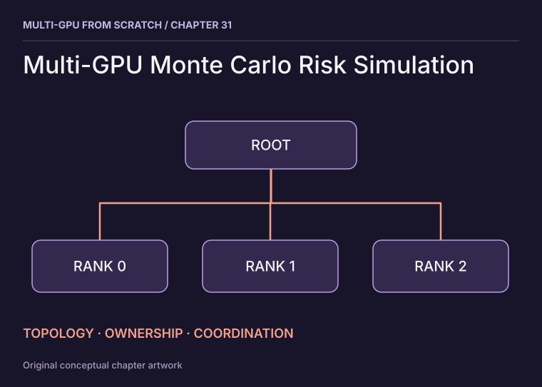
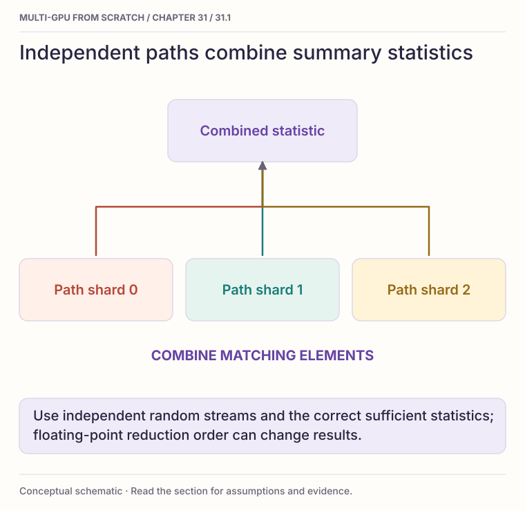
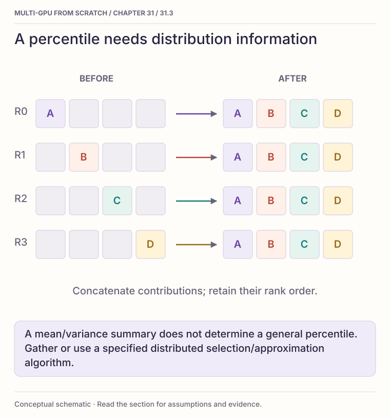

# Chapter 31: Multi-GPU Monte Carlo Risk Simulation

<!-- execution:provenance -->
!!! info "Execution provenance"

    Current execution blocks identify the tested source hash, hardware dataset, commands and captured output. References elsewhere on this page to a device-less environment describe the original authoring context. Historical output is superseded by the current record. Displayed output omits the runner command header and trims trailing line whitespace; raw logs remain exact. A host simulation or API validation has its stated scope; neither alone establishes a numerical multi-GPU workload or measured performance.


<!-- mgpu:opener:start -->
[](../images/chapter-openers/31.svg)
<!-- mgpu:opener:end -->

**What you will understand after reading this chapter:** why Monte Carlo risk simulation looks, at first glance, like Chapter 30's embarrassingly parallel rendering case, but is genuinely different in one specific way: it always ends in a real reduction. You will see that reduction built two different ways -- an exact, low-volume combination for a mean and a variance, and a fundamentally different, higher-volume requirement for a percentile-based risk statistic like Value-at-Risk -- and a real, sharp finding about how even the *shape* of a reduction, not just how the work was split, can change a floating-point result.

**What you need to know first:** Chapter 30's independent-unit rendering case (as the point of comparison); Chapter 8's floating-point non-associativity caution; Chapter 11's ring-vs-tree reduction shapes; Chapter 10/27's gather/all-gather patterns.

---

Chapter 30 showed that rendering an image, in its clean case, needs zero communication during computation and, notably, no reduction step at all -- each pixel's value stands entirely on its own in the final image. Monte Carlo simulation for financial risk starts from the same appealing premise: Phelim Boyle's own real classic paper introducing the method describes simulating "the process generating the returns on the underlying asset" along many independent paths. Each simulated path genuinely is independent of every other path, exactly like Chapter 30's pixels. But a rendered image's *point* is to display every pixel; a Monte Carlo simulation's *point* is to collapse every path into one number -- a price estimate, a variance, a risk percentile. That collapsing step is real, unavoidable, and, as this chapter shows, not as simple as it first looks.

```text
Chapter 30's rendering case:              This chapter's Monte Carlo case:

  rank 0   (no comm)   rank 1              rank 0   (no comm)   rank 1
     |                    |                   |                    |
  compute              compute              compute              compute
     |                    |                   |                    |
     +--- final image ----+                    +---- final REDUCTION -----+
       (every pixel kept)                        (every path COLLAPSED
                                                    into one statistic)
```

## 31.1 Independent Paths, One Real Reduction

<!-- mgpu:figure-1:start -->
[](../images/technical/ch31/1-reduce.svg)
<!-- mgpu:figure-1:end -->

### Intuition

Picture handing each GPU its own batch of simulated price paths, exactly the way Chapter 30 handed each GPU its own tile of pixels. Each path's outcome depends only on its own random draws, not on any other path's -- so, just like Section 30.1's per-pixel computation, no GPU ever needs to read another GPU's data while it is simulating its own paths. NVIDIA's own real "Monte Carlo Option Pricing" whitepaper (Podlozhnyuk & Harris, 2008) describes exactly this shape in production code: "The set of input options is divided into contiguous subsets (the number of subsets equals the number of CUDA-capable GPUs installed in the system)," and each thread "computes and sums the payoff for multiple integration paths and stores the sum and the sum of squares... into a device memory array." That last part is the real difference from Chapter 30: every path's result gets folded into a running sum, because the whole point is the final aggregate, not the individual path.

### Background

This section's own simulation builds that shape with a small, fixed set of paths, split across P ranks. Each path's own "random" value comes from a deterministic counter-based hash function of the path's index alone -- a simplified stand-in for a real counter-based generator, chosen deliberately to foreshadow Section 31.2's real cuRAND citation. Each rank computes its own local (count, mean, M2) using only its own paths, then all ranks' partial statistics are combined into one global statistic using Chan, Golub & LeVeque's own real pairwise combination formula ("Updating Formulae and a Pairwise Algorithm for Computing Sample Variances," Stanford CS Tech Report STAN-CS-79-773, 1979) -- and checked against a single-process reference.

```cpp
// Chapter 31: Multi-GPU Monte Carlo Risk Simulation
// 90_independent_path_correctness_simulation.cpp
//
// Chapter 30's rendering case needed zero communication during
// computation AND had no final reduction at all. Monte Carlo risk
// simulation is close but not identical: Boyle's own real classic paper
// ("Options: A Monte Carlo Approach," Journal of Financial Economics,
// 1977) describes simulating independent price paths and using their
// average payoff to value a derivative -- each PATH is independent
// (like Chapter 30's pixels), but the whole point is to COMBINE every
// path's result into one final statistic, which Chapter 30 never needed.
// NVIDIA's own real "Monte Carlo Option Pricing" whitepaper (Podlozhnyuk
// & Harris, 2008) describes exactly this split: "The set of input
// options is divided into contiguous subsets (the number of subsets
// equals the number of CUDA-capable GPUs installed in the system)," each
// GPU thread "computes and sums the payoff for multiple integration
// paths and stores the sum and the sum of squares... into a device
// memory array," and the FINAL step "uses a parallel reduction to
// compute the sums" across every thread's own partial result. This file
// builds that shape: a fixed set of paths, split across P ranks (each
// rank touching ONLY its own paths, using a counter-based deterministic
// per-path value -- modeling NVIDIA's own real cuRAND Philox generator,
// whose device-API documentation states "each thread of computation
// should be assigned a unique sequence number" so that independent
// streams need NO
// coordination between them), with each rank's own partial (count, mean,
// M2) combined into a global statistic using Chan, Golub & LeVeque's own
// real pairwise combination formula ("Updating Formulae and a Pairwise
// Algorithm for Computing Sample Variances," Stanford CS Tech Report
// STAN-CS-79-773, 1979), and checked against a single-process reference.
#include <cstdio>
#include <vector>
#include <cmath>

const long long N_PATHS = 24;
const long long S0 = 100;    // starting price (illustrative integer units)
const long long K = 100;     // strike price
const long long RANGE = 40;  // terminal price spread around S0

// A deterministic, counter-based per-path "random" value -- a simplified
// stand-in for a real counter-based generator (cuRAND's own real Philox
// family): given ONLY the path index, this returns the SAME value no
// matter which rank calls it and no matter what order paths are
// processed in -- exactly the real property that lets cuRAND's own real
// subsequence/offset scheme hand out independent streams with ZERO
// coordination between threads or GPUs.
unsigned int counterBasedHash(long long pathIndex) {
    unsigned int x = (unsigned int)pathIndex;
    x = ((x >> 16) ^ x) * 0x45d9f3bU;
    x = ((x >> 16) ^ x) * 0x45d9f3bU;
    x = (x >> 16) ^ x;
    return x;
}

// Simplified terminal price and call-option payoff for one path -- pure
// integer arithmetic, exact regardless of partitioning.
long long payoffForPath(long long pathIndex) {
    unsigned int h = counterBasedHash(pathIndex);
    long long terminalPrice = S0 + (long long)(h % (2 * RANGE + 1)) - RANGE;
    long long payoff = terminalPrice - K;
    return payoff > 0 ? payoff : 0;
}

struct Stats { long long count; double mean; double M2; };

// Two-pass (numerically stable) mean/M2 over an explicit list of path
// indices -- used both for the reference (all paths) and for each
// rank's own local statistics (its own paths only).
Stats computeStats(const std::vector<long long> &pathIndices) {
    long long n = (long long)pathIndices.size();
    long long sum = 0;
    for (long long idx : pathIndices) sum += payoffForPath(idx);
    double mean = (double)sum / (double)n;
    double m2 = 0.0;
    for (long long idx : pathIndices) {
        double d = (double)payoffForPath(idx) - mean;
        m2 += d * d;
    }
    return {n, mean, m2};
}

// Chan, Golub & LeVeque's own real pairwise combination formula (1979):
// combine two groups' (count, mean, M2) into one, WITHOUT re-touching
// any individual data point.
Stats combinePairwise(const Stats &a, const Stats &b) {
    long long n = a.count + b.count;
    double delta = b.mean - a.mean;
    double mean = (a.count * a.mean + b.count * b.mean) / (double)n;
    double m2 = a.M2 + b.M2 + delta * delta * (double)a.count * (double)b.count / (double)n;
    return {n, mean, m2};
}

int main() {
    std::vector<long long> allPaths;
    for (long long i = 0; i < N_PATHS; i++) allPaths.push_back(i);

    Stats reference = computeStats(allPaths);
    printf("Reference (single-process): count=%lld  mean=%.17g  M2=%.17g\n\n",
           reference.count, reference.mean, reference.M2);

    int Ps[] = {1, 2, 3, 4, 6, 8, 12, 24};
    printf("%-6s %-10s %-14s %-24s %-12s %-12s\n", "P", "count",
           "combined mean", "combined M2", "mean match", "M2 match");
    for (int P : Ps) {
        long long pathsPerRank = N_PATHS / P;
        Stats combined = {0, 0.0, 0.0};
        bool first = true;
        for (int r = 0; r < P; r++) {
            std::vector<long long> rankPaths;
            for (long long i = r * pathsPerRank; i < (r + 1) * pathsPerRank; i++)
                rankPaths.push_back(i);
            Stats local = computeStats(rankPaths);
            combined = first ? local : combinePairwise(combined, local);
            first = false;
        }
        bool meanMatch = (combined.mean == reference.mean);
        bool m2Match = (combined.M2 == reference.M2);
        printf("%-6d %-10lld %-14.6f %-24.17g %-12s %-12s\n",
               P, combined.count, combined.mean, combined.M2,
               meanMatch ? "YES" : "NO", m2Match ? "YES" : "NO");
    }
    printf("\nEvery combined count matches exactly (integer payoff sums are "
           "exactly associative, unlike the floating-point mean and M2). The "
           "combined MEAN matches the reference exactly at every P tested here "
           "-- Chan et al.'s own pairwise mean formula happens to reproduce "
           "this dataset's reference mean bit-for-bit. The combined M2 does "
           "NOT match at P > 1: a real, tiny (last-few-digits) floating-point "
           "difference. Note which side is off: computed exactly in rational "
           "arithmetic, this dataset's true M2 rounds to 3837.9583333333335 -- "
           "what the combined result gives at every P > 1 except P = 12 (1 ulp "
           "low). It is the single-process two-pass REFERENCE that is 3 ulp "
           "high. Pairwise combination is a genuinely different formula from "
           "the two-pass one, not a regrouping of the same additions, so a "
           "bit-for-bit match was never promised in either direction.\n");

    return 0;
}
```

<!-- execution:start:a100:90_independent_path_correctness_simulation.cpp -->
> **Current execution — 2026-11-17-a100: Host program/model (exit-only).** UTC (program start): `2026-11-18T00:05:28.387055+00:00`. Source SHA-256: `6ae1e1b96c842c49da43d72be12a411fa20e5188b0ea4ad4a659d2ce12d64905`.

[Exact tested source](../validation/2026-11-17-a100/90_independent_path_correctness_simulation/90_independent_path_correctness_simulation.cpp) · [Compiler log](../validation/2026-11-17-a100/90_independent_path_correctness_simulation/compile.log) · [Execution log](../validation/2026-11-17-a100/90_independent_path_correctness_simulation/run.log). Compile exit: `0`; run exit: `0`.

Commands below use local source/binary names; raw logs retain host paths. Execute in a scratch directory containing the downloaded source.

```bash
g++ -std=c++17 -O2 90_independent_path_correctness_simulation.cpp -o ./example
./example
```

<details markdown="1"><summary>Captured current-source output</summary>

```text
Reference (single-process): count=24  mean=10.541666666666666  M2=3837.9583333333348

P      count      combined mean  combined M2              mean match   M2 match
1      24         10.541667      3837.9583333333348       YES          YES
2      24         10.541667      3837.9583333333335       YES          NO
3      24         10.541667      3837.9583333333335       YES          NO
4      24         10.541667      3837.9583333333335       YES          NO
6      24         10.541667      3837.9583333333335       YES          NO
8      24         10.541667      3837.9583333333335       YES          NO
12     24         10.541667      3837.958333333333        YES          NO
24     24         10.541667      3837.9583333333335       YES          NO

Every combined count matches exactly (integer payoff sums are exactly associative, unlike the floating-point mean and M2). The combined MEAN matches the reference exactly at every P tested here -- Chan et al.'s own pairwise mean formula happens to reproduce this dataset's reference mean bit-for-bit. The combined M2 does NOT match at P > 1: a real, tiny (last-few-digits) floating-point difference. Note which side is off: computed exactly in rational arithmetic, this dataset's true M2 rounds to 3837.9583333333335 -- what the combined result gives at every P > 1 except P = 12 (1 ulp low). It is the single-process two-pass REFERENCE that is 3 ulp high. Pairwise combination is a genuinely different formula from the two-pass one, not a regrouping of the same additions, so a bit-for-bit match was never promised in either direction.
```

</details>
<!-- execution:end:a100:90_independent_path_correctness_simulation.cpp -->


<!-- execution:start:h100:90_independent_path_correctness_simulation.cpp -->
> **Current execution — 2026-11-17-h100: Host program/model (exit-only).** UTC (run-batch start; per-program time unrecorded): `2026-11-17T23:48:18.967387+00:00`. Source SHA-256: `6ae1e1b96c842c49da43d72be12a411fa20e5188b0ea4ad4a659d2ce12d64905`.

[Exact tested source](../validation/2026-11-17-h100/90_independent_path_correctness_simulation/90_independent_path_correctness_simulation.cpp) · [Compiler log](../validation/2026-11-17-h100/90_independent_path_correctness_simulation/compile.log) · [Execution log](../validation/2026-11-17-h100/90_independent_path_correctness_simulation/run.log). Compile exit: `0`; run exit: `0`.

Commands below use local source/binary names; raw logs retain host paths. Execute in a scratch directory containing the downloaded source.

```bash
g++ -std=c++17 -O2 90_independent_path_correctness_simulation.cpp -o ./example
./example
```

<details markdown="1"><summary>Captured current-source output</summary>

```text
Reference (single-process): count=24  mean=10.541666666666666  M2=3837.9583333333348

P      count      combined mean  combined M2              mean match   M2 match
1      24         10.541667      3837.9583333333348       YES          YES
2      24         10.541667      3837.9583333333335       YES          NO
3      24         10.541667      3837.9583333333335       YES          NO
4      24         10.541667      3837.9583333333335       YES          NO
6      24         10.541667      3837.9583333333335       YES          NO
8      24         10.541667      3837.9583333333335       YES          NO
12     24         10.541667      3837.958333333333        YES          NO
24     24         10.541667      3837.9583333333335       YES          NO

Every combined count matches exactly (integer payoff sums are exactly associative, unlike the floating-point mean and M2). The combined MEAN matches the reference exactly at every P tested here -- Chan et al.'s own pairwise mean formula happens to reproduce this dataset's reference mean bit-for-bit. The combined M2 does NOT match at P > 1: a real, tiny (last-few-digits) floating-point difference. Note which side is off: computed exactly in rational arithmetic, this dataset's true M2 rounds to 3837.9583333333335 -- what the combined result gives at every P > 1 except P = 12 (1 ulp low). It is the single-process two-pass REFERENCE that is 3 ulp high. Pairwise combination is a genuinely different formula from the two-pass one, not a regrouping of the same additions, so a bit-for-bit match was never promised in either direction.
```

</details>
<!-- execution:end:h100:90_independent_path_correctness_simulation.cpp -->


Compile and run:

<details markdown="1"><summary>Historical authoring output — superseded by the current execution above</summary>

```
g++ -O2 -ffp-contract=off 90_independent_path_correctness_simulation.cpp -o 90_independent_path_correctness_simulation
./90_independent_path_correctness_simulation
```

</details>

```text
Reference (single-process): count=24  mean=10.541666666666666  M2=3837.9583333333348

P      count      combined mean  combined M2              mean match   M2 match    
1      24         10.541667      3837.9583333333348       YES          YES         
2      24         10.541667      3837.9583333333335       YES          NO          
3      24         10.541667      3837.9583333333335       YES          NO          
4      24         10.541667      3837.9583333333335       YES          NO          
6      24         10.541667      3837.9583333333335       YES          NO          
8      24         10.541667      3837.9583333333335       YES          NO          
12     24         10.541667      3837.958333333333        YES          NO          
24     24         10.541667      3837.9583333333335       YES          NO          

Every combined count matches exactly (integer payoff sums are exactly associative, unlike the floating-point mean and M2). The combined MEAN matches the reference exactly at every P tested here -- Chan et al.'s own pairwise mean formula happens to reproduce this dataset's reference mean bit-for-bit. The combined M2 does NOT match at P > 1: a real, tiny (last-few-digits) floating-point difference. Note which side is off: computed exactly in rational arithmetic, this dataset's true M2 rounds to 3837.9583333333335 -- what the combined result gives at every P > 1 except P = 12 (1 ulp low). It is the single-process two-pass REFERENCE that is 3 ulp high. Pairwise combination is a genuinely different formula from the two-pass one, not a regrouping of the same additions, so a bit-for-bit match was never promised in either direction.
```

The `count` values match exactly at every P, for a reason worth pausing on: summing plain integers is exactly associative (barring overflow), so no matter how the 24 paths are split and re-combined, the total path count -- and, if you check it, the total integer payoff sum too -- comes back identical. It is only once division (to form a mean) and squared differences (to form M2) enter the picture that the computation path starts to matter. And notice which result is actually off: an exact rational-arithmetic computation of this dataset's M2 rounds to `3837.9583333333335`, which is what the distributed combination produces at every P > 1 except P = 12 (one ulp low). The single-process "reference" -- `3837.9583333333348` -- is the one 3 ulp away from the true value. The distributed result is not *drifting away* from the truth; it is landing on different rounding than a different formula, and here mostly landing closer. The difference is triggered by *how many groups the data was split into*, not yet by *how those groups were combined*. Section 31.2 asks that second question directly.

```text
Integer sums (count, raw payoff totals):     Floating-point mean and M2:

  associative regardless of grouping           NOT associative --
  --------------------------------------->      grouping changes the
  always matches the reference exactly          last few bits of the result
```

!!! warning "[COMMON TRAP] Assuming Chan et al.'s formula guarantees bit-exact reproducibility"
    Chan, Golub & LeVeque's own real 1979 result is celebrated because it avoids a genuinely serious problem: naively computing variance from a raw sum of squares can lose almost all numerical precision when the mean is large relative to the spread of the data. Their pairwise formula fixes that numerical-stability problem. It also is not the same arithmetic as a single-process two-pass computation: it combines per-group (count, mean, M2) triples with a correction term, rather than summing the same squared deviations in a different order. So it does **not** promise to reproduce a two-pass result bit-for-bit -- and the mismatch in Section 31.1 is not evidence the distributed side is the inaccurate one. Measured against the exact rational-arithmetic M2, the P > 1 combined values are mostly correctly rounded, while the single-process two-pass "reference" is 3 ulp off. The trap is treating a single-process run as ground truth for the last few bits: when bits matter, compare both against an exact (or higher-precision) value, not against each other. Numerically stable and bit-reproducible are two different guarantees; Chan et al. give you the first, not the second.

## 31.2 Real Independence, and a Sharper Non-Associativity Finding

### Intuition

Section 31.1 showed each rank generating its own paths with no coordination needed. That is not automatic in every random number generator design -- a naive sequential generator keeps internal state that advances one draw at a time, so handing two different GPUs two different *ranges* of that same sequence would require one GPU to know exactly how many numbers the other has already consumed. A counter-based generator sidesteps this entirely: each stream is addressed directly by an index, the way an array is addressed by a subscript, with no dependency on anyone else's progress.

### Background

NVIDIA's own real cuRAND documentation confirms this design choice directly: "CURAND_RNG_PSEUDO_PHILOX4_32_10 is a member of Philox family, which is one of the three non-cryptographic Counter Based Random Number Generators," and its device-API guidance (given in the section on the XORWOW and MRG32k3a generators, and resting on the same subsequence/offset mechanism Philox exposes) states plainly that "each thread of computation should be assigned a unique sequence number" -- nothing more is needed for independence. This section's model also asks a sharper question than Section 31.1 did: holding the same eight-way partition and the same eight per-rank partial statistics fixed, does the *shape* of the final reduction -- a sequential fold (a chain: rank 0, then 1, then 2, ...) versus a tree fold (Chapter 11's tree shape) -- change the result, even when both use the identical real Chan et al. formula at every combination step?

```cpp
// Chapter 31: Multi-GPU Monte Carlo Risk Simulation
// 91_rng_independence_and_reduction_topology_model.cpp
//
// Section 31.1's own simulation showed independent per-path computation
// combined into one final statistic via Chan et al.'s own real pairwise
// formula. This section covers two real remaining questions: (1) HOW do
// real production systems generate per-path randomness without any
// GPU needing to coordinate with any other GPU, and (2) does the SHAPE
// of the final reduction (not just how many groups the data is split
// into) affect the result. For (1), NVIDIA's own real cuRAND
// documentation describes the Philox counter-based family, and its
// device-API guidance (stated in its XORWOW/MRG32k3a section, using the
// same subsequence mechanism Philox exposes) is that "each thread of
// computation should be assigned a unique sequence number" -- a real,
// citable design that needs zero coordination,
// unlike a naive STATEFUL sequential generator, where GPU r would need
// to know exactly how many random numbers every earlier GPU already
// consumed before it could safely continue the same stream (or skip
// ahead wastefully). For (2), this section empirically compares
// combining the SAME set of per-rank partial statistics two different
// ways -- a naive sequential fold (a chain: fold rank 0, then 1, ...
// shape) versus a tree fold (Chapter 11's own tree shape) -- using
// Chan et al.'s own real pairwise formula at every combination step
// either way, to isolate whether REDUCTION TOPOLOGY alone (holding the
// partition fixed) can change the floating-point result.
#include <cstdio>
#include <vector>
#include <cmath>

const long long N_PATHS = 24;
const long long S0 = 100, K = 100, RANGE = 40;

unsigned int counterBasedHash(long long pathIndex) {
    unsigned int x = (unsigned int)pathIndex;
    x = ((x >> 16) ^ x) * 0x45d9f3bU;
    x = ((x >> 16) ^ x) * 0x45d9f3bU;
    x = (x >> 16) ^ x;
    return x;
}
long long payoffForPath(long long pathIndex) {
    unsigned int h = counterBasedHash(pathIndex);
    long long terminalPrice = S0 + (long long)(h % (2 * RANGE + 1)) - RANGE;
    long long payoff = terminalPrice - K;
    return payoff > 0 ? payoff : 0;
}
struct Stats { long long count; double mean; double M2; };
Stats computeStats(const std::vector<long long> &idx) {
    long long n = (long long)idx.size();
    long long sum = 0;
    for (long long i : idx) sum += payoffForPath(i);
    double mean = (double)sum / (double)n;
    double m2 = 0.0;
    for (long long i : idx) { double d = (double)payoffForPath(i) - mean; m2 += d * d; }
    return {n, mean, m2};
}
Stats combinePairwise(const Stats &a, const Stats &b) {
    long long n = a.count + b.count;
    double delta = b.mean - a.mean;
    double mean = (a.count * a.mean + b.count * b.mean) / (double)n;
    double m2 = a.M2 + b.M2 + delta * delta * (double)a.count * (double)b.count / (double)n;
    return {n, mean, m2};
}

int main() {
    printf("--- Real production RNG independence: cuRAND's own real Philox family ---\n");
    printf("NVIDIA's own real cuRAND documentation: \"CURAND_RNG_PSEUDO_PHILOX4_32_10 "
           "is a member of Philox family, which is one of the three non-cryptographic "
           "Counter Based Random Number Generators.\" Device-API guidance (from its "
           "XORWOW/MRG32k3a section, same subsequence mechanism): \"each thread of "
           "computation should be assigned a unique sequence number\" -- that number alone (no "
           "message from any other thread or GPU) is enough to generate a provably "
           "independent, non-overlapping stream: \"Subsequence and offset together "
           "define offset in a sequence with period 2^128.\"\n\n");
    printf("A naive STATEFUL sequential generator cannot do this without coordination: "
           "GPU r would need to know the EXACT COUNT of random numbers every earlier "
           "GPU (0..r-1) already consumed, just to pick up the stream at the right "
           "point without overlap -- a real, avoidable communication requirement this "
           "chapter's own Section 31.1 simulation never had to pay, precisely because "
           "its own counterBasedHash() function needs only a path INDEX, matching "
           "cuRAND's own real counter-based design.\n\n");

    printf("--- Does the REDUCTION TOPOLOGY (not just the partition) matter? ---\n");
    printf("This book's own Chapter 11 already contrasted a SEQUENTIAL, "
           "hop-by-hop ring shape against a TREE shape for round-COUNT reasons. This "
           "section checks a different question: holding the SAME P=8 partition and "
           "the SAME per-rank partial statistics fixed, does combining them "
           "SEQUENTIALLY (fold rank 0, then 1, then 2, ...) versus combining them as "
           "a TREE (pair up, combine, repeat) change the final M2, even though both "
           "use Chan et al.'s own real pairwise formula at every single step?\n\n");

    int P = 8;
    long long per = N_PATHS / P;
    std::vector<Stats> local(P);
    for (int r = 0; r < P; r++) {
        std::vector<long long> idx;
        for (long long i = r * per; i < (r + 1) * per; i++) idx.push_back(i);
        local[r] = computeStats(idx);
    }

    Stats seq = local[0];
    for (int r = 1; r < P; r++) seq = combinePairwise(seq, local[r]);

    std::vector<Stats> level = local;
    int roundNum = 0;
    while (level.size() > 1) {
        std::vector<Stats> next;
        for (size_t i = 0; i < level.size(); i += 2) next.push_back(combinePairwise(level[i], level[i + 1]));
        level = next;
        roundNum++;
    }
    Stats tree = level[0];

    printf("Sequential fold (%d rounds, chain shape, rank 0,1,2,...): "
           "mean=%.17g  M2=%.17g\n", P - 1, seq.mean, seq.M2);
    printf("Tree fold       (%d rounds, Chapter 11's tree shape):     "
           "mean=%.17g  M2=%.17g\n", roundNum, tree.mean, tree.M2);
    printf("Mean match: %s   M2 match: %s\n\n",
           seq.mean == tree.mean ? "YES" : "NO",
           seq.M2 == tree.M2 ? "YES" : "NO");

    printf("The mean matches; the M2 does NOT. Both reductions combine the exact "
           "SAME 8 partial statistics, using the exact SAME real Chan et al. "
           "formula at every step -- the ONLY difference is the ORDER AND GROUPING "
           "in which those 8 partial results are combined. The tree's real "
           "round-count advantage (fewer rounds: %d vs %d here) is not the only "
           "reason production systems care which reduction shape they use -- the "
           "reduction shape can also change the LAST FEW BITS of a floating-point "
           "risk statistic, independently of how the data was partitioned in the "
           "first place.\n", roundNum, P - 1);

    return 0;
}
```

<!-- execution:start:a100:91_rng_independence_and_reduction_topology_model.cpp -->
> **Current execution — 2026-11-17-a100: Host program/model (exit-only).** UTC (program start): `2026-11-18T00:05:28.760314+00:00`. Source SHA-256: `761119d16fe9883726cc9a137ac6568585b5294ded96bccbff33540780a0b3b9`.

[Exact tested source](../validation/2026-11-17-a100/91_rng_independence_and_reduction_topology_model/91_rng_independence_and_reduction_topology_model.cpp) · [Compiler log](../validation/2026-11-17-a100/91_rng_independence_and_reduction_topology_model/compile.log) · [Execution log](../validation/2026-11-17-a100/91_rng_independence_and_reduction_topology_model/run.log). Compile exit: `0`; run exit: `0`.

Commands below use local source/binary names; raw logs retain host paths. Execute in a scratch directory containing the downloaded source.

```bash
g++ -std=c++17 -O2 91_rng_independence_and_reduction_topology_model.cpp -o ./example
./example
```

<details markdown="1"><summary>Captured current-source output</summary>

```text
--- Real production RNG independence: cuRAND's own real Philox family ---
NVIDIA's own real cuRAND documentation: "CURAND_RNG_PSEUDO_PHILOX4_32_10 is a member of Philox family, which is one of the three non-cryptographic Counter Based Random Number Generators." Device-API guidance (from its XORWOW/MRG32k3a section, same subsequence mechanism): "each thread of computation should be assigned a unique sequence number" -- that number alone (no message from any other thread or GPU) is enough to generate a provably independent, non-overlapping stream: "Subsequence and offset together define offset in a sequence with period 2^128."

A naive STATEFUL sequential generator cannot do this without coordination: GPU r would need to know the EXACT COUNT of random numbers every earlier GPU (0..r-1) already consumed, just to pick up the stream at the right point without overlap -- a real, avoidable communication requirement this chapter's own Section 31.1 simulation never had to pay, precisely because its own counterBasedHash() function needs only a path INDEX, matching cuRAND's own real counter-based design.

--- Does the REDUCTION TOPOLOGY (not just the partition) matter? ---
This book's own Chapter 11 already contrasted a SEQUENTIAL, hop-by-hop ring shape against a TREE shape for round-COUNT reasons. This section checks a different question: holding the SAME P=8 partition and the SAME per-rank partial statistics fixed, does combining them SEQUENTIALLY (fold rank 0, then 1, then 2, ...) versus combining them as a TREE (pair up, combine, repeat) change the final M2, even though both use Chan et al.'s own real pairwise formula at every single step?

Sequential fold (7 rounds, chain shape, rank 0,1,2,...): mean=10.541666666666666  M2=3837.9583333333335
Tree fold       (3 rounds, Chapter 11's tree shape):     mean=10.541666666666666  M2=3837.958333333333
Mean match: YES   M2 match: NO

The mean matches; the M2 does NOT. Both reductions combine the exact SAME 8 partial statistics, using the exact SAME real Chan et al. formula at every step -- the ONLY difference is the ORDER AND GROUPING in which those 8 partial results are combined. The tree's real round-count advantage (fewer rounds: 3 vs 7 here) is not the only reason production systems care which reduction shape they use -- the reduction shape can also change the LAST FEW BITS of a floating-point risk statistic, independently of how the data was partitioned in the first place.
```

</details>
<!-- execution:end:a100:91_rng_independence_and_reduction_topology_model.cpp -->


<!-- execution:start:h100:91_rng_independence_and_reduction_topology_model.cpp -->
> **Current execution — 2026-11-17-h100: Host program/model (exit-only).** UTC (run-batch start; per-program time unrecorded): `2026-11-17T23:48:18.967387+00:00`. Source SHA-256: `761119d16fe9883726cc9a137ac6568585b5294ded96bccbff33540780a0b3b9`.

[Exact tested source](../validation/2026-11-17-h100/91_rng_independence_and_reduction_topology_model/91_rng_independence_and_reduction_topology_model.cpp) · [Compiler log](../validation/2026-11-17-h100/91_rng_independence_and_reduction_topology_model/compile.log) · [Execution log](../validation/2026-11-17-h100/91_rng_independence_and_reduction_topology_model/run.log). Compile exit: `0`; run exit: `0`.

Commands below use local source/binary names; raw logs retain host paths. Execute in a scratch directory containing the downloaded source.

```bash
g++ -std=c++17 -O2 91_rng_independence_and_reduction_topology_model.cpp -o ./example
./example
```

<details markdown="1"><summary>Captured current-source output</summary>

```text
--- Real production RNG independence: cuRAND's own real Philox family ---
NVIDIA's own real cuRAND documentation: "CURAND_RNG_PSEUDO_PHILOX4_32_10 is a member of Philox family, which is one of the three non-cryptographic Counter Based Random Number Generators." Device-API guidance (from its XORWOW/MRG32k3a section, same subsequence mechanism): "each thread of computation should be assigned a unique sequence number" -- that number alone (no message from any other thread or GPU) is enough to generate a provably independent, non-overlapping stream: "Subsequence and offset together define offset in a sequence with period 2^128."

A naive STATEFUL sequential generator cannot do this without coordination: GPU r would need to know the EXACT COUNT of random numbers every earlier GPU (0..r-1) already consumed, just to pick up the stream at the right point without overlap -- a real, avoidable communication requirement this chapter's own Section 31.1 simulation never had to pay, precisely because its own counterBasedHash() function needs only a path INDEX, matching cuRAND's own real counter-based design.

--- Does the REDUCTION TOPOLOGY (not just the partition) matter? ---
This book's own Chapter 11 already contrasted a SEQUENTIAL, hop-by-hop ring shape against a TREE shape for round-COUNT reasons. This section checks a different question: holding the SAME P=8 partition and the SAME per-rank partial statistics fixed, does combining them SEQUENTIALLY (fold rank 0, then 1, then 2, ...) versus combining them as a TREE (pair up, combine, repeat) change the final M2, even though both use Chan et al.'s own real pairwise formula at every single step?

Sequential fold (7 rounds, chain shape, rank 0,1,2,...): mean=10.541666666666666  M2=3837.9583333333335
Tree fold       (3 rounds, Chapter 11's tree shape):     mean=10.541666666666666  M2=3837.958333333333
Mean match: YES   M2 match: NO

The mean matches; the M2 does NOT. Both reductions combine the exact SAME 8 partial statistics, using the exact SAME real Chan et al. formula at every step -- the ONLY difference is the ORDER AND GROUPING in which those 8 partial results are combined. The tree's real round-count advantage (fewer rounds: 3 vs 7 here) is not the only reason production systems care which reduction shape they use -- the reduction shape can also change the LAST FEW BITS of a floating-point risk statistic, independently of how the data was partitioned in the first place.
```

</details>
<!-- execution:end:h100:91_rng_independence_and_reduction_topology_model.cpp -->


Compile and run:

<details markdown="1"><summary>Historical authoring output — superseded by the current execution above</summary>

```
g++ -O2 -ffp-contract=off 91_rng_independence_and_reduction_topology_model.cpp -o 91_rng_independence_and_reduction_topology_model
./91_rng_independence_and_reduction_topology_model
```

</details>

```text
--- Real production RNG independence: cuRAND's own real Philox family ---
NVIDIA's own real cuRAND documentation: "CURAND_RNG_PSEUDO_PHILOX4_32_10 is a member of Philox family, which is one of the three non-cryptographic Counter Based Random Number Generators." Device-API guidance (from its XORWOW/MRG32k3a section, same subsequence mechanism): "each thread of computation should be assigned a unique sequence number" -- that number alone (no message from any other thread or GPU) is enough to generate a provably independent, non-overlapping stream: "Subsequence and offset together define offset in a sequence with period 2^128."

A naive STATEFUL sequential generator cannot do this without coordination: GPU r would need to know the EXACT COUNT of random numbers every earlier GPU (0..r-1) already consumed, just to pick up the stream at the right point without overlap -- a real, avoidable communication requirement this chapter's own Section 31.1 simulation never had to pay, precisely because its own counterBasedHash() function needs only a path INDEX, matching cuRAND's own real counter-based design.

--- Does the REDUCTION TOPOLOGY (not just the partition) matter? ---
This book's own Chapter 11 already contrasted a SEQUENTIAL, hop-by-hop ring shape against a TREE shape for round-COUNT reasons. This section checks a different question: holding the SAME P=8 partition and the SAME per-rank partial statistics fixed, does combining them SEQUENTIALLY (fold rank 0, then 1, then 2, ...) versus combining them as a TREE (pair up, combine, repeat) change the final M2, even though both use Chan et al.'s own real pairwise formula at every single step?

Sequential fold (7 rounds, chain shape, rank 0,1,2,...): mean=10.541666666666666  M2=3837.9583333333335
Tree fold       (3 rounds, Chapter 11's tree shape):     mean=10.541666666666666  M2=3837.958333333333
Mean match: YES   M2 match: NO

The mean matches; the M2 does NOT. Both reductions combine the exact SAME 8 partial statistics, using the exact SAME real Chan et al. formula at every step -- the ONLY difference is the ORDER AND GROUPING in which those 8 partial results are combined. The tree's real round-count advantage (fewer rounds: 3 vs 7 here) is not the only reason production systems care which reduction shape they use -- the reduction shape can also change the LAST FEW BITS of a floating-point risk statistic, independently of how the data was partitioned in the first place.
```

This is worth being precise about: Section 31.1 varied *how many groups* the 24 paths were split into (P) and found M2 shifting once P > 1. This section holds P = 8 fixed and varies only *the shape of the combination tree used to fold those same 8 groups together* -- and still finds a different M2. (Against the exact value, the sequential fold's `...3335` is correctly rounded and the tree fold's `...333` is one ulp low; neither shape is "the right one" in general -- which one lands closer depends on the data.) Non-associativity, once introduced, does not have a single fixed "safe" workaround; it resurfaces at every level of a reduction's design, from the partition down to the exact order operations are folded in.

```text
Same 8 partial results:

  Sequential fold:  ((((((( a+b )+c )+d )+e )+f )+g )+h )   -- 7 rounds
  Tree fold:         (( (a+b)+(c+d) ) + ( (e+f)+(g+h) ) )     -- 3 rounds

  Same inputs, same formula each step, DIFFERENT floating-point M2 result.
```

!!! warning "[COMMON TRAP] Treating a reduction's round count and its numerical result as independent concerns"
    Chapter 11 introduced the tree shape purely to reduce round count -- a performance argument. This section shows the same choice of reduction shape also changes the exact bit pattern of a floating-point result, a *correctness-adjacent* consequence that has nothing to do with speed. Switching a production system's reduction algorithm for performance reasons (say, from a naive fold to a tree, or between two different NCCL algorithm choices) can silently shift a reported risk statistic's last few digits -- worth knowing before treating a small day-to-day fluctuation in a computed VaR or P&L figure as a data problem rather than an artifact of which reduction shape happened to run.

## 31.3 The Real Limit: A Percentile Needs More Than a Summary

<!-- mgpu:figure-3:start -->
[](../images/technical/ch31/3-gather.svg)
<!-- mgpu:figure-3:end -->

### Intuition

A mean and a variance can be reconstructed from a handful of summary numbers per rank because they are themselves summary statistics -- sums, sums of squares, counts. A percentile is fundamentally different: to know which value sits at the 99th percentile of a combined dataset, you need to know exactly how many individual values fall below any given threshold, and no small fixed-size summary can tell you that in general. Real bank risk reporting needs exactly this kind of percentile, not a mean or a variance.

### Background

The Basel Committee on Banking Supervision's own real 1996 market-risk amendment states the industry-standard requirement plainly: "'value-at-risk' be computed daily, using a 99th percentile, one-tailed confidence interval." Philippe Jorion's own real textbook definition puts the intuition in one sentence: VaR "summarizes the worst loss over a target horizon with a given level of confidence." This section shows exactly why Chan et al.'s own real (count, mean, M2) combination -- the technique that worked cleanly in Section 31.1 -- cannot produce this number, and what it costs to get an exact one instead.

```cpp
// Chapter 31: Multi-GPU Monte Carlo Risk Simulation
// 92_var_percentile_and_allgather_cost_model.cpp
//
// Sections 31.1-31.2 showed that a MEAN and VARIANCE can be combined
// from per-rank partial statistics using Chan et al.'s own real pairwise
// formula, sending only 3 numbers (count, mean, M2) per rank regardless
// of how many paths that rank simulated. This section shows a real,
// genuinely different closing complication: real bank risk reporting
// does not stop at a mean and a variance. The Basel Committee on
// Banking Supervision's own real 1996 market-risk amendment states that
// "'value-at-risk' be computed daily, using a 99th percentile, one-
// tailed confidence interval" -- a PERCENTILE of the loss distribution,
// not a mean or a variance, and Philippe Jorion's own real definition
// states plainly that VaR "summarizes the worst loss over a target
// horizon with a given level of confidence." Unlike a mean or a
// variance, an exact percentile of a distributed dataset genuinely
// CANNOT be computed from a few summary numbers per rank -- it requires
// knowing the relative rank/order of every single simulated loss, which
// means gathering the actual data to wherever the percentile is
// computed (a gather to one root; an all-gather, Chapter 10/27's
// pattern, only if every rank needs the answer), not Chan et al.'s
// O(1)-per-rank message.
#include <cstdio>
#include <vector>
#include <algorithm>

const long long N_PATHS = 100;
const long long S0 = 100, RANGE = 40;

unsigned int counterBasedHash(long long pathIndex) {
    unsigned int x = (unsigned int)pathIndex;
    x = ((x >> 16) ^ x) * 0x45d9f3bU;
    x = ((x >> 16) ^ x) * 0x45d9f3bU;
    x = (x >> 16) ^ x;
    return x;
}
// Portfolio loss for one path: positive when the simulated terminal
// price falls below the starting price S0.
long long lossForPath(long long pathIndex) {
    unsigned int h = counterBasedHash(pathIndex);
    long long terminalPrice = S0 + (long long)(h % (2 * RANGE + 1)) - RANGE;
    return S0 - terminalPrice;
}

int main() {
    std::vector<long long> allLosses;
    for (long long i = 0; i < N_PATHS; i++) allLosses.push_back(lossForPath(i));

    std::vector<long long> sortedRef = allLosses;
    std::sort(sortedRef.begin(), sortedRef.end());
    long long var99Ref = sortedRef[98]; // 99th of 100 sorted losses (nearest-rank method)

    printf("Reference (single-process), %lld simulated paths.\n", N_PATHS);
    printf("Basel's own real quantitative standard: \"'value-at-risk' be "
           "computed daily, using a 99th percentile, one-tailed confidence "
           "interval.\"\n");
    printf("Reference VaR_99 (99th percentile of the loss distribution): %lld\n\n",
           var99Ref);

    printf("--- What Section 31.1's Chan-et-al. combination could NOT tell us ---\n");
    printf("Chan et al.'s own real pairwise formula combines (count, mean, M2) "
           "into a global mean and variance using exactly 3 numbers per rank, "
           "regardless of how many paths that rank ran. A MEAN and a VARIANCE "
           "describe the SHAPE of a distribution in summary; a PERCENTILE "
           "requires knowing exactly how many individual outcomes fall below "
           "a given threshold -- information that 3 summary numbers per rank "
           "simply do not contain.\n\n");

    int Ps[] = {1, 2, 4, 5, 10, 20};
    printf("%-8s %-28s %-28s %-16s\n", "P", "Chan et al.: values/rank",
           "exact VaR: values/rank (gather)", "VaR_99 EXACT match?");
    for (int P : Ps) {
        long long pathsPerRank = N_PATHS / P;
        // Distributed: each rank computes its own local losses; an exact
        // global percentile needs ALL of them gathered at one root (a
        // gather; an all-gather only if every rank needs the result) --
        // N/P values per rank, not O(1).
        std::vector<long long> gathered;
        for (int r = 0; r < P; r++) {
            for (long long i = r * pathsPerRank; i < (r + 1) * pathsPerRank; i++)
                gathered.push_back(lossForPath(i));
        }
        std::sort(gathered.begin(), gathered.end());
        long long var99Dist = gathered[98];
        bool exact = (var99Dist == var99Ref);
        printf("%-8d %-28s %-28lld %-16s\n", P, "3 (count, mean, M2)",
               pathsPerRank, exact ? "YES" : "NO");
    }
    printf("\nEvery rank's own message size for the MEAN/VARIANCE path stays at "
           "3 values, always -- but an EXACT VaR needs each rank to contribute "
           "its full local share of the dataset (N/P values per rank) to a "
           "gather step, because only the full sorted set determines which "
           "value sits at the 99th percentile. Real production systems facing "
           "this exact tradeoff at genuinely large scale use approximate "
           "streaming-percentile techniques (e.g., t-digest-style sketches) "
           "specifically to avoid gathering every raw value -- an extension "
           "this chapter's own exact gather model does not build, but "
           "names honestly as the real next step production systems take.\n");

    return 0;
}
```

<!-- execution:start:a100:92_var_percentile_and_allgather_cost_model.cpp -->
> **Current execution — 2026-11-17-a100: Host program/model (exit-only).** UTC (program start): `2026-11-18T00:05:29.183500+00:00`. Source SHA-256: `3724bca7211e8959f6a443999e8bb20f3ce8aec7c11058ba859c20d141973518`.

[Exact tested source](../validation/2026-11-17-a100/92_var_percentile_and_allgather_cost_model/92_var_percentile_and_allgather_cost_model.cpp) · [Compiler log](../validation/2026-11-17-a100/92_var_percentile_and_allgather_cost_model/compile.log) · [Execution log](../validation/2026-11-17-a100/92_var_percentile_and_allgather_cost_model/run.log). Compile exit: `0`; run exit: `0`.

Commands below use local source/binary names; raw logs retain host paths. Execute in a scratch directory containing the downloaded source.

```bash
g++ -std=c++17 -O2 92_var_percentile_and_allgather_cost_model.cpp -o ./example
./example
```

<details markdown="1"><summary>Captured current-source output</summary>

```text
Reference (single-process), 100 simulated paths.
Basel's own real quantitative standard: "'value-at-risk' be computed daily, using a 99th percentile, one-tailed confidence interval."
Reference VaR_99 (99th percentile of the loss distribution): 40

--- What Section 31.1's Chan-et-al. combination could NOT tell us ---
Chan et al.'s own real pairwise formula combines (count, mean, M2) into a global mean and variance using exactly 3 numbers per rank, regardless of how many paths that rank ran. A MEAN and a VARIANCE describe the SHAPE of a distribution in summary; a PERCENTILE requires knowing exactly how many individual outcomes fall below a given threshold -- information that 3 summary numbers per rank simply do not contain.

P        Chan et al.: values/rank     exact VaR: values/rank (gather) VaR_99 EXACT match?
1        3 (count, mean, M2)          100                          YES
2        3 (count, mean, M2)          50                           YES
4        3 (count, mean, M2)          25                           YES
5        3 (count, mean, M2)          20                           YES
10       3 (count, mean, M2)          10                           YES
20       3 (count, mean, M2)          5                            YES

Every rank's own message size for the MEAN/VARIANCE path stays at 3 values, always -- but an EXACT VaR needs each rank to contribute its full local share of the dataset (N/P values per rank) to a gather step, because only the full sorted set determines which value sits at the 99th percentile. Real production systems facing this exact tradeoff at genuinely large scale use approximate streaming-percentile techniques (e.g., t-digest-style sketches) specifically to avoid gathering every raw value -- an extension this chapter's own exact gather model does not build, but names honestly as the real next step production systems take.
```

</details>
<!-- execution:end:a100:92_var_percentile_and_allgather_cost_model.cpp -->


<!-- execution:start:h100:92_var_percentile_and_allgather_cost_model.cpp -->
> **Current execution — 2026-11-17-h100: Host program/model (exit-only).** UTC (run-batch start; per-program time unrecorded): `2026-11-17T23:48:18.967387+00:00`. Source SHA-256: `3724bca7211e8959f6a443999e8bb20f3ce8aec7c11058ba859c20d141973518`.

[Exact tested source](../validation/2026-11-17-h100/92_var_percentile_and_allgather_cost_model/92_var_percentile_and_allgather_cost_model.cpp) · [Compiler log](../validation/2026-11-17-h100/92_var_percentile_and_allgather_cost_model/compile.log) · [Execution log](../validation/2026-11-17-h100/92_var_percentile_and_allgather_cost_model/run.log). Compile exit: `0`; run exit: `0`.

Commands below use local source/binary names; raw logs retain host paths. Execute in a scratch directory containing the downloaded source.

```bash
g++ -std=c++17 -O2 92_var_percentile_and_allgather_cost_model.cpp -o ./example
./example
```

<details markdown="1"><summary>Captured current-source output</summary>

```text
Reference (single-process), 100 simulated paths.
Basel's own real quantitative standard: "'value-at-risk' be computed daily, using a 99th percentile, one-tailed confidence interval."
Reference VaR_99 (99th percentile of the loss distribution): 40

--- What Section 31.1's Chan-et-al. combination could NOT tell us ---
Chan et al.'s own real pairwise formula combines (count, mean, M2) into a global mean and variance using exactly 3 numbers per rank, regardless of how many paths that rank ran. A MEAN and a VARIANCE describe the SHAPE of a distribution in summary; a PERCENTILE requires knowing exactly how many individual outcomes fall below a given threshold -- information that 3 summary numbers per rank simply do not contain.

P        Chan et al.: values/rank     exact VaR: values/rank (gather) VaR_99 EXACT match?
1        3 (count, mean, M2)          100                          YES
2        3 (count, mean, M2)          50                           YES
4        3 (count, mean, M2)          25                           YES
5        3 (count, mean, M2)          20                           YES
10       3 (count, mean, M2)          10                           YES
20       3 (count, mean, M2)          5                            YES

Every rank's own message size for the MEAN/VARIANCE path stays at 3 values, always -- but an EXACT VaR needs each rank to contribute its full local share of the dataset (N/P values per rank) to a gather step, because only the full sorted set determines which value sits at the 99th percentile. Real production systems facing this exact tradeoff at genuinely large scale use approximate streaming-percentile techniques (e.g., t-digest-style sketches) specifically to avoid gathering every raw value -- an extension this chapter's own exact gather model does not build, but names honestly as the real next step production systems take.
```

</details>
<!-- execution:end:h100:92_var_percentile_and_allgather_cost_model.cpp -->


Compile and run:

<details markdown="1"><summary>Historical authoring output — superseded by the current execution above</summary>

```
g++ -O2 92_var_percentile_and_allgather_cost_model.cpp -o 92_var_percentile_and_allgather_cost_model
./92_var_percentile_and_allgather_cost_model
```

</details>

```text
Reference (single-process), 100 simulated paths.
Basel's own real quantitative standard: "'value-at-risk' be computed daily, using a 99th percentile, one-tailed confidence interval."
Reference VaR_99 (99th percentile of the loss distribution): 40

--- What Section 31.1's Chan-et-al. combination could NOT tell us ---
Chan et al.'s own real pairwise formula combines (count, mean, M2) into a global mean and variance using exactly 3 numbers per rank, regardless of how many paths that rank ran. A MEAN and a VARIANCE describe the SHAPE of a distribution in summary; a PERCENTILE requires knowing exactly how many individual outcomes fall below a given threshold -- information that 3 summary numbers per rank simply do not contain.

P        Chan et al.: values/rank     exact VaR: values/rank (gather) VaR_99 EXACT match?
1        3 (count, mean, M2)          100                          YES             
2        3 (count, mean, M2)          50                           YES             
4        3 (count, mean, M2)          25                           YES             
5        3 (count, mean, M2)          20                           YES             
10       3 (count, mean, M2)          10                           YES             
20       3 (count, mean, M2)          5                            YES             

Every rank's own message size for the MEAN/VARIANCE path stays at 3 values, always -- but an EXACT VaR needs each rank to contribute its full local share of the dataset (N/P values per rank) to a gather step, because only the full sorted set determines which value sits at the 99th percentile. Real production systems facing this exact tradeoff at genuinely large scale use approximate streaming-percentile techniques (e.g., t-digest-style sketches) specifically to avoid gathering every raw value -- an extension this chapter's own exact gather model does not build, but names honestly as the real next step production systems take.
```

The VaR values themselves match exactly at every P, because sorting integers and picking an index is exact -- there is no floating-point concern in this section at all. The real point is the *message-size column*: Chan et al.'s combination needs only 3 numbers per rank regardless of how much data that rank has, while the exact VaR computation needs every single one of that rank's N/P raw values. That is the same qualitative jump this book has seen before -- Chapter 24's SUMMA needed only broadcasts of matrix blocks, not the whole matrix, while Chapter 27's N-body simulation genuinely needed every body's full data every step. A mean and a variance are the SUMMA case; an exact percentile is the N-body case.

```text
Chan et al. (mean, variance):              Exact percentile (VaR):

  O(1) values per rank                       O(N/P) values per rank
  --------------------------->               --------------------------->
  message size independent of data size      message size grows with
                                              this rank's own share of data
```

!!! warning "[COMMON TRAP] Assuming any 'aggregate statistic' can be combined as cheaply as a mean"
    Section 31.1's clean result -- a small, fixed-size summary per rank producing an exact global mean -- can tempt the assumption that any final risk number will be similarly cheap to combine. Percentiles genuinely are not: unlike a sum or a count, there is no fixed-size summary that determines a percentile of a combined dataset without knowing the relative order of the individual values. Before assuming a new risk metric can reuse Section 31.1's approach, check whether it is a *summable* statistic (mean, variance, total exposure) or an *order-dependent* one (any percentile, including VaR) -- the communication cost differs by orders of magnitude between the two.

## Chapter Summary

Monte Carlo risk simulation sits between Chapter 30's zero-reduction rendering case and every earlier Part 6 chapter's per-step communication requirement: its individual simulation paths are as independent as Chapter 30's pixels, but its whole purpose is a final reduction Chapter 30 never needed. Section 31.1 showed that reduction done correctly for a mean and variance, using Chan, Golub & LeVeque's own real pairwise formula, needing only 3 numbers per rank -- and found a real, tiny floating-point mismatch in the combined variance once more than one rank was involved, for the reasons Chapter 8 cautioned about and Chapter 29 also observed -- with the twist that the single-process reference, not the distributed result, was the one further from the exact value. Section 31.2 sharpened that finding: holding the same partition fixed and varying only the shape of the final reduction (sequential fold versus tree fold) produced a different variance too, showing that reduction topology, not just partitioning, affects a floating-point result -- and grounded the chapter's independence claim in NVIDIA's own real cuRAND Philox counter-based generator design. Section 31.3 closed with the real limit: Basel's own real 99th-percentile Value-at-Risk standard cannot be reconstructed from Chan et al.'s small summary at all, requiring every rank's full share of raw data in a gather instead (an all-gather, Chapter 10 and Chapter 27's pattern, only if every rank needs the answer) rather than Section 31.1's cheap summary.

## Self-Check Questions

1. Why does the combined path *count* match the reference exactly at every tested P in Section 31.1, while the combined *M2* does not?
2. What real property of NVIDIA's own cuRAND Philox generator lets each GPU generate its own independent random stream with zero coordination, and what would a naive stateful sequential generator need instead?
3. In Section 31.2's own experiment, what two things were held exactly fixed between the sequential-fold and tree-fold runs, and what was the one thing that differed?
4. According to Section 31.2's own COMMON TRAP, why can changing a reduction's algorithm for performance reasons alone still change a reported risk statistic's last few digits?
5. Why can a mean and a variance be combined from a small, fixed-size summary per rank, while an exact percentile like Value-at-Risk cannot?
6. According to Section 31.3's own model, how does the message size needed for an exact VaR computation scale with the number of ranks P, compared to Chan et al.'s own mean/variance combination?
7. What real technique does Section 31.3 name as what production systems actually use to avoid gathering every raw value when computing an approximate percentile at large scale?
8. How does this chapter's own reduction requirement (Sections 31.1-31.3) position Monte Carlo risk simulation relative to Chapter 30's rendering case and every earlier Part 6 chapter's per-step communication requirement?

## Where We Go Next

Chapter 31 closes Part 6's eight-chapter case-study arc. Part 7, "Cutting-Edge Industrial Case Studies," picks up several of these same threads at genuine industrial scale -- including a chapter that extends this very Monte Carlo risk simulation into a distributed, multi-node, NCCL-aggregated XVA and portfolio-risk pipeline, and a chapter building on Chapter 21's GPUDirect RDMA work for low-latency capital-markets applications.

## Worked Solutions

1. Integer addition is exactly associative as long as no overflow occurs, so summing the same 24 integer payoffs in any grouping always produces the identical total, and therefore the identical count. Computing M2 requires first dividing by a count to get a mean (a floating-point operation) and then summing squared floating-point differences; floating-point addition is not associative, and the distributed path uses a different formula (Chan et al.'s pairwise combination) from the reference's single two-pass loop, so the two can and did round differently in the last few digits. (Checked against the exact rational value, it is the two-pass reference that is 3 ulp off; the distributed results are mostly correctly rounded.)
2. cuRAND's Philox family is counter-based: a stream is addressed directly by a subsequence/offset value derived from a thread's own unique sequence number, so any thread can jump straight to its own portion of the sequence without needing any information about another thread's progress. A naive stateful sequential generator instead advances one draw at a time from shared internal state, so a second GPU wanting a non-overlapping range of the same sequence would need to know exactly how many draws an earlier GPU had already consumed.
3. The experiment held the P=8 partition (the same eight groups of paths) and the per-rank partial (count, mean, M2) statistics exactly fixed, and used the identical real Chan et al. pairwise formula at every single combination step in both cases. The one thing that differed was the order and grouping in which those eight partial results were folded together -- sequentially (fold one at a time) versus as a tree (pair up and combine, repeatedly).
4. Because the tree shape and the sequential shape were shown to produce different final M2 values from the identical inputs and the identical combination formula, switching between them for a performance reason (fewer communication rounds) has a side effect that has nothing to do with speed: it can shift which floating-point bit pattern comes out of the reduction, which shows up as a small change in a reported statistic's last few digits.
5. A mean and a variance are themselves summary statistics built from a count, a sum, and a sum of squared deviations -- quantities that can be combined algebraically from smaller groups' own summaries without needing to revisit the original data. A percentile is defined by the relative ORDER of every individual value in the combined dataset (how many values fall below a threshold), and no fixed-size summary of a group can capture that ordering information about values it doesn't fully contain.
6. Chan et al.'s own mean/variance combination needs exactly 3 numbers (count, mean, M2) from each rank, regardless of how many paths that rank ran -- a message size that stays constant as P grows. Section 31.3's own exact VaR computation needs each rank to contribute its full local share of raw values (N/P values per rank) to a gather step, so the total data moved does not shrink with P the way Chan et al.'s summary does; only each individual rank's share shrinks.
7. Section 31.3 names approximate streaming-percentile techniques, for example t-digest-style sketches, as the real production approach for computing an approximate percentile at large scale without gathering every raw simulated value.
8. Chapter 30's rendering case needed zero communication and no reduction at all; every earlier Part 6 chapter needed communication at every computational step. This chapter's Monte Carlo simulation needs zero communication DURING path simulation (like Chapter 30), but always ends in a real reduction (unlike Chapter 30) -- placing it between the two extremes, with the reduction's own cost ranging from Chapter 24-style cheap summaries (mean/variance) to Chapter 27-style full-data requirements (an exact percentile), depending on which statistic is actually needed.

---

**Sources cited in this chapter:**

- Phelim P. Boyle, "Options: A Monte Carlo Approach," *Journal of Financial Economics*, Vol. 4, Issue 3, pp. 323-338, 1977.
- Victor Podlozhnyuk and Mark Harris, "Monte Carlo Option Pricing," NVIDIA whitepaper, June 2008.
- NVIDIA cuRAND Library documentation (Philox counter-based generator family, subsequence/offset design).
- Tony F. Chan, Gene H. Golub, Randall J. LeVeque, "Updating Formulae and a Pairwise Algorithm for Computing Sample Variances," Technical Report STAN-CS-79-773, Stanford University Department of Computer Science, November 1979.
- Basel Committee on Banking Supervision, "Amendment to the Capital Accord to Incorporate Market Risks," 1996.
- Philippe Jorion, *Value at Risk: The New Benchmark for Managing Financial Risk*, McGraw-Hill.
