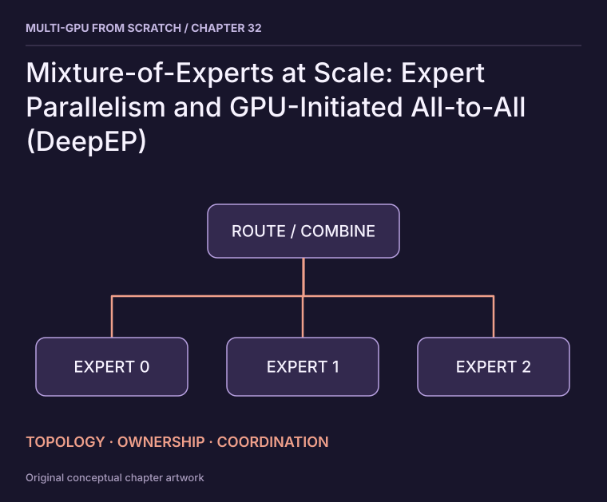
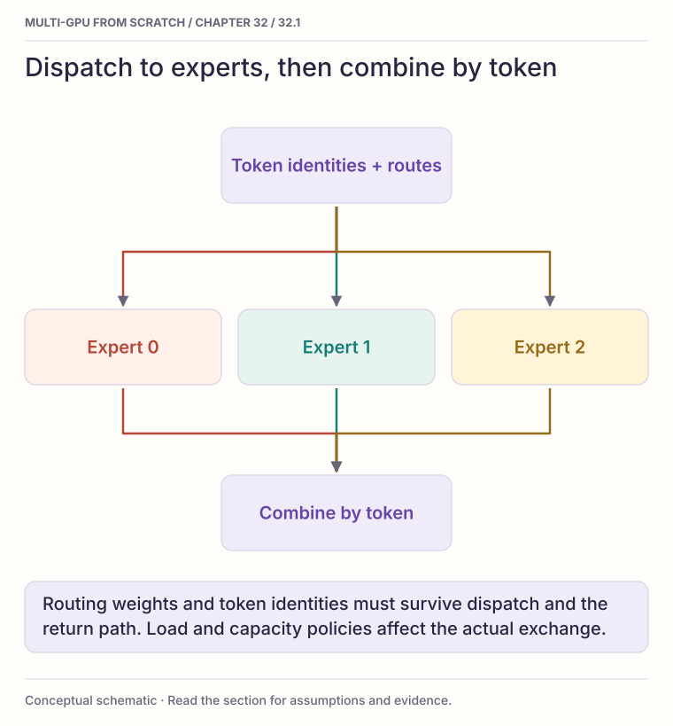
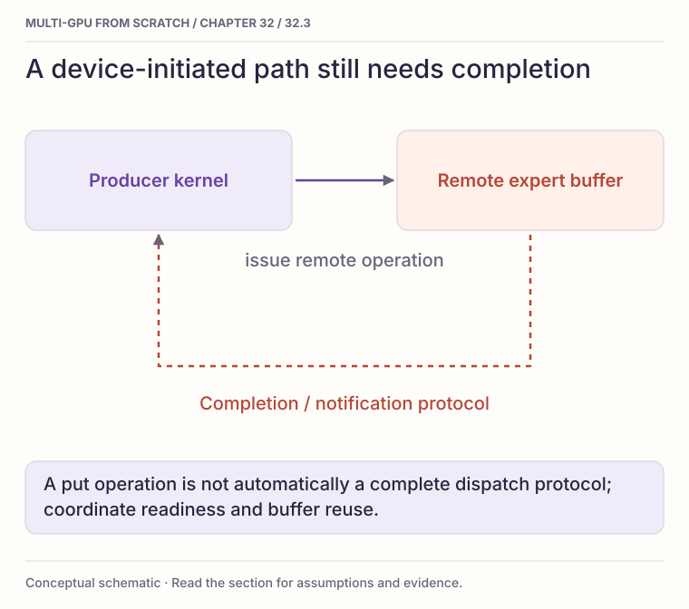

# Chapter 32: Mixture-of-Experts at Scale: Expert Parallelism and GPU-Initiated All-to-All (DeepEP)

<!-- mgpu:opener:start -->
[](../images/chapter-openers/32.svg)
<!-- mgpu:opener:end -->

**What you will understand after this chapter:** why a Mixture-of-Experts (MoE) layer needs a genuinely different communication pattern than anything Part 2 through Part 6 built -- a per-TOKEN dispatch/combine all-to-all, not a per-RANK reduction -- and why MoE outputs are nevertheless NOT independent of how many ranks the batch is split across: GShard-style per-group expert capacity makes which tokens overflow depend on the partition, and once a token is routed to three or more experts, the grouping of its combine sum matters too; what DeepSeek-AI's own real, open-source DeepEP library actually is, why it ships two entirely separate all-to-all kernel families (one tuned for training throughput, one for inference latency) rather than a single "best" kernel, and how its own real V1 design used NVIDIA's NVSHMEM (this book's own Chapter 22) with GPU-initiated RDMA to let the GPU drive the network directly, bypassing the CPU per dispatch -- plus a candid look at DeepEP's later releases, which moved away from that NVSHMEM foundation and have since removed V1 from the repository entirely, a reminder that even a cutting-edge production library's transport layer keeps changing.

**What you need to know first:** Chapter 10 (all-to-all, this chapter's direct ancestor), Chapter 14 (tensor parallelism -- MoE is a different way of sharding work within a layer), and Chapter 22 (NVSHMEM and GPU-initiated communication, which this chapter's real GPU-initiated all-to-all API calls build on directly).

---

Part 6 closed with eight case studies that each fit into one of three communication shapes this book had already built: a fixed communication pattern regardless of scale (Chapter 16's halo exchange), one that grows with the number of ranks (Chapter 27's N-body all-gather), or one with no communication at all during computation (Chapter 30's rendering). Part 7 opens with four industrial systems that are cutting-edge, real, and actively deployed today -- starting with Mixture-of-Experts, the architecture behind DeepSeek-V3, Mixtral, and GPT-4's rumored design, which turns out to need a FOURTH shape this book has never built: a communication pattern keyed by which TOKEN needs which EXPERT, decided fresh at every layer, for every batch, by a small neural network. Google's GShard paper (Lepikhin et al., 2020) gave this pattern its now-standard name -- "dispatch" to route each token to its chosen experts, "combine" to route each expert's output back -- and DeepSeek-AI's own real, open-source DeepEP library exists specifically because that dispatch/combine step, done at production scale across many GPUs, is expensive enough to deserve its own dedicated communication library, built directly on top of this book's own Chapter 22 (NVSHMEM) and Chapter 10 (all-to-all).

```text
+------------------------------------------------------------------+
|  Chapters 8-31 (every collective in this book so far):           |
|  Rank 0 data --+                                                 |
|  Rank 1 data --+--> [ REDUCE across ALL ranks ] --> one result   |
|  Rank 2 data --+     (order/grouping-dependent: a different P    |
|                       can change the last bits of the result)     |
+------------------------------------------------------------------+
|  Chapter 32 (MoE dispatch/combine):                               |
|  Token A --> [ gate ] --> expert 2 (on Rank 1) --+                |
|  Token B --> [ gate ] --> expert 0 (on Rank 0)    |--> DISPATCH   |
|  Token C --> [ gate ] --> expert 2 (on Rank 1) --+                |
|                                                                    |
|  expert output --> [ weighted combine, PER TOKEN ONLY ] --> COMBINE|
|  (but capacity is per group/rank, so P changes who overflows;     |
|   and a top-k>=3 combine sum is grouping-dependent too)           |
+------------------------------------------------------------------+
```

## 32.1 Expert Parallelism and the Dispatch/Combine All-to-All

<!-- mgpu:figure-1:start -->
[](../images/technical/ch32/1-experts.svg)
<!-- mgpu:figure-1:end -->

### Intuition

Picture a large office mailroom that receives a stack of letters (tokens) every morning. Instead of one clerk reading every letter, a fast triage clerk (the gating network) glances at each letter's address and routes it to one of several specialist departments (experts) sitting in different buildings (ranks). Two departments per letter, actually -- GShard's own real design sends each token to its top-2 scoring experts, not just one, so a little redundancy survives if one department is slow or overloaded. Each department processes its own letters and mails back a reply; the original sender's assistant (the combine step) simply averages the two replies, weighted by how confident the triage clerk was in each department. The averaging step itself only touches that one letter's two replies -- unlike Chapter 8's broadcast/reduce chapter, where every rank's value had to be folded into one shared answer. But the letters are NOT entirely independent of each other, because of the next paragraph's desks.

But departments have finite desks. If a wildly popular department gets more letters than it has desks for (its "capacity"), the overflow letters don't get processed by that department at all -- GShard's own real paper calls this an "overflowed" token, and its own real fix is disarmingly simple: the letter is just forwarded on unopened, via what the paper calls a residual connection, exactly as if no department touched it. No error, no retry -- just silently reduced processing for that one letter. And there is a catch in how the desks are counted: GShard does not hand each department one desk count for the whole company's mail. The letters are split into groups (in expert-parallel training, each rank's own local batch is a group), and each group gets only "a fractional capacity of each expert." Which letters overflow therefore depends on which other letters landed in the same group -- split the same morning's mail across a different number of mailrooms and a different set of letters gets bounced.

!!! warning "[COMMON TRAP] Assuming capacity overflow is a rare edge case, not a routine one"
    It is tempting to treat "expert capacity" as a safety valve that almost never trips, sized generously enough that overflow is a one-in-a-million event. Real gating networks are learned, not designed, and real token popularity is skewed -- some experts genuinely do get chosen far more often than an even split would predict, especially early in training or for specific domains of input. File 93 below deliberately reproduces this: with a modest, deliberately-skewed gating popularity and a capacity factor of 1.25x the even split, **7 of 24 tokens (29%) end up FULLY overflowed** -- both of their chosen experts already full -- and are passed straight through unprocessed by any expert at all. A production system that assumes overflow is rare and doesn't monitor its own overflow rate can be silently degrading a meaningful fraction of its own batch's quality with zero errors to alert anyone. And because capacity is enforced per group, that fraction is not even a fixed property of the batch: the same 24 tokens give anywhere from 0 to 7 fully-overflowed tokens depending on how many ranks they are split across.

### Background

```text
+-------------------------------------------------------------+
| gate(token) -> pick top-2 experts by score                  |
|   |                                                          |
|   +-> capacity check per expert (per GROUP = per rank: each   |
|   |   group has its own budget and its own token order)      |
|          |--> ACCEPT: expert(token) computed, weight applied |
|          |--> single OVERFLOW: that term drops to 0          |
|          |--> BOTH OVERFLOW: y = token's own residual value  |
|   |                                                          |
|   +-> combine: y = w1*expert1(token) + w2*expert2(token)     |
+-------------------------------------------------------------+
```

File 93 builds exactly this shape on the host: 24 tokens, 6 experts, top-2 gating with a deterministic (counter-based, reproducible) popularity skew toward experts 0 and 1, and a capacity factor of 1.25x. Capacity is computed the way GShard computes it: the batch is split into P contiguous groups (one per rank), each group gets a per-expert capacity sized from its own token count, `ceil(groupSize * 2 / E * 1.25)`, and checks it in its own token order. P = 1 is the special case where the whole batch is one group. Part A of the file runs the identical tokens and gate under P = 1, 2, 3, 4, 6, 8, 12, 24 and counts how many tokens' outputs change. Part B isolates the floating-point side of combine: it models a hierarchical combine (each rank first sums the weighted outputs of the chosen experts it owns, then the per-rank partials are added) for top-2, 3, 4 and 8 routing, and counts tokens whose result differs from a plain left-to-right sum. Gating scores use a numerically-stable softmax (subtracting the larger of the two chosen scores before calling `exp()`) -- an early version of this file skipped that stabilization and called `exp()` directly on raw scores in the hundreds, which silently overflowed to `+inf` and produced NaN in every single token's combined output. That NaN was itself a genuine teaching moment: IEEE 754 defines `NaN != NaN`, so a bit-exact-equality check between two runs that both produced NaN reported a "mismatch" even though both runs did the identical (broken) arithmetic -- a reminder that "the outputs don't match" and "the computation overflowed" are different bugs that can disguise themselves as each other. The fixed version below is what actually ran and locked.

```cpp
// Chapter 32: Mixture-of-Experts at Scale
// 93_moe_dispatch_combine_correctness_simulation.cpp
//
// Google's GShard paper ("GShard: Scaling Giant Models with Conditional
// Computation and Automatic Sharding," Lepikhin et al., 2020) gives MoE
// its standard vocabulary: a gating network picks, for EACH token, its
// top-2 experts; "dispatching of inputs to selected experts is expressed
// by a single einsum between the dispatching mask and the input," and
// "taking weighted average of all experts output into the final output
// is expressed in another einsum" -- what this book calls combine.
//
// GShard ALSO says how expert capacity is enforced, and that is where a
// partition-dependence hides: the tokens are split into G groups that are
// processed independently, and each group gets only "a fractional
// capacity of each expert." In expert-parallel training each rank's
// local batch is such a group, so the capacity check is made per rank,
// against that rank's own share of the capacity, in that rank's own
// token order. Change the number of ranks P and you change which tokens
// share a capacity budget -- and therefore which tokens overflow.
//
// GShard's overflow rule: "When both experts selected by a token already
// exceed their capacity, the token is considered as an overflowed
// token... such tokens have their representation x_s passed on to the
// next layer via residual connections" -- silent, not an error.
//
// Part A of this file runs the SAME tokens and the SAME gate under
// P = 1, 2, 3, 4, 6, 8, 12, 24 groups and reports how many tokens' outputs
// change relative to P = 1, and how the overflow count moves.
//
// Part B isolates the floating-point side of combine. With top-2 routing
// a token's combine is a 2-term sum, and IEEE 754 addition is
// commutative, so a+b == b+a bit for bit: no ordering or grouping of the
// two contributions can change the result. With top-k for k >= 3 (DeepSeek-
// V3 routes each token to 8 experts) the grouping of the k terms DOES
// matter. Part B models a hierarchical combine -- each rank first sums the
// contributions of the experts it owns, then the per-rank partials are
// summed -- and counts how many tokens' results differ from the P = 1 sum.
#include <cstdio>
#include <cmath>
#include <vector>
#include <algorithm>

const int T = 24;          // total tokens in the batch (Part A)
const int E = 6;           // total experts (Part A)
const int TOPK = 2;        // GShard's top-2 gating
const double CAPACITY_FACTOR = 1.25;

// Deterministic counter-based hash, reused from Chapter 31 -- a stand-in
// for a real gating network's learned logits: given only (token, expert),
// it returns the same score no matter which rank evaluates it.
unsigned int counterBasedHash(long long x) {
    unsigned int h = (unsigned int)x;
    h = ((h >> 16) ^ h) * 0x45d9f3bU;
    h = ((h >> 16) ^ h) * 0x45d9f3bU;
    h = (h >> 16) ^ h;
    return h;
}

// Gating score with a deliberate popularity skew toward experts 0 and 1,
// so that capacity overflow actually happens at this small batch size.
double gateScore(int token, int expert) {
    double base = (double)(counterBasedHash((long long)token * 1000 + expert) % 1000);
    if (expert == 0 || expert == 1) base += 500.0;
    return base;
}

double tokenValue(int token) { return (double)((token + 1) * 2); }
double expertOutput(int token, int expert) {
    // A deterministic per-expert affine transform standing in for a real
    // expert feed-forward network's output on this token.
    double scale = 1.0 + 0.1 * (double)expert;
    double bias = 0.5 * (double)expert;
    return tokenValue(token) * scale + bias;
}

struct TokenResult { double y; int overflowedSlots; };

// GShard-style capacity: the batch is split into P contiguous groups
// (one per rank); each group has its OWN per-expert capacity, sized from
// the group's own token count, and checks it in the group's own order.
// P = 1 is the "whole batch is one group" special case.
std::vector<TokenResult> runGrouped(int P) {
    std::vector<TokenResult> results(T);
    int groupSize = T / P;  // every tested P divides T
    int perExpertCapacity =
        (int)std::ceil((double)(groupSize * TOPK) / (double)E * CAPACITY_FACTOR);

    for (int g = 0; g < P; g++) {
        std::vector<int> capacityUsed(E, 0);  // fresh budget per group
        for (int t = g * groupSize; t < (g + 1) * groupSize; t++) {
            int best1 = -1, best2 = -1;
            double s1 = -1e18, s2 = -1e18;
            for (int e = 0; e < E; e++) {
                double s = gateScore(t, e);
                if (s > s1) { best2 = best1; s2 = s1; best1 = e; s1 = s; }
                else if (s > s2) { best2 = e; s2 = s; }
            }
            // Numerically-stable 2-way softmax (subtract the max first).
            // An earlier draft called exp() on raw scores in the hundreds,
            // overflowed to +inf, and produced NaN for every token -- and
            // since NaN != NaN, the equality check then reported a
            // "mismatch" for two runs that did identical arithmetic.
            double w1 = 1.0 / (1.0 + std::exp(s2 - s1));
            double w2 = 1.0 - w1;

            bool accept1 = capacityUsed[best1] < perExpertCapacity;
            if (accept1) capacityUsed[best1]++;
            bool accept2 = capacityUsed[best2] < perExpertCapacity;
            if (accept2) capacityUsed[best2]++;

            double y;
            int overflowed = (accept1 ? 0 : 1) + (accept2 ? 0 : 1);
            if (!accept1 && !accept2) {
                y = tokenValue(t);  // GShard's residual passthrough
            } else {
                y = (accept1 ? w1 * expertOutput(t, best1) : 0.0) +
                    (accept2 ? w2 * expertOutput(t, best2) : 0.0);
            }
            results[t] = {y, overflowed};
        }
    }
    return results;
}

// ---- Part B: does the combine's summation grouping matter? ----
const int TB = 4096;   // tokens
const int EB = 32;     // experts, sharded contiguously: EB/P per rank

// Hierarchical combine for one token: each rank sums (in ascending expert
// order) the weighted outputs of the chosen experts it owns, then the
// per-rank partial sums are added in rank order. P = 1 is a plain
// left-to-right sum of all k terms.
double combineHierarchical(const std::vector<int> &experts,
                           const std::vector<double> &terms, int P) {
    int perRank = EB / P;
    double total = 0.0;
    bool haveTotal = false;
    for (int r = 0; r < P; r++) {
        double partial = 0.0;
        bool havePartial = false;
        for (size_t i = 0; i < experts.size(); i++) {
            if (experts[i] / perRank != r) continue;
            partial = havePartial ? partial + terms[i] : terms[i];
            havePartial = true;
        }
        if (!havePartial) continue;
        total = haveTotal ? total + partial : partial;
        haveTotal = true;
    }
    return total;
}

int countCombineMismatches(int k, int P) {
    int mismatches = 0;
    for (int t = 0; t < TB; t++) {
        // Top-k experts by an (unskewed) hash score.
        std::vector<std::pair<double, int>> scored;
        for (int e = 0; e < EB; e++) {
            double s = (double)(counterBasedHash((long long)t * 7919 + e * 104729LL) % 1000) / 100.0;
            scored.push_back({s, e});
        }
        std::partial_sort(scored.begin(), scored.begin() + k, scored.end(),
                          [](const std::pair<double, int> &a, const std::pair<double, int> &b) {
                              return a.first > b.first || (a.first == b.first && a.second < b.second);
                          });
        double smax = scored[0].first, denom = 0.0;
        for (int i = 0; i < k; i++) denom += std::exp(scored[i].first - smax);
        std::vector<std::pair<int, double>> chosen;  // (expert, weighted term)
        for (int i = 0; i < k; i++) {
            int e = scored[i].second;
            double w = std::exp(scored[i].first - smax) / denom;
            double x = 1.0 + (double)(t % 97) / 7.0;  // non-integer token value
            chosen.push_back({e, w * (x * (1.0 + 0.1 * e) + 0.5 * e)});
        }
        // Ascending expert order, so both paths see the same term order and
        // differ ONLY in how the terms are grouped.
        std::sort(chosen.begin(), chosen.end());
        std::vector<int> experts;
        std::vector<double> terms;
        for (auto &c : chosen) { experts.push_back(c.first); terms.push_back(c.second); }
        double ref = combineHierarchical(experts, terms, 1);
        double got = combineHierarchical(experts, terms, P);
        if (got != ref) mismatches++;
    }
    return mismatches;
}

int main() {
    // ---------------- Part A ----------------
    std::vector<TokenResult> reference = runGrouped(1);
    int refSlots = 0, refFull = 0;
    for (auto &r : reference) { refSlots += r.overflowedSlots; refFull += (r.overflowedSlots == 2); }
    printf("Part A -- GShard-style per-group capacity, %d tokens, %d experts, top-%d, "
           "capacity factor %.2f\n", T, E, TOPK, CAPACITY_FACTOR);
    printf("Reference (P=1, whole batch is one group): %d overflowed (token,expert) "
           "slots of %d, %d tokens fully overflowed.\n\n", refSlots, T * TOPK, refFull);

    int Ps[] = {1, 2, 3, 4, 6, 8, 12, 24};
    printf("%-4s %-10s %-16s %-17s %-15s %-22s\n", "P", "cap/group",
           "overflow slots", "fully overflowed", "tokens changed", "max |y - reference.y|");
    for (int P : Ps) {
        std::vector<TokenResult> underP = runGrouped(P);
        int cap = (int)std::ceil((double)((T / P) * TOPK) / (double)E * CAPACITY_FACTOR);
        int slots = 0, full = 0, changed = 0;
        double maxDiff = 0.0;
        for (int t = 0; t < T; t++) {
            slots += underP[t].overflowedSlots;
            full += (underP[t].overflowedSlots == 2);
            if (underP[t].y != reference[t].y) changed++;
            maxDiff = std::max(maxDiff, std::fabs(underP[t].y - reference[t].y));
        }
        printf("%-4d %-10d %-16d %-17d %-15d %-22.6g\n", P, cap, slots, full, changed, maxDiff);
    }

    // ---------------- Part B ----------------
    printf("\nPart B -- hierarchical combine (per-rank partial sums, then a sum of "
           "partials), %d tokens, %d experts sharded contiguously across P ranks.\n",
           TB, EB);
    printf("Tokens whose combined output differs from the P=1 left-to-right sum:\n");
    int Ks[] = {2, 3, 4, 8};
    int PBs[] = {2, 4, 8, 16, 32};
    printf("%-8s", "top-k");
    for (int P : PBs) printf("P=%-8d", P);
    printf("\n");
    for (int k : Ks) {
        printf("%-8d", k);
        for (int P : PBs) printf("%-10d", countCombineMismatches(k, P));
        printf("\n");
    }

    printf("\nPart A: once capacity is enforced per group (per rank), the SAME "
           "tokens and the SAME gate give different outputs for different P -- "
           "which tokens overflow depends on which tokens share a capacity "
           "budget. Part B: with top-2 routing a token's combine is a 2-term "
           "sum, and IEEE 754 addition is commutative, so no grouping can change "
           "it; at top-3 and beyond the grouping of the terms matters and the "
           "result depends on how experts are spread across ranks.\n");
    return 0;
}
```

<!-- execution:start:a100:93_moe_dispatch_combine_correctness_simulation.cpp -->
> **Compiled and executed — 2026-11-17-a100: Host program/model (exit-only).** Hardware: 8 A100 GPUs. Executed UTC: `2026-11-18T00:05:34.609734+00:00`.

<!-- execution:metadata Source SHA-256: 0716eaa8aa725282e651da3a00418941f9d494352c04f917ea717a60237a12b0; recorded UTC (program start): 2026-11-18T00:05:33.944011+00:00 -->

[Exact tested source](../validation/2026-11-17-a100/93_moe_dispatch_combine_correctness_simulation/93_moe_dispatch_combine_correctness_simulation.cpp) · [Compiler log](../validation/2026-11-17-a100/93_moe_dispatch_combine_correctness_simulation/compile.log) · [Execution log](../validation/2026-11-17-a100/93_moe_dispatch_combine_correctness_simulation/run.log). Compile exit: `0`; run exit: `0`.

Commands below use local source/binary names; raw logs retain host paths. Execute in a scratch directory containing the downloaded source.

```bash
g++ -std=c++17 -O2 93_moe_dispatch_combine_correctness_simulation.cpp -o ./example
./example
```

**Sample output**

```text
Part A -- GShard-style per-group capacity, 24 tokens, 6 experts, top-2, capacity factor 1.25
Reference (P=1, whole batch is one group): 19 overflowed (token,expert) slots of 48, 7 tokens fully overflowed.

P    cap/group  overflow slots   fully overflowed  tokens changed  max |y - reference.y|
1    10         19               7                 0               0
2    5          19               6                 4               36
3    4          15               4                 5               42.3
4    3          16               5                 6               42.3
6    2          16               5                 4               30
8    2          9                2                 4               42.3
12   1          16               5                 8               42.3
24   1          0                0                 4               42.3

Part B -- hierarchical combine (per-rank partial sums, then a sum of partials), 4096 tokens, 32 experts sharded contiguously across P ranks.
Tokens whose combined output differs from the P=1 left-to-right sum:
top-k   P=2       P=4       P=8       P=16      P=32
2       0         0         0         0         0
3       429       295       142       58        0
4       696       553       290       109       0
8       1332      1232      867       364       0

Part A: once capacity is enforced per group (per rank), the SAME tokens and the SAME gate give different outputs for different P -- which tokens overflow depends on which tokens share a capacity budget. Part B: with top-2 routing a token's combine is a 2-term sum, and IEEE 754 addition is commutative, so no grouping can change it; at top-3 and beyond the grouping of the terms matters and the result depends on how experts are spread across ranks.
```


<!-- execution:end:a100:93_moe_dispatch_combine_correctness_simulation.cpp -->


<!-- execution:start:h100:93_moe_dispatch_combine_correctness_simulation.cpp -->
> **Compiled and executed — 2026-11-17-h100: Host program/model (exit-only).** Hardware: 2 H100 GPUs. Execution record UTC (run-batch start; per-program time unrecorded): `2026-11-17T23:48:18.967387+00:00`.

<!-- execution:metadata Source SHA-256: 0716eaa8aa725282e651da3a00418941f9d494352c04f917ea717a60237a12b0; recorded UTC (run-batch start; per-program time unrecorded): 2026-11-17T23:48:18.967387+00:00 -->

[Exact tested source](../validation/2026-11-17-h100/93_moe_dispatch_combine_correctness_simulation/93_moe_dispatch_combine_correctness_simulation.cpp) · [Compiler log](../validation/2026-11-17-h100/93_moe_dispatch_combine_correctness_simulation/compile.log) · [Execution log](../validation/2026-11-17-h100/93_moe_dispatch_combine_correctness_simulation/run.log). Compile exit: `0`; run exit: `0`.

Commands below use local source/binary names; raw logs retain host paths. Execute in a scratch directory containing the downloaded source.

```bash
g++ -std=c++17 -O2 93_moe_dispatch_combine_correctness_simulation.cpp -o ./example
./example
```

<details markdown="1"><summary>Captured current-source output</summary>

```text
Part A -- GShard-style per-group capacity, 24 tokens, 6 experts, top-2, capacity factor 1.25
Reference (P=1, whole batch is one group): 19 overflowed (token,expert) slots of 48, 7 tokens fully overflowed.

P    cap/group  overflow slots   fully overflowed  tokens changed  max |y - reference.y|
1    10         19               7                 0               0
2    5          19               6                 4               36
3    4          15               4                 5               42.3
4    3          16               5                 6               42.3
6    2          16               5                 4               30
8    2          9                2                 4               42.3
12   1          16               5                 8               42.3
24   1          0                0                 4               42.3

Part B -- hierarchical combine (per-rank partial sums, then a sum of partials), 4096 tokens, 32 experts sharded contiguously across P ranks.
Tokens whose combined output differs from the P=1 left-to-right sum:
top-k   P=2       P=4       P=8       P=16      P=32
2       0         0         0         0         0
3       429       295       142       58        0
4       696       553       290       109       0
8       1332      1232      867       364       0

Part A: once capacity is enforced per group (per rank), the SAME tokens and the SAME gate give different outputs for different P -- which tokens overflow depends on which tokens share a capacity budget. Part B: with top-2 routing a token's combine is a 2-term sum, and IEEE 754 addition is commutative, so no grouping can change it; at top-3 and beyond the grouping of the terms matters and the result depends on how experts are spread across ranks.
```

</details>
<!-- execution:end:h100:93_moe_dispatch_combine_correctness_simulation.cpp -->


Compile and run (a plain host `.cpp` file, no CUDA/NCCL/MPI/NVSHMEM linkage, so this was executed on the recorded H100 and A100 hosts):

```bash
g++ -O2 -ffp-contract=off -o 93_moe_dispatch_combine_correctness_simulation \
    93_moe_dispatch_combine_correctness_simulation.cpp
./93_moe_dispatch_combine_correctness_simulation
```

Read Part A first. At P = 1 (one group), 19 of the 48 (token, expert) slots overflow and 7 of the 24 tokens overflow on BOTH of their chosen experts, hitting GShard's residual-passthrough branch. Split the same batch into groups and the picture moves: between 4 and 8 of the 24 tokens produce a different output at every P > 1, and the fully-overflowed count wanders between 0 and 6. Nothing about the tokens or the gate changed -- only which tokens share a capacity budget. At P = 24 every group holds one token, its capacity rounds up to 1, and nothing overflows at all; at P = 8 the capacity rounds to 2 for a group of 3 tokens, which is relatively generous, so overflow drops to 9 slots; at P = 12 two tokens share a capacity of 1, and overflow climbs back to 16. The rounding in `ceil()` and the skewed gate interact in a way no single "overflow rate" captures. MoE layer outputs are partition-dependent -- not by a last-bit rounding difference, but by whole tokens being processed or skipped. (GShard's per-group capacity is a deliberate design choice -- it keeps the capacity check local, with no cross-rank count to synchronize -- and the price is exactly this dependence.)

Part B answers the floating-point question separately. With top-2 routing, every grouping gives a bit-exact result: a token's combine is a sum of exactly two terms, and IEEE 754 addition is commutative (`a + b == b + a` bit for bit), so there is no second way to group two terms. That -- and NOT any claim that a token's combine "stays on one rank" -- is why top-2 combine is order-safe; in expert parallelism a token's two experts usually live on different ranks. At top-3 and beyond, `(a + b) + c` and `a + (b + c)` can differ in the last bit, and a hierarchical combine's grouping follows the expert-to-rank layout: hundreds of the 4096 tokens differ at top-3, and roughly a third at top-8. The P = 32 column is zero only because with 32 experts on 32 ranks every per-rank partial is a single term, so the sum of partials degenerates back to the same left-to-right order as P = 1. DeepSeek-V3 routes each token to 8 experts, so its real combine is in the order-sensitive regime, and a production combine kernel that wants reproducibility has to fix its summation order explicitly.

## 32.2 DeepEP's Real Normal vs. Low-Latency Kernels: A Cost Model

### Intuition

Imagine two different delivery services for the same warehouse network. One is a fleet of large moving trucks: cheap per pound shipped, but each truck takes time to load, dispatch, and route, so it only makes sense once you have a big load ready to go -- exactly a training step's batch of thousands of tokens. The other is a fleet of bicycle couriers: far more expensive per pound, and their per-trip bandwidth is genuinely lower, but a single package can leave the moment it's ready, with none of the truck's loading overhead -- exactly an inference decode step's batch of a few dozen or a few hundred tokens, where a user is waiting on the reply right now. DeepSeek-AI's own real DeepEP library ships both a "normal kernel" (the truck) and a "low-latency kernel" (the courier) for the identical operation -- MoE dispatch and combine -- because neither one is simply a faster version of the other; each wins in its own regime.

!!! warning "[COMMON TRAP] Assuming 'low-latency' means 'strictly faster'"
    The name says what the kernel optimizes, not that it beats the other kernel on every number -- and comparing the two tables needs care. The normal kernel's headline 153-158 GB/s is its INTRANODE (NVLink) figure; the low-latency kernel is pure RDMA, so the like-for-like comparison is against the normal kernel's INTERNODE numbers, 43-58 GB/s. On that comparison the low-latency kernel's 98 GB/s at EP=8 is actually HIGHER, not lower, and it stays in the same 39-63 GB/s range as the internode normal kernel at larger EP. So "low-latency kernels have lower bandwidth" is not what the data says. What the data does say is that the two kernels were benchmarked at different operating points -- the low-latency table at a fixed 128 tokens per batch, the normal table at training-sized batches -- and that the low-latency kernel's bandwidth falls steeply as EP grows. A team that swaps one for the other should benchmark at its own batch size and EP degree rather than read a winner off either table.

### Background

```text
+---------------------------------------------------------------+
|  Normal kernels: large batch (thousands of tokens)             |
|  bandwidth: 153-158 GB/s (intranode), 43-58 GB/s (internode)   |
|  latency: not published -- amortized away by batch size        |
+---------------------------------------------------------------+
|  Low-latency kernels: small batch (128 tokens, inference decode)|
|  bandwidth: 39-98 GB/s (lower peak, falls further as EP grows)  |
|  latency: 77-194 us dispatch, 114-369 us combine (published,    |
|           because at THIS batch size it is what the user feels)|
+---------------------------------------------------------------+
```

File 94 prints DeepEP V1's own two real published benchmark tables (from V1's `docs/legacy.md` in the `deepseek-ai/DeepEP` GitHub repository, read when this chapter was written; the current README says V1, its NVSHMEM backend and its legacy docs have since been removed, so that file now returns 404 and the tables survive only in the repository's history) side by side, then computes two pieces of honest arithmetic directly on those real numbers: a per-token dispatch latency at each expert-parallelism (EP) degree, and the bandwidth-degradation ratio from the smallest to the largest tested EP degree. No number here is measured or estimated by this book -- every input is copied verbatim from DeepEP's own documentation.

```cpp
// Chapter 32: Mixture-of-Experts at Scale
// 94_normal_vs_lowlatency_kernel_cost_model.cpp
//
// DeepSeek-AI's own real DeepEP library ships TWO separate kernel
// families for the exact same operation (MoE dispatch and combine), not
// one "best" kernel -- and its own real documented numbers (V1, at
// docs/legacy.md in the deepseek-ai/DeepEP GitHub repository -- since
// removed from the current repository along with V1 itself) explain why. "Normal kernels" are described
// as "high-throughput and low-latency all-to-all GPU kernels" tuned for
// TRAINING-sized batches; "low-latency kernels" are "a set of low-
// latency kernels with pure RDMA to minimize delays," built specifically
// "for inference decoding" where batches are tiny (as few as 8 tokens
// per expert) and every microsecond of end-to-end latency is user-
// visible. This file prints DeepEP's own two real cited tables side by
// side -- no timing here is measured or fabricated by this book; every
// number below is copied verbatim from DeepEP's own published benchmark
// data -- and computes simple, honest arithmetic ON those real numbers
// (a per-token latency, and a bandwidth-degradation ratio) to make the
// actual tradeoff visible.
#include <cstdio>

struct NormalRow { const char *type; int ep; double dispatchGBps; double combineGBps; };
struct LowLatRow { int ep; double dispatchUs; double dispatchGBps; double combineUs; double combineGBps; };

int main() {
    // DeepEP V1's own real "Normal kernels" table (H800, DeepSeek-V3/R1
    // settings), from docs/legacy.md.
    NormalRow normal[] = {
        {"Intranode", 8,  153.0, 158.0},
        {"Internode", 16, 43.0,  43.0},
        {"Internode", 32, 58.0,  57.0},
        {"Internode", 64, 51.0,  50.0},
    };
    printf("DeepEP V1 -- Normal kernels (real cited data, docs/legacy.md):\n");
    printf("%-10s %-6s %-20s %-20s\n", "Type", "EP", "Dispatch BW (GB/s)", "Combine BW (GB/s)");
    for (auto &r : normal) {
        printf("%-10s %-6d %-20.1f %-20.1f\n", r.type, r.ep, r.dispatchGBps, r.combineGBps);
    }

    // DeepEP V1's own real "Low-latency kernels" table (pure RDMA, 128
    // tokens per batch), same source.
    LowLatRow lowlat[] = {
        {8,   77.0,  98.0,  114.0, 127.0},
        {16,  118.0, 63.0,  195.0, 74.0},
        {32,  155.0, 48.0,  273.0, 53.0},
        {64,  173.0, 43.0,  314.0, 46.0},
        {128, 192.0, 39.0,  369.0, 39.0},
        {256, 194.0, 39.0,  360.0, 40.0},
    };
    printf("\nDeepEP V1 -- Low-latency kernels (real cited data, 128 tokens/batch):\n");
    printf("%-6s %-14s %-16s %-14s %-16s %-16s\n", "EP", "Dispatch us",
           "Dispatch GB/s", "Combine us", "Combine GB/s", "us/token (dispatch)");
    for (auto &r : lowlat) {
        double perTokenUs = r.dispatchUs / 128.0;
        printf("%-6d %-14.1f %-16.1f %-14.1f %-16.1f %-16.3f\n",
               r.ep, r.dispatchUs, r.dispatchGBps, r.combineUs, r.combineGBps, perTokenUs);
    }

    double bwAt8 = lowlat[0].dispatchGBps;
    double bwAt256 = lowlat[5].dispatchGBps;
    printf("\nLow-latency dispatch bandwidth falls from %.0f GB/s at EP=8 to "
           "%.0f GB/s at EP=256 -- a %.2fx drop -- as latency simultaneously "
           "RISES from %.0f us to %.0f us, a %.2fx increase. Both real "
           "numbers move in the same direction as EP grows: more experts to "
           "reach means more small, separate RDMA operations per token, not "
           "one bigger one.\n",
           bwAt8, bwAt256, bwAt8 / bwAt256,
           lowlat[0].dispatchUs, lowlat[5].dispatchUs, lowlat[5].dispatchUs / lowlat[0].dispatchUs);

    printf("\nNotice what DeepEP's own real documentation does NOT publish: "
           "no latency number at all for the normal kernels, at any EP "
           "degree. That omission is itself informative -- normal kernels "
           "are benchmarked and tuned purely as a throughput number because "
           "they are meant to move whole TRAINING batches (thousands of "
           "tokens) where per-call fixed overhead is amortized away; low-"
           "latency kernels report latency because at INFERENCE-DECODE "
           "batch sizes (the 128-token, 8-to-256-expert range above) that "
           "fixed overhead is exactly what a user waiting on a response "
           "feels. This mirrors Chapter 18's own finding that no single "
           "load-balancing strategy dominates across every workload shape: "
           "here, no single ALL-TO-ALL KERNEL dominates across every batch "
           "size either, which is exactly why DeepEP ships both.\n");
    return 0;
}
```

<!-- execution:start:a100:94_normal_vs_lowlatency_kernel_cost_model.cpp -->
> **Compiled and executed — 2026-11-17-a100: Host program/model (exit-only).** Hardware: 8 A100 GPUs. Executed UTC: `2026-11-18T00:05:34.843719+00:00`.

<!-- execution:metadata Source SHA-256: 34335d753cb7c58850cc4203491ecaf9656d3da978b285ebd9a05d2051efc098; recorded UTC (program start): 2026-11-18T00:05:34.728979+00:00 -->

[Exact tested source](../validation/2026-11-17-a100/94_normal_vs_lowlatency_kernel_cost_model/94_normal_vs_lowlatency_kernel_cost_model.cpp) · [Compiler log](../validation/2026-11-17-a100/94_normal_vs_lowlatency_kernel_cost_model/compile.log) · [Execution log](../validation/2026-11-17-a100/94_normal_vs_lowlatency_kernel_cost_model/run.log). Compile exit: `0`; run exit: `0`.

Commands below use local source/binary names; raw logs retain host paths. Execute in a scratch directory containing the downloaded source.

```bash
g++ -std=c++17 -O2 94_normal_vs_lowlatency_kernel_cost_model.cpp -o ./example
./example
```

**Sample output**

```text
DeepEP V1 -- Normal kernels (real cited data, docs/legacy.md):
Type       EP     Dispatch BW (GB/s)   Combine BW (GB/s)
Intranode  8      153.0                158.0
Internode  16     43.0                 43.0
Internode  32     58.0                 57.0
Internode  64     51.0                 50.0

DeepEP V1 -- Low-latency kernels (real cited data, 128 tokens/batch):
EP     Dispatch us    Dispatch GB/s    Combine us     Combine GB/s     us/token (dispatch)
8      77.0           98.0             114.0          127.0            0.602
16     118.0          63.0             195.0          74.0             0.922
32     155.0          48.0             273.0          53.0             1.211
64     173.0          43.0             314.0          46.0             1.352
128    192.0          39.0             369.0          39.0             1.500
256    194.0          39.0             360.0          40.0             1.516

Low-latency dispatch bandwidth falls from 98 GB/s at EP=8 to 39 GB/s at EP=256 -- a 2.51x drop -- as latency simultaneously RISES from 77 us to 194 us, a 2.52x increase. Both real numbers move in the same direction as EP grows: more experts to reach means more small, separate RDMA operations per token, not one bigger one.

Notice what DeepEP's own real documentation does NOT publish: no latency number at all for the normal kernels, at any EP degree. That omission is itself informative -- normal kernels are benchmarked and tuned purely as a throughput number because they are meant to move whole TRAINING batches (thousands of tokens) where per-call fixed overhead is amortized away; low-latency kernels report latency because at INFERENCE-DECODE batch sizes (the 128-token, 8-to-256-expert range above) that fixed overhead is exactly what a user waiting on a response feels. This mirrors Chapter 18's own finding that no single load-balancing strategy dominates across every workload shape: here, no single ALL-TO-ALL KERNEL dominates across every batch size either, which is exactly why DeepEP ships both.
```


<!-- execution:end:a100:94_normal_vs_lowlatency_kernel_cost_model.cpp -->


<!-- execution:start:h100:94_normal_vs_lowlatency_kernel_cost_model.cpp -->
> **Compiled and executed — 2026-11-17-h100: Host program/model (exit-only).** Hardware: 2 H100 GPUs. Execution record UTC (run-batch start; per-program time unrecorded): `2026-11-17T23:48:18.967387+00:00`.

<!-- execution:metadata Source SHA-256: 34335d753cb7c58850cc4203491ecaf9656d3da978b285ebd9a05d2051efc098; recorded UTC (run-batch start; per-program time unrecorded): 2026-11-17T23:48:18.967387+00:00 -->

[Exact tested source](../validation/2026-11-17-h100/94_normal_vs_lowlatency_kernel_cost_model/94_normal_vs_lowlatency_kernel_cost_model.cpp) · [Compiler log](../validation/2026-11-17-h100/94_normal_vs_lowlatency_kernel_cost_model/compile.log) · [Execution log](../validation/2026-11-17-h100/94_normal_vs_lowlatency_kernel_cost_model/run.log). Compile exit: `0`; run exit: `0`.

Commands below use local source/binary names; raw logs retain host paths. Execute in a scratch directory containing the downloaded source.

```bash
g++ -std=c++17 -O2 94_normal_vs_lowlatency_kernel_cost_model.cpp -o ./example
./example
```

<details markdown="1"><summary>Captured current-source output</summary>

```text
DeepEP V1 -- Normal kernels (real cited data, docs/legacy.md):
Type       EP     Dispatch BW (GB/s)   Combine BW (GB/s)
Intranode  8      153.0                158.0
Internode  16     43.0                 43.0
Internode  32     58.0                 57.0
Internode  64     51.0                 50.0

DeepEP V1 -- Low-latency kernels (real cited data, 128 tokens/batch):
EP     Dispatch us    Dispatch GB/s    Combine us     Combine GB/s     us/token (dispatch)
8      77.0           98.0             114.0          127.0            0.602
16     118.0          63.0             195.0          74.0             0.922
32     155.0          48.0             273.0          53.0             1.211
64     173.0          43.0             314.0          46.0             1.352
128    192.0          39.0             369.0          39.0             1.500
256    194.0          39.0             360.0          40.0             1.516

Low-latency dispatch bandwidth falls from 98 GB/s at EP=8 to 39 GB/s at EP=256 -- a 2.51x drop -- as latency simultaneously RISES from 77 us to 194 us, a 2.52x increase. Both real numbers move in the same direction as EP grows: more experts to reach means more small, separate RDMA operations per token, not one bigger one.

Notice what DeepEP's own real documentation does NOT publish: no latency number at all for the normal kernels, at any EP degree. That omission is itself informative -- normal kernels are benchmarked and tuned purely as a throughput number because they are meant to move whole TRAINING batches (thousands of tokens) where per-call fixed overhead is amortized away; low-latency kernels report latency because at INFERENCE-DECODE batch sizes (the 128-token, 8-to-256-expert range above) that fixed overhead is exactly what a user waiting on a response feels. This mirrors Chapter 18's own finding that no single load-balancing strategy dominates across every workload shape: here, no single ALL-TO-ALL KERNEL dominates across every batch size either, which is exactly why DeepEP ships both.
```

</details>
<!-- execution:end:h100:94_normal_vs_lowlatency_kernel_cost_model.cpp -->


Compile and run (again a plain host `.cpp` file with no CUDA/NCCL/MPI/NVSHMEM linkage, executed on the recorded H100 and A100 hosts):

```bash
g++ -O2 -ffp-contract=off -o 94_normal_vs_lowlatency_kernel_cost_model \
    94_normal_vs_lowlatency_kernel_cost_model.cpp
./94_normal_vs_lowlatency_kernel_cost_model
```

## 32.3 GPU-Initiated All-to-All: NVSHMEM/IBGDA vs. the Host-Mediated All-to-All

<!-- mgpu:figure-3:start -->
[](../images/technical/ch32/3-put.svg)
<!-- mgpu:figure-3:end -->

### Intuition

Chapter 10's all-to-all, and every MPI-based collective since Chapter 20, follows the same basic script: the CPU (the host) decides it's time to communicate, calls into the network library, and the library does the actual work of moving bytes -- the CPU is the one giving the order, even if it isn't the one carrying the package. Chapter 22 showed a different script is possible: NVSHMEM lets a `__global__` kernel call `nvshmem_int_p()` and issue a single-element network put FROM INSIDE THE KERNEL ITSELF, with no CPU instruction anywhere in that critical path. NVIDIA's own real NVSHMEM design takes this one step further with "InfiniBand GPUDirect Async," IBGDA for short -- shipped as a real transport module in the installed NVSHMEM package (though a library file's presence says nothing about whether an RDMA NIC exists to use it) -- which lets the GPU hand work directly to the network card's queue, skipping the CPU's involvement in ringing up the NIC at all. This is exactly the foundation DeepEP's own real V1 design used for its low-latency kernels: the GPU thread that just finished computing which expert a token belongs to can issue that token's dispatch itself, in the same breath, rather than handing control back to the CPU first.

!!! warning "[COMMON TRAP] Assuming DeepEP's own current design still works this way"
    It would be reasonable to assume that a library built specifically to showcase GPU-initiated NVSHMEM communication keeps that design permanently. It does not. When this chapter was first written, DeepEP's V2 README said the project had "switched from the NVSHMEM backend to the more lightweight NCCL Gin backend," with NVSHMEM support relabeled "legacy" (V1) and documented separately at `docs/legacy.md`. A later re-read of the current README (V2.5) found the next step: V1, its NVSHMEM backend and the legacy docs have been removed from the repository entirely, and `docs/legacy.md` now returns 404. The GPU-initiated, IBGDA-backed design this section builds on is real and was DeepEP's own V1 architecture -- but assuming any cutting-edge library's current internals match what a conference talk or blog post described even a year earlier is exactly the trap this book's own Chapter 21 (a fabricated-quote catch) and Chapter 23 (a real NCCL segfault) already warned about: verify against the CURRENT source, every time.

### Background

```text
+-------------------------------------------------------------+
| Host-mediated all-to-all (Chapter 10 / Chapter 20):          |
|   CPU issues MPI_Alltoall() ---> network library ---> bytes  |
|   moved. CPU is on the critical path of EVERY exchange.      |
+-------------------------------------------------------------+
| GPU-initiated all-to-all (NVSHMEM + IBGDA, DeepEP V1):        |
|   GPU kernel calls nvshmem_int_p() itself ---> NIC directly. |
|   CPU is never consulted for this one put.                   |
+-------------------------------------------------------------+
```

File 95 checks a host-callable NVSHMEM All-to-All and a kernel-initiated ring put. Each process selects its node-local GPU, initializes its symmetric buffers and checks every received value after completion.

The [2026-11-17 H100 execution record](../validation-h100.md) covers two GPUs connected by local NV18. It distinguishes numerical checks, API probes and other executions; a successful exit alone does not establish GPU algorithm correctness.


The [2026-11-17 H100 execution record](../validation-h100.md) covers two GPUs connected by local NV18. It distinguishes numerical checks, API probes and other executions; a successful exit alone does not establish GPU algorithm correctness.

```cpp
// 95_gpu_initiated_alltoall_and_put_demo.cu
// Checked two-PE example. Compile and execution evidence are captured separately.
#define OMPI_SKIP_MPICXX
#include <mpi.h>
#include <cstdio>
#include <cstdlib>
#include <vector>
#include <cuda_runtime.h>
#include <nvshmem.h>
#include <nvshmemx.h>

#define CUDA_OK(call) do { cudaError_t e = (call); if (e != cudaSuccess) { \
    fprintf(stderr, "%s: %s\n", #call, cudaGetErrorString(e)); \
    MPI_Abort(MPI_COMM_WORLD, 1); } } while (0)

static void bind_device(int rank) {
    MPI_Comm node;
    MPI_Comm_split_type(MPI_COMM_WORLD, MPI_COMM_TYPE_SHARED, rank, MPI_INFO_NULL, &node);
    int localRank, count;
    MPI_Comm_rank(node, &localRank);
    MPI_Comm_free(&node);
    CUDA_OK(cudaGetDeviceCount(&count));
    if (localRank >= count) {
        fprintf(stderr, "Insufficient GPUs: local rank %d, visible devices %d\n", localRank, count);
        MPI_Abort(MPI_COMM_WORLD, 2);
    }
    CUDA_OK(cudaSetDevice(localRank));
}

__global__ void putKernel(int *destination, int value, int peer) {
    nvshmem_int_p(destination, value, peer);
    nvshmem_quiet(); // complete this issuing thread's remote operation
}

int main(int argc, char **argv) {
    MPI_Init(&argc, &argv);
    int rank;
    MPI_Comm_rank(MPI_COMM_WORLD, &rank);
    bind_device(rank); // one local PE per GPU, before NVSHMEM initialization
    MPI_Comm world = MPI_COMM_WORLD;
    nvshmemx_init_attr_t attr = NVSHMEMX_INIT_ATTR_INITIALIZER;
    nvshmemx_set_attr_mpi_comm_args(&world, &attr);
    int rc = nvshmemx_init_attr(NVSHMEMX_INIT_WITH_MPI_COMM, &attr);
    if (rc != 0) MPI_Abort(MPI_COMM_WORLD, 3);
    int pe = nvshmem_my_pe(), nPes = nvshmem_n_pes();
    int errors = 0;
    // One element per destination, hence nPes elements per symmetric buffer.
    size_t bytes = static_cast<size_t>(nPes) * sizeof(int);
    int *send = static_cast<int *>(nvshmem_malloc(bytes));
    int *recv = static_cast<int *>(nvshmem_malloc(bytes));
    if (!send || !recv) MPI_Abort(MPI_COMM_WORLD, 4);
    std::vector<int> hostSend(nPes), hostRecv(nPes, -1);
    for (int destination = 0; destination < nPes; ++destination)
        hostSend[destination] = 10000 * pe + destination;
    CUDA_OK(cudaMemcpy(send, hostSend.data(), bytes, cudaMemcpyHostToDevice));
    CUDA_OK(cudaMemset(recv, 0xff, bytes));
    nvshmem_barrier_all();
    nvshmem_int_alltoall(NVSHMEM_TEAM_WORLD, recv, send, 1);
    CUDA_OK(cudaDeviceSynchronize());
    CUDA_OK(cudaMemcpy(hostRecv.data(), recv, bytes, cudaMemcpyDeviceToHost));
    for (int source = 0; source < nPes; ++source) {
        int expectedValue = 10000 * source + pe;
        if (hostRecv[source] != expectedValue) ++errors;
    }
    printf("PE %d all-to-all: checked %d source elements, errors=%d\n", pe, nPes, errors);
    nvshmem_free(recv);
    nvshmem_free(send);
    int *target = static_cast<int *>(nvshmem_malloc(sizeof(int)));
    if (!target) MPI_Abort(MPI_COMM_WORLD, 4);
    CUDA_OK(cudaMemset(target, 0xff, sizeof(int)));
    nvshmem_barrier_all(); // all destination allocations are initialized
    int value = 777 + pe, peer = (pe + 1) % nPes;
    void *args[] = {&target, &value, &peer};
    rc = nvshmemx_collective_launch(reinterpret_cast<const void *>(putKernel),
                                  dim3(1), dim3(1), args, 0, 0);
    if (rc != 0) MPI_Abort(MPI_COMM_WORLD, 5);
    CUDA_OK(cudaDeviceSynchronize());
    nvshmem_barrier_all(); // every issuing PE has completed its put and quiet
    int received = -1;
    CUDA_OK(cudaMemcpy(&received, target, sizeof(int), cudaMemcpyDeviceToHost));
    int expected = 777 + (pe + nPes - 1) % nPes;
    if (received != expected) ++errors;
    printf("PE %d ring put: received=%d expected=%d\n", pe, received, expected);
    nvshmem_free(target);
    int totalErrors = 0;
    MPI_Allreduce(&errors, &totalErrors, 1, MPI_INT, MPI_SUM, MPI_COMM_WORLD);
    if (pe == 0) printf("VALIDATION %s: %d PEs, errors=%d\n",
                        totalErrors ? "FAIL" : "PASS", nPes, totalErrors);
    nvshmem_finalize();
    MPI_Finalize();
    return totalErrors ? 1 : 0;
}
```

<!-- execution:start:a100:95_gpu_initiated_alltoall_and_put_demo.cu -->
> **Compiled and executed — 2026-11-17-a100: Numerical/transport validation (recorded scope).** Hardware: 8 A100 GPUs. Executed UTC: `2026-11-18T00:05:42.982569+00:00`.

<!-- execution:metadata Source SHA-256: 4b3e85ccf3af9bdd91b9c33e0903bb67ca67521af886b6b82732f1d0ad6e371d; recorded UTC (program start): 2026-11-18T00:05:34.851429+00:00 -->

[Exact tested source](../validation/2026-11-17-a100/95_gpu_initiated_alltoall_and_put_demo/95_gpu_initiated_alltoall_and_put_demo.cu) · [Compiler log](../validation/2026-11-17-a100/95_gpu_initiated_alltoall_and_put_demo/compile.log) · [Execution log](../validation/2026-11-17-a100/95_gpu_initiated_alltoall_and_put_demo/run.log). Compile exit: `0`; run exit: `0`.

Commands below use local source/binary names; raw logs retain host paths. Execute in a scratch directory containing the downloaded source.

```bash
nvcc -std=c++17 -O2 -arch=sm_80 -ccbin mpicxx -rdc=true -I/home/ubuntu/book2-deps/lib/python3.12/site-packages/nvidia/nvshmem/include -L/home/ubuntu/book2-deps/lib/python3.12/site-packages/nvidia/nvshmem/lib -Xlinker=-rpath=/home/ubuntu/book2-deps/lib/python3.12/site-packages/nvidia/nvshmem/lib 95_gpu_initiated_alltoall_and_put_demo.cu -o ./example -lnvshmem_host -lnvshmem_device -lcuda
/usr/mpi/gcc/openmpi-4.1.7rc1/bin/mpirun --oversubscribe -np 8 ./example
```

**Sample output**

```text
[LOG_CAT_SBGP] libnuma.so: cannot open shared object file: No such file or directory
[LOG_CAT_SBGP] Failed to dlopen libnuma.so. Fallback to GROUP_BY_SOCKET manual.
[LOG_CAT_SBGP] libnuma.so: cannot open shared object file: No such file or directory
[LOG_CAT_SBGP] Failed to dlopen libnuma.so. Fallback to GROUP_BY_SOCKET manual.
[LOG_CAT_SBGP] libnuma.so: cannot open shared object file: No such file or directory
[LOG_CAT_SBGP] Failed to dlopen libnuma.so. Fallback to GROUP_BY_SOCKET manual.
[LOG_CAT_SBGP] libnuma.so: cannot open shared object file: No such file or directory
[LOG_CAT_SBGP] Failed to dlopen libnuma.so. Fallback to GROUP_BY_SOCKET manual.
[LOG_CAT_SBGP] libnuma.so: cannot open shared object file: No such file or directory
[LOG_CAT_SBGP] Failed to dlopen libnuma.so. Fallback to GROUP_BY_SOCKET manual.
[LOG_CAT_SBGP] libnuma.so: cannot open shared object file: No such file or directory
[LOG_CAT_SBGP] Failed to dlopen libnuma.so. Fallback to GROUP_BY_SOCKET manual.
[LOG_CAT_SBGP] libnuma.so: cannot open shared object file: No such file or directory
[LOG_CAT_SBGP] Failed to dlopen libnuma.so. Fallback to GROUP_BY_SOCKET manual.
[LOG_CAT_SBGP] libnuma.so: cannot open shared object file: No such file or directory
[LOG_CAT_SBGP] Failed to dlopen libnuma.so. Fallback to GROUP_BY_SOCKET manual.
PE 5 all-to-all: checked 8 source elements, errors=0
PE 1 all-to-all: checked 8 source elements, errors=0
PE 4 all-to-all: checked 8 source elements, errors=0
PE 6 all-to-all: checked 8 source elements, errors=0
PE 0 all-to-all: checked 8 source elements, errors=0
PE 7 all-to-all: checked 8 source elements, errors=0
PE 3 all-to-all: checked 8 source elements, errors=0
PE 2 all-to-all: checked 8 source elements, errors=0
PE 2 ring put: received=778 expected=778
PE 7 ring put: received=783 expected=783
PE 4 ring put: received=780 expected=780
PE 0 ring put: received=784 expected=784
PE 6 ring put: received=782 expected=782
PE 3 ring put: received=779 expected=779
PE 5 ring put: received=781 expected=781
PE 1 ring put: received=777 expected=777
VALIDATION PASS: 8 PEs, errors=0
```


<!-- execution:end:a100:95_gpu_initiated_alltoall_and_put_demo.cu -->


<!-- execution:start:h100:95_gpu_initiated_alltoall_and_put_demo.cu -->
> **Compiled and executed — 2026-11-17-h100: Numerical/transport validation (recorded scope).** Hardware: 2 H100 GPUs. Execution record UTC (run-batch start; per-program time unrecorded): `2026-11-17T23:48:18.967387+00:00`.

<!-- execution:metadata Source SHA-256: 4b3e85ccf3af9bdd91b9c33e0903bb67ca67521af886b6b82732f1d0ad6e371d; recorded UTC (run-batch start; per-program time unrecorded): 2026-11-17T23:48:18.967387+00:00 -->

[Exact tested source](../validation/2026-11-17-h100/95_gpu_initiated_alltoall_and_put_demo/95_gpu_initiated_alltoall_and_put_demo.cu) · [Compiler log](../validation/2026-11-17-h100/95_gpu_initiated_alltoall_and_put_demo/compile.log) · [Execution log](../validation/2026-11-17-h100/95_gpu_initiated_alltoall_and_put_demo/run.log). Compile exit: `0`; run exit: `0`.

Commands below use local source/binary names; raw logs retain host paths. Execute in a scratch directory containing the downloaded source.

```bash
nvcc -std=c++17 -O2 -arch=sm_90 -ccbin mpicxx -rdc=true -I/home/ubuntu/book2-deps/lib/python3.12/site-packages/nvidia/nvshmem/include -L/home/ubuntu/book2-deps/lib/python3.12/site-packages/nvidia/nvshmem/lib -Xlinker=-rpath=/home/ubuntu/book2-deps/lib/python3.12/site-packages/nvidia/nvshmem/lib 95_gpu_initiated_alltoall_and_put_demo.cu -o ./example -lnvshmem_host -lnvshmem_device -lcuda
/home/ubuntu/book2-bin/mpirun --oversubscribe -np 2 ./example
```

<details markdown="1"><summary>Captured current-source output</summary>

```text
--------------------------------------------------------------------------
Sorry!  You were supposed to get help about:
    unavailable
But I couldn't open the help file:
    /usr/lib/x86_64-linux-gnu/pmix2/share/pmix/help-pcompress.txt: No such file or directory.  Sorry!
--------------------------------------------------------------------------
libibverbs: Warning: couldn't load driver 'libvmw_pvrdma-rdmav34.so': libvmw_pvrdma-rdmav34.so: cannot open shared object file: No such file or directory
libibverbs: Warning: couldn't load driver 'libvmw_pvrdma-rdmav34.so': libvmw_pvrdma-rdmav34.so: cannot open shared object file: No such file or directory
--------------------------------------------------------------------------
WARNING: No preset parameters were found for the device that Open MPI
detected:

  Local host:            192-222-53-210
  Device name:           mlx5_0
  Device vendor ID:      0x02c9
  Device vendor part ID: 4124

Default device parameters will be used, which may result in lower
performance.  You can edit any of the files specified by the
btl_openib_device_param_files MCA parameter to set values for your
device.

NOTE: You can turn off this warning by setting the MCA parameter
      btl_openib_warn_no_device_params_found to 0.
--------------------------------------------------------------------------
--------------------------------------------------------------------------
No OpenFabrics connection schemes reported that they were able to be
used on a specific port.  As such, the openib BTL (OpenFabrics
support) will be disabled for this port.

  Local host:           192-222-53-210
  Local device:         mlx5_0
  Local port:           1
  CPCs attempted:       udcm
--------------------------------------------------------------------------
PE 0 all-to-all: checked 2 source elements, errors=0
PE 1 all-to-all: checked 2 source elements, errors=0
PE 0 ring put: received=778 expected=778
PE 1 ring put: received=777 expected=777
VALIDATION PASS: 2 PEs, errors=0
[192-222-53-210:14062] 1 more process has sent help message help-mpi-btl-openib.txt / no device params found
[192-222-53-210:14062] Set MCA parameter "orte_base_help_aggregate" to 0 to see all help / error messages
[192-222-53-210:14062] 1 more process has sent help message help-mpi-btl-openib-cpc-base.txt / no cpcs for port
```

</details>
<!-- execution:end:h100:95_gpu_initiated_alltoall_and_put_demo.cu -->


Compile and run with CUDA, NVSHMEM and MPI installed on the execution host. The dated H100 record captures the actual commands and dependency versions used:

The [2026-11-17 H100 execution record](../validation-h100.md) covers two GPUs connected by local NV18. It distinguishes numerical checks, API probes and other executions; a successful exit alone does not establish GPU algorithm correctness.

```bash
# nvidia.nvshmem is a namespace package (__file__ is None), so use __path__
NVSHMEM_DIR=$(python3 -c "import nvidia.nvshmem; print(list(nvidia.nvshmem.__path__)[0])")
ln -sf libnvshmem_host.so.3 $NVSHMEM_DIR/lib/libnvshmem_host.so   # unversioned symlink, same as Chapter 22
export LD_LIBRARY_PATH=$NVSHMEM_DIR/lib:$LD_LIBRARY_PATH

nvcc -rdc=true -ccbin mpicxx -arch=sm_90 \
    -I$NVSHMEM_DIR/include -L$NVSHMEM_DIR/lib \
    -o 95_gpu_initiated_alltoall_and_put_demo \
    95_gpu_initiated_alltoall_and_put_demo.cu \
    -lnvshmem_host -lnvshmem_device -lcuda -lmpi

mpirun --allow-run-as-root -np 2 ./95_gpu_initiated_alltoall_and_put_demo
```


The [2026-11-17 H100 execution record](../validation-h100.md) covers two GPUs connected by local NV18. It distinguishes numerical checks, API probes and other executions; a successful exit alone does not establish GPU algorithm correctness.

The current File 95 passed its two-PE numerical check: initialized host-callable all-to-all buffers and a kernel-initiated ring put were verified by explicit CUDA readback. This establishes the selected local NVLink case, not InfiniBand, IBGDA transport selection, DeepEP execution or production MoE performance.

The [2026-11-17 H100 execution record](../validation-h100.md) covers two GPUs connected by local NV18. It distinguishes numerical checks, API probes and other executions; a successful exit alone does not establish GPU algorithm correctness.

## Chapter Summary

Mixture-of-Experts routing needs a communication shape this book had not yet built: a per-token dispatch/combine all-to-all, driven by a gating network's own choices rather than a fixed topology. Google's GShard paper gave this pattern its standard vocabulary -- dispatch, combine, expert capacity, and the silent residual-passthrough that real systems use for overflow -- and File 93 showed that MoE outputs are partition-dependent in two separate ways. First, GShard enforces capacity per group (per rank), so the same tokens and the same gate overflow differently at different P: 4 to 8 of 24 tokens changed output at every P > 1. Second, a token's combine is a sum of its top-k weighted expert outputs; at top-2 that two-term sum is bit-exact under any grouping because IEEE 754 addition is commutative, but at top-3 and beyond the grouping matters, and DeepSeek-V3-style top-8 routing changed about a third of tokens' last bits under a hierarchical combine. DeepSeek-AI's own real, open-source DeepEP library exists specifically to make that dispatch/combine step fast at production scale, and its own real published V1 numbers (File 94) show it ships two entirely separate kernel families -- a high-throughput "normal" kernel for training-sized batches and a pure-RDMA "low-latency" kernel for inference decoding -- because each is tuned for a different operating point. DeepEP's own real V1 design built its low-latency kernels on NVSHMEM's GPU-initiated RDMA (IBGDA), the same real Chapter 22 foundation this book already established, letting a GPU kernel issue a network operation without any CPU round-trip; File 95 passed initialized all-to-all and kernel-initiated ring-put checks with two PEs on the H100 pair. That local NV18 result validates neither IBGDA nor DeepEP itself. Finally, re-checking DeepEP's own repository found something this book's own Chapter 21 and Chapter 23 already warned about: DeepEP's V2 moved away from NVSHMEM to a "NCCL Gin backend," and a later release removed V1 and its documentation altogether, a reminder that even a cutting-edge production library's transport layer keeps evolving, and that any citation to "how a real system works" needs re-verifying against the current source, not memory of an earlier version.

The [2026-11-17 H100 execution record](../validation-h100.md) covers two GPUs connected by local NV18. It distinguishes numerical checks, API probes and other executions; a successful exit alone does not establish GPU algorithm correctness.

## Self-Check Questions

1. File 93's Part B found top-2 combine bit-exact under every grouping but top-3 and top-8 combine not. What property of IEEE 754 addition explains the top-2 result, and why does it stop helping at three terms?
2. GShard's own real paper describes two different outcomes for a token that exceeds expert capacity, depending on whether ONE or BOTH of its chosen experts are full. What is each outcome, how many tokens hit the second one at P = 1 in File 93, and why does that number change at other P?
3. File 93's first draft called `std::exp()` directly on raw gating scores and produced NaN in every token's output. What caused the overflow, what is the standard fix, and why did the NaN also break the file's own bit-exact equality check in a confusing way?
4. DeepEP's normal-kernel table lists 153-158 GB/s and its low-latency table peaks at 98 GB/s. Why is concluding "the low-latency kernel has lower bandwidth" from those two numbers a mistake, and what is the like-for-like comparison?
5. Why does DeepEP's own documentation publish a latency number (in microseconds) for the low-latency kernels but not for the normal kernels? What does that omission itself reveal about how each kernel is meant to be used?
6. What real NVSHMEM feature lets a GPU issue a network put without any CPU involvement in that specific operation, and what does it depend on? Does finding its transport library installed tell you the hardware is there?
7. What do File 95’s two-PE all-to-all and ring-put checks establish, and why do they not establish IBGDA or a DeepEP benchmark?
8. What changed across DeepEP's releases regarding NVSHMEM, and why does this matter for how this book cites "how a real production system works"?
9. Chapter 30's rendering had no reduction at all and was genuinely partition-independent. File 93 found MoE outputs partition-dependent even at top-2, where the combine sum itself is bit-exact. Where does that dependence come from, if not from floating-point summation?

The [2026-11-17 H100 execution record](../validation-h100.md) covers two GPUs connected by local NV18. It distinguishes numerical checks, API probes and other executions; a successful exit alone does not establish GPU algorithm correctness.

## Where We Go Next

Chapter 33 stays inside the same real, cutting-edge deployment landscape but turns to a different production bottleneck: disaggregated LLM inference. DistServe's own real design (arXiv 2401.09670) splits a single inference request's prefill and decode phases onto physically separate GPU pools -- a genuinely different parallelization axis than anything Part 3 built, and one that extends this book's own Chapter 26 case study on multi-GPU LLM inference into how vLLM, SGLang, and TensorRT-LLM actually run in production today.

## Worked Solutions

1. IEEE 754 addition is commutative: `a + b` and `b + a` are bit-identical. With top-2 routing a token's combine is a sum of exactly two weighted terms, and there is only one way to group two terms, so whichever order the two contributions arrive in -- and whichever ranks they come from, which in expert parallelism is usually two different ranks -- the result is the same. Addition is NOT associative, though: with three or more terms, `(a + b) + c` and `a + (b + c)` can differ in the last bit. A hierarchical combine that first sums each rank's local contributions and then sums the per-rank partials groups the terms according to the expert-to-rank layout, so at top-3 and beyond the result depends on P. File 93's Part B found 0 mismatches at top-2 and hundreds to over a thousand of 4096 tokens at top-3 through top-8.
2. If only ONE of a token's two chosen experts is full, that expert's term simply drops out of the weighted sum (contributes 0), while the other accepted expert's own weighted term still contributes normally, with no renormalization. If BOTH chosen experts are full, GShard's own real design passes the token's original (residual) value straight through, untouched by any expert. At P = 1 File 93 showed 19 overflowed (token, expert) slots out of 48, with 7 of the 24 tokens on the full-overflow (residual-passthrough) branch. The count changes with P because GShard gives each group (each rank's local batch) its own fractional capacity, checked in that group's own token order: which tokens compete for the same budget, and the rounding of `ceil(groupSize * 2 / E * 1.25)`, both depend on P -- the fully-overflowed count ranged from 0 (P = 24) to 6 (P = 2) across the tested splits.
3. The gating scores were raw hash-derived values in the hundreds (further skewed by +500 for the two popular experts), and `std::exp()` of a value that large overflows `double` to `+inf`; dividing `+inf` by `(+inf + +inf)` produces NaN, not an error. The standard fix is a numerically-stable softmax: subtract the larger of the two scores before exponentiating (`1.0 / (1.0 + exp(s2 - s1))`), which never overflows since the exponent argument is always <= 0. The confusing part is that IEEE 754 defines `NaN != NaN`, so comparing two runs that BOTH independently produced NaN (identically, since both ran the identical broken arithmetic) still reports "not equal" -- making an overflow bug look, at the comparison step, exactly like a real cross-run mismatch.
4. The 153-158 GB/s figure is the normal kernel's INTRANODE (NVLink) bandwidth, while the low-latency kernel is pure RDMA, so the two numbers measure different links. The like-for-like comparison is against the normal kernel's INTERNODE (RDMA) figures of 43-58 GB/s, and on that comparison the low-latency kernel's 98 GB/s at EP=8 is higher. Its bandwidth does fall steeply as EP grows (to 39 GB/s at EP=128-256), and the two tables were measured at different batch sizes, so neither table names a universal winner: benchmark at your own batch size and EP degree.
5. Normal kernels are designed to move large training batches, where a fixed per-call setup cost is amortized across thousands of tokens and effectively disappears from the user-relevant number -- so DeepEP's own documentation only needs to publish bandwidth for them. Low-latency kernels exist specifically for small inference-decode batches, where that same fixed cost is NOT amortized away and instead becomes exactly what a waiting user experiences end to end -- so latency, not just bandwidth, is the number that matters and the one DeepEP publishes.
6. IBGDA permits GPU-initiated network operations with a compatible RDMA NIC, drivers and transport configuration. Finding its shared library proves installation only. File 95’s local two-H100 NV18 pass does not establish that NIC path.
7. The current File 95 checks initialized all-to-all values and a kernel-initiated ring put on two PEs. This replaces the earlier no-device limitation with a local numerical check; it does not benchmark MoE or cross-node networking.
8. DeepEP's own V1 release built its dispatch/combine kernels on NVSHMEM, including an IBGDA-backed low-latency path; File 95 exercises local NVSHMEM communication rather than that RDMA path; DeepEP's V2 release "switched from the NVSHMEM backend to the more lightweight NCCL Gin backend," moving NVSHMEM support to a separate "legacy" document, and the current V2.5 README says V1, its NVSHMEM backend and those legacy docs have now been removed entirely. This matters because a book (or any technical writing) that cites "how DeepEP works" without checking the CURRENT source risks describing an architecture the real project has already moved past -- exactly the discipline Chapter 21's fabricated-quote catch and Chapter 23's real NCCL segfault already taught: verify against the live, current source every time, not memory of an earlier version.
9. From capacity. Chapter 30's pixels were computed by a pure function of the pixel alone, so no partition could change them. An MoE token's output is NOT a pure function of the token: whether its chosen experts accept it depends on how many earlier tokens in the same group already claimed those experts' capacity. GShard sizes and enforces capacity per group, so changing P changes which tokens share a budget, and therefore which tokens overflow -- whole tokens switch between "processed by an expert" and "passed through on the residual," a far larger change than any last-bit rounding difference. At top-2 the combine arithmetic is bit-exact under any grouping (two-term commutativity), so in File 93 every Part A difference comes from capacity alone.

The [2026-11-17 H100 execution record](../validation-h100.md) covers two GPUs connected by local NV18. It distinguishes numerical checks, API probes and other executions; a successful exit alone does not establish GPU algorithm correctness.

---

**Sources cited in this chapter:**

- Lepikhin, D. et al. "GShard: Scaling Giant Models with Conditional Computation and Automatic Sharding." arXiv:2006.16668, 2020. A Google paper. (Expert capacity, per-group fractional capacity, overflow/residual-passthrough behavior, and the "dispatch"/"combine" einsum terminology, quoted verbatim from the paper's HTML version.)
- DeepSeek-AI. `deepseek-ai/DeepEP` GitHub repository, `README.md` and V1's `docs/legacy.md`. (DeepEP's own description, the V1 normal-kernel and low-latency-kernel performance tables, the NVSHMEM dependency statement, and the V2 "NCCL Gin backend" migration note were read from the V2-era README and `docs/legacy.md`; the current V2.5 README states that V1, its NVSHMEM backend and the legacy docs have been removed, and `docs/legacy.md` is no longer served -- consult the repository history for the V1 tables.)
- Nebius. "Inside the Nebius + PyTorch DeepSeek V3 recipe: NVSHMEM and DeepEP for wide expert parallelism." nebius.com/blog, fetched fresh this session. (NVSHMEM's PGAS description, IBGDA's real function bypassing CPU-mediated GPUDirect RDMA, and why GPU-initiated kernels suit MoE's small dynamic transfers.)
- The installed NVSHMEM headers and libraries (`nvidia-nvshmem-cu12` pip package, 3.7.2 and later 3.8.0), grepped directly for `nvshmem_int_p`, `nvshmem_int_alltoall`, `nvshmemx_collective_launch`, and the installed IBGDA transport file (`nvshmem_transport_ibgda.so.6` in 3.7.2, `.so.7` in 3.8.0), confirming every API this chapter calls is present.
- This book's own Chapter 10 (all-to-all), Chapter 14 (tensor parallelism), Chapter 18 (load-balancing tradeoffs, no single strategy dominating), Chapter 21 (fabricated-quote catch), Chapter 22 (NVSHMEM and GPU-initiated communication, the `nvshmem_int_p()`/`nvshmemx_collective_launch()` pattern reused directly), Chapter 23 (a real NCCL segfault from a broken communicator), and Chapter 30 (rendering, the first chapter with no reduction at all).
