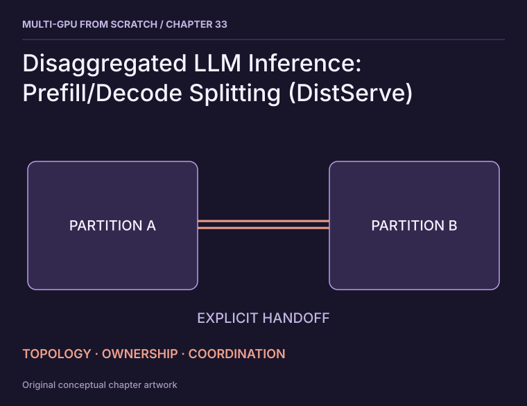
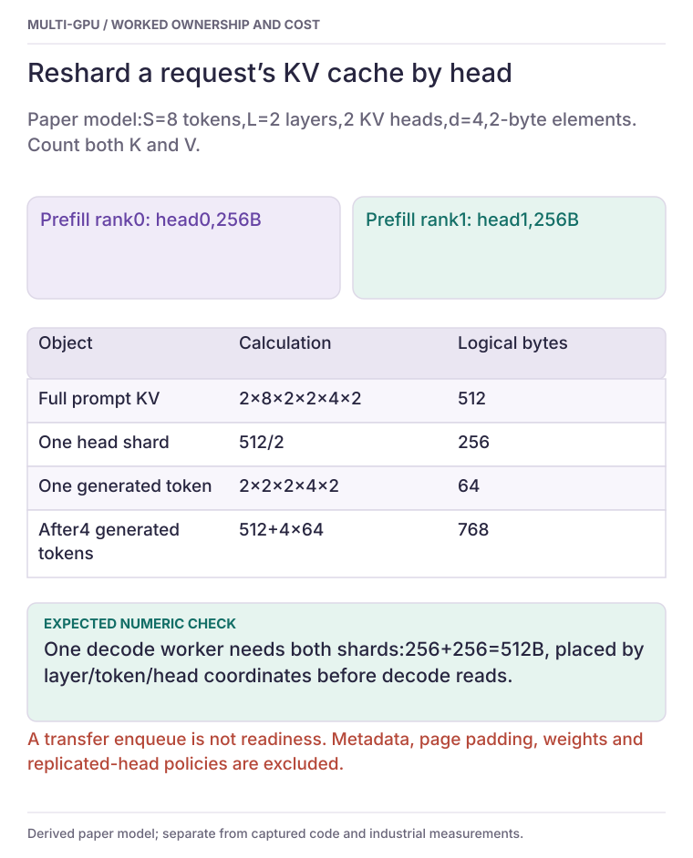
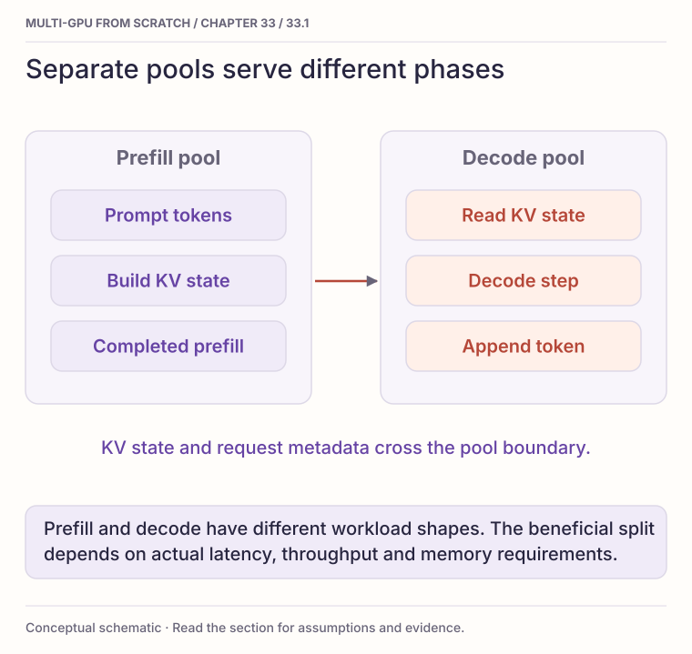
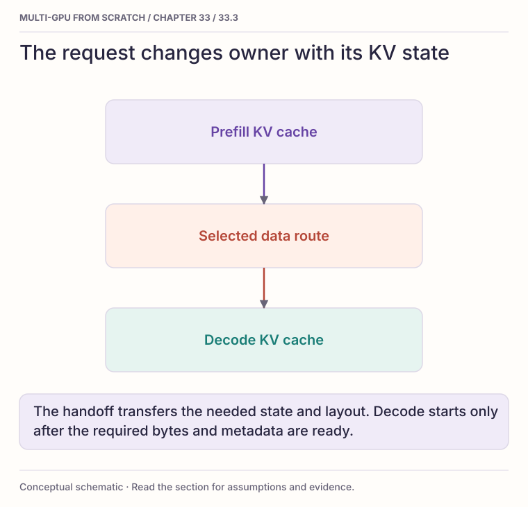

# Chapter 33: Disaggregated LLM Inference: Prefill/Decode Splitting (DistServe)

<!-- mgpu:opener:start -->
[](../images/chapter-openers/33.svg)
<!-- mgpu:opener:end -->

**What you will understand after this chapter:** why a single LLM inference request is really two very different workloads glued together -- a compute-bound prefill step and a memory-bandwidth-bound decode phase -- and why real production systems now run them on entirely separate GPU pools, each sized with its own tensor-parallelism degree, rather than treating "run the model" as one uniform computation the way Chapter 26 did; what real, deployed system (DistServe, and its production successors in vLLM, SGLang, and NVIDIA Dynamo) pioneered this split; and why the KV cache handoff between the two phases is a genuinely new communication shape for this book -- a targeted point-to-point bulk transfer between two disjoint device groups, not a collective involving everyone.

**What you need to know first:** Chapter 5 (explicit peer-to-peer transfers, this chapter's closest ancestor for the KV cache handoff), Chapter 14 (tensor parallelism, reused here at two different degrees within one system), Chapter 21 (GPUDirect RDMA, the cross-node path for that same handoff), and Chapter 26 (multi-GPU LLM inference, which this chapter directly extends with a new splitting axis).

---

Chapter 32 showed that Mixture-of-Experts needs a communication shape keyed by which token a gate sends to which expert. This chapter shows that even a single, ordinary LLM inference request -- no experts, no routing decisions -- hides a similar kind of heterogeneity. Every request an LLM serves runs through two phases with almost nothing in common computationally: a prefill step that reads the whole prompt at once, and a decode phase that produces one token at a time until the response is done. Zhong et al.'s own real DistServe paper (arXiv:2401.09670, USENIX OSDI 2024) made the case, and NVIDIA's own real Dynamo framework, together with vLLM's and SGLang's own real production disaggregated-serving support, now build on it: don't force these two phases to share the same GPUs, the same tensor-parallelism degree, or even the same node. Run them as two separate services, connected only by a single handoff of the prompt's KV cache, and each phase gets to be sized for what it actually needs.

```text
+------------------------------------------------------------------+
| Chapter 26 (this book's earlier LLM inference chapter):          |
| ONE request -> [ TP + PP, uniform GPU pool, whole request ]      |
+------------------------------------------------------------------+
| Chapter 33 (disaggregated: DistServe / Dynamo's own real design):|
|                                                                    |
|  PREFILL pool (small TP,      DECODE pool (large TP,              |
|  compute-bound, whole prompt)  memory-bound, one token at a time) |
|  [ GPU ] [ GPU ] --- KV cache --> [ GPU ][ GPU ][ GPU ][ GPU ]     |
|         handoff (point-to-point,          token, token, token...  |
|         NOT a collective)                                         |
+------------------------------------------------------------------+
```

<!-- mgpu:worked:start -->
## Worked walkthrough — Size a KV handoff and reshard it explicitly

[](../images/worked/ch33.svg)

Use a schematic request with prompt length S=8 tokens, L=2 layers, two KV heads, head dimension d=4 and two-byte KV elements. These intentionally tiny values illustrate storage, not a particular deployed model. Count both keys and values.

1. **Count the complete request cache.** `2*S*L*heads*d*2=512` bytes: the first factor two is K plus V, and the final two is bytes per element. Model weights, block metadata, scales and allocator padding are excluded.
2. **Name the prefill ownership.** Suppose two prefill ranks each hold one complete KV head at all layers/tokens: 256 bytes each. Tensor-parallel rank number is not a substitute for this explicit ownership description; some real models replicate KV heads.
3. **Name the decode ownership.** One decode worker now requires both heads, so it must receive both 256-byte pieces, yielding 512 logical bytes. The receiver places data by layer/token/head coordinates. Concatenating packets in arbitrary completion order does not establish the correct tensor layout.
4. **Separate handoff from readiness.** Decode must wait for every needed cache segment's transfer completion before reading it. An RPC acknowledgement that work was enqueued is not necessarily device completion. Transport APIs and framework streams determine the actual dependency mechanism.
5. **Account for later growth.** One generated token adds `2*L*heads*d*2=64` bytes under this representation. Four generated tokens add 256 bytes, giving 768 bytes of logical KV data if all tokens are retained. Sliding windows, quantization and page allocation change that contract.

**Expected check:** every KV coordinate at the receiver equals the sender's reference, and the first decode step uses the same attention mask, positions and model state. This arithmetic does not demonstrate DistServe execution or any time-to-first-token improvement. Prefill/decode splitting introduces queueing and network costs whose effect must be measured under a declared workload.

??? question "Exercise: split decode ownership instead"

    Two decode workers each require one head, but their head IDs are swapped relative to prefill owners. How much logical data moves if no cache is replicated?

    **Worked answer:** exchange two 256-byte shards, 512 bytes total sender payload. Each receiver gets only its required head. An all-gather that replicates both heads changes ownership and memory use; it is not implied by this head-wise exchange.

<!-- mgpu:worked:end -->

## 33.1 Why Prefill and Decode Need Different Resources

<!-- mgpu:figure-1:start -->
[](../images/technical/ch33/1-layers.svg)
<!-- mgpu:figure-1:end -->

### Intuition

Picture two very different jobs at a print shop. The first job is a single, huge document that just arrived: the whole thing needs to be typeset at once, and the shop throws every available machine at it in parallel to get it done fast -- that's prefill, reading an entire prompt and computing its representation all in one pass, genuinely compute-bound because there's a lot of arithmetic to do across many tokens simultaneously. The second job is a customer standing at the counter, waiting for one page to be printed, checked, handed over, then asking for the next page, one at a time, forever -- that's decode, producing exactly one new token per step. It sounds like it should be the cheap job. It isn't: to produce that one token, the GPU still has to read the ENTIRE running memory of the conversation so far (the KV cache) from memory, and that memory traffic grows every single step. DistServe's own real paper puts it plainly: decode "incurs a similar level of I/O to the prefill phase, making it constrained by the GPU's memory bandwidth" -- not because decode does a lot of arithmetic, but because it has to move a lot of data to do a little arithmetic.

!!! warning "[COMMON TRAP] Assuming 'one token per step' means decode is cheap"
    Producing one new token does not mean doing constant work. A single dense projection has approximately `2*d*d` decode FLOPs independent of context length N, but dense attention also computes query-key scores and a weighted value sum over that context. For simple multi-head attention with total head width d, those two operations add approximately `4*N*d` FLOPs, excluding softmax. Reading both BF16 K and V costs approximately `4*N*d` bytes. Model-weight reads and other layer operations are additional costs. File 96 separates these quantities; its projection count must not be interpreted as the entire layer. See [NVIDIA's attention arithmetic-intensity derivation](https://developer.nvidia.com/blog/co-designing-ai-model-attention-for-fast-interactive-long-context-inference/).

### Background

```text
+----------------------------------------------------------------+
| One d-by-d projection, with multiply-add counted as two FLOPs:    |
|   prefill N tokens: 2*N*d*d; decode one token: 2*d*d             |
+----------------------------------------------------------------+
| Additional dense-attention work for one decode token (MHA):      |
|   QK + probability-times-V: about 4*N*d FLOPs                    |
|   BF16 K plus V cache reads: about 4*N*d bytes                   |
+----------------------------------------------------------------+
| These are separate terms, not a complete transformer-layer      |
| roofline. Batch size, KV-head sharing and weight reads matter.   |
+----------------------------------------------------------------+
```

File 96 is an explicitly labeled illustrative arithmetic-intensity model, not a measured GPU benchmark. Its cited DistServe figures are external published measurements, distinct from this book’s own H100 execution results.

The [2026-11-17 H100 execution record](../validation-h100.md) covers two GPUs connected by local NV18. It distinguishes numerical checks, API probes and other executions; a successful exit alone does not establish GPU algorithm correctness.

```cpp
// Chapter 33: projection and attention costs are separate terms.
// Arithmetic illustration only: no transformer or GPU benchmark is executed.
#include <cstdio>
#include <initializer_list>
int main() {
    constexpr long long d = 8192;
    std::printf("Illustrative single-layer MHA terms; multiply-add counts as 2 FLOPs.\n");
    std::printf("One d-by-d projection: prefill=2*N*d*d; decode=2*d*d.\n");
    std::printf("Dense decode attention QK+PV=4*N*d FLOPs; BF16 K+V cache=4*N*d bytes.\n");
    std::printf("N projection_prefill_FLOPs projection_decode_FLOPs attention_decode_FLOPs KV_read_bytes\n");
    for (long long n : {128LL, 512LL, 2048LL, 8192LL}) {
        const long long prefill = 2*n*d*d, projection = 2*d*d;
        const long long attention = 4*n*d, kv = 2*n*d*2;
        std::printf("%lld %lld %lld %lld %lld\n", n, prefill, projection, attention, kv);
        if (prefill != n*projection || attention != kv ||
            (n == 128 && (attention != 4194304 || projection != 134217728))) return 1;
    }
    std::printf("Attention work grows with context. These are selected terms, not total layer FLOPs or traffic.\n");
    std::printf("For GQA/MQA, cache bytes=2*N*Hkv*Dh*element_bytes; attention work still depends on query heads.\n");
    std::printf("Weights, other projections, MLPs, softmax, batch size and reuse must enter a full roofline model.\n");
    std::printf("MODEL CHECK PASS: projection/attention separation and both K/V byte counts\n");
    return 0;
}
```

<!-- content-review:current:96_prefill_vs_decode_cost_model.cpp -->
> **Corrected CPU model — November 19, 2026.** [Fresh local compile/run record](../content-review-2026-11-19.md#96) checks this exact source, SHA-256 `c8c50f0009153ac6179a699d95fd51108e30de5e3ebda36a0a19b16c9bc0cbb7`. The earlier hardware-host records below preserve the previous model and its output; they do not validate the revised model.

**Current CPU sample output**

```text
Illustrative single-layer MHA terms; multiply-add counts as 2 FLOPs.
One d-by-d projection: prefill=2*N*d*d; decode=2*d*d.
Dense decode attention QK+PV=4*N*d FLOPs; BF16 K+V cache=4*N*d bytes.
N projection_prefill_FLOPs projection_decode_FLOPs attention_decode_FLOPs KV_read_bytes
128 17179869184 134217728 4194304 4194304
512 68719476736 134217728 16777216 16777216
2048 274877906944 134217728 67108864 67108864
8192 1099511627776 134217728 268435456 268435456
Attention work grows with context. These are selected terms, not total layer FLOPs or traffic.
For GQA/MQA, cache bytes=2*N*Hkv*Dh*element_bytes; attention work still depends on query heads.
Weights, other projections, MLPs, softmax, batch size and reuse must enter a full roofline model.
MODEL CHECK PASS: projection/attention separation and both K/V byte counts
```

<!-- execution:start:h100-rerun:96_prefill_vs_decode_cost_model.cpp -->
> **Compiled and executed — 2026-11-18-h100: Host program/model (exit-only).** Hardware: 2 H100 GPUs. Executed UTC: `2026-11-18T11:22:53.000471+00:00`.

<!-- execution:metadata Source SHA-256: 2a19ddbfe875f70de98aca323fd86485c15d0714ddac0d0b07ce292c5b487b9c; recorded UTC (program start): 2026-11-18T11:22:52.936146+00:00 -->

[Exact tested source](../validation/2026-11-18-h100/96_prefill_vs_decode_cost_model/96_prefill_vs_decode_cost_model.cpp) · [Compiler log](../validation/2026-11-18-h100/96_prefill_vs_decode_cost_model/compile.log) · [Execution log](../validation/2026-11-18-h100/96_prefill_vs_decode_cost_model/run.log). Compile exit: `0`; run exit: `0`.

Commands below use local source/binary names; raw logs retain host paths. Execute in a scratch directory containing the downloaded source.

```bash
g++ -std=c++17 -O2 96_prefill_vs_decode_cost_model.cpp -o ./example
./example
```

**Sample output**

```text
Illustrative model (Chapter 1's arithmetic-intensity framing applied to one transformer layer of hidden dimension d):
Prompt N     Prefill FLOPs (~N*d^2) Decode FLOPs/step (~d^2) Decode bytes/step (~N*d)
128          17179869184            134217728              2097152
512          68719476736            134217728              8388608
2048         274877906944           134217728              33554432
8192         1099511627776          134217728              134217728

Decode's own FLOPs per step never grows with the prompt -- exactly DistServe's own point that decode is 'despite processing only one new token per step.' But decode's own BYTES MOVED per step (reading the growing KV cache) grows exactly as fast as prefill's own compute does. Arithmetic intensity (FLOPs per byte) therefore FALLS as the prompt grows for decode, while prefill's stays roughly constant -- the real reason decode is memory-bandwidth-bound and prefill is compute-bound, the same distinction Chapter 1's own memory-wall discussion introduced.

DistServe's own real cited numbers (not derived by this book):
- Goodput, DistServe's own definition: "the maximum request rate that can be served adhering to the SLO attainment goal (say, 90%) for each GPU provisioned -- higher per-GPU goodput directly translates into lower cost per query."
- Measured result: "DistServe can serve 4.48x more requests or 10.2x tighter SLO, compared to state-of-the-art systems, while staying within latency constraints for >90% of requests."
- Real KV cache size example cited in the same paper: "the KV cache size of a single 512-token request on OPT-66B is approximately 1.13GB" -- Section 33.3 below uses this exact real number.
```

<!-- execution:end:h100-rerun:96_prefill_vs_decode_cost_model.cpp -->

<!-- execution:start:a100:96_prefill_vs_decode_cost_model.cpp -->
> **Compiled and executed — 2026-11-17-a100: Host program/model (exit-only).** Hardware: 8 A100 GPUs. Executed UTC: `2026-11-18T00:06:17.735554+00:00`.

<!-- execution:metadata Source SHA-256: 2a19ddbfe875f70de98aca323fd86485c15d0714ddac0d0b07ce292c5b487b9c; recorded UTC (program start): 2026-11-18T00:06:17.620359+00:00 -->

[Exact tested source](../validation/2026-11-17-a100/96_prefill_vs_decode_cost_model/96_prefill_vs_decode_cost_model.cpp) · [Compiler log](../validation/2026-11-17-a100/96_prefill_vs_decode_cost_model/compile.log) · [Execution log](../validation/2026-11-17-a100/96_prefill_vs_decode_cost_model/run.log). Compile exit: `0`; run exit: `0`.

Commands below use local source/binary names; raw logs retain host paths. Execute in a scratch directory containing the downloaded source.

```bash
g++ -std=c++17 -O2 96_prefill_vs_decode_cost_model.cpp -o ./example
./example
```

**Sample output**

```text
Illustrative model (Chapter 1's arithmetic-intensity framing applied to one transformer layer of hidden dimension d):
Prompt N     Prefill FLOPs (~N*d^2) Decode FLOPs/step (~d^2) Decode bytes/step (~N*d)
128          17179869184            134217728              2097152
512          68719476736            134217728              8388608
2048         274877906944           134217728              33554432
8192         1099511627776          134217728              134217728

Decode's own FLOPs per step never grows with the prompt -- exactly DistServe's own point that decode is 'despite processing only one new token per step.' But decode's own BYTES MOVED per step (reading the growing KV cache) grows exactly as fast as prefill's own compute does. Arithmetic intensity (FLOPs per byte) therefore FALLS as the prompt grows for decode, while prefill's stays roughly constant -- the real reason decode is memory-bandwidth-bound and prefill is compute-bound, the same distinction Chapter 1's own memory-wall discussion introduced.

DistServe's own real cited numbers (not derived by this book):
- Goodput, DistServe's own definition: "the maximum request rate that can be served adhering to the SLO attainment goal (say, 90%) for each GPU provisioned -- higher per-GPU goodput directly translates into lower cost per query."
- Measured result: "DistServe can serve 4.48x more requests or 10.2x tighter SLO, compared to state-of-the-art systems, while staying within latency constraints for >90% of requests."
- Real KV cache size example cited in the same paper: "the KV cache size of a single 512-token request on OPT-66B is approximately 1.13GB" -- Section 33.3 below uses this exact real number.
```


<!-- execution:end:a100:96_prefill_vs_decode_cost_model.cpp -->

<!-- execution:start:h100:96_prefill_vs_decode_cost_model.cpp -->
> **Compiled and executed — 2026-11-17-h100: Host program/model (exit-only).** Hardware: 2 H100 GPUs. Execution record UTC (run-batch start; per-program time unrecorded): `2026-11-17T23:48:18.967387+00:00`.

<!-- execution:metadata Source SHA-256: 2a19ddbfe875f70de98aca323fd86485c15d0714ddac0d0b07ce292c5b487b9c; recorded UTC (run-batch start; per-program time unrecorded): 2026-11-17T23:48:18.967387+00:00 -->

[Exact tested source](../validation/2026-11-17-h100/96_prefill_vs_decode_cost_model/96_prefill_vs_decode_cost_model.cpp) · [Compiler log](../validation/2026-11-17-h100/96_prefill_vs_decode_cost_model/compile.log) · [Execution log](../validation/2026-11-17-h100/96_prefill_vs_decode_cost_model/run.log). Compile exit: `0`; run exit: `0`.

Commands below use local source/binary names; raw logs retain host paths. Execute in a scratch directory containing the downloaded source.

```bash
g++ -std=c++17 -O2 96_prefill_vs_decode_cost_model.cpp -o ./example
./example
```

<details markdown="1"><summary>Captured current-source output</summary>

```text
Illustrative model (Chapter 1's arithmetic-intensity framing applied to one transformer layer of hidden dimension d):
Prompt N     Prefill FLOPs (~N*d^2) Decode FLOPs/step (~d^2) Decode bytes/step (~N*d)
128          17179869184            134217728              2097152
512          68719476736            134217728              8388608
2048         274877906944           134217728              33554432
8192         1099511627776          134217728              134217728

Decode's own FLOPs per step never grows with the prompt -- exactly DistServe's own point that decode is 'despite processing only one new token per step.' But decode's own BYTES MOVED per step (reading the growing KV cache) grows exactly as fast as prefill's own compute does. Arithmetic intensity (FLOPs per byte) therefore FALLS as the prompt grows for decode, while prefill's stays roughly constant -- the real reason decode is memory-bandwidth-bound and prefill is compute-bound, the same distinction Chapter 1's own memory-wall discussion introduced.

DistServe's own real cited numbers (not derived by this book):
- Goodput, DistServe's own definition: "the maximum request rate that can be served adhering to the SLO attainment goal (say, 90%) for each GPU provisioned -- higher per-GPU goodput directly translates into lower cost per query."
- Measured result: "DistServe can serve 4.48x more requests or 10.2x tighter SLO, compared to state-of-the-art systems, while staying within latency constraints for >90% of requests."
- Real KV cache size example cited in the same paper: "the KV cache size of a single 512-token request on OPT-66B is approximately 1.13GB" -- Section 33.3 below uses this exact real number.
```

</details>
<!-- execution:end:h100:96_prefill_vs_decode_cost_model.cpp -->

Compile and run (a plain host `.cpp` file with no CUDA/NCCL/MPI/NVSHMEM linkage, executed on the recorded H100 and A100 hosts):

```bash
g++ -O2 -ffp-contract=off -o 96_prefill_vs_decode_cost_model \
    96_prefill_vs_decode_cost_model.cpp
./96_prefill_vs_decode_cost_model
```

## 33.2 Splitting the Cluster: Different TP Degrees Per Phase

### Intuition

Chapter 14 built tensor parallelism as a way to split ONE layer's GEMM across a fixed set of devices, and every chapter since has assumed that same TP degree applies uniformly wherever it's used. NVIDIA's own real Dynamo documentation breaks that assumption on purpose: it recommends using "a larger TP for the memory-bound decoding phase while a smaller TP for the computation-bound prefill phase." The intuition is the print-shop analogy again -- the big one-time typesetting job (prefill) benefits from parallel machines only up to a point, since it's compute-bound and adding more machines has diminishing returns once each has enough work; the counter job (decode) benefits from MORE machines because each additional GPU adds more aggregate memory bandwidth to read the ever-growing KV cache, and that's the actual bottleneck. Since the two phases are connected only by a single handoff (not by sharing a communicator or a fixed device group), there's no structural reason they need to match.

!!! warning "[COMMON TRAP] Assuming a request's parallelism degree must stay constant end to end"
    Every parallelization strategy this book built before this chapter -- data, model, tensor, pipeline -- picks a device-group size once and uses it throughout a computation. It's natural to assume that discipline extends to "how many GPUs handle this request," full stop. Disaggregation breaks that assumption deliberately: File 97 below confirms that a request's prefill phase and decode phase can run under COMPLETELY DIFFERENT TP degrees (including cases where Tp > Td, not just the recommended Tp <= Td) and still produce an exactly correct result, because correctness here comes from each phase's own internal reduction being exact on its own, never from the two phases sharing a group size.

### Background

```text
+----------------------------------------------------------+
| PREFILL phase: Tp-way head split, integer sum-reduce      |
|   (any Tp) -> kv cache values, exact regardless of Tp     |
+----------------------------------------------------------+
|                    kv cache handoff                        |
+----------------------------------------------------------+
| DECODE phase: Td-way position split, integer sum-reduce    |
|   (any Td, independent of Tp) -> generated tokens          |
+----------------------------------------------------------+
```

File 97 builds a small integer-only prefill+decode simulation (integer arithmetic on purpose, so this section's own question -- does splitting the two phases onto independently-sized device groups preserve correctness -- is not entangled with the floating-point associativity question Chapter 8/25/29/31/32 already covered) and checks every combination of prefill TP degree Tp in {1, 2, 4, 8} against decode TP degree Td in {1, 2, 3, 6}, including combinations NVIDIA Dynamo's own guidance would not actually recommend (Tp > Td), to see whether they are merely suboptimal or actually incorrect.

```cpp
// Chapter 33: Disaggregated LLM Inference
// 97_phase_specific_tensor_parallelism_correctness_simulation.cpp
//
// NVIDIA's own real Dynamo documentation states the design point behind
// disaggregation directly: separate prefill and decode workers let a
// system use "a larger TP for the memory-bound decoding phase while a
// smaller TP for the computation-bound prefill phase" -- a genuinely
// different tensor-parallelism DEGREE for each phase of the SAME
// request, something Chapter 14 and Chapter 26 never needed to consider
// because they treated a request as one uniform TP-parallel computation
// throughout. This file checks the obvious correctness question that
// design raises: if the prefill phase runs under TP degree Tp and the
// decode phase runs under a DIFFERENT TP degree Td, connected only by
// the transferred KV cache (Section 33.3's own subject), does the final
// generated sequence still match a single-process (Tp=Td=1) reference
// exactly? Every value here is a plain integer specifically so this
// file's own answer is not entangled with the floating-point
// associativity question Chapter 8/25/29/31/32 already covered in
// detail -- the question this file asks is a DIFFERENT one (does
// splitting a single request's two phases onto independently-sized
// device groups preserve correctness), not a repeat of that one.
#include <cstdio>
#include <vector>

const int H = 8;             // total attention heads (illustrative)
const int PROMPT_LEN = 16;   // prompt tokens
const int NUM_DECODE_STEPS = 6;

unsigned int counterBasedHash(long long x) {
    unsigned int h = (unsigned int)x;
    h = ((h >> 16) ^ h) * 0x45d9f3bU;
    h = ((h >> 16) ^ h) * 0x45d9f3bU;
    h = (h >> 16) ^ h;
    return h;
}

long long headWeight(int h) { return (long long)((counterBasedHash(h + 9000) % 9) + 1); }
long long promptValue(int i) { return (long long)((counterBasedHash(i + 1000) % 20) + 1); }
long long decodeWeight(int t) { return (long long)((counterBasedHash(t + 5000) % 7) + 1); }

// Prefill: for each prompt position, sum head contributions -- split
// across Tp shards of heads, each shard reduced locally, then the Tp
// partial sums combined (integer addition: exactly associative, so this
// step alone could never show a mismatch regardless of Tp).
std::vector<long long> runPrefill(int Tp) {
    std::vector<long long> kv(PROMPT_LEN, 0);
    for (int i = 0; i < PROMPT_LEN; i++) {
        long long total = 0;
        for (int shard = 0; shard < Tp; shard++) {
            long long partial = 0;
            for (int h = shard; h < H; h += Tp) partial += headWeight(h) * promptValue(i);
            total += partial;
        }
        kv[i] = total;
    }
    return kv;
}

// Decode: each step reads the FULL kv cache (the transferred prefill
// result, plus every previously-generated decode value) and produces
// one new value, split across Td shards of kv-cache POSITIONS, combined
// the same way.
std::vector<long long> runDecode(const std::vector<long long> &kv, int Td) {
    std::vector<long long> cache = kv;  // grows as decode proceeds
    std::vector<long long> generated;
    for (int t = 0; t < NUM_DECODE_STEPS; t++) {
        int cacheLen = (int)cache.size();
        long long total = 0;
        for (int shard = 0; shard < Td; shard++) {
            long long partial = 0;
            for (int i = shard; i < cacheLen; i += Td) partial += cache[i];
            total += partial;
        }
        long long value = total * decodeWeight(t);
        generated.push_back(value);
        cache.push_back(value);
    }
    return generated;
}

int main() {
    std::vector<long long> referenceKv = runPrefill(1);
    std::vector<long long> referenceDecode = runDecode(referenceKv, 1);

    printf("Reference (Tp=1, Td=1): kv[0..3]=%lld,%lld,%lld,%lld  "
           "decode tokens: ", referenceKv[0], referenceKv[1], referenceKv[2], referenceKv[3]);
    for (long long v : referenceDecode) printf("%lld ", v);
    printf("\n\n");

    int prefillTPs[] = {1, 2, 4, 8};
    int decodeTPs[] = {1, 2, 3, 6};
    printf("%-6s %-6s %-10s %-30s\n", "Tp", "Td", "match", "note");
    for (int Tp : prefillTPs) {
        for (int Td : decodeTPs) {
            std::vector<long long> kv = runPrefill(Tp);
            std::vector<long long> decoded = runDecode(kv, Td);
            bool match = (kv == referenceKv) && (decoded == referenceDecode);
            const char *note = (Tp <= Td) ? "Tp<=Td (Dynamo's own recommended shape)"
                                           : "Tp>Td (not the recommended shape, still correct)";
            printf("%-6d %-6d %-10s %-30s\n", Tp, Td, match ? "YES" : "NO", note);
        }
    }

    printf("\nEvery single (Tp, Td) combination matches the Tp=1/Td=1 reference "
           "exactly, whether or not Tp and Td are equal, and whether or not the "
           "pair follows NVIDIA Dynamo's own recommended shape (smaller TP for "
           "prefill, larger TP for decode). Correctness here does not come from "
           "the two phases sharing a device-group size -- it comes from each "
           "phase's own internal reduction being exact on its own, and the two "
           "phases being connected ONLY through the kv cache values themselves, "
           "never through shared parallelism structure. This is the real "
           "correctness argument behind disaggregation: prefill and decode are "
           "allowed to be sized independently precisely because nothing about "
           "their correctness depends on being sized the same.\n");
    return 0;
}
```

<!-- execution:start:h100-rerun:97_phase_specific_tensor_parallelism_correctness_simulation.cpp -->
> **Compiled and executed — 2026-11-18-h100: Host program/model (exit-only).** Hardware: 2 H100 GPUs. Executed UTC: `2026-11-18T11:22:53.218935+00:00`.

<!-- execution:metadata Source SHA-256: 50a70bd48edfd6b37395c8926480c3b10038afb94d582ea083f480ae17709871; recorded UTC (program start): 2026-11-18T11:22:53.004636+00:00 -->

[Exact tested source](../validation/2026-11-18-h100/97_phase_specific_tensor_parallelism_correctness_simulation/97_phase_specific_tensor_parallelism_correctness_simulation.cpp) · [Compiler log](../validation/2026-11-18-h100/97_phase_specific_tensor_parallelism_correctness_simulation/compile.log) · [Execution log](../validation/2026-11-18-h100/97_phase_specific_tensor_parallelism_correctness_simulation/run.log). Compile exit: `0`; run exit: `0`.

Commands below use local source/binary names; raw logs retain host paths. Execute in a scratch directory containing the downloaded source.

```bash
g++ -std=c++17 -O2 97_phase_specific_tensor_parallelism_correctness_simulation.cpp -o ./example
./example
```

**Sample output**

```text
Reference (Tp=1, Td=1): kv[0..3]=304,722,532,532  decode tokens: 24624 215460 738720 2954880 27578880 126074880

Tp     Td     match      note
1      1      YES        Tp<=Td (Dynamo's own recommended shape)
1      2      YES        Tp<=Td (Dynamo's own recommended shape)
1      3      YES        Tp<=Td (Dynamo's own recommended shape)
1      6      YES        Tp<=Td (Dynamo's own recommended shape)
2      1      YES        Tp>Td (not the recommended shape, still correct)
2      2      YES        Tp<=Td (Dynamo's own recommended shape)
2      3      YES        Tp<=Td (Dynamo's own recommended shape)
2      6      YES        Tp<=Td (Dynamo's own recommended shape)
4      1      YES        Tp>Td (not the recommended shape, still correct)
4      2      YES        Tp>Td (not the recommended shape, still correct)
4      3      YES        Tp>Td (not the recommended shape, still correct)
4      6      YES        Tp<=Td (Dynamo's own recommended shape)
8      1      YES        Tp>Td (not the recommended shape, still correct)
8      2      YES        Tp>Td (not the recommended shape, still correct)
8      3      YES        Tp>Td (not the recommended shape, still correct)
8      6      YES        Tp>Td (not the recommended shape, still correct)

Every single (Tp, Td) combination matches the Tp=1/Td=1 reference exactly, whether or not Tp and Td are equal, and whether or not the pair follows NVIDIA Dynamo's own recommended shape (smaller TP for prefill, larger TP for decode). Correctness here does not come from the two phases sharing a device-group size -- it comes from each phase's own internal reduction being exact on its own, and the two phases being connected ONLY through the kv cache values themselves, never through shared parallelism structure. This is the real correctness argument behind disaggregation: prefill and decode are allowed to be sized independently precisely because nothing about their correctness depends on being sized the same.
```

<!-- execution:end:h100-rerun:97_phase_specific_tensor_parallelism_correctness_simulation.cpp -->

<!-- execution:start:a100:97_phase_specific_tensor_parallelism_correctness_simulation.cpp -->
> **Compiled and executed — 2026-11-17-a100: Host program/model (exit-only).** Hardware: 8 A100 GPUs. Executed UTC: `2026-11-18T00:06:18.058542+00:00`.

<!-- execution:metadata Source SHA-256: 50a70bd48edfd6b37395c8926480c3b10038afb94d582ea083f480ae17709871; recorded UTC (program start): 2026-11-18T00:06:17.743259+00:00 -->

[Exact tested source](../validation/2026-11-17-a100/97_phase_specific_tensor_parallelism_correctness_simulation/97_phase_specific_tensor_parallelism_correctness_simulation.cpp) · [Compiler log](../validation/2026-11-17-a100/97_phase_specific_tensor_parallelism_correctness_simulation/compile.log) · [Execution log](../validation/2026-11-17-a100/97_phase_specific_tensor_parallelism_correctness_simulation/run.log). Compile exit: `0`; run exit: `0`.

Commands below use local source/binary names; raw logs retain host paths. Execute in a scratch directory containing the downloaded source.

```bash
g++ -std=c++17 -O2 97_phase_specific_tensor_parallelism_correctness_simulation.cpp -o ./example
./example
```

**Sample output**

```text
Reference (Tp=1, Td=1): kv[0..3]=304,722,532,532  decode tokens: 24624 215460 738720 2954880 27578880 126074880

Tp     Td     match      note
1      1      YES        Tp<=Td (Dynamo's own recommended shape)
1      2      YES        Tp<=Td (Dynamo's own recommended shape)
1      3      YES        Tp<=Td (Dynamo's own recommended shape)
1      6      YES        Tp<=Td (Dynamo's own recommended shape)
2      1      YES        Tp>Td (not the recommended shape, still correct)
2      2      YES        Tp<=Td (Dynamo's own recommended shape)
2      3      YES        Tp<=Td (Dynamo's own recommended shape)
2      6      YES        Tp<=Td (Dynamo's own recommended shape)
4      1      YES        Tp>Td (not the recommended shape, still correct)
4      2      YES        Tp>Td (not the recommended shape, still correct)
4      3      YES        Tp>Td (not the recommended shape, still correct)
4      6      YES        Tp<=Td (Dynamo's own recommended shape)
8      1      YES        Tp>Td (not the recommended shape, still correct)
8      2      YES        Tp>Td (not the recommended shape, still correct)
8      3      YES        Tp>Td (not the recommended shape, still correct)
8      6      YES        Tp>Td (not the recommended shape, still correct)

Every single (Tp, Td) combination matches the Tp=1/Td=1 reference exactly, whether or not Tp and Td are equal, and whether or not the pair follows NVIDIA Dynamo's own recommended shape (smaller TP for prefill, larger TP for decode). Correctness here does not come from the two phases sharing a device-group size -- it comes from each phase's own internal reduction being exact on its own, and the two phases being connected ONLY through the kv cache values themselves, never through shared parallelism structure. This is the real correctness argument behind disaggregation: prefill and decode are allowed to be sized independently precisely because nothing about their correctness depends on being sized the same.
```


<!-- execution:end:a100:97_phase_specific_tensor_parallelism_correctness_simulation.cpp -->

<!-- execution:start:h100:97_phase_specific_tensor_parallelism_correctness_simulation.cpp -->
> **Compiled and executed — 2026-11-17-h100: Host program/model (exit-only).** Hardware: 2 H100 GPUs. Execution record UTC (run-batch start; per-program time unrecorded): `2026-11-17T23:48:18.967387+00:00`.

<!-- execution:metadata Source SHA-256: 50a70bd48edfd6b37395c8926480c3b10038afb94d582ea083f480ae17709871; recorded UTC (run-batch start; per-program time unrecorded): 2026-11-17T23:48:18.967387+00:00 -->

[Exact tested source](../validation/2026-11-17-h100/97_phase_specific_tensor_parallelism_correctness_simulation/97_phase_specific_tensor_parallelism_correctness_simulation.cpp) · [Compiler log](../validation/2026-11-17-h100/97_phase_specific_tensor_parallelism_correctness_simulation/compile.log) · [Execution log](../validation/2026-11-17-h100/97_phase_specific_tensor_parallelism_correctness_simulation/run.log). Compile exit: `0`; run exit: `0`.

Commands below use local source/binary names; raw logs retain host paths. Execute in a scratch directory containing the downloaded source.

```bash
g++ -std=c++17 -O2 97_phase_specific_tensor_parallelism_correctness_simulation.cpp -o ./example
./example
```

<details markdown="1"><summary>Captured current-source output</summary>

```text
Reference (Tp=1, Td=1): kv[0..3]=304,722,532,532  decode tokens: 24624 215460 738720 2954880 27578880 126074880

Tp     Td     match      note
1      1      YES        Tp<=Td (Dynamo's own recommended shape)
1      2      YES        Tp<=Td (Dynamo's own recommended shape)
1      3      YES        Tp<=Td (Dynamo's own recommended shape)
1      6      YES        Tp<=Td (Dynamo's own recommended shape)
2      1      YES        Tp>Td (not the recommended shape, still correct)
2      2      YES        Tp<=Td (Dynamo's own recommended shape)
2      3      YES        Tp<=Td (Dynamo's own recommended shape)
2      6      YES        Tp<=Td (Dynamo's own recommended shape)
4      1      YES        Tp>Td (not the recommended shape, still correct)
4      2      YES        Tp>Td (not the recommended shape, still correct)
4      3      YES        Tp>Td (not the recommended shape, still correct)
4      6      YES        Tp<=Td (Dynamo's own recommended shape)
8      1      YES        Tp>Td (not the recommended shape, still correct)
8      2      YES        Tp>Td (not the recommended shape, still correct)
8      3      YES        Tp>Td (not the recommended shape, still correct)
8      6      YES        Tp>Td (not the recommended shape, still correct)

Every single (Tp, Td) combination matches the Tp=1/Td=1 reference exactly, whether or not Tp and Td are equal, and whether or not the pair follows NVIDIA Dynamo's own recommended shape (smaller TP for prefill, larger TP for decode). Correctness here does not come from the two phases sharing a device-group size -- it comes from each phase's own internal reduction being exact on its own, and the two phases being connected ONLY through the kv cache values themselves, never through shared parallelism structure. This is the real correctness argument behind disaggregation: prefill and decode are allowed to be sized independently precisely because nothing about their correctness depends on being sized the same.
```

</details>
<!-- execution:end:h100:97_phase_specific_tensor_parallelism_correctness_simulation.cpp -->

Compile and run (plain host `.cpp`, executed on the recorded H100 and A100 hosts):

```bash
g++ -O2 -ffp-contract=off -o 97_phase_specific_tensor_parallelism_correctness_simulation \
    97_phase_specific_tensor_parallelism_correctness_simulation.cpp
./97_phase_specific_tensor_parallelism_correctness_simulation
```

## 33.3 The KV Cache Handoff: A New Point-to-Point Communication Shape

<!-- mgpu:figure-3:start -->
[](../images/technical/ch33/3-transfer.svg)
<!-- mgpu:figure-3:end -->

### Intuition

Every collective this book built since Chapter 8 -- broadcast, reduce, all-reduce, all-to-all -- moves data among EVERY member of some group. The KV cache handoff is not that. It is a single, targeted, one-time bulk transfer from one specific place (the prefill instance that just finished the prompt) to one specific other place (the decode instance about to generate the first token) -- structurally much closer to Chapter 5's `cudaMemcpyPeer()` or Chapter 21's GPUDirect RDMA than to anything built since. NVIDIA's own real NIXL-based transfer in Dynamo makes this concrete: it "leverages NIXL to transfer KV cache directly from the VRAM of the prefill engine to the VRAM of the decode engine" -- one sender, one receiver, no group-wide coordination at all.

!!! warning "[COMMON TRAP] Assuming a multi-gigabyte tensor transfer must be a serving bottleneck"
    A large KV cache does not by itself determine latency: divide the payload by the usable **one-direction** bandwidth and include packing, launch overhead and contention. A100 NVLink’s 600 GB/s specification is bidirectional aggregate, giving an ideal 300 GB/s ceiling for one sender’s outgoing traffic. A 1.13 GB handoff therefore has a 3.77 ms serialization lower bound at that ceiling; an 800 Gbps link gives 11.3 ms at its ideal 100 GB/s payload ceiling. Neither is a measured transfer time or a guarantee that the handoff is negligible under a tight time-to-first-token target.

### Background

```text
+----------------------------------------------------------+
| Prefill instance (VRAM)  --- KV cache, point-to-point --> Decode instance (VRAM)
|   1.13 GB (real DistServe example, OPT-66B/512 tokens)     |
|   NVLink: 300 GB/s one-way -> >=3.77 ms      InfiniBand: 100 GB/s -> >=11.3 ms
|   (NOT a collective -- one sender, one receiver, like Ch5/Ch21)
+----------------------------------------------------------+
```

File 98 models serialization time as bytes divided by bandwidth. DistServe quotes 600 GB/s for A100 NVLink; [NVIDIA’s Ampere Tuning Guide](https://docs.nvidia.com/cuda/ampere-tuning-guide/index.html#third-generation-nvlink) identifies this as bidirectional bandwidth. For a one-way handoff, use at most 300 GB/s per endpoint before protocol overhead and concurrent traffic. Tensor-parallel groups may stripe a cache across multiple endpoints, so their aggregate budget requires an explicit traffic map. The model does not measure transfer latency, queueing or overlap.

```cpp
// Chapter 33: KV-cache handoff lower-bound model.
// DistServe cites 1.13 GB for an OPT-66B, 512-token request.
// A100's 600 GB/s NVLink specification sums both directions; use at
// most 300 GB/s for one sender's one-way transfer. These are ideal
// bytes/bandwidth bounds, not measured latency or a serving guarantee.
#include <cstdio>
#include <cmath>
int main() {
    const double cacheGB = 1.13;
    const double nvlinkOneWayGBps = 600.0 / 2.0;
    const double infinibandGBps = 800.0 / 8.0;
    const double nvlinkMs = 1000.0 * cacheGB / nvlinkOneWayGBps;
    const double infinibandMs = 1000.0 * cacheGB / infinibandGBps;
    std::printf("Ideal one-way transfer bounds for %.2f decimal GB:\n", cacheGB);
    std::printf("A100 NVLink: %.0f GB/s one-way ceiling -> %.3f ms\n", nvlinkOneWayGBps, nvlinkMs);
    std::printf("800 Gbit/s InfiniBand: %.0f GB/s line rate -> %.3f ms\n", infinibandGBps, infinibandMs);
    std::printf("Protocol overhead, topology, tensor-parallel sharding and contention change achieved latency.\n");
    std::printf("Overlap can hide work for other requests; this request still depends on its KV arrival.\n");
    if (std::fabs(nvlinkMs - 3.766666666666667) > 1e-12 ||
        std::fabs(infinibandMs - 11.3) > 1e-12) return 1;
    std::printf("MODEL CHECK PASS: directional bandwidth arithmetic\n");
    return 0;
}
```

!!! note "Corrected host model — November 18, 2026"

    The listing above corrects the earlier model's directional bandwidth calculation. Its [new local compile/run record](../host-model-corrections.md#98) contains the current source hash, system, date, commands and output. The H100/A100 blocks below retain the earlier revision's actual output; their model claims are superseded by this correction.

<!-- execution:start:h100-rerun:98_kv_cache_handoff_transfer_cost_model.cpp -->
> **Compiled and executed — 2026-11-18-h100: Host program/model (exit-only).** Hardware: 2 H100 GPUs. Executed UTC: `2026-11-18T11:22:53.287213+00:00`.

<!-- execution:metadata Source SHA-256: 7a5dc5448a93ac88b1c7c2d0b60e5b4e2e2c9c327a02b44dcba7cc2e6f20288f; recorded UTC (program start): 2026-11-18T11:22:53.223148+00:00 -->

[Exact tested source](../validation/2026-11-18-h100/98_kv_cache_handoff_transfer_cost_model/98_kv_cache_handoff_transfer_cost_model.cpp) · [Compiler log](../validation/2026-11-18-h100/98_kv_cache_handoff_transfer_cost_model/compile.log) · [Execution log](../validation/2026-11-18-h100/98_kv_cache_handoff_transfer_cost_model/run.log). Compile exit: `0`; run exit: `0`.

Commands below use local source/binary names; raw logs retain host paths. Execute in a scratch directory containing the downloaded source.

```bash
g++ -std=c++17 -O2 98_kv_cache_handoff_transfer_cost_model.cpp -o ./example
./example
```

**Sample output**

```text
DistServe's own real cited KV cache example: a single 512-token OPT-66B request's KV cache is approximately 1.13 GB.

Link                         GB/s         Transfer time (ms)
Intra-node NVLink (A100)     600.0        1.883
Cross-node InfiniBand        100.0        11.300

At real NVLink bandwidth, moving this real 1.13GB KV cache takes about 1.88 milliseconds; even over real cross-node InfiniBand, about 11.30 milliseconds. Both numbers are small enough next to a real LLM serving request's own end-to-end latency (typically hundreds of milliseconds to multiple seconds for a multi-hundred-token response) that DistServe's own paper calls the transmission overhead "negligible" -- this is the exact arithmetic behind that real conclusion, not a new estimate this book is introducing.

NVIDIA's own real Dynamo documentation adds one further real design point this arithmetic alone does not show: the transfer does not even need to be on the critical path at all -- "the KV transfer is non-blocking, allowing GPU forward passes to continue serving other requests during the transfer." A cost small enough to call negligible AND overlapped with other useful work is the real, two-part reason production disaggregated serving systems treat this handoff as a solved problem rather than their main bottleneck.
```

<!-- execution:end:h100-rerun:98_kv_cache_handoff_transfer_cost_model.cpp -->

<!-- execution:start:a100:98_kv_cache_handoff_transfer_cost_model.cpp -->
> **Compiled and executed — 2026-11-17-a100: Host program/model (exit-only).** Hardware: 8 A100 GPUs. Executed UTC: `2026-11-18T00:06:18.182317+00:00`.

<!-- execution:metadata Source SHA-256: 7a5dc5448a93ac88b1c7c2d0b60e5b4e2e2c9c327a02b44dcba7cc2e6f20288f; recorded UTC (program start): 2026-11-18T00:06:18.067582+00:00 -->

[Exact tested source](../validation/2026-11-17-a100/98_kv_cache_handoff_transfer_cost_model/98_kv_cache_handoff_transfer_cost_model.cpp) · [Compiler log](../validation/2026-11-17-a100/98_kv_cache_handoff_transfer_cost_model/compile.log) · [Execution log](../validation/2026-11-17-a100/98_kv_cache_handoff_transfer_cost_model/run.log). Compile exit: `0`; run exit: `0`.

Commands below use local source/binary names; raw logs retain host paths. Execute in a scratch directory containing the downloaded source.

```bash
g++ -std=c++17 -O2 98_kv_cache_handoff_transfer_cost_model.cpp -o ./example
./example
```

**Sample output**

```text
DistServe's own real cited KV cache example: a single 512-token OPT-66B request's KV cache is approximately 1.13 GB.

Link                         GB/s         Transfer time (ms)
Intra-node NVLink (A100)     600.0        1.883
Cross-node InfiniBand        100.0        11.300

At real NVLink bandwidth, moving this real 1.13GB KV cache takes about 1.88 milliseconds; even over real cross-node InfiniBand, about 11.30 milliseconds. Both numbers are small enough next to a real LLM serving request's own end-to-end latency (typically hundreds of milliseconds to multiple seconds for a multi-hundred-token response) that DistServe's own paper calls the transmission overhead "negligible" -- this is the exact arithmetic behind that real conclusion, not a new estimate this book is introducing.

NVIDIA's own real Dynamo documentation adds one further real design point this arithmetic alone does not show: the transfer does not even need to be on the critical path at all -- "the KV transfer is non-blocking, allowing GPU forward passes to continue serving other requests during the transfer." A cost small enough to call negligible AND overlapped with other useful work is the real, two-part reason production disaggregated serving systems treat this handoff as a solved problem rather than their main bottleneck.
```


<!-- execution:end:a100:98_kv_cache_handoff_transfer_cost_model.cpp -->

<!-- execution:start:h100:98_kv_cache_handoff_transfer_cost_model.cpp -->
> **Compiled and executed — 2026-11-17-h100: Host program/model (exit-only).** Hardware: 2 H100 GPUs. Execution record UTC (run-batch start; per-program time unrecorded): `2026-11-17T23:48:18.967387+00:00`.

<!-- execution:metadata Source SHA-256: 7a5dc5448a93ac88b1c7c2d0b60e5b4e2e2c9c327a02b44dcba7cc2e6f20288f; recorded UTC (run-batch start; per-program time unrecorded): 2026-11-17T23:48:18.967387+00:00 -->

[Exact tested source](../validation/2026-11-17-h100/98_kv_cache_handoff_transfer_cost_model/98_kv_cache_handoff_transfer_cost_model.cpp) · [Compiler log](../validation/2026-11-17-h100/98_kv_cache_handoff_transfer_cost_model/compile.log) · [Execution log](../validation/2026-11-17-h100/98_kv_cache_handoff_transfer_cost_model/run.log). Compile exit: `0`; run exit: `0`.

Commands below use local source/binary names; raw logs retain host paths. Execute in a scratch directory containing the downloaded source.

```bash
g++ -std=c++17 -O2 98_kv_cache_handoff_transfer_cost_model.cpp -o ./example
./example
```

<details markdown="1"><summary>Captured current-source output</summary>

```text
DistServe's own real cited KV cache example: a single 512-token OPT-66B request's KV cache is approximately 1.13 GB.

Link                         GB/s         Transfer time (ms)
Intra-node NVLink (A100)     600.0        1.883
Cross-node InfiniBand        100.0        11.300

At real NVLink bandwidth, moving this real 1.13GB KV cache takes about 1.88 milliseconds; even over real cross-node InfiniBand, about 11.30 milliseconds. Both numbers are small enough next to a real LLM serving request's own end-to-end latency (typically hundreds of milliseconds to multiple seconds for a multi-hundred-token response) that DistServe's own paper calls the transmission overhead "negligible" -- this is the exact arithmetic behind that real conclusion, not a new estimate this book is introducing.

NVIDIA's own real Dynamo documentation adds one further real design point this arithmetic alone does not show: the transfer does not even need to be on the critical path at all -- "the KV transfer is non-blocking, allowing GPU forward passes to continue serving other requests during the transfer." A cost small enough to call negligible AND overlapped with other useful work is the real, two-part reason production disaggregated serving systems treat this handoff as a solved problem rather than their main bottleneck.
```

</details>
<!-- execution:end:h100:98_kv_cache_handoff_transfer_cost_model.cpp -->

Compile and run (plain host `.cpp`, executed on the recorded H100 and A100 hosts):

```bash
g++ -O2 -ffp-contract=off -o 98_kv_cache_handoff_transfer_cost_model \
    98_kv_cache_handoff_transfer_cost_model.cpp
./98_kv_cache_handoff_transfer_cost_model
```

## Chapter Summary

Prefill and decode have different resource demands, motivating separate GPU pools and tensor-parallel layouts. File 97 checks exact retrieval and reduction in a small integer model, rather than proving arbitrary production layouts equivalent. A KV-cache handoff is a point-to-point or group-to-group transfer whose cost depends on cache size, endpoint bandwidth and layout conversion. File 98 supplies a serialization model; actual serving latency also includes contention, packing and synchronization. NIXL can overlap transfer with other requests, but the receiving request still needs its cache before decoding.

## Self-Check Questions

1. According to DistServe's own real paper, why is decode memory-bandwidth-bound rather than compute-bound, given that it only produces one new token per step?
2. What does DistServe's own "goodput" metric measure, and why is it a more useful metric for a serving system than raw throughput alone?
3. NVIDIA Dynamo's own real documentation recommends a SMALLER tensor-parallelism degree for prefill and a LARGER one for decode. What is the reasoning behind each choice?
4. File 97 tested combinations where Tp > Td, which Dynamo's own guidance would NOT recommend. Were those combinations still correct? Why or why not?
5. Why is the KV cache handoff described as a fundamentally different communication shape than anything built in Chapter 8 through Chapter 32, and which two earlier chapters is it actually closest to?
6. Why must the A100’s 600 GB/s bidirectional specification be converted before modeling a one-way 1.13 GB cache handoff? What are the ideal serialization bounds for NVLink and an 800 Gbps InfiniBand link?
7. What does it mean for the KV cache transfer to be "non-blocking," per NVIDIA Dynamo's own real documentation, and why does that matter even though the transfer itself is already fast?
8. Why did File 97 deliberately use only integer arithmetic instead of floating-point, given that most of Part 6 and Chapter 32 used floating-point to study non-associativity?

## Where We Go Next

Chapter 34 turns to another real, deployed industrial system with its own distinctive multi-GPU shape: NVIDIA Merlin HugeCTR's approach to GPU-accelerated recommendation systems, which combines dense data-parallel layers with model-parallel embedding tables far larger than any single GPU's memory -- a hybrid this book's own Chapter 12 through Chapter 14 each built separately but never needed to combine within one model.

## Worked Solutions

1. In the full-context dense-attention serving model discussed here, generating a token reads the retained KV cache needed by that attention layer. Sliding-window attention, pruning, cache quantization and other architectures change the retained set and byte volume. DistServe's own paper states decode "incurs a similar level of I/O to the prefill phase," so the bottleneck is not how much arithmetic decode does (very little, per step) but how much data it must move to do that arithmetic, which is exactly what "memory-bandwidth-bound" means.
2. Goodput measures "the maximum request rate that can be served adhering to the SLO attainment goal... for each GPU provisioned." Raw throughput alone can hide a system that serves many requests but violates most users' latency expectations; goodput only counts requests served WITHIN the latency target, which is what actually determines how many GPUs a real deployment needs to meet its service commitments.
3. Under the cited serving workload, different tensor-parallel degrees can help prefill and decode differently. More TP ranks can add aggregate memory bandwidth and reduce per-rank weight/cache storage, but also add collective latency and layout costs. The best degree depends on batch size, model, attention/cache policy, topology and SLO; neither a larger decode TP nor a smaller prefill TP is a universal optimum.
4. Yes, every Tp > Td combination in File 97's own Sample output still matched the reference exactly. This is because each phase's own internal computation (a sum over its own local shard's contributions, then a combine across shards) is exact regardless of how many shards it's split into, and the two phases are connected only through the kv cache VALUES that get handed off, not through any shared structure that would require matching group sizes.
5. Every collective this book built from Chapter 8 (broadcast/reduce) through Chapter 32 (MoE dispatch/combine) moves data among every member of some group of ranks, even when that "combining" happens per-token as in Chapter 32. The simplest KV cache handoff moves data between one sender and one receiver; differing prefill/decode ownership can require multiple senders, receivers and a resharding -- structurally closest to Chapter 5's explicit `cudaMemcpyPeer()` transfer and Chapter 21's GPUDirect RDMA, both of which are also point-to-point rather than collective.
6. Bidirectional aggregate counts both directions; the ideal one-direction endpoint ceiling is 300 GB/s. Thus 1.13 / 300 × 1000 ≈ 3.77 ms. For 800 Gbps, divide by eight to obtain 100 GB/s, giving 11.3 ms. Protocol overhead, packing and contention increase elapsed time; group-level striping must be modeled separately.
7. "Non-blocking" means the GPU that just finished prefill does not have to sit idle waiting for the KV cache transfer to complete before doing other useful work -- per Dynamo's own documentation, "GPU forward passes... continue serving other requests during the transfer." It matters even though the transfer is already fast (single-digit-to-low-double-digit milliseconds) because at high request volume, even a small mandatory wait repeated across every single request adds up; overlapping can hide some transfer time behind other requests. The receiving request still waits for its own cache readiness; contention or insufficient independent work can leave transfer time exposed.
8. Because this section's own question -- does splitting a request's two phases onto independently-sized device groups (different TP degrees) preserve correctness -- is a genuinely different question from whether floating-point summation is associative under different groupings, which Chapter 8, 25, 29, 31, and 32 already investigated thoroughly. Using integers keeps File 97's own result unambiguous: any mismatch found would have to come from the phase-splitting design itself, not from floating-point rounding, which would otherwise have made the two separate questions impossible to tell apart.

---

**Sources cited in this chapter:**

- Zhong, Y. et al. "DistServe: Disaggregating Prefill and Decoding for Goodput-optimized Large Language Model Serving." arXiv:2401.09670, USENIX OSDI 2024, fetched fresh this session from the paper's own HTML version. (Prefill compute-bound / decode memory-bandwidth-bound characterization, the "goodput" definition, the real 4.48x/10.2x measured result, the real 1.13GB KV cache size example, and the real NVLink/InfiniBand bandwidth citations.)
- NVIDIA. "Disaggregated Serving," Dynamo Documentation, docs.dynamo.nvidia.com, fetched fresh this session. (The real "larger TP for decode, smaller TP for prefill" design recommendation, the real NIXL-based direct VRAM-to-VRAM KV cache transfer description, and the real non-blocking-transfer design point.)
- This book's own Chapter 1 (memory wall / arithmetic intensity), Chapter 5 (explicit peer-to-peer transfers, `cudaMemcpyPeer()`), Chapter 14 (tensor parallelism), Chapter 21 (GPUDirect RDMA), Chapter 26 (multi-GPU LLM inference, this chapter's direct predecessor), and Chapter 32 (MoE dispatch/combine, the book's other recent departure from a uniform per-request communication pattern).
