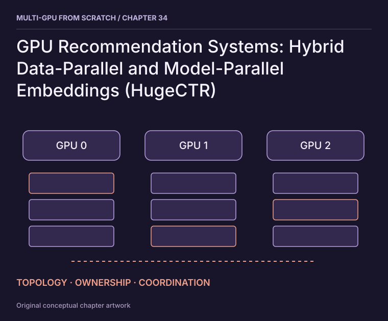
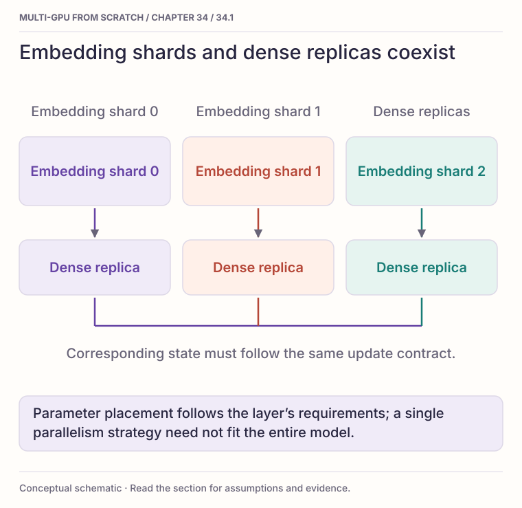
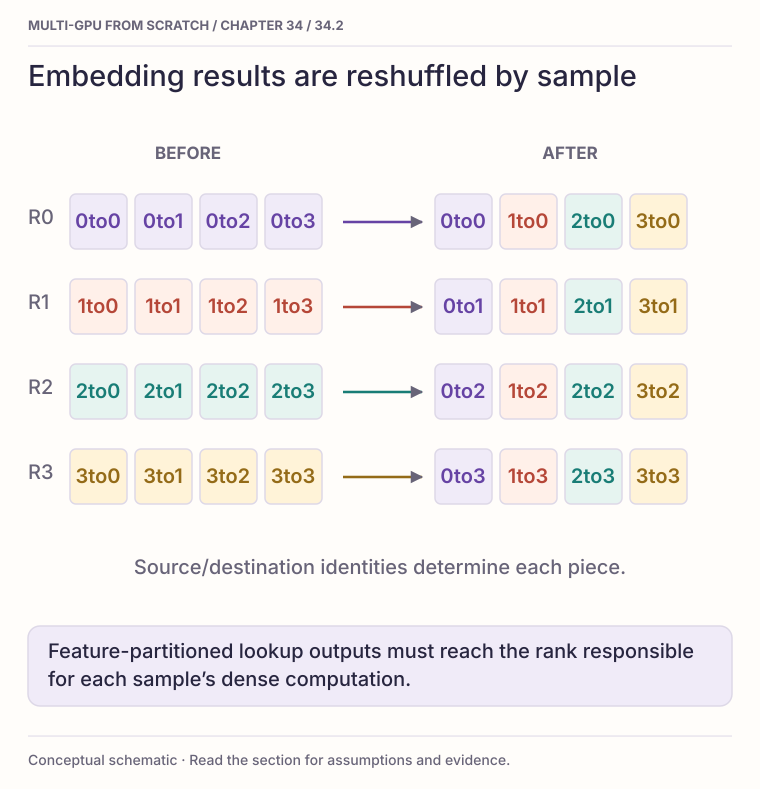

# Chapter 34: GPU Recommendation Systems: Hybrid Data-Parallel and Model-Parallel Embeddings (HugeCTR)

<!-- mgpu:opener:start -->
[](../images/chapter-openers/34.svg)
<!-- mgpu:opener:end -->

**What you will understand after this chapter:** why a single recommendation model routinely needs Chapter 12's data parallelism and Chapter 13's model parallelism at the SAME TIME, applied to two different parts of the same model, rather than picking one strategy for the whole thing the way every earlier chapter did; how NVIDIA's own real, deployed Merlin HugeCTR framework's "hybrid embedding" design uses Chapter 10's all-to-all for a genuinely new purpose -- reassembling data from one parallelism scheme into another, on a fixed deterministic schedule, not a gating decision like Chapter 32's Mixture-of-Experts -- and why sharding a huge embedding table across more GPUs keeps cutting both each GPU's memory footprint and each GPU's share of that all-to-all's traffic, even though the FRACTION of the payload that crosses the network saturates near 100%.

**What you need to know first:** Chapter 1 (the memory wall, reused here for embedding-table capacity), Chapter 9 (ring collectives and how communication volume scales with P), Chapter 10 (all-to-all, resharding a tensor from one split dimension to another), Chapter 12 (data parallelism), Chapter 13 (model parallelism), and Chapter 32 (the book's other recent use of an all-to-all for a non-collective purpose, useful here as a contrast).

---

Every parallelization strategy this book has built so far -- data, model, tensor, pipeline, domain decomposition -- picks ONE strategy and applies it to an ENTIRE model or computation. NVIDIA's own real, deployed Merlin HugeCTR framework, described in its own real paper ("Merlin HugeCTR: GPU-accelerated Recommender System Training and Inference," arXiv:2210.08803, RecSys 2022), shows why that assumption breaks down for one of the most widely deployed model families in industry: recommendation systems. A recommendation model has two parts with almost nothing in common: embedding tables, one row per user or item ID, that can genuinely reach terabyte scale, and a comparatively tiny dense neural network that consumes those embeddings to produce a prediction. HugeCTR's own real design applies Chapter 13's model parallelism to the first part and Chapter 12's data parallelism to the second, within the SAME model, and stitches the two together with a real, production all-to-all -- the same primitive Chapter 10 built and Chapter 32 reused, now doing a third, genuinely different job.

```text
+------------------------------------------------------------------+
| Every earlier chapter: ONE strategy for the WHOLE model            |
|   [ Chapter 12: data-parallel  ] OR  [ Chapter 13: model-parallel ]|
+------------------------------------------------------------------+
| Chapter 34 (HugeCTR's own real hybrid design):                    |
|                                                                    |
|  EMBEDDING tables (model-parallel,   DENSE layers (data-parallel,  |
|  sharded by FEATURE, can be TBs)      tiny, replicated everywhere) |
|  [ GPU ][ GPU ][ GPU ][ GPU ]  --all-to-all-->  [ GPU ][ GPU ]     |
|      shard by feature            reshard to      shard by SAMPLE   |
|                                   batch dimension                  |
+------------------------------------------------------------------+
```

## 34.1 Why Recommendation Models Need Both Data and Model Parallelism

<!-- mgpu:figure-1:start -->
[](../images/technical/ch34/1-hybrid.svg)
<!-- mgpu:figure-1:end -->

### Intuition

Picture a department store with two very different systems: a colossal warehouse catalog listing every item the store has ever stocked -- far too large for any one clerk's desk, so different sections of the catalog live on different desks -- and a small decision checklist every cashier uses to ring up a sale, identical and small enough to be printed and taped to every register in the store. The catalog is HugeCTR's own real embedding tables: "each GPU only keeps a shard of the embedding table (MP). Therefore, the total size of an embedding feature can exceed the memory capacity of a single GPU." The checklist is the dense DNN: "the dense model, such as DNN, is data parallel and contains a copy of the dense model in each GPU." Forcing the whole store to use ONE system -- one catalog copy per register, or one shared checklist everyone has to walk over to consult -- would be absurd in both directions, and that is exactly the shape HugeCTR's own real design avoids.

!!! warning "[COMMON TRAP] Assuming one parallelism strategy must apply to a whole model"
    Chapter 12 and Chapter 13 each introduced a full parallelization strategy, and it's natural to conclude a real system picks one FOR the model. HugeCTR's own real production design shows that assumption is specific to models where every part is roughly the same size. File 99's own capacity numbers make the failure concrete: replicating a 10 TB embedding table on every GPU (pure data parallelism) would need 128x the 80 GB of HBM on one A100 -- and 16x even the 640 GB aggregate of an entire 8-GPU node, the figure HugeCTR's own ETC documentation quotes -- while replicating the tiny 2GB dense model the same way costs nothing at any GPU count.

### Background

```text
+----------------------------------------------------------+
| Embedding tables: can reach TBs -> must be SHARDED (MP)    |
|   per GPU: 80 GB (A100); per 8-GPU node: 640 GB aggregate   |
+----------------------------------------------------------+
| Dense DNN layers: stays small -> fully REPLICATED (DP)     |
|   fits comfortably at any GPU count                        |
+----------------------------------------------------------+
```

File 99 builds a closed-form capacity model, reusing Chapter 1's own memory-wall framing and Chapter 13's own memory-shard formula, to show exactly where pure data parallelism stops being an option. One number needs care. HugeCTR's Embedding Training Cache documentation says: "with a 8x Tesla A100 (80 GB per GPU) setup, the cumulative GPU memory size ... is 640 GB." That 640 GB is the AGGREGATE of an 8-GPU node, not what one GPU holds; an earlier draft of this chapter misread it as a per-GPU capacity, which understated every GPU count below by a factor of 8. File 99 uses 80 GB per GPU, and its GPU counts are lower bounds, since a real GPU's HBM also holds activations, the dense model, optimizer state and workspace.

```cpp
// Chapter 34: GPU Recommendation Systems
// 99_embedding_capacity_and_parallelism_choice_model.cpp
//
// NVIDIA's own real Merlin HugeCTR paper ("Merlin HugeCTR: GPU-
// accelerated Recommender System Training and Inference," arXiv:2210.08803,
// RecSys 2022) describes a model shape neither Chapter 12 (pure data
// parallelism) nor Chapter 13 (pure model parallelism) was built for: one
// model with two wildly different-sized parts. The embedding tables
// (one row per user/item/category ID) are described as needing model
// parallelism specifically because of their size -- "each GPU only keeps
// a shard of the embedding table (MP). Therefore, the total size of an
// embedding feature can exceed the memory capacity of a single GPU" --
// while the dense DNN layers that consume those embeddings stay small
// enough to replicate everywhere: "the dense model, such as DNN, is data
// parallel and contains a copy of the dense model in each GPU." This
// file builds a closed-form capacity model, reusing Chapter 1's own
// memory-wall framing and Chapter 13's own memory-shard formula, to show
// exactly where pure data parallelism (replicate everything) stops being
// an option and hybrid parallelism (Chapter 12's technique for the dense
// part, Chapter 13's technique for the embeddings) becomes necessary --
// grounded in HugeCTR's own ETC documentation, which sizes memory per
// 8-GPU NODE, not per GPU: "with a 8x Tesla A100 (80 GB per GPU) setup,
// the cumulative GPU memory size ... is 640 GB." The per-GPU budget is
// therefore 80 GB (and less in practice, since activations, the dense
// model, optimizer state and workspace share the same HBM); 640 GB is
// what a whole 8-GPU node holds in aggregate.
#include <cstdio>

int main() {
    // HugeCTR's ETC documentation's own setup: 8x A100, 80 GB per GPU.
    double perGpuBudgetGB = 80.0;
    int gpusPerNode = 8;
    double perNodeAggregateGB = perGpuBudgetGB * gpusPerNode;  // 640 GB

    // The dense DNN part stays tiny by comparison -- illustrative size
    // for a realistic DLRM-style bottom+top MLP stack.
    double denseModelGB = 2.0;

    printf("Per-GPU HBM: %.0f GB (A100 80GB); one 8-GPU node in aggregate: "
           "%.0f GB -- the 640 GB figure in HugeCTR's ETC documentation is "
           "this NODE aggregate, not a single-GPU capacity.\n",
           perGpuBudgetGB, perNodeAggregateGB);
    printf("Dense model size: %.1f GB -- comfortably replicated on EVERY "
           "GPU regardless of GPU count (Chapter 12's data parallelism), "
           "since it is a small fraction of one GPU's %.0f GB.\n\n",
           denseModelGB, perGpuBudgetGB);

    struct Scenario { const char *label; double totalEmbeddingGB; };
    Scenario scenarios[] = {
        {"Small catalog",                                   50.0},
        {"One 8x A100 node's aggregate (HugeCTR ETC doc)",  640.0},
        {"Production-scale",                                2048.0},
        {"Terabyte-scale (10 TB)",                          10240.0},
    };

    printf("%-50s %-16s %-12s %-14s %-12s\n", "Scenario", "Total emb. (GB)",
           "Fits 1 GPU?", "GPUs (MP)", "8-GPU nodes");
    for (auto &s : scenarios) {
        bool fitsOne = s.totalEmbeddingGB <= perGpuBudgetGB;
        int gpusNeeded = (int)((s.totalEmbeddingGB + perGpuBudgetGB - 1.0) / perGpuBudgetGB);
        int nodesNeeded = (gpusNeeded + gpusPerNode - 1) / gpusPerNode;
        printf("%-50s %-16.1f %-12s %-14d %-12d\n", s.label, s.totalEmbeddingGB,
               fitsOne ? "YES" : "NO", gpusNeeded, nodesNeeded);
    }

    printf("\nThese GPU counts are LOWER bounds: they assume the whole %.0f GB "
           "of every GPU holds embedding rows and nothing else. Pure data "
           "parallelism (replicate the WHOLE model on every GPU, Chapter 12's "
           "technique alone) only works for the first scenario -- a 10 TB "
           "table is %.0fx one GPU's memory, and %.0fx even a whole 8-GPU "
           "node's aggregate. That is exactly why HugeCTR's own real design "
           "shards the embeddings (Chapter 13's technique) while keeping the "
           "dense layers replicated (Chapter 12's technique) -- a genuine "
           "HYBRID of two techniques this book built separately, applied to "
           "two different PARTS of the same model rather than to the whole "
           "model uniformly.\n",
           perGpuBudgetGB, 10240.0 / perGpuBudgetGB, 10240.0 / perNodeAggregateGB);
    return 0;
}
```

<!-- execution:start:a100:99_embedding_capacity_and_parallelism_choice_model.cpp -->
> **Compiled and executed — 2026-11-17-a100: Host program/model (exit-only).** Hardware: 8 A100 GPUs. Executed UTC: `2026-11-18T00:06:18.303890+00:00`.

<!-- execution:metadata Source SHA-256: 594b8190528b8ca88fce0696fa7d7db64d94b47ee70b96680b46de9e97e18e0d; recorded UTC (program start): 2026-11-18T00:06:18.189213+00:00 -->

[Exact tested source](../validation/2026-11-17-a100/99_embedding_capacity_and_parallelism_choice_model/99_embedding_capacity_and_parallelism_choice_model.cpp) · [Compiler log](../validation/2026-11-17-a100/99_embedding_capacity_and_parallelism_choice_model/compile.log) · [Execution log](../validation/2026-11-17-a100/99_embedding_capacity_and_parallelism_choice_model/run.log). Compile exit: `0`; run exit: `0`.

Commands below use local source/binary names; raw logs retain host paths. Execute in a scratch directory containing the downloaded source.

```bash
g++ -std=c++17 -O2 99_embedding_capacity_and_parallelism_choice_model.cpp -o ./example
./example
```

**Sample output**

```text
Per-GPU HBM: 80 GB (A100 80GB); one 8-GPU node in aggregate: 640 GB -- the 640 GB figure in HugeCTR's ETC documentation is this NODE aggregate, not a single-GPU capacity.
Dense model size: 2.0 GB -- comfortably replicated on EVERY GPU regardless of GPU count (Chapter 12's data parallelism), since it is a small fraction of one GPU's 80 GB.

Scenario                                           Total emb. (GB)  Fits 1 GPU?  GPUs (MP)      8-GPU nodes
Small catalog                                      50.0             YES          1              1
One 8x A100 node's aggregate (HugeCTR ETC doc)     640.0            NO           8              1
Production-scale                                   2048.0           NO           26             4
Terabyte-scale (10 TB)                             10240.0          NO           128            16

These GPU counts are LOWER bounds: they assume the whole 80 GB of every GPU holds embedding rows and nothing else. Pure data parallelism (replicate the WHOLE model on every GPU, Chapter 12's technique alone) only works for the first scenario -- a 10 TB table is 128x one GPU's memory, and 16x even a whole 8-GPU node's aggregate. That is exactly why HugeCTR's own real design shards the embeddings (Chapter 13's technique) while keeping the dense layers replicated (Chapter 12's technique) -- a genuine HYBRID of two techniques this book built separately, applied to two different PARTS of the same model rather than to the whole model uniformly.
```


<!-- execution:end:a100:99_embedding_capacity_and_parallelism_choice_model.cpp -->


<!-- execution:start:h100:99_embedding_capacity_and_parallelism_choice_model.cpp -->
> **Compiled and executed — 2026-11-17-h100: Host program/model (exit-only).** Hardware: 2 H100 GPUs. Execution record UTC (run-batch start; per-program time unrecorded): `2026-11-17T23:48:18.967387+00:00`.

<!-- execution:metadata Source SHA-256: 594b8190528b8ca88fce0696fa7d7db64d94b47ee70b96680b46de9e97e18e0d; recorded UTC (run-batch start; per-program time unrecorded): 2026-11-17T23:48:18.967387+00:00 -->

[Exact tested source](../validation/2026-11-17-h100/99_embedding_capacity_and_parallelism_choice_model/99_embedding_capacity_and_parallelism_choice_model.cpp) · [Compiler log](../validation/2026-11-17-h100/99_embedding_capacity_and_parallelism_choice_model/compile.log) · [Execution log](../validation/2026-11-17-h100/99_embedding_capacity_and_parallelism_choice_model/run.log). Compile exit: `0`; run exit: `0`.

Commands below use local source/binary names; raw logs retain host paths. Execute in a scratch directory containing the downloaded source.

```bash
g++ -std=c++17 -O2 99_embedding_capacity_and_parallelism_choice_model.cpp -o ./example
./example
```

<details markdown="1"><summary>Captured current-source output</summary>

```text
Per-GPU HBM: 80 GB (A100 80GB); one 8-GPU node in aggregate: 640 GB -- the 640 GB figure in HugeCTR's ETC documentation is this NODE aggregate, not a single-GPU capacity.
Dense model size: 2.0 GB -- comfortably replicated on EVERY GPU regardless of GPU count (Chapter 12's data parallelism), since it is a small fraction of one GPU's 80 GB.

Scenario                                           Total emb. (GB)  Fits 1 GPU?  GPUs (MP)      8-GPU nodes
Small catalog                                      50.0             YES          1              1
One 8x A100 node's aggregate (HugeCTR ETC doc)     640.0            NO           8              1
Production-scale                                   2048.0           NO           26             4
Terabyte-scale (10 TB)                             10240.0          NO           128            16

These GPU counts are LOWER bounds: they assume the whole 80 GB of every GPU holds embedding rows and nothing else. Pure data parallelism (replicate the WHOLE model on every GPU, Chapter 12's technique alone) only works for the first scenario -- a 10 TB table is 128x one GPU's memory, and 16x even a whole 8-GPU node's aggregate. That is exactly why HugeCTR's own real design shards the embeddings (Chapter 13's technique) while keeping the dense layers replicated (Chapter 12's technique) -- a genuine HYBRID of two techniques this book built separately, applied to two different PARTS of the same model rather than to the whole model uniformly.
```

</details>
<!-- execution:end:h100:99_embedding_capacity_and_parallelism_choice_model.cpp -->


Compile and run (a plain host `.cpp` file with no CUDA/NCCL/MPI/NVSHMEM linkage, executed on the recorded H100 and A100 hosts):

```bash
g++ -O2 -ffp-contract=off -o 99_embedding_capacity_and_parallelism_choice_model \
    99_embedding_capacity_and_parallelism_choice_model.cpp
./99_embedding_capacity_and_parallelism_choice_model
```

## 34.2 The Embedding All-to-All: Resharding From Feature-Parallel to Batch-Parallel

<!-- mgpu:figure-2:start -->
[](../images/technical/ch34/2-alltoall.svg)
<!-- mgpu:figure-2:end -->

### Intuition

Once every GPU has looked up its own shard of embedding features for the WHOLE batch, there's a mismatch: the embedding phase is organized by feature (Chapter 13's model-parallel shape), but the dense layers that come next are organized by batch sample (Chapter 12's data-parallel shape), and each GPU needs the COMPLETE feature vector for its own samples, not a partial one. HugeCTR's own real paper names the fix directly: "after each local reduction step, all-to-all communication is conducted to share the results of the lookup operation across all available GPUs along the batch dimension." This is genuinely the SAME primitive Chapter 10 built and Chapter 32 reused for MoE dispatch/combine -- but doing a third, different job here. Chapter 32's all-to-all moved tokens to wherever a gating network's runtime decision sent them, with real capacity overflow as a possible silent failure mode. This all-to-all follows a fixed, predetermined schedule known before the batch even arrives: in this chapter's simulation, features are striped by feature index modulo GPU count, and samples are assigned in contiguous blocks. Nothing is decided at runtime, and nothing can overflow.

!!! warning "[COMMON TRAP] Treating every all-to-all as if it were a reduction"
    Chapter 8 through Chapter 11 spent an entire Part building REDUCTION-shaped collectives, and it is easy to instinctively read any cross-GPU data movement as "combining values." File 100 below is a direct check against that instinct: this embedding all-to-all never adds, averages, or otherwise combines two values together. It only ever RELOCATES a value from the GPU that computed it to the GPU that needs it next. So floating-point (non-)associativity and GShard-style capacity limits have nothing to act on. What CAN go wrong is bookkeeping: the sender packs values in one layout and the receiver must unpack them in exactly that layout. File 100 shows both sides -- a correct unpacker, and one that assumes the wrong feature layout.

### Background

```text
+----------------------------------------------------------+
| BEFORE all-to-all: sharded by FEATURE, full batch per rank |
|   rank r owns features {r, r+P, r+2P, ...} for ALL samples  |
+----------------------------------------------------------+
|              all-to-all (fixed schedule, pure resharding)  |
+----------------------------------------------------------+
| AFTER all-to-all: sharded by SAMPLE, full features per rank|
|   rank r owns samples r*B/P .. (r+1)*B/P - 1 (contiguous),  |
|   with EVERY feature                                       |
+----------------------------------------------------------+
```

File 100 builds this resharding as a host-side simulation with F=12 embedding features and B=24 batch samples. Each rank computes ONLY its own cyclic feature shard, packs one message per destination rank, the simulated all-to-all delivers the messages, and each destination rank unpacks them into its own contiguous block of samples using nothing but the schedule. The P-rank path never reads the reference, so a layout error would show up as wrong vectors. To prove the check can fail, the file also runs a deliberately buggy unpacker that assumes each source rank owned a CONTIGUOUS block of features -- the exact confusion an earlier draft of this file had in its own comments, which described "contiguous" shards while the code striped features cyclically.

```cpp
// Chapter 34: GPU Recommendation Systems
// 100_embedding_alltoall_resharding_correctness_simulation.cpp
//
// HugeCTR's own real paper describes the exact moment its two parallel
// strategies meet: "when doing intra-slot reductions for multi-hot
// features, no inter-GPU communication is required. After each local
// reduction step, all-to-all communication is conducted to share the
// results of the lookup operation across all available GPUs along the
// batch dimension." Before that all-to-all, each GPU owns a SHARD OF
// FEATURES (model-parallel: Chapter 13's own technique) but holds
// results for the WHOLE batch of samples. After it, each GPU owns a
// SHARD OF SAMPLES (data-parallel: Chapter 12's own technique) but holds
// the COMPLETE feature vector for each of its own samples -- exactly
// GShard's own real framing from Chapter 32, "resharding a sharded
// tensor from one dimension to another," applied here to a fixed,
// deterministic schedule rather than a gating network's dynamic
// decision. This file builds that resharding as a host-side simulation
// -- F embedding features sharded by feature across P ranks, B batch
// samples -- and checks whether every sample's own complete, reassembled
// feature vector matches a single-process reference exactly, at every P.
// Every value here is a plain integer, deliberately, so this file's own
// answer is about the RESHARDING itself -- the pack/send/unpack index
// bookkeeping -- not about floating-point associativity.
//
// What makes this a real test rather than a tautology: the P-rank path
// never reads the global answer. Each rank computes only its own feature
// shard (features f with f % P == r -- CYCLIC striping, HugeCTR-style
// "feature index modulo P"), packs one send buffer per destination rank,
// the all-to-all delivers buffers, and each destination rank (owning a
// CONTIGUOUS block of B/P samples) must unpack every received value into
// the right (sample, feature) slot using only the schedule. A wrong
// assumption about the schedule produces wrong vectors -- which the file
// demonstrates with a second, deliberately buggy unpacker that assumes
// each source rank sent a CONTIGUOUS block of features.
#include <cstdio>
#include <vector>

const int F = 12;  // total embedding features (illustrative)
const int B = 24;  // batch samples

unsigned int counterBasedHash(long long x) {
    unsigned int h = (unsigned int)x;
    h = ((h >> 16) ^ h) * 0x45d9f3bU;
    h = ((h >> 16) ^ h) * 0x45d9f3bU;
    h = (h >> 16) ^ h;
    return h;
}

// The looked-up (and already locally-reduced, for multi-hot features)
// embedding value for a given (sample, feature) pair -- a pure function,
// so it never depends on which rank happens to be asking.
long long embeddingValue(int sample, int feature) {
    return (long long)(counterBasedHash((long long)sample * 100 + feature) % 97);
}

// Reference: every sample's full feature vector, computed directly with
// no sharding or resharding at all.
std::vector<std::vector<long long>> runReference() {
    std::vector<std::vector<long long>> full(B, std::vector<long long>(F));
    for (int s = 0; s < B; s++)
        for (int f = 0; f < F; f++)
            full[s][f] = embeddingValue(s, f);
    return full;
}

// Feature ownership: CYCLIC, rank r owns features r, r+P, r+2P, ...
int featureOwner(int f, int P) { return f % P; }
// Sample ownership after the all-to-all: CONTIGUOUS blocks of B/P.
int sampleOwner(int s, int P) { return s / (B / P); }

// One rank's view after the all-to-all: its B/P samples, each with a full
// F-length feature vector (-1 marks a slot nobody filled).
typedef std::vector<std::vector<long long>> LocalSamples;

// P-rank simulation. Returns the global (B x F) matrix stitched together
// from every rank's LOCAL post-all-to-all samples, so it can be compared
// with the reference. contiguousBug selects the deliberately wrong unpack.
std::vector<std::vector<long long>> runWithP(int P, bool contiguousBug,
                                             long long *valuesOffRank) {
    // Phase 1 (model-parallel): rank r looks up ITS features for ALL B
    // samples, and packs them into one send buffer per destination rank d,
    // ordered (sample in d's block, then r's features in ascending order).
    // sendBuf[r][d] is the message rank r sends to rank d.
    std::vector<std::vector<std::vector<long long>>> sendBuf(
        P, std::vector<std::vector<long long>>(P));
    for (int r = 0; r < P; r++) {
        for (int s = 0; s < B; s++) {
            int d = sampleOwner(s, P);
            for (int f = r; f < F; f += P) sendBuf[r][d].push_back(embeddingValue(s, f));
        }
    }

    // Phase 2 (the all-to-all): message (r -> d) arrives at d as recvBuf[d][r].
    *valuesOffRank = 0;
    std::vector<std::vector<std::vector<long long>>> recvBuf(
        P, std::vector<std::vector<long long>>(P));
    for (int r = 0; r < P; r++)
        for (int d = 0; d < P; d++) {
            recvBuf[d][r] = sendBuf[r][d];
            if (d != r) *valuesOffRank += (long long)sendBuf[r][d].size();
        }

    // Phase 3 (unpack, data-parallel): rank d rebuilds full feature vectors
    // for its own contiguous sample block from the P received messages.
    int samplesPerRank = B / P;
    std::vector<LocalSamples> local(P, LocalSamples(samplesPerRank, std::vector<long long>(F, -1)));
    for (int d = 0; d < P; d++) {
        for (int r = 0; r < P; r++) {
            const std::vector<long long> &msg = recvBuf[d][r];
            int featuresFromR = (int)msg.size() / samplesPerRank;
            size_t pos = 0;
            for (int ls = 0; ls < samplesPerRank; ls++) {
                for (int k = 0; k < featuresFromR; k++) {
                    // Correct: the k-th feature rank r owns is r + k*P (cyclic).
                    // Bug: assume r owned a contiguous block r*(F/P) + k.
                    int f = contiguousBug ? r * (F / P) + k : r + k * P;
                    local[d][ls][f] = msg[pos++];
                }
            }
        }
    }

    // Stitch the per-rank local results into a global matrix for checking.
    std::vector<std::vector<long long>> global(B);
    for (int s = 0; s < B; s++) global[s] = local[sampleOwner(s, P)][s % samplesPerRank];
    return global;
}

int main() {
    auto reference = runReference();
    printf("Reference (single-process): sample 0's full feature vector: ");
    for (long long v : reference[0]) printf("%lld ", v);
    printf("\n\n");

    int Ps[] = {1, 2, 3, 4, 6, 12};
    printf("%-6s %-22s %-26s %-28s\n", "P", "values sent off-rank",
           "cyclic unpack: all match", "contiguous-bug unpack: wrong");
    for (int P : Ps) {
        long long offRank = 0, offRankBug = 0;
        auto good = runWithP(P, false, &offRank);
        auto bad = runWithP(P, true, &offRankBug);
        bool allMatch = true;
        int wrongSlots = 0;
        for (int s = 0; s < B; s++)
            for (int f = 0; f < F; f++) {
                if (good[s][f] != reference[s][f]) allMatch = false;
                if (bad[s][f] != reference[s][f]) wrongSlots++;
            }
        printf("%-6d %-22lld %-26s %d of %d slots\n", P, offRank,
               allMatch ? "YES" : "NO", wrongSlots, B * F);
    }

    printf("\nThe correct unpacker reproduces every sample's feature vector "
           "at every P, and the number of values that cross the network is "
           "exactly B*F*(P-1)/P. The buggy unpacker -- which assumes each "
           "rank owned a CONTIGUOUS block of features when the schedule "
           "actually stripes them CYCLICALLY (feature index modulo P) -- "
           "scrambles feature slots at every P where the two layouts differ "
           "(they coincide only at P=1 and P=F, where each rank owns either "
           "every feature or exactly one). Nothing here is ever summed, so "
           "the operation is exact; what CAN go wrong is the bookkeeping, "
           "which is why the pack and unpack sides of an all-to-all must "
           "agree on one layout.\n");
    return 0;
}
```

<!-- execution:start:a100:100_embedding_alltoall_resharding_correctness_simulation.cpp -->
> **Compiled and executed — 2026-11-17-a100: Host program/model (exit-only).** Hardware: 8 A100 GPUs. Executed UTC: `2026-11-18T00:05:30.022415+00:00`.

<!-- execution:metadata Source SHA-256: cc5ee47c40c185b33b28be66de6536cfb27f087be326e5f762484beba41696ce; recorded UTC (program start): 2026-11-18T00:05:29.557027+00:00 -->

[Exact tested source](../validation/2026-11-17-a100/100_embedding_alltoall_resharding_correctness_simulation/100_embedding_alltoall_resharding_correctness_simulation.cpp) · [Compiler log](../validation/2026-11-17-a100/100_embedding_alltoall_resharding_correctness_simulation/compile.log) · [Execution log](../validation/2026-11-17-a100/100_embedding_alltoall_resharding_correctness_simulation/run.log). Compile exit: `0`; run exit: `0`.

Commands below use local source/binary names; raw logs retain host paths. Execute in a scratch directory containing the downloaded source.

```bash
g++ -std=c++17 -O2 100_embedding_alltoall_resharding_correctness_simulation.cpp -o ./example
./example
```

**Sample output**

```text
Reference (single-process): sample 0's full feature vector: 0 72 83 9 70 91 47 15 70 58 85 85

P      values sent off-rank   cyclic unpack: all match   contiguous-bug unpack: wrong
1      0                      YES                        0 of 288 slots
2      144                    YES                        239 of 288 slots
3      192                    YES                        238 of 288 slots
4      216                    YES                        238 of 288 slots
6      240                    YES                        239 of 288 slots
12     264                    YES                        0 of 288 slots

The correct unpacker reproduces every sample's feature vector at every P, and the number of values that cross the network is exactly B*F*(P-1)/P. The buggy unpacker -- which assumes each rank owned a CONTIGUOUS block of features when the schedule actually stripes them CYCLICALLY (feature index modulo P) -- scrambles feature slots at every P where the two layouts differ (they coincide only at P=1 and P=F, where each rank owns either every feature or exactly one). Nothing here is ever summed, so the operation is exact; what CAN go wrong is the bookkeeping, which is why the pack and unpack sides of an all-to-all must agree on one layout.
```


<!-- execution:end:a100:100_embedding_alltoall_resharding_correctness_simulation.cpp -->


<!-- execution:start:h100:100_embedding_alltoall_resharding_correctness_simulation.cpp -->
> **Compiled and executed — 2026-11-17-h100: Host program/model (exit-only).** Hardware: 2 H100 GPUs. Execution record UTC (run-batch start; per-program time unrecorded): `2026-11-17T23:48:18.967387+00:00`.

<!-- execution:metadata Source SHA-256: cc5ee47c40c185b33b28be66de6536cfb27f087be326e5f762484beba41696ce; recorded UTC (run-batch start; per-program time unrecorded): 2026-11-17T23:48:18.967387+00:00 -->

[Exact tested source](../validation/2026-11-17-h100/100_embedding_alltoall_resharding_correctness_simulation/100_embedding_alltoall_resharding_correctness_simulation.cpp) · [Compiler log](../validation/2026-11-17-h100/100_embedding_alltoall_resharding_correctness_simulation/compile.log) · [Execution log](../validation/2026-11-17-h100/100_embedding_alltoall_resharding_correctness_simulation/run.log). Compile exit: `0`; run exit: `0`.

Commands below use local source/binary names; raw logs retain host paths. Execute in a scratch directory containing the downloaded source.

```bash
g++ -std=c++17 -O2 100_embedding_alltoall_resharding_correctness_simulation.cpp -o ./example
./example
```

<details markdown="1"><summary>Captured current-source output</summary>

```text
Reference (single-process): sample 0's full feature vector: 0 72 83 9 70 91 47 15 70 58 85 85

P      values sent off-rank   cyclic unpack: all match   contiguous-bug unpack: wrong
1      0                      YES                        0 of 288 slots
2      144                    YES                        239 of 288 slots
3      192                    YES                        238 of 288 slots
4      216                    YES                        238 of 288 slots
6      240                    YES                        239 of 288 slots
12     264                    YES                        0 of 288 slots

The correct unpacker reproduces every sample's feature vector at every P, and the number of values that cross the network is exactly B*F*(P-1)/P. The buggy unpacker -- which assumes each rank owned a CONTIGUOUS block of features when the schedule actually stripes them CYCLICALLY (feature index modulo P) -- scrambles feature slots at every P where the two layouts differ (they coincide only at P=1 and P=F, where each rank owns either every feature or exactly one). Nothing here is ever summed, so the operation is exact; what CAN go wrong is the bookkeeping, which is why the pack and unpack sides of an all-to-all must agree on one layout.
```

</details>
<!-- execution:end:h100:100_embedding_alltoall_resharding_correctness_simulation.cpp -->


Compile and run (plain host `.cpp`, executed on the recorded H100 and A100 hosts):

```bash
g++ -O2 -ffp-contract=off -o 100_embedding_alltoall_resharding_correctness_simulation \
    100_embedding_alltoall_resharding_correctness_simulation.cpp
./100_embedding_alltoall_resharding_correctness_simulation
```

Every P reproduces the exact same per-sample feature vectors as the single-process reference with the correct unpacker, and the "values sent off-rank" column is exactly B*F*(P-1)/P (144 of 288 at P=2, 264 at P=12) -- the same off-rank fraction File 101 uses below. The buggy unpacker gets almost every slot wrong at P = 2, 3, 4 and 6, and is "correct" only at P = 1 and P = 12, where cyclic and contiguous layouts happen to coincide (each rank owns all features, or exactly one). That is a useful warning about testing too: a resharding test run only at P = 1 and P = F would have passed the buggy code. Unlike Chapter 32's MoE dispatch/combine -- where a GATING NETWORK decided, per token, where data would go, and capacity overflow could silently drop a contribution -- this embedding all-to-all follows a FIXED, deterministic schedule known in advance, with no equivalent of capacity overflow, and never combines two values, so its correctness depends only on sender and receiver agreeing on the layout.

## 34.3 Sizing the Shards: What More GPUs Do and Don't Buy

### Intuition

Section 34.1 showed sharding an embedding table across more GPUs (P) always helps fit a bigger table -- pure good news, more P, more headroom. Section 34.2's all-to-all raises a second question: what does more P do to the data that crosses the network on every training step? In a full all-to-all resharding among P ranks, each rank keeps 1/P of the data it holds and sends the other (P-1)/P away. Two different numbers follow from that, and they move in different directions. The FRACTION of the whole payload that crosses the network, (P-1)/P, climbs toward 100% and plateaus. But each GPU starts with only 1/P of the payload, so the bytes EACH GPU sends, payload*(P-1)/P^2, keep falling roughly as 1/P.

!!! warning "[COMMON TRAP] Assuming more shards always means less communication"
    It is intuitive to think "more GPUs sharing the work" means "less communication, full stop." File 101 below shows the answer depends on which communication number you mean. Per GPU, the intuition holds: each GPU's bytes sent per step keep falling roughly as 1/P. In aggregate, it fails: the fraction of the payload that crosses the network is over 87% at P=8 and over 99% at P=128, so the TOTAL traffic on the fabric approaches the whole payload and never shrinks. When a shared resource -- a switch's bisection bandwidth, the inter-node network -- carries all of that traffic, adding GPUs does not relieve it, and real all-to-all time also has a per-message latency term that grows with P. That is an echo of Chapter 16's "more ranks is not free" lesson, arrived at here for a structurally different reason.

### Background

```text
+----------------------------------------------------------+
| P grows -> per-GPU embedding shard shrinks LINEARLY        |
|            (unbounded improvement, Section 34.1's finding) |
+----------------------------------------------------------+
| P grows -> off-rank fraction (P-1)/P rises toward 100%      |
|            and SATURATES: total network bytes ~ whole payload|
+----------------------------------------------------------+
| P grows -> bytes sent PER GPU = payload*(P-1)/P^2          |
|            keep falling roughly as 1/P                     |
+----------------------------------------------------------+
```

File 101 applies the all-to-all volume rule to a realistic payload -- batch size x number of categorical feature slots x embedding dimension (the slot count is easy to forget, and leaving it out understates the payload 26-fold for a Criteo-style model) -- alongside Section 34.1's terabyte-scale scenario, to show all three trends side by side.

```cpp
// Chapter 34: GPU Recommendation Systems
// 101_embedding_alltoall_comm_volume_cost_model.cpp
//
// Section 34.1's own capacity model showed sharding embeddings across
// more GPUs (P) directly helps fit larger tables -- more P, more real
// per-GPU headroom. This file checks whether more P also helps the
// OTHER real cost HugeCTR's own paper names: the per-batch all-to-all
// that reshards embedding results from feature-parallel to batch-
// parallel every single training step. The volume rule is the standard
// one for a full all-to-all resharding: each rank keeps 1/P of the data
// it holds and must send the other (P-1)/P to the other ranks. Applied to
// a realistic batch x feature-slot x embedding-dimension payload, this
// closed-form model (never a fabricated timing) separates two numbers
// that are easy to confuse: the FRACTION of the payload that must cross
// the network, which rises toward 100% and saturates, and the BYTES EACH
// GPU must send per step, which keeps falling roughly as 1/P.
#include <cstdio>

int main() {
    // Illustrative but realistic DLRM-style figures (bf16 embeddings,
    // 2 bytes per value). 26 categorical feature slots is the Criteo
    // click-log layout used by the DLRM benchmarks.
    long long batchSize = 65536;      // a real large-scale training batch size
    long long numSlots = 26;          // categorical feature slots per sample
    long long embeddingDim = 128;     // a real common embedding vector width
    long long bytesPerElement = 2;    // bf16
    long long totalPayloadBytes = batchSize * numSlots * embeddingDim * bytesPerElement;

    printf("Per-step embedding payload: batch=%lld x slots=%lld x dim=%lld x "
           "%lld bytes = %lld bytes (%.3f GB) that must be FULLY reassembled "
           "into batch-parallel shards every single training step.\n\n",
           batchSize, numSlots, embeddingDim, bytesPerElement, totalPayloadBytes,
           totalPayloadBytes / 1e9);

    int Ps[] = {1, 2, 4, 8, 16, 32, 64, 128};
    printf("%-6s %-18s %-22s %-22s %-18s\n", "P", "Fraction off-rank",
           "Total bytes on network", "Bytes sent PER GPU", "Per-GPU emb. shard (GB, 10TB total)");
    double totalEmbeddingGB = 10240.0;  // reuse Section 34.1's terabyte-scale scenario
    for (int P : Ps) {
        // Each rank holds 1/P of the payload before the all-to-all and
        // sends (P-1)/P of what it holds to other ranks.
        double offRankFraction = (P > 1) ? (double)(P - 1) / (double)P : 0.0;
        double bytesCrossing = totalPayloadBytes * offRankFraction;
        double bytesPerGpu = bytesCrossing / (double)P;
        double perGpuShardGB = totalEmbeddingGB / (double)P;
        printf("%-6d %-18.4f %-22.0f %-22.0f %-18.3f\n", P, offRankFraction,
               bytesCrossing, bytesPerGpu, perGpuShardGB);
    }

    printf("\nTwo different quantities, two different trends. The FRACTION of "
           "the per-step payload that must cross the network rises from 0%% "
           "(P=1) toward 100%% and saturates -- already over 87%% at P=8 -- so "
           "the TOTAL bytes on the network approach the whole payload and stop "
           "growing. But the bytes EACH GPU must send keep falling roughly as "
           "1/P (exactly payload*(P-1)/P^2), because each GPU holds a smaller "
           "slice to begin with. So more GPUs DO keep shrinking each GPU's "
           "per-step all-to-all traffic; what they cannot do is shrink the "
           "aggregate traffic below (nearly) the whole payload, which matters "
           "when a shared resource -- a switch's bisection bandwidth, the "
           "inter-node fabric -- carries all of it. Real all-to-all time also "
           "has a per-message latency term that grows with P, which this "
           "volume-only model omits.\n");
    return 0;
}
```

<!-- execution:start:a100:101_embedding_alltoall_comm_volume_cost_model.cpp -->
> **Compiled and executed — 2026-11-17-a100: Host program/model (exit-only).** Hardware: 8 A100 GPUs. Executed UTC: `2026-11-18T00:05:30.145560+00:00`.

<!-- execution:metadata Source SHA-256: 80de05b7f2bf36a6fa3f138425fbce8b1d3b6b373ce2e200f8946faa80aa2933; recorded UTC (program start): 2026-11-18T00:05:30.030489+00:00 -->

[Exact tested source](../validation/2026-11-17-a100/101_embedding_alltoall_comm_volume_cost_model/101_embedding_alltoall_comm_volume_cost_model.cpp) · [Compiler log](../validation/2026-11-17-a100/101_embedding_alltoall_comm_volume_cost_model/compile.log) · [Execution log](../validation/2026-11-17-a100/101_embedding_alltoall_comm_volume_cost_model/run.log). Compile exit: `0`; run exit: `0`.

Commands below use local source/binary names; raw logs retain host paths. Execute in a scratch directory containing the downloaded source.

```bash
g++ -std=c++17 -O2 101_embedding_alltoall_comm_volume_cost_model.cpp -o ./example
./example
```

**Sample output**

```text
Per-step embedding payload: batch=65536 x slots=26 x dim=128 x 2 bytes = 436207616 bytes (0.436 GB) that must be FULLY reassembled into batch-parallel shards every single training step.

P      Fraction off-rank  Total bytes on network Bytes sent PER GPU     Per-GPU emb. shard (GB, 10TB total)
1      0.0000             0                      0                      10240.000
2      0.5000             218103808              109051904              5120.000
4      0.7500             327155712              81788928               2560.000
8      0.8750             381681664              47710208               1280.000
16     0.9375             408944640              25559040               640.000
32     0.9688             422576128              13205504               320.000
64     0.9844             429391872              6709248                160.000
128    0.9922             432799744              3381248                80.000

Two different quantities, two different trends. The FRACTION of the per-step payload that must cross the network rises from 0% (P=1) toward 100% and saturates -- already over 87% at P=8 -- so the TOTAL bytes on the network approach the whole payload and stop growing. But the bytes EACH GPU must send keep falling roughly as 1/P (exactly payload*(P-1)/P^2), because each GPU holds a smaller slice to begin with. So more GPUs DO keep shrinking each GPU's per-step all-to-all traffic; what they cannot do is shrink the aggregate traffic below (nearly) the whole payload, which matters when a shared resource -- a switch's bisection bandwidth, the inter-node fabric -- carries all of it. Real all-to-all time also has a per-message latency term that grows with P, which this volume-only model omits.
```


<!-- execution:end:a100:101_embedding_alltoall_comm_volume_cost_model.cpp -->


<!-- execution:start:h100:101_embedding_alltoall_comm_volume_cost_model.cpp -->
> **Compiled and executed — 2026-11-17-h100: Host program/model (exit-only).** Hardware: 2 H100 GPUs. Execution record UTC (run-batch start; per-program time unrecorded): `2026-11-17T23:48:18.967387+00:00`.

<!-- execution:metadata Source SHA-256: 80de05b7f2bf36a6fa3f138425fbce8b1d3b6b373ce2e200f8946faa80aa2933; recorded UTC (run-batch start; per-program time unrecorded): 2026-11-17T23:48:18.967387+00:00 -->

[Exact tested source](../validation/2026-11-17-h100/101_embedding_alltoall_comm_volume_cost_model/101_embedding_alltoall_comm_volume_cost_model.cpp) · [Compiler log](../validation/2026-11-17-h100/101_embedding_alltoall_comm_volume_cost_model/compile.log) · [Execution log](../validation/2026-11-17-h100/101_embedding_alltoall_comm_volume_cost_model/run.log). Compile exit: `0`; run exit: `0`.

Commands below use local source/binary names; raw logs retain host paths. Execute in a scratch directory containing the downloaded source.

```bash
g++ -std=c++17 -O2 101_embedding_alltoall_comm_volume_cost_model.cpp -o ./example
./example
```

<details markdown="1"><summary>Captured current-source output</summary>

```text
Per-step embedding payload: batch=65536 x slots=26 x dim=128 x 2 bytes = 436207616 bytes (0.436 GB) that must be FULLY reassembled into batch-parallel shards every single training step.

P      Fraction off-rank  Total bytes on network Bytes sent PER GPU     Per-GPU emb. shard (GB, 10TB total)
1      0.0000             0                      0                      10240.000
2      0.5000             218103808              109051904              5120.000
4      0.7500             327155712              81788928               2560.000
8      0.8750             381681664              47710208               1280.000
16     0.9375             408944640              25559040               640.000
32     0.9688             422576128              13205504               320.000
64     0.9844             429391872              6709248                160.000
128    0.9922             432799744              3381248                80.000

Two different quantities, two different trends. The FRACTION of the per-step payload that must cross the network rises from 0% (P=1) toward 100% and saturates -- already over 87% at P=8 -- so the TOTAL bytes on the network approach the whole payload and stop growing. But the bytes EACH GPU must send keep falling roughly as 1/P (exactly payload*(P-1)/P^2), because each GPU holds a smaller slice to begin with. So more GPUs DO keep shrinking each GPU's per-step all-to-all traffic; what they cannot do is shrink the aggregate traffic below (nearly) the whole payload, which matters when a shared resource -- a switch's bisection bandwidth, the inter-node fabric -- carries all of it. Real all-to-all time also has a per-message latency term that grows with P, which this volume-only model omits.
```

</details>
<!-- execution:end:h100:101_embedding_alltoall_comm_volume_cost_model.cpp -->


Compile and run (plain host `.cpp`, executed on the recorded H100 and A100 hosts):

```bash
g++ -O2 -ffp-contract=off -o 101_embedding_alltoall_comm_volume_cost_model \
    101_embedding_alltoall_comm_volume_cost_model.cpp
./101_embedding_alltoall_comm_volume_cost_model
```

## Chapter Summary

Merlin HugeCTR's own real, deployed design combines two parallelization strategies this book built separately -- Chapter 12's data parallelism and Chapter 13's model parallelism -- within a single model, applying each to a different part: the (potentially terabyte-scale) embedding tables are sharded model-parallel, while the small dense DNN layers stay fully replicated data-parallel. File 99 showed exactly where a single uniform strategy fails: with 80 GB per A100 (HugeCTR's own 640 GB figure is an 8-GPU node's aggregate), a 2 TB table needs at least 26 GPUs and a 10 TB table at least 128. The two parts are stitched together by an all-to-all, the exact primitive HugeCTR's own paper names directly, doing a third distinct job for this book: reassembling data from a feature-parallel shape into a batch-parallel shape on a fixed, predetermined schedule, never a runtime gating decision like Chapter 32's MoE dispatch, and with no equivalent of capacity overflow. File 100 simulated the real pack/all-to-all/unpack sequence and found it exact at every tested P -- it never combines values, only relocates them -- while a deliberately buggy unpacker that assumed the wrong feature layout scrambled almost every slot, showing that the real risk in a resharding is layout bookkeeping. File 101 closed the chapter by separating two quantities: per-GPU memory and per-GPU bytes sent both keep falling roughly as 1/P, but the SHARE of the per-step payload that crosses the network saturates near 100%, so aggregate fabric traffic never shrinks -- Chapter 16's "more ranks is not free" lesson, discovered here for a structurally different reason.

## Self-Check Questions

1. Why does HugeCTR's own real design apply Chapter 13's model parallelism to embedding tables specifically, rather than to the whole model?
2. Why does HugeCTR's own real design apply Chapter 12's data parallelism to the dense DNN layers specifically, rather than to the whole model?
3. What real all-to-all does HugeCTR's own paper describe, and what two "shapes" does it convert data between?
4. How does this chapter's embedding all-to-all differ structurally from Chapter 32's MoE dispatch/combine all-to-all, even though both reuse the same underlying primitive?
5. Why did File 100 use plain integers rather than floating-point values, and what does that choice isolate? Why did the buggy unpacker pass at P = 1 and P = 12?
6. According to File 101's own Sample output, what fraction of the per-step embedding payload crosses the network at P=8? At P=128? What trend do these two numbers show?
7. File 101 shows the off-rank FRACTION saturating while the bytes sent PER GPU keep falling. Explain why both are true at once, and when the saturating one is the number that matters.
8. If a team were choosing how many GPUs to shard a 2TB embedding table across, what would File 99 and File 101 together suggest about diminishing returns past a certain P?

## Where We Go Next

Chapter 35 turns to a very different industrial domain running on the same multi-GPU foundations: NVIDIA Earth-2's real FourCastNet weather-forecasting system, which replaces the classic stencil computation Chapter 16's domain decomposition was built around with a learned neural operator. Whether that neural operator inherits Chapter 16's halo-exchange communication shape -- a natural guess for a computation on a global grid -- is exactly the question Chapter 35 has to check rather than assume.

## Worked Solutions

1. Because embedding tables can reach a scale ("the total size of an embedding feature can exceed the memory capacity of a single GPU," per HugeCTR's own real paper) where no single GPU can hold a full replica, model parallelism (sharding, not copying) is the only way to fit them at all -- exactly Chapter 13's own technique, applied here because of raw size, not because of any computational property of embeddings themselves.
2. Because the dense DNN layers stay small enough to replicate on every GPU with no capacity concern at all -- File 99's own Sample output shows a 2GB dense model is a small fraction of one A100's 80 GB at any table size tested. Once capacity is not the constraint, data parallelism (Chapter 12's technique, replicate and split the batch) is the natural, simpler choice, and HugeCTR's own real design uses it there.
3. HugeCTR's own paper describes an all-to-all that, "after each local reduction step... share[s] the results of the lookup operation across all available GPUs along the batch dimension." It converts data from being sharded by FEATURE (each GPU holds a slice of features for the whole batch) to being sharded by BATCH SAMPLE (each GPU holds every feature for its own slice of samples).
4. Chapter 32's MoE all-to-all routes each token to whichever expert a gating network decides on AT RUNTIME, and a real capacity limit can cause an overflowed token to be silently dropped or passed through unprocessed. This chapter's embedding all-to-all follows a FIXED schedule (feature index modulo P) known before the batch even arrives, with every value having one single, predetermined destination and no equivalent of capacity overflow at all.
5. Using plain integers isolates the question File 100 is actually asking -- does the RESHARDING itself (pack on the sender, deliver, unpack on the receiver) put every value in the right (sample, feature) slot at any P -- from the floating-point associativity question earlier chapters investigated. Since nothing in this all-to-all ever adds two values together, there was never a risk of floating-point grouping mattering, and integers make that unambiguous. The buggy unpacker passed at P = 1 because one rank owns every feature, and at P = 12 = F because each rank owns exactly one feature -- in both cases the cyclic layout (f = r + k*P) and the contiguous layout (f = r*F/P + k) name the same features, so the bug is invisible. Testing only at the extremes would have missed it.
6. At P=8, the off-rank fraction is 0.8750 (87.5%) of the payload. At P=128, it is 0.9922 (99.22%). The trend is a rapidly rising curve that flattens out: almost all of the payload crosses the network once P is moderately large, so total network traffic approaches the full payload (0.436 GB per step in File 101) and stops changing.
7. The off-rank fraction (P-1)/P is a fraction of the WHOLE payload, and it rises toward 1.0 and saturates. The bytes each GPU sends are that total divided among P senders, payload*(P-1)/P^2, which keeps falling roughly as 1/P from P=2 on (109 MB at P=2, 3.4 MB at P=128 in File 101). Both are true because each GPU holds less to begin with even as a larger share of what it holds must leave. The per-GPU number is what matters when each GPU's own link is the bottleneck; the saturating aggregate is what matters when a shared resource -- a switch's bisection bandwidth or the inter-node fabric -- carries everyone's traffic, and per-message latency, which grows with P, is a further cost this volume-only model leaves out.
8. Capacity sets a MINIMUM: File 99 shows a 2TB table needs at least 26 A100-80GB GPUs (4 eight-GPU nodes) just to hold the rows, and more in practice since HBM also holds activations, the dense model and optimizer state. Above that minimum, File 101 shows more GPUs keep cutting each GPU's memory and each GPU's bytes sent, but not the aggregate traffic the fabric carries, which is already 87.5% of the payload at P=8 and nearly all of it beyond -- and once the job spans several nodes, much of that traffic is on the slower inter-node network. So a real team would pick P from the memory constraint and compute/throughput needs, then check whether the inter-node fabric can carry the near-full payload every step, rather than expect more P to make this all-to-all cheaper overall.

---

**Sources cited in this chapter:**

- Wang, J., Wei, Y., Lee, M., et al. "Merlin HugeCTR: GPU-accelerated Recommender System Training and Inference." arXiv:2210.08803, RecSys 2022, read from both the paper's own PDF and its ar5iv HTML rendering (cross-checked for consistency). (The hybrid data-parallel/model-parallel design, the real embedding all-to-all description including "along the batch dimension," the terabyte-scale ETC claims, and the real cited 24.6x and 5-62x speedup numbers.)
- NVIDIA. Merlin HugeCTR Embedding Training Cache (ETC) documentation. (The "8x Tesla A100 (80 GB per GPU) setup ... cumulative GPU memory size ... is 640 GB" figure -- an 8-GPU node aggregate.)
- NVIDIA. "HugeCTR Core Features," Merlin HugeCTR documentation, nvidia-merlin.github.io, fetched fresh this session. (The real "each GPU only keeps a shard of the embedding table (MP)" and "the dense model... is data parallel and contains a copy... in each GPU" quotes, and the real NCCL-based communication statement.)
- This book's own Chapter 1 (memory wall), Chapter 9 (ring collectives and communication volume), Chapter 10 (all-to-all), Chapter 12 (data parallelism), Chapter 13 (model parallelism), Chapter 16 (the "more ranks is not free" lesson, reappearing here for a new reason), and Chapter 32 (MoE dispatch/combine, this chapter's direct contrast for what an all-to-all can and cannot be used for).
