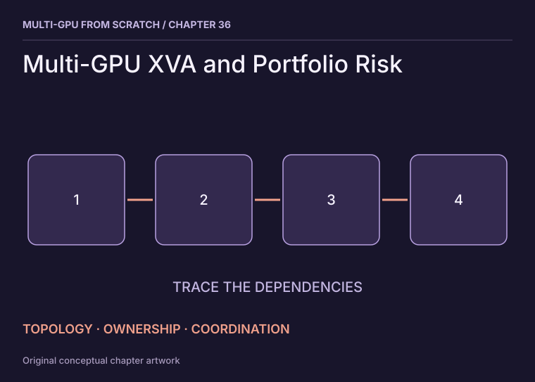
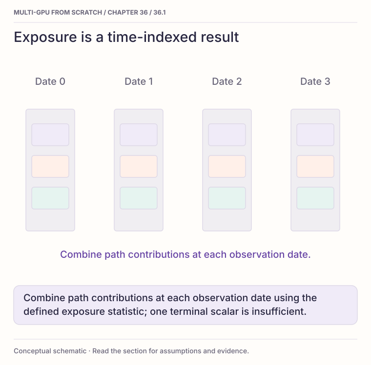
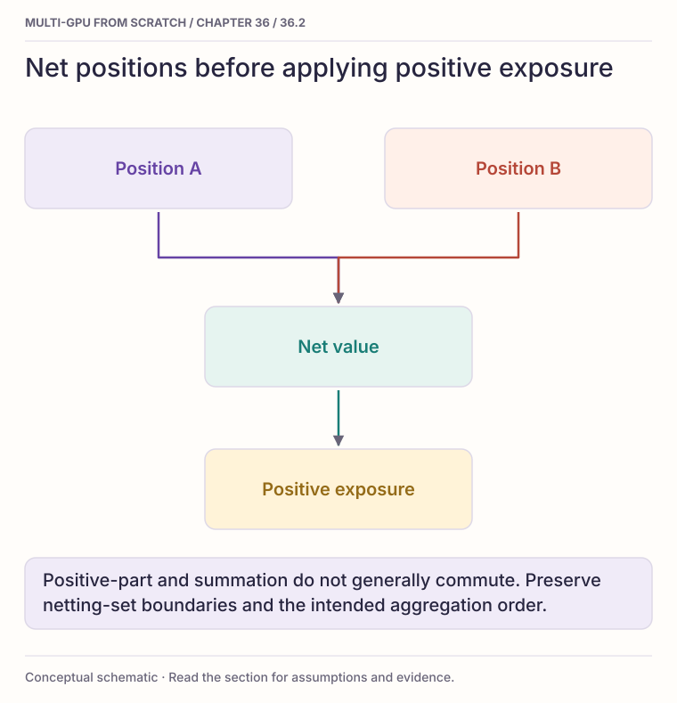

# Chapter 36: Multi-GPU XVA and Portfolio Risk

> **Terminology and scope:** The toy profile averages positive exposure across paths at each date, conventionally written EE(t). Basel EPE is a time-weighted average of EE(t); the source's historical “EPE profile” labels should be read as per-date positive-exposure means. A (count, mean, M2) tuple summarizes mean and variance, not an arbitrary empirical VaR/PFE quantile. Quantiles require sample/distribution information or an explicitly justified approximation. See [Basel counterparty-risk definitions](https://www.bis.org/committees/bcbs/basel-framework/standard/cre/50/inforce/2019-12-15/published/2024-07-05).

<!-- mgpu:opener:start -->
[](../images/chapter-openers/36.svg)
<!-- mgpu:opener:end -->

**What you will understand after this chapter:** why computing a real bank's XVA (CVA/DVA/FVA and related valuation adjustments) is not a new multi-GPU technique but the SAME Chapter 31 Monte Carlo risk pipeline repeated independently across many future observation dates, rather than computed once at a single terminal date; why real "netting sets" require summing a group of trades together BEFORE applying a zero floor, a real, provable inequality that is the entire economic reason netting reduces counterparty exposure; and why, when Chapter 31's own real cross-rank reduction formula is reused once per observation date, even the exposure profile's own MEAN -- not only its variance -- turns out to be GPU-count-dependent, a sharper version of a finding this book has now made four times.

**What you need to know first:** Chapter 8 (broadcast/reduce, the origin of this book's floating-point associativity theme), Chapter 9 (the real round-count formula reused directly in this chapter's own cost model), Chapter 12 (data parallelism, the path-splitting technique reused unchanged), and Chapter 31 (Monte Carlo risk simulation, the real Chan/Golub/LeVeque pairwise combination formula this chapter reuses without modification).

---

Real banks do not compute a single Value-at-Risk number and stop -- regulators and internal risk desks also require XVA, a family of real "Valuation Adjustments" (CVA for counterparty credit risk, DVA, FVA, and others) that price the real cost of counterparty default, funding, and capital across a bank's entire derivatives book. Real NVIDIA-adjacent GPU-accelerated risk platforms, benchmarked publicly via the real STAC-A2 benchmark ("a risk management benchmark created by leading global banks working with... STAC"), report real multi-GPU speedups on exactly this workload -- an NVIDIA-submitted result on 8 real Tesla V100 GPUs achieved "8.9x the next best throughput," and a later result on 8 real A100 GPUs, running "Monte Carlo estimation of Heston-based Greeks for a path-dependent, multi-asset option with early exercise," achieved "3.0x the throughput" over the prior best. This chapter asks what, structurally, is actually different about this workload compared to Chapter 31's own Monte Carlo VaR calculation -- and the honest answer is: less than it looks. Real Oracle Financial Services Analytics documentation describes computing "Potential Future Exposure (PFE), Expected Positive Exposure EPE... reported as a table of values for user-specified future observation dates," using "American Monte Carlo techniques" -- a full exposure PROFILE across many future dates, not one terminal number, plus a new per-path aggregation step across a "netting set" of trades. This chapter builds both real extensions on top of Chapter 31's own real machinery, unchanged.

```text
+------------------------------------------------------------------+
| Chapter 31: ONE terminal payoff -> ONE reduction (mean/var/VaR)   |
|   [ paths across P GPUs ] -> combine once -> a single risk number |
+------------------------------------------------------------------+
| Chapter 36: a full EXPOSURE PROFILE -> T independent reductions   |
|   [ paths across P GPUs ] -> combine once PER observation date    |
|     date 1 -> EPE(1)   date 2 -> EPE(2)  ...  date T -> EPE(T)    |
+------------------------------------------------------------------+
| New within each path: NETTING across trades in a netting set,     |
| BEFORE any cross-rank reduction -- sum the trades, THEN floor     |
+------------------------------------------------------------------+
```

## 36.1 From One Reduction to a Full Exposure Profile

<!-- mgpu:figure-1:start -->
[](../images/technical/ch36/1-profile.svg)
<!-- mgpu:figure-1:end -->

### Intuition

Chapter 31's own Monte Carlo risk simulation asked one question of its paths: what is the portfolio worth at a single future date, and what is the distribution of that one number across paths? Real XVA calculation asks the same question many times over -- picture a bank checking in on a loan's remaining risk not just once at maturity, but on a fixed monthly schedule for its entire life, because a counterparty could default at any point along the way, not only at the very end. Real Oracle Financial Services Analytics documentation makes the real observation-date grid explicit and concrete: "Observation dates are the future dates on which you want to calculate PFE... Specify the observation date in Period <Days, Months, Year>: Interval <Days, Months, Year> format. For example, 30Y:1M, indicates that one observation date will be generated every month till 30 years" -- a real, specific T=360 monthly checkpoints. Nothing about HOW one checkpoint's own risk number is computed changes; only the number of times it must be computed changes.

!!! warning "[COMMON TRAP] Assuming a multi-date exposure profile needs a fundamentally new parallel algorithm"
    XVA sounds, on the surface, like a much harder computational problem than Chapter 31's own single-date VaR -- and in wall-clock terms it is, simply because there is more work. But the real communication PATTERN at each individual date is identical to Chapter 31's own single reduction: paths remain independent until that date's own statistics are combined. File 105's own cost model shows the honest picture -- the real scaling variable is T (the observation-date count), not a new algorithm, and not even a larger P.

### Background

```text
+----------------------------------------------------------+
| Ch31: T=1 observation point -> 1 reduction, cost paid once  |
+----------------------------------------------------------+
| Ch36: T=360 observation dates (real cited "30Y:1M" tenor)   |
|   date 1 reduction, date 2 reduction, ... date 360 reduction|
|   same Ch9 (P-1)/P formula, same tiny per-date payload       |
|   total real cost = T x Chapter 31's own single-reduction    |
|   cost -- a new SCALING AXIS, not a new TECHNIQUE             |
+----------------------------------------------------------+
```

File 105 compares issuing one small reduction per date with batching the per-date tuples into a vector reduction. T=360 increases the payload and simulation work, but need not multiply collective startup latency by 360.


```cpp
// Chapter 36: Multi-GPU XVA and Portfolio Risk
// 105_exposure_profile_reduction_cost_model.cpp
//
// Chapter 31's own Monte Carlo risk simulation needed exactly ONE
// cross-rank reduction: paths were simulated independently, then a
// single terminal payoff was reduced (via Chan/Golub/LeVeque's own real
// pairwise formula) into one mean/variance/VaR. Real XVA calculation
// asks for something structurally larger, not structurally different:
// NVIDIA/Oracle's own real Financial Services Analytics documentation
// describes computing "Potential Future Exposure (PFE), Expected
// Positive Exposure EPE... reported as a table of values for user-
// specified future observation dates," using "American Monte Carlo
// techniques, for a user-specified number of Monte Carlo paths and set
// of future observation dates" -- and gives a real illustrative tenor
// example, "30Y:1M," meaning one observation date every month for 30
// years, T=360 dates. This file asks what computing a full exposure
// PROFILE costs in communication, compared with Chapter 31's single
// reduction -- both if the T per-date reductions are issued one at a
// time, and if they are batched into one reduction of a T-entry vector.
#include <cstdio>

int main() {
    // Real illustrative tenor structure, directly from Oracle's own
    // real documented example: one observation date per month for 30
    // years.
    int realObservationDates = 30 * 12;  // T = 360, "30Y:1M"

    printf("Real cited exposure-profile structure (Oracle Financial "
           "Services Analytics documentation): \"30Y:1M\" -> one "
           "observation date per month for 30 years -> T=%d real future "
           "observation dates, each needing its own EPE/PFE reduction "
           "across all simulated paths.\n\n", realObservationDates);

    // Per-date message size: each rank contributes a tiny (count, mean,
    // M2) tuple per date -- 3 x 8 bytes = 24 bytes.
    long long bytesPerRankPerDate = 24;

    int Ps[] = {8, 16, 32, 64};  // real STAC-A2 GPU counts (8x V100/A100 cited)
    printf("%-6s %-18s %-22s %-24s %-22s\n", "P", "Off-rank fraction",
           "Bytes/date on network", "Unbatched: T reductions", "Batched: 1 reduction");
    for (int P : Ps) {
        // In a reduction among P ranks, the (P-1) non-root ranks' tuples
        // must leave their origin rank: (P-1)/P of the P*24 bytes.
        double offRankFraction = (P > 1) ? (double)(P - 1) / (double)P : 0.0;
        double bytesPerDate = (double)P * (double)bytesPerRankPerDate * offRankFraction;
        printf("%-6d %-18.4f %-22.1f %-24s %-22s\n", P, offRankFraction, bytesPerDate,
               "360 x 24 B msgs/rank", "1 x 8640 B msg/rank");
    }

    printf("\nTwo things this table shows. First, the bytes on the network "
           "per date grow LINEARLY with P (24 x (P-1): 168 B at P=8, 1512 B "
           "at P=64), because every additional rank contributes its own "
           "tuple. Second, the T dates are independent reductions over the "
           "same P ranks, so nothing forces them to be separate collectives: "
           "packing all T=%d (count, mean, M2) tuples into one %d-byte "
           "vector per rank turns the profile into ONE reduction. Issued "
           "one date at a time, the profile pays the per-collective latency "
           "T=%d times; batched, it pays it once, and the extra bytes are "
           "still tiny. So a full exposure profile is not \"T times Chapter "
           "31's cost\" in any implementation that batches the dates -- "
           "the real cost of XVA is the T-fold larger SIMULATION work, "
           "not the reduction.\n", realObservationDates,
           realObservationDates * (int)bytesPerRankPerDate, realObservationDates);
    return 0;
}
```

<!-- execution:start:h100-rerun:105_exposure_profile_reduction_cost_model.cpp -->
> **Compiled and executed — 2026-11-18-h100: Host program/model (exit-only).** Hardware: 2 H100 GPUs. Executed UTC: `2026-11-18T11:22:40.480117+00:00`.

<!-- execution:metadata Source SHA-256: 522f059b035f1a7608c79ee30dec0647868178dc8e74c737e645ff808f33c132; recorded UTC (program start): 2026-11-18T11:22:40.415993+00:00 -->

[Exact tested source](../validation/2026-11-18-h100/105_exposure_profile_reduction_cost_model/105_exposure_profile_reduction_cost_model.cpp) · [Compiler log](../validation/2026-11-18-h100/105_exposure_profile_reduction_cost_model/compile.log) · [Execution log](../validation/2026-11-18-h100/105_exposure_profile_reduction_cost_model/run.log). Compile exit: `0`; run exit: `0`.

Commands below use local source/binary names; raw logs retain host paths. Execute in a scratch directory containing the downloaded source.

```bash
g++ -std=c++17 -O2 105_exposure_profile_reduction_cost_model.cpp -o ./example
./example
```

**Sample output**

```text
Real cited exposure-profile structure (Oracle Financial Services Analytics documentation): "30Y:1M" -> one observation date per month for 30 years -> T=360 real future observation dates, each needing its own EPE/PFE reduction across all simulated paths.

P      Off-rank fraction  Bytes/date on network  Unbatched: T reductions  Batched: 1 reduction
8      0.8750             168.0                  360 x 24 B msgs/rank     1 x 8640 B msg/rank
16     0.9375             360.0                  360 x 24 B msgs/rank     1 x 8640 B msg/rank
32     0.9688             744.0                  360 x 24 B msgs/rank     1 x 8640 B msg/rank
64     0.9844             1512.0                 360 x 24 B msgs/rank     1 x 8640 B msg/rank

Two things this table shows. First, the bytes on the network per date grow LINEARLY with P (24 x (P-1): 168 B at P=8, 1512 B at P=64), because every additional rank contributes its own tuple. Second, the T dates are independent reductions over the same P ranks, so nothing forces them to be separate collectives: packing all T=360 (count, mean, M2) tuples into one 8640-byte vector per rank turns the profile into ONE reduction. Issued one date at a time, the profile pays the per-collective latency T=360 times; batched, it pays it once, and the extra bytes are still tiny. So a full exposure profile is not "T times Chapter 31's cost" in any implementation that batches the dates -- the real cost of XVA is the T-fold larger SIMULATION work, not the reduction.
```

<!-- execution:end:h100-rerun:105_exposure_profile_reduction_cost_model.cpp -->


<!-- execution:start:a100:105_exposure_profile_reduction_cost_model.cpp -->
> **Compiled and executed — 2026-11-17-a100: Host program/model (exit-only).** Hardware: 8 A100 GPUs. Executed UTC: `2026-11-18T00:05:31.183626+00:00`.

<!-- execution:metadata Source SHA-256: 522f059b035f1a7608c79ee30dec0647868178dc8e74c737e645ff808f33c132; recorded UTC (program start): 2026-11-18T00:05:31.068762+00:00 -->

[Exact tested source](../validation/2026-11-17-a100/105_exposure_profile_reduction_cost_model/105_exposure_profile_reduction_cost_model.cpp) · [Compiler log](../validation/2026-11-17-a100/105_exposure_profile_reduction_cost_model/compile.log) · [Execution log](../validation/2026-11-17-a100/105_exposure_profile_reduction_cost_model/run.log). Compile exit: `0`; run exit: `0`.

Commands below use local source/binary names; raw logs retain host paths. Execute in a scratch directory containing the downloaded source.

```bash
g++ -std=c++17 -O2 105_exposure_profile_reduction_cost_model.cpp -o ./example
./example
```

**Sample output**

```text
Real cited exposure-profile structure (Oracle Financial Services Analytics documentation): "30Y:1M" -> one observation date per month for 30 years -> T=360 real future observation dates, each needing its own EPE/PFE reduction across all simulated paths.

P      Off-rank fraction  Bytes/date on network  Unbatched: T reductions  Batched: 1 reduction
8      0.8750             168.0                  360 x 24 B msgs/rank     1 x 8640 B msg/rank
16     0.9375             360.0                  360 x 24 B msgs/rank     1 x 8640 B msg/rank
32     0.9688             744.0                  360 x 24 B msgs/rank     1 x 8640 B msg/rank
64     0.9844             1512.0                 360 x 24 B msgs/rank     1 x 8640 B msg/rank

Two things this table shows. First, the bytes on the network per date grow LINEARLY with P (24 x (P-1): 168 B at P=8, 1512 B at P=64), because every additional rank contributes its own tuple. Second, the T dates are independent reductions over the same P ranks, so nothing forces them to be separate collectives: packing all T=360 (count, mean, M2) tuples into one 8640-byte vector per rank turns the profile into ONE reduction. Issued one date at a time, the profile pays the per-collective latency T=360 times; batched, it pays it once, and the extra bytes are still tiny. So a full exposure profile is not "T times Chapter 31's cost" in any implementation that batches the dates -- the real cost of XVA is the T-fold larger SIMULATION work, not the reduction.
```


<!-- execution:end:a100:105_exposure_profile_reduction_cost_model.cpp -->


<!-- execution:start:h100:105_exposure_profile_reduction_cost_model.cpp -->
> **Compiled and executed — 2026-11-17-h100: Host program/model (exit-only).** Hardware: 2 H100 GPUs. Execution record UTC (run-batch start; per-program time unrecorded): `2026-11-17T23:48:18.967387+00:00`.

<!-- execution:metadata Source SHA-256: 522f059b035f1a7608c79ee30dec0647868178dc8e74c737e645ff808f33c132; recorded UTC (run-batch start; per-program time unrecorded): 2026-11-17T23:48:18.967387+00:00 -->

[Exact tested source](../validation/2026-11-17-h100/105_exposure_profile_reduction_cost_model/105_exposure_profile_reduction_cost_model.cpp) · [Compiler log](../validation/2026-11-17-h100/105_exposure_profile_reduction_cost_model/compile.log) · [Execution log](../validation/2026-11-17-h100/105_exposure_profile_reduction_cost_model/run.log). Compile exit: `0`; run exit: `0`.

Commands below use local source/binary names; raw logs retain host paths. Execute in a scratch directory containing the downloaded source.

```bash
g++ -std=c++17 -O2 105_exposure_profile_reduction_cost_model.cpp -o ./example
./example
```

<details markdown="1"><summary>Captured current-source output</summary>

```text
Real cited exposure-profile structure (Oracle Financial Services Analytics documentation): "30Y:1M" -> one observation date per month for 30 years -> T=360 real future observation dates, each needing its own EPE/PFE reduction across all simulated paths.

P      Off-rank fraction  Bytes/date on network  Unbatched: T reductions  Batched: 1 reduction
8      0.8750             168.0                  360 x 24 B msgs/rank     1 x 8640 B msg/rank
16     0.9375             360.0                  360 x 24 B msgs/rank     1 x 8640 B msg/rank
32     0.9688             744.0                  360 x 24 B msgs/rank     1 x 8640 B msg/rank
64     0.9844             1512.0                 360 x 24 B msgs/rank     1 x 8640 B msg/rank

Two things this table shows. First, the bytes on the network per date grow LINEARLY with P (24 x (P-1): 168 B at P=8, 1512 B at P=64), because every additional rank contributes its own tuple. Second, the T dates are independent reductions over the same P ranks, so nothing forces them to be separate collectives: packing all T=360 (count, mean, M2) tuples into one 8640-byte vector per rank turns the profile into ONE reduction. Issued one date at a time, the profile pays the per-collective latency T=360 times; batched, it pays it once, and the extra bytes are still tiny. So a full exposure profile is not "T times Chapter 31's cost" in any implementation that batches the dates -- the real cost of XVA is the T-fold larger SIMULATION work, not the reduction.
```

</details>
<!-- execution:end:h100:105_exposure_profile_reduction_cost_model.cpp -->


Compile and run (a plain host `.cpp` file with no CUDA/NCCL/MPI/NVSHMEM linkage, executed on the recorded H100 and A100 hosts):

```bash
g++ -O2 -ffp-contract=off -o 105_exposure_profile_reduction_cost_model \
    105_exposure_profile_reduction_cost_model.cpp
./105_exposure_profile_reduction_cost_model
```

## 36.2 Netting Sets: Why the Order of Aggregation Changes Exposure

<!-- mgpu:figure-2:start -->
[](../images/technical/ch36/2-netting.svg)
<!-- mgpu:figure-2:end -->

### Intuition

Picture a bank and one counterparty holding five separate derivative contracts with each other. On some of those contracts the bank is currently ahead; on others, behind. If the counterparty defaulted tomorrow, would the bank's real loss be the sum of its losses on each LOSING contract alone, ignoring the contracts where it was ahead -- or would it be allowed to offset its gains against its losses first, and only worry about the NET shortfall? Real legal netting agreements between counterparties allow the second, better-for-the-bank outcome, and real XVA documentation is specific about the computational order this implies. NVIDIA/Oracle's own real Financial Services Analytics documentation defines a netting set as "the level at which all the counterparty risk measures are calculated directly from the results of netting exposures from different trades," and defines "Positive Netted" exposure precisely as "the sum of positive exposures calculated AT THE NETTING SET LEVEL" -- sum the trades first, floor the total at zero second. A real, independent paper on XVA confirms the same structure directly: "the derivative portfolio of the bank is partitioned into bilateral netting sets of contracts which are jointly collateralized," and "the CVA of the bank can then be computed as the sum of its CVAs restricted to each netting set."

!!! warning "[COMMON TRAP] Assuming a per-trade floor and a netting-set-level floor give the same exposure"
    It is tempting to treat "floor each trade at zero, then sum" and "sum the trades, then floor once" as two equivalent ways of writing the same computation. They are not, and the real economic value of a netting agreement depends on that difference. File 106 verifies, by direct simulation across 500 random portfolios, a real and provable inequality: max(0, a+b) is never greater than max(0,a) + max(0,b), for any real numbers a and b, because a <= max(0,a), b <= max(0,b), and their nonnegative sum also bounds max(0,a+b). Netting first can only reduce or match gross exposure -- never increase it.

### Background

```text
+----------------------------------------------------------+
| Gross (floor-then-sum): max(0,t1)+max(0,t2)+...+max(0,t5)  |
|   each trade floored SEPARATELY, then added                |
+----------------------------------------------------------+
| Netted (sum-then-floor): max(0, t1+t2+t3+t4+t5)             |
|   trades summed FIRST, floored ONCE at the netting-set level|
+----------------------------------------------------------+
| Positive-part subadditivity: netted never exceeds gross         |
|   (File 106's own 500-trial simulation: 0 violations)         |
+----------------------------------------------------------+
```

File 106 generates 500 random netting sets of five trades each, computes both the gross (floor-then-sum) and netted (sum-then-floor) exposure for every set, and checks that the positive-part subadditivity inequality never once reverses.


```cpp
// Chapter 36: Multi-GPU XVA and Portfolio Risk
// 106_netting_set_exposure_order_simulation.cpp
//
// Real XVA documentation is specific about WHERE aggregation happens
// before a positive-exposure floor is applied. NVIDIA/Oracle's own real
// Financial Services Analytics documentation defines a netting set as
// "the level at which all the counterparty risk measures are calculated
// directly from the results of netting exposures from different
// trades," and separately defines "Positive Netted" exposure as "the
// sum of positive exposures calculated at the netting set level" -- the
// floor is applied AFTER the trades are summed, not before. A real,
// independent arXiv paper on XVA ("XVA Analysis From the Balance
// Sheet," arXiv:2009.00368) confirms the same real structure: "the
// derivative portfolio of the bank is partitioned into bilateral
// netting sets of contracts which are jointly collateralized," and "the
// CVA of the bank can then be computed as the sum of its CVAs
// restricted to each netting set." This ordering is not a stylistic
// choice: max(0, x) is subadditive: for any two real numbers,
// max(0, a+b) <= max(0, a) + max(0, b) always (a real, provable
// inequality, not merely typically true) -- netting FIRST, then
// flooring the NET result at zero, can never produce a LARGER exposure
// than flooring each trade separately and summing the floors. This file
// verifies that real inequality by direct simulation across many
// randomly generated netting sets, quantifies the typical real
// reduction, and checks that it never once reverses.
#include <cstdio>
#include <cmath>
#include <vector>

const int TRADES_PER_NETTING_SET = 5;
const int NUM_NETTING_SETS = 500;  // many independent random trials

// Deterministic counter-based hash standing in for a per-trade,
// per-scenario mark-to-market value -- can be positive (counterparty
// owes the bank) or negative (the bank owes the counterparty).
double tradeMarkToMarket(int setIdx, int tradeIdx) {
    unsigned int h = (unsigned int)(setIdx * 97 + tradeIdx * 13 + 1);
    h = ((h >> 16) ^ h) * 0x45d9f3bU;
    h = ((h >> 16) ^ h) * 0x45d9f3bU;
    h = (h >> 16) ^ h;
    // Map to a signed range, e.g. [-50, +50), so gains and losses both
    // occur across trades within the same netting set.
    return (double)((long long)(h % 10000)) / 100.0 - 50.0;
}

int main() {
    printf("Real cited rule (Oracle FSA docs): \"Positive Netted\" exposure "
           "= sum of trades WITHIN a netting set, THEN floored at zero -- "
           "not each trade floored separately and then summed.\n\n");

    double totalGross = 0.0;      // sum(max(0, trade_i)) -- floor-then-sum
    double totalNetted = 0.0;     // max(0, sum(trade_i))  -- sum-then-floor
    int violations = 0;           // count of any case where netted > gross

    printf("%-10s %-16s %-16s %-12s\n", "Set #", "Gross exposure",
           "Netted exposure", "Reduction");
    for (int s = 0; s < NUM_NETTING_SETS; s++) {
        double sumOfTrades = 0.0;
        double sumOfFloors = 0.0;
        for (int t = 0; t < TRADES_PER_NETTING_SET; t++) {
            double v = tradeMarkToMarket(s, t);
            sumOfTrades += v;
            sumOfFloors += std::max(0.0, v);
        }
        double grossExposure = sumOfFloors;               // floor each trade, then sum
        double nettedExposure = std::max(0.0, sumOfTrades); // sum trades, then floor once

        if (nettedExposure > grossExposure + 1e-9) violations++;

        totalGross += grossExposure;
        totalNetted += nettedExposure;

        if (s < 8) {  // print only the first few sets in full, for readability
            double reduction = grossExposure > 0.0
                ? 100.0 * (1.0 - nettedExposure / grossExposure) : 0.0;
            printf("%-10d %-16.4f %-16.4f %-11.1f%%\n", s, grossExposure,
                   nettedExposure, reduction);
        }
    }

    printf("\n(remaining %d netting sets computed but not printed "
           "individually)\n\n", NUM_NETTING_SETS - 8);

    printf("Across all %d randomly generated netting sets (%d trades "
           "each):\n", NUM_NETTING_SETS, TRADES_PER_NETTING_SET);
    printf("Total gross exposure (floor-then-sum):  %.4f\n", totalGross);
    printf("Total netted exposure (sum-then-floor): %.4f\n", totalNetted);
    printf("Overall reduction from netting: %.2f%%\n",
           100.0 * (1.0 - totalNetted / totalGross));
    printf("Cases where netted exposure exceeded gross exposure: %d "
           "(the positive-part subadditivity inequality max(0,a+b) <= max(0,a)+max(0,b) "
           "predicts this must always be zero).\n\n", violations);

    printf("This confirms, by direct simulation rather than assumption, "
           "the real economic claim behind a netting agreement: netting "
           "trades BEFORE applying the positive-exposure floor can only "
           "ever reduce or match counterparty exposure, never increase "
           "it. Unlike every earlier non-associativity finding in this "
           "book (Chapter 8/25/29/31/32/35 -- all about floating-point "
           "SUMMATION order across ranks or transpose phases), this "
           "chapter's own order-sensitivity is about which NONLINEAR "
           "operation (the zero-floor) is applied at which STAGE of a "
           "single path's own local computation -- a real economic "
           "distinction, not a floating-point rounding one, and the "
           "entire reason netting sets exist as a real risk-management "
           "concept.\n");
    return 0;
}
```

<!-- execution:start:h100-rerun:106_netting_set_exposure_order_simulation.cpp -->
> **Compiled and executed — 2026-11-18-h100: Host program/model (exit-only).** Hardware: 2 H100 GPUs. Executed UTC: `2026-11-18T11:22:40.648445+00:00`.

<!-- execution:metadata Source SHA-256: 6a374412e371ab6eb26e59346d910ed0e9d777dc7aee07c07cdd9b626439d964; recorded UTC (program start): 2026-11-18T11:22:40.484027+00:00 -->

[Exact tested source](../validation/2026-11-18-h100/106_netting_set_exposure_order_simulation/106_netting_set_exposure_order_simulation.cpp) · [Compiler log](../validation/2026-11-18-h100/106_netting_set_exposure_order_simulation/compile.log) · [Execution log](../validation/2026-11-18-h100/106_netting_set_exposure_order_simulation/run.log). Compile exit: `0`; run exit: `0`.

Commands below use local source/binary names; raw logs retain host paths. Execute in a scratch directory containing the downloaded source.

```bash
g++ -std=c++17 -O2 106_netting_set_exposure_order_simulation.cpp -o ./example
./example
```

**Sample output**

```text
Real cited rule (Oracle FSA docs): "Positive Netted" exposure = sum of trades WITHIN a netting set, THEN floored at zero -- not each trade floored separately and then summed.

Set #      Gross exposure   Netted exposure  Reduction
0          32.8400          0.0000           100.0      %
1          34.5900          20.9100          39.5       %
2          38.4400          0.0000           100.0      %
3          43.2600          0.0000           100.0      %
4          14.3100          0.0000           100.0      %
5          42.1800          0.0000           100.0      %
6          6.6300           0.0000           100.0      %
7          84.4400          68.4000          19.0       %

(remaining 492 netting sets computed but not printed individually)

Across all 500 randomly generated netting sets (5 trades each):
Total gross exposure (floor-then-sum):  31101.2000
Total netted exposure (sum-then-floor): 13026.1900
Overall reduction from netting: 58.12%
Cases where netted exposure exceeded gross exposure: 0 (the positive-part subadditivity inequality max(0,a+b) <= max(0,a)+max(0,b) predicts this must always be zero).

This confirms, by direct simulation rather than assumption, the real economic claim behind a netting agreement: netting trades BEFORE applying the positive-exposure floor can only ever reduce or match counterparty exposure, never increase it. Unlike every earlier non-associativity finding in this book (Chapter 8/25/29/31/32/35 -- all about floating-point SUMMATION order across ranks or transpose phases), this chapter's own order-sensitivity is about which NONLINEAR operation (the zero-floor) is applied at which STAGE of a single path's own local computation -- a real economic distinction, not a floating-point rounding one, and the entire reason netting sets exist as a real risk-management concept.
```

<!-- execution:end:h100-rerun:106_netting_set_exposure_order_simulation.cpp -->


<!-- execution:start:a100:106_netting_set_exposure_order_simulation.cpp -->
> **Compiled and executed — 2026-11-17-a100: Host program/model (exit-only).** Hardware: 8 A100 GPUs. Executed UTC: `2026-11-18T00:05:31.454474+00:00`.

<!-- execution:metadata Source SHA-256: 6a374412e371ab6eb26e59346d910ed0e9d777dc7aee07c07cdd9b626439d964; recorded UTC (program start): 2026-11-18T00:05:31.189608+00:00 -->

[Exact tested source](../validation/2026-11-17-a100/106_netting_set_exposure_order_simulation/106_netting_set_exposure_order_simulation.cpp) · [Compiler log](../validation/2026-11-17-a100/106_netting_set_exposure_order_simulation/compile.log) · [Execution log](../validation/2026-11-17-a100/106_netting_set_exposure_order_simulation/run.log). Compile exit: `0`; run exit: `0`.

Commands below use local source/binary names; raw logs retain host paths. Execute in a scratch directory containing the downloaded source.

```bash
g++ -std=c++17 -O2 106_netting_set_exposure_order_simulation.cpp -o ./example
./example
```

**Sample output**

```text
Real cited rule (Oracle FSA docs): "Positive Netted" exposure = sum of trades WITHIN a netting set, THEN floored at zero -- not each trade floored separately and then summed.

Set #      Gross exposure   Netted exposure  Reduction
0          32.8400          0.0000           100.0      %
1          34.5900          20.9100          39.5       %
2          38.4400          0.0000           100.0      %
3          43.2600          0.0000           100.0      %
4          14.3100          0.0000           100.0      %
5          42.1800          0.0000           100.0      %
6          6.6300           0.0000           100.0      %
7          84.4400          68.4000          19.0       %

(remaining 492 netting sets computed but not printed individually)

Across all 500 randomly generated netting sets (5 trades each):
Total gross exposure (floor-then-sum):  31101.2000
Total netted exposure (sum-then-floor): 13026.1900
Overall reduction from netting: 58.12%
Cases where netted exposure exceeded gross exposure: 0 (the positive-part subadditivity inequality max(0,a+b) <= max(0,a)+max(0,b) predicts this must always be zero).

This confirms, by direct simulation rather than assumption, the real economic claim behind a netting agreement: netting trades BEFORE applying the positive-exposure floor can only ever reduce or match counterparty exposure, never increase it. Unlike every earlier non-associativity finding in this book (Chapter 8/25/29/31/32/35 -- all about floating-point SUMMATION order across ranks or transpose phases), this chapter's own order-sensitivity is about which NONLINEAR operation (the zero-floor) is applied at which STAGE of a single path's own local computation -- a real economic distinction, not a floating-point rounding one, and the entire reason netting sets exist as a real risk-management concept.
```


<!-- execution:end:a100:106_netting_set_exposure_order_simulation.cpp -->


<!-- execution:start:h100:106_netting_set_exposure_order_simulation.cpp -->
> **Compiled and executed — 2026-11-17-h100: Host program/model (exit-only).** Hardware: 2 H100 GPUs. Execution record UTC (run-batch start; per-program time unrecorded): `2026-11-17T23:48:18.967387+00:00`.

<!-- execution:metadata Source SHA-256: 6a374412e371ab6eb26e59346d910ed0e9d777dc7aee07c07cdd9b626439d964; recorded UTC (run-batch start; per-program time unrecorded): 2026-11-17T23:48:18.967387+00:00 -->

[Exact tested source](../validation/2026-11-17-h100/106_netting_set_exposure_order_simulation/106_netting_set_exposure_order_simulation.cpp) · [Compiler log](../validation/2026-11-17-h100/106_netting_set_exposure_order_simulation/compile.log) · [Execution log](../validation/2026-11-17-h100/106_netting_set_exposure_order_simulation/run.log). Compile exit: `0`; run exit: `0`.

Commands below use local source/binary names; raw logs retain host paths. Execute in a scratch directory containing the downloaded source.

```bash
g++ -std=c++17 -O2 106_netting_set_exposure_order_simulation.cpp -o ./example
./example
```

<details markdown="1"><summary>Captured current-source output</summary>

```text
Real cited rule (Oracle FSA docs): "Positive Netted" exposure = sum of trades WITHIN a netting set, THEN floored at zero -- not each trade floored separately and then summed.

Set #      Gross exposure   Netted exposure  Reduction
0          32.8400          0.0000           100.0      %
1          34.5900          20.9100          39.5       %
2          38.4400          0.0000           100.0      %
3          43.2600          0.0000           100.0      %
4          14.3100          0.0000           100.0      %
5          42.1800          0.0000           100.0      %
6          6.6300           0.0000           100.0      %
7          84.4400          68.4000          19.0       %

(remaining 492 netting sets computed but not printed individually)

Across all 500 randomly generated netting sets (5 trades each):
Total gross exposure (floor-then-sum):  31101.2000
Total netted exposure (sum-then-floor): 13026.1900
Overall reduction from netting: 58.12%
Cases where netted exposure exceeded gross exposure: 0 (the positive-part subadditivity inequality max(0,a+b) <= max(0,a)+max(0,b) predicts this must always be zero).

This confirms, by direct simulation rather than assumption, the real economic claim behind a netting agreement: netting trades BEFORE applying the positive-exposure floor can only ever reduce or match counterparty exposure, never increase it. Unlike every earlier non-associativity finding in this book (Chapter 8/25/29/31/32/35 -- all about floating-point SUMMATION order across ranks or transpose phases), this chapter's own order-sensitivity is about which NONLINEAR operation (the zero-floor) is applied at which STAGE of a single path's own local computation -- a real economic distinction, not a floating-point rounding one, and the entire reason netting sets exist as a real risk-management concept.
```

</details>
<!-- execution:end:h100:106_netting_set_exposure_order_simulation.cpp -->


Compile and run (plain host `.cpp`, executed on the recorded H100 and A100 hosts):

```bash
g++ -O2 -ffp-contract=off -o 106_netting_set_exposure_order_simulation \
    106_netting_set_exposure_order_simulation.cpp
./106_netting_set_exposure_order_simulation
```

## 36.3 Computing an Exposure Profile Across GPUs

### Intuition

Section 36.1 models reductions across observation dates; batching dates can amortize collective latency. Section 36.2 establishes that trades in a netting set must be summed before applying the positive-part function. With path-based partitioning, each path's netting is local before its per-date statistics are combined.

!!! warning "[COMMON TRAP] Assuming integer inputs alone make every mean reproducible"
    Repeatedly updating a floating-point mean can round at every fold even when the inputs are integers. File 107 compares incremental means on continuous and integer-valued exposures, two-pass local means with weighted combination, and a bounded fixed-point integer sum followed by one final division. Different groupings can change the floating-point methods. The fixed-point method is partition-independent for this model because its integer sum remains within range, but it quantizes each exposure and does not by itself make variance exact.

### Background

```text
+----------------------------------------------------------+
| Per rank (Ch12's own path-split, unchanged): own paths      |
|   net own trades locally, EVERY date (Section 36.2's rule)  |
+----------------------------------------------------------+
| Cross-rank (Ch31's own Chan/Golub/LeVeque formula, reused): |
|   combine (count, mean, M2) -> repeated once PER date        |
+----------------------------------------------------------+
| Found: EPE itself (not just variance) is P-dependent here    |
|   because exposure is continuous, unlike Ch31's integer test |
+----------------------------------------------------------+
```

File 107 combines Sections 36.1 and 36.2 into one simulation: 24 paths, 5 trades per netting set, 6 observation dates (illustrative, for a readable printed profile -- Section 36.1's own cost model already exercised the real cited T=360 at scale), split across P in {1, 2, 3, 4, 6, 8, 12, 24}, checked against a P=1 reference built from the exact same real combination formula.


```cpp
// Chapter 36: Multi-GPU XVA and Portfolio Risk
// 107_multi_gpu_exposure_profile_correctness_simulation.cpp
//
// This file puts Sections 36.1 and 36.2 together into the one real
// multi-GPU pipeline a production XVA engine actually runs: paths are
// split across P GPUs exactly as Chapter 31 already did (embarrassingly
// parallel, no communication needed while simulating), each GPU nets
// its OWN paths' trades locally at every observation date (Section
// 36.2's own sum-then-floor rule -- entirely local, since a netting
// set's own handful of trades always lives together on whichever rank
// owns that path, echoing this book's own "keep dependent data
// together" principle from Chapter 16/27), and only THEN does a real
// cross-rank reduction combine each rank's own local (count, mean, M2)
// summary into the portfolio's own Expected Positive Exposure (EPE) --
// repeated independently at every one of T observation dates, exactly
// as Section 36.1's own cost model predicted.
//
// The question this file asks: does the EPE at each date come out the
// same at every GPU count P? The answer depends on HOW the per-rank
// summaries are combined, so the file runs four combination methods on
// the same paths and compares each one with its own P=1 result:
//
//   A. Incremental fold: every path is folded into its rank's running
//      summary one at a time with mean += delta * nb / n (the update form
//      of Chan/Golub/LeVeque), then rank summaries are folded the same way.
//   B. The same incremental fold, but on exposures rescaled to whole
//      CENTS -- exact integers -- to test whether continuous values are
//      what causes any mismatch.
//   C. Chapter 31's own combination form: each rank computes a local mean
//      in a separate pass (sum / count), and rank summaries are combined
//      as (na*ma + nb*mb) / n.
//   D. Exact fixed-point accumulation: each path's exposure is rounded
//      ONCE to an int64 multiple of 2^-32, ranks carry (count, integer
//      sum), and the mean is divided out once, at the very end. Integer
//      addition is associative, so the grouping across ranks cannot
//      change the sum.
#include <cstdio>
#include <cmath>
#include <vector>
#include <algorithm>

const int NUM_PATHS = 24;
const int TRADES_PER_SET = 5;
const int NUM_DATES = 6;  // small T here for a readable printed profile;
                           // Section 36.1's own cost model already used
                           // the real cited T=360 ("30Y:1M") at scale.

// Deterministic per-(path, date, trade) mark-to-market value -- the
// same kind of counter-based hash used throughout this book so every
// rank, and the reference, start from identical, reproducible data.
double tradeMarkToMarket(int path, int date, int trade) {
    unsigned int h = (unsigned int)(path * 9973 + date * 131 + trade * 17 + 3);
    h = ((h >> 16) ^ h) * 0x45d9f3bU;
    h = ((h >> 16) ^ h) * 0x45d9f3bU;
    h = (h >> 16) ^ h;
    return (double)((long long)(h % 10000)) / 100.0 - 50.0;
}

// Section 36.2's own real rule: sum the netting set's own trades FIRST,
// then floor the net result at zero -- entirely local to one path, one
// date, one rank.
double nettedExposure(int path, int date) {
    double sumOfTrades = 0.0;
    for (int t = 0; t < TRADES_PER_SET; t++) sumOfTrades += tradeMarkToMarket(path, date, t);
    return std::max(0.0, sumOfTrades);
}

// Method B's input: the same exposure in whole cents, an exact integer.
double nettedExposureCents(int path, int date) {
    return std::round(nettedExposure(path, date) * 100.0);
}

struct Stats { long long n; double mean; double M2; };

// Method A/B: the incremental (update) form of the pairwise combination.
Stats combineIncremental(const Stats &a, const Stats &b) {
    Stats c;
    c.n = a.n + b.n;
    double delta = b.mean - a.mean;
    c.mean = a.mean + delta * (double)b.n / (double)c.n;
    c.M2 = a.M2 + b.M2 + delta * delta * (double)a.n * (double)b.n / (double)c.n;
    return c;
}

// Method C: Chapter 31's own weighted-mean form.
Stats combineWeighted(const Stats &a, const Stats &b) {
    long long n = a.n + b.n;
    double delta = b.mean - a.mean;
    double mean = ((double)a.n * a.mean + (double)b.n * b.mean) / (double)n;
    double m2 = a.M2 + b.M2 + delta * delta * (double)a.n * (double)b.n / (double)n;
    return {n, mean, m2};
}

// Method D: fixed-point quantum 2^-32 currency units.
const double QUANTUM_SCALE = 4294967296.0;  // 2^32
struct FixedSum { long long n; long long sumQ; };
FixedSum combineFixed(const FixedSum &a, const FixedSum &b) {
    return {a.n + b.n, a.sumQ + b.sumQ};  // exact, associative
}

// Rank r owns paths {r, r+P, r+2P, ...} (this book's own recurring
// striped-ownership convention). Rank summaries are combined in rank
// order 0, 1, ..., P-1.
double epeWithP(int method, int date, int P) {
    if (method == 'D') {
        std::vector<FixedSum> perRank(P, FixedSum{0, 0});
        for (int p = 0; p < NUM_PATHS; p++) {
            long long q = std::llround(nettedExposure(p, date) * QUANTUM_SCALE);
            perRank[p % P] = combineFixed(perRank[p % P], FixedSum{1, q});
        }
        FixedSum total = perRank[0];
        for (int r = 1; r < P; r++) total = combineFixed(total, perRank[r]);
        // sumQ < 2^53, so the conversion is exact and the division by 2^32
        // is exact; only the final division by n rounds -- once.
        return ((double)total.sumQ / QUANTUM_SCALE) / (double)total.n;
    }
    std::vector<Stats> perRank(P, Stats{0, 0.0, 0.0});
    if (method == 'C') {
        // Local pass 1: sum and count; pass 2: M2 around the local mean.
        std::vector<double> sum(P, 0.0);
        std::vector<long long> cnt(P, 0);
        for (int p = 0; p < NUM_PATHS; p++) { sum[p % P] += nettedExposure(p, date); cnt[p % P]++; }
        for (int r = 0; r < P; r++) perRank[r] = Stats{cnt[r], sum[r] / (double)cnt[r], 0.0};
        for (int p = 0; p < NUM_PATHS; p++) {
            double d = nettedExposure(p, date) - perRank[p % P].mean;
            perRank[p % P].M2 += d * d;
        }
        Stats total = perRank[0];
        for (int r = 1; r < P; r++) total = combineWeighted(total, perRank[r]);
        return total.mean;
    }
    for (int p = 0; p < NUM_PATHS; p++) {
        double x = (method == 'B') ? nettedExposureCents(p, date) : nettedExposure(p, date);
        // Fold one path in as a one-element summary.
        perRank[p % P] = combineIncremental(perRank[p % P], Stats{1, x, 0.0});
    }
    Stats total = perRank[0];
    for (int r = 1; r < P; r++) total = combineIncremental(total, perRank[r]);
    return total.mean;
}

int main() {
    int Ps[] = {2, 3, 4, 6, 8, 12, 24};
    const int NP = 7;
    const char *names[] = {
        "A incremental fold, continuous exposure",
        "B incremental fold, whole-cent integers",
        "C Ch31 two-pass local mean + (na*ma+nb*mb)/n",
        "D exact fixed-point (count, int64 sum)"};
    const int methods[] = {'A', 'B', 'C', 'D'};

    printf("EPE vs. the same method's own P=1 result, %d paths, %d dates, "
           "P in {2,3,4,6,8,12,24} (%d (P, date) pairs per method):\n\n",
           NUM_PATHS, NUM_DATES, NP * NUM_DATES);
    printf("%-46s %-16s %-14s\n", "Combination method", "pairs differing", "max |diff|");
    for (int m = 0; m < 4; m++) {
        int differing = 0;
        double maxDiff = 0.0;
        for (int d = 0; d < NUM_DATES; d++) {
            double ref = epeWithP(methods[m], d, 1);
            for (int i = 0; i < NP; i++) {
                double diff = std::fabs(epeWithP(methods[m], d, Ps[i]) - ref);
                if (diff != 0.0) differing++;
                maxDiff = std::max(maxDiff, diff);
            }
        }
        printf("%-46s %-16d %-14.3g\n", names[m], differing, maxDiff);
    }

    printf("\nMethod D, per date (the EPE profile itself, and the largest "
           "difference from P=1 over every tested P):\n");
    printf("%-6s %-16s %-14s\n", "Date", "EPE (P=1)", "max |diff|");
    for (int d = 0; d < NUM_DATES; d++) {
        double ref = epeWithP('D', d, 1);
        double maxDiff = 0.0;
        for (int i = 0; i < NP; i++)
            maxDiff = std::max(maxDiff, std::fabs(epeWithP('D', d, Ps[i]) - ref));
        printf("%-6d %-16.10f %-14.3g\n", d, ref, maxDiff);
    }

    printf("\nMethod B rules out continuity as the cause: whole-cent integer "
           "exposures still give P-dependent means under the incremental fold, "
           "because mean + delta*nb/n rounds at every fold and the folds are "
           "grouped differently at each P. Method C is not immune either: its "
           "local means and the products na*ma each round, so the weighted "
           "combination still depends on grouping in general. Method D carries "
           "an exact integer sum, so the grouping across ranks cannot matter, "
           "and divides once at the end: the EPE is identical at every P. The "
           "cost is one rounding of each path's exposure to 2^-32 -- the same "
           "rounding at every P -- and a variance would need its own exact "
           "second pass. With T=360 dates per profile (Section 36.1), method "
           "D makes every date of the profile reproducible across GPU counts.\n");
    return 0;
}
```

<!-- execution:start:h100-rerun:107_multi_gpu_exposure_profile_correctness_simulation.cpp -->
> **Compiled and executed — 2026-11-18-h100: Host program/model (exit-only).** Hardware: 2 H100 GPUs. Executed UTC: `2026-11-18T11:22:40.967064+00:00`.

<!-- execution:metadata Source SHA-256: e448af5fe6bd6b15d37146412533b08630324d1bf2bac910f0489fc54f3118c1; recorded UTC (program start): 2026-11-18T11:22:40.652418+00:00 -->

[Exact tested source](../validation/2026-11-18-h100/107_multi_gpu_exposure_profile_correctness_simulation/107_multi_gpu_exposure_profile_correctness_simulation.cpp) · [Compiler log](../validation/2026-11-18-h100/107_multi_gpu_exposure_profile_correctness_simulation/compile.log) · [Execution log](../validation/2026-11-18-h100/107_multi_gpu_exposure_profile_correctness_simulation/run.log). Compile exit: `0`; run exit: `0`.

Commands below use local source/binary names; raw logs retain host paths. Execute in a scratch directory containing the downloaded source.

```bash
g++ -std=c++17 -O2 107_multi_gpu_exposure_profile_correctness_simulation.cpp -o ./example
./example
```

**Sample output**

```text
EPE vs. the same method's own P=1 result, 24 paths, 6 dates, P in {2,3,4,6,8,12,24} (42 (P, date) pairs per method):

Combination method                             pairs differing  max |diff|
A incremental fold, continuous exposure        19               7.11e-15
B incremental fold, whole-cent integers        26               1.82e-12
C Ch31 two-pass local mean + (na*ma+nb*mb)/n   21               1.42e-14
D exact fixed-point (count, int64 sum)         0                0

Method D, per date (the EPE profile itself, and the largest difference from P=1 over every tested P):
Date   EPE (P=1)        max |diff|
0      18.9762500000    0
1      26.7516666667    0
2      29.5337500000    0
3      26.2037500000    0
4      16.2587500000    0
5      38.2633333333    0

Method B rules out continuity as the cause: whole-cent integer exposures still give P-dependent means under the incremental fold, because mean + delta*nb/n rounds at every fold and the folds are grouped differently at each P. Method C is not immune either: its local means and the products na*ma each round, so the weighted combination still depends on grouping in general. Method D carries an exact integer sum, so the grouping across ranks cannot matter, and divides once at the end: the EPE is identical at every P. The cost is one rounding of each path's exposure to 2^-32 -- the same rounding at every P -- and a variance would need its own exact second pass. With T=360 dates per profile (Section 36.1), method D makes every date of the profile reproducible across GPU counts.
```

<!-- execution:end:h100-rerun:107_multi_gpu_exposure_profile_correctness_simulation.cpp -->


<!-- execution:start:a100:107_multi_gpu_exposure_profile_correctness_simulation.cpp -->
> **Compiled and executed — 2026-11-17-a100: Host program/model (exit-only).** Hardware: 8 A100 GPUs. Executed UTC: `2026-11-18T00:05:31.926251+00:00`.

<!-- execution:metadata Source SHA-256: e448af5fe6bd6b15d37146412533b08630324d1bf2bac910f0489fc54f3118c1; recorded UTC (program start): 2026-11-18T00:05:31.460651+00:00 -->

[Exact tested source](../validation/2026-11-17-a100/107_multi_gpu_exposure_profile_correctness_simulation/107_multi_gpu_exposure_profile_correctness_simulation.cpp) · [Compiler log](../validation/2026-11-17-a100/107_multi_gpu_exposure_profile_correctness_simulation/compile.log) · [Execution log](../validation/2026-11-17-a100/107_multi_gpu_exposure_profile_correctness_simulation/run.log). Compile exit: `0`; run exit: `0`.

Commands below use local source/binary names; raw logs retain host paths. Execute in a scratch directory containing the downloaded source.

```bash
g++ -std=c++17 -O2 107_multi_gpu_exposure_profile_correctness_simulation.cpp -o ./example
./example
```

**Sample output**

```text
EPE vs. the same method's own P=1 result, 24 paths, 6 dates, P in {2,3,4,6,8,12,24} (42 (P, date) pairs per method):

Combination method                             pairs differing  max |diff|
A incremental fold, continuous exposure        19               7.11e-15
B incremental fold, whole-cent integers        26               1.82e-12
C Ch31 two-pass local mean + (na*ma+nb*mb)/n   21               1.42e-14
D exact fixed-point (count, int64 sum)         0                0

Method D, per date (the EPE profile itself, and the largest difference from P=1 over every tested P):
Date   EPE (P=1)        max |diff|
0      18.9762500000    0
1      26.7516666667    0
2      29.5337500000    0
3      26.2037500000    0
4      16.2587500000    0
5      38.2633333333    0

Method B rules out continuity as the cause: whole-cent integer exposures still give P-dependent means under the incremental fold, because mean + delta*nb/n rounds at every fold and the folds are grouped differently at each P. Method C is not immune either: its local means and the products na*ma each round, so the weighted combination still depends on grouping in general. Method D carries an exact integer sum, so the grouping across ranks cannot matter, and divides once at the end: the EPE is identical at every P. The cost is one rounding of each path's exposure to 2^-32 -- the same rounding at every P -- and a variance would need its own exact second pass. With T=360 dates per profile (Section 36.1), method D makes every date of the profile reproducible across GPU counts.
```


<!-- execution:end:a100:107_multi_gpu_exposure_profile_correctness_simulation.cpp -->


<!-- execution:start:h100:107_multi_gpu_exposure_profile_correctness_simulation.cpp -->
> **Compiled and executed — 2026-11-17-h100: Host program/model (exit-only).** Hardware: 2 H100 GPUs. Execution record UTC (run-batch start; per-program time unrecorded): `2026-11-17T23:48:18.967387+00:00`.

<!-- execution:metadata Source SHA-256: e448af5fe6bd6b15d37146412533b08630324d1bf2bac910f0489fc54f3118c1; recorded UTC (run-batch start; per-program time unrecorded): 2026-11-17T23:48:18.967387+00:00 -->

[Exact tested source](../validation/2026-11-17-h100/107_multi_gpu_exposure_profile_correctness_simulation/107_multi_gpu_exposure_profile_correctness_simulation.cpp) · [Compiler log](../validation/2026-11-17-h100/107_multi_gpu_exposure_profile_correctness_simulation/compile.log) · [Execution log](../validation/2026-11-17-h100/107_multi_gpu_exposure_profile_correctness_simulation/run.log). Compile exit: `0`; run exit: `0`.

Commands below use local source/binary names; raw logs retain host paths. Execute in a scratch directory containing the downloaded source.

```bash
g++ -std=c++17 -O2 107_multi_gpu_exposure_profile_correctness_simulation.cpp -o ./example
./example
```

<details markdown="1"><summary>Captured current-source output</summary>

```text
EPE vs. the same method's own P=1 result, 24 paths, 6 dates, P in {2,3,4,6,8,12,24} (42 (P, date) pairs per method):

Combination method                             pairs differing  max |diff|
A incremental fold, continuous exposure        19               7.11e-15
B incremental fold, whole-cent integers        26               1.82e-12
C Ch31 two-pass local mean + (na*ma+nb*mb)/n   21               1.42e-14
D exact fixed-point (count, int64 sum)         0                0

Method D, per date (the EPE profile itself, and the largest difference from P=1 over every tested P):
Date   EPE (P=1)        max |diff|
0      18.9762500000    0
1      26.7516666667    0
2      29.5337500000    0
3      26.2037500000    0
4      16.2587500000    0
5      38.2633333333    0

Method B rules out continuity as the cause: whole-cent integer exposures still give P-dependent means under the incremental fold, because mean + delta*nb/n rounds at every fold and the folds are grouped differently at each P. Method C is not immune either: its local means and the products na*ma each round, so the weighted combination still depends on grouping in general. Method D carries an exact integer sum, so the grouping across ranks cannot matter, and divides once at the end: the EPE is identical at every P. The cost is one rounding of each path's exposure to 2^-32 -- the same rounding at every P -- and a variance would need its own exact second pass. With T=360 dates per profile (Section 36.1), method D makes every date of the profile reproducible across GPU counts.
```

</details>
<!-- execution:end:h100:107_multi_gpu_exposure_profile_correctness_simulation.cpp -->


Compile and run (plain host `.cpp`, executed on the recorded H100 and A100 hosts):

```bash
g++ -O2 -ffp-contract=off -o 107_multi_gpu_exposure_profile_correctness_simulation \
    107_multi_gpu_exposure_profile_correctness_simulation.cpp
./107_multi_gpu_exposure_profile_correctness_simulation
```

## Chapter Summary

The exposure profile adds observation dates to a path-partitioned computation. The 24-byte per-date statistics in File 105 can be batched across dates: this preserves the payload size while reducing the number of collective startup costs. It does not make the larger simulation work free.

Netting relies on positive-part subadditivity, not a universal inequality for convex functions. File 107 then separates two sources of numerical behavior: floating-point fold order and deliberate fixed-point quantization. Integer-valued inputs can still produce rounded incremental means. A bounded integer sum followed by a final division gives a reproducible mean for the quantized model across the tested partitions; continuous exposures and higher statistics require their own error analysis. These host simulations do not establish production XVA performance, risk materiality, or multi-GPU execution.

## Self-Check Questions

1. What real structural extension does Chapter 36 make to Chapter 31's own Monte Carlo risk simulation, and what stays completely unchanged?
2. According to File 105's own Sample output, what real, cited number does T represent, and where does it come from?
3. How does batching T observation dates change reduction payload and startup cost?
4. What is a netting set, according to the real cited Oracle and arXiv sources, and why does the order of summing trades and applying the zero-floor matter?
5. What real mathematical property of the function max(0, x) guarantees that netted exposure can never exceed gross exposure? State it in your own words.
6. File 106 found zero violations of the netted-less-than-or-equal-to-gross inequality across 500 random trials. Was this a coincidence of the random data, or something that must always hold? Explain.
7. Why does the netting-set aggregation in File 107 need no cross-rank communication at all, even in a real multi-GPU deployment?
8. File 107 found the EPE itself -- not just a variance-like statistic -- was P-dependent, unlike Chapter 31's own integer-payoff test. What real difference between the two files' payoffs explains this?
9. If a bank's real production system needed the exact same EPE regardless of how many GPUs it used, what would this chapter's own findings suggest they should do differently, if anything?

## Where We Go Next

Chapter 37 extends Chapter 21's own GPUDirect RDMA to capital markets, where the same bypass-the-host technique this book already built for GPU-to-GPU transfers turns out to matter for a very different real reason: shaving microseconds off market-data delivery in latency-sensitive trading.

## Worked Solutions

1. Chapter 36 extends Chapter 31 along a new time axis: instead of computing one terminal-date risk statistic, it computes a full profile of statistics across T future observation dates (a real XVA/PFE exposure profile). What stays completely unchanged is the underlying machinery -- Chapter 12's own path-splitting across GPUs and Chapter 31's own real Chan/Golub/LeVeque pairwise combination formula are both reused without modification; only the number of times that formula is invoked changes.
2. T represents the number of real future observation dates in an exposure profile, and File 105's own Sample output uses the real cited value T=360, taken directly from Oracle Financial Services Analytics documentation's own real example tenor structure "30Y:1M" -- one observation date every month for 30 years.
3. Each date has independent statistics over the same participating ranks. Packing T date tuples into one vector increases bytes by T but can amortize the per-collective startup cost across those dates; issuing T separate reductions pays that startup T times.
4. A netting set is a group of derivative trades with the same counterparty that are jointly collateralized and can be legally offset against one another upon default -- the real cited sources describe it as "the level at which... counterparty risk measures are calculated directly from the results of netting exposures from different trades" and "partitioned into bilateral netting sets... jointly collateralized." The order matters because summing the trades first (netting gains against losses) before applying the zero floor can only produce a smaller or equal result than flooring each trade separately and then summing -- exactly the real economic benefit a netting agreement is designed to provide.
5. The function max(0, x) is convex, and the positive-part function is subadditive: max(0,a+b) <= max(0,a)+max(0,b). This does not hold for arbitrary convex functions (f(x)=x² with a=b=1 is a counterexample) -- concretely, whichever of a and b is negative can only ever reduce the sum a+b before the floor is applied, whereas flooring each of a and b separately at zero first discards that offsetting effect entirely, so the separately-floored-and-summed version can only be greater than or equal to the netted version.
6. It is not a coincidence -- it is something that must always hold, because it follows from a general mathematical property (the subadditivity of the positive-part function) rather than from any specific property of the randomly generated trade values. The 500 trials were a verification of a claim that holds for ALL real numbers, not a search for a pattern that happened to be true for these particular random values; any set of trade values, however chosen, would produce the same zero-violation result.
7. Because Chapter 12's own path-splitting assigns each path, and everything needed to compute that path's own result, to exactly one GPU -- and a netting set's own handful of trades are all evaluated along the SAME path, so they are always already co-located on whichever single rank owns that path. There is nothing to communicate because the data that needs to be combined was never split across ranks in the first place, echoing the same "keep dependent data together" principle Chapter 16 and Chapter 27 both relied on.
8. Integer-valued inputs do not guarantee a reproducible incremental floating-point mean. File 107 demonstrates that the arithmetic and grouping matter; retaining an exact bounded integer sum and dividing once is different from dividing at every fold.
9. The observed differences characterize this toy workload only; they do not establish materiality for a real risk model. Fixed rank order alone does not give the same grouping when P changes. A partition-independent exact or reproducible accumulator, with explicitly bounded overflow and quantization error, is needed for a stronger guarantee.

---

**Sources cited in this chapter:**

- NVIDIA Technical Blog. "A New STAC-A2 Record," developer.nvidia.com, fetched fresh this session. (The real "STAC-A2 is a risk management benchmark created by leading global banks... in order to allow assessment of financial compute solutions" quote, the real 8x Tesla V100 GPU configuration, and the real "8.9x the next best throughput" and related cited speedup figures.)
- STAC (Securities Technology Analysis Center). "STAC Report: STAC-A2 (derivatives risk) on 8 x NVIDIA A100 80GB GPUs and Red Hat OpenShift," docs.stacresearch.com, fetched fresh this session. (The real "Monte Carlo estimation of Heston-based Greeks for a path-dependent, multi-asset option with early exercise" benchmark description and the real cited "3.0x the throughput" result on 8 real A100 GPUs in a DGX A100 server.)
- Kinetica. "How GPUs Have Transformed XVA Pricing and Risk Calculations," kinetica.com/blog, fetched fresh this session. (The real XVA component definitions -- CVA, DVA, FVA -- and the real "compute-intensive workloads like real-time adjustment calculations are perfect for high-performance GPUs" and "running a Monte Carlo simulation... is very compute heavy and much better suited to GPUs than CPUs" quotes.)
- Oracle. "Market Risk - Monte Carlo Simulation, XVA and PFE," Oracle Financial Services Analytics documentation, docs.oracle.com, fetched fresh this session. (The real "Potential Future Exposure (PFE), Expected Positive Exposure EPE... reported as a table of values for user-specified future observation dates" and "American Monte Carlo techniques" quotes, the real "30Y:1M" tenor example, and the real netting-set and "Positive Netted... sum of positive exposures calculated at the netting set level" definitions.)
- Albanese, C. et al. "XVA Analysis From the Balance Sheet." arXiv:2009.00368, fetched fresh this session. (The real "the derivative portfolio of the bank is partitioned into bilateral netting sets of contracts which are jointly collateralized" and "the CVA of the bank can then be computed as the sum of its CVAs restricted to each netting set" quotes.)
- This book's own Chapter 8 (broadcast/reduce, the origin of this book's own floating-point associativity theme), Chapter 9 (the real round-count formula reused directly in File 105), Chapter 12 (data parallelism, the path-splitting technique reused unchanged in File 107), Chapter 16 and Chapter 27 (the "keep dependent data together" principle underlying Section 36.3's own no-communication netting step), and Chapter 31 (Monte Carlo risk simulation, whose real Chan/Golub/LeVeque combination formula and deliberately-integer test payoff this chapter reuses and directly contrasts against).

Numerical background: [NVIDIA floating-point guide](https://docs.nvidia.com/cuda/floating-point/index.html).
