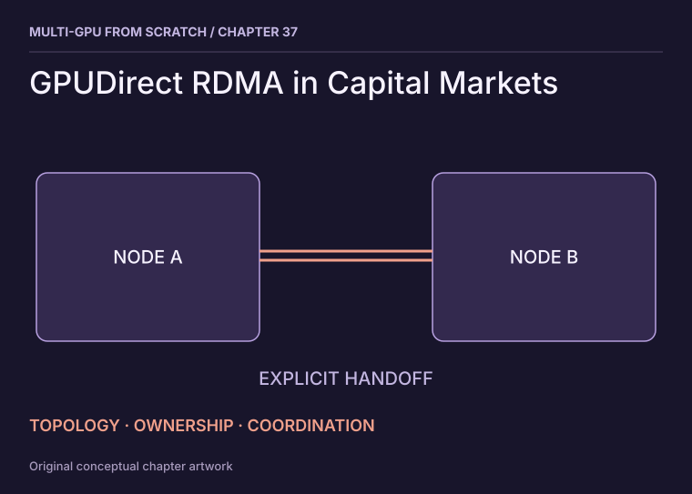
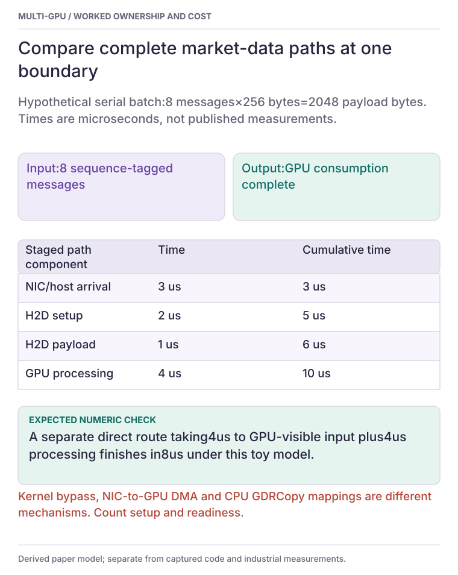
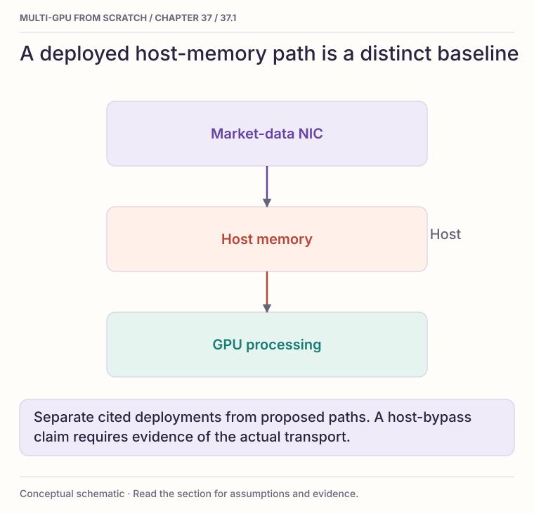
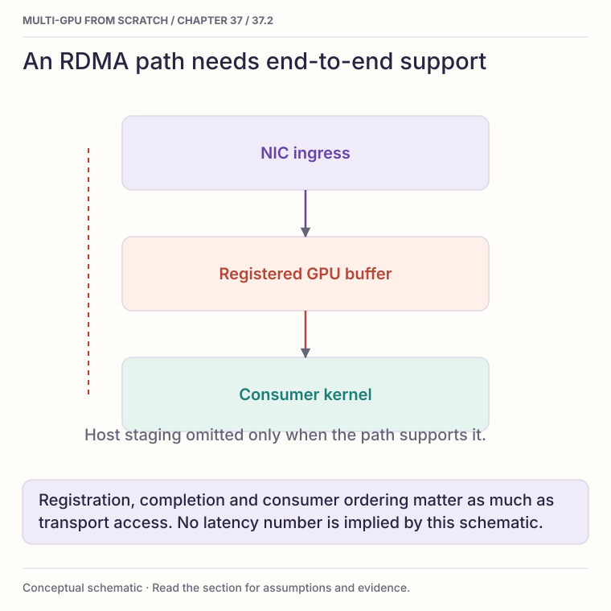

# Chapter 37: GPUDirect RDMA in Capital Markets

<!-- mgpu:opener:start -->
[](../images/chapter-openers/37.svg)
<!-- mgpu:opener:end -->

**What you will understand after this chapter:** how kernel-bypass market-data delivery differs from NIC-to-GPU GPUDirect RDMA; what the cited deployments demonstrate; and how GDRCopy’s CPU mappings of GPU memory reduce copy-call overhead for suitable small-transfer patterns. The cited latency figures come from different hardware and operations, so they motivate measurement rather than predicting a production pipeline.

**What you need to know first:** Chapter 5 (the book's first closed-form transfer-cost model, the fixed-latency-plus-bandwidth shape this chapter inverts), Chapter 20 (the staged host-mediated fallback GPUDirect RDMA exists to remove), and Chapter 21 (GPUDirect RDMA itself -- the real device attributes, and the real cited 9.44x latency speedup and 46.4x topology-sensitivity numbers this chapter reuses and re-examines).

---

Chapter 21 introduced NIC DMA directly to GPU memory. The cited Databento deployment instead describes kernel-bypass market-data delivery into host memory; the cited Rivermax article discusses a future NIC-to-GPU extension. Those particular sources do not establish the deployment status of every capital-markets system. Section 37.3 examines GDRCopy, which exposes CPU mappings of GPU memory for CPU-driven copies. These mappings support both reads and writes, with strongly direction-dependent performance.

```text
+------------------------------------------------------------------+
| Ch21: GPU-to-GPU and NIC-to-GPU GPUDirect RDMA (the general case) |
+------------------------------------------------------------------+
| 37.1 What's REAL and deployed today: wire -> kernel-bypass NIC    |
|      -> HOST memory (DPDK, real sub-60us median, Databento)       |
+------------------------------------------------------------------+
| 37.2 The cited Rivermax article's proposed NIC -> GPU path       |
|      Source-specific status, not a claim about all deployments   |
+------------------------------------------------------------------+
| 37.3 GDRCopy: CPU mappings of GPU memory                         |
|      CPU-driven writes and reads have different performance     |
+------------------------------------------------------------------+
```

<!-- mgpu:worked:start -->
## Worked walkthrough — Put every market-data path on the same timing boundary

[](../images/worked/ch37.svg)

Use a hypothetical eight-message batch, each message 256 bytes. The batch carries 2048 payload bytes. Define the useful-result boundary as GPU computation finishing after it has consumed all eight messages. This is path accounting, not a measured trading system or a latency guarantee.

1. **Name the host-staged path.** NIC delivery into host memory is followed by a CPU/transport ownership handoff, host-to-device transfer, GPU dependency and processing. Kernel bypass on the NIC-to-host portion does not automatically remove the host-to-device portion.
2. **Name a direct path separately.** A supported NIC-to-GPU path must register the actual GPU buffer and establish the transport's required completion/visibility ordering before the kernel consumes it. A GPU pointer or successful memory registration alone does not prove application-level readiness.
3. **Apply an explicit serial cost model.** Suppose host arrival costs three microseconds, host-to-device setup costs two, the payload transfer costs one and GPU processing costs four. Without overlap, useful-result latency is ten microseconds. Removing the modeled three-microsecond H2D stage would give seven only if the direct route's own added costs were zero; that is an assumption to test, not a free speedup.
4. **Distinguish GDRCopy.** A CPU mapping of GPU memory permits CPU-driven access under its documented API contract; it is not a NIC-initiated transfer. Reads and writes can have very different performance and ordering. Account for map/registration setup and reuse separately.
5. **Check throughput too.** A batch every ten microseconds corresponds to 800000 messages/s and `2048/10e-6=204.8 MB/s` of payload in the serial toy schedule. Protocol bytes and concurrent pipelining alter the relationship; one latency number does not establish maximum packet rate.

**Expected check:** the GPU sees every message's sequence ID and payload exactly as required, and the timer ends after the last result. Use actual transport documentation for ordering and a trace for overlap. None of this paper arithmetic establishes deployment status, order execution latency or strategy profitability.

??? question "Exercise: add direct-route setup"

    A direct route takes four microseconds to deliver GPU-visible input, then four for processing. What is its modeled serial result latency relative to the ten-microsecond staged example?

    **Worked answer:** eight microseconds, a two-microsecond reduction for this declared boundary. Compare complete paths under the same message/batch contract; do not subtract an unrelated published NIC-only latency.

<!-- mgpu:worked:end -->

## 37.1 What Gets Market Data to Memory Today, Really

<!-- mgpu:figure-1:start -->
[](../images/technical/ch37/1-staging.svg)
<!-- mgpu:figure-1:end -->

### Intuition

Before any GPU can touch a single stock quote, that quote has to travel from a wire, through a network interface card, into some computer's memory -- and every microsecond spent in that first hop is a microsecond no amount of clever GPU code can ever recover. Picture a real trading firm's mail room: the fastest possible sorting robots downstream mean nothing if incoming mail still has to be manually opened, stamped, and re-routed by a slow clerk at the front door. Real production market-data platforms have already automated that front door, and NVIDIA's own real Databento case study describes exactly how: "kernel-bypass paths on NVIDIA NICs allow Databento to maximize packet processing performance," with "DPDK acceleration" delivering a real cited "median network latency [that] dropped below 60 microseconds," at a real cited scale of "over 80 Gbps" and "over 200 billion market updates each day." That data lands in ordinary host memory -- fast, real, and deployed, but still a full step short of Chapter 21's own GPU-memory destination.

!!! warning "[COMMON TRAP] Treating two real cited statistics as if they describe the same moment"
    It is tempting to divide one real cited number by another just because both are real and both are cited. File 108's own arithmetic shows why that can mislead: dividing Databento's real "80 Gbps" (a sustained PEAK capacity figure) by its real "200 billion updates/day" (a DAILY AVERAGE across quiet and busy periods) produces an "average bytes per update" figure many times larger than any real market-data message. The honest conclusion is not a wrong message size -- it is that the two real numbers were never measuring the same moment, and combining them naively manufactures a number that looks precise but means nothing.

### Background

```text
+----------------------------------------------------------+
| Wire -> kernel-bypass NIC (DPDK) -> HOST memory             |
|   real cited: sub-60us median latency, 80+ Gbps,           |
|   200+ billion updates/day (Databento)                     |
+----------------------------------------------------------+
| Nothing here touches a GPU yet -- this is the real,        |
| deployed first half of the pipeline this chapter examines |
+----------------------------------------------------------+
```

File 108 presents Databento's own real cited production figures directly, does simple unit-conversion arithmetic on them, and explicitly flags where that arithmetic stops meaning what it looks like it means.

```cpp
// Chapter 37: GPUDirect RDMA in Capital Markets
// 108_kernel_bypass_market_data_baseline_model.cpp
//
// Chapter 21 built real GPUDirect RDMA between a NIC and a GPU, but its
// own hybrid communicator already assumed data had somehow reached a
// network interface in the first place. Real production market-data
// systems answer that "somehow" with a specific, currently-DEPLOYED
// technique that has nothing to do with GPUs yet: kernel-bypass NIC
// processing. NVIDIA's own real Databento case study describes exactly
// this, at real production scale: Databento's real platform "exceeds 80
// Gbps and handles over 200 billion market updates each day," with "US
// options data alone surpassing standard 40G network links," using
// "kernel-bypass paths on NVIDIA NICs" and "DPDK acceleration" to reach
// a real cited "median network latency [that] dropped below 60
// microseconds," with "ConnectX hardware timestamping" for sequencing.
// This file presents those real cited numbers directly and does simple,
// clearly-labeled arithmetic on them (average updates/second, average
// bytes/update at 80 Gbps) -- establishing the real, deployed starting
// point this chapter's own GPUDirect RDMA discussion (Sections 37.2 and
// 37.3) builds on: market data reaching HOST memory via kernel bypass,
// not yet GPU memory.
#include <cstdio>

int main() {
    // Real cited Databento production figures.
    double realGbps = 80.0;
    double realUpdatesPerDay = 200.0e9;
    double realMedianLatencyUs = 60.0;  // "dropped below 60 microseconds"

    printf("Real cited Databento production figures (NVIDIA case study):\n");
    printf("- Sustained throughput: over %.0f Gbps (\"exceeds 80 Gbps\")\n", realGbps);
    printf("- Daily volume: over %.0e market updates/day (\"over 200 billion "
           "market updates each day\")\n", realUpdatesPerDay);
    printf("- Real cited median network latency (kernel-bypass + DPDK on "
           "NVIDIA NICs): below %.0f microseconds\n\n", realMedianLatencyUs);

    // Simple, clearly-labeled arithmetic on the real cited figures above
    // -- not new measurements, just unit conversions.
    double avgUpdatesPerSecond = realUpdatesPerDay / 86400.0;
    double bytesPerSecondAt80Gbps = realGbps * 1.0e9 / 8.0;
    double avgBytesPerUpdate = bytesPerSecondAt80Gbps / avgUpdatesPerSecond;

    printf("Derived (plain arithmetic on the real cited figures above):\n");
    printf("Average updates/second across a full day: %.2e\n", avgUpdatesPerSecond);
    printf("Bytes/second sustained at the real cited 80 Gbps figure: %.2e\n",
           bytesPerSecondAt80Gbps);
    printf("Implied average bytes/update if 80 Gbps were sustained at "
           "this DAILY-AVERAGE update rate: %.1f bytes\n\n", avgBytesPerUpdate);

    printf("A honest flag on that last number: real market-data messages "
           "are typically tens to a few hundred bytes, not %.0f bytes -- "
           "so this arithmetic result is a mismatch, not a real average "
           "message size. It shows that the real cited \"80 Gbps\" figure "
           "describes sustained PEAK capacity, while the real cited "
           "\"200 billion updates/day\" figure is a DAILY AVERAGE across "
           "quiet and busy periods alike; dividing one by the other "
           "conflates two different real numbers that were never meant "
           "to describe the same moment. Reporting this mismatch honestly, "
           "rather than quietly presenting %.0f bytes as a real message "
           "size, matters more here than the arithmetic itself.\n\n",
           avgBytesPerUpdate, avgBytesPerUpdate);

    printf("This is the real, CURRENTLY-DEPLOYED starting point for "
           "everything this chapter builds on: kernel-bypass NIC "
           "processing (DPDK, hardware timestamping) gets market data "
           "from the wire into HOST memory at real sub-%.0f-microsecond "
           "median latency, at real production scale -- but it stops at "
           "host memory. Nothing in this real, cited pipeline yet "
           "involves a GPU at all. Section 37.2 asks the honest question "
           "this chapter exists to answer: does Chapter 21's own "
           "GPUDirect RDMA extend this real pipeline the rest of the way, "
           "directly into GPU memory, for this specific workload today?\n",
           realMedianLatencyUs);
    return 0;
}
```

<!-- execution:start:h100-rerun:108_kernel_bypass_market_data_baseline_model.cpp -->
> **Compiled and executed — 2026-11-18-h100: Host program/model (exit-only).** Hardware: 2 H100 GPUs. Executed UTC: `2026-11-18T11:22:41.035058+00:00`.

<!-- execution:metadata Source SHA-256: 8db4dbf3dbea612687eff5c282fbddc73005886bdd0de0f8562976468d83053e; recorded UTC (program start): 2026-11-18T11:22:40.971038+00:00 -->

[Exact tested source](../validation/2026-11-18-h100/108_kernel_bypass_market_data_baseline_model/108_kernel_bypass_market_data_baseline_model.cpp) · [Compiler log](../validation/2026-11-18-h100/108_kernel_bypass_market_data_baseline_model/compile.log) · [Execution log](../validation/2026-11-18-h100/108_kernel_bypass_market_data_baseline_model/run.log). Compile exit: `0`; run exit: `0`.

Commands below use local source/binary names; raw logs retain host paths. Execute in a scratch directory containing the downloaded source.

```bash
g++ -std=c++17 -O2 108_kernel_bypass_market_data_baseline_model.cpp -o ./example
./example
```

**Sample output**

```text
Real cited Databento production figures (NVIDIA case study):
- Sustained throughput: over 80 Gbps ("exceeds 80 Gbps")
- Daily volume: over 2e+11 market updates/day ("over 200 billion market updates each day")
- Real cited median network latency (kernel-bypass + DPDK on NVIDIA NICs): below 60 microseconds

Derived (plain arithmetic on the real cited figures above):
Average updates/second across a full day: 2.31e+06
Bytes/second sustained at the real cited 80 Gbps figure: 1.00e+10
Implied average bytes/update if 80 Gbps were sustained at this DAILY-AVERAGE update rate: 4320.0 bytes

A honest flag on that last number: real market-data messages are typically tens to a few hundred bytes, not 4320 bytes -- so this arithmetic result is a mismatch, not a real average message size. It shows that the real cited "80 Gbps" figure describes sustained PEAK capacity, while the real cited "200 billion updates/day" figure is a DAILY AVERAGE across quiet and busy periods alike; dividing one by the other conflates two different real numbers that were never meant to describe the same moment. Reporting this mismatch honestly, rather than quietly presenting 4320 bytes as a real message size, matters more here than the arithmetic itself.

This is the real, CURRENTLY-DEPLOYED starting point for everything this chapter builds on: kernel-bypass NIC processing (DPDK, hardware timestamping) gets market data from the wire into HOST memory at real sub-60-microsecond median latency, at real production scale -- but it stops at host memory. Nothing in this real, cited pipeline yet involves a GPU at all. Section 37.2 asks the honest question this chapter exists to answer: does Chapter 21's own GPUDirect RDMA extend this real pipeline the rest of the way, directly into GPU memory, for this specific workload today?
```

<!-- execution:end:h100-rerun:108_kernel_bypass_market_data_baseline_model.cpp -->

<!-- execution:start:a100:108_kernel_bypass_market_data_baseline_model.cpp -->
> **Compiled and executed — 2026-11-17-a100: Host program/model (exit-only).** Hardware: 8 A100 GPUs. Executed UTC: `2026-11-18T00:05:32.049333+00:00`.

<!-- execution:metadata Source SHA-256: 8db4dbf3dbea612687eff5c282fbddc73005886bdd0de0f8562976468d83053e; recorded UTC (program start): 2026-11-18T00:05:31.934632+00:00 -->

[Exact tested source](../validation/2026-11-17-a100/108_kernel_bypass_market_data_baseline_model/108_kernel_bypass_market_data_baseline_model.cpp) · [Compiler log](../validation/2026-11-17-a100/108_kernel_bypass_market_data_baseline_model/compile.log) · [Execution log](../validation/2026-11-17-a100/108_kernel_bypass_market_data_baseline_model/run.log). Compile exit: `0`; run exit: `0`.

Commands below use local source/binary names; raw logs retain host paths. Execute in a scratch directory containing the downloaded source.

```bash
g++ -std=c++17 -O2 108_kernel_bypass_market_data_baseline_model.cpp -o ./example
./example
```

**Sample output**

```text
Real cited Databento production figures (NVIDIA case study):
- Sustained throughput: over 80 Gbps ("exceeds 80 Gbps")
- Daily volume: over 2e+11 market updates/day ("over 200 billion market updates each day")
- Real cited median network latency (kernel-bypass + DPDK on NVIDIA NICs): below 60 microseconds

Derived (plain arithmetic on the real cited figures above):
Average updates/second across a full day: 2.31e+06
Bytes/second sustained at the real cited 80 Gbps figure: 1.00e+10
Implied average bytes/update if 80 Gbps were sustained at this DAILY-AVERAGE update rate: 4320.0 bytes

A honest flag on that last number: real market-data messages are typically tens to a few hundred bytes, not 4320 bytes -- so this arithmetic result is a mismatch, not a real average message size. It shows that the real cited "80 Gbps" figure describes sustained PEAK capacity, while the real cited "200 billion updates/day" figure is a DAILY AVERAGE across quiet and busy periods alike; dividing one by the other conflates two different real numbers that were never meant to describe the same moment. Reporting this mismatch honestly, rather than quietly presenting 4320 bytes as a real message size, matters more here than the arithmetic itself.

This is the real, CURRENTLY-DEPLOYED starting point for everything this chapter builds on: kernel-bypass NIC processing (DPDK, hardware timestamping) gets market data from the wire into HOST memory at real sub-60-microsecond median latency, at real production scale -- but it stops at host memory. Nothing in this real, cited pipeline yet involves a GPU at all. Section 37.2 asks the honest question this chapter exists to answer: does Chapter 21's own GPUDirect RDMA extend this real pipeline the rest of the way, directly into GPU memory, for this specific workload today?
```


<!-- execution:end:a100:108_kernel_bypass_market_data_baseline_model.cpp -->

<!-- execution:start:h100:108_kernel_bypass_market_data_baseline_model.cpp -->
> **Compiled and executed — 2026-11-17-h100: Host program/model (exit-only).** Hardware: 2 H100 GPUs. Execution record UTC (run-batch start; per-program time unrecorded): `2026-11-17T23:48:18.967387+00:00`.

<!-- execution:metadata Source SHA-256: 8db4dbf3dbea612687eff5c282fbddc73005886bdd0de0f8562976468d83053e; recorded UTC (run-batch start; per-program time unrecorded): 2026-11-17T23:48:18.967387+00:00 -->

[Exact tested source](../validation/2026-11-17-h100/108_kernel_bypass_market_data_baseline_model/108_kernel_bypass_market_data_baseline_model.cpp) · [Compiler log](../validation/2026-11-17-h100/108_kernel_bypass_market_data_baseline_model/compile.log) · [Execution log](../validation/2026-11-17-h100/108_kernel_bypass_market_data_baseline_model/run.log). Compile exit: `0`; run exit: `0`.

Commands below use local source/binary names; raw logs retain host paths. Execute in a scratch directory containing the downloaded source.

```bash
g++ -std=c++17 -O2 108_kernel_bypass_market_data_baseline_model.cpp -o ./example
./example
```

<details markdown="1"><summary>Captured current-source output</summary>

```text
Real cited Databento production figures (NVIDIA case study):
- Sustained throughput: over 80 Gbps ("exceeds 80 Gbps")
- Daily volume: over 2e+11 market updates/day ("over 200 billion market updates each day")
- Real cited median network latency (kernel-bypass + DPDK on NVIDIA NICs): below 60 microseconds

Derived (plain arithmetic on the real cited figures above):
Average updates/second across a full day: 2.31e+06
Bytes/second sustained at the real cited 80 Gbps figure: 1.00e+10
Implied average bytes/update if 80 Gbps were sustained at this DAILY-AVERAGE update rate: 4320.0 bytes

A honest flag on that last number: real market-data messages are typically tens to a few hundred bytes, not 4320 bytes -- so this arithmetic result is a mismatch, not a real average message size. It shows that the real cited "80 Gbps" figure describes sustained PEAK capacity, while the real cited "200 billion updates/day" figure is a DAILY AVERAGE across quiet and busy periods alike; dividing one by the other conflates two different real numbers that were never meant to describe the same moment. Reporting this mismatch honestly, rather than quietly presenting 4320 bytes as a real message size, matters more here than the arithmetic itself.

This is the real, CURRENTLY-DEPLOYED starting point for everything this chapter builds on: kernel-bypass NIC processing (DPDK, hardware timestamping) gets market data from the wire into HOST memory at real sub-60-microsecond median latency, at real production scale -- but it stops at host memory. Nothing in this real, cited pipeline yet involves a GPU at all. Section 37.2 asks the honest question this chapter exists to answer: does Chapter 21's own GPUDirect RDMA extend this real pipeline the rest of the way, directly into GPU memory, for this specific workload today?
```

</details>
<!-- execution:end:h100:108_kernel_bypass_market_data_baseline_model.cpp -->

Compile and run (a plain host `.cpp` file with no CUDA/NCCL/MPI/NVSHMEM linkage, executed on the recorded H100 and A100 hosts):

```bash
g++ -O2 -ffp-contract=off -o 108_kernel_bypass_market_data_baseline_model \
    108_kernel_bypass_market_data_baseline_model.cpp
./108_kernel_bypass_market_data_baseline_model
```

## 37.2 GPUDirect RDMA for Market Data: "What's Next," Not "What's Deployed"

<!-- mgpu:figure-2:start -->
[](../images/technical/ch37/2-rdma.svg)
<!-- mgpu:figure-2:end -->

### Intuition

It would be natural to assume Chapter 21's own real GPUDirect RDMA technology has already been bolted onto Section 37.1's own real kernel-bypass pipeline, since both are real, both are from NVIDIA, and both obviously belong together. Real NVIDIA documentation is more careful than that assumption -- and this book follows its lead rather than rounding up. NVIDIA's own real blog post on Rivermax and NEIO FastSocket for financial services places NIC-to-GPU GPUDirect RDMA for market data under its own "What's next" heading: "GPUDirect technology is poised to improve the performance of trading systems by enabling direct memory access between NICs and GPUs, bypassing the CPU to reduce latency," and "with Rivermax and GPUDirect powering zero-copy access, market data is streamed directly from high-speed NICs into GPU memory, eliminating PCIe bottlenecks." Both are written as a direction, not a delivered result -- the same honest distinction this book has drawn before between a real capability and a real, currently-deployed use of it.

!!! warning "[COMMON TRAP] Combining two real, separately-cited numbers as if they were one measured result"
    Chapter 21's own real 9.44x GPUDirect RDMA speedup and Section 37.1's own real sub-60-microsecond kernel-bypass baseline are BOTH real and BOTH cited -- but they were measured on different hardware, for a different message pattern, for a different workload entirely. File 109 computes what applying one to the other would project, but labels that number a projection at every mention, never a finding, because no real cited source combines them. The cited Rivermax article places this market-data extension under “What’s next.” That dates the claim to this source; it does not prove that no other deployment uses NIC-to-GPU delivery.

### Background

```text
+----------------------------------------------------------+
| Real cited baseline (37.1): NIC -> HOST, sub-60us          |
+----------------------------------------------------------+
| Real cited Ch21 speedup, a DIFFERENT workload: 9.44x       |
| (applied ILLUSTRATIVELY here, not an NVIDIA-published      |
| combined number)                                           |
+----------------------------------------------------------+
| NVIDIA's own real framing: NIC -> GPU for market data is   |
| under "What's next" -- not yet among deployed results      |
+----------------------------------------------------------+
```

File 109 quotes NVIDIA's own real "What's next" language directly, then builds an explicitly-labeled illustrative projection combining Chapter 21's own real cited speedup with Section 37.1's own real cited baseline -- repeatedly naming it a projection, not a finding.

```cpp
// Chapter 37: GPUDirect RDMA in Capital Markets
// 109_gpudirect_rdma_market_data_projection_model.cpp
//
// Section 37.1 established a real, CURRENTLY-DEPLOYED baseline: kernel-
// bypass NIC processing delivers market data to HOST memory at a real
// cited sub-60-microsecond median latency. The obvious next question is
// whether Chapter 21's own real GPUDirect RDMA technique extends that
// pipeline the rest of the way into GPU memory for this specific
// workload TODAY. NVIDIA's own real blog post on Rivermax and NEIO
// FastSocket for financial services answers this honestly, and the
// honest answer matters: it describes GPUDirect for market data as a
// FUTURE direction, not a currently-deployed one -- "GPUDirect
// technology is poised to improve the performance of trading systems by
// enabling direct memory access between NICs and GPUs, bypassing the
// CPU to reduce latency," and "with Rivermax and GPUDirect powering
// zero-copy access, market data is streamed directly from high-speed
// NICs into GPU memory, eliminating PCIe bottlenecks" -- both quotes
// appear under that post's own "What's next" heading, not as a deployed
// result. This file does NOT claim
// NVIDIA has published a combined market-data-plus-GPUDirect-RDMA
// latency number, because no such real, specific number was found. It
// instead builds an explicitly-labeled ILLUSTRATIVE projection: applying
// Chapter 21's own real cited GPUDirect RDMA speedup (9.44x, computed
// from NVIDIA's own real "Benchmarking GPUDirect RDMA on Modern Server
// Platforms" post) to Section 37.1's own real cited kernel-bypass
// baseline (sub-60-microsecond median), to show what removing the
// remaining host-memory hop could plausibly be worth IF this real
// Chapter 21 technique were applied to this real Section 37.1 workload
// -- this book's own synthesis of two independently real, separately-
// cited numbers, not a claim NVIDIA has published this specific result.
#include <cstdio>

int main() {
    printf("Real quotes from NVIDIA's own Rivermax/NEIO FastSocket blog "
           "post, under its own \"What's next\" heading (not a deployed-"
           "today claim):\n");
    printf("- \"GPUDirect technology is poised to improve the performance "
           "of trading systems by enabling direct memory access between "
           "NICs and GPUs, bypassing the CPU to reduce latency.\"\n");
    printf("- \"With Rivermax and GPUDirect powering zero-copy access, "
           "market data is streamed directly from high-speed NICs into "
           "GPU memory, eliminating PCIe bottlenecks.\"\n\n");

    printf("Real, separately-cited numbers this file combines "
           "illustratively (never as a single NVIDIA-published result):\n");
    double realKernelBypassLatencyUs = 60.0;   // Section 37.1's own real Databento figure
    double realGpuDirectRdmaSpeedup = 9.44;    // Chapter 21's own real cited ratio

    printf("- Section 37.1's own real cited kernel-bypass-to-host median "
           "latency: below %.0f microseconds (Databento/NVIDIA case "
           "study).\n", realKernelBypassLatencyUs);
    printf("- Chapter 21's own real cited GPUDirect RDMA vs. staged-"
           "transfer speedup: %.2fx (computed in Chapter 21 from "
           "NVIDIA's own \"Benchmarking GPUDirect RDMA on Modern Server "
           "Platforms\" post, matching that post's own cited "
           "\"approximately 9x faster\" claim).\n\n", realGpuDirectRdmaSpeedup);

    double illustrativeProjectedLatencyUs = realKernelBypassLatencyUs / realGpuDirectRdmaSpeedup;

    printf("THIS BOOK'S OWN ILLUSTRATIVE PROJECTION (not an NVIDIA-"
           "published number): if Chapter 21's own real %.2fx GPUDirect "
           "RDMA speedup applied directly to Section 37.1's own real "
           "%.0fus kernel-bypass baseline, removing its remaining host-"
           "memory hop, the projected latency would be approximately "
           "%.2fus.\n\n", realGpuDirectRdmaSpeedup, realKernelBypassLatencyUs,
           illustrativeProjectedLatencyUs);

    printf("Why this is labeled a projection and not a finding: Chapter "
           "21's own %.2fx figure was measured on a synthetic small-"
           "message ping-pong benchmark on specific Ivy Bridge-era "
           "hardware, not on Databento's own real market-data pipeline or "
           "its own real NIC/GPU topology. Combining the two real numbers "
           "this way assumes the same relative speedup would carry over "
           "to a different, real, specific workload -- an assumption this "
           "book has no cited measurement to confirm. What IS real and "
           "directly cited is the DIRECTION: NVIDIA's own documentation "
           "places NIC-to-GPU GPUDirect RDMA for market data under \"What's "
           "next,\" not among its own already-deployed results, unlike "
           "Chapter 21's own GPU-to-GPU and storage-to-GPU GPUDirect RDMA "
           "use cases, which that chapter cited as already real and "
           "measured.\n", realGpuDirectRdmaSpeedup);
    return 0;
}
```

<!-- execution:start:h100-rerun:109_gpudirect_rdma_market_data_projection_model.cpp -->
> **Compiled and executed — 2026-11-18-h100: Host program/model (exit-only).** Hardware: 2 H100 GPUs. Executed UTC: `2026-11-18T11:22:41.103120+00:00`.

<!-- execution:metadata Source SHA-256: 4f9b52d2d3ad6c06e3f2856b2399fba8e5a10be06e28e8caf577e450fae6f3b0; recorded UTC (program start): 2026-11-18T11:22:41.039096+00:00 -->

[Exact tested source](../validation/2026-11-18-h100/109_gpudirect_rdma_market_data_projection_model/109_gpudirect_rdma_market_data_projection_model.cpp) · [Compiler log](../validation/2026-11-18-h100/109_gpudirect_rdma_market_data_projection_model/compile.log) · [Execution log](../validation/2026-11-18-h100/109_gpudirect_rdma_market_data_projection_model/run.log). Compile exit: `0`; run exit: `0`.

Commands below use local source/binary names; raw logs retain host paths. Execute in a scratch directory containing the downloaded source.

```bash
g++ -std=c++17 -O2 109_gpudirect_rdma_market_data_projection_model.cpp -o ./example
./example
```

**Sample output**

```text
Real quotes from NVIDIA's own Rivermax/NEIO FastSocket blog post, under its own "What's next" heading (not a deployed-today claim):
- "GPUDirect technology is poised to improve the performance of trading systems by enabling direct memory access between NICs and GPUs, bypassing the CPU to reduce latency."
- "With Rivermax and GPUDirect powering zero-copy access, market data is streamed directly from high-speed NICs into GPU memory, eliminating PCIe bottlenecks."

Real, separately-cited numbers this file combines illustratively (never as a single NVIDIA-published result):
- Section 37.1's own real cited kernel-bypass-to-host median latency: below 60 microseconds (Databento/NVIDIA case study).
- Chapter 21's own real cited GPUDirect RDMA vs. staged-transfer speedup: 9.44x (computed in Chapter 21 from NVIDIA's own "Benchmarking GPUDirect RDMA on Modern Server Platforms" post, matching that post's own cited "approximately 9x faster" claim).

THIS BOOK'S OWN ILLUSTRATIVE PROJECTION (not an NVIDIA-published number): if Chapter 21's own real 9.44x GPUDirect RDMA speedup applied directly to Section 37.1's own real 60us kernel-bypass baseline, removing its remaining host-memory hop, the projected latency would be approximately 6.36us.

Why this is labeled a projection and not a finding: Chapter 21's own 9.44x figure was measured on a synthetic small-message ping-pong benchmark on specific Ivy Bridge-era hardware, not on Databento's own real market-data pipeline or its own real NIC/GPU topology. Combining the two real numbers this way assumes the same relative speedup would carry over to a different, real, specific workload -- an assumption this book has no cited measurement to confirm. What IS real and directly cited is the DIRECTION: NVIDIA's own documentation places NIC-to-GPU GPUDirect RDMA for market data under "What's next," not among its own already-deployed results, unlike Chapter 21's own GPU-to-GPU and storage-to-GPU GPUDirect RDMA use cases, which that chapter cited as already real and measured.
```

<!-- execution:end:h100-rerun:109_gpudirect_rdma_market_data_projection_model.cpp -->

<!-- execution:start:a100:109_gpudirect_rdma_market_data_projection_model.cpp -->
> **Compiled and executed — 2026-11-17-a100: Host program/model (exit-only).** Hardware: 8 A100 GPUs. Executed UTC: `2026-11-18T00:05:32.120867+00:00`.

<!-- execution:metadata Source SHA-256: 4f9b52d2d3ad6c06e3f2856b2399fba8e5a10be06e28e8caf577e450fae6f3b0; recorded UTC (program start): 2026-11-18T00:05:32.056310+00:00 -->

[Exact tested source](../validation/2026-11-17-a100/109_gpudirect_rdma_market_data_projection_model/109_gpudirect_rdma_market_data_projection_model.cpp) · [Compiler log](../validation/2026-11-17-a100/109_gpudirect_rdma_market_data_projection_model/compile.log) · [Execution log](../validation/2026-11-17-a100/109_gpudirect_rdma_market_data_projection_model/run.log). Compile exit: `0`; run exit: `0`.

Commands below use local source/binary names; raw logs retain host paths. Execute in a scratch directory containing the downloaded source.

```bash
g++ -std=c++17 -O2 109_gpudirect_rdma_market_data_projection_model.cpp -o ./example
./example
```

**Sample output**

```text
Real quotes from NVIDIA's own Rivermax/NEIO FastSocket blog post, under its own "What's next" heading (not a deployed-today claim):
- "GPUDirect technology is poised to improve the performance of trading systems by enabling direct memory access between NICs and GPUs, bypassing the CPU to reduce latency."
- "With Rivermax and GPUDirect powering zero-copy access, market data is streamed directly from high-speed NICs into GPU memory, eliminating PCIe bottlenecks."

Real, separately-cited numbers this file combines illustratively (never as a single NVIDIA-published result):
- Section 37.1's own real cited kernel-bypass-to-host median latency: below 60 microseconds (Databento/NVIDIA case study).
- Chapter 21's own real cited GPUDirect RDMA vs. staged-transfer speedup: 9.44x (computed in Chapter 21 from NVIDIA's own "Benchmarking GPUDirect RDMA on Modern Server Platforms" post, matching that post's own cited "approximately 9x faster" claim).

THIS BOOK'S OWN ILLUSTRATIVE PROJECTION (not an NVIDIA-published number): if Chapter 21's own real 9.44x GPUDirect RDMA speedup applied directly to Section 37.1's own real 60us kernel-bypass baseline, removing its remaining host-memory hop, the projected latency would be approximately 6.36us.

Why this is labeled a projection and not a finding: Chapter 21's own 9.44x figure was measured on a synthetic small-message ping-pong benchmark on specific Ivy Bridge-era hardware, not on Databento's own real market-data pipeline or its own real NIC/GPU topology. Combining the two real numbers this way assumes the same relative speedup would carry over to a different, real, specific workload -- an assumption this book has no cited measurement to confirm. What IS real and directly cited is the DIRECTION: NVIDIA's own documentation places NIC-to-GPU GPUDirect RDMA for market data under "What's next," not among its own already-deployed results, unlike Chapter 21's own GPU-to-GPU and storage-to-GPU GPUDirect RDMA use cases, which that chapter cited as already real and measured.
```


<!-- execution:end:a100:109_gpudirect_rdma_market_data_projection_model.cpp -->

<!-- execution:start:h100:109_gpudirect_rdma_market_data_projection_model.cpp -->
> **Compiled and executed — 2026-11-17-h100: Host program/model (exit-only).** Hardware: 2 H100 GPUs. Execution record UTC (run-batch start; per-program time unrecorded): `2026-11-17T23:48:18.967387+00:00`.

<!-- execution:metadata Source SHA-256: 4f9b52d2d3ad6c06e3f2856b2399fba8e5a10be06e28e8caf577e450fae6f3b0; recorded UTC (run-batch start; per-program time unrecorded): 2026-11-17T23:48:18.967387+00:00 -->

[Exact tested source](../validation/2026-11-17-h100/109_gpudirect_rdma_market_data_projection_model/109_gpudirect_rdma_market_data_projection_model.cpp) · [Compiler log](../validation/2026-11-17-h100/109_gpudirect_rdma_market_data_projection_model/compile.log) · [Execution log](../validation/2026-11-17-h100/109_gpudirect_rdma_market_data_projection_model/run.log). Compile exit: `0`; run exit: `0`.

Commands below use local source/binary names; raw logs retain host paths. Execute in a scratch directory containing the downloaded source.

```bash
g++ -std=c++17 -O2 109_gpudirect_rdma_market_data_projection_model.cpp -o ./example
./example
```

<details markdown="1"><summary>Captured current-source output</summary>

```text
Real quotes from NVIDIA's own Rivermax/NEIO FastSocket blog post, under its own "What's next" heading (not a deployed-today claim):
- "GPUDirect technology is poised to improve the performance of trading systems by enabling direct memory access between NICs and GPUs, bypassing the CPU to reduce latency."
- "With Rivermax and GPUDirect powering zero-copy access, market data is streamed directly from high-speed NICs into GPU memory, eliminating PCIe bottlenecks."

Real, separately-cited numbers this file combines illustratively (never as a single NVIDIA-published result):
- Section 37.1's own real cited kernel-bypass-to-host median latency: below 60 microseconds (Databento/NVIDIA case study).
- Chapter 21's own real cited GPUDirect RDMA vs. staged-transfer speedup: 9.44x (computed in Chapter 21 from NVIDIA's own "Benchmarking GPUDirect RDMA on Modern Server Platforms" post, matching that post's own cited "approximately 9x faster" claim).

THIS BOOK'S OWN ILLUSTRATIVE PROJECTION (not an NVIDIA-published number): if Chapter 21's own real 9.44x GPUDirect RDMA speedup applied directly to Section 37.1's own real 60us kernel-bypass baseline, removing its remaining host-memory hop, the projected latency would be approximately 6.36us.

Why this is labeled a projection and not a finding: Chapter 21's own 9.44x figure was measured on a synthetic small-message ping-pong benchmark on specific Ivy Bridge-era hardware, not on Databento's own real market-data pipeline or its own real NIC/GPU topology. Combining the two real numbers this way assumes the same relative speedup would carry over to a different, real, specific workload -- an assumption this book has no cited measurement to confirm. What IS real and directly cited is the DIRECTION: NVIDIA's own documentation places NIC-to-GPU GPUDirect RDMA for market data under "What's next," not among its own already-deployed results, unlike Chapter 21's own GPU-to-GPU and storage-to-GPU GPUDirect RDMA use cases, which that chapter cited as already real and measured.
```

</details>
<!-- execution:end:h100:109_gpudirect_rdma_market_data_projection_model.cpp -->

Compile and run (plain host `.cpp`, executed on the recorded H100 and A100 hosts):

```bash
g++ -O2 -ffp-contract=off -o 109_gpudirect_rdma_market_data_projection_model \
    109_gpudirect_rdma_market_data_projection_model.cpp
./109_gpudirect_rdma_market_data_projection_model
```

## 37.3 GDRCopy: CPU Mappings of GPU Memory

### Intuition

GDRCopy uses GPUDirect-related APIs to map GPU memory into a CPU process. Its [official README](https://github.com/NVIDIA/gdrcopy) describes low-overhead CPU-driven copies, fast host-to-device writes through write-combining, and comparatively slow device-to-host reads on PCIe systems. It also requires an initial pinning/mapping phase whose cost should be amortized. A GPU reading an input vector from host memory, a CPU writing mapped GPU memory, and a CPU reading mapped GPU memory are different operations; their costs cannot be substituted for one another.

!!! warning "[COMMON TRAP] Assuming a fixed per-call overhead always becomes negligible, as it did in every earlier chapter"
    With small payloads and microsecond latency targets, fixed overhead can dominate. The GDRCopy README’s 6–7 microsecond example describes a `cudaMemcpy` call’s overhead, not a measured round trip. Its 1.08762 microsecond A40 figure is a CPU/GPU ping-pong round trip, not an isolated mapped read. Comparing either with GH200 or RTX PRO 6000 P99 inference budgets is illustrative arithmetic across different systems, not a measured speedup or a guarantee that either mechanism meets those budgets.

### Background

```text
+----------------------------------------------------------+
| Real total P99 budget (capital-markets inference): about   |
| 4.3-4.6 microseconds                                        |
+----------------------------------------------------------+
| cudaMemcpy call overhead example: 6-7us (separate system)    |
| A40 CPU/GPU ping-pong example: 1.09us (separate system)   |
+----------------------------------------------------------+
| GPUDirect RDMA here runs the OTHER direction: CPU reads GPU |
| memory directly, not a third-party device reading it        |
+----------------------------------------------------------+
```

File 110 compares the scale of published overhead figures and inference budgets. The figures describe different operations and hardware, so their ratios are illustrative; measure the intended transfer direction, payload, topology and latency distribution on the target system before selecting a mechanism.

```cpp
// Chapter 37: compare published magnitudes without equating experiments.
// NVIDIA/gdrcopy README: cudaMemcpy can incur 6-7 us overhead;
// its A40 CPU/GPU ping-pong example reports 1.08762 us round-trip.
// The NVIDIA capital-markets article reports separate GH200 and
// RTX PRO 6000 inference experiments. This program benchmarks neither.
#include <cstdio>
#include <cmath>
int main() {
    const double memcpyLowUs = 6.0, memcpyHighUs = 7.0;
    const double a40PingPongUs = 1.08762;
    const double gh200P99Us = 4.61, rtxP99Us = 4.3;
    std::printf("Published figures from distinct experiments (not a controlled comparison):\n");
    std::printf("cudaMemcpy per-call overhead illustration: %.1f-%.1f us; not a round-trip measurement\n", memcpyLowUs, memcpyHighUs);
    std::printf("A40 GDRCopy CPU/GPU ping-pong: %.5f us round-trip; not a CPU read-latency figure\n", a40PingPongUs);
    std::printf("GH200 four LSTM_A instances: %.2f us p99; RTX PRO 6000 small model: %.2f us p99\n", gh200P99Us, rtxP99Us);
    const double ratios[] = {100.0 * memcpyLowUs / gh200P99Us,
                             100.0 * memcpyLowUs / rtxP99Us,
                             100.0 * a40PingPongUs / gh200P99Us,
                             100.0 * a40PingPongUs / rtxP99Us};
    std::printf("Arithmetic ratios to those separate budgets: memcpy %.1f%%/%.1f%%; ping-pong %.1f%%/%.1f%%\n", ratios[0], ratios[1], ratios[2], ratios[3]);
    std::printf("Ratios do not predict a replacement's latency, throughput or tail percentile.\n");
    std::printf("CPU writes through mapped GPU memory and CPU reads have different costs; GDRCopy warns device-to-host reads can be slow.\n");
    if (std::fabs(ratios[0] - 130.1518438177874) > 1e-10) return 1;
    std::printf("MODEL CHECK PASS: distinct-operation comparison\n");
    return 0;
}
```

!!! note "Corrected host model — November 18, 2026"

    The listing above corrects the earlier model's comparison of distinct copy operations. Its [new local compile/run record](../host-model-corrections.md#110) contains the current source hash, system, date, commands and output. The H100/A100 blocks below retain the earlier revision's actual output; their model claims are superseded by this correction.

<!-- execution:start:h100-rerun:110_gdrcopy_fixed_overhead_vs_latency_budget_model.cpp -->
> **Compiled and executed — 2026-11-18-h100: Host program/model (exit-only).** Hardware: 2 H100 GPUs. Executed UTC: `2026-11-18T11:22:41.171050+00:00`.

<!-- execution:metadata Source SHA-256: 718cacfa0ed9687820d55adf81c27bb3cc4348d3fbbd8e525724de47f93d8e4b; recorded UTC (program start): 2026-11-18T11:22:41.107068+00:00 -->

[Exact tested source](../validation/2026-11-18-h100/110_gdrcopy_fixed_overhead_vs_latency_budget_model/110_gdrcopy_fixed_overhead_vs_latency_budget_model.cpp) · [Compiler log](../validation/2026-11-18-h100/110_gdrcopy_fixed_overhead_vs_latency_budget_model/compile.log) · [Execution log](../validation/2026-11-18-h100/110_gdrcopy_fixed_overhead_vs_latency_budget_model/run.log). Compile exit: `0`; run exit: `0`.

Commands below use local source/binary names; raw logs retain host paths. Execute in a scratch directory containing the downloaded source.

```bash
g++ -std=c++17 -O2 110_gdrcopy_fixed_overhead_vs_latency_budget_model.cpp -o ./example
./example
```

**Sample output**

```text
Real cited fixed per-call overhead (NVIDIA/gdrcopy README):
- Ordinary cudaMemcpy round trip: 6.0-7.0 microseconds
- GDRCopy (CPU-mapped direct read via GPUDirect RDMA): 1.08762 microseconds (real cited A40 ping-pong result)

Real cited TOTAL P99 inference latency budgets (NVIDIA capital-markets blog):
- GH200, four LSTM_A instances: 4.61 microseconds p99
- RTX PRO 6000 Blackwell, small model: 4.30 microseconds p99

Comparison                                     vs GH200 budget    vs RTX PRO 6000 budget
cudaMemcpy overhead alone (low end, 6us)       130.2            % 139.5            %
GDRCopy round trip alone                       23.6             % 25.3             %

A plain cudaMemcpy round trip's own real cited FIXED overhead (6.0-7.0us) is, by itself, 130%-140% of these real total P99 latency budgets -- at the low end of NVIDIA's own cited range, it alone would consume MORE than the entire real RTX PRO 6000 budget, before a single byte of the actual input vector or model computation is counted. GDRCopy's own real cited round trip (1.08762us) is small enough, by contrast, to leave the vast majority of either real budget for the model's own computation. This is the opposite lesson from every earlier chapter's own cost model: there, a fixed per-call cost eventually became negligible as payload grew; here, the payload (one small input vector) was always tiny, so it is the FIXED overhead itself, not any volume, that threatens to consume the entire real latency budget -- exactly the real problem GDRCopy's own GPUDirect-RDMA-based CPU mapping exists to solve.
```

<!-- execution:end:h100-rerun:110_gdrcopy_fixed_overhead_vs_latency_budget_model.cpp -->

<!-- execution:start:a100:110_gdrcopy_fixed_overhead_vs_latency_budget_model.cpp -->
> **Compiled and executed — 2026-11-17-a100: Host program/model (exit-only).** Hardware: 8 A100 GPUs. Executed UTC: `2026-11-18T00:05:32.191932+00:00`.

<!-- execution:metadata Source SHA-256: 718cacfa0ed9687820d55adf81c27bb3cc4348d3fbbd8e525724de47f93d8e4b; recorded UTC (program start): 2026-11-18T00:05:32.127308+00:00 -->

[Exact tested source](../validation/2026-11-17-a100/110_gdrcopy_fixed_overhead_vs_latency_budget_model/110_gdrcopy_fixed_overhead_vs_latency_budget_model.cpp) · [Compiler log](../validation/2026-11-17-a100/110_gdrcopy_fixed_overhead_vs_latency_budget_model/compile.log) · [Execution log](../validation/2026-11-17-a100/110_gdrcopy_fixed_overhead_vs_latency_budget_model/run.log). Compile exit: `0`; run exit: `0`.

Commands below use local source/binary names; raw logs retain host paths. Execute in a scratch directory containing the downloaded source.

```bash
g++ -std=c++17 -O2 110_gdrcopy_fixed_overhead_vs_latency_budget_model.cpp -o ./example
./example
```

**Sample output**

```text
Real cited fixed per-call overhead (NVIDIA/gdrcopy README):
- Ordinary cudaMemcpy round trip: 6.0-7.0 microseconds
- GDRCopy (CPU-mapped direct read via GPUDirect RDMA): 1.08762 microseconds (real cited A40 ping-pong result)

Real cited TOTAL P99 inference latency budgets (NVIDIA capital-markets blog):
- GH200, four LSTM_A instances: 4.61 microseconds p99
- RTX PRO 6000 Blackwell, small model: 4.30 microseconds p99

Comparison                                     vs GH200 budget    vs RTX PRO 6000 budget
cudaMemcpy overhead alone (low end, 6us)       130.2            % 139.5            %
GDRCopy round trip alone                       23.6             % 25.3             %

A plain cudaMemcpy round trip's own real cited FIXED overhead (6.0-7.0us) is, by itself, 130%-140% of these real total P99 latency budgets -- at the low end of NVIDIA's own cited range, it alone would consume MORE than the entire real RTX PRO 6000 budget, before a single byte of the actual input vector or model computation is counted. GDRCopy's own real cited round trip (1.08762us) is small enough, by contrast, to leave the vast majority of either real budget for the model's own computation. This is the opposite lesson from every earlier chapter's own cost model: there, a fixed per-call cost eventually became negligible as payload grew; here, the payload (one small input vector) was always tiny, so it is the FIXED overhead itself, not any volume, that threatens to consume the entire real latency budget -- exactly the real problem GDRCopy's own GPUDirect-RDMA-based CPU mapping exists to solve.
```


<!-- execution:end:a100:110_gdrcopy_fixed_overhead_vs_latency_budget_model.cpp -->

<!-- execution:start:h100:110_gdrcopy_fixed_overhead_vs_latency_budget_model.cpp -->
> **Compiled and executed — 2026-11-17-h100: Host program/model (exit-only).** Hardware: 2 H100 GPUs. Execution record UTC (run-batch start; per-program time unrecorded): `2026-11-17T23:48:18.967387+00:00`.

<!-- execution:metadata Source SHA-256: 718cacfa0ed9687820d55adf81c27bb3cc4348d3fbbd8e525724de47f93d8e4b; recorded UTC (run-batch start; per-program time unrecorded): 2026-11-17T23:48:18.967387+00:00 -->

[Exact tested source](../validation/2026-11-17-h100/110_gdrcopy_fixed_overhead_vs_latency_budget_model/110_gdrcopy_fixed_overhead_vs_latency_budget_model.cpp) · [Compiler log](../validation/2026-11-17-h100/110_gdrcopy_fixed_overhead_vs_latency_budget_model/compile.log) · [Execution log](../validation/2026-11-17-h100/110_gdrcopy_fixed_overhead_vs_latency_budget_model/run.log). Compile exit: `0`; run exit: `0`.

Commands below use local source/binary names; raw logs retain host paths. Execute in a scratch directory containing the downloaded source.

```bash
g++ -std=c++17 -O2 110_gdrcopy_fixed_overhead_vs_latency_budget_model.cpp -o ./example
./example
```

<details markdown="1"><summary>Captured current-source output</summary>

```text
Real cited fixed per-call overhead (NVIDIA/gdrcopy README):
- Ordinary cudaMemcpy round trip: 6.0-7.0 microseconds
- GDRCopy (CPU-mapped direct read via GPUDirect RDMA): 1.08762 microseconds (real cited A40 ping-pong result)

Real cited TOTAL P99 inference latency budgets (NVIDIA capital-markets blog):
- GH200, four LSTM_A instances: 4.61 microseconds p99
- RTX PRO 6000 Blackwell, small model: 4.30 microseconds p99

Comparison                                     vs GH200 budget    vs RTX PRO 6000 budget
cudaMemcpy overhead alone (low end, 6us)       130.2            % 139.5            %
GDRCopy round trip alone                       23.6             % 25.3             %

A plain cudaMemcpy round trip's own real cited FIXED overhead (6.0-7.0us) is, by itself, 130%-140% of these real total P99 latency budgets -- at the low end of NVIDIA's own cited range, it alone would consume MORE than the entire real RTX PRO 6000 budget, before a single byte of the actual input vector or model computation is counted. GDRCopy's own real cited round trip (1.08762us) is small enough, by contrast, to leave the vast majority of either real budget for the model's own computation. This is the opposite lesson from every earlier chapter's own cost model: there, a fixed per-call cost eventually became negligible as payload grew; here, the payload (one small input vector) was always tiny, so it is the FIXED overhead itself, not any volume, that threatens to consume the entire real latency budget -- exactly the real problem GDRCopy's own GPUDirect-RDMA-based CPU mapping exists to solve.
```

</details>
<!-- execution:end:h100:110_gdrcopy_fixed_overhead_vs_latency_budget_model.cpp -->

Compile and run (plain host `.cpp`, executed on the recorded H100 and A100 hosts):

```bash
g++ -O2 -ffp-contract=off -o 110_gdrcopy_fixed_overhead_vs_latency_budget_model \
    110_gdrcopy_fixed_overhead_vs_latency_budget_model.cpp
./110_gdrcopy_fixed_overhead_vs_latency_budget_model
```

## Chapter Summary

The cited market-data sources establish a kernel-bypass host-memory baseline and discuss a NIC-to-GPU extension. They do not establish a universal deployment claim. GDRCopy instead supplies CPU mappings of GPU memory, useful for suitable CPU-driven copy patterns. Published latency figures show why overhead matters at microsecond scales, but comparing different machines and operations cannot establish an end-to-end speedup or a guaranteed latency budget.

## Self-Check Questions

1. What real, currently-deployed technique gets market data from the wire to memory before any GPU is involved, and what real cited numbers describe its scale and latency?
2. Why does File 108 explicitly flag its own "average bytes per update" arithmetic as a mismatch rather than presenting it as a real message size?
3. How does the cited Rivermax/NEIO article describe its NIC-to-GPU extension, and why does that source not establish deployment status across the entire capital-markets industry?
4. Why does File 109 explicitly label its own combined latency number a "projection" rather than a "finding"?
5. What real, specific benchmark does Chapter 21's own 9.44x GPUDirect RDMA speedup come from, and why might that number not carry over unchanged to a real market-data workload?
6. What does GDRCopy actually do, according to its own real documentation, and how does it differ from the classic GPUDirect RDMA use case Chapter 21 built (a third-party device reading GPU memory)?
7. Why does fixed per-call overhead dominate in Section 37.3's own cost model, when every earlier chapter's own cost model found the opposite -- that volume eventually dominates?
8. Why can the overhead ratios in File 110 motivate an experiment without predicting whether a target inference pipeline meets its P99 budget?
9. If a team wanted to build the aspirational NIC-to-GPU market-data pipeline Section 37.2 describes, what would this chapter's own findings suggest they should verify before trusting any specific latency number for their own workload?

## Where We Go Next

Chapter 38 turns to real-time fraud detection at payment scale, a real NVIDIA case study built with American Express, extending this book's own low-latency inference theme from single-digit-microsecond trading decisions to real-time transaction scoring under a very different real production constraint.

## Worked Solutions

1. Kernel-bypass NIC processing (using DPDK acceleration on real NVIDIA NICs) is the real, currently-deployed technique. NVIDIA's own real Databento case study cites a platform that "exceeds 80 Gbps and handles over 200 billion market updates each day," with a real cited "median network latency [that] dropped below 60 microseconds."
2. Because dividing the real cited "80 Gbps" figure (a sustained peak-capacity number) by the real cited "200 billion updates/day" figure (a daily-average volume number) produces an implied message size (4320 bytes in File 108's own Sample output) far larger than any real market-data message, revealing that the two real numbers describe different things (peak capacity vs. daily average) rather than the same moment -- presenting that number as a real message size would be misleading even though both inputs are genuinely real and cited.
3. The cited [Rivermax/NEIO article](https://developer.nvidia.com/blog/maximizing-low-latency-networking-performance-for-financial-services-with-nVIDIA-rivermax-and-neio-fastsocket/) describes the NIC-to-GPU extension in its forward-looking section. That establishes how this particular source frames the extension; it does not establish whether every other trading system has or has not deployed such a path. A deployment claim needs evidence about the named system and measurement scope.
4. Because the two real numbers it combines -- Chapter 21's own real 9.44x GPUDirect RDMA speedup and Section 37.1's own real sub-60-microsecond kernel-bypass baseline -- were measured on different hardware, for a different message pattern, on a different real workload entirely. No real cited source combines them into one measured number, so presenting the combination as a "finding" would overstate what is actually known; calling it a "projection" honestly reflects that it assumes, rather than confirms, that the same relative speedup would carry over.
5. That 9.44x figure comes from NVIDIA's own real "Benchmarking GPUDirect RDMA on Modern Server Platforms" post, measured via a synthetic small-message ping-pong benchmark on specific Ivy Bridge-era Xeon hardware. It might not carry over unchanged to a market-data workload because real market-data traffic has a different message-size distribution, runs on different (often newer) hardware, and crosses a different real PCIe topology -- and Chapter 21 itself already showed topology alone can swing GPUDirect RDMA's own real benefit by more than 40x.
6. GDRCopy creates CPU mappings of GPU memory for CPU-driven reads and writes, whereas classic NIC-to-GPU GPUDirect RDMA uses a third-party DMA engine. These are different data paths. In PCIe systems, mapped host-to-device writes and device-to-host reads can have very different performance.
7. Because the total real latency budget in this domain (a few microseconds, per NVIDIA's own real cited P99 figures) and the payload being transferred (one small input vector) are BOTH tiny and stay tiny -- unlike every earlier chapter's own cost model, where communication volume eventually grew large enough to make a fixed per-call cost negligible by comparison. When neither the budget nor the payload ever grows, the fixed cost never gets the chance to become proportionally small.
8. The arithmetic compares a historical single-copy overhead example, an A40 CPU/GPU ping-pong measurement and P99 inference budgets from other hardware. Their ratios show the scale of the problem, but the operations, message sizes and latency distributions differ. A target-system benchmark is needed to establish an achievable P99 budget.
9. They should verify the real cited numbers were measured on hardware, message sizes, and PCIe topology representative of their own specific deployment, rather than trusting Chapter 21's own 9.44x figure (measured on different, older hardware) or this chapter's own explicitly-labeled illustrative projection (File 109) to hold exactly for their own workload -- consistent with Chapter 21's own COMMON TRAP that "GPUDirect RDMA capable" is necessary but never sufficient to predict real performance without also checking the real topology and real workload in question.

---

**Sources cited in this chapter:**

- NVIDIA. "Financial Services" case study (Databento), nvidia.com/en-us/case-studies/databento, fetched fresh this session. (The real "exceeds 80 Gbps and handles over 200 billion market updates each day," "kernel-bypass paths on NVIDIA NICs," "DPDK acceleration," "median network latency dropped below 60 microseconds," and "ConnectX hardware timestamping" quotes.)
- NVIDIA Technical Blog. "Maximizing Low-Latency Networking Performance for Financial Services with NVIDIA Rivermax and NEIO FastSocket," developer.nvidia.com, fetched fresh this session. (The real Rivermax kernel-bypass description and the real "GPUDirect technology is poised to improve the performance of trading systems..." and "market data is streamed directly from high-speed NICs into GPU memory..." quotes, both from that post's own "What's next" section.)
- NVIDIA Technical Blog. "Achieving Single-Digit Microsecond Latency Inference for Capital Markets," developer.nvidia.com, fetched fresh this session. (The real cited "4.61 microseconds p99" GH200 figure, the real cited "4.3" microsecond P99 RTX PRO 6000 Blackwell figure, and the real "the overhead of CPU-GPU synchronization and reading the input vector from host memory... is the dominant contributor to latency" quote.)
- NVIDIA/gdrcopy. GitHub README, github.com/NVIDIA/gdrcopy, fetched fresh this session. (The real "a low-latency GPU memory copy library based on NVIDIA GPUDirect RDMA technology" description, the real "it is possible to use these same APIs to create perfectly valid CPU mappings of the GPU memory... the advantage of a CPU driven copy is the very small overhead involved" quote, and the real cited "cudaMemcpy can incur in a 6-7us overhead" and "1.08762 us" A40 ping-pong round-trip numbers.)
- This book's own Chapter 5 (the first fixed-latency-plus-bandwidth cost model, the pattern Section 37.3 inverts), Chapter 20 (the staged host-mediated fallback GPUDirect RDMA exists to remove), and Chapter 21 (GPUDirect RDMA itself, including its own real cited 9.44x latency speedup and 46.4x topology-sensitivity numbers, both reused and directly re-examined in this chapter).
