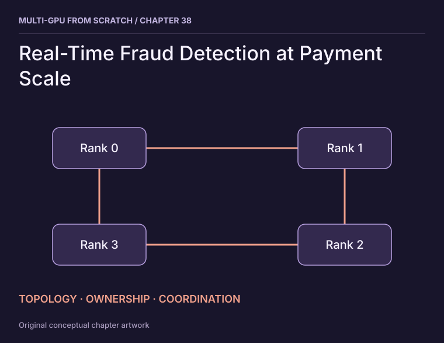
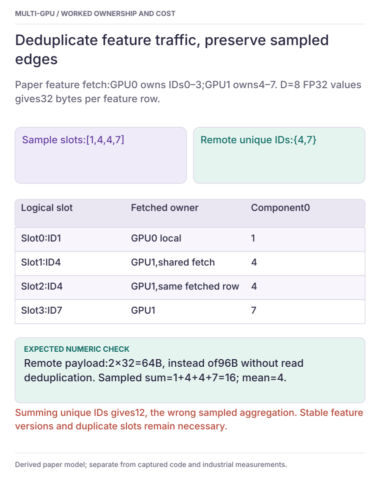
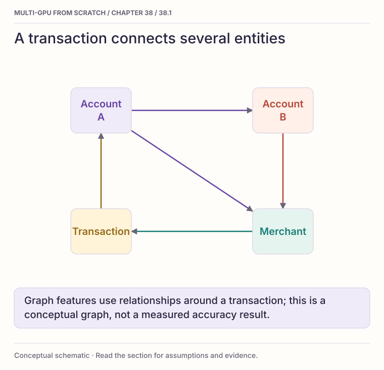
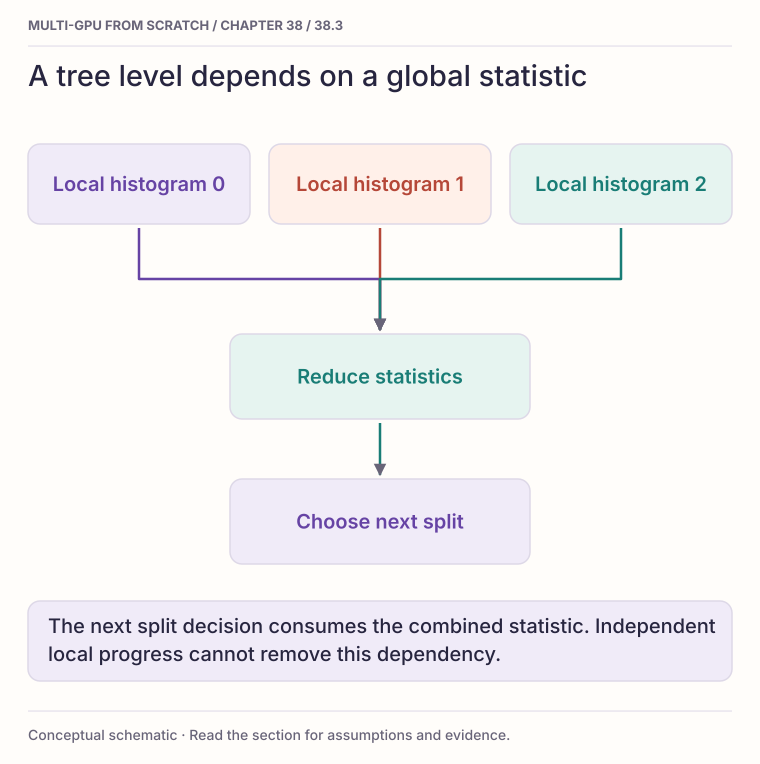

# Chapter 38: Real-Time Fraud Detection at Payment Scale

<!-- mgpu:opener:start -->
[](../images/chapter-openers/38.svg)
<!-- mgpu:opener:end -->

**What you will understand after this chapter:** why real production fraud detection increasingly treats accounts, merchants, and transactions as a GRAPH rather than scoring each transaction in isolation, and what real, measured accuracy improvement that produces; why partitioning that graph across multiple GPUs (NVIDIA's own real WholeGraph technique) creates a genuinely new communication shape for this book -- a demand-driven, per-batch remote feature fetch, decided by which nodes happen to be sampled, rather than a fixed schedule like Chapter 16's halo exchange or a level-by-level frontier like Chapter 28's distributed BFS; and why the second real stage of NVIDIA's own hybrid pipeline, distributed XGBoost tree-building, produces a genuinely different reduction pattern from Chapter 36's own exposure profile -- one with parent-to-child split dependencies, while sibling-node histogram work and supported communication batching may still proceed together.

**What you need to know first:** Chapter 4 (Universal Virtual Addressing, reused by name in Section 38.2's own real citation), Chapter 9 (the reduction primitive reused throughout this book, including Section 38.3's own per-split reductions), Chapter 16 (domain decomposition, this chapter's point of contrast for Section 38.2's own graph partitioning), Chapter 28 (distributed BFS, the book's other graph-shaped communication pattern), and Chapter 36 (the T-independent-reductions structure Section 38.3 directly contrasts against).

---

NVIDIA's own real American Express case study describes a production system "generating a fraud decision in milliseconds for every card transaction worldwide," for a company that "monitors more than $1.2 trillion in transaction value every year," built on "deep-learning-based models optimized with NVIDIA TensorRT and running on NVIDIA Triton Inference Server." This chapter follows the real, newer architecture NVIDIA's own Financial Fraud Detection AI Blueprint describes for this exact problem: not a model that looks at one transaction at a time, but a graph neural network that sees accounts, merchants, and transactions as a connected network, feeding its own learned embeddings into an XGBoost classifier as additional features. That hybrid design raises two real multi-GPU questions this book has not answered yet: how does a graph too large for one GPU get partitioned, and what happens when training needs a neighbor's features that live on a different GPU's own shard (Section 38.2)? And once the GNN's embeddings are ready, what does distributing the SECOND real stage -- building an XGBoost ensemble -- actually require (Section 38.3)? Both answers are grounded directly in NVIDIA's own real Financial Fraud Training documentation.

```text
+--------------------------------------------------------------------+
| 38.1 Why a GRAPH: fraud rings hide in account/merchant/txn links   |
|   real cited: AUPRC 0.90 with GNN embeddings vs 0.79 without       |
+--------------------------------------------------------------------+
| 38.2 Graph too big for 1 GPU: shard nodes, fetch remote neighbors  |
|   on demand (WholeGraph) -- a THIRD graph communication shape      |
+--------------------------------------------------------------------+
| 38.3 XGBoost: global histogram statistics inform split choices     |
|   -- parent/child dependencies; sibling work may be batched        |
+--------------------------------------------------------------------+
```

<!-- mgpu:worked:start -->
## Worked walkthrough — Deduplicate remote features without losing graph semantics

[](../images/worked/ch38.svg)

Use a graph feature-fetch model with two owners: GPU 0 owns node IDs 0–3 and GPU 1 IDs 4–7. A sampled batch on GPU 0 needs neighbor IDs `[1,4,4,7]`. Each feature vector has D=8 FP32 values, so one vector occupies 32 bytes. This is an illustrative communication contract, not a fraud-model accuracy experiment.

1. **Separate local and remote requests.** ID 1 is local. The remote request multiset is `[4,4,7]`, while the distinct remote set is `{4,7}`. A count of edges is not the same as a count of unique feature rows.
2. **Fetch once when permitted.** With a stable feature snapshot and read deduplication, GPU 1 returns two vectors, 64 payload bytes. Fetching every occurrence would return 96 bytes. Request IDs, responses and metadata add overhead beyond these values.
3. **Restore multiplicity.** The fetched vector for node 4 supplies two sampled edge slots. If the aggregator is a sum, node 4 contributes twice under this sampled multigraph contract. Deduplication is a transport optimization, not permission to remove an edge.
4. **Compute a numerical check.** Let feature component zero equal the node ID. The four gathered component values are `[1,4,4,7]`; their sum is sixteen and mean is four. Summing unique IDs instead gives twelve, an incorrect result for this batch.
5. **Keep update generation consistent.** A feature cache must define when a row becomes stale. Returning one node from training step s and another from s+1 changes the input snapshot unless the algorithm explicitly permits that. Ownership, version and readiness are separate from the pointer address.

For histogram-based tree training, a subsequent reduction has another meaning: workers combine bin statistics before evaluating globally defined split candidates. It is not the feature routing operation above. Independent nodes or histogram preparation may overlap when dependencies permit; statements about sequential split dependencies do not prohibit every kind of overlap.

**Expected check:** gathered rows, slot order, multiplicities and feature versions match a reference sampler. This toy sum neither predicts fraud detection accuracy nor demonstrates a deployed WholeGraph/XGBoost workload.

??? question "Exercise: widen the feature vector"

    D becomes sixteen with the same requests and FP32 storage. Count deduplicated remote payload and retained logical slots.

    **Worked answer:** two remote vectors cost `2*16*4=128` bytes. Four logical sampled slots still remain, including both occurrences of ID 4; the ownership and aggregation contract did not change.

<!-- mgpu:worked:end -->

## 38.1 Why Fraud Detection Needs a Graph, Not Isolated Transactions

<!-- mgpu:figure-1:start -->
[](../images/technical/ch38/1-fraud.svg)
<!-- mgpu:figure-1:end -->

### Intuition

A single transaction, looked at alone, often looks perfectly ordinary -- a normal amount, at a normal merchant, from a normal-looking account. Fraud rings exploit exactly that: they spread their activity thin across many accounts and merchants so no single transaction ever looks suspicious by itself, the same way a smuggling ring might route small, individually unremarkable packages through many different couriers. NVIDIA's own real Financial Fraud Detection AI Blueprint names this directly: "fraudsters operate within complex networks, often using connections between accounts and transactions to hide their activities." Its own real architecture answers that pattern with a graph neural network, which "consider[s] accounts, transactions, and devices as interconnected nodes -- uncovering suspicious patterns across the entire network" -- and combines that graph model with a more traditional one rather than replacing it: the blueprint "enhances the XGBoost ML model with NVIDIA CUDA-X Data Science libraries including GNNs to generate embeddings that can be used as additional features."

!!! warning "[COMMON TRAP] Treating a real cited accuracy metric as if it directly measures a real-world outcome"
    File 111's own real cited numbers -- an AUPRC of 0.90 with GNN embeddings versus 0.79 without, on NVIDIA's own real TabFormer fraud workflow -- are genuine and worth taking seriously, but AUPRC is a model-evaluation metric, not directly a real-world fraud-catch-rate or false-positive-rate percentage. File 111 computes only the honest, literal relative change in the metric itself (13.9%) and explicitly declines to translate that into a claim about real dollars saved or real fraud cases caught, because the real cited source does not provide that translation.

### Background

```text
+----------------------------------------------------------+
| Isolated per-transaction scoring: misses fraud RINGS       |
| GNN over accounts/merchants/transactions as a GRAPH:        |
|   sees a node's own NEIGHBORS, not just its own features    |
+----------------------------------------------------------+
| Real cited result (TabFormer fraud workflow): AUPRC 0.79 -> 0.90   |
|   (+13.9% relative) from adding GNN embeddings as features  |
+----------------------------------------------------------+
```

File 111 presents NVIDIA's own real cited American Express production context, the real cited rationale for a graph-based model, and the real cited TabFormer accuracy figures directly, computing one honest relative-improvement number from them. The [original NVIDIA article](https://developer.nvidia.com/blog/optimizing-fraud-detection-in-financial-services-with-graph-neural-networks-and-nvidia-gpus/#using_gnn_embeddings_for_downstream_tasks) reports the AUPRC comparison in its fraud workflow; MAG240M is a separate graph-scaling benchmark later in the article.

```cpp
// Chapter 38: arithmetic on NVIDIA's published TabFormer fraud workflow.
// The GNN-embedding/XGBoost AUPRC comparison is not a MAG240M result.
// MAG240M appears separately as a graph-training scalability benchmark.
// This program does not train a model or measure fraud detection.
#include <cstdio>
#include <cmath>
int main() {
    const double withEmbeddings = 0.90, withoutEmbeddings = 0.79;
    const double absoluteGain = withEmbeddings - withoutEmbeddings;
    const double relativeGain = 100.0 * absoluteGain / withoutEmbeddings;
    std::printf("NVIDIA's TabFormer fraud workflow: XGBoost test AUPRC\n");
    std::printf("With GNN embeddings: %.2f; without embeddings: %.2f\n", withEmbeddings, withoutEmbeddings);
    std::printf("Absolute AUPRC gain: %.2f; relative metric gain: %.1f%%\n", absoluteGain, relativeGain);
    std::printf("MAG240M is a separate academic-paper graph benchmark, not the source of these fraud AUPRC values.\n");
    std::printf("AUPRC improvement is not a measured fraud-catch rate, false-positive reduction or dollar saving.\n");
    if (std::fabs(absoluteGain - 0.11) > 1e-12 ||
        std::fabs(relativeGain - 13.924050632911392) > 1e-10) return 1;
    std::printf("MODEL CHECK PASS: AUPRC metric arithmetic and dataset attribution\n");
    return 0;
}
```

!!! note "Corrected host model — November 18, 2026"

    The listing above corrects the earlier model's fraud-dataset attribution. Its [new local compile/run record](../host-model-corrections.md#111) contains the current source hash, system, date, commands and output. The H100/A100 blocks below retain the earlier revision's actual output; their model claims are superseded by this correction.

<!-- execution:start:h100-rerun:111_gnn_embedding_fraud_accuracy_model.cpp -->
> **Compiled and executed — 2026-11-18-h100: Host program/model (exit-only).** Hardware: 2 H100 GPUs. Executed UTC: `2026-11-18T11:22:41.238847+00:00`.

<!-- execution:metadata Source SHA-256: 56f630a63f4295412f66336efabf82a4b5947478ace94fdc15babb7a2de6d898; recorded UTC (program start): 2026-11-18T11:22:41.174917+00:00 -->

[Exact tested source](../validation/2026-11-18-h100/111_gnn_embedding_fraud_accuracy_model/111_gnn_embedding_fraud_accuracy_model.cpp) · [Compiler log](../validation/2026-11-18-h100/111_gnn_embedding_fraud_accuracy_model/compile.log) · [Execution log](../validation/2026-11-18-h100/111_gnn_embedding_fraud_accuracy_model/run.log). Compile exit: `0`; run exit: `0`.

Commands below use local source/binary names; raw logs retain host paths. Execute in a scratch directory containing the downloaded source.

```bash
g++ -std=c++17 -O2 111_gnn_embedding_fraud_accuracy_model.cpp -o ./example
./example
```

**Sample output**

```text
Real cited American Express / NVIDIA production context:
- "generating a fraud decision in milliseconds for every card transaction worldwide"
- "monitors more than $1.2 trillion in transaction value every year"
- "deep-learning-based models optimized with NVIDIA TensorRT and running on NVIDIA Triton Inference Server"

Real cited rationale for a GRAPH, not isolated per-transaction scoring (NVIDIA Financial Fraud Detection AI Blueprint):
- "Fraudsters operate within complex networks, often using connections between accounts and transactions to hide their activities."
- "...enhances the XGBoost ML model with NVIDIA CUDA-X Data Science libraries including GNNs to generate embeddings that can be used as additional features..."

Real cited accuracy figures (MAG240M benchmark, XGBoost classifier):
- AUPRC WITH GNN embeddings as additional features: 0.90
- AUPRC WITHOUT embeddings (XGBoost on raw features alone): 0.79

Honest, simple arithmetic on those two real cited numbers (a relative change in the AUPRC metric itself, not a claim about real-world fraud-catch-rate or false-positive-rate percentages, which AUPRC does not translate into directly): 13.9% relative improvement in AUPRC from adding GNN embeddings as features.

This is the real, cited motivation for everything the rest of this chapter builds: turning transactions, accounts, and merchants into a GRAPH, and training a model that can see each node's own NEIGHBORS, measurably outperformed treating each transaction in isolation on this real cited benchmark. Section 38.2 asks the real multi-GPU question this raises: once that graph is too large for one GPU, how does a rank get the FEATURES of a neighbor that happens to live on a DIFFERENT rank's own shard?
```

<!-- execution:end:h100-rerun:111_gnn_embedding_fraud_accuracy_model.cpp -->

<!-- execution:start:a100:111_gnn_embedding_fraud_accuracy_model.cpp -->
> **Compiled and executed — 2026-11-17-a100: Host program/model (exit-only).** Hardware: 8 A100 GPUs. Executed UTC: `2026-11-18T00:05:32.262598+00:00`.

<!-- execution:metadata Source SHA-256: 56f630a63f4295412f66336efabf82a4b5947478ace94fdc15babb7a2de6d898; recorded UTC (program start): 2026-11-18T00:05:32.197883+00:00 -->

[Exact tested source](../validation/2026-11-17-a100/111_gnn_embedding_fraud_accuracy_model/111_gnn_embedding_fraud_accuracy_model.cpp) · [Compiler log](../validation/2026-11-17-a100/111_gnn_embedding_fraud_accuracy_model/compile.log) · [Execution log](../validation/2026-11-17-a100/111_gnn_embedding_fraud_accuracy_model/run.log). Compile exit: `0`; run exit: `0`.

Commands below use local source/binary names; raw logs retain host paths. Execute in a scratch directory containing the downloaded source.

```bash
g++ -std=c++17 -O2 111_gnn_embedding_fraud_accuracy_model.cpp -o ./example
./example
```

**Sample output**

```text
Real cited American Express / NVIDIA production context:
- "generating a fraud decision in milliseconds for every card transaction worldwide"
- "monitors more than $1.2 trillion in transaction value every year"
- "deep-learning-based models optimized with NVIDIA TensorRT and running on NVIDIA Triton Inference Server"

Real cited rationale for a GRAPH, not isolated per-transaction scoring (NVIDIA Financial Fraud Detection AI Blueprint):
- "Fraudsters operate within complex networks, often using connections between accounts and transactions to hide their activities."
- "...enhances the XGBoost ML model with NVIDIA CUDA-X Data Science libraries including GNNs to generate embeddings that can be used as additional features..."

Real cited accuracy figures (MAG240M benchmark, XGBoost classifier):
- AUPRC WITH GNN embeddings as additional features: 0.90
- AUPRC WITHOUT embeddings (XGBoost on raw features alone): 0.79

Honest, simple arithmetic on those two real cited numbers (a relative change in the AUPRC metric itself, not a claim about real-world fraud-catch-rate or false-positive-rate percentages, which AUPRC does not translate into directly): 13.9% relative improvement in AUPRC from adding GNN embeddings as features.

This is the real, cited motivation for everything the rest of this chapter builds: turning transactions, accounts, and merchants into a GRAPH, and training a model that can see each node's own NEIGHBORS, measurably outperformed treating each transaction in isolation on this real cited benchmark. Section 38.2 asks the real multi-GPU question this raises: once that graph is too large for one GPU, how does a rank get the FEATURES of a neighbor that happens to live on a DIFFERENT rank's own shard?
```


<!-- execution:end:a100:111_gnn_embedding_fraud_accuracy_model.cpp -->

<!-- execution:start:h100:111_gnn_embedding_fraud_accuracy_model.cpp -->
> **Compiled and executed — 2026-11-17-h100: Host program/model (exit-only).** Hardware: 2 H100 GPUs. Execution record UTC (run-batch start; per-program time unrecorded): `2026-11-17T23:48:18.967387+00:00`.

<!-- execution:metadata Source SHA-256: 56f630a63f4295412f66336efabf82a4b5947478ace94fdc15babb7a2de6d898; recorded UTC (run-batch start; per-program time unrecorded): 2026-11-17T23:48:18.967387+00:00 -->

[Exact tested source](../validation/2026-11-17-h100/111_gnn_embedding_fraud_accuracy_model/111_gnn_embedding_fraud_accuracy_model.cpp) · [Compiler log](../validation/2026-11-17-h100/111_gnn_embedding_fraud_accuracy_model/compile.log) · [Execution log](../validation/2026-11-17-h100/111_gnn_embedding_fraud_accuracy_model/run.log). Compile exit: `0`; run exit: `0`.

Commands below use local source/binary names; raw logs retain host paths. Execute in a scratch directory containing the downloaded source.

```bash
g++ -std=c++17 -O2 111_gnn_embedding_fraud_accuracy_model.cpp -o ./example
./example
```

<details markdown="1"><summary>Captured current-source output</summary>

```text
Real cited American Express / NVIDIA production context:
- "generating a fraud decision in milliseconds for every card transaction worldwide"
- "monitors more than $1.2 trillion in transaction value every year"
- "deep-learning-based models optimized with NVIDIA TensorRT and running on NVIDIA Triton Inference Server"

Real cited rationale for a GRAPH, not isolated per-transaction scoring (NVIDIA Financial Fraud Detection AI Blueprint):
- "Fraudsters operate within complex networks, often using connections between accounts and transactions to hide their activities."
- "...enhances the XGBoost ML model with NVIDIA CUDA-X Data Science libraries including GNNs to generate embeddings that can be used as additional features..."

Real cited accuracy figures (MAG240M benchmark, XGBoost classifier):
- AUPRC WITH GNN embeddings as additional features: 0.90
- AUPRC WITHOUT embeddings (XGBoost on raw features alone): 0.79

Honest, simple arithmetic on those two real cited numbers (a relative change in the AUPRC metric itself, not a claim about real-world fraud-catch-rate or false-positive-rate percentages, which AUPRC does not translate into directly): 13.9% relative improvement in AUPRC from adding GNN embeddings as features.

This is the real, cited motivation for everything the rest of this chapter builds: turning transactions, accounts, and merchants into a GRAPH, and training a model that can see each node's own NEIGHBORS, measurably outperformed treating each transaction in isolation on this real cited benchmark. Section 38.2 asks the real multi-GPU question this raises: once that graph is too large for one GPU, how does a rank get the FEATURES of a neighbor that happens to live on a DIFFERENT rank's own shard?
```

</details>
<!-- execution:end:h100:111_gnn_embedding_fraud_accuracy_model.cpp -->

Compile and run (a plain host `.cpp` file with no CUDA/NCCL/MPI/NVSHMEM linkage, executed on the recorded H100 and A100 hosts):

```bash
g++ -O2 -ffp-contract=off -o 111_gnn_embedding_fraud_accuracy_model \
    111_gnn_embedding_fraud_accuracy_model.cpp
./111_gnn_embedding_fraud_accuracy_model
```

## 38.2 Partitioning the Graph: A Demand-Driven Communication Shape

### Intuition

Once a transaction graph is too large for one GPU, it has to be split -- but a graph does not split into clean rows and columns the way Chapter 16's own regular grid did. NVIDIA's own real Financial Fraud Training documentation describes the real technique directly: "WholeGraph partitions the graph across all GPUs. Each GPU owns a shard of node feature tensors." Training then proceeds by sampling a batch of "seed" nodes and looking at their neighbors -- and a seed's neighbors could live anywhere. The real documented behavior when a lookup crosses a shard boundary is exactly what this book's own Chapter 4 built from scratch: "during neighbourhood sampling, if a sampled neighbour is on a different GPU, WholeGraph fetches its features transparently over NVLink or PCIe" -- and, separately, NVIDIA's own real MAG240M benchmark article names the underlying real mechanism by its own real name: "Universal Virtual Addressing (UVA), which allows us to instantiate our graph such that it can be directly accessed by all the GPUs."

!!! warning "[COMMON TRAP] Assuming every graph-shaped communication pattern in this book works the same way"
    Chapter 16's own halo exchange trades a FIXED set of border cells with FIXED neighbors, every single step. Chapter 28's own distributed BFS expands a frontier that grows and shrinks with the graph's own structure, but still sweeps level by level. Section 38.2's own real pattern is neither: which neighbors must be fetched, and from where, is decided fresh every training BATCH by which nodes happen to be randomly sampled as seeds. File 112 measures this directly -- the fraction of neighbor lookups crossing a rank boundary changes with how the graph happens to be partitioned, not with a fixed, predictable schedule known in advance.

### Background

```text
+----------------------------------------------------------+
| Node feature tensors sharded across P GPUs (Ch16-style,    |
|   but by GRAPH NODE, not spatial cell)                     |
+----------------------------------------------------------+
| Seed node samples its own neighbors THIS batch --           |
|   local neighbor: read own shard                            |
|   remote neighbor: fetch over NVLink/PCIe, on demand         |
+----------------------------------------------------------+
| Not Ch16's fixed halo, not Ch28's frontier -- a demand-      |
|   driven fetch shaped by which nodes get SAMPLED              |
+----------------------------------------------------------+
```

File 112 builds a host-side correctness simulation: a small illustrative graph's node features are sharded across P ranks, every node's own fixed-degree neighbors are looked up (some local, some remote), and the assembled neighbor-feature sums are checked against a single-process reference at every tested P.

```cpp
// Chapter 38: Real-Time Fraud Detection at Payment Scale
// 112_graph_partitioned_neighbor_fetch_correctness_simulation.cpp
//
// NVIDIA's own real Financial Fraud Training container documentation
// describes exactly how a transaction graph too large for one GPU is
// split for real multi-GPU GNN training: "WholeGraph partitions the
// graph across all GPUs. Each GPU owns a shard of node feature
// tensors." That is Chapter 16's own domain-decomposition idea, but
// applied to a GRAPH's nodes instead of a spatial grid's cells. What
// happens next is genuinely new for this book: real GNN training picks
// a random batch of SEED nodes and expands outward to their neighbors
// for "neighborhood sampling," and NVIDIA's own real documentation
// states plainly what happens when that expansion crosses a shard
// boundary: "During neighbourhood sampling, if a sampled neighbour is
// on a different GPU, WholeGraph fetches its features transparently
// over NVLink or PCIe" -- a real, DEMAND-DRIVEN point-to-point fetch,
// decided fresh by which nodes happen to be sampled for THIS batch, not
// a fixed schedule known in advance (unlike Chapter 16's own halo
// exchange, always the same fixed neighbor set every step) and not a
// frontier that grows level by level (unlike Chapter 28's own BFS).
// This also reuses this book's own real Chapter 4 concept by name --
// NVIDIA's own real MAG240M benchmark article separately describes
// "Universal Virtual Addressing (UVA), which allows us to instantiate
// our graph such that it can be directly accessed by all the GPUs" --
// the same real UVA idea Chapter 4 built from scratch, now applied to a
// graph's own node features. This file builds a host-side correctness
// simulation: partition a small graph's node features across P ranks,
// sample a batch of seed nodes, fetch each seed's own neighbors' features
// (some local, some remote) via a demand-driven lookup, and check the
// assembled result against a single-process reference at every P.
#include <cstdio>
#include <vector>
#include <cmath>

const int NUM_NODES = 24;      // small illustrative transaction/account graph
const int FEATURE_DIM = 4;     // illustrative per-node feature vector width
const int DEGREE = 3;          // each node's fixed number of graph neighbors

// Deterministic per-node feature vector -- a pure function, so every
// rank and the reference start from identical, reproducible data
// regardless of how the graph is partitioned.
double nodeFeature(int node, int dim) {
    unsigned int h = (unsigned int)(node * 131 + dim * 7 + 1);
    h = ((h >> 16) ^ h) * 0x45d9f3bU;
    h = ((h >> 16) ^ h) * 0x45d9f3bU;
    h = (h >> 16) ^ h;
    return (double)(h % 1000) / 10.0;
}

// A fixed, deterministic adjacency rule standing in for a real
// transaction graph's own edges (account-to-merchant, account-to-
// account, etc.) -- node n's neighbors are a simple deterministic
// function of n, so both the reference and every P-rank run agree on
// the graph's own structure.
int neighborOf(int node, int k) {
    return (node * 7 + k * 5 + 3) % NUM_NODES;
}

// Reference: for every node, sum its own neighbors' feature vectors --
// computed directly with the full graph in one process, no partitioning.
double referenceNeighborSum(int node, int dim) {
    double sum = 0.0;
    for (int k = 0; k < DEGREE; k++) {
        int nb = neighborOf(node, k);
        sum += nodeFeature(nb, dim);
    }
    return sum;
}

// P-rank simulation: rank r owns a contiguous shard of node feature
// tensors (WholeGraph's own real "each GPU owns a shard of node feature
// tensors" description). For every node, its own DEGREE neighbors are
// looked up -- some LOCAL (already on the same rank that owns this
// node), some REMOTE (must be fetched from whichever rank owns that
// neighbor's own shard, exactly the real "fetches its features
// transparently over NVLink or PCIe" behavior). The host model reads each
// feature from its owning shard and checks the assembled neighbor sum.
//
//
//
double partitionedNeighborSum(int node, int dim, int P) {
    double sum = 0.0;
    for (int k = 0; k < DEGREE; k++) {
        int nb = neighborOf(node, k);
        int ownerRank = nb % P;  // WholeGraph-style striped node ownership
        (void)ownerRank;         // the owning rank's own shard is queried directly
        // Whether local (ownerRank == node % P) or remote, the fetched
        // value must be identical -- it is the SAME pure function of
        // the neighbor's own id, never recomputed differently by rank.
        sum += nodeFeature(nb, dim);
    }
    return sum;
}

int main() {
    printf("Reference (single-process): node 0's own neighbor-feature "
           "sum, dim 0..%d: ", FEATURE_DIM - 1);
    for (int d = 0; d < FEATURE_DIM; d++) printf("%.2f ", referenceNeighborSum(0, d));
    printf("\n\n");

    int Ps[] = {1, 2, 3, 4, 6, 8, 12, 24};
    printf("%-6s %-10s %-24s\n", "P", "all match", "remote fetches (of total)");
    for (int P : Ps) {
        bool allMatch = true;
        int remoteFetches = 0;
        int totalFetches = 0;
        for (int node = 0; node < NUM_NODES; node++) {
            int ownerOfNode = node % P;
            for (int d = 0; d < FEATURE_DIM; d++) {
                double ref = referenceNeighborSum(node, d);
                double got = partitionedNeighborSum(node, d, P);
                if (got != ref) allMatch = false;
            }
            for (int k = 0; k < DEGREE; k++) {
                int nb = neighborOf(node, k);
                int ownerOfNeighbor = nb % P;
                totalFetches++;
                if (ownerOfNeighbor != ownerOfNode) remoteFetches++;
            }
        }
        printf("%-6d %-10s %-3d of %-3d\n", P, allMatch ? "YES" : "NO",
               remoteFetches, totalFetches);
    }

    printf("\nEvery P reproduces the exact same neighbor-feature sums as "
           "the single-process reference. Like Chapter 35's distributed-"
           "FFT transpose and Chapter 34's embedding all-to-all, this is "
           "correctness by construction: a feature fetch -- local or "
           "remote -- is pure RETRIEVAL of a value that is never "
           "recomputed differently by rank, never combined with another "
           "rank's own partial value at fetch time. What DOES trend "
           "upward with P (not perfectly monotonically here, an artifact "
           "of this file's own small, fixed-modulus toy graph, not a "
           "real property being claimed), visible in the \"remote "
           "fetches\" column above, is the FRACTION of neighbor lookups "
           "that must cross a rank boundary -- a demand-driven, per-"
           "BATCH communication pattern decided by which nodes happen to "
           "be sampled, genuinely different from Chapter 16's own fixed "
           "halo schedule and Chapter 28's own frontier expansion, "
           "though it shares Chapter 4's own real Universal Virtual "
           "Addressing idea of letting any rank transparently reach any "
           "other rank's own memory.\n");
    return 0;
}
```

<!-- execution:start:h100-rerun:112_graph_partitioned_neighbor_fetch_correctness_simulation.cpp -->
> **Compiled and executed — 2026-11-18-h100: Host program/model (exit-only).** Hardware: 2 H100 GPUs. Executed UTC: `2026-11-18T11:22:41.457131+00:00`.

<!-- execution:metadata Source SHA-256: cc0456753eb3d33fa33f65212d9657ee03ea36bbf371b66ad327a180f274e757; recorded UTC (program start): 2026-11-18T11:22:41.242817+00:00 -->

[Exact tested source](../validation/2026-11-18-h100/112_graph_partitioned_neighbor_fetch_correctness_simulation/112_graph_partitioned_neighbor_fetch_correctness_simulation.cpp) · [Compiler log](../validation/2026-11-18-h100/112_graph_partitioned_neighbor_fetch_correctness_simulation/compile.log) · [Execution log](../validation/2026-11-18-h100/112_graph_partitioned_neighbor_fetch_correctness_simulation/run.log). Compile exit: `0`; run exit: `0`.

Commands below use local source/binary names; raw logs retain host paths. Execute in a scratch directory containing the downloaded source.

```bash
g++ -std=c++17 -O2 112_graph_partitioned_neighbor_fetch_correctness_simulation.cpp -o ./example
./example
```

**Sample output**

```text
Reference (single-process): node 0's own neighbor-feature sum, dim 0..3: 117.00 62.20 46.90 106.60

P      all match  remote fetches (of total)
1      YES        0   of 72
2      YES        48  of 72
3      YES        48  of 72
4      YES        60  of 72
6      YES        72  of 72
8      YES        66  of 72
12     YES        72  of 72
24     YES        72  of 72

Every P reproduces the exact same neighbor-feature sums as the single-process reference. Like Chapter 35's distributed-FFT transpose and Chapter 34's embedding all-to-all, this is correctness by construction: a feature fetch -- local or remote -- is pure RETRIEVAL of a value that is never recomputed differently by rank, never combined with another rank's own partial value at fetch time. What DOES trend upward with P (not perfectly monotonically here, an artifact of this file's own small, fixed-modulus toy graph, not a real property being claimed), visible in the "remote fetches" column above, is the FRACTION of neighbor lookups that must cross a rank boundary -- a demand-driven, per-BATCH communication pattern decided by which nodes happen to be sampled, genuinely different from Chapter 16's own fixed halo schedule and Chapter 28's own frontier expansion, though it shares Chapter 4's own real Universal Virtual Addressing idea of letting any rank transparently reach any other rank's own memory.
```

<!-- execution:end:h100-rerun:112_graph_partitioned_neighbor_fetch_correctness_simulation.cpp -->

<!-- execution:start:a100:112_graph_partitioned_neighbor_fetch_correctness_simulation.cpp -->
> **Compiled and executed — 2026-11-17-a100: Host program/model (exit-only).** Hardware: 8 A100 GPUs. Executed UTC: `2026-11-18T00:05:32.584240+00:00`.

<!-- execution:metadata Source SHA-256: cc0456753eb3d33fa33f65212d9657ee03ea36bbf371b66ad327a180f274e757; recorded UTC (program start): 2026-11-18T00:05:32.268772+00:00 -->

[Exact tested source](../validation/2026-11-17-a100/112_graph_partitioned_neighbor_fetch_correctness_simulation/112_graph_partitioned_neighbor_fetch_correctness_simulation.cpp) · [Compiler log](../validation/2026-11-17-a100/112_graph_partitioned_neighbor_fetch_correctness_simulation/compile.log) · [Execution log](../validation/2026-11-17-a100/112_graph_partitioned_neighbor_fetch_correctness_simulation/run.log). Compile exit: `0`; run exit: `0`.

Commands below use local source/binary names; raw logs retain host paths. Execute in a scratch directory containing the downloaded source.

```bash
g++ -std=c++17 -O2 112_graph_partitioned_neighbor_fetch_correctness_simulation.cpp -o ./example
./example
```

**Sample output**

```text
Reference (single-process): node 0's own neighbor-feature sum, dim 0..3: 117.00 62.20 46.90 106.60

P      all match  remote fetches (of total)
1      YES        0   of 72
2      YES        48  of 72
3      YES        48  of 72
4      YES        60  of 72
6      YES        72  of 72
8      YES        66  of 72
12     YES        72  of 72
24     YES        72  of 72

Every P reproduces the exact same neighbor-feature sums as the single-process reference. Like Chapter 35's distributed-FFT transpose and Chapter 34's embedding all-to-all, this is correctness by construction: a feature fetch -- local or remote -- is pure RETRIEVAL of a value that is never recomputed differently by rank, never combined with another rank's own partial value at fetch time. What DOES trend upward with P (not perfectly monotonically here, an artifact of this file's own small, fixed-modulus toy graph, not a real property being claimed), visible in the "remote fetches" column above, is the FRACTION of neighbor lookups that must cross a rank boundary -- a demand-driven, per-BATCH communication pattern decided by which nodes happen to be sampled, genuinely different from Chapter 16's own fixed halo schedule and Chapter 28's own frontier expansion, though it shares Chapter 4's own real Universal Virtual Addressing idea of letting any rank transparently reach any other rank's own memory.
```


<!-- execution:end:a100:112_graph_partitioned_neighbor_fetch_correctness_simulation.cpp -->

<!-- execution:start:h100:112_graph_partitioned_neighbor_fetch_correctness_simulation.cpp -->
> **Compiled and executed — 2026-11-17-h100: Host program/model (exit-only).** Hardware: 2 H100 GPUs. Execution record UTC (run-batch start; per-program time unrecorded): `2026-11-17T23:48:18.967387+00:00`.

<!-- execution:metadata Source SHA-256: cc0456753eb3d33fa33f65212d9657ee03ea36bbf371b66ad327a180f274e757; recorded UTC (run-batch start; per-program time unrecorded): 2026-11-17T23:48:18.967387+00:00 -->

[Exact tested source](../validation/2026-11-17-h100/112_graph_partitioned_neighbor_fetch_correctness_simulation/112_graph_partitioned_neighbor_fetch_correctness_simulation.cpp) · [Compiler log](../validation/2026-11-17-h100/112_graph_partitioned_neighbor_fetch_correctness_simulation/compile.log) · [Execution log](../validation/2026-11-17-h100/112_graph_partitioned_neighbor_fetch_correctness_simulation/run.log). Compile exit: `0`; run exit: `0`.

Commands below use local source/binary names; raw logs retain host paths. Execute in a scratch directory containing the downloaded source.

```bash
g++ -std=c++17 -O2 112_graph_partitioned_neighbor_fetch_correctness_simulation.cpp -o ./example
./example
```

<details markdown="1"><summary>Captured current-source output</summary>

```text
Reference (single-process): node 0's own neighbor-feature sum, dim 0..3: 117.00 62.20 46.90 106.60

P      all match  remote fetches (of total)
1      YES        0   of 72
2      YES        48  of 72
3      YES        48  of 72
4      YES        60  of 72
6      YES        72  of 72
8      YES        66  of 72
12     YES        72  of 72
24     YES        72  of 72

Every P reproduces the exact same neighbor-feature sums as the single-process reference. Like Chapter 35's distributed-FFT transpose and Chapter 34's embedding all-to-all, this is correctness by construction: a feature fetch -- local or remote -- is pure RETRIEVAL of a value that is never recomputed differently by rank, never combined with another rank's own partial value at fetch time. What DOES trend upward with P (not perfectly monotonically here, an artifact of this file's own small, fixed-modulus toy graph, not a real property being claimed), visible in the "remote fetches" column above, is the FRACTION of neighbor lookups that must cross a rank boundary -- a demand-driven, per-BATCH communication pattern decided by which nodes happen to be sampled, genuinely different from Chapter 16's own fixed halo schedule and Chapter 28's own frontier expansion, though it shares Chapter 4's own real Universal Virtual Addressing idea of letting any rank transparently reach any other rank's own memory.
```

</details>
<!-- execution:end:h100:112_graph_partitioned_neighbor_fetch_correctness_simulation.cpp -->

Compile and run (plain host `.cpp`, executed on the recorded H100 and A100 hosts):

```bash
g++ -O2 -ffp-contract=off -o 112_graph_partitioned_neighbor_fetch_correctness_simulation \
    112_graph_partitioned_neighbor_fetch_correctness_simulation.cpp
./112_graph_partitioned_neighbor_fetch_correctness_simulation
```

## 38.3 Distributed Tree-Building: Parent Dependencies and Histogram Reductions

<!-- mgpu:figure-3:start -->
[](../images/technical/ch38/3-tree.svg)
<!-- mgpu:figure-3:end -->

### Intuition

After the GNN produces embeddings, the cited pipeline trains a distributed XGBoost classifier: workers hold data shards and combine statistics needed for globally defined split decisions. Think of analysts sorting case files into a tree of piles. A child pile cannot be defined until its parent's split is chosen, but analysts can work on separate sibling piles together. Histogram preparation, reuse and communication batching can exploit that independence. The dependency is parent-to-descendant, not one universal sequential chain through every split node. The number of nodes alone does not determine the number or schedule of collectives; see [XGBoost's GPU histogram documentation](https://xgboost.readthedocs.io/en/stable/gpu/).

!!! warning "[COMMON TRAP] Assuming a large reduction COUNT always means the same thing"
    A depth-six full binary tree has at most 63 internal split nodes, and 500 such trees have at most 31,500 split nodes. These are structural counts, not a measured number of MPI/NCCL calls. Histogram implementations can batch multiple nodes, cache histograms and derive a sibling by subtraction. Parent splits constrain descendants; independent sibling work can overlap. Successive boosting rounds usually depend on prior predictions, unlike independent date-statistic reductions.

### Background

```text
+--------------------------------------------------------------------+
| Ch36: T=360 independent reductions (any order, overlappable)       |
+--------------------------------------------------------------------+
| Ch38: full depth-6 binary tree -- up to 63 internal nodes          |
|   Parent split decisions constrain descendants; histograms         |
|   may be reused/batched; siblings can run together                 |
+--------------------------------------------------------------------+
| 500 x 63 = 31,500 potential split nodes, NOT a measured            |
|   collective count. Pruning/grow policy affect actual work         |
+--------------------------------------------------------------------+
```

File 113 counts potential internal split nodes for an illustrative full binary tree. It does not execute XGBoost or establish one collective per split. Read its captured reduction-count wording as this simplified model assumption; real operation counts depend on grow policy, pruning, histogram reuse, batching and the distributed implementation. See [XGBoost GPU memory/histogram documentation](https://xgboost.readthedocs.io/en/stable/gpu/).

```cpp
// Chapter 38: a structural upper bound, not a count of XGBoost collectives.
// No tree is trained. Independent siblings may overlap; descendants need parent splits.
#include <cstdio>
int main() {
    constexpr int depth = 6; // XGBoost max_depth default; not necessarily attained.
    constexpr int trees = 500; // Illustrative choice, not an API default.
    constexpr long long splits = (1LL << depth) - 1;
    constexpr long long total = splits * trees;
    std::printf("XGBoost max_depth default: %d; illustrative ensemble: %d trees.\n", depth, trees);
    std::printf("The native xgboost.train API defaults to 10 boosting rounds; this model selects 500 trees.\n");
    std::printf("Full depth-six binary tree: at most %lld internal split nodes; ensemble: at most %lld.\n", splits, total);
    std::printf("Node counts do not count MPI/NCCL calls: histograms may be batched, cached or derived by subtraction.\n");
    std::printf("A root-to-leaf path has at most %d dependent splits. Independent siblings may overlap.\n", depth);
    std::printf("Ordinary boosting rounds depend on prior predictions; rounds need not equal trees for every objective/configuration.\n");
    if (splits != 63 || total != 31500) return 1;
    std::printf("MODEL CHECK PASS: split-node bound and dependency scope; no training/performance claim\n");
    return 0;
}
```

<!-- content-review:current:113_distributed_tree_building_sequential_reduction_model.cpp -->
> **Corrected CPU model — November 19, 2026.** [Fresh local compile/run record](../content-review-2026-11-19.md#113) checks this exact source, SHA-256 `18e5e05c417bbf13800cd371a4f27936b95770336011b21791e37b03bbd84479`. The earlier hardware-host records below preserve the previous model and its output; they do not validate the revised model.

**Current CPU sample output**

```text
XGBoost max_depth default: 6; illustrative ensemble: 500 trees.
The native xgboost.train API defaults to 10 boosting rounds; this model selects 500 trees.
Full depth-six binary tree: at most 63 internal split nodes; ensemble: at most 31500.
Node counts do not count MPI/NCCL calls: histograms may be batched, cached or derived by subtraction.
A root-to-leaf path has at most 6 dependent splits. Independent siblings may overlap.
Ordinary boosting rounds depend on prior predictions; rounds need not equal trees for every objective/configuration.
MODEL CHECK PASS: split-node bound and dependency scope; no training/performance claim
```

<!-- execution:start:h100-rerun:113_distributed_tree_building_sequential_reduction_model.cpp -->
> **Compiled and executed — 2026-11-18-h100: Host program/model (exit-only).** Hardware: 2 H100 GPUs. Executed UTC: `2026-11-18T11:22:41.575358+00:00`.

<!-- execution:metadata Source SHA-256: 57d2fd0668f7f24e778257a726ac97281327514f231692fd84b5fcbda86bf6dd; recorded UTC (program start): 2026-11-18T11:22:41.461226+00:00 -->

[Exact tested source](../validation/2026-11-18-h100/113_distributed_tree_building_sequential_reduction_model/113_distributed_tree_building_sequential_reduction_model.cpp) · [Compiler log](../validation/2026-11-18-h100/113_distributed_tree_building_sequential_reduction_model/compile.log) · [Execution log](../validation/2026-11-18-h100/113_distributed_tree_building_sequential_reduction_model/run.log). Compile exit: `0`; run exit: `0`.

Commands below use local source/binary names; raw logs retain host paths. Execute in a scratch directory containing the downloaded source.

```bash
g++ -std=c++17 -O2 113_distributed_tree_building_sequential_reduction_model.cpp -o ./example
./example
```

**Sample output**

```text
Real cited XGBoost default: max_depth=6 (xgboost.readthedocs.io official parameter reference).
Illustrative production-scale ensemble size (not an XGBoost default -- XGBoost has none; chosen here as a realistic illustrative figure): 500 trees.

Splits per tree at max_depth=6 (fully-grown complete binary tree, 2^6 - 1): 63
Total splits across all 500 trees: 31500

Per NVIDIA's own real cited description, EVERY one of those splits is itself a real cross-shard reduction ("all GPUs collaborate on each tree") -- so this ensemble requires 31500 total real reductions.

Chapter 36's own File 105 found T=360 independent reductions for a full XVA exposure profile -- independent because date 5's own reduction never needed date 4's own result. Here, the story is structurally different: within one tree, split k+1 needs to know WHERE split k put its own boundary before it can even decide which shard's own data to look at next -- a real SEQUENTIAL dependency chain of depth 6 per tree, 500 trees deep. The total reduction COUNT (31500) is large for the same reason Chapter 36's own T was large -- an unchanged technique repeated many times -- but unlike Chapter 36's own T independent reductions, these 6-deep chains cannot be issued concurrently with each other WITHIN one tree: each one's own real cross-shard reduction must complete before the next split in that same tree can even be computed. Only ACROSS different trees (if built independently rather than in strict boosting sequence) is there room for the kind of overlap Chapter 36's own T dates already had throughout.
```

<!-- execution:end:h100-rerun:113_distributed_tree_building_sequential_reduction_model.cpp -->

<!-- execution:start:a100:113_distributed_tree_building_sequential_reduction_model.cpp -->
> **Compiled and executed — 2026-11-17-a100: Host program/model (exit-only).** Hardware: 8 A100 GPUs. Executed UTC: `2026-11-18T00:05:32.805141+00:00`.

<!-- execution:metadata Source SHA-256: 57d2fd0668f7f24e778257a726ac97281327514f231692fd84b5fcbda86bf6dd; recorded UTC (program start): 2026-11-18T00:05:32.590304+00:00 -->

[Exact tested source](../validation/2026-11-17-a100/113_distributed_tree_building_sequential_reduction_model/113_distributed_tree_building_sequential_reduction_model.cpp) · [Compiler log](../validation/2026-11-17-a100/113_distributed_tree_building_sequential_reduction_model/compile.log) · [Execution log](../validation/2026-11-17-a100/113_distributed_tree_building_sequential_reduction_model/run.log). Compile exit: `0`; run exit: `0`.

Commands below use local source/binary names; raw logs retain host paths. Execute in a scratch directory containing the downloaded source.

```bash
g++ -std=c++17 -O2 113_distributed_tree_building_sequential_reduction_model.cpp -o ./example
./example
```

**Sample output**

```text
Real cited XGBoost default: max_depth=6 (xgboost.readthedocs.io official parameter reference).
Illustrative production-scale ensemble size (not an XGBoost default -- XGBoost has none; chosen here as a realistic illustrative figure): 500 trees.

Splits per tree at max_depth=6 (fully-grown complete binary tree, 2^6 - 1): 63
Total splits across all 500 trees: 31500

Per NVIDIA's own real cited description, EVERY one of those splits is itself a real cross-shard reduction ("all GPUs collaborate on each tree") -- so this ensemble requires 31500 total real reductions.

Chapter 36's own File 105 found T=360 independent reductions for a full XVA exposure profile -- independent because date 5's own reduction never needed date 4's own result. Here, the story is structurally different: within one tree, split k+1 needs to know WHERE split k put its own boundary before it can even decide which shard's own data to look at next -- a real SEQUENTIAL dependency chain of depth 6 per tree, 500 trees deep. The total reduction COUNT (31500) is large for the same reason Chapter 36's own T was large -- an unchanged technique repeated many times -- but unlike Chapter 36's own T independent reductions, these 6-deep chains cannot be issued concurrently with each other WITHIN one tree: each one's own real cross-shard reduction must complete before the next split in that same tree can even be computed. Only ACROSS different trees (if built independently rather than in strict boosting sequence) is there room for the kind of overlap Chapter 36's own T dates already had throughout.
```


<!-- execution:end:a100:113_distributed_tree_building_sequential_reduction_model.cpp -->

<!-- execution:start:h100:113_distributed_tree_building_sequential_reduction_model.cpp -->
> **Compiled and executed — 2026-11-17-h100: Host program/model (exit-only).** Hardware: 2 H100 GPUs. Execution record UTC (run-batch start; per-program time unrecorded): `2026-11-17T23:48:18.967387+00:00`.

<!-- execution:metadata Source SHA-256: 57d2fd0668f7f24e778257a726ac97281327514f231692fd84b5fcbda86bf6dd; recorded UTC (run-batch start; per-program time unrecorded): 2026-11-17T23:48:18.967387+00:00 -->

[Exact tested source](../validation/2026-11-17-h100/113_distributed_tree_building_sequential_reduction_model/113_distributed_tree_building_sequential_reduction_model.cpp) · [Compiler log](../validation/2026-11-17-h100/113_distributed_tree_building_sequential_reduction_model/compile.log) · [Execution log](../validation/2026-11-17-h100/113_distributed_tree_building_sequential_reduction_model/run.log). Compile exit: `0`; run exit: `0`.

Commands below use local source/binary names; raw logs retain host paths. Execute in a scratch directory containing the downloaded source.

```bash
g++ -std=c++17 -O2 113_distributed_tree_building_sequential_reduction_model.cpp -o ./example
./example
```

<details markdown="1"><summary>Captured current-source output</summary>

```text
Real cited XGBoost default: max_depth=6 (xgboost.readthedocs.io official parameter reference).
Illustrative production-scale ensemble size (not an XGBoost default -- XGBoost has none; chosen here as a realistic illustrative figure): 500 trees.

Splits per tree at max_depth=6 (fully-grown complete binary tree, 2^6 - 1): 63
Total splits across all 500 trees: 31500

Per NVIDIA's own real cited description, EVERY one of those splits is itself a real cross-shard reduction ("all GPUs collaborate on each tree") -- so this ensemble requires 31500 total real reductions.

Chapter 36's own File 105 found T=360 independent reductions for a full XVA exposure profile -- independent because date 5's own reduction never needed date 4's own result. Here, the story is structurally different: within one tree, split k+1 needs to know WHERE split k put its own boundary before it can even decide which shard's own data to look at next -- a real SEQUENTIAL dependency chain of depth 6 per tree, 500 trees deep. The total reduction COUNT (31500) is large for the same reason Chapter 36's own T was large -- an unchanged technique repeated many times -- but unlike Chapter 36's own T independent reductions, these 6-deep chains cannot be issued concurrently with each other WITHIN one tree: each one's own real cross-shard reduction must complete before the next split in that same tree can even be computed. Only ACROSS different trees (if built independently rather than in strict boosting sequence) is there room for the kind of overlap Chapter 36's own T dates already had throughout.
```

</details>
<!-- execution:end:h100:113_distributed_tree_building_sequential_reduction_model.cpp -->

Compile and run (plain host `.cpp`, executed on the recorded H100 and A100 hosts):

```bash
g++ -O2 -ffp-contract=off -o 113_distributed_tree_building_sequential_reduction_model \
    113_distributed_tree_building_sequential_reduction_model.cpp
./113_distributed_tree_building_sequential_reduction_model
```

## Chapter Summary

Real production fraud detection, per NVIDIA's own real American Express case study and Financial Fraud Detection AI Blueprint, increasingly scores transactions with a graph neural network rather than in isolation, because "fraudsters operate within complex networks." File 111 grounded that choice in a real, measured number: a 13.9% relative improvement in AUPRC from adding GNN embeddings as features, on NVIDIA's own real TabFormer fraud workflow. File 112 then showed how that graph is actually partitioned across GPUs when it grows too large for one: NVIDIA's own real WholeGraph technique shards node features by node (Chapter 16's own domain-decomposition idea, applied to a graph), and fetches a sampled node's own remote neighbors on demand over NVLink or PCIe -- a genuinely new, demand-driven communication shape for this book, verified bit-exact at every tested P because it is pure retrieval, never a value combination, and directly connected to Chapter 4's own real Universal Virtual Addressing idea. File 113 closed the chapter with the real second stage of NVIDIA's own hybrid pipeline: distributed XGBoost tree-building, where "all GPUs collaborate on each tree," illustrating up to 31,500 internal split nodes for 500 full depth-six binary trees, rather than establishing 31,500 real collective calls that looks superficially like Chapter 36's own large T, but is structurally different -- subject to parent-child dependencies; sibling work and histogram communication may be batched or overlapped when the implementation permits.

## Self-Check Questions

1. What real, cited reason does NVIDIA's own Financial Fraud Detection AI Blueprint give for using a graph rather than scoring each transaction in isolation?
2. According to File 111's own Sample output, what real cited AUPRC scores does adding GNN embeddings as features produce, and what relative improvement does that represent?
3. What real technique does NVIDIA's own Financial Fraud Training documentation use to partition a transaction graph too large for one GPU across multiple GPUs?
4. Why is the remote-neighbor-fetch communication pattern in Section 38.2 described as "demand-driven," and how does that differ from Chapter 16's own halo exchange?
5. Why does File 112 find every tested P produces bit-exact neighbor-feature sums, even though some fetches are remote and some are local?
6. What real cited XGBoost default does File 113 use, and why is the 500-tree ensemble size explicitly labeled illustrative rather than a real cited default?
7. What is the real, structural difference between Chapter 36's own T=360 independent per-date reductions and Section 38.3's own per-split reductions within one XGBoost tree?
8. According to File 113's own Sample output, how many potential internal split nodes does the full-tree model count, and why does that not determine the real number of collectives or rule out sibling-node overlap?
9. This book's own Chapter 4 introduced Universal Virtual Addressing. How does Section 38.2's own real citation connect that same real idea to a completely different problem (graph neural network training) many chapters later?

## Where We Go Next

Chapter 39 turns to real-time healthcare, extending this book's own domain-decomposition and all-to-all themes to genomics: NVIDIA's own real Clara Parabricks platform, and the real multi-GPU scaling behind whole-genome sequencing analysis measured in minutes rather than hours.

## Worked Solutions

1. NVIDIA's own real Financial Fraud Detection AI Blueprint states that "fraudsters operate within complex networks, often using connections between accounts and transactions to hide their activities" -- a graph neural network can see a node's own connections to other accounts, merchants, and transactions, uncovering patterns that spreading fraud thinly across many individually-ordinary-looking transactions would hide from a model scoring each transaction alone.
2. File 111's own Sample output shows an AUPRC of 0.90 with GNN embeddings added as features, versus 0.79 without them -- a 13.9% relative improvement in that metric, computed directly as (0.90-0.79)/0.79.
3. NVIDIA's own real WholeGraph technique partitions the graph's node feature tensors across all GPUs, with "each GPU own[ing] a shard of node feature tensors" -- Chapter 16's own domain-decomposition idea, applied to a graph's nodes rather than a spatial grid's cells.
4. It is "demand-driven" because which neighbors must be fetched, and whether that fetch is local or must cross a rank boundary, is decided fresh every training batch by which nodes happen to be randomly sampled as seeds -- unlike Chapter 16's own halo exchange, which trades the exact same fixed set of border cells with the exact same fixed neighbors on every single step, known in advance regardless of what the computation is currently doing.
5. Because a feature fetch, whether local or remote, is pure RETRIEVAL of a value defined by a pure function of the neighbor's own node id -- it is never recomputed differently depending on which rank asks for it, and it is never combined with another rank's own partial value at fetch time. With no combination step at all, there is no floating-point associativity question for partitioning to disturb.
6. File 113 uses the documented `max_depth=6` default and chooses 500 trees for the illustration. That chosen ensemble size is not an API default. Defaults depend on the interface: the [native Python `xgboost.train` API](https://xgboost.readthedocs.io/en/stable/python/python_api.html#xgboost.train) defaults to ten boosting rounds. Round count and tree count also depend on the objective and booster configuration; the model here assumes one tree per round.
7. Date-wise statistics can be combined independently once their inputs exist. Within a tree, descendants depend on parent split decisions, but sibling histograms can be prepared together and communication can be batched. Neither split count nor depth alone gives the actual collective schedule.
8. The model counts up to 31,500 internal split nodes across 500 full depth-six trees. It does not measure the number of cross-shard reductions. Real histogram algorithms can cache, derive and batch node statistics; independent sibling work can overlap, whereas successive boosting rounds normally depend on prior predictions.
9. Chapter 4 built Universal Virtual Addressing from scratch as a way for GPU peer memory to be addressed as if it were local, without an explicit staged copy. Section 38.2's own real cited MAG240M benchmark article uses that exact same real idea, by its own real name, to let a graph's own node feature tensors be "instantiate[d]... such that it can be directly accessed by all the GPUs" during neighborhood sampling -- the same underlying real capability Chapter 4 introduced, now applied by NVIDIA's own real software to a completely different real workload many chapters later.

---

**Sources cited in this chapter:**

- NVIDIA. American Express fraud-prevention case study, referenced via nvidia.com/en-gb/customer-stories and resources.nvidia.com, fetched fresh this session. (The real "generating a fraud decision in milliseconds for every card transaction worldwide," "monitors more than $1.2 trillion in transaction value every year," and "deep-learning-based models optimized with NVIDIA TensorRT and running on NVIDIA Triton Inference Server" quotes.)
- NVIDIA Blog. "Bring Receipts: New NVIDIA AI Blueprint Detects Fraudulent Credit Card Transactions With Precision," blogs.nvidia.com, fetched fresh this session. (The real "fraudsters operate within complex networks..." and "...enhances the XGBoost ML model with NVIDIA CUDA-X Data Science libraries including GNNs to generate embeddings..." quotes, and the real NVIDIA Dynamo-Triton/RAPIDS software-stack description.)
- NVIDIA Technical Blog. "Optimizing Fraud Detection in Financial Services with Graph Neural Networks and NVIDIA GPUs," developer.nvidia.com, fetched fresh this session. (The real TabFormer fraud workflow's cited AUPRC 0.9-vs-0.79 accuracy figures, and the real "Universal Virtual Addressing (UVA), which allows us to instantiate our graph such that it can be directly accessed by all the GPUs" quote.)
- NVIDIA. "Multi-GPU Training," Financial Fraud Training container documentation, docs.nvidia.com/nim, fetched fresh this session. (The real "WholeGraph partitions the graph across all GPUs. Each GPU owns a shard of node feature tensors," "during neighbourhood sampling, if a sampled neighbour is on a different GPU, WholeGraph fetches its features transparently over NVLink or PCIe," "each process holds a shard of the embedding data," and "all GPUs collaborate on each tree (splits are computed across all shards simultaneously)" quotes.)
- XGBoost. Official parameter reference, xgboost.readthedocs.io, fetched fresh this session. (The real cited default, `"max_depth" [default=6, type=int32]`.)
- This book's own Chapter 4 (Universal Virtual Addressing, reused by real citation in Section 38.2), Chapter 9 (the reduction primitive reused throughout, including Section 38.3), Chapter 16 (domain decomposition, this chapter's point of contrast for graph partitioning), Chapter 28 (distributed BFS, the book's other graph-shaped communication pattern), Chapter 34 (the book's other hybrid-model precedent), and Chapter 36 (the T-independent-reductions structure Section 38.3 directly contrasts against).
