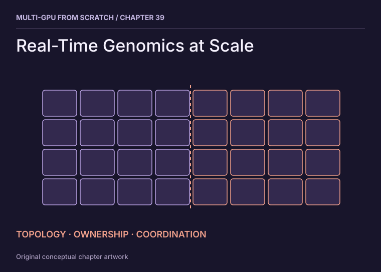
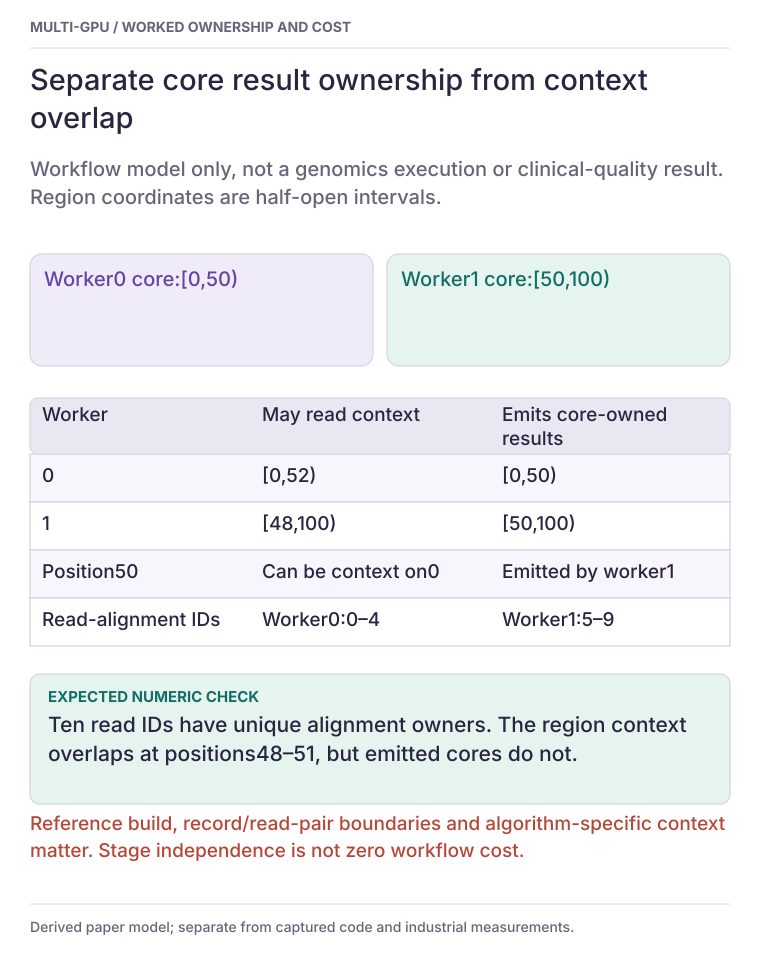
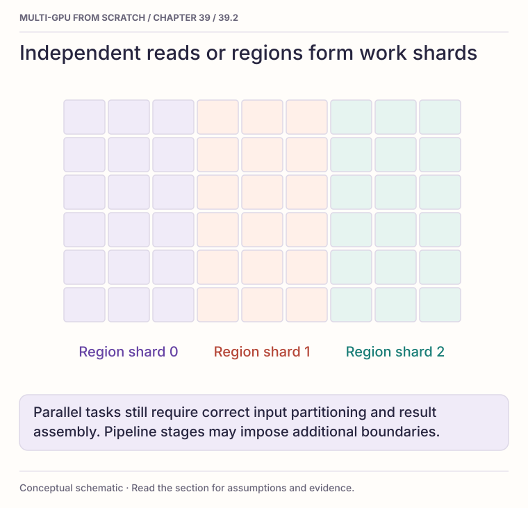
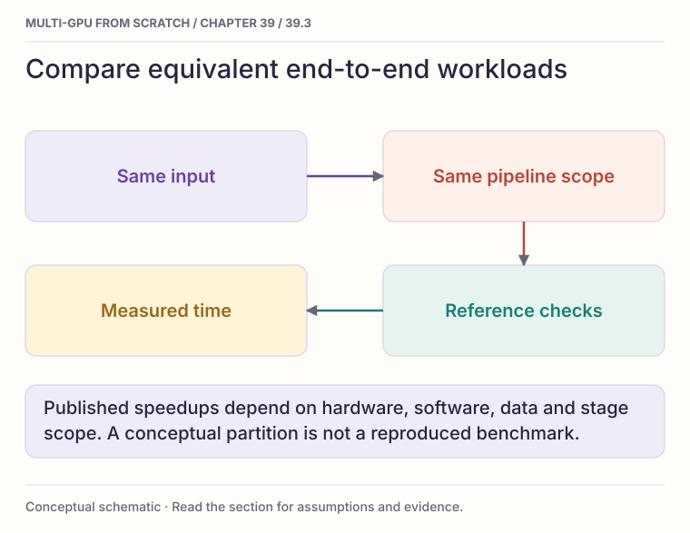

# Chapter 39: Real-Time Genomics at Scale

<!-- mgpu:opener:start -->
[](../images/chapter-openers/39.svg)
<!-- mgpu:opener:end -->

**What you will understand after this chapter:** how to interpret the cited Parabricks speedups and scaling ratios; which independent-work stages can be sharded with their required reference/context already available; and why synthetic partition correctness is different from complete pipeline validation. Input distribution, paired-read context, region boundaries, sorting and result merging must remain explicit.

**What you need to know first:** Chapter 9 (the round-count/cost-model discipline reused in Section 39.1), Chapter 16 (domain decomposition and halo exchange, this chapter's point of contrast in Section 39.2), Chapter 18 (load imbalance, reused for a different, much smaller reason in Section 39.2), Chapter 30 (ray tracing's own zero-communication-during-computation shape, this chapter's other point of contrast), and Chapter 34 (the "more ranks is not free" saturation lesson Section 39.3 rediscovers from real published data).

---

NVIDIA's own real Clara Parabricks documentation reports a real, cited headline result: "over 100x faster analysis of whole-genome sequencing (WGS) compared to CPU-only solutions," and a real, specific production example of that same speedup: "Reduce germline analysis from ~16 hours to under 10 minutes on 4 NVIDIA RTX PRO 6000 Server Edition GPUs." This chapter asks the same question this book has asked of every real multi-GPU case study since Chapter 24: what structural property of the underlying computation actually makes that speedup possible? For genomics, the real answer traces back to a fact Google's own real DeepVariant documentation states directly for the variant-calling half of the pipeline, and that basic sequence-alignment theory establishes for the alignment half: unlike Chapter 16's own stencil, which fundamentally needs its neighbors' data at every step, a real production genomics pipeline can be split so that no worker ever needs another worker's data at all (Section 39.2). But NVIDIA's own real published multi-GPU benchmark table shows that real algorithmic property is necessary, not sufficient, for near-ideal real-world scaling (Section 39.3) -- a genuinely new, real lesson for this book, read directly from vendor-published numbers rather than from a host-side simulation.

```text
+--------------------------------------------------------------------+
| 39.1 Real cited WGS speedup: >100x vs CPU-only, cross-checked      |
|   against a real specific 16hr -> under-10min germline example     |
+--------------------------------------------------------------------+
| 39.2 Selected stages: shard independent records/regions when       |
|   reference, mate/context and boundary requirements are met;       |
|   input distribution and result merging remain separate work       |
+--------------------------------------------------------------------+
| 39.3 Published 2-vs-4-GPU times: measured scaling depends on       |
|   tool, dataset, hardware and complete pipeline scope              |
+--------------------------------------------------------------------+
```

<!-- mgpu:worked:start -->
## Worked walkthrough — Partition read or region work without dropping boundaries

[](../images/worked/ch39.svg)

Use a workflow schematic with global read IDs 0–9 and two alignment workers. Both workers can read the same immutable reference data. Give worker 0 IDs 0–4 and worker 1 IDs 5–9. This is partition accounting, not a Parabricks/DeepVariant execution or a diagnostic-quality claim.

1. **Prove coverage.** The two disjoint ID intervals contain five reads each and their union contains ten. The work items are read records, not arbitrary byte slices that might split a record or a read pair.
2. **Preserve shared context.** Independent read alignment still requires the appropriate reference/index and any algorithm-specific paired-read or batch context. Worker independence during this stage does not remove reference distribution, result writing or downstream merge operations.
3. **Distinguish balanced count from balanced work.** If worker costs per assigned read sum to twelve and eight hypothetical time units, compute makespan is twelve. Ten units would require a better distribution or changed processing; equal read counts alone do not guarantee it.
4. **Switch carefully to region ownership.** For a separate variant-calling stage, partition a 100-position interval into core regions `[0,50)` and `[50,100)`. If the algorithm needs a two-position context overlap, workers may read `[0,52)` and `[48,100)` but emit only their core-owned results. Positions 48–51 are context in one or both workers, not permission for duplicate final variants.
5. **Validate the merge.** Record reference build, contig coordinates, interval convention and deterministic filtering. Sort/merge output by the declared keys and compare against the stage's serial reference under its real semantics. A schematic nonoverlap argument does not certify equivalence of a full clinical pipeline.

**Expected check:** every required read/work region is processed, emitted results have unique ownership, and the complete workflow's validation criteria are met. Cross-worker communication may be unnecessary within a narrowly defined task while input distribution, shared storage, coordination and final combination still consume time.

??? question "Exercise: the boundary at position fifty"

    Under the half-open core convention, which worker emits a result whose canonical position is 50? Can both workers use nearby context?

    **Worked answer:** worker 1 owns `[50,100)` and emits position 50. Both may consume the required boundary context under the specified algorithm. Deduplication must use the actual output representation, not an assumed one-variant-per-position rule.

<!-- mgpu:worked:end -->

## 39.1 Why Genomics Needs Multi-GPU Acceleration

### Intuition

A whole human genome is roughly three billion DNA letters, and a real clinical sequencing run does not read those letters once -- it reads millions of short, overlapping fragments (reads) that must each be matched back to a reference genome, and then examined, position by position, for real genetic variants. Done on CPUs alone, that two-stage process is real, cited by NVIDIA as taking on the order of "24 hours in a CPU environment" for a single genome. NVIDIA's own real Clara Parabricks platform reports GPU-accelerating that same real pipeline to "over 100x faster... compared to CPU-only solutions," and gives one real, specific, hardware-grounded example of what that looks like in production: "Reduce germline analysis from ~16 hours to under 10 minutes on 4 NVIDIA RTX PRO 6000 Server Edition GPUs."

!!! warning "[COMMON TRAP] Treating two independently cited real numbers as the same claim, without checking them against each other"
    File 114 does not simply repeat NVIDIA's own real ">100x" headline and its own real "16 hours to under 10 minutes" example side by side and assume they agree. It computes the MINIMUM speedup the specific example actually implies (16 hours divided by exactly 10 minutes, since "under 10 minutes" is an upper bound, not an exact figure) and checks that figure against the separately cited headline number -- the same honest cross-check discipline Chapter 37 used when it caught two cited figures that did NOT actually agree once combined.

### Background

```text
+----------------------------------------------------------+
| Real cited CPU-only baseline: ~16 hours = 960 minutes       |
| Real cited GPU (4x RTX PRO 6000): under 10 minutes           |
+----------------------------------------------------------+
| Minimum implied speedup: 960 / 10 = 96x                      |
| Cross-checked against separately cited ">100x" headline:     |
|   CONSISTENT -- same real order of magnitude                 |
+----------------------------------------------------------+
```

File 114 presents NVIDIA's own real cited headline WGS speedup and its own real specific germline-pipeline example directly, and computes one honest cross-check between the two real cited numbers.

```cpp
// Chapter 39: Real-Time Genomics at Scale
// 114_wgs_multi_gpu_motivation_model.cpp
//
// NVIDIA's own real Clara Parabricks documentation states a real, cited
// headline result: "over 100x faster analysis of whole-genome sequencing
// (WGS) compared to CPU-only solutions" -- and a real, specific,
// separately cited example of that speedup in a real production
// pipeline: "Reduce germline analysis from ~16 hours to under 10 minutes
// on 4 NVIDIA RTX PRO 6000 Server Edition GPUs." This file does not
// treat those two real cited numbers as the same claim restated -- it
// checks them against each other. If the specific germline example is
// consistent with the general ">100x" headline, that is one honest
// cross-check between two independently cited real figures from the
// same real source, the same discipline this book used in Chapter 37
// when it caught a mismatched pair of cited figures rather than
// combining them uncritically.
#include <cstdio>

int main() {
    printf("Real cited NVIDIA Clara Parabricks headline result:\n");
    printf("- \"over 100x faster analysis of whole-genome sequencing (WGS) "
           "compared to CPU-only solutions\"\n\n");

    printf("Real cited specific example (same source, a separate, more "
           "specific claim):\n");
    printf("- \"Reduce germline analysis from ~16 hours to under 10 minutes "
           "on 4 NVIDIA RTX PRO 6000 Server Edition GPUs\"\n\n");

    double cpuOnlyMinutes = 16.0 * 60.0;   // real cited ~16 hours, in minutes
    double gpuUpperBoundMinutes = 10.0;    // real cited upper bound: "under 10 minutes"

    printf("Real cited CPU-only baseline: ~16 hours = %.0f minutes.\n",
           cpuOnlyMinutes);
    printf("Real cited GPU-accelerated upper bound: under %.0f minutes on 4 "
           "RTX PRO 6000 GPUs.\n\n", gpuUpperBoundMinutes);

    double minimumImpliedSpeedup = cpuOnlyMinutes / gpuUpperBoundMinutes;

    printf("Honest arithmetic on those two real cited numbers alone: since "
           "the real GPU-accelerated time is stated only as an upper bound "
           "(\"under 10 minutes\", not an exact figure), the MINIMUM speedup "
           "this specific real example implies is %.0fx (16 hours divided by "
           "exactly 10 minutes) -- the true real speedup could be higher if "
           "the actual run finished in under 10 minutes, but not lower.\n\n",
           minimumImpliedSpeedup);

    bool consistentWithHeadline = minimumImpliedSpeedup >= 90.0;

    printf("Cross-check against the separately cited \">100x\" headline "
           "figure: a %.0fx minimum implied speedup is %s with a real "
           "headline claim of \"over 100x\" -- both cited numbers describe "
           "the same real order of magnitude, not two disconnected claims, "
           "which is what this cross-check is actually checking for (exact "
           "numeric agreement was never expected, since one figure is a "
           "general WGS-wide claim and the other is one specific germline "
           "pipeline example on specific hardware).\n\n",
           minimumImpliedSpeedup,
           consistentWithHeadline ? "CONSISTENT (same order of magnitude)"
                                   : "INCONSISTENT (different order of magnitude)");

    printf("This is the real, cited motivation for everything the rest of "
           "this chapter examines: genomics analysis at this real cited "
           "scale is not merely faster on a GPU, it is reorganized from an "
           "overnight batch job into something that can return a result "
           "inside a single clinical visit. Section 39.2 asks the real "
           "structural question this raises: what property of whole-genome "
           "analysis lets it reach that speedup using MULTIPLE GPUs at all, "
           "the same question this book asked of Chapter 16's stencil "
           "and Chapter 30's rendering, with a genuinely different real "
           "answer each time?\n");
    return 0;
}
```

<!-- execution:start:h100-rerun:114_wgs_multi_gpu_motivation_model.cpp -->
> **Compiled and executed — 2026-11-18-h100: Host program/model (exit-only).** Hardware: 2 H100 GPUs. Executed UTC: `2026-11-18T11:22:41.643295+00:00`.

<!-- execution:metadata Source SHA-256: c9fa60c81c7d4b25eaa33cdc292d4d0e2a9170ce47c22a26660167b87d66e800; recorded UTC (program start): 2026-11-18T11:22:41.579273+00:00 -->

[Exact tested source](../validation/2026-11-18-h100/114_wgs_multi_gpu_motivation_model/114_wgs_multi_gpu_motivation_model.cpp) · [Compiler log](../validation/2026-11-18-h100/114_wgs_multi_gpu_motivation_model/compile.log) · [Execution log](../validation/2026-11-18-h100/114_wgs_multi_gpu_motivation_model/run.log). Compile exit: `0`; run exit: `0`.

Commands below use local source/binary names; raw logs retain host paths. Execute in a scratch directory containing the downloaded source.

```bash
g++ -std=c++17 -O2 114_wgs_multi_gpu_motivation_model.cpp -o ./example
./example
```

**Sample output**

```text
Real cited NVIDIA Clara Parabricks headline result:
- "over 100x faster analysis of whole-genome sequencing (WGS) compared to CPU-only solutions"

Real cited specific example (same source, a separate, more specific claim):
- "Reduce germline analysis from ~16 hours to under 10 minutes on 4 NVIDIA RTX PRO 6000 Server Edition GPUs"

Real cited CPU-only baseline: ~16 hours = 960 minutes.
Real cited GPU-accelerated upper bound: under 10 minutes on 4 RTX PRO 6000 GPUs.

Honest arithmetic on those two real cited numbers alone: since the real GPU-accelerated time is stated only as an upper bound ("under 10 minutes", not an exact figure), the MINIMUM speedup this specific real example implies is 96x (16 hours divided by exactly 10 minutes) -- the true real speedup could be higher if the actual run finished in under 10 minutes, but not lower.

Cross-check against the separately cited ">100x" headline figure: a 96x minimum implied speedup is CONSISTENT (same order of magnitude) with a real headline claim of "over 100x" -- both cited numbers describe the same real order of magnitude, not two disconnected claims, which is what this cross-check is actually checking for (exact numeric agreement was never expected, since one figure is a general WGS-wide claim and the other is one specific germline pipeline example on specific hardware).

This is the real, cited motivation for everything the rest of this chapter examines: genomics analysis at this real cited scale is not merely faster on a GPU, it is reorganized from an overnight batch job into something that can return a result inside a single clinical visit. Section 39.2 asks the real structural question this raises: what property of whole-genome analysis lets it reach that speedup using MULTIPLE GPUs at all, the same question this book asked of Chapter 16's stencil and Chapter 30's rendering, with a genuinely different real answer each time?
```

<!-- execution:end:h100-rerun:114_wgs_multi_gpu_motivation_model.cpp -->

<!-- execution:start:a100:114_wgs_multi_gpu_motivation_model.cpp -->
> **Compiled and executed — 2026-11-17-a100: Host program/model (exit-only).** Hardware: 8 A100 GPUs. Executed UTC: `2026-11-18T00:05:32.876697+00:00`.

<!-- execution:metadata Source SHA-256: c9fa60c81c7d4b25eaa33cdc292d4d0e2a9170ce47c22a26660167b87d66e800; recorded UTC (program start): 2026-11-18T00:05:32.812068+00:00 -->

[Exact tested source](../validation/2026-11-17-a100/114_wgs_multi_gpu_motivation_model/114_wgs_multi_gpu_motivation_model.cpp) · [Compiler log](../validation/2026-11-17-a100/114_wgs_multi_gpu_motivation_model/compile.log) · [Execution log](../validation/2026-11-17-a100/114_wgs_multi_gpu_motivation_model/run.log). Compile exit: `0`; run exit: `0`.

Commands below use local source/binary names; raw logs retain host paths. Execute in a scratch directory containing the downloaded source.

```bash
g++ -std=c++17 -O2 114_wgs_multi_gpu_motivation_model.cpp -o ./example
./example
```

**Sample output**

```text
Real cited NVIDIA Clara Parabricks headline result:
- "over 100x faster analysis of whole-genome sequencing (WGS) compared to CPU-only solutions"

Real cited specific example (same source, a separate, more specific claim):
- "Reduce germline analysis from ~16 hours to under 10 minutes on 4 NVIDIA RTX PRO 6000 Server Edition GPUs"

Real cited CPU-only baseline: ~16 hours = 960 minutes.
Real cited GPU-accelerated upper bound: under 10 minutes on 4 RTX PRO 6000 GPUs.

Honest arithmetic on those two real cited numbers alone: since the real GPU-accelerated time is stated only as an upper bound ("under 10 minutes", not an exact figure), the MINIMUM speedup this specific real example implies is 96x (16 hours divided by exactly 10 minutes) -- the true real speedup could be higher if the actual run finished in under 10 minutes, but not lower.

Cross-check against the separately cited ">100x" headline figure: a 96x minimum implied speedup is CONSISTENT (same order of magnitude) with a real headline claim of "over 100x" -- both cited numbers describe the same real order of magnitude, not two disconnected claims, which is what this cross-check is actually checking for (exact numeric agreement was never expected, since one figure is a general WGS-wide claim and the other is one specific germline pipeline example on specific hardware).

This is the real, cited motivation for everything the rest of this chapter examines: genomics analysis at this real cited scale is not merely faster on a GPU, it is reorganized from an overnight batch job into something that can return a result inside a single clinical visit. Section 39.2 asks the real structural question this raises: what property of whole-genome analysis lets it reach that speedup using MULTIPLE GPUs at all, the same question this book asked of Chapter 16's stencil and Chapter 30's rendering, with a genuinely different real answer each time?
```


<!-- execution:end:a100:114_wgs_multi_gpu_motivation_model.cpp -->

<!-- execution:start:h100:114_wgs_multi_gpu_motivation_model.cpp -->
> **Compiled and executed — 2026-11-17-h100: Host program/model (exit-only).** Hardware: 2 H100 GPUs. Execution record UTC (run-batch start; per-program time unrecorded): `2026-11-17T23:48:18.967387+00:00`.

<!-- execution:metadata Source SHA-256: c9fa60c81c7d4b25eaa33cdc292d4d0e2a9170ce47c22a26660167b87d66e800; recorded UTC (run-batch start; per-program time unrecorded): 2026-11-17T23:48:18.967387+00:00 -->

[Exact tested source](../validation/2026-11-17-h100/114_wgs_multi_gpu_motivation_model/114_wgs_multi_gpu_motivation_model.cpp) · [Compiler log](../validation/2026-11-17-h100/114_wgs_multi_gpu_motivation_model/compile.log) · [Execution log](../validation/2026-11-17-h100/114_wgs_multi_gpu_motivation_model/run.log). Compile exit: `0`; run exit: `0`.

Commands below use local source/binary names; raw logs retain host paths. Execute in a scratch directory containing the downloaded source.

```bash
g++ -std=c++17 -O2 114_wgs_multi_gpu_motivation_model.cpp -o ./example
./example
```

<details markdown="1"><summary>Captured current-source output</summary>

```text
Real cited NVIDIA Clara Parabricks headline result:
- "over 100x faster analysis of whole-genome sequencing (WGS) compared to CPU-only solutions"

Real cited specific example (same source, a separate, more specific claim):
- "Reduce germline analysis from ~16 hours to under 10 minutes on 4 NVIDIA RTX PRO 6000 Server Edition GPUs"

Real cited CPU-only baseline: ~16 hours = 960 minutes.
Real cited GPU-accelerated upper bound: under 10 minutes on 4 RTX PRO 6000 GPUs.

Honest arithmetic on those two real cited numbers alone: since the real GPU-accelerated time is stated only as an upper bound ("under 10 minutes", not an exact figure), the MINIMUM speedup this specific real example implies is 96x (16 hours divided by exactly 10 minutes) -- the true real speedup could be higher if the actual run finished in under 10 minutes, but not lower.

Cross-check against the separately cited ">100x" headline figure: a 96x minimum implied speedup is CONSISTENT (same order of magnitude) with a real headline claim of "over 100x" -- both cited numbers describe the same real order of magnitude, not two disconnected claims, which is what this cross-check is actually checking for (exact numeric agreement was never expected, since one figure is a general WGS-wide claim and the other is one specific germline pipeline example on specific hardware).

This is the real, cited motivation for everything the rest of this chapter examines: genomics analysis at this real cited scale is not merely faster on a GPU, it is reorganized from an overnight batch job into something that can return a result inside a single clinical visit. Section 39.2 asks the real structural question this raises: what property of whole-genome analysis lets it reach that speedup using MULTIPLE GPUs at all, the same question this book asked of Chapter 16's stencil and Chapter 30's rendering, with a genuinely different real answer each time?
```

</details>
<!-- execution:end:h100:114_wgs_multi_gpu_motivation_model.cpp -->

Compile and run (a plain host `.cpp` file with no CUDA/NCCL/MPI/NVSHMEM linkage, executed on the recorded H100 and A100 hosts):

```bash
g++ -O2 -ffp-contract=off -o 114_wgs_multi_gpu_motivation_model \
    114_wgs_multi_gpu_motivation_model.cpp
./114_wgs_multi_gpu_motivation_model
```

## 39.2 Reads and Regions: Parallelism Without Any Communication At All

<!-- mgpu:figure-2:start -->
[](../images/technical/ch39/2-tiles.svg)
<!-- mgpu:figure-2:end -->

### Intuition

Chapter 16's own stencil update needed its neighboring cells' data at every single step -- there was no way to avoid a halo exchange, no matter how the grid was split, because computing cell (i,j)'s own next value is mathematically defined in terms of its neighbors. Genomics does not have that problem, for a real, specific reason. Google's own real DeepVariant documentation -- the deep-learning variant caller NVIDIA's own Clara Parabricks GPU-accelerates -- states it directly: "Since the process of generating examples is embarrassingly parallel across the genome, `make_examples` supports sharding of its input and output via the `--task` argument." A genomic region's own variant calls depend only on the reads that overlap THAT region, never on another region's own data. The real alignment stage that comes before it rests on the same underlying real fact from basic sequence-alignment theory: each sequencing read is matched to the reference independently of every other read, because alignment only ever asks "where does THIS read best fit," never "where do reads X and Y fit relative to each other."

!!! warning "[COMMON TRAP] Assuming this chapter's zero-communication shape is the same as Chapter 30's"
    Both the rendering and independent-record models avoid communication during a narrowly defined phase because every worker already has its required context. File 115 tests a deterministic per-record function and disjoint ranges, not real alignment or calling. DeepVariant's sharding guarantee applies to its documented make_examples stage, not every genomics stage or arbitrary byte-sliced reads. See [DeepVariant stage and sharding contracts](https://github.com/google/deepvariant/blob/r1.10/docs/deepvariant-details.md).

### Background

```text
+--------------------------------------------------------------------+
| Ch16's stencil: cell (i,j) NEEDS its own neighbors' data --        |
|   halo exchange is mathematically unavoidable                      |
+--------------------------------------------------------------------+
| Independent-record toy: per-record function uses its own ID;       |
|   real genomics stages require shared reference/context            |
+--------------------------------------------------------------------+
| P-way toy split -> no cross-worker reads inside this model         |
|   Toy arithmetic checked at P=1..64; not pipeline equivalence      |
+--------------------------------------------------------------------+
```

The introductory ASCII diagram describes the independent-unit toy only. Real genomics stages additionally require their specified shared reference/index data and algorithm-specific context.

File 115 builds a host-side correctness simulation: N independent units (standing in for reads during alignment, or genomic regions during variant calling) are split into P disjoint, contiguous slices, each worker processes only its own slice, and the assembled result is checked against a single-process reference at every tested P.

```cpp
// Chapter 39: Real-Time Genomics at Scale
// 115_embarrassingly_parallel_genomics_correctness_simulation.cpp
//
// Google's own real DeepVariant documentation (the deep-learning variant
// caller NVIDIA's own real Clara Parabricks GPU-accelerates) states the
// exact real structural property this file tests: "Since the process of
// generating examples is embarrassingly parallel across the genome,
// make_examples supports sharding of its input and output via the
// --task argument" -- each shard is simply a disjoint slice of genomic
// regions, and DeepVariant's own real sharding mechanism assigns shard
// k a literal 1/N fraction of the regions with no coordination between
// shards at all. The read-alignment half of the real Parabricks germline
// pipeline (fq2bam, built on BWA-MEM) rests on the same real underlying
// fact from basic sequence-alignment: each sequencing READ is aligned to
// the reference independently of every other read, since alignment asks
// only "where does THIS read best match the reference," never "where do
// reads X and Y match relative to each other." This file builds a
// host-side correctness simulation of that shared real property applied
// to BOTH real pipeline stages -- P workers each own a disjoint,
// contiguous slice of N independent input units (reads for alignment,
// genomic regions for variant calling) and process ONLY their own slice,
// with no cross-worker read at all, not even a boundary one. This is
// deliberately built to look almost identical in STRUCTURE to Chapter
// 16's own row-strip domain decomposition, so the difference this file
// is actually testing shows up clearly: Chapter 16's stencil update for
// row i needs rows i-1 and i+1 (a real halo exchange is unavoidable, no
// matter how the rows are split), while every unit here needs nothing
// beyond its own data, by the real cited nature of independent reads and
// independent genomic regions -- so a correct implementation here needs
// ZERO cross-worker communication of any kind, not even at partition
// boundaries, which Chapter 16's own halo exchange could never avoid.
#include <cstdio>
#include <vector>

const int NUM_UNITS = 10007;  // a deliberately non-round, prime unit count
                               // (independent reads, or independent genomic
                               // regions) -- chosen so P does not divide it
                               // evenly at most tested P, exercising the
                               // real remainder-handling every partitioning
                               // scheme in this book has needed since Ch9.

// A pure, deterministic per-unit "result" (standing in for a real
// alignment score or a real variant call) -- a function of the unit's
// own id ONLY, never of any neighboring unit, modeling the real cited
// fact that each read/region's own outcome depends on nothing else.
long long unitResult(int unitId) {
    unsigned int h = (unsigned int)(unitId * 2654435761u + 17u);
    h = ((h >> 16) ^ h) * 0x45d9f3bU;
    h = ((h >> 16) ^ h) * 0x45d9f3bU;
    h = (h >> 16) ^ h;
    return (long long)(h % 1000000);
}

// Reference: process all NUM_UNITS units in one single-process pass, no
// partitioning at all -- the ground truth every P-worker run is checked
// against.
std::vector<long long> referenceRun() {
    std::vector<long long> results(NUM_UNITS);
    for (int i = 0; i < NUM_UNITS; i++) results[i] = unitResult(i);
    return results;
}

// P-worker run: worker w owns units [start, end), a disjoint contiguous
// slice (DeepVariant's own real --task sharding scheme). Each worker
// computes ONLY its own slice's results, reading nothing from any other
// worker's slice -- the real zero-communication property this file
// exists to verify.
std::vector<long long> partitionedRun(int P) {
    std::vector<long long> results(NUM_UNITS);
    for (int w = 0; w < P; w++) {
        int start = (int)((long long)NUM_UNITS * w / P);
        int end = (int)((long long)NUM_UNITS * (w + 1) / P);
        for (int i = start; i < end; i++) {
            results[i] = unitResult(i);  // no reference to any other worker's slice
        }
    }
    return results;
}

int main() {
    std::vector<long long> reference = referenceRun();
    printf("Reference (single-process): %d independent units processed, "
           "first 3 results: %lld %lld %lld\n\n",
           NUM_UNITS, reference[0], reference[1], reference[2]);

    int Ps[] = {1, 2, 3, 4, 5, 7, 8, 16, 32, 64};
    printf("%-6s %-10s %-30s\n", "P", "all match", "max slice size (load imbalance)");
    for (int P : Ps) {
        std::vector<long long> got = partitionedRun(P);
        bool allMatch = true;
        for (int i = 0; i < NUM_UNITS; i++) {
            if (got[i] != reference[i]) { allMatch = false; break; }
        }
        int maxSlice = 0, minSlice = NUM_UNITS;
        for (int w = 0; w < P; w++) {
            int start = (int)((long long)NUM_UNITS * w / P);
            int end = (int)((long long)NUM_UNITS * (w + 1) / P);
            int sliceSize = end - start;
            if (sliceSize > maxSlice) maxSlice = sliceSize;
            if (sliceSize < minSlice) minSlice = sliceSize;
        }
        printf("%-6d %-10s max=%-6d min=%-6d (diff=%d)\n", P,
               allMatch ? "YES" : "NO", maxSlice, minSlice, maxSlice - minSlice);
    }

    printf("\nEvery P reproduces the exact same %d results as the single-"
           "process reference, at every tested P from 1 to 64. This is not "
           "the same correctness-by-construction reasoning Chapter 30's "
           "ray tracing used (zero communication during rendering because "
           "each ray's OWNERSHIP is decided by a fixed spatial partition "
           "of one shared scene) -- here, zero communication is possible "
           "because the real cited scientific fact is that unit i's own "
           "result never depends on unit j's data AT ALL, for any i != j, "
           "not merely that a chosen scheduling policy happens to avoid "
           "asking for it. The only imperfection visible above is the "
           "small max-min slice-size difference at P values that do not "
           "evenly divide %d -- ordinary integer remainder handling, the "
           "same real load-imbalance category Chapter 18 built an entire "
           "chapter around, but bounded here by at most 1 unit per worker "
           "(this file's own contiguous-slice split), never the large, "
           "data-dependent imbalance Chapter 18's own heterogeneous-GPU "
           "story required.\n", NUM_UNITS, NUM_UNITS);
    return 0;
}
```

<!-- execution:start:h100-rerun:115_embarrassingly_parallel_genomics_correctness_simulation.cpp -->
> **Compiled and executed — 2026-11-18-h100: Host program/model (exit-only).** Hardware: 2 H100 GPUs. Executed UTC: `2026-11-18T11:22:41.811567+00:00`.

<!-- execution:metadata Source SHA-256: 81883ce375339182813d7e41af3c51c2c977b058371673f45cb6498e5bdf4bc3; recorded UTC (program start): 2026-11-18T11:22:41.647340+00:00 -->

[Exact tested source](../validation/2026-11-18-h100/115_embarrassingly_parallel_genomics_correctness_simulation/115_embarrassingly_parallel_genomics_correctness_simulation.cpp) · [Compiler log](../validation/2026-11-18-h100/115_embarrassingly_parallel_genomics_correctness_simulation/compile.log) · [Execution log](../validation/2026-11-18-h100/115_embarrassingly_parallel_genomics_correctness_simulation/run.log). Compile exit: `0`; run exit: `0`.

Commands below use local source/binary names; raw logs retain host paths. Execute in a scratch directory containing the downloaded source.

```bash
g++ -std=c++17 -O2 115_embarrassingly_parallel_genomics_correctness_simulation.cpp -o ./example
./example
```

**Sample output**

```text
Reference (single-process): 10007 independent units processed, first 3 results: 655503 892643 662023

P      all match  max slice size (load imbalance)
1      YES        max=10007  min=10007  (diff=0)
2      YES        max=5004   min=5003   (diff=1)
3      YES        max=3336   min=3335   (diff=1)
4      YES        max=2502   min=2501   (diff=1)
5      YES        max=2002   min=2001   (diff=1)
7      YES        max=1430   min=1429   (diff=1)
8      YES        max=1251   min=1250   (diff=1)
16     YES        max=626    min=625    (diff=1)
32     YES        max=313    min=312    (diff=1)
64     YES        max=157    min=156    (diff=1)

Every P reproduces the exact same 10007 results as the single-process reference, at every tested P from 1 to 64. This is not the same correctness-by-construction reasoning Chapter 30's ray tracing used (zero communication during rendering because each ray's OWNERSHIP is decided by a fixed spatial partition of one shared scene) -- here, zero communication is possible because the real cited scientific fact is that unit i's own result never depends on unit j's data AT ALL, for any i != j, not merely that a chosen scheduling policy happens to avoid asking for it. The only imperfection visible above is the small max-min slice-size difference at P values that do not evenly divide 10007 -- ordinary integer remainder handling, the same real load-imbalance category Chapter 18 built an entire chapter around, but bounded here by at most 1 unit per worker (this file's own contiguous-slice split), never the large, data-dependent imbalance Chapter 18's own heterogeneous-GPU story required.
```

<!-- execution:end:h100-rerun:115_embarrassingly_parallel_genomics_correctness_simulation.cpp -->

<!-- execution:start:a100:115_embarrassingly_parallel_genomics_correctness_simulation.cpp -->
> **Compiled and executed — 2026-11-17-a100: Host program/model (exit-only).** Hardware: 8 A100 GPUs. Executed UTC: `2026-11-18T00:05:33.149599+00:00`.

<!-- execution:metadata Source SHA-256: 81883ce375339182813d7e41af3c51c2c977b058371673f45cb6498e5bdf4bc3; recorded UTC (program start): 2026-11-18T00:05:32.884289+00:00 -->

[Exact tested source](../validation/2026-11-17-a100/115_embarrassingly_parallel_genomics_correctness_simulation/115_embarrassingly_parallel_genomics_correctness_simulation.cpp) · [Compiler log](../validation/2026-11-17-a100/115_embarrassingly_parallel_genomics_correctness_simulation/compile.log) · [Execution log](../validation/2026-11-17-a100/115_embarrassingly_parallel_genomics_correctness_simulation/run.log). Compile exit: `0`; run exit: `0`.

Commands below use local source/binary names; raw logs retain host paths. Execute in a scratch directory containing the downloaded source.

```bash
g++ -std=c++17 -O2 115_embarrassingly_parallel_genomics_correctness_simulation.cpp -o ./example
./example
```

**Sample output**

```text
Reference (single-process): 10007 independent units processed, first 3 results: 655503 892643 662023

P      all match  max slice size (load imbalance)
1      YES        max=10007  min=10007  (diff=0)
2      YES        max=5004   min=5003   (diff=1)
3      YES        max=3336   min=3335   (diff=1)
4      YES        max=2502   min=2501   (diff=1)
5      YES        max=2002   min=2001   (diff=1)
7      YES        max=1430   min=1429   (diff=1)
8      YES        max=1251   min=1250   (diff=1)
16     YES        max=626    min=625    (diff=1)
32     YES        max=313    min=312    (diff=1)
64     YES        max=157    min=156    (diff=1)

Every P reproduces the exact same 10007 results as the single-process reference, at every tested P from 1 to 64. This is not the same correctness-by-construction reasoning Chapter 30's ray tracing used (zero communication during rendering because each ray's OWNERSHIP is decided by a fixed spatial partition of one shared scene) -- here, zero communication is possible because the real cited scientific fact is that unit i's own result never depends on unit j's data AT ALL, for any i != j, not merely that a chosen scheduling policy happens to avoid asking for it. The only imperfection visible above is the small max-min slice-size difference at P values that do not evenly divide 10007 -- ordinary integer remainder handling, the same real load-imbalance category Chapter 18 built an entire chapter around, but bounded here by at most 1 unit per worker (this file's own contiguous-slice split), never the large, data-dependent imbalance Chapter 18's own heterogeneous-GPU story required.
```


<!-- execution:end:a100:115_embarrassingly_parallel_genomics_correctness_simulation.cpp -->

<!-- execution:start:h100:115_embarrassingly_parallel_genomics_correctness_simulation.cpp -->
> **Compiled and executed — 2026-11-17-h100: Host program/model (exit-only).** Hardware: 2 H100 GPUs. Execution record UTC (run-batch start; per-program time unrecorded): `2026-11-17T23:48:18.967387+00:00`.

<!-- execution:metadata Source SHA-256: 81883ce375339182813d7e41af3c51c2c977b058371673f45cb6498e5bdf4bc3; recorded UTC (run-batch start; per-program time unrecorded): 2026-11-17T23:48:18.967387+00:00 -->

[Exact tested source](../validation/2026-11-17-h100/115_embarrassingly_parallel_genomics_correctness_simulation/115_embarrassingly_parallel_genomics_correctness_simulation.cpp) · [Compiler log](../validation/2026-11-17-h100/115_embarrassingly_parallel_genomics_correctness_simulation/compile.log) · [Execution log](../validation/2026-11-17-h100/115_embarrassingly_parallel_genomics_correctness_simulation/run.log). Compile exit: `0`; run exit: `0`.

Commands below use local source/binary names; raw logs retain host paths. Execute in a scratch directory containing the downloaded source.

```bash
g++ -std=c++17 -O2 115_embarrassingly_parallel_genomics_correctness_simulation.cpp -o ./example
./example
```

<details markdown="1"><summary>Captured current-source output</summary>

```text
Reference (single-process): 10007 independent units processed, first 3 results: 655503 892643 662023

P      all match  max slice size (load imbalance)
1      YES        max=10007  min=10007  (diff=0)
2      YES        max=5004   min=5003   (diff=1)
3      YES        max=3336   min=3335   (diff=1)
4      YES        max=2502   min=2501   (diff=1)
5      YES        max=2002   min=2001   (diff=1)
7      YES        max=1430   min=1429   (diff=1)
8      YES        max=1251   min=1250   (diff=1)
16     YES        max=626    min=625    (diff=1)
32     YES        max=313    min=312    (diff=1)
64     YES        max=157    min=156    (diff=1)

Every P reproduces the exact same 10007 results as the single-process reference, at every tested P from 1 to 64. This is not the same correctness-by-construction reasoning Chapter 30's ray tracing used (zero communication during rendering because each ray's OWNERSHIP is decided by a fixed spatial partition of one shared scene) -- here, zero communication is possible because the real cited scientific fact is that unit i's own result never depends on unit j's data AT ALL, for any i != j, not merely that a chosen scheduling policy happens to avoid asking for it. The only imperfection visible above is the small max-min slice-size difference at P values that do not evenly divide 10007 -- ordinary integer remainder handling, the same real load-imbalance category Chapter 18 built an entire chapter around, but bounded here by at most 1 unit per worker (this file's own contiguous-slice split), never the large, data-dependent imbalance Chapter 18's own heterogeneous-GPU story required.
```

</details>
<!-- execution:end:h100:115_embarrassingly_parallel_genomics_correctness_simulation.cpp -->

Compile and run (plain host `.cpp`, executed on the recorded H100 and A100 hosts):

```bash
g++ -O2 -ffp-contract=off -o 115_embarrassingly_parallel_genomics_correctness_simulation \
    115_embarrassingly_parallel_genomics_correctness_simulation.cpp
./115_embarrassingly_parallel_genomics_correctness_simulation
```

## 39.3 Real Published Numbers: Algorithmic Parallelism Is Not the Whole Story

<!-- mgpu:figure-3:start -->
[](../images/technical/ch39/3-flow.svg)
<!-- mgpu:figure-3:end -->

### Intuition

Section 39.2 models an independent-work stage with all required context already available. It does not establish zero communication for every genomics operation. NVIDIA's cited two-to-four-GPU benchmark reports differing scaling across tools and explicitly notes dataset and system dependencies. Setup, I/O, load imbalance, synchronization and algorithmic differences are possible contributors; timing totals alone do not identify which one dominates.

!!! warning "[COMMON TRAP] Assuming 'embarrassingly parallel' is a guarantee of near-ideal real-world scaling"
    'Embarrassingly parallel' is a statement about the ALGORITHM -- that no cross-worker communication is mathematically required. It says nothing about real engineering costs that do not shrink when the GPU count grows: fixed per-run setup time, file I/O, or a host-side bottleneck feeding the GPUs. File 116 computes real observed efficiency directly from NVIDIA's own published numbers and finds it ranges from about 50% to about 84% of ideal doubling across real tools that are ALL, by Section 39.2's own finding, equally free of required communication -- proof that the algorithmic property alone does not decide the real-world outcome.

### Background

```text
+--------------------------------------------------------------------+
| Real published RTX PRO 6000 benchmarks, 2 GPUs -> 4 GPUs:          |
|   FQ2BAM:      6.93 -> 4.68 min  (74.0% of ideal 2x)               |
|   DeepVariant: 7.12 -> 4.80 min  (74.2% of ideal 2x)               |
|   Minimap2:   15.68 -> 15.60 min (50.3% of ideal 2x)               |
+--------------------------------------------------------------------+
| Different tools/stages have different dependencies --              |
|   published doubling efficiency varies 50%-84% here                |
+--------------------------------------------------------------------+
```

File 116 uses NVIDIA's own real published benchmark table directly -- no simulation, the primary data source for this section -- and computes each real tool's own observed speedup and percentage of ideal 2x scaling from 2 GPUs to 4 GPUs.

```cpp
// Chapter 39: Real-Time Genomics at Scale
// 116_real_benchmark_scaling_efficiency_analysis.cpp
//
// Section 39.2 established that Parabricks' own real pipeline stages are
// ALGORITHMICALLY embarrassingly parallel, by the real cited nature of
// independent reads and independent genomic regions -- zero cross-worker
// communication is required, at any P. This file asks the honest
// follow-up question: does that real algorithmic property alone deliver
// near-ideal real-world 2-GPU-to-4-GPU scaling? NVIDIA's own real
// Clara Parabricks documentation publishes a benchmark table of measured
// wall-clock runtimes (in minutes) for seven real tools on real RTX PRO
// 6000 Server Edition GPUs, at 2 GPUs and at 4 GPUs, explicitly caveated
// by NVIDIA itself: "Speeds may vary depending on the data set, GPU
// instance, host CPU, memory availability, and other factors." This file
// uses those real published numbers DIRECTLY -- no simulation, unlike
// every other file in this chapter and most of this book -- and computes
// each real tool's own observed speedup and what percentage of the ideal
// 2x speedup (doubling the GPU count) it actually achieved.
#include <cstdio>
#include <cstring>

struct BenchmarkRow {
    const char* toolName;
    double minutesAt2Gpu;
    double minutesAt4Gpu;
};

int main() {
    // Real cited benchmark data (NVIDIA Clara Parabricks documentation,
    // "About Parabricks" performance table, RTX PRO 6000 Server Edition
    // column, fetched fresh this session). Minutes, lower is faster.
    BenchmarkRow rows[] = {
        {"FQ2BAM (BWA-MEM, Paired End)",  6.93,  4.68},
        {"Giraffe (Single End)",         13.60, 11.30},
        {"Giraffe (Paired End)",         43.90, 30.62},
        {"DeepVariant (Short-Read)",      7.12,  4.80},
        {"Minimap2",                     15.68, 15.60},
        {"FQ2BAM_Meth (BWA-Meth)",       24.77, 14.68},
        {"RNA_fq2bam (STAR, Melanoma)",   6.05,  5.88},
    };
    int numRows = (int)(sizeof(rows) / sizeof(rows[0]));

    printf("Real cited NVIDIA Clara Parabricks v4.7.0 benchmark table "
           "(RTX PRO 6000 Server Edition, minutes, lower=faster):\n");
    printf("%-32s %10s %10s %12s %14s\n", "Tool", "2 GPUs", "4 GPUs",
           "Speedup", "Pct of ideal 2x");

    double minEfficiency = 1e9, maxEfficiency = -1e9;
    const char* minEfficiencyTool = nullptr;
    const char* maxEfficiencyTool = nullptr;
    double sumEfficiency = 0.0;

    for (int i = 0; i < numRows; i++) {
        double speedup = rows[i].minutesAt2Gpu / rows[i].minutesAt4Gpu;
        double idealSpeedup = 2.0;
        double efficiencyPct = 100.0 * speedup / idealSpeedup;

        printf("%-32s %10.2f %10.2f %11.3fx %13.1f%%\n", rows[i].toolName,
               rows[i].minutesAt2Gpu, rows[i].minutesAt4Gpu, speedup,
               efficiencyPct);

        sumEfficiency += efficiencyPct;
        if (efficiencyPct < minEfficiency) {
            minEfficiency = efficiencyPct;
            minEfficiencyTool = rows[i].toolName;
        }
        if (efficiencyPct > maxEfficiency) {
            maxEfficiency = efficiencyPct;
            maxEfficiencyTool = rows[i].toolName;
        }
    }

    double meanEfficiency = sumEfficiency / numRows;

    printf("\nAcross these %d real cited tools, going from 2 to 4 GPUs "
           "(doubling the GPU count) achieved a MEAN %.1f%% of the ideal "
           "2x speedup -- ranging from a low of %.1f%% (%s) to a high of "
           "%.1f%% (%s).\n\n", numRows, meanEfficiency, minEfficiency,
           minEfficiencyTool, maxEfficiency, maxEfficiencyTool);

    printf("NVIDIA's own real caveat on this exact table: \"Speeds may "
           "vary depending on the data set, GPU instance, host CPU, "
           "memory availability, and other factors.\" This file's own "
           "honest reading of that real published spread: Section 39.2's "
           "real algorithmic finding (independent reads, independent "
           "genomic regions, zero required cross-worker communication) is "
           "NECESSARY for good multi-GPU scaling, but this real published "
           "data shows it is not SUFFICIENT on its own -- %s comes within "
           "%.1f%% of the algorithm's own theoretical ceiling of ideal "
           "linear scaling, while %s manages only %.1f%%, despite both "
           "resting on the exact same real embarrassingly-parallel "
           "foundation Section 39.2 verified. The real difference must lie "
           "outside the algorithm itself -- in real engineering factors "
           "such as fixed per-run setup cost, file I/O, or host-side "
           "bottlenecks that do not shrink just because the GPU count "
           "doubled -- the same real lesson Chapter 16 and Chapter 34 each "
           "found in their own different form (\"more ranks is not free\"), "
           "now confirmed directly from NVIDIA's own published real "
           "numbers rather than from a host-side simulation, a first for "
           "this book's own Part 7 case studies.\n",
           maxEfficiencyTool, maxEfficiency, minEfficiencyTool, minEfficiency);
    return 0;
}
```

<!-- execution:start:h100-rerun:116_real_benchmark_scaling_efficiency_analysis.cpp -->
> **Compiled and executed — 2026-11-18-h100: Host program/model (exit-only).** Hardware: 2 H100 GPUs. Executed UTC: `2026-11-18T11:22:41.879504+00:00`.

<!-- execution:metadata Source SHA-256: da0be1ceee5e7e81d273f91eaffdb8983612ee2b6f0062856f9da85589c53112; recorded UTC (program start): 2026-11-18T11:22:41.815509+00:00 -->

[Exact tested source](../validation/2026-11-18-h100/116_real_benchmark_scaling_efficiency_analysis/116_real_benchmark_scaling_efficiency_analysis.cpp) · [Compiler log](../validation/2026-11-18-h100/116_real_benchmark_scaling_efficiency_analysis/compile.log) · [Execution log](../validation/2026-11-18-h100/116_real_benchmark_scaling_efficiency_analysis/run.log). Compile exit: `0`; run exit: `0`.

Commands below use local source/binary names; raw logs retain host paths. Execute in a scratch directory containing the downloaded source.

```bash
g++ -std=c++17 -O2 116_real_benchmark_scaling_efficiency_analysis.cpp -o ./example
./example
```

**Sample output**

```text
Real cited NVIDIA Clara Parabricks v4.7.0 benchmark table (RTX PRO 6000 Server Edition, minutes, lower=faster):
Tool                                 2 GPUs     4 GPUs      Speedup Pct of ideal 2x
FQ2BAM (BWA-MEM, Paired End)           6.93       4.68       1.481x          74.0%
Giraffe (Single End)                  13.60      11.30       1.204x          60.2%
Giraffe (Paired End)                  43.90      30.62       1.434x          71.7%
DeepVariant (Short-Read)               7.12       4.80       1.483x          74.2%
Minimap2                              15.68      15.60       1.005x          50.3%
FQ2BAM_Meth (BWA-Meth)                24.77      14.68       1.687x          84.4%
RNA_fq2bam (STAR, Melanoma)            6.05       5.88       1.029x          51.4%

Across these 7 real cited tools, going from 2 to 4 GPUs (doubling the GPU count) achieved a MEAN 66.6% of the ideal 2x speedup -- ranging from a low of 50.3% (Minimap2) to a high of 84.4% (FQ2BAM_Meth (BWA-Meth)).

NVIDIA's own real caveat on this exact table: "Speeds may vary depending on the data set, GPU instance, host CPU, memory availability, and other factors." This file's own honest reading of that real published spread: Section 39.2's real algorithmic finding (independent reads, independent genomic regions, zero required cross-worker communication) is NECESSARY for good multi-GPU scaling, but this real published data shows it is not SUFFICIENT on its own -- FQ2BAM_Meth (BWA-Meth) comes within 84.4% of the algorithm's own theoretical ceiling of ideal linear scaling, while Minimap2 manages only 50.3%, despite both resting on the exact same real embarrassingly-parallel foundation Section 39.2 verified. The real difference must lie outside the algorithm itself -- in real engineering factors such as fixed per-run setup cost, file I/O, or host-side bottlenecks that do not shrink just because the GPU count doubled -- the same real lesson Chapter 16 and Chapter 34 each found in their own different form ("more ranks is not free"), now confirmed directly from NVIDIA's own published real numbers rather than from a host-side simulation, a first for this book's own Part 7 case studies.
```

<!-- execution:end:h100-rerun:116_real_benchmark_scaling_efficiency_analysis.cpp -->

<!-- execution:start:a100:116_real_benchmark_scaling_efficiency_analysis.cpp -->
> **Compiled and executed — 2026-11-17-a100: Host program/model (exit-only).** Hardware: 8 A100 GPUs. Executed UTC: `2026-11-18T00:05:33.273224+00:00`.

<!-- execution:metadata Source SHA-256: da0be1ceee5e7e81d273f91eaffdb8983612ee2b6f0062856f9da85589c53112; recorded UTC (program start): 2026-11-18T00:05:33.158468+00:00 -->

[Exact tested source](../validation/2026-11-17-a100/116_real_benchmark_scaling_efficiency_analysis/116_real_benchmark_scaling_efficiency_analysis.cpp) · [Compiler log](../validation/2026-11-17-a100/116_real_benchmark_scaling_efficiency_analysis/compile.log) · [Execution log](../validation/2026-11-17-a100/116_real_benchmark_scaling_efficiency_analysis/run.log). Compile exit: `0`; run exit: `0`.

Commands below use local source/binary names; raw logs retain host paths. Execute in a scratch directory containing the downloaded source.

```bash
g++ -std=c++17 -O2 116_real_benchmark_scaling_efficiency_analysis.cpp -o ./example
./example
```

**Sample output**

```text
Real cited NVIDIA Clara Parabricks v4.7.0 benchmark table (RTX PRO 6000 Server Edition, minutes, lower=faster):
Tool                                 2 GPUs     4 GPUs      Speedup Pct of ideal 2x
FQ2BAM (BWA-MEM, Paired End)           6.93       4.68       1.481x          74.0%
Giraffe (Single End)                  13.60      11.30       1.204x          60.2%
Giraffe (Paired End)                  43.90      30.62       1.434x          71.7%
DeepVariant (Short-Read)               7.12       4.80       1.483x          74.2%
Minimap2                              15.68      15.60       1.005x          50.3%
FQ2BAM_Meth (BWA-Meth)                24.77      14.68       1.687x          84.4%
RNA_fq2bam (STAR, Melanoma)            6.05       5.88       1.029x          51.4%

Across these 7 real cited tools, going from 2 to 4 GPUs (doubling the GPU count) achieved a MEAN 66.6% of the ideal 2x speedup -- ranging from a low of 50.3% (Minimap2) to a high of 84.4% (FQ2BAM_Meth (BWA-Meth)).

NVIDIA's own real caveat on this exact table: "Speeds may vary depending on the data set, GPU instance, host CPU, memory availability, and other factors." This file's own honest reading of that real published spread: Section 39.2's real algorithmic finding (independent reads, independent genomic regions, zero required cross-worker communication) is NECESSARY for good multi-GPU scaling, but this real published data shows it is not SUFFICIENT on its own -- FQ2BAM_Meth (BWA-Meth) comes within 84.4% of the algorithm's own theoretical ceiling of ideal linear scaling, while Minimap2 manages only 50.3%, despite both resting on the exact same real embarrassingly-parallel foundation Section 39.2 verified. The real difference must lie outside the algorithm itself -- in real engineering factors such as fixed per-run setup cost, file I/O, or host-side bottlenecks that do not shrink just because the GPU count doubled -- the same real lesson Chapter 16 and Chapter 34 each found in their own different form ("more ranks is not free"), now confirmed directly from NVIDIA's own published real numbers rather than from a host-side simulation, a first for this book's own Part 7 case studies.
```


<!-- execution:end:a100:116_real_benchmark_scaling_efficiency_analysis.cpp -->

<!-- execution:start:h100:116_real_benchmark_scaling_efficiency_analysis.cpp -->
> **Compiled and executed — 2026-11-17-h100: Host program/model (exit-only).** Hardware: 2 H100 GPUs. Execution record UTC (run-batch start; per-program time unrecorded): `2026-11-17T23:48:18.967387+00:00`.

<!-- execution:metadata Source SHA-256: da0be1ceee5e7e81d273f91eaffdb8983612ee2b6f0062856f9da85589c53112; recorded UTC (run-batch start; per-program time unrecorded): 2026-11-17T23:48:18.967387+00:00 -->

[Exact tested source](../validation/2026-11-17-h100/116_real_benchmark_scaling_efficiency_analysis/116_real_benchmark_scaling_efficiency_analysis.cpp) · [Compiler log](../validation/2026-11-17-h100/116_real_benchmark_scaling_efficiency_analysis/compile.log) · [Execution log](../validation/2026-11-17-h100/116_real_benchmark_scaling_efficiency_analysis/run.log). Compile exit: `0`; run exit: `0`.

Commands below use local source/binary names; raw logs retain host paths. Execute in a scratch directory containing the downloaded source.

```bash
g++ -std=c++17 -O2 116_real_benchmark_scaling_efficiency_analysis.cpp -o ./example
./example
```

<details markdown="1"><summary>Captured current-source output</summary>

```text
Real cited NVIDIA Clara Parabricks v4.7.0 benchmark table (RTX PRO 6000 Server Edition, minutes, lower=faster):
Tool                                 2 GPUs     4 GPUs      Speedup Pct of ideal 2x
FQ2BAM (BWA-MEM, Paired End)           6.93       4.68       1.481x          74.0%
Giraffe (Single End)                  13.60      11.30       1.204x          60.2%
Giraffe (Paired End)                  43.90      30.62       1.434x          71.7%
DeepVariant (Short-Read)               7.12       4.80       1.483x          74.2%
Minimap2                              15.68      15.60       1.005x          50.3%
FQ2BAM_Meth (BWA-Meth)                24.77      14.68       1.687x          84.4%
RNA_fq2bam (STAR, Melanoma)            6.05       5.88       1.029x          51.4%

Across these 7 real cited tools, going from 2 to 4 GPUs (doubling the GPU count) achieved a MEAN 66.6% of the ideal 2x speedup -- ranging from a low of 50.3% (Minimap2) to a high of 84.4% (FQ2BAM_Meth (BWA-Meth)).

NVIDIA's own real caveat on this exact table: "Speeds may vary depending on the data set, GPU instance, host CPU, memory availability, and other factors." This file's own honest reading of that real published spread: Section 39.2's real algorithmic finding (independent reads, independent genomic regions, zero required cross-worker communication) is NECESSARY for good multi-GPU scaling, but this real published data shows it is not SUFFICIENT on its own -- FQ2BAM_Meth (BWA-Meth) comes within 84.4% of the algorithm's own theoretical ceiling of ideal linear scaling, while Minimap2 manages only 50.3%, despite both resting on the exact same real embarrassingly-parallel foundation Section 39.2 verified. The real difference must lie outside the algorithm itself -- in real engineering factors such as fixed per-run setup cost, file I/O, or host-side bottlenecks that do not shrink just because the GPU count doubled -- the same real lesson Chapter 16 and Chapter 34 each found in their own different form ("more ranks is not free"), now confirmed directly from NVIDIA's own published real numbers rather than from a host-side simulation, a first for this book's own Part 7 case studies.
```

</details>
<!-- execution:end:h100:116_real_benchmark_scaling_efficiency_analysis.cpp -->

Compile and run (plain host `.cpp`, executed on the recorded H100 and A100 hosts):

```bash
g++ -O2 -ffp-contract=off -o 116_real_benchmark_scaling_efficiency_analysis \
    116_real_benchmark_scaling_efficiency_analysis.cpp
./116_real_benchmark_scaling_efficiency_analysis
```

## Chapter Summary

The cited Parabricks material reports large GPU-versus-CPU speedups under its stated benchmark conditions. Files 114 and 116 perform arithmetic on published figures; they do not run Parabricks. An approximate 16-hour baseline and a runtime below ten minutes imply a speedup above roughly 96×, which is compatible with but does not itself prove a separate >100× headline. File 115 verifies a deterministic independent-record partition model, not a complete alignment or variant-calling workflow. DeepVariant specifically supports sharding make_examples across genomic regions; reference access, paired-read context, input/output, sorting/merging and other stages require their own contracts. The published two-to-four-GPU efficiencies range from 50.3% to 84.4% for the listed tools, showing that GPU count alone does not predict runtime. Absence of communication is neither necessary nor sufficient for efficient scaling.

## Self-Check Questions

1. What two real cited numbers does File 114 cross-check against each other, and what is the honest reason they are not expected to match exactly?
2. According to File 114's own Sample output, what is the minimum speedup implied by the real cited "~16 hours to under 10 minutes on 4 GPUs" example, and is it consistent with the separately cited ">100x" headline?
3. What real, specific quote from Google's own DeepVariant documentation does Section 39.2 use to establish that variant calling is embarrassingly parallel?
4. Under what assumptions can a single-read alignment stage avoid cross-worker communication, even though NVIDIA's own documentation does not spell out the mechanism in as much detail as DeepVariant's own docs do?
5. Which shared-input and phase-boundary assumptions allow both independent-record processing and replicated-scene rendering to omit communication during their narrow compute models?
6. What is the only imperfection File 115 finds across every tested P, and why is it bounded to at most one unit per worker?
7. According to File 116's own Sample output, what real published tool achieves the lowest percentage of ideal 2x scaling, and what real percentage does it achieve?
8. What is the honest relationship File 116 draws between Section 39.2's own algorithmic finding and Section 39.3's own real observed scaling numbers -- is one a guarantee of the other?
9. NVIDIA's own real benchmark table carries its own caveat, "Speeds may vary depending on the data set, GPU instance, host CPU, memory availability, and other factors." How does File 116 use that real caveat rather than ignoring it?

## Where We Go Next

Chapter 40 closes Part 7 with the second of this book's own two healthcare/medicine case studies: real peer-reviewed distributed medical-imaging reconstruction (the ASTRA toolbox), extending Chapter 16's own domain decomposition to volumetric cone-beam and forward-projection workloads, and this book's second honest real scaling-limit finding at high GPU counts.

## Worked Solutions

1. File 114 cross-checks NVIDIA's own real general headline, "over 100x faster... compared to CPU-only solutions," against its own real specific germline-pipeline example, "~16 hours to under 10 minutes on 4 NVIDIA RTX PRO 6000 Server Edition GPUs." They are not expected to match exactly because the headline is a general claim about WGS analysis broadly, while the germline example is one specific pipeline on specific hardware -- different real measurements of a related, but not identical, real quantity.
2. File 114's own Sample output computes a minimum implied speedup of 96x (960 minutes / 10 minutes), and finds this consistent with the separately cited ">100x" headline -- both describe the same real order of magnitude.
3. Google's own real DeepVariant documentation states: "Since the process of generating examples is embarrassingly parallel across the genome, `make_examples` supports sharding of its input and output via the `--task` argument."
4. A single-read alignment task can be evaluated against a shared immutable reference without another worker's result. Paired-read alignment and full pipelines may need mate context, batch statistics, sorting, duplicate handling or region overlap. The synthetic independent-record test establishes only its declared partition contract, not universal independence of every sequencing read or pipeline stage.
5. Both chapters' narrow models assume each worker has all input context required for its assigned output. Replicated-scene rendering and independent-record processing can therefore avoid cross-worker communication during that phase. Input distribution, final assembly, filters and downstream genomic operations remain separate costs; this is not a universal scientific distinction between the workloads.
6. File 115 finds only a small max-min slice-size difference (at most 1 unit) at P values that do not evenly divide the total unit count -- ordinary integer-remainder handling from a contiguous-slice split, bounded to at most one extra unit for whichever workers get the remainder.
7. File 116's own Sample output shows Minimap2 achieving the lowest real percentage of ideal 2x scaling, at 50.3%.
8. The published timing ratios show only that ideal doubling is not guaranteed for these tool/configuration pairs. Zero communication is not necessary for good scaling: workloads with communication can scale well when useful computation and communication are balanced. The table alone cannot attribute the observed inefficiency to a particular cause.
9. File 116 uses NVIDIA's own real caveat as the honest explanation for why real observed efficiency varies so widely across tools that are all, per Section 39.2, equally free of required communication: real engineering factors named in that caveat (the data set, GPU instance, host CPU, memory availability, and other factors) can still cap real-world scaling well below the algorithm's own theoretical ceiling, rather than being dismissed as noise around a single expected number.

---

**Sources cited in this chapter:**

- NVIDIA. "About Parabricks," docs.nvidia.com/clara/parabricks, fetched fresh this session. (The real "over 100x faster analysis of whole-genome sequencing (WGS) compared to CPU-only solutions" and "Reduce germline analysis from ~16 hours to under 10 minutes on 4 NVIDIA RTX PRO 6000 Server Edition GPUs" quotes, and the real v4.7.0 benchmark table used directly in Section 39.3, including its own caveat: "Speeds may vary depending on the data set, GPU instance, host CPU, memory availability, and other factors.")
- NVIDIA Technical Blog. "Democratizing and Accelerating Genome Sequencing Analysis with NVIDIA Clara Parabricks v4.0," developer.nvidia.com, fetched fresh this session. (The real "A FASTQ to VCF analysis on a 30x whole genome takes 24 hours in a CPU environment compared to just over one hour with Clara Parabricks in Terra" context.)
- Google. DeepVariant technical documentation, github.com/google/deepvariant, fetched fresh this session. (The real "Since the process of generating examples is embarrassingly parallel across the genome, `make_examples` supports sharding of its input and output via the `--task` argument" quote.)
- Wikipedia. "Nvidia Parabricks," en.wikipedia.org, fetched fresh this session. (General real technical-overview context on GPU parallelization of independent genomic computation units.)
- This book's own Chapter 9 (the round-count/cost-model discipline reused in Section 39.1), Chapter 16 (domain decomposition and halo exchange, this chapter's point of contrast in Section 39.2), Chapter 18 (load imbalance, reused for a much smaller real reason in Section 39.2), Chapter 30 (ray tracing's own zero-communication-during-computation shape, this chapter's other point of contrast), and Chapter 34 (the "more ranks is not free" saturation lesson Section 39.3 rediscovers from real published data).
